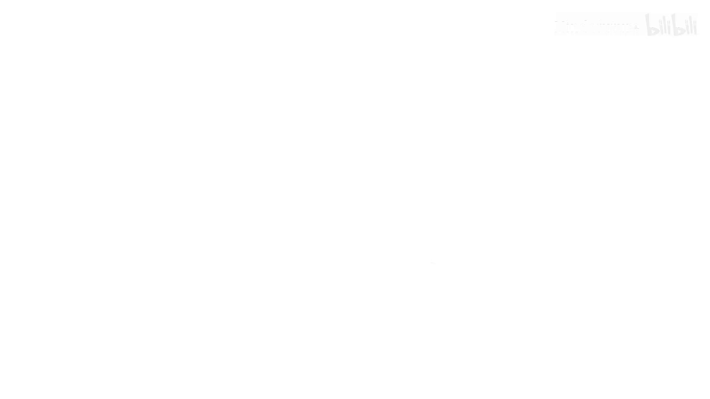
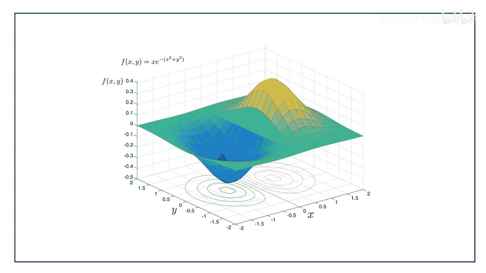
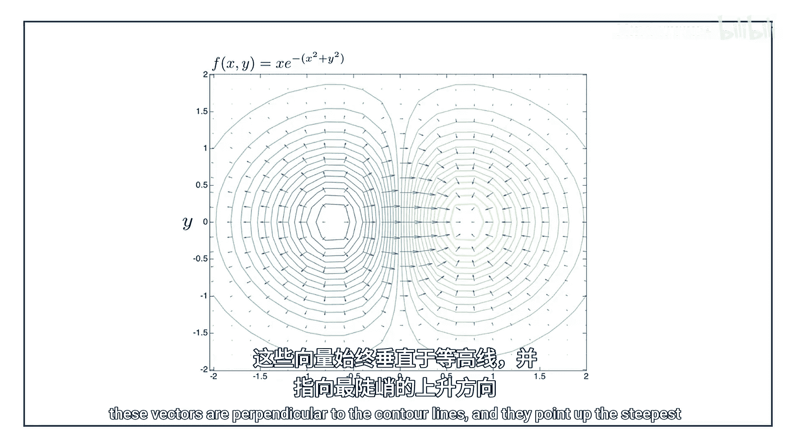
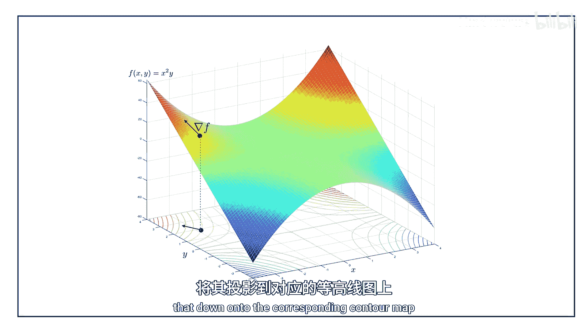
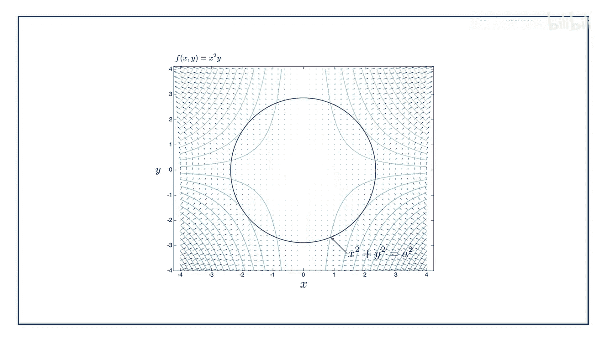
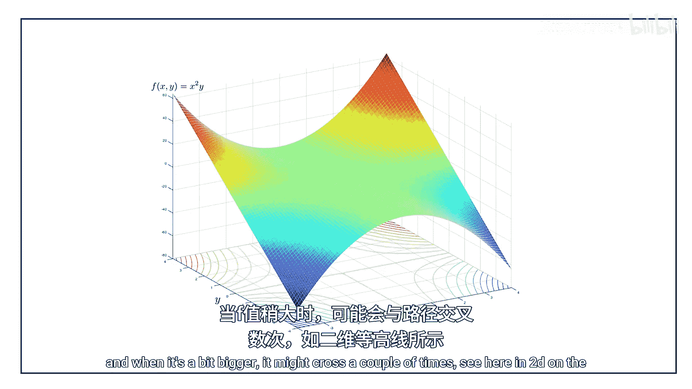
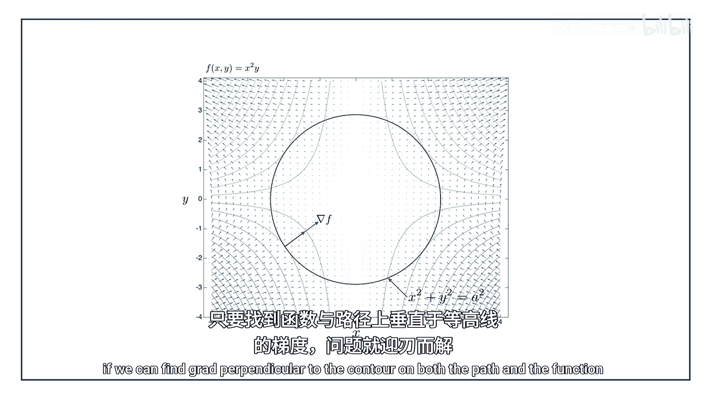
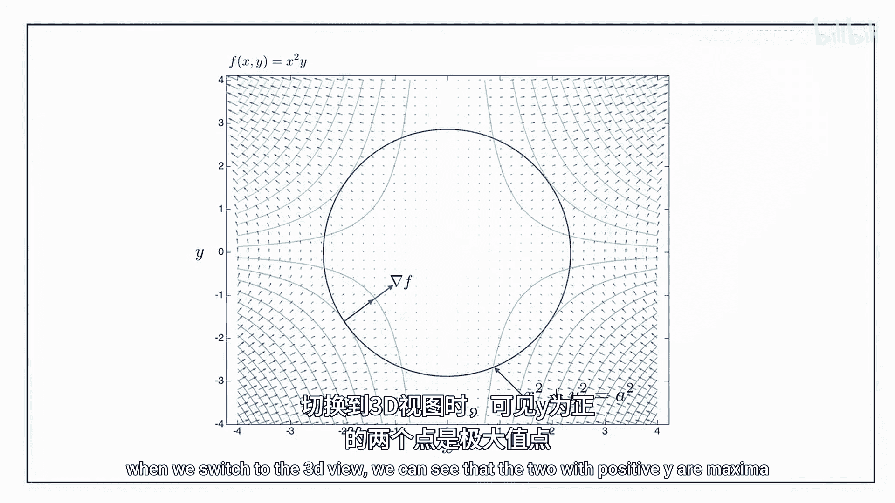
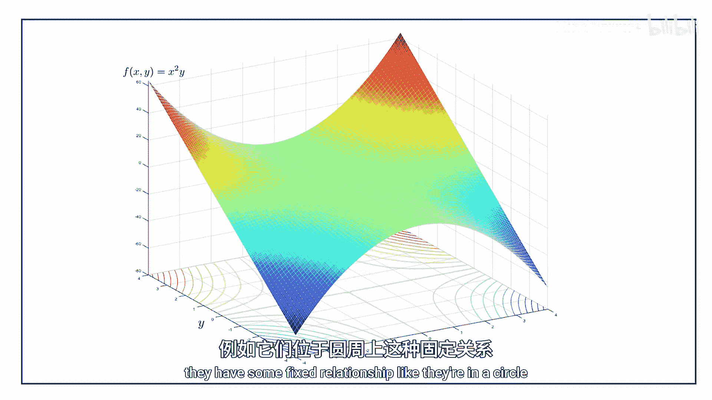

# 【帝国理工学院】机器学习数学：多元微积分 ｜ Multivariate Calculus Machine Learning p37 P37_约束优化_05_02_01 -BV1wnYDzmEdV_p37-

So we found out about grad， and that LED us on to sketch out a neat method for finding the minimum and maximuma of multiverbal functions。

 which we call gradient descent。In this video， we'll look at what happens if we want to find the minimum or maximum subject to some constraint。

 though we want to find the maximum somewhere along a line or something like that。

This is called the method using La Grande multiplies。

 So what we did in the last video is we looked at a function like this one。 F here。

 This function F is x times the exponential of minus x squared plus y squared。

 and it's one of the standard matlab examples。😊，And I've plotted below it here。

 a contour map of the valleys。

If I now plot just the contour map， I can plot out the vectors of grad F。 As we said。

 these vectors are perpendicular to the contour lines， and they point out the steepest gradient。

Now let's return to the function we were looking at last time， f equals x squared y。

 which is the Khan Academy standard example for this problem。

Last time we plotted GrdF on both a 3D version and then dropped that down onto the corresponding Con up。

Actually， it's going to be easier if we now just work with the contour map itself。

So here's the contour map。 And what I've done is I've used the gradient function in Matlab to just plot out the gradient perpendicular to the contours everywhere in the space。

😊，So the low sides are at negative Y down here and the high sides are it positive y up here。Now。

 what happens if I want the maximum value for this function F equals x square y。

 but constrain it to line a circle。 Where's the highest point anywhere on that circle。

So I have a circle of radius a squared， and I want to find the minimum maxima on that path as I go around that circle。

😊，Now， can imagine that describing an equation for how x squared y varies as I go around a circle part It iss going to be a complete nightmare。

 But that's not the question we are actually asked。 What we wanted to know was。

 what's the maximum along that circle， Not what's the value everywhere on the circle。

Now， La Grande was one of those French mathematicians。 His name is inscribed around the Eiffel Tower。

 And what La Grandrange noticed was that when the contours just touched the path。

 then you'll have found the maximum minimum point。That is F when F is a little bit smaller。

 it won't quite touch the path， See it here in 3D。 and when it's a bit bigger。

 it might cross a couple of times， see here in  TD on the contours。

But when the contour just touches， then we'll have found the minimum and maximum of the function F as we go down the path our circle in this case。

And what Lagoz noticed was that when the contour touches the path。

 then the vector perpendicular to the contour is in the same direction up to a minus sign as the vector of the path itself。

 that's perpendicular to the path。 So if we can find grad。

 we can find the minimum maximum points to solve the problem。

 If we can find grad perpenditicular the contour on both the path and the function， we're away。

So， we want to maximize。Fengsun。F of x， y。Which is equal to x squared y， subject to some constraint。

Which we're going to call the constraint equation G of X， Y。

And that's the equation of a circle x squared plus y squared， and it has some value。

 some particular value to the problem we want to solve of a squared。😊。

So what we're saying is if we've got the function doing something like this and it has。

 its grabbedd that way and the circle has some current path that's doing that and it's got its gra that way。

 What we're doing is we're solving。😊，Grad F is equal to lambda some number times grad G。

 where lambda is laggrange。Is La Grandrange is multiply or the lag Grande multiply。

And that's all we really need to do。 So we just need to set up this set of equations and then solve them。

 So if I take gra air。Is equal to the grad of x squared y。

While that's equal to if I differentiate for the DfDX， I've got 2 X， Y。😊，And if I take DFDY。

 the y just goes and I've got x squared。And I'm saying that that's equal to lambda times gra G。

Which is equal to lambda times。 if I differentiate G x squared plus y squared with respect to x。

 I've got2 x。 And if I differentiate it with respect to Y， I've got2 y。

And that's given me two equations of two unknowns， and I've got a third equation。

 which is the constraint equation itself that brings in the actual value of the circle I'm particularly interested in So I've just got to solve that。

😊，So if I take the first line， I've got2 x y is equal to lambda times 2 x。 I cancel the two x's。

 and therefore I've got y is equal to lambda。Straight out。 if I take the second row， the Y row。

 if you like， I've got x squared is equal to lambda times 2 y， but lambda is itself y。

 So that's equal to 2 y squared。 So I can say that x is equal to the square root of 2。Times y。

 And because I've done the square root， I've got a plus minus here。

And if I take the constraint equation itself， the third one。

 I've got x squared plus y squared is equal to a squared， but x squared is equal to 2 y squared。

 so that's equal to3 y squared。 So then if I square root that I can say that y is equal to a divided by the square root of3。

 And again because I've done the square root， I've got a plus minus。

So those are my solutions so I can write those out。And I've got the solutions are going to be。

A over the square root of three times if I take y is1， then x is root two times that。So route 21。

And I've got a over a root  three times root2 minus1 for y。And I've got all the possibilities。

 A over a root 3， minus root 2 and one。And I've got a over the square root 3 of minus root 2 and minus1。

Now， if I find the values of the function。F of x， y。As I go take all of those。

 So I've got to find x squared y for that。 So that's a cubed over3 root 3 because I'm cubing that bit in effect because they're both in x and y。

 And I've got x squared is 2 plus y is one times y is1。 So that's 2。Here I've got the same thing。

 but I've got what Y is negative。 So now I've got a cubed over 3 root 3。Times，-2。

This one's wise plus。 and when this squares the minus sign is going to disappear。

 So this is going to give be another plus solution to over3 root 3 a cubed。 and I've got here。

 here wise negative， so I'm going to get a minus here。A cube over 3 root 3。 So I've got a max。A max。

I've got a men。I've got a max， the way I've went out and another min。

 So I've got two positive solutions。 and I wanted to find the maximum。 So those are there。

 And I've got the minima as well for free。 So let's look at what that looks like now on the graph。😊。

So two of our solutions are here and two here。 When we switch to the 3D view。

 we can see that the two with positive y or maxima and the two with negative y are a minia。

 So that's really neat。 What we've done here is we've used our understanding of gradients to find the minia or maxima subject to some constraint equation like a straight line or a circle。

 And very often， we will want to make it that some of the variables in a function that we want to fit a fixed in relation to each other。

 They have some fixed relationship like they're around a circle。

 So this is a very handy thing to be able to do。 It's really useful。 So hopefully that was good fun。

😊。

