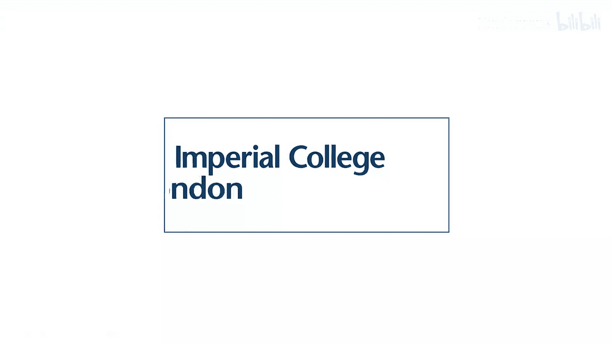

# 【帝国理工学院】机器学习数学：多元微积分 ｜ Multivariate Calculus Machine Learning p38 P38_下个模块见_05_03_01 -BV1wnYDzmEdV_p38-

This week， you've taken all the multivariable calculus you've done so far and looked at how to put that together with vectors and linear in algebra to do vector calculus。

We've been looking at optimization problems together， how to solve equations and optimize functions。

 for example， to optimize the fitter of a function to some data。

 we started off with the Newton Raftom method where we used the gradient to estimate how far we should step to get from a current guess to a solution to our next guess。

 and then we kept doing that until our estimate for the solution converge to an we were happy with。😊。

We then moved on to look at how to find the gradient in the multivariable case。

 We defined the gradient vector grad， which is perpendicular the contour lines and has elements equal to the differential of the function along each of the axes。

 the F D X， the F D Y， and so on。 and it has magnitude given by the size of grad to some of the squares。

 the elements。😊，We then figured out that we could use grad to go down a hill to find the minimum valleys of a function by taking little steps down the hill at a time。

 And that's really neat， because it means we don't need to evaluate the function everywhere and then find the minimum or solve the function using algebra。

 As long as we can find the gradient an initial estimate。

 we can just take steps down the hill until we find ourselves in the bottom of the valley。😊。

And this gradient descent method is probably the most powerful method for finding minimum that exists。

Finally， we looked at how to solve a problem subject to a constraint。

 we found that this would use to equating the gradient of the function to the tangent of the constraint。

 taking two gras and then solving the simultaneous equations。

 resulting from equating those two vectors。That was the La Grande multiplieries method。

So this is really neat。 The big picture is we've learned how to optimize functions。

 and we've taken ourselves from the realm of doing algebra to the realm of solving problems with computers。

😊，In the next module， what we'll do is we'll move on to look at how to fit functions to data using what's called the least squares method。

😊。

