# 【帝国理工学院】机器学习数学：多元微积分 ｜ Multivariate Calculus Machine Learning p39 P39_简单线性回归_06_01_01 -BV1wnYDzmEdV_p39-

So this week we're finally going to apply all this multivariate calculus to help us fit functions to data。

This is really handy。 It allows us to make sense of our data to start doing statistics testing and to start to really apply all of this stuff we've been doing into the real world。

If you have some big bundle of data， the first thing you need to do is to clean it up other courses on this。

 but the first thing you need to do is clean it up to get it into shape to start doing the maths with that means figuring out what a sensible thing to do is with things like partially empty data entries zeros。

 those sorts of things to figure out if you can do any dimensionality reduction by binning or grouping the data together eliminating duplicates。

 garbage data all those sorts of things often the easiest thing to do is to tag all of your data so that you can reorder them and put them back in whether you've change the order then sort them and look for funny values and then figure out what to do with those to get rid of them all or to replace them with something sensible and then once you've cleaned it up。

 you can start graphing it take averages， look at standard deviations and all those sorts of things。

Of course， in doing this， it really helps if you're interested in the data。

 you need it to be kind of like a person that you want to figure out and understand until it becomes an old friend。

If over time as you collect more data and it starts to change。

 you want to get to the point where you're gonna notice those changes， actually。

 So you really want to get it intimate and friendly with your data。

Once you've graphed it in a sensible way， you'll often get a plot like this guy here。

 which is a simple X Y plot of some data。 This data seems to plot like a straight line。

 If you know something physically about the processes involved in generating the data or if you have some hypothesis as to how the variables are related。

 then you can try and fit that model to the data。Alternatively。

 you can just try fitting something sensible based on how it looks like a straight line to this data here。

 for example。😊。

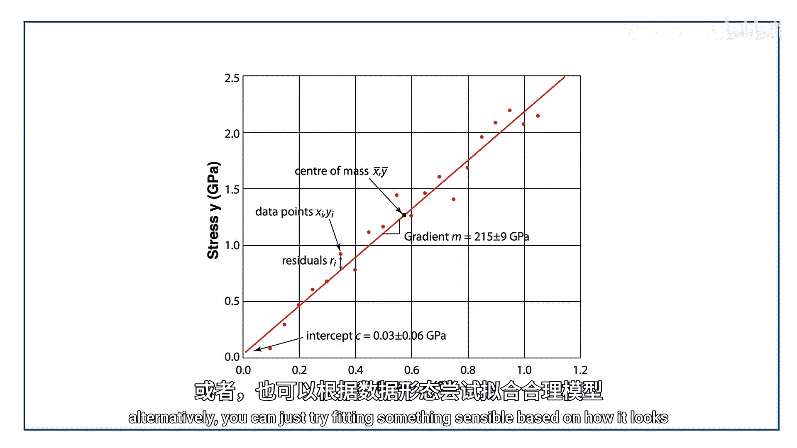

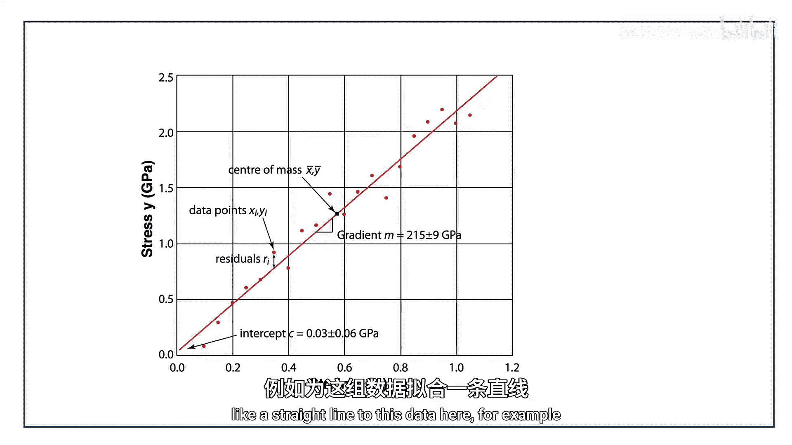

Now I can model my straight line Y here as being a function of the I observationss Xi and a vector A of the fitting parameters。

😡，In the case of a straight line equals y equals m x plus C。

 then the parameters in the vector A would be the gradient M and the intercept C of the straight line。

So here I've plotted the optimal straight line for this data。

 it happens to have a gradient of 215 gigappaal GPA and in an intercept of 0。3 GPA for C。

I can also find the mean of X X bar and the mean of Y Y bar。

 which are at the geometric center of mass of that data set。Now。

 in order to find the optimal value of M and C， let's first define a residual R。

 which we define as the difference between the data items。

 Yi and the predicted location of those on the line at Y， which would be Mx plus C。

 so R is Y I minus Mxi minus C。😡，Then I can take a measure of the overall quality of the fit being a quantity I'll call chi squared。

 which is the sum of the squares the residuals are。

 I do this so that I penalise both data that are above and data that are below the line。

 I don't want the pluses and minuses to net off against each other。Also。

 I really want to badly penalize data items that are a long way away from the line。

 And then I'm going to try and find the best chi squared possible。 the one that's lowest。

 I'm doing a minimization。

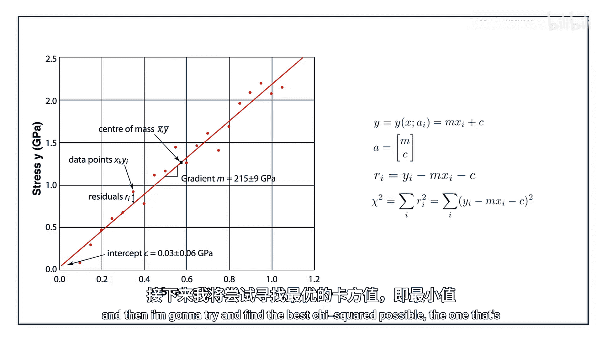

So now it's worth plotting out what chi square is going to look like for lots of different possible valuess of M and C。

 which is what I've done on this contour plot here。

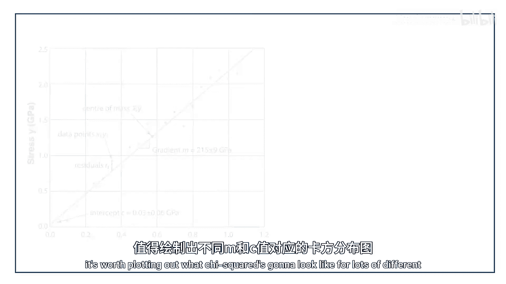

In the middle at about 215 and near an intercept of 0， I find my minimum。

 And the further I get away from those， the worse it is。 And note that in terms of chi squared。

 it's slanted， there seems to be some kind of trade off。

 The bigger C gets the lower the optimum value of the gradient M and vice versa。

And if I look on this plot， Es its so obvious if I make the line steeper on the original fit。

 then in order for it to fit， well， the intercept' is going to have to get smaller， actually。

 I'm pivoting about the center of mass。😊，And also， this shallow trough here in the chi squared value is gonna to be really quite shallow。

 So this is actually gonna to be quite a tricky problem for a steepest tocent algorithm。

 It's gonna to be easy to get down the size， but it's gonna to be difficult to get down the bottom of the valley to find the actual minimum。

But nevertheless， it looks like it's going to be quite an okay problem to solve。

 it has one easy to spot minimum， and therefore we can find it。😊。

A note that to do this with any precision， if I do it simply by doing lots of computations here like I've done for different Ms and C's and finding the minimum that way。

 plotting it all out， finding the minimum on this graph to do this， I have to a lot of math in Matla。

 this contour plot took about 200000 computations to make。😊，So even for a simple problem like this。

 we really do want to find an algorithm that's going to let us get there a bit more efficiently。 Now。

 the minimum is going to be found when the gradient of chi squared is 0。

 So if we just take the grad of chi squared with respect to the fitting parameters and set it to 0。

 that's going to be our solution。😊，Now， the neat thing is that in this particular case。

 we can actually solve this problem explicitly。 So that's what we're going to do in this video but then we'll go on to see how to do it by linear descent and then we'll find a better algorithm and then we'll explore how to do this sort of problem where it's not so easy to do explicitly。

😊，So if we differentiate the first row with this spec to M。

 then the first thing to worry about is all these sums over the data item's eye。

But actually it turns out that we don't need to worry about these sums because we're not differentiating the X I or the Yi themselves。

 So they'll just sit benignly in the sum。 You know。

 Mx1 plus Mx2 plus Mx3 is the same as if we differentiate that respect to M it we just get x1 plus x2 plus x3。

So we don't have to worry about those sums。😊，And then it's easy right。

 we differentiate a square that drops in power by one and we multiply by two。

 and then we take the differential of the inside of the bracket which respect respect to M is minus Xi。

😊，We can then take that that minus-2 outside of the sum altogether， in fact。For the second row。

 it's easier because the differential to the inside of the bracket with a respect C is just minus1。

 so we just get the two down for the power and the minus sign and so it all looks quite easy。😊。

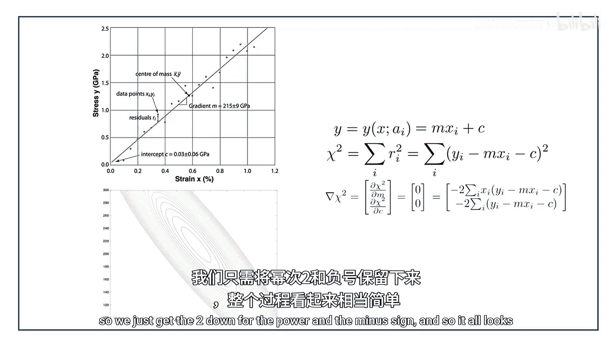

Keeping on looking at the second row， then the sum of C times the number of data items we can take out of the sum altogether。

And then we've got got the sum of the YI's and the sum of m times the X's。

 and if we divide that through by the number of data items。

 we get our result that C is going to be y bar minus M times x bar y bar and x bar being the average。

We can carry on in that way and generate an answer to M， which I'm just going to leave here。

 I don't think there's any point in showing all the mass to you blow by bo。😡。

It's a bit trickier to see， and I'm not going to go through actually the maths and the derivation。

 but you can also find estimates for the uncertainties in CM， which I've put up here。

 which I'll call Sigma C and Sigma M。AndIt's very important actually。

 when you're doing a fit to get an idea of the uncertainties in those fitting parameters and to quote those in your fit so I'm just going to leave those here in case you need to use them。

😊。

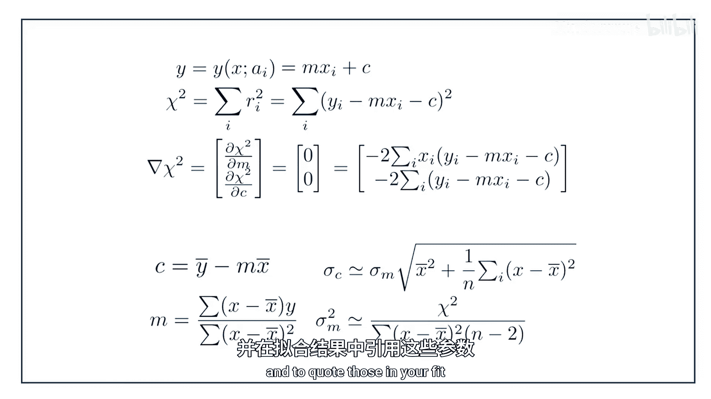

So coming back to our fitted data， we can plot it out again here。

 Now the amazing thing here is just how accurate this sort of fitting really is。 It's really cool。

 You know， we've got quite noisy data， but an a gradient of 215。

 but the uncertainty is only9 it's about 5%。 It's really amazing。

 Now you should always plot your fit and visually compare it just as a sanity check and we can see why this is a good idea here。

 This is Anscomb's famous quartet。 you can find the graph on Wikipedia。😊。

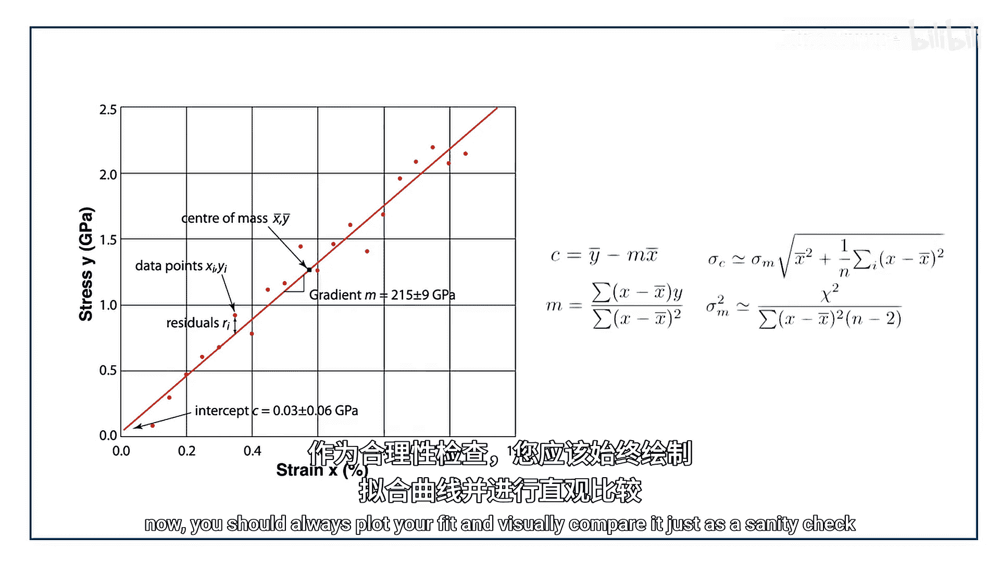

All these four data sets have the same chi squared means。

 best fit lines and uncertainties in the fitting problems。

 but they are obviously very different data。 in the right hand， two cases。

 probably fitting a straight line is just the wrong thing to do。 The bottom left。

 if you remove the flyer data point， the gradient is different and the intercept。

 it's only the top left where the fits actually doing the right thing altogether。😊。

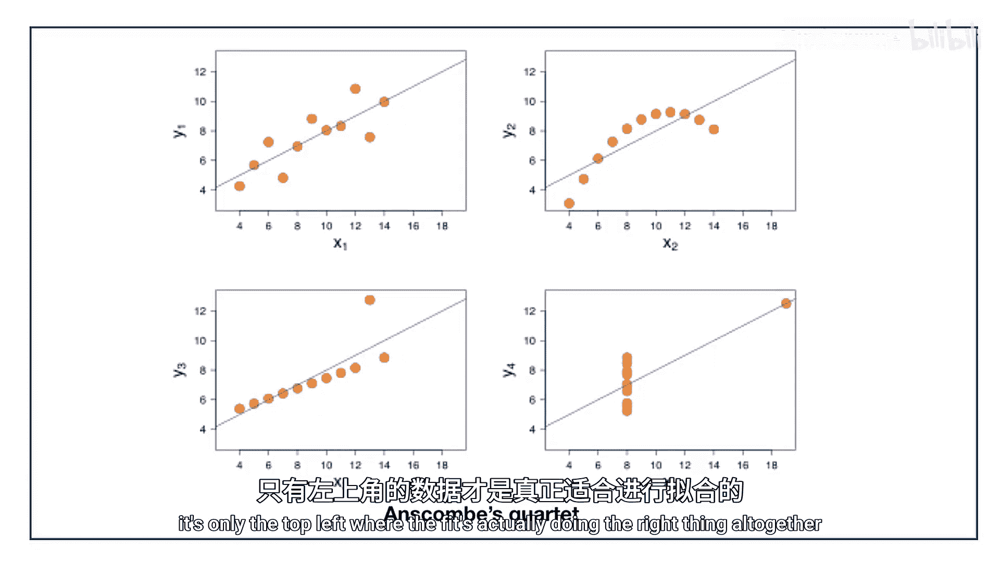

And there's another subtlety actually， we go back and look at C the intercept。

 we can see that the intercept depends on the gradient M。

 is what we said earlier when we looked at a lot of chi squared。😊。

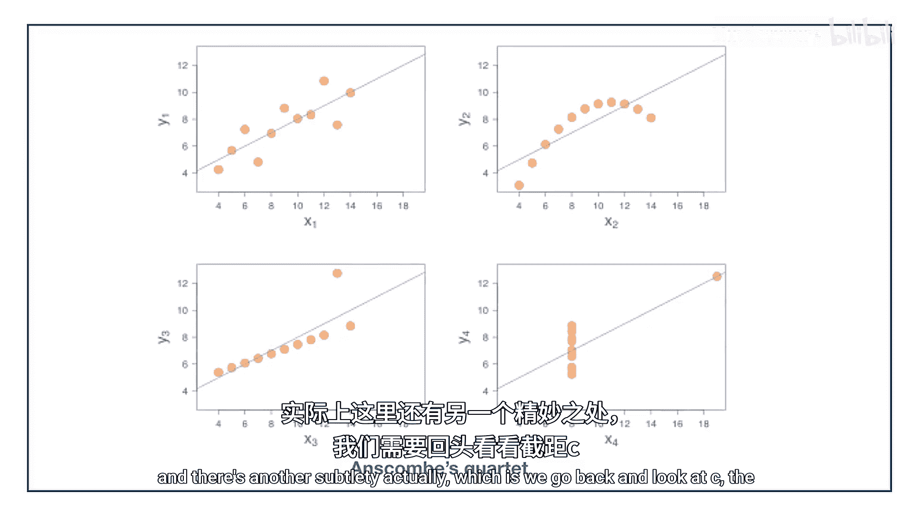

Now there's a way to recast the problem， which is to look at the deviations from the center of the mass of the data X bar instead。

 and then the intercept B now rather than C is the location of the centre of mass in Y at Y bar。

And then the constant term in the fit B， that constant B doesn't depend on the gradientding anymore。

 and neither therefore does its uncertainty include a term from the uncertainty M。In fact。

 if I plot out the contour plot for chi square when I do that， I find that it then isn't slanted。

 It's a nice sort of circular looking thing because I've removed the interaction between M and the constant term。

 So it's a mathematically much more reasonable， well postulated problem so。

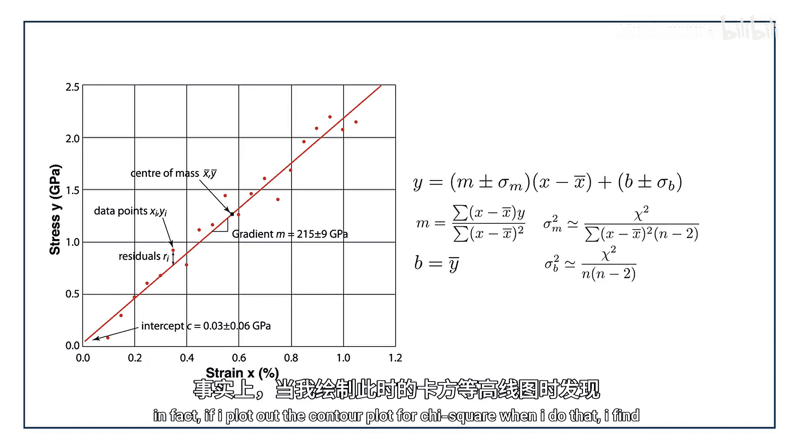

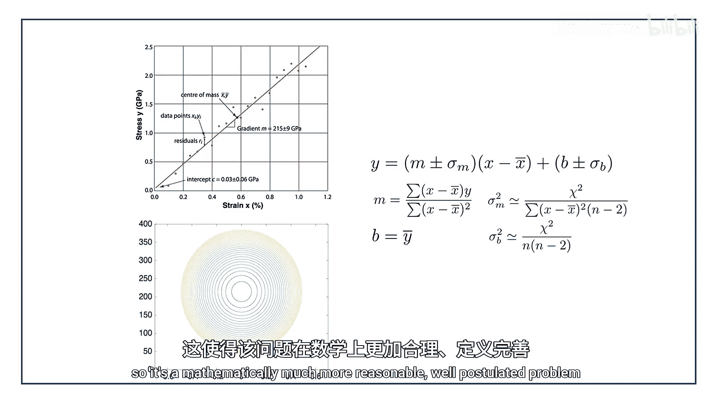

NowThat's the essence of regression of how to fit a line to some data。

 And this is a totally really useful life skill， almost whatever your professional job。

 What we'll do in the next couple of videos is look at how to do this in more complicated cases with more complicated functions and how to extend the idea of regression to those cases。

😊，The main thing really that we've defined here that's important to remember is this goodness of fit estimator chi squared。

 the sum of the squares， the deviations of the fit from the data。

 and chi squared is going to be really useful to us going forward。😊。

