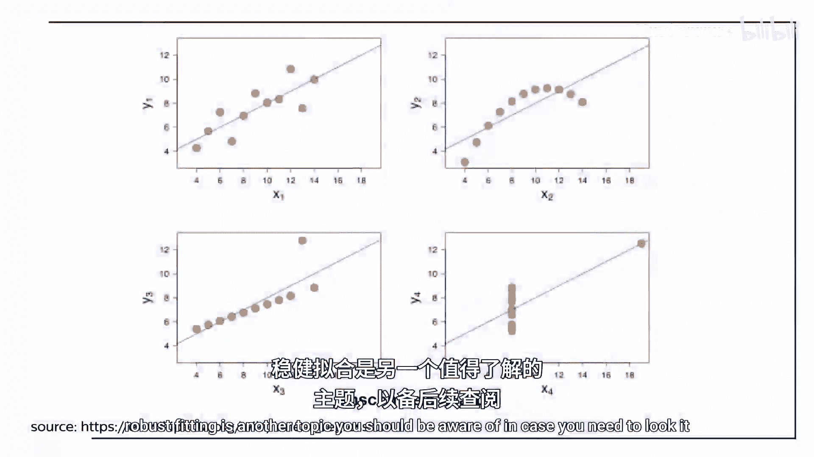
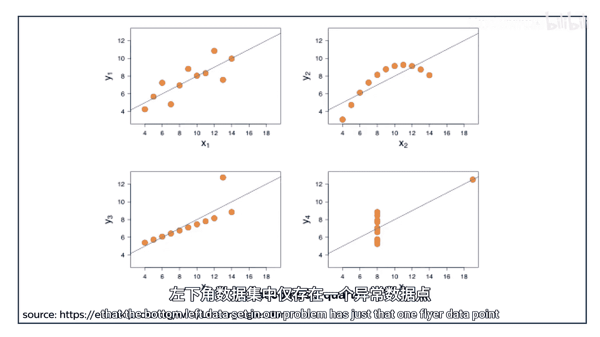
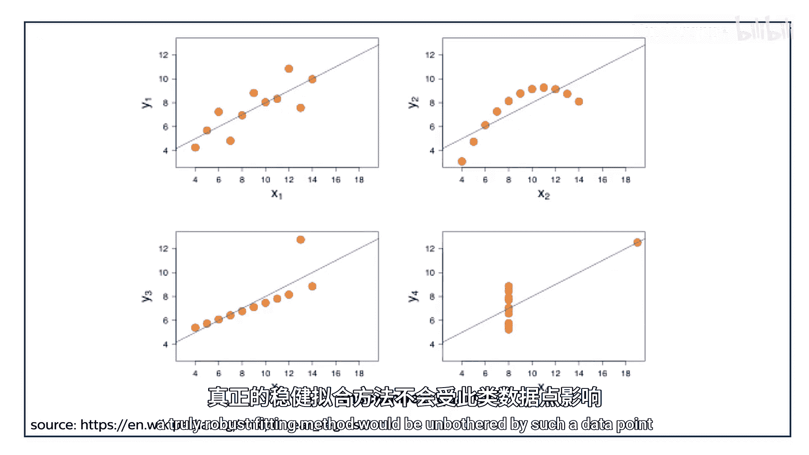
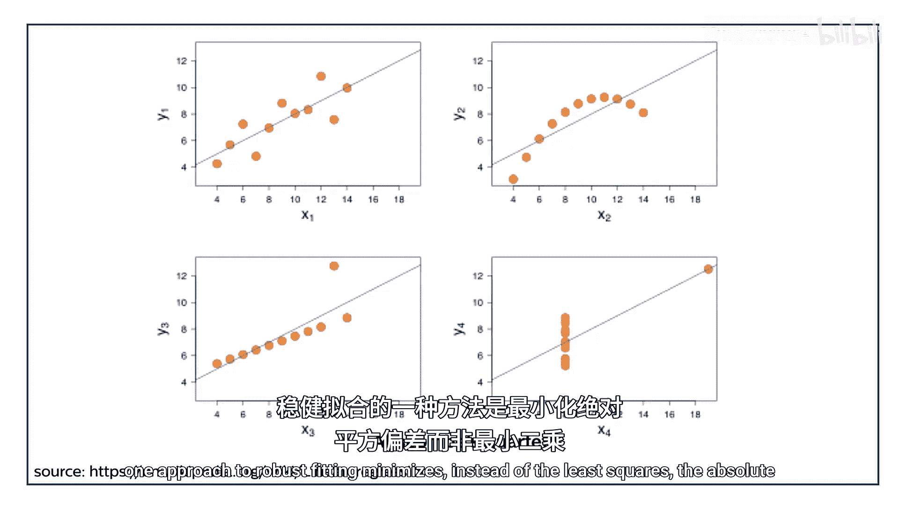
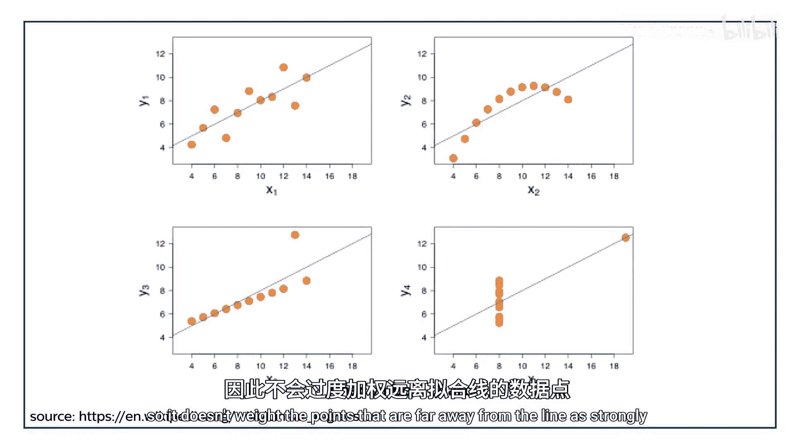
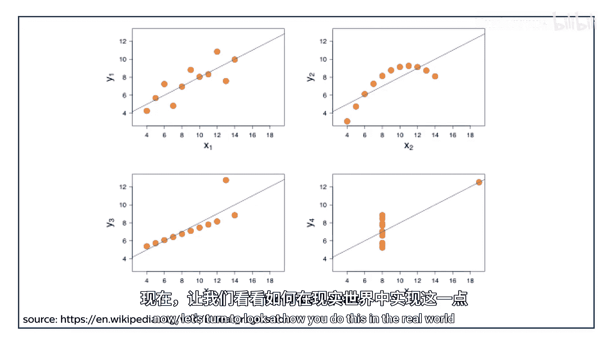

# 【帝国理工学院】机器学习数学：多元微积分 ｜ Multivariate Calculus Machine Learning p41 P41_实践中进行最小二乘回归分析_06_02_02 -BV1wnYDzmEdV_p41-

In this video， we're going to make some final comments on the least squares regression fitting of data。

 and we're going to look at how we really do this in anger in the world using computational tools like MAAb or Python or R。

😊，So you've made a gradient dely squares minimizer and then used that to solve the sample pit problem already。

😊，There are few comments to make before we move on。 In reality。

 there are a huge number of solvers for nonlinear least squares problems。

we can observe that if we do a Taylor series expansion of Chi squared， then the second term。

 the second derivative is the Hessian， which gives us information about the curvature or the gradient of the gradient。

 the gradient of the Jacobian。😊，And therefore we can shoot directly for where the Jacobbin is zero。

 just as in Newton Rason using that second derivative。😊，Now。

 using the hessum would be faster than simply taking steps along as steep as disscent algorithm。😊。

Effectively， we'd be using the Hassian to give us a guess as to the size of the step we should take in gradient descent。

😊，The problem is， is that often the hessian isn't very stable， especially far from the minimum。

So the Leavenburg Marquap method uses steepest descent far from the minimum and then switches to using the Hessian as it gets close to the minimum based on a criteria as to whether Kis scared is getting better or not。

 if it's getting better， it uses the Hessian。 and if it's in trouble， it uses steepest descent。

There is also the Gaus Newton method and the BFGS method amongst many others that either use the Hessian directly or build up information about the Hessian over successive iterations。

😊，And depending on the convergence， then different methods may be better than others。

Robust fitting is another topic you should be aware of in case you need to look it up later。

If we come back to Anskin's quartet here， we see that the bottom left data set in our problem has just that one flyer data point。

 a truly robust fitting method would be unbothered by such a data point。

One approach to robust fitting minimizes instead of the least squares。

 the absolute are the square deviations， so it doesn't weight the points that are far away from the line as strongly。

 and that means it fits a little bit what visually looks a bit better。😊。

Now let's turn to look at how you do this in the real world。😡。

In MATLb， it's easy， you simply import your data using the Iport data tab at the top of the screen and then flick over to the apps tab and start curvefi。

 the curvefitting app。😊，There you can even symbolically define your own algorithm。

 you have to pick a starting guess and it will fit your function for you。

Or you can use a prebuilt function that already knows itss Jacobbians and will therefore be faster and more efficient。

😊，In Python， it's very nearly as simple in the scientific Python SP set of modules。

 the Opimr module includes a least squares curve fitting minimizer curve fit。

 which is at the link below this video。😊，Accompanying this video。

 we've left you one of the SP examples for fitting some data so you can see how to use it。

 This is it。 and it's amazing。 The fitting takes really works very well。

 produces this nice graph here of this apparently noisy data with this crazy function。

 and the fitting only takes three lines， the three bold ones here， two lines to define the function。

 and one line to do the fit。 The rest of that code is all about plotting it and importing the data and everything else while generating it in this case。

 actually。😊，Effectively， this set of routines in Cpe is the modern implementation of what's called MinPAak。

 which was a fourran set of routines published by Jg Moray in 1980 and described in the book Newmerco recipepes。

😊，And it's absolutely astonishing how easy it is to do this stuff now， you know。

 when I was a student， you were reduced to reading this long。

 difficult textbook now you just effectively write one line in Python。😊。

Just as in Python in the R statistical programming language。

 there is also a minir for doing nonlinear least square fitting of models to data。

So if you like R for looking at data， you can also do all this stuff just as easily in R。😊。

So what I want you to do now is write a Python code block to fit the Gaussian distribution shown here。

You'll need to give it a starting guess and we give you the input data for the height distribution in the population。

 this is the final height distribution data set that we've been talking about schematically all the way through these two courses。

😊，And what you'll find is that the mean height B here is about 178 centimeters and the characteristic width of this distribution is about 11 centimeters。

😊，that's parameter C in the equation here。Now， it's useful at this point to think about why we need to have the starting guess。

 If we started with a guess here for the mean of 100 centimetres。

 the model curve wouldn't overlap with the data at all。 So when we did a little move to be。

 We get no change。 and therefore， the gradient of chiis squared with respect of the mean B would be 0。

 So the algorithm wouldn't know what direction to go in。

 We wouldn't get a sensible answer for the Jacobian or for grad。 And therefore。

 our algorithm wouldn't know where to go to find the minimum。So in doing any of this data fitting。

 it's vital to come up with a good means for generating a starting guess。😊，Here it's easy。

 you pick the biggest value， for instance。😊，Not coincideally。

 it's also equally important to compare the fit to the data and ask if you believe the final fit。

What we've done in this video is we've finished our little discussion of using vectors of multivariate calculus together to help us do optimizations of functions and to fit data to functions。

 And it's turned out in the end to be really easy computationally。

 We can fit functions in just a few lines of code in Python or Matlab or R。😊，But now。

 after all this work， you understand something of how those algorithms work under the hood。

And that means that hopefully you'll be much better off at figuring out how to fix them when they go wrong。

 for instance， whether Jacobian doesn't make any sense。And also。

 you've got all the maths you need to access the next course in this specialization on machine learning。

😊。