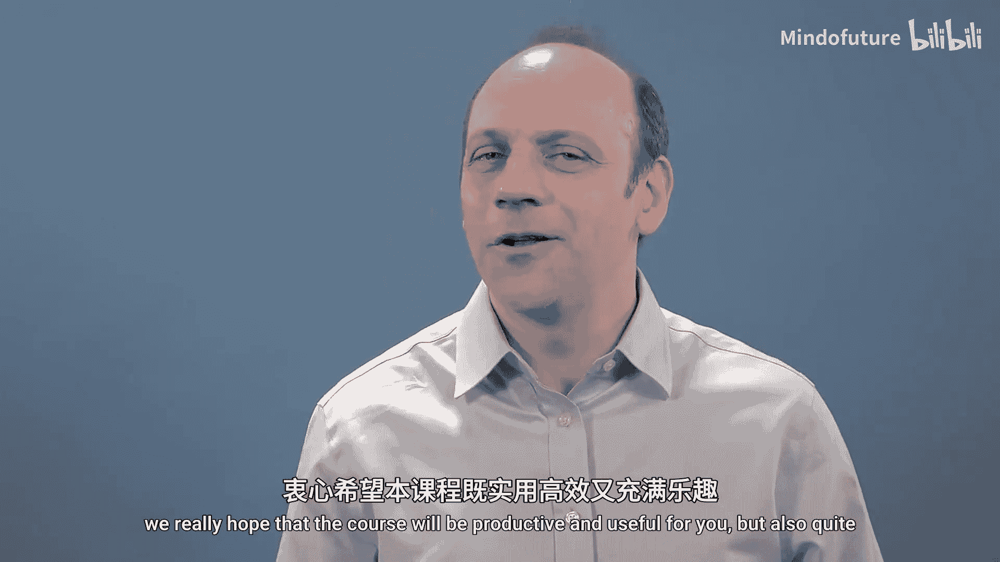
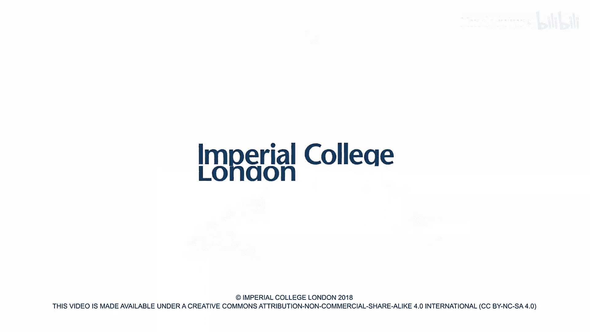

# 【帝国理工学院】机器学习数学：线性代数 ｜ Linear Algebra Machine Learning p01 P_01 介绍 - 用数学解决数据科学挑战_01_01_01 -BV1AJYDzEESM_p1-

Hi there， I'm David Dye and welcome to the Mathematics for Machine Learning Specialization。😊。

Before we get stuck in， let's set the scene。 Mach learning is a set of powerful mathematical tools that enable us to represent。

 interpret and control the complex world around us。😊，However。

 even just the word mathematics makes some people feel uneasy and are welcome to explore the topic。😊。

The purpose of this specialization is to take you on a tour through the basic maths。

 underlying these methods， focusing in particular， on building your intuition。

 rather than worrying too much about the details。Thanks to the amazing machine learning community。

 it's actually possible to apply many powerful machine learning methods without understanding very much about the underpinning mathematics by using open source libraries。

😊，This is great， but problems can arise and without some sense of the language and meaning of the relevant maths。

 you can struggle to work out what's gone wrong or how to fix it。😊。

The ideal outcome of this specialisation is that it will give you the confidence and motivation to immediately dive into one of the hundreds of brilliant applied machine learning courses already available online and not be intimidated by the matrix notation or the calculus。

😊，We want to open up machine learning to as many people as possible and not just leave all the fun to computer scientists。

This first course offers an introduction to linearar algebra。

 which is essentially a set of notational conventions and handy operations that allow you to manipulate large systems of equations conveniently。

😊，Over the next five modules， we'll be focusing on building your intuition about vectors and transformations through the use of quizzes and interactive widgets。

 as well as occasionally asking you to fill in the gaps in some Python coding examples。😊。

In the final module， Doctor Sam Cooper will bring it all together by showing you how linear algebra is at the heart of Google's famous page rank algorithm which is used for deciding the order of web pages in search results。

😊，Hopefully， if you find this course useful， you'll stick around for our follow on course。

 where Sam and I will introduce you to multivariate calculus。 Then in our other course， Doctor。

 Mark Dnroth will introduce principal component analysis。😊，So welcome。

 we really hope that the course be productive and useful for you， but also quite a lot of fun。

 and I look forward to hearing from you in the forum。😊。

