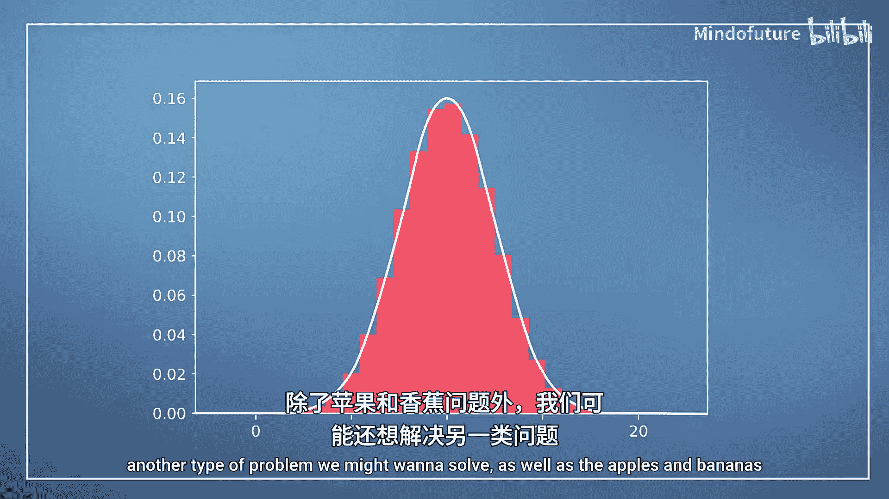
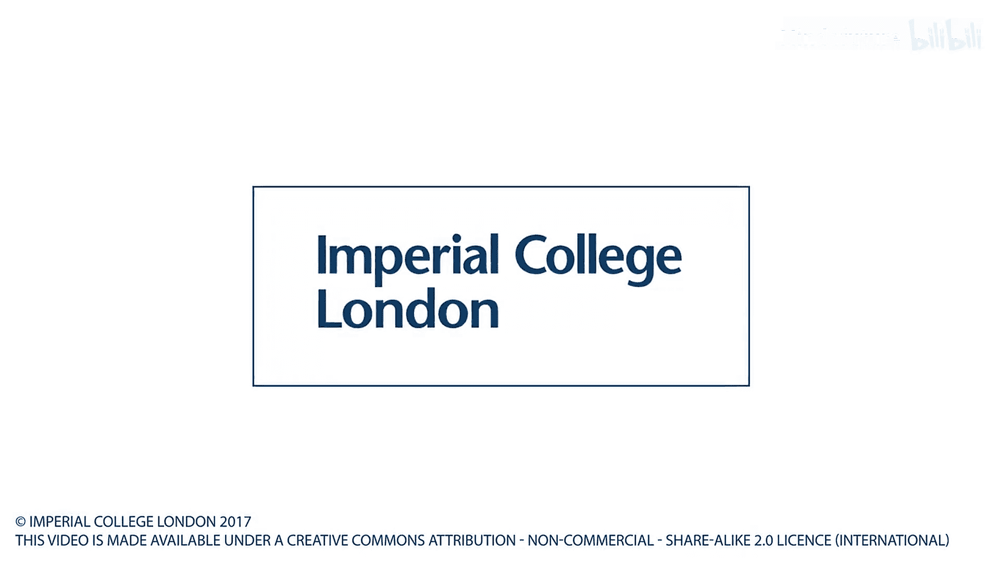

# 【帝国理工学院】机器学习数学：线性代数 ｜ Linear Algebra Machine Learning p02 P02_线性代数的动机_01_02_01 -BV1AJYDzEESM_p2-

In this video， we're going to look a bit more at the types of problems we might want to solve and expose what linear algebra is and how it might help us to solve them。

The first one I might think of is one of price discovery。

 say I go shopping on two occasions and I buy apples and bananas。

 and the first time I buy two apples and three bananas and they cost 8s。And the second time I buy。

 say 10 apples and 1 banana and the cost is 13s and the A's and the B's here are the price of a single apple in the single banana and what I'm going to have to do is solve these what are called simultaneous equations in order to discover the price of individual apples and bananas。

Now， in the general case of lots of different types of items and lots of shopping trips。

 then finding out the prices might be quite hard。 It might be quite difficult to solve all of these equations by hand。

 So we might want a computer algorithm to do it for us in the general case。Now。

 this is an example of a linear algebra problem。 I have some constant linear coefficients here。

 These numbers，2，10，3，1。That relate the input variables A and B to the output 8 and 13。And that is。

 if I think about a vector AB that describes the prices of apples and bananas。

Then this gets translated into a cost if I know how many them I want to buy it and the cost happens to be 8 on the first trip and 13 on the second trip。

And I can write this down as a matrix problem where the 2，3 is my first trip and the 10。

1 is my second trip。 and then these are then matrices。 That's a matrix then。

 and these are vectors and what we're going to do over the course of modules 1 to3 is build up looking at these different types of mathematical objects and understanding what they are and how to work with them these vectors and these matrices and then we'll come back and figure out how to solve this problem in the general case。

 Another type of problem we might be interested in is fitting an equation to some data。😊，In fact。

 with neural networks and machine learning， we want the computer in effect not only to fit the equation。

 but to figure out what equation to use。That's a highly inexact description， really。

 of what's going on， but it gives the right sort of flavor。

But let's say we have some data like this histogram here。

 this looks like a population with an average and some variation here， some width。😊。

Another type of problem you might want to solve， as well as the apples and bananas problem。

 is how to find the optimum value of the parameters in the equation describing this line。

 the ones that fit the data in the histogram best。

That might be really handy then using that equation。

 we'd have an easy portable description of the population we could carry around without needing all the original data。

 which would free us out， for example， from privacy concerns。😊，Now。

 we could plot how good the fit was in terms of the parameters。

 And that's what we'll look at in the next video。 In this video。

 we've set up two problems in this first module on Lydia algebra。😊，First。

 the problem of apples and bananas of solving simultaneous equations。And secondly。

 the optimization problem of fitting some data with an equation with some fitting premises。

And these problems will go on to look at and motivate our work right through the course on linear algebra and its partner with multivariate calculus。

