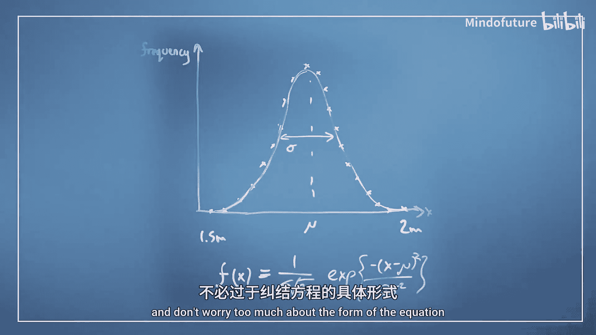

# 【帝国理工学院】机器学习数学：线性代数 ｜ Linear Algebra Machine Learning p03 P03_掌握向量_01_02_02 -BV1AJYDzEESM_p3-

So the first thing we need to do in this course on linear algebra is to get a handle on vectors。

 which will turn out to be really useful for us in solving those linear algebra problems。

 that is the ones that are linear in their coefficients such as most fitting parameters。

We're going to first step back and look in some detail at the sorts of things we're trying to do with data and why those vectors you first learned about in high school were even relevant。

😊，And this will hopefully make all the work with vectors a lot more intuitive。😊。

Let's go back to that simpler problem from the last video。

 the histogram distribution of heights of people in the population。

 you know there aren't many people above about2 meters， say。

 and there aren't really very many people below 1。5 meters。嗯。

Same we wanted to try fitting that distribution with an equation describing the variation of heights in the population。

And let's say that equation has just two parameters。

 one describing the center of the distribution here。

 and we'll call that mu and one describing how wide it is， which we'll call sigma。

So we could fit it with some curve that had。Two parameters。啊。Mux and sigma。

 And I I would use an equation like this。 I， I'd call it F of x， some function of x。

 where x is the is the height is equal to one over sigma root 2 pi。Times。

The exponential of minus x minus mu。Squared， divided by two sigma squared。

So this equation only has two parameters， sigma here， a mu， and it looks like this。😊。

And it has an area here of one because there's only 100% of people in the population as a whole。

 And don't worry too much about the form of the equation。 This one happens。

 This is called the normal or Gaussian distribution。

 and it's got a centre of mu and a width of sigma and it's normalized so that its area is one。

Now， how do we go about fitting this distribution， That is finding mu and sigma or the best possible mu and sigma that fits the data as well as is possible。

Imagine that we had guessed that the width was wider than it really is。

 but keeping the area at one so if we' guess that it was a fatter and probably a bit shorter distribution。

 something like that。Soy， so this one has something like that。 This one has a wider sigma。

 but it's got the same mu。It'd be too high at the edges here and too low in the middle。

So then we could add up the differences between all of our measurements and all of our estimates。

 we've got all of these places where we underestimate here and all of these places where we overestimate here。

😊，And we could add up those differences， or in fact。

 the squares of them to get a measure of the goodness or badness of the fit。

 And we'll look in detail at how we do that once we we've done all the vector's work and once we've done actually all the calculus work。

 then we could plot how that goodness varied as we change the fitting parameters。

 Sigma and mu and we get a plot like this。 So if we had our correct value。

 our best possible value for mu here and our best possible value for the width sigma here。

 we get we could then plot for a given value of mu and sigma， what the difference was。

 So if we were at the right value， we'd get a value of goodness where the sums of the squares the differences was not。

 And if mu was too far over， if we had misestimated mu and we got the distribution is shifted over。

Either width was right， but we had some wrong value of mu there。

 that wed get some value of all the sums of the squares and the differences of our goodness being some value here that was higher。

 And it might be the same if we went over the other side， and we had some value there。

 And if we were too wide， we'd get something there or too thin， it would。

 we'd get something that was too thin like that。 something like that。

 say So we'd get some other value of goodness。 And we could imagine plotting out all of the values of where we had the same value of goodness or badness for different values of mu and sigma。

 And we could then do that for some other value of badness。

 and we might get a contour that looked like this and another contour that looked like this and so on and so forth。

Now， say we don't want to compute the value of this goodness parameter for every possible mun sigma。

 We just want to do it a few times and then find our way to the best possible fit of all。

So say we started off here with some guests that was too big a mu and two smaller width。

 We thought people were taller than they really are and that they were tighter packed in their heights than they really are。

 Well what we could do is we could say， well， if I do a little move in mu and sigma。

 then does it get better or worse。 And if it gets better。 while we'll keep moving in that direction。

 So we could imagine making a vector of a change in mu and a change in sigma and we could have our original mu and sigma there we could have a new value U prime sigma prime and ask。

 if that gives us a better answer if it's better there or if mu mu prime sigma prime took us over here if we better or worse there。

 something like that。Now， actually， if we could find what the steepest way down the hill was。

 then we could go down this set of contours， this sort of landscape here towards the minimum point towards the point where we get the best possible fit。

 and what we're doing here， these are vectors。 These are little moves around space。

 they're not moves around a physical space， they moves around a parameter space。

 but it's the same thing。 So if we understand vectors。 and we understand how to get downhis。

 that sort of curvness of this value of goodness that's calculus。

 then once we've got calculus and vectors， we'll be able to solve this sort of problem。

 So we can see that vectors don't have to be just geometric objects in the physical order of space。

 they can describe directions along any sorts of axes。

 So we can think of vectors as just being lists。 if we thought of the space of all possible cars。

 for example。 So here's a car。 there's its back， there's its window， there's the front。

 something like that。 there's a。There's the window We could write down in a vector。

 all of the things about the car， we could write down its cost in euros。

 we could write down its emissions performance in grams of CO2 per 100 kilomet。

 we could write down itsnx performance you know how much it polluted our city and kill people due to air pollution。

 we could write down its euro endcap star rating， how good it was in a crash we could write down its top speed and write those all down in a list that was a vector。

😊，That'd be more of a computer science view of vectors。

 whereas the spatial view is more familiar from physics。In my field metal。

 I could think of any alloy as being described by a vector that describes all of the possible components。

 all the compositions of that alloy。 Einstein， when he conceived relativity。

 conceived of time as just being another dimension。 So space time is a four dimensional space。

 three dimensions of meters， and one of time in seconds。

 And he wrote those down as a vector of space time of X， Y， Z。😊，And time。She called space time。

 When we put it like that。 It's not so crazy to think of the space of all the fittingretting parameters of a function。

 And then a vectors as being things that take us around that space。

 And what we're trying to do then is find a location in that space where the badness is minimized。

 The goodness is maximd and the function fits the data best。😊。

If the badness surface here was like a contour map of a landscape。

 we're trying to find the bottom of the hill。 the lowest possible point in the landscape。

 So to do this well， we'll want to understand how to work with vectors and then how to do calculates on those vectors in order to find gradients in these contour maps and minima and all those sorts of things。

 Then we'll be able to go and do optimizations， enabling us to go and work with data and do machine learning and data science。

So in this video， we've revisited the problem of fitting a function to some data。 In this case。

 the distribution of heights in the population。What we've seen is that the function we fit。

 whatever it is， has some parameters， and we can plot how the quality of the fit。

 the goodness of the fit varies as we vary those parameters。

Moves around these fitting parameter space。 So then just vectors in that space of fitting parameters。

 and therefore we want to look at and revisit vector maths in order to be able to build on that and then do calculus and then do machine learning。

😊。

