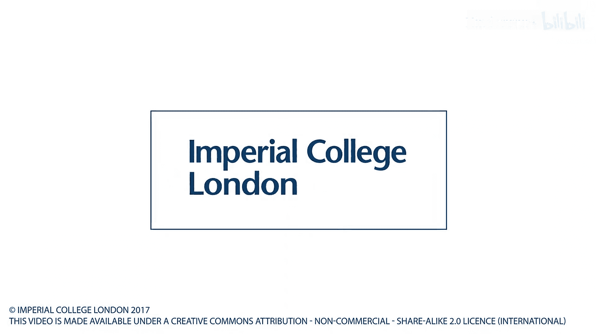

# 【帝国理工学院】机器学习数学：线性代数 ｜ Linear Algebra Machine Learning p05 P05_总结_01_04_01 -BV1AJYDzEESM_p5-

So in this first module of our course on linear algebra。

 we first looked at the problem of data that our world has so much of it。

 And that if we could figure out how to analyse and use it。

 we could really solve problems in the world。And we've looked at where these courses fit in terms of helping us access the world of machine learning and data science。

Then we've moved on to look at some example problems。

 the problem of solving some simultaneous equations， for example。

 to discover the price of things in the apples and bananas problem or the problem of fitting a model equation with some fitting parameters we want to optimize against some data。

We've then said that both of these problems are going to involve vectors and possibly some calculus。

 So we've started off our journey with vectors and with defining vector tradition and scalar multiplication。

In the next module， we'll go further to look at some more operations for vectors and define what we mean by a vector space at the coordinate system of a vector space or its basis。

