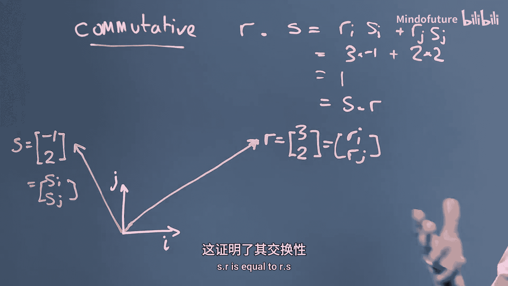

# 【帝国理工学院】机器学习数学：线性代数 ｜ Linear Algebra Machine Learning p07 P07_模 - 内积_02_02_01 -BV1AJYDzEESM_p7-

So we've looked at the two main vector operations of addition and scaling by a number。

 And those are all the things we really need to be able to do to define what we mean by a vector。

 the mathematical properties that a vector has。 Now， we can move on to define two things。

 The length of a vector， also called its size and the dot product of a vector。

 Also call its inner scalar or projection product。😊。

The dock product is this huge and amazing concept in linear algebra。

 with huge numbers of implications， and will'll only be able to touch on a few parts here。

 but enjoy itss one of the most beautiful parts of linear algebra。😊。

So we going to find a vector initially， say this guy R here。

We did it without reference to any coordinate system。 In fact， as a geometric object。

 this thing R just has two properties， its length and its direction that it's pointing that way。

So irrespective of the coordinate system we decided to use。

 we want to know how to calculate these two properties of length and direction。

If the coordinate system was constructed out of two unit vectors that were orthogonal to each other。

 like I hear。And J here。In 2D， then we can say that R。Is equal to a times I。Plus， B。Times J。

And when I say unit about I and J， I mean theyre of length one。

 which people will often denote by putting a little hat over them like this。Then from Pythagoras。

 we can say that the length of R is given by the hypothes。

 So what I mean by that is if we draw a little triangle here。

Then we've got this length here is A eyes'。 And so if we write the length being。

 well with these two little vertical lines， it's just of length A because eyes of length 1， right。

 And this side here is B，Js。 And that's of length B。

So this side here is from Pythagoras is just a squared plus B squared， all square rooted。

 and that's the size of R。😊，So we can write down R， quite often people will do this。

 write R down like this， just ignoring the I and J and writing it as a column vector。

 So R is equal to A B。And the size of R， we write down as being the square root of a squared plus B squared。

Now， we've done this for two spatial directions defined by unit vectors。

 I N J that are at right angles to each other。 But this definition of the size of a vector is more general than that。

 It doesn't matter if the different components of the vector are dimensions in space like here。

 or even things of different physical units like length and time and price。

 We still define the size of a vector through the sums of the squares of its components。

The next thing we're going to do is to define the dot product one way。

 one way among several of multiplying。 if you like two vectors together。If we have two vectors。

 R and S here， R here has components， R， I， R J。So R in the I direction， R in the J direction。

 and S has components， S I and S J。Then， we define R。dotted with S。

To be given by multiplying the I components together。 So that's R I times S I。

And adding the J components together， so that's Rj times Sj。That is。

 the dot product is just a number， scalar number of like 3。

 given by multiplying the components of the vector together in turn and adding those up。

So in this case， that would be 3 and 2 for the for the R， I， RJ and-1。And two for S。So if we do that。

 then we get a sum that R dot S is equal to-3 plus 4， which gives us one。 So R dot S in this case。

 is just one。Now， we need to prove some properties of the dot product。 First， it's commutative。So。

Commutative。And what commutative means is that R dot S is equal to S dot R。

 It doesn't matter which way round we do it。And it doesn't matter because when we put these numbers in here。

 if we interchange those， the R's and ss， we get the same thing when we multiply -1 by3。

 It's the same as three times -1。 So it doesn't matter which way round we do the dot product。

 S dot R is equal to R dot S， which means it's commutative。

Second property we want to prove is that the dot product is distributive over addition。

 by which I mean that if I've got a third vector here now T。That R dotted with S plus T。

Is equal to R dotted with S plus R dotted with T。 I can multiply it out in that kind of way。

This probably feels kind of mundane or obvious， but let's prove it in the general case。

 So let's say I've got some n dimensional vector R components R1 and R2 all the way up to R N。An S。

It's the same has components S1 S2 all the way up to SN。And tea。As components T1， T2。

 all the way up to TN。Then let's multip it out。 So if we take the left hand side。

 are dotted with S plus T。That's gonna be equal to R 1 times S1 plus T 1。

 If we take the components and then R 2 component R 2 times components S 2 plus T 2。

And then all the dimensions in between， and then finally RN times SN plus TN。

And then what we can do is we can then separate that out。 So we've got multiply that out。

 So we've got a R 1， S 1 plus R 1， T 1。Plus， R T， S T。Plus， R 2， T 2。Plus。All the ones in between R。

 N， S， N plus R， N， T， N。And then we can collect them together because we've got the R 1， S 1 terms。

 R 2， S 2 are all the way to R N S N。 And that's， of course， just equal to R dotted with S。

 And if we collect the R T terms together， we've got R 1 T with1 R 2 T 2。

 all the ones in between and R N， T， N。 And that's just。😊，A dotted with tea。😡。

So we've demonstrated that this is， in fact， true that you can pull out plus signs and dots in this way。

 which is called being distributive over addition。The third thing we want to look at is what's called associivity。

 So that is， if we take a vector a dot product and we've got R dotted with some multiple of S。

 where a is just a number， It's just a scalar number。 So we're multiplying S by a scalar。

 And what we're gonna say is that that is equal to a times R dotted with S。

 And that means that it's associative over scalar multiplication。

 And we can prove that quite easily just in the 2 D case。 So if we say we've got R 1 times A S1。😊。

Plus R2 times A S 2。That's the left hand side just for a two dimensional vector。

 Then we can pull the a out， right， so we can take the a out of both of these。

 And then we've got R 1 S 1 plus R 2 S 2。And that's just R dot S a times r dot S。So this is， in fact。

 true。 And so we've got our three properties that are。😊，The dot product is commutative。

 We can interchange it。 It's distributive over addition， which is this expression。

 and it's associative over scalear multiplication。 We can just pull out scalar numbers out。

 As an aside， sometimes you'll see people in physics and engineering write vectors in bold numbers or scalers in normal font。

 or they'll underline their vectors to easily distinguish them from things that just scrs。😊。

Whereas in maths and computer science， people don't tend to do that。

 It's just the notation difference between different communities。

 and it's not anything fundamental to worry about。The last thing we need to do before we can move on is draw out the link between the dot product and the length or modulus of a vector。

 If I take a vector and dot it with itself。 So R dotted with R。

 What I get is just the sums of the squares of its components。 So I get， know。

 R1 times R 1 plus R 2 times R2 and all the others if there are all the others。

 So I get R1 squared plus R 2 squared。😊，Now， that's quite interesting because that means if I take the dot product vector itself。

 I get the square of its size of its modulus。 So that is that equals R 1 plus R 2 squared square rooted。

 all squared。 So that's。😊，Moar squared。So if we want to get the size of a vector。

 we can do that just by dotting the vector with itself and taking the square root。

 and that's really kind of neat and really hopefully quite satisfying。😊。

