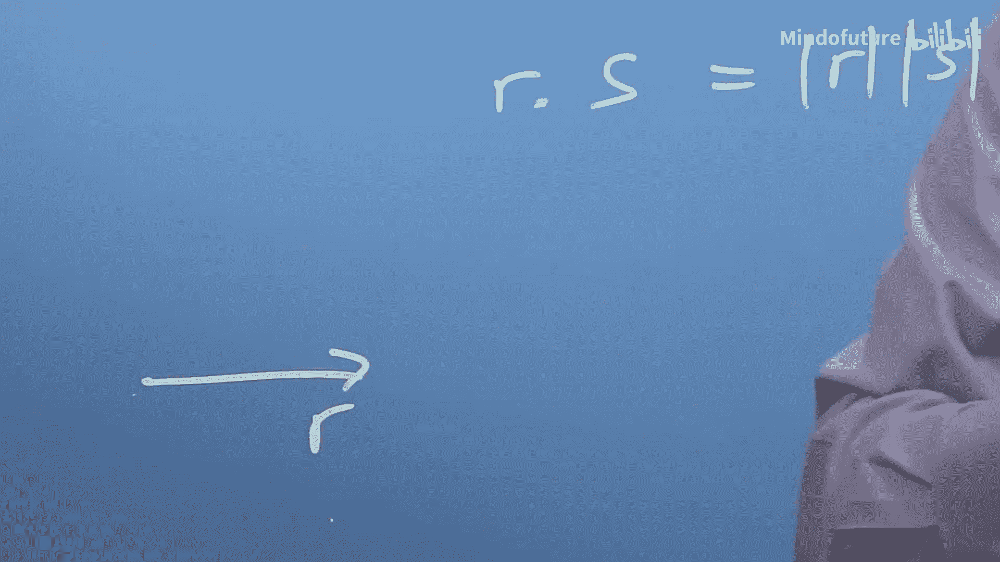

# 【帝国理工学院】机器学习数学：线性代数 ｜ Linear Algebra Machine Learning p08 P08_余弦 - 点积_02_02_02 -BV1AJYDzEESM_p8-

Let's take the cosine rule from algebra， which you'll remember Rob E Vaagey from school。

 and that said if we had a triangle with sides A。B and C。Then what the cosine rule said。

Was that C squared was equal to a squared plus B squared minus2 A B times the cause of the angle between A and B。

Ca。That angle feetta there。Now we can translate that into our vector notation。

 We call this vector R here。And we call this vector S here。 Then this vector would be minus S plus R。

 So that vector would be R minus S minus S plus R。So we could say that C squared was the modulus of r minus S squared。

And that would be equal to the modulus， the size of r squared plus the size of S squared minus2 mod R mod S。

Cause theta。Now here's the callul bitt， we can multiply this out。Using our dot product。

 because we know that the size of r minus S squared is equal to R minus S dotted with itself。

Now that's just that。😊，And we can multiply that out。

 and then we'll compare it to this right hand side here。So r minus S dotted with R minus S。

 Well that's going to be if we we need to figure out how to multiply that out。

 that's going to be equal to R dotted with R。And then tell the next one minus S dotted with R。Mus。

S dotted with R again。 if you take that minus S and that R minus S dotted with R again。

 and then minus S。Dotted with minus S。So that is， we've got the modulus of r squared here。

I mean dot R with itself minus twice S dotted with R。啊。And then minus S dotted with minus S。 Well。

 that's going to be the size of minus S squared， which is just the size of S squared。

And then we can compare that to the right hand side。 And when we do that comparison。

 compare that to the right hand side， the minus r squared are going to cancel。The R squares。

 even the S squares are going to cancel。 And so we get a result。

 which is that minus twice S dotted with R is equal to minus twice modulus of R modulus of S cause theta。

 That is。 and then we can lose the minus sign， right， minus signs will cancel out。

 just multiply 3 by -1。 So， and then the twos we can cancel out again。

So we can say that the dot product。R dot S， just to put it in a more familiar form。

 is equal to mod R mod S。Causes，So what we found here is that the dot product really does something quite profound。

 It takes the size of the two vectors。 If， if these were both unit length vectors。

 those would be one。And multipls by cause of the angle between them。

 It tells us something about the extent to which the two vectors go in the same direction。

 because if cos theta if theta was 0， then co theta be 1。

 and R do S would just be the size of the two vectors multiply together。 If the two vectors。

 on the other hand， were at 90 degrees to each other。 if they were。A was like this。

An S was like this。 And the angle between them， Theta was equal to 90 degrees。 Co Theta cos 90 is 0。

 And then R dot S is going to be。We can immediately see R dot S is going to be some size of R。

 some size of S times 0。 So if the two vectors are pointing at 90 degrees to each other。

 if they're what's called orthogonal to each other， then the dot product' is going to give me 0。

 If they're both pointed in the same direction。Soy S was like that。

 And the angle between them is not cause。Of naught is equal to one。 And then R dot S。

Is equal to the mod R times mod S， just the multiplication of the two sizes together。Fun one。

 last fun one here is that R and S are in opposite directions。 So let's say S was now going this way。

And the angle between them was 1 80 degrees， cause of 1，80。180 degrees is equal to -1。So， then。A dos。

Will be equal to minus the size of R time to the size of S。

 And so what the dot product here really does with this cause。

 it tells us when we get the minus sign out that they're going in opposite directions。

So there's some property here in the dot product we've derived by looking at the cosine rule。

But we've arrived here。When the dot products0， they were at 90 degrees which are orthogonal。

 when theyre going the same way， we get a positive answer。

 when they go more or less in opposite directions， we get a negative answer for the dot product。

