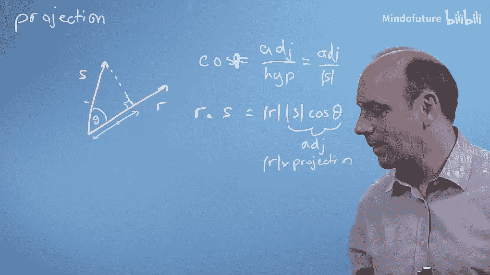

# 【帝国理工学院】机器学习数学：线性代数 ｜ Linear Algebra Machine Learning p09 P09_投影_02_02_03 -BV1AJYDzEESM_p9-

Now， there's one last thing to talk about in this segment， which is called projection。Projection。

And for that， we'll need to draw a triangle。So if I've got a vector R。😊，And another vector， S。Now。

 if I take a little right handed triangle， drop a little right handed triangle down here。

Why are they angles，90 degrees。Then I can do the following。

If I can say that if this angle here is theta， that cause theta。

Is equal to from Sockkatoa iss equal to the adjacent length here over the hypotens there。

Adjacent over the hypotenase。 that is， and this hypotense is the size of S。

So that's the adjacent over the size of S there。Now， if I compare that。

 the definition of the dot product， I can say that。哦。Dotted with， well have fun with colors。

 dotted with S。Is equal to。啊。Mod R size of R times。The size of S。Time to cause theta。Cas theta。

But the size of S times co theta， if I pour S up here， I just need to put my theta in there。

Cause S cause The is just that adjacent side。So that's just that adjacent side here in the triangle。

So the adjacent side here is just kind of the shadow。 If I， if I had light coming down from here。

 it's the shadow of S on R that length there。It's kind of a shadow cast。

 If I had a light at 90 degrees R shining down on S。And that's called the projection。

 So what the dot product gives us is it gives us the projection here。Of S onto R times the size of R。

And one thing to notice here is that if S was perpendicular to R， if S was pointing this way。

 it would have no shadow。 That is if cause Theta was 90 degrees， that shadow would be n。

 the causes Theta would be nughaught here， and I get no projection。So。

The other thing the dot product gives us is it gives us the size of R times some idea about the projection of S onto R。

The shadow of it onto all。So if I divide the dot product， R dot S by the length of R。

 just bring the R down here。 I get mod S cause   I get that adjacent side。 I get a number。

Which is called becauseuse R dot S is a number and the size of our is a number。

 And that's called the scalar projection。And that's why the dot product is also called the projection product because it takes the projection of one vector onto another。

 We just have to divide by the length of R。 And if R happen to be a unit vector or one of the vectors we used to define the space at length 1。

 then that would be of length1 and R dot S would just be the scal of projection of S onto that R that that vector defining the axes or whatever it was。

Now， if I want to remember to encode something about R。

 which way R was going into the dot product or into the project product。

 it I could define something called the vector projection。

And that's defined to be R dot S over mod R dotted with itself。 So R dot R mod R squared。

 So that's R dot S over R dot R， if you like because mod R squared is equal to R dot R and that and we multiply that by the vector R itself。

So that is that dot products just a number。 These sizes are just a number。

 R and R itself is a vector。 So what we've done here is we've taken the scalar projection R dot S over R。

 this guy， that's how much S goes along。 R， and we've multiplied it by R divided it by its length。

 We've multiplied it by a vector going the direction of R。

 but that's been normalized to have a length 1。So that vector projection is a number times a unit vector that goes in the direction of R。

 So if R say was with some number of lengths， the vector that would be R divided by its size。

 So if that was a unit length vector I've just drawn there and the vector projection would be that number S dot R。

 that adjacent side。Times a vector going in the unit length of R。So that's。

 if you like the scalar projection also encoded with something about the direction of R。

 just a unit vector going in the direction of R。 So we've defined a scalar projection here。

 and we've defined a vector projection there。So good job。

 This was really the core video for this week。 We've done some real work here。

 We found the size of a vector， and we've defined the dartt or projection product。😊。

We've then found out some mathematical operations we can do with the dot product that it's disive over vector addition and associative with scalear multiplication。

 that it's commutative。😊，We then found that it finds the angle between two vectors。

 the extent to which they go in the same direction。

 and then it finds the projection of one vector onto another。

 That's kind of how one vector will collapse onto another。

 which is what we'll explore in the next two videos。 So good work。

 Now is a good time to pause and try some examples that put all this together and give it all a workout and a bit of a try before we move on。

