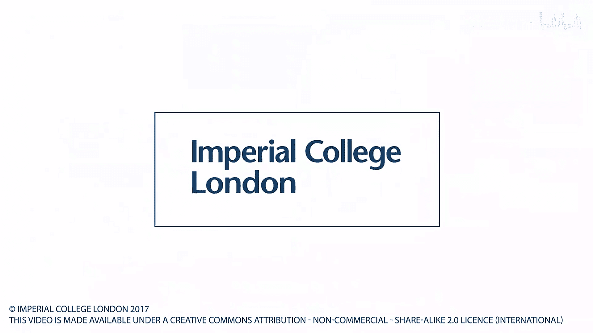

# 【帝国理工学院】机器学习数学：线性代数 ｜ Linear Algebra Machine Learning p15 P15_矩阵如何变换空间_03_02_01 -BV1AJYDzEESM_p15-

Previously， we introduced the idea of a matrix and related it to the problem of solving simultaneous equations。

And we show that the columns of a matrix just read as what it does to the unit vector along each axis。

Now， we'll look at different types of matrix and what they do to space and what happens if we apply one matrix transformation and then another。

 which is term composition。Now， because we can make any vector out of a vector to some of the scaled versions of E1 hat and E2 hat。

 then what that means is the result of the transformation is just going to be some sum of the transform vectors。

 which I'm calling E1 hat and E 2 hat。 This is a bit hard to see。

 But what it means is that the grid lines of our space， stay parallel。Andevenly spaced。

 they might be stretched or sheared， but the origin stays where it is。

 And there isn't any curvness to the space。 It doesn't get warped。

 And that's a consequence of our scalar addition and multiplication rules for vectors。So that is。

 if I write down the matrixes capital A and the vector it's transforming as R， know， whatever it was。

 A B in our apples and bananas problem。And that gives me some。😊，Altered version。 We said it was 8。

13 before， but I'm gonna call it R transformed or R prime。

Then we can look at what happens if I do algebra with it。 So if I multiply。by some number。

 just the a number。 Let's call it n。And if I apply a to N R。

 what I'm saying is that I will get N R prime and hopefully you can see if I put an N in there when I multiply it all out。

 I'm going to get an N in there。Similarly， if I multiply a。By the vector， R plus s。

Then I will get A R plus A S。 So if I get that multiplication， get that。

 do it the whole thing again with another vector and get another vector S and add those two。

 that will be true。So what I'm saying here is that if I can then think of these as being the original basis vector。

 E1 hat and E2 hat， I'll then get some addition of。E 2 and E1 finded。

 So if I say that's N E1 hat plus M E 2 hat。I'll get a n times E1 hat。Plus M times A E2 hat。

Which is N E1 prime plus M， E2 primeed， which is just the vector sum of some multiple of those。

 So this space gets transformed。 E1 E and E2 gets moved。And then I can just add up vectors with them。

So that's very nice。 That means that all of our vector sum rules work。Now。

 maybe that's a bit confusing。 So let's try it with an example， so。

I've got my matrix A here from my apple's bananas problems of 2，3，10，1。 Or if we like the vector 2。

10 and the vector 3，1。And let's try an example like a vector3，2。Now。

 if I multiply that out just straightforwardly as we probably did at school。

 I've got two times 3 plus  three times 2。 so that's 6 plus 6。 that's 12。 and I've got 10 times 3。

 which is 30 plus 1 times 2， which is 2， so that's 32。But I could think of that as being2，3，10，1。

Times。3 times 1，0。Plus，2 times 0，1。That is three of E1 hat and two of E2 hat in a vector sum。Now。

 I can take the three outce。 That's  three times 2，3，101。Times 1，0。Plus， two times 2。2，3，10，1。Time 0。

1。And this， we know that this is what happens from E1 hat to get to E1 prime here。

 So that's  three times 2，10。And that。Two times what happens to E2 hat， And that goes to 3，1。

So that gives us 6 plus 6 is 12， and 30 plus 2 is 32。So it really is true。

 These rules really do work， and we can think of a matrix multiplication as just being the multiplication of the vector sum of the transformed basis factors。

So pause it for a moment and try that maybe with an example of your own and verify that that really does work because that's really quite deep。

 This matrix just tells us where the basis vectors go。 That's the transformation it does。

 It's not a complicated multiplying out thing。 We don't need to worry about the mechanics of doing the sum。

 We can just think of it in terms of what it does to vectors in the space。

