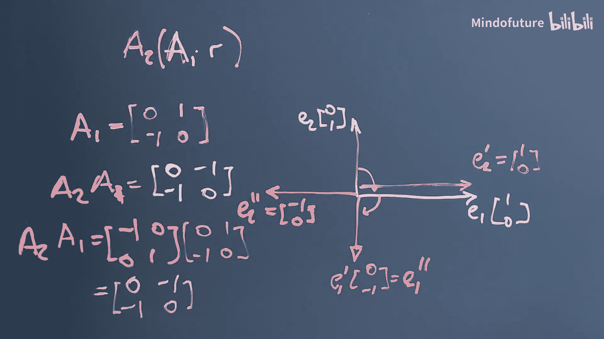

# 【帝国理工学院】机器学习数学：线性代数 ｜ Linear Algebra Machine Learning p17 P17_矩阵变换的合成或组合_03_02_03 -BV1AJYDzEESM_p17-

Now， what's the point of telling about all these different geometric transformations？ Well。

 if you want to do any kind of shape alteration， Sa all the pixels in an image of a face or something like that。

 then you could always make that shape change out of some combination of rotations， shear。

 stretches and inverses。 That is， if I first apply one transformation， a 1。😊，To a vector R。

Then that makes some first change。 Then if I apply another transformation， a 2。

To that to the result of that， Then I can perform a composition of the two transformations。

 What I've done is I've performed first A1， and then a 2，2 R。Now， maybe this isn't so obvious。

 So let's slow down and do a concrete example。

Let's start out with our our basis factors。 So we've got our E1 as being 1，0。And our E2。As being01。

Now let's take our first transformation， a1 as being a 90 degree anticlockwise rotation。

So we're going to work out what happens if we rotate this by 90 degrees anticlockwise。

 So E1 comes down to some transformed E1。 Let's call it E1 prime of 0-1。

So we can put 0 minus1 in there and our E2 rotates down here to be some transform version of E2。

 which well call which will then be E2 primed。Which will be at 1，0。So then we've got an overall a1。

Which describes a 90 degree rotation。Now， then let's take another one， another matrix。

 which also transforms our original basis factors。original E1 and E2。

And what we'll say is that that is a， let's say， a mirror。 say， So that moves a vertical mirror。

 moves E1 to E1 prime。Is gonna be  -10。And it's going to leave E2。😡，Where it was。

 if I just reflect vertically。 So my transformation A 2 now is gonna be -1，0。

 and it leaves the other one the same，0，1。Now， let's ask ourselves what happens if I do a 2，2， a1。

 So now I'm going to reflect over the result of doing a 1， so。

E1 prime is actually what I reflect vertically going to stay in the same place。

And that's gonna give me E1。 Let's say double prime for doing it twice。

 And E2 prime is going to reflect over here， and it's going to become E2。 double prime is going be-1。

0。So I'm going to have an overall result of doing A2。2 a1。Which is going to be。What I get E1 prime。

 I first write down，0-1 and E 2 double prime。 I'm going write down-10。Now。

 I can work out what that is， actually， in a matrix way without having to draw it all out by saying a 2。

To a 1 is doing a 2， which is -1，0，0，11。To a one's basis vectors， and a a1。Sorry a1 there。

 A 1 was 0-1，1，0， which is just the two transform basis vectors， the single primes。

 And when I do that， I just have to do this matrix to that basis vector。

 And then this matrix to that basis vector。 And what that looks like if I do that is I do this matrix to that basis vector。

 So I do that row times that column。And that gives me-1 times 0 plus 0 times -1。 That gives me 0。

 And that one to that one。 So the second row， the first column me 0 times 0 plus 1 times -1 gives me -1。

And then I do that A two transformation to the second column now to the second basis factor of a1。

 so minus-1 times 1。Plus0 times 0 a minus1 times 1 sorry second row。

0 times 1 plus1 times 0 gives me0。So I do the row times the column for all the possible row and column combinations。

 So that is in fact， the same thing。 So we can have discovered really how to do matrix composition or matrix multiplication doing one matrix to another transformation matrix。

😊。

Notice that geometrically， we can show that a2， then a1 or isn't the same as doing the transformations in the other order。

 First， a1， then a2。 So just watch that for a minute。 So this one， we've done a2。

 And then what if we then do a 1。 Well， a1 is a 90 degree rotation。 So if we rotate E1 prime。

 then we find that E1 double prime， would be equal to our original O2 E2， that is01。

 and our E 2 prime， which was just staying where it was。 When we rotate that down。😊。

Then that'll come down to here。 That'll come down to 10。 So our E2 double prime will be 1，0。

let's look how that works out matrix wise。 So if we do a1。2， a，2， a1 was 0，1，-10。And if we do that，2。

 a2。😡，Which was-1，0，0，1。Then we've got to do that matrix multiplication。

 And what that's going to give us is。0 times minus-1 plus 1 times 0，0。 Then this one times this one。

 minus1 times minus-1 plus10 times 0 is1。This row， second column 0，0，1，1， and second row。

 second column， -1 n naught1。 Give me n。So that is the first column is 01 and the second column is 10。

😊，So that isn't the same as doing the operations in the other sequence。

 You see these minus signs are flipped。 In effect， what happens， what's happened is this composition。

 rotating and then flipping over is the equivalent of reflecting the whole lot。

 the original basis factors in this mirror and flipping and then rotating round the effect is I've just flipped my original axes E1 E2。

 which is putting a mirror in here。😊，So doing the two operations in opposites in different sequences doesn't give you the same operation。

 What we've shown is that matrix multiplication isn't commutative。 A2， A1 isn't the same as a1， A2。

 So we have to be very careful with matrix multiplication。 We can do them in any order。

 meaning they're associative， that is we if we do a3 to A2 to a 1。😊，We can do a2， A1 and then do a3。

 or we can do。A 3， a 2，2， a 1。 so we could do that。 And then that those are the same。

They're associative。But we can't interchange the order。 We can't swap them around。 It's not。

Commutative。So， this is interesting。There seems to be some deep connection between sultaneous equations。

 these things called matrices and the vectors we were talking about in the last module。

And it turns out the key to solving spontaneous equation problems is appreciating how vectors are transformed by matrices。

 which is the heart of linear algebra。😊。