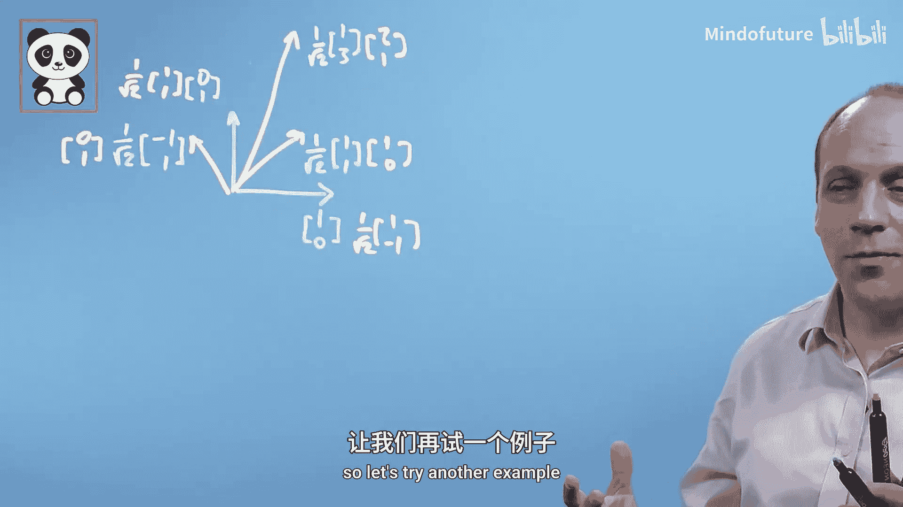

# 【帝国理工学院】机器学习数学：线性代数 ｜ Linear Algebra Machine Learning p23 P23_矩阵 - 改变基_04_02_01 -BV1AJYDzEESM_p23-

We've said before that the columns of a transformation matrix are the axes of the new basis vectors of the mapping in my coordinate system。

We're now going to spend a little while looking at how to transform a vector from one set of basis vector to another。

Let's say I have two new basis vectors that describe the world of panda bear here。

 and pannda's world is orange。So panda's got a first basis factor there and then another basis factor there。

 say， and let's say in my world， panda bears basis factors are at 31。On a one， one。

And my basis vector here are E1 hat equals naught one for sorry for E2 hat and E1 hat。

Is equal to one naught。So those are my basis factors and the orange ones are panda's basis factors。

Now， and so panda's basis factors is the first one for panda is his one0。And the first one。

 the second one is 01 in panda's world。So， bears basis vector。A three one。On 11。In my blue frame。

That is， I can write down bear's transformation matrix as 31，1，1。Now， let's take some vector。

 I want to transform。Let's say that vector is in bear's world， is the vector。A half。Of 3，1。

In bears world。So it's three over two， one over two。

So the instruction there is do three over two of three，1 and then do one over two a half of one。

1 in my frame， if you like。 so in my world that's going to give me the answer of three times three over2 plus one times1 over two。

 is 9，10 halves， which is5。And one times3 of two plus one times a half。 So that's a total of two。

So that's the vector5，2 in my world。5，2， those two are the same things。 So this is。Bears vector。

And this is。My vector。So this transformation matrix here are bears。Basis。In my coordinates。

In my coordinate system。 So that transforms bears vectors into my world。Which is a bit of a problem。

 you know， usually I'd want to translate my world into bear's world。

 So we need to figure out how to go the other way。So my next question is。

 how do I perform that reverse process？ Well， it's going to involve the inverse。

 So if I call bears transformation matrix B， I'm going to want B inverse which B to the -1。

 and the inverse of this matrix。 But it's actually pretty easy。

 We can write down the inverse of that matrix pretty easily。 It's going to be a half of1。

3 flip the elements on the leading diagonal and put a minus on the off diagonal terms。

 And we can see the determinant of that's3 minus minus2。 So we do the determinant of a half。

 So that's going to be B to the -1。 And that's。The are my basis factors in Bears coordinates。😡。

So that's my basis。In bear。In bear's world。So my 10 is going to be a half of 1-1 in bears system and my 0。

1 is going to be a half of -1，3 in bears system。 and we can verify that this is true。

 if we take this guy， a half 1-1。 and compose it with bears vectors。

 We've got 1 plus-1 of those is going to give me 3 plus 1 is 3-1 is 2。1-1 is 0。 So that's 20。

 half it gives you 1，0。 So that really does work。 If I take a half1-1 of bears vectors。

 I get my unit vector。 Okay， so that really does do the reverse thing。So then if I take my vector。

Which was 5，2。And then I do that some。 I should get the world in bears basis。

 So I've got five times a half。Minus a half。Using that guy， plus two times。-13。

And that will give me a half。Of 3，2，1， I'm multiplied all out。 And if I do the same thing here。

 Ive got 5 times 1-1 times 2 gives me 3 over 2 gives me 3 over 2。 It all works out。

 If you do it that way。 or if you do it that way， you still get that answer。 So that's bears vector。

Again， which is the vector we started out with。So that's how you do the reverse process。 You need to。

 if you want to take bears vector into my world， you need bears basis in my coordinate frame。

 And if you want to do the reverse process， you want my basis in bears coordinate frame。

That's probably quite counterintuitive。 So let's try another example where this time Bears worldord is going to be an ortho normalmal basis factor set。

 So here's our basis factors at 10 and 0，1 in my world in blue。 and Bear's worldor is in orange。

 Bear's world and Bears worldd has11 times。 and I've made it unit length。 that's one over root 2。

 and-1，1。 again， the unit lengths are one over root 2。 So they' are those two。

 And those you can do a product and verify that those two are at 90 degrees to each other。

 And there bears vectors 10 and 0，1。

So then I can write down bears transformation matrix that transforms a vector of bears。Now。

 if I've got the vector in Bears world that's 2，1， then I can write that down。

And I will therefore get the vector in my world。So when I multiply that hour。

 what I get is I'll get one over root 2 times2 minus1， which is1。

 and then one2 plus1 times 1 gives me3。 So my world。

 the vector is as I've written down one over root 2 times 13。

So if I want to do the reverse transformation， I need B to the -1。

And B to the minus one is actually quite easy because this is an ortho normal basis。

 the determinant of this matrix is one， so it all becomes quite easy so I just get one over root 2。

 keep the leading terms the same flip the sign of the off diagonal terms because it's a two by two matrix that's really simple And if you go and put that in if you say if I take one over root 2 times1 minus1 so I take one of those plus one of those divide multiplied by root 2 I do in fact get10 and the same for01 it all works。

So then if I take the vector in my world。This factor in my world。W whichch is one，3。

And multiply it out than what I get。Is the vector in bears world。 So that's  one plus 3， which is 4。

1。 So -1 plus 3 is 2。And I've got one over route 2 times one over route 2。 So that's a half。

 So in bears world， this vector is 2，1， which is what we originally said。 So it really works。Now。

 this was all prep， really for the fun part， which is we said before in the vectors module。

 that we could do this just by using projections if the new basis factors were orthogonal。

 which these are。 So let's see how this works with projections。😊，So let's try it with projections。

What we said before was that if I take my version of the vector。And dot it with bears axis。

So the first of bears a is that in my world， then I will get the answer of the vector in bears world。

 So that gives me one over root 2 times one over root 2， which is a half of one plus 3， which is4。

So that gives me two。And that's going to be the first component of bears vector because it's the first of bears axes。

 and I can do it again with the other of bears axes。 so that's one over Ro 2，1，3。

That's the factory in my world with the other of bear's axes， which is one over root2 times -11。

And when I do that dot product。What I'll get the one over route 2s will multiply to give me a half again。

 And I've got one times -1 plus 3 times 1 is a total of 2。Which is one。And that' bears vector notice。

2，1。So I've used projections here to translate my vector to bears vector just using the dot product。

 Now， remember with the vector product， what I'd have to do is I'd have to remember to normalize when I did the multiplication by bears vectors。

 I'd have to normalize by their lengths。 but in this case， their lengths are one。

 So it's actually really easy。 So we don't have to do the complicated matrix maths。

 we can just use the dot product。If bears vectors are orthogonal。Now， there is one last thing。

 if you try this with the example we did before with bears vectors of 3，1 and1，1。

So before we had those being bears vectors， if you try the dot product with those because they're not orthogonal to each other。

 it won't work and give it a go for yourself and verify that。

 that it really won't work that they need to be orthogonal for this to work。

 If you have them not being orthogonal。 you can still do it with the matrix transformation。

 You just can't do it with the dot product。