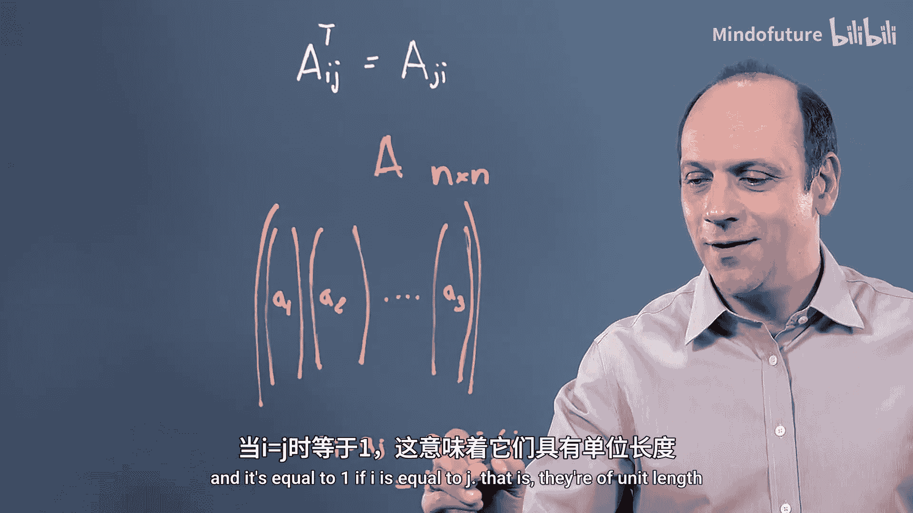

# 【帝国理工学院】机器学习数学：线性代数 ｜ Linear Algebra Machine Learning p25 P25_正交矩阵_04_03_01 -BV1AJYDzEESM_p25-

Now it's going to be really useful if we can make a transformation matrix whose column vectors make up a new basis。

 all of whom's vectors are perpendicular or what's called orthogonal to each other。😊，In this video。

 we're going to look at this and why this is。😊，But first。

 I wanted to define a new operation on a matrix called the transpose。

 This is where we interchange all the elements of the rows and columns of the matrix。

 So I denote the transpose as a T。 And I say that the I Jth element of the transpose of a is equal to the elements on the opposite diagonal A J I。

 So if I had a matrix like 1，2，3，4。😊，And I wanted to know it's transpose that I'd interchange the elements that are off the diagonal。

 So the one and the four stay where they are， because if it is， if I and J with the same 1，1，1，1。

 they would stay the same。 and same for 2，2。 But the elements element1，2 interchange the element 2 1。

 So they go like that。 So 1，2，3，4 becomes1 I transpose it 1，3，2，4。Now。

 let's imagine that I have a square matrix of dimension N by N that defines a transformation with a new basis and the columns of that transformation matrix A are some vectors。

 a 1， A2， that are the basis factors in the new space， right， as we've said before。😊。

And I'm going to make this a special matrix where I impose the condition that these vectors are orthogonal to each other and they're of unit length。

 that is AI dotted with AJ is equal to0， if I isn't equal to J， that is they' orthogonal。

 and it's equal to1， if I is equal to J， that is there of unit length。😊。

Now， let's think about what happens if I multiply this matrix on the left by a transpose。

 So a transpose is going to be given by just flipping the rows and columns of all of the elements across the leading diagonal of a。

 So that is I'm going to have a1 is going to become a row。

 a2 is going to become the next row all the way down to A N。

 because I flip all of the elements across the leading diagonal。So when I multiply A T by a。

 let's see what happens。 It's going be quite magical。 So if I get A T times a。😊，Then。

 I'm going to get。Well， the first element here is going to be the first row times the first column。

 and that's a1 time dotted with a1， and that's1。The second element here， the first row。

 the second column is a1 dotted with A2， and that's 0。

 and A1 dotted A3 all the way up to A N is going to give me a whole series of zeros。Where this guy。

 remember is A N。 And then when I do the second row and the first column， I'm gonna get another0。

 when I do the second row and the second column， I'm gonna get one second row。

 third column 0 all the way across。 And when I do the third one， I'm gonna get the same again。

 I'm gonna get 0，0。 it's all means0 is except a 3 times a 3。

 and that's gonna be that element all the way across。

 And when I'm gradually building up here is I'm building up the identity matrix。😊。

So what I found is that A times a gives me the identity matrix。

 and what that means is is that A T is a valid inverse。😊，Of a， which is really kind of me。

A set of unit length basis vectors that are all perpendicular to each other are called an orthoormal basis set。

Or for normal。And the matrix composed of them is called an orthogonal matrix。

One thing also to know about an orthogonal matrix is that because all the basis factors in are of unit length。

 it must scale space by a factor of one， so the determinant of an orthogonal matrix must be either plus or -1。

The minus water rises in the new basis， if the new basis factor set flip space around as they sort of invert it。

 they make it left handed。😊，Notice that if AT is the inverse。

 then I should be able to post multiply a by A and get the identity at I can do this either way around。

 which also means by the same logic that the rows of the orthogonal matrix are orthoormal。😊。

As well as the columns， which is kind of me。 And we saw in the last video that actually。

 the inverse is the matrix that does the reverse transformation。

 So the transpose matrix of an orthooral basis vector set is itself another orthogonal basis vector set。

 which is it's really neat。😊，Now， remember that in the last module on vectors。

 we said that transforming a vector to a new coordinate system was just taking the projection or dot product of that vector。

 So say that's the vector with each of the basis vectors。 So basis vector， this one， basis vector。

 that one and so on。To long as those basis factors were orthogonal to each other。

 If you want to pause and think about that for a moment in the light of all we've learned about matrices。

 just think， look and think about this for a moment。😊，Now， in data science。

 what we're really saying here is that wherever possible we want to use an awful normal basis vector set when we transform our data。

 that is we want our transformation matrix to be an orthogonal matrix。

 That means the inverse is easy to compute。 It means the transformation is reversible because it doesn't clap space。

 It means that the projection is just the dot product。 Lots of things are nice and pleasant and easy。

😊，If I arrange the basis factors in the right order， then the determinant is one。

 and that's an easy way to check。 And if they aren't， just exchange a pair of them。

 and actually then they will be a determinant one rather than minus1。

So what we've done in this video is look at the transpose and that's led us to find out about the most convenient basis vector set of all。

 which is the orthoormal basis factor set， which together make the orthogonal matrix whose inverse is its transpose。

😊，So that's really cool。