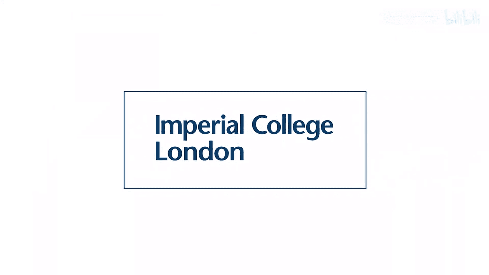

# 【帝国理工学院】机器学习数学：线性代数 ｜ Linear Algebra Machine Learning p27 P27_例子 - 在平面上反射_04_04_02 -BV1AJYDzEESM_p27-

Okay， so let's put all this together， Let's use our transformations knowledge and our basis knowledge in order to do something quite tricky and see if we can't actually make our life quite simple。

😊，What I want to do here is know what a vector looks like when I reflect it in some funny plane。

For example， the way this board works， when I write on the light board here， if you're looking at it。

 all the writing would appear mirrored， but what we do to make that work is we reflect everything in post productionion left right。

 and then everything comes out okay。😊，The example we're going to do here ask what the reflection of bear。

 say something in a mirror would look like to me if the mirror was off at some funny angle。Now。

 my first challenge is gonna to be that I don't know the plane of the mirror very well。

But I do know two vectors in the mirror。😡，1，1，1。And 2，0，1。And I've got a third vector。

 which is out of the plane of the mirror， which is at 31 minus-1。 That's my third vector。

 So I've got vectors V1， V2 and V3。 and these two guys are in the plane of the mirror We could draw it something like V1 and V2 and therein some plane like this and V3 is out of the plane。

 I've got V3 there。V1 and V2。So first， let's do the Gam Schchmidt process and find some awful normal vectors describing this plane and its normal V3。

So my first vector E1。I's going to be just the normalized version of V1 V1 here is of length root 3。

1 square plus1 square plus one squared all square rooted。

 So it's going to be  one over root 3 times 1，1，1。That's a normalized version of V1。

So then we can carry on， and I can find you， too。Is equal to V2。Minus sum number of E1。

 So that's going be then the sum number is going to be the projection of V 2 onto E1。Times Z1。

So that's going to be 20，1。Minus。2，0，1， dotted with E1， which is one over Ro 3。1，1， one。

Times 1 over Ro 3，1，1，1。Because that's E1。 So that's 201。

inus the root3s are gonna to come outside so I can just have them being a third。201 dotted with 11。

1 is 2 plus 0 plus 1 is 3。 So that actually goes and has a party and becomes 1。 and yeah， okay。

 I confess， I fixed the example。 So it's 201-1，1，1， which is going give me1-11-1 is 0。 So 1-1，0。

 That's u 2。 Now， if I want to normalize u2。 I can say E 2 is equal to the normal version of u 2。

Which is just one over root 2 times 1-10。So then I' just to find U 3。

And I can do the same again with U3。 I can say that that's equal to V3 minus the projection of V3 onto E1。

Minus the projection of V3 onto E2。So， that's going to be。3，1， minus-1。mininus。3，1，-1。

Dotted with one over Ro 3，1，1，1。And that's a number。

And it's going in the direction of the unit vector。O V2。won。Minus v3 dotted with E2， so that's。3，1。

 minus-1。Dotted with one over route 2。1-10。Times E2， which is 1 over root 2，1 minus10。So。

It's quite a complicated sum。 So I've got but I've got an answer here。Which I can do，3，1，-1。

Minus the one over Ro 3s come out again。3 plus 1-1 is 3。 So that goes。 and I've got 1，1，1。There。

 so that becomes one minus。The halves are going to come out， the one over root2s。

 I've got three minus1 minus0。 so that's2。So they cancel and become one again， as I say。

 I fix the example to make my life easy。So then I've got 3，1， minus-1， minus-1，1，1， minus-1， minus-1。

0。So therefore， I get an answer for you2 being 3-1-1。 So that's1。1-1 is 0，- -1。Is plus 1，-1，-1 is -2。

And so I can then normalize that and get E 3。So E 3 is just the normalized version of that。

 which is gonna be one over root 6 of 1，1-2。Now， let's just check。 So 1，1-2 is normal to 1， mile 10。

 It is normal to 1，1，1。 Those two are normal to each other。 So a normal basis set。

Just need to make sure that's one over reach 6。 They are all of unit length。

 So I can write down my new transformation matrix， which I'm going to call E。

 Its the transformation matrix described by the basis factors E1， E2， E 3。 So I've got E1。E 2， E 3。

 all written down as column vectors。 And that's going be my transformation matrix thats first contains the plane notice and then contains the normal to the plane。

So I've redrawn everything just to get it all more compact so we can carry on we've got our original two vectors V1 and V2 and we've defined E1 to be the normalized version of V1 and we've defined E2 to be the perpendicular part of V2 to E1 normalized to be of unit length So these are all in a plane and then E3 is normal to that plane。

 It's the bit of V3 that we can't make by a projection onto V1 and V2 then of unit length。Now。

 say I've got a vector R over here。Now， what I want to do is reflect R down through this plane on a drop R down。

Through this plane， there is when he intersects the plane。

And then out the other side to get a vector R prime。And let's say that R has some number like 2，3，5。

2，3，5。Now this is going to be really awkward， this planes off at some funny angle composed of these vectors and even these basis vectors。

 it's up some funny angle and then how do I drop it down and do the perfect there's going to be a lot of trigonometry。

But the neat thing here is that I can think of R as being composed of a vector that's in the plane。

 So some vector that's composed of E1s and E2s。So so here's E1 here。And some vector that's normal。

 So some vector that's some number of E3s。And when I reflect it through the bit that's in the plane is going to be the same。

 But this bit that's some number of E3s， this bit here。

I'm just going to make into minus this bit here。So if I wrote that down as a transformation matrix。

 the transformation matrix in my basis E is going to be to keep。The E1 bit， the same。

Keep the E 2 bit the same。 So that's the E1 B。 That's the E2 B。

 and then reflect the E3 bit from being up to being down 0，0-1。So that's a reflection matrix in E3。

 so that's a reflection in the plane。😊，So just by thinking about it quite carefully。

 I can think about what the reflection is。😊，And that T is in the basis of the plane， not in my basis。

 but in the basis of the plane， so that is easy to define and therefore if I can get the vector R defined in the planes basis vector set in the E basis。

 I can then do the reflection and then I can put it back into my basis vector set and then I have the complete transformation。

😡，So a way of thinking about that is that if I've got my vector R。

And I'm trying to get it through some transformation matrix to R prime。But that's going to be hard。😡。

That's going to be tricky， but I can transform it。Into。The basis of the plane。

So I can make an R in the basis of the plane。And I'm going to do that， using。E to the -1。

 E to the -1 is the thing that got me into。 Ive got a vector of mine into bears basis， remember。

Then I can do my transformation。 I can do my reflection。In the plot basis of the plane。

 I can do my reflection transformation。And then I will get a。That's been transformed。

 primed in the basis of the plane。🤢，Then。I can read that back into my basis by doing E because E is the thing that takes bears vector and puts it back into my basis。

 So if I go I can avoid the hard thing by going round doing these three operations。

 So R E to the minus-1 E inverse T in the E basis E。 If I do those three things。

 I've done the complete transformation， and I get R prime。

 So this problem reduces to doing that matrix multiplication。 So we've got that。 we've got that。

 we can just do the math now， and that will be done。

So I've just put the logic up there so that I can have the space down here for later and I've put the transformation we're going to do there。

A couple other things to note。 One is because E， we've carefully constructed by our gram Schchmidt process to be ortho normalmal。

 we know that E transpose is the inverse。 So calculating the inverse here is't going to be a pain in the neck。

The other thing is compared to the situation with bear where we're changing bases here we're changing from our vector R to bears or actually the planes coordinate system。

 then we're doing the transformation of the reflection in the plane and then we're coming back to our basis so the E and E to the minus-1 a flipped compared to the last video because we're doing the logic the other way there。

😊，quiteite neat， right， The actual multiplication of doing this isn't。Awfully edifying。

 It doesn't build you up very much。 It's just doing some arithmetics。

 So I'm gonna write it down here。 And if you want to verify it。

 you can pause the video and then we'll come back and we'll comment on it。

So this is TE times the transposeer E。Then I take that and multiply it by E itself。

 and I get E T E E transpose， which is this guy simplifies to this guy。

 so that's T all comes out quite nicely。So that's very， very nice。

 So then we can apply that to R so we can say that t times R is equal to t times R vector 2，35。

And that's going to give us our prime。 And that gives us an answer of one third。Of 11，14，5。

So our prime here is equal to one third of 11， 14， and5。

So that's a process that would have been very， very difficult to do with trigonometry。

 but actually with transformations， once we get into the plane of the mirror and the normal to the mirror。

 then it all becomes very easy to do that reflection operation。 And it's quite magical， really。

 It's really amazing。 So that's really nice， right， It's really cool。😊。

So what we've done here is we've done an example where we've put everything we've learned about matrices and vectors together to describe how to do something fun。

 like reflect a point in space in a mirror。😊，This might be useful， for instance。

 if you want to transform images of faces for the purposes of doing facial recognition， you know。

 transform my face from being like that to being like that。😊。

And then we could use on your networks on machine learning to do that facial recognition part。

In summary， this week we've gone out into the world with matrices and learned about constructing orthogonal bases。

 changing bases， and we've related that back to vectors and projections。

 so it's been a lot of fun and it sets us up for the next topic which Sam is going to lead on eigenvalues and eigenvectors。

😊。

