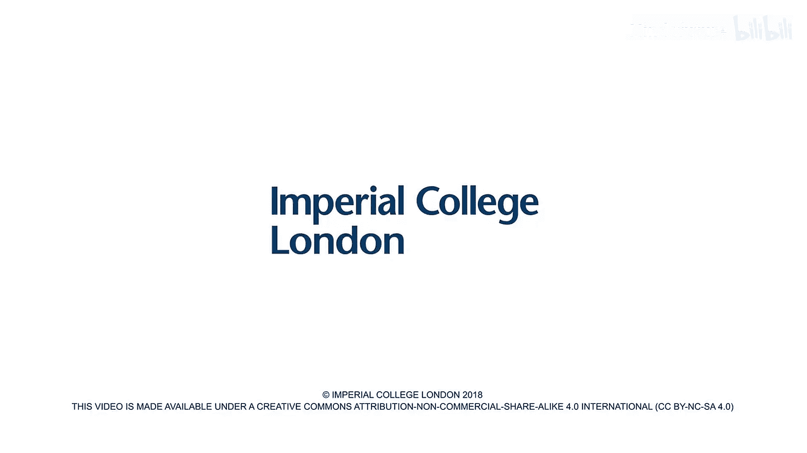

# 【帝国理工学院】机器学习数学：线性代数 ｜ Linear Algebra Machine Learning p28 P28_欢迎来到模块 5_05_01_01 -BV1AJYDzEESM_p28-

Welcome to the final module。I'm Dr。 Sam Cooper from the Dyson School of Design Engineering at Imperial College London。

 and I'm an energy researcher who uses machine learning as a tool to help me understand lithium ion batteries。

😊，I'll be taking over from Dave for the last topic of the linear algebra course。

 but if you continue with the specialization， I'll also be leaving the next course。

 which is on multivariate calculus。In this final module。

 we're going to be focusing on eigen problems， which will require us to draw on nearly all of the ideas that you've learned in the previous modules。

 then to finish the course。 you'll be applying this tool in a coding exercise to recreate Google's famous page rank algorithm。

 which takes your Internet search results and displays them in some kind of convenient order。

 I hope you enjoy this module and make use of the forums to let us know how you're getting on。😊。

