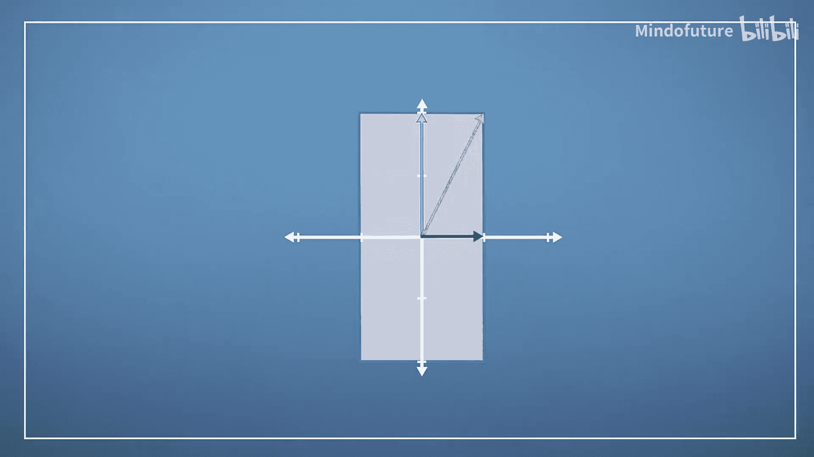

# 【帝国理工学院】机器学习数学：线性代数 ｜ Linear Algebra Machine Learning p29 P29_什么是特征值和特征向量_05_01_02 -BV1AJYDzEESM_p29-

The word eigen is perhaps most usefully translated from the German as meaning characteristic。

 So when we talk about an eigen problem， we're talking about finding the characteristic properties of something。

 but characteristic of what。This module， like the previous weeks。

 will try and explain this concept of eenness primarily through a geometric interpretation。

 which allows us to discuss images rather than immediately getting tangled up in the maths。😡。

When I first learn this topic， not only did we start by grinding through formulaly。

 we also spent very little time discussing what all the maths was doing。

 This topic is often considered by students to be quite tricky。

 but it's my belief that once you know how to sketch these problems， the rest is just algebra。

So as you've seen from previous weeks， it's possible to express the concept of linear transformations using matrices。

These operations can include scalings。Rotations。And sharears。Often。

 when applying these transformations， we are thinking about what they might do to a specific vector。

 However， it can also be useful to think about what it might look like when theyre applied to every vector in the space。

This can be most easily visualized by drawing a square center at the origin。

And then seeing how your shape is distorted when you apply the transformation。

So if we apply a scaling of two in the vertical direction， the square would now become a rectangle。

Whereas if we applied a horizontal shear to this space， it might look something like this。Now。

 here's the key concept。We are using our little square to help us visualize what is happening to many vectors。

😡，But notice that some vectors end up lying on the same line that they started on。

 whereas others do not。To highlight this， I'm going to draw three specific vectors onto our initial square。

Now， let's consider our vertical scaling again and think about what will happen to these three vectors。

As you can see， the horizontal green vector is unchanged。

 pointing in the same direction and having the same length。

The vertical pink vector is also still pointing in the same direction as before。

 but its length has doubled。Lastly， the diagonal orange vector used to be exactly 45 degrees to the axis。

 Its angle has now increased， as has its length。 I hope you can see that actually。

 besides the horizontal and vertical vectorctors。 Any other vector's direction would have been changed by this vertical scaling。

 So in some sense， the horizontal and vertical vectorctors are special。

 they are characteristic of this particular transfer， which is why we refer to them as eigenvectors。

😊。

Furthermore， because the horizontal vector's length was unchanged。

 we say that it has a corresponding eigenvalue of one。

 whereas the vertical eigenvector doubled in length。 So we say it has an eigenvalue of  two。

 So from a conceptual perspective， That's about it for 2 D eigen problems。

 We simply take a transform， and we look for the vectors who are still laying along the same span as before。

 and then we measure how much their length is changed。

This is basically what eigenvectors and their corresponding eigenvalues are。😡。

Let's look at two more classic examples to make sure that we can generalize what we've learned。

Here's our marked up square again。And now let's look at pure shear。

 where pure means that we aren't performing any scaling or rotation in addition。

 So the area is unchanged。As I hope you spotted， it's only the green horizontal line that is still laying along its original span。

 and all the other vectors will be shifted。Finally， let's look at rotation。Clearly。

 this thing has got no eigenvectors at all， as all of the vectorctors have been rotated off their original span。

In this lecture， we've already covered almost all of what you need to know about eigenvectors and eigenvalues。

Although we've only been working in two dimensions so far。

 the concept is exactly the same in three or more dimensions。 in the rest of the module。

 we will be having a look at some special cases， as well as discussing how to describe what we've observed in more mathematical terms。

😊。