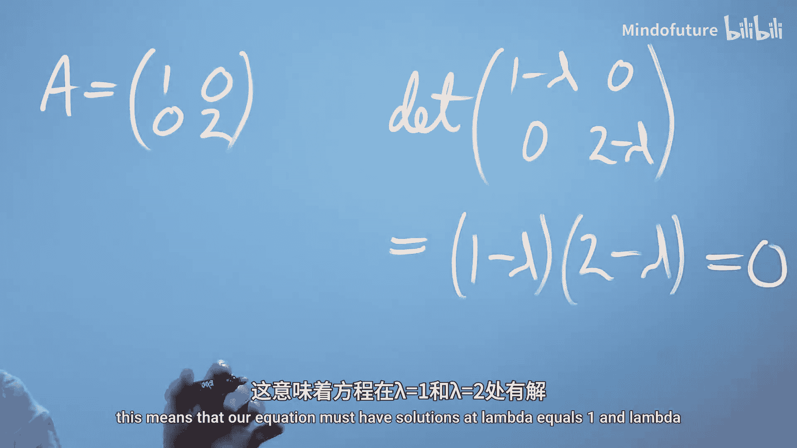
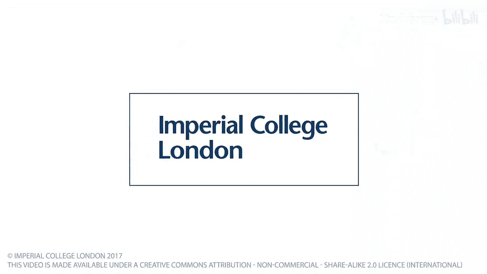

# 【帝国理工学院】机器学习数学：线性代数 ｜ Linear Algebra Machine Learning p31 P31_计算特征向量_05_02_02 -BV1AJYDzEESM_p31-

Hopefully， you all now have a reasonable feeling for an eigenpro looks like geometrically。😡。

So in this video， we're going to formalize this concept into an algebraic expression。

 which will allow us to calculate eigenvalues and eigenvectors whenever they exist。😊。

Once you've understood this method， we'll be in a good position to see why you should be glad that computers can do this for you。

😊，If we consider a transformation A， what we have seen is that if it has eigenvectors at all。

 then these are simply the vectors which stay on the same span following a transformation。😡。

They can change length and even point in an opposite direction entirely。

 but if they remain on the same span， they are eigenvectors。If we call our eigenvector X。

 then we can say the following expression。A X equals lambda X。Where on the left hand side。

 we are applying the translation matrix A to a vector X。 and on the right hand side。

 we are simply stretching the vector x by some scalar factor lambda。 So lambda is just some number。

We're trying to find values of x that make the two sides equal。😡。

Another way of saying this is that for our eigenvectors。

 having a applied to them just scales their length or does nothing at all。

 which is the same as scaling the length by a factor of one。So in this equation。

 a is an n dimensional transform， meaning it must be an n by n square matrix。

 The eigenvector x must therefore be an n dimensional vector。

To help us find the solutions to this expression， we can rewrite it by putting all the terms on one side and then factorizing。

A minus lambda I。Times x。Equs0。If you're wondering about where the I term came from。

 it's just an n by n identity matrix， which means it's a matrix the same size as a。

 but with ones along the leading diagonal and zeros everywhere else。

We didn't need this in the first expression we wrote as multiplying vectors by scs is defined。

 however， subtracting scs from matrices is not defined so that I just tiies up the maths without changing the meaning。

😡，Now that we have this expression， we can see that for the left hand side to equals zero。

 either the contents of the brackets must be0 or the vector x is0。😊。

So we're actually not interested in the case where the vector x is0。

 that's when it has no length or direction and is what we call a trivial solution Instead we must find when the term in the brackets is0。

😊，Referring back to the material in the previous parts of the course。

 we can test if a matrix operation will result in a zero output by calculating its determinant。So。De。

Of a minus lambda I。Equals。0。Calculating the determinants manually is a lot of work for high dimensional matrices。

 So let's just try applying this to an arbitrary two by two transformation。Let's say。A equals a。Bc。地。

Substituting this into our eigenfinding expression gives the following。Da。Of A，BCD。Minus。Orda，0，0。

Laa。Evaluating this determinant。We get what is referred to as the characteristic polynomial。

 which looks like this。😊，So， lambda squared minus。A plus D。Lambda。Plus。A D， minus B。Equals0。

Our eigenvalues are simply the solutions of this equation and we can then plug these eigenvalues back into the original expression。

😊，To calculate our eigenvectors。Rather than continuing with our generalized form。

 this is a good moment to apply this to a simple transformation for which we already know the eigen solution。

Let's take the case of a vertical scaling by a factor of two。

 which is represented by the transformation matrix。A equals1，0，0，2。

We can then apply the method that we just described and take the determinant of a minus lambda I and then set it to0 and solve。

The determinant。Of 1 minus lambda，0。0，2 minus Lada。Equals。1 minus lambda。wo minus lambda。Which is。

 of course， equal to 0。This means that our equation must have solutions at lambda equals 1 and lambda equals 2。

Thinking back to our original eigenfinding formula， a minus lambda I。X equals 0。

We can now sub these two solutions back in。So thinking about the case where lambda equals one。

We can say。1，-1，0，0，2-1 times this x vector， x1， x 1 and x 2。Must equal to 0，0，0，1。Times x1， x 2。

Therefore。We've got zero。And x 2。Must equal 0。Now thinking about the case where lambda equals2。

At lambda equals 2。You get1 minus2。And2 minus-2。And then you get， of course， minus1，0，0， zero。😡。

Which equals 2 minus x10。Which equals0。So what do these two expressions tell us， Well。

 in the case where our eigenvalue Lada equals1， we've got an eigenvector where the x2 term must be 0。

 but we don't really know anything about the x1 term。 Well， this is because， of course。

 any vectorctor that points along the horizontal axis could be an eigenvector of this system。

 So we write that by saying。At lambda equals1。X， or eigenvector， can equal anything。

Along the horizontal axis， as long as it's zero in the vertical direction。

 So we put in an arbitrary parameter T， similarly for the Lada equals 2 case。

We can say that our eigenvector must equal。0 t， because as long as it doesn't move at all in the horizontal direction。

 any vector that's purely vertical would therefore also be an eigenvector of this system as they all would lie along the same span。

 So now we have two eigenvalues and their two corresponding eigenvectors。

Let's now try the case of a rotation by 90 degrees anticlockwise to ensure that we get the result that we expect。

 which if you remember is no eigenvectors at all The transformation matrix corresponding to a 90 degree rotation is as follows。

A equals。0，-1，1，0。Sir。😡，Applying the formula once again， we get。The determinant。Of 0 minus lambda，-1。

1，0 minus lambda。Which if we calculate this through， comes out to lambda squared。Plus，1 equals0。

Which doesn't have any real numbered solutions at all。 hence， no real eigenvectors。

We could still calculate some complex eigenvectors using im numbers。

 but this is beyond what we need for this particular course。

Despite all the fun that we've just been having， the truth is that you will almost certainly never have to perform this calculation by hand。

Furthermore， we saw that our approach required finding the roots of a polynomial of order N i。

e the dimension of your matrix， which means that the problem will very quickly stop being possible by analytical methods alone。

 so when a computer finds the eigen solutionss of a0dial problem。

 it's forced to employ iterative numerical methods， however。

 I can assure you that developing a strong conceptual understanding of eig problems will be much more useful than being really good at calculating them by hand。

😡，In this video， we translated our geometrical understanding of eigenvectors into a robust mathematical expression and validated it on a few test cases。

 but I hope that I've also convinced you that working through lots of eigen problems is as is often done in engineering undergraduate degrees is not a good investment of your time if you already understand the underlying concepts。

 This is what computers of four Next video we'll be referring back to the concept of basis change to see what magic happens when you use eigenvectors as your basis See then。

😊。

