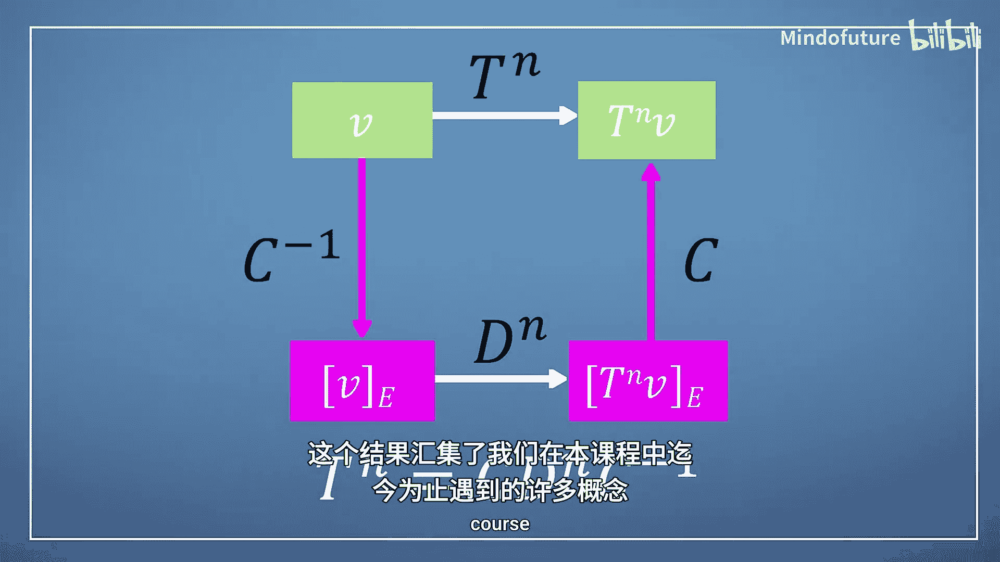

# 【帝国理工学院】机器学习数学：线性代数 ｜ Linear Algebra Machine Learning p32 P32_变换到特征基_05_03_01 -BV1AJYDzEESM_p32-

So now that we know what eigenvectors are and how to calculate them。

 we can combine this idea with a concept of changing basis， which was covered earlier in the course。

 What emerges from this synthesis is a particularly powerful tool for performing efficient matrix operations called diagonalization。

Sometimes we need to apply the same matrix multiplication many times。For example。

 imagine a transformation matrix T。😡，Represents the change in location of a particle after a single time step。

So we can write that our initial position described by vector v0。

 multiplied by the transformation T gives us our new location V1。😊。

To work out where our particle will be after two time steps。

 we can find V2 by simply multiplying V1 by T。Which is of course the same thing as multiplying v0 by t2 times。

😡，So V2 equals T squared times v0。Now， imagine that we expect this same linear transformation to occur every time step for n time steps。

 where we can write Vn is t to the power of n times v0。

You've already seen how much work it takes to apply a single 3D matrix multiplication。

 Sophie were to imagine that T tells us what happens in one second。

 but we'd like to know where our particle is in two weeks from now。 Then N is going to be around 1。

2 million i。e。 We'd need to multiply T by itself more than a million times。

 which may take quite a while。If all the terms in the matrix are 0。

 except for those along the leading diagonal， we refer to it as a diagonal matrix。

 And when raising matrices to powers， diagonal matrices make things a lot easier。 In fact。

 have a go just now to see what I mean。 All you need to do is put each of the terms on the diagonal to the power of N。

 And you've got the answer。 So in this case， T to the N。Is A to the N， B to the N and C to the N。

It's simple enough。But what if T is not a diagonal matrix？Well， as you may have guessed。

 the answer comes from eigenanalysis。Essentially， what we're going to do is simply change to a basis where our transformation T becomes diagonal。

 which is what we call an eigenbasis。 We can then easily apply our power of N to the diagonalized form and finally transform the resulting matrix back again。

 giving us T to the power of N， but avoiding much of the work。

As we saw in the section on changing basis， each column of our transform matrix simply represents the new location of the transformed unitvectors。

 so to build our eigenbasis conversion matrix， we just plug in each of our eigenvectors as columns。😊。

Xi。Equals。Eigenvector 1。I conveted，2。An eigenvector 3， in this case。

 as we're using a three dimension example。However， don't forget that some of these may be complex。

 so not easy to spot using the purely geometrical approach。

 but they appear in the maths just like the others。😡，Applying this transform。

 we find ourselves in a world where multiplying by T is effectively just a pure scaling。

 which is another way of saying that it can now be represented by a diagonal matrix。 Crurucily。

 this diagonal matrix D contains the corresponding eigenvalues of the matrix T， so。D。Equals lambda 1。

Lambda 2。And lambmbda 3。With zeros。Elsewhere。We're so close now to unleashing the power of eigen。

 The final link that we need to see is the following。Bringing together everything we've just said。

 it should now be clear that applying the transformation T is just the same as converting to our eigenbasis。

 applying the diagonalized matrix， and then converting back again。So， tea。Equals C， D， C， inverse。

Which suggests that。T squared。Can be written as C， D C inverse， multiplied again by C， D， C inverse。

So hopefully you've spotted that in the middle of our expression， on the right hand side。

 you've got C multiplied by C inverse。😡，But multiplying a matrix。

 and then by its inverse is just the same as doing nothing at all so we can simply remove this operation。

Equals C， D。Dxi。Inverse。And then we can finish this expression by saying， well， this must be C。

 D squared C inverse。We can， of course， then generalize this to any power of tea we'd like。

 So finally， we can say that tea。To the power of N is going to equal C， D to the power of N。

Multiply by sea。Inverse。We now have a method which lets us apply a transformation matrix as many times as we'd like without paying a large computational cost。

This result brings together many of the ideas that we've encountered so far in this course。

 And in the next video， we'll work through a short example just to ensure that this approach lines up with our expectations when applied to a simple case。

 See you then。

