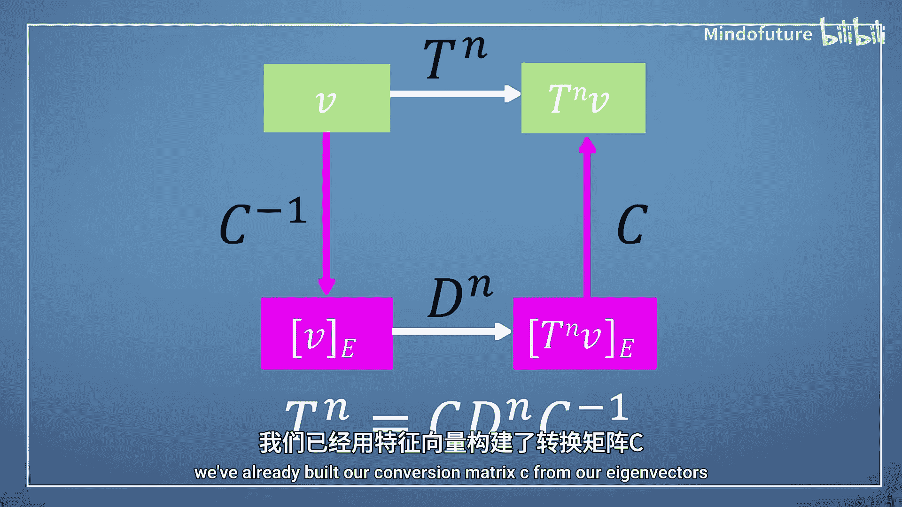

# 【帝国理工学院】机器学习数学：线性代数 ｜ Linear Algebra Machine Learning p33 P33_特征基例子_05_03_02 -BV1AJYDzEESM_p33-

Now that we've walked through the theory of eigenbass and diagonalization。

 let's have a go to simple 2D example where we can see the answer graphically。

 so we'll know whether or not our method has worked as expected。😊，Consider the transformation matrix。

T equals1，1，0，2。Hopefully， you'd feel fairly comfortable at this point in drawing the transformed square and vectors that were used in the previous examples。

As the first column is just 10。 This means that our I hat vector will be unchanged。 However。

 the second column tells us that J hat， the second vector will be moving to the 。12。

 Let's also consider the orange diagonal vector to 0。11。Multiplying through gives us 1，1，0，2。

 multiplied by 1，1。 So thinking about rose times Cols， we're going to get one plus 1 and 0 plus 2。

Which gives us。2，2。It's interesting to consider that this particular transform could be decomposed into a vertical scaling by a factor of  two。

 and then a horizontal shear by a half step。Because we've chosen such a simple transformation。

 hopefully you've already spotted the eigenvectors and can state their eigenvalues。😊，These are。

At lambda equals 1。Our eigenvector is 1，0。And at lambda equals2， Our eigenvector equals 1，1。Now。

 let's consider what happens to the vector -1，1 when we apply T。 So 1，1，0，2。Apply to -1，1。

 This time is gonna equal rose times Cols-1 plus 1 and 0 plus 2。Which equals0。2。

And if we apply T again， we're going to get the following。1，1，0，2， applied to 0，2。

Which is going to equal rose times cause again，0 plus 2 and 0 plus。4。

 so this thing finally is going to equal 2。4 now， instead， if we were to start by finding T squared。

So， T squared is going to equal。This， this matrix。Multiplily by itself。😡，So applying rose times Cols。

 we're gonna get one times 1 times 1 times 0。 So that's1 rose times callss here。

 We're gonna get a3 rose times callss here。 We're gonna get a 0。 rose times callss here。

 We're gonna get a4。Now we can apply this to our vector and see if we get the same result。1，3，0，4。

 multiplied by-11。I's going equal rose times Cos。 So we're going to get -1 plus 3 and 0 plus 4。

 which， of course， equals2。4our。We can now try this whole process again。

 but using our eigenbasis approach。We've already built our conversion matrix C from our eigenvectors。

 So C is going to equal 1，0，1，1。

But were now going to have to find its inverse。 However。

 because we've picked such a simple two by two example。

 it's possible just to write this inverse down directly by considering that C would just be a horizontal shear one step to the right。

 So C inverse must just be this same shift back to the left again。So C inverse。

Is going to equal 1-10。one。It's worth noting that despite how easy this was。

 I would still always feed this to the computer instead of risking making silly mistakes。

 we can now construct our problem。😡，So。T squared is gonna equal C。D squared C inverse， which。

 of course， in our case， is going to equal  1，1，0，1， multiplied by our diagonal matrix。

 which is going to be  one and 2。And that's all squared， multiplied by C inverse， which is 1-1，0，1。

Working this through， we can see that Let's keep this first matrix 1，1，0，1， and work out this bit。

 So we'll say， okay， this is gonna be  one and 4 on the diagonal。1-1，0，1。

And let's work out these two matrices here。 So we've got 1，1，0，1 multiplied by。

 so we're doing rows times columns in each case。 So for example，1，0 times 10。 if we get a1 here。

 we're going do the second row and the first column we're get a0 there。

 first row and second column we're going to get a minus1 there and the second row and the second column。

 we're going to get a4 here。Okay， and then working it through one more step。

We're going to see that we get more， more grinding。 We get first row， first column1。Second row。

 first column 0， first row。 Second column is 3， and second row。 Second column is。4our。

And applying this to the vector -11， we're going to get something like this。So。1，3，0，4 applied to-1。

1 is gonna be rose times Cols。 So-1 plus 3。And0 plus 4。Which equals2。4。Which， pleasingly enough。

Is the same result。As we found before now， there is a sense in which for much of mathematics。

 Once you're sure that you've really understood a concept， then because of computers。

 you may never have to do this again by hand。However。

 it is still good to work through a couple of examples on your own。

 just to be absolutely sure that you get it。There are， of course。

 many aspects of eigen theory that we haven't covered in this short video series。

 including undiaagonizable matrices and complex eigenvectors。 However。

 if you are comfortable with the core topics that we've discussed。

 then you're already in great shape。😊，In the next video。

 we're going to be looking at a real world application of eigen theoryory to finish off this linear algebra course。

This is a particularly famous application， which requires abstraction away from the sort of geometric interpretations that we've been using so far。

 which means that you'll be taking the plunge and just trusting the math。 See then。

