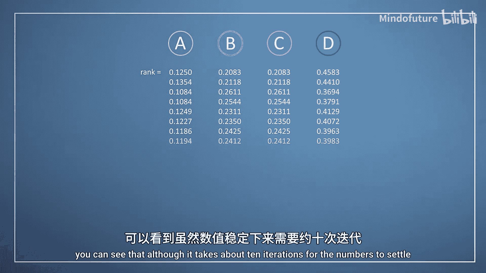

# 【帝国理工学院】机器学习数学：线性代数 ｜ Linear Algebra Machine Learning p34 P34_PageRank 简介_05_04_01 -BV1AJYDzEESM_p34-

The final topic of this module on eigen problemss， as well as the final topic of this course as a whole。

 will focus on an algorithm called PageRnk。This algorithm was famously published by and named after Google found a Larry Page and colleagues in 1998 and was used by Google to help them decide which order to display their websites when they return from search。

The central assumption underpinning page rank is that the importance of a website is related to its links to and from other websites。

 and somehow lien theory comes up This bubble diagram represents a model mini internet where each bubble is a web page and each arrow from A。

BC and D represents a link on that webp page which takes you to one of the others。😡。

We're trying to build an expression that tells us based on this network structure which of these web pages is most relevant to the person who made the search As such。

 we're going to use the concept of procrastinating Pat。

 who is an imaginary person who goes on the internet and just randomly clicks links to avoid doing their work。

😡，By mapping all the possible links， we can build a model to estimate the amount of time we would expect Pat to spend on each web page。

😡，We can describe the links present on page A as a vector， where each row， if either are a1 or a0。

 based on whether there is a link to the corresponding page and then normalize the vector by the total number of links such that they can be used to describe a probability for that page。

 For example， the vector of links from page A would be 0，1，1，1。

 because vector A has links to sites B to C and to D， but it doesn't have a link to itself。😡，Also。

 because there are three links on this page in total。

 we would normalize by a factor of a third so that the total click probability sums to one。

So we can write。L A。Equals。0。A third。A third。A third。Following the same logic。

 the link vectors of the next two sites are shown here。 And finally， for page D， we can write。

L D is gonna equal。 So D is connected to B and C， but not a  two sites in total，0， a half。Half。0。

We can now build our link matrix L by using each of our link vectors as a column。

 which you can see will form a square matrix。 What we're trying to represent here with our matrix L。

 is the probability of ending up on each of the pages。 For example。

 the only way to get to A is by being at B。 So you then need to know the probability of being at B。

 which you could have got to from either A or D。 As you can see。

 this problem is self referential as the ranks of all the pages depend on all the others。

Although we built our matrix from columns of outward links。

 we can see that the rows describe inward links normalized with respect to their page of origin。

We can now write an expression which summarizes the approach。

 We're going to use the vector R to store the rank of all web pages to calculate the rank of page A。

 you need to know three things about all other pages on the Internet。What's your rank。

 do you link to page A and how many outgoing links you have in total。

 the following expression combines these three pieces of information for web page A only。

R A is going to equal the sum from J equals1 to n where ends all the web pages of the link matrix relevant to web page A and location J multiplied by the rank at location J。

 So this is going to scroll through each of our web pages。

 which means that the rank of a is the sum of the ranks of all the pages which link to it weighted by their specific link probability taken from matrix L。

 Now， we want to be able to write this expression for all pages and solve them simultaneously。

Thinking back to our linear algebra， we can rewrite the above expression apply to all web pages as a simple matrix modification。

 So R equals L R。😊，Clearly， we start off not knowing R。

 So we simply assume that all the ranks are equally and normalize them by the total number of web pages in our analysis。

 which in this case is4 so。R equals a quarter。A quarter， a quarter。A quarter。

Then each time we multiply R by our matrix L， So gives us an updated value for R。

 So we can say that R I plus1 is going to be L times R I。

Applying this expression repeatedly means that we are solving this problem iteratively。

 each time we do this， we update the values in R until eventually R stops changing。😊。

So now r really does equal LR。😡，Thinking back to the previous videos in this module。

 this implies that R is now an eigenvector of matrix L with an eigenvalue of one。At this point。

 you might well be thinking if we want to multiply R by L many times。

 perhaps this would be a best tackled by applying the diagonalization method that we saw in the last video。

 but don't forget， this would require us to already know all the eigenvectors。

 which is what we're trying to find in the first place。

So now that we have an equation and hopefully some idea of where it came from。

 we can ask our computer to iteratively apply it until it converges to find our rank vector。😊。

You can see that although it takes about 10 iterations for the numbers to settle down。

 the order is already established after the first iteration， however。

 this is just an artifact of R system being so tiny。😊。

So now we have our result， which says that as procrastinating Pat randomly clicks around our network。

 we would expect them to spend about 40% of their time on page D。

 but only about 12% of their time on page A with 24% on each of pages B and C。

We now have our ranking with D at the top an A at the bottom and B and C equal in the middle。

 as it turns out， although there are many approaches for efficiently calculating eigenvectors that have been developed over the years。

 repeatedly multiplying a randomly selected initial guest vector by your matrix。

 which is called the power method is still very effective for the page rank problem for two reasons。

 Firstly， although the power method will clearly only give you one eigenvector。

 when we know that there will be n for an n web page system。

 it turns out that because of the way we've structured our link matrix。

 the vector it gives you will always be the one that you're looking for with an eigenvalue of one。

 Secondly， although this is not true for the four web page mini internet。

 when looking at the real internet， you can imagine that almost every entry in the link matrix will be0。

 i。e。 most pages don't connect to most other pages。 This is referred to as a sparse matrix。

 and algorithms exist such that multiplication can be performed very。😊，Ffficly。

One key aspect of the pay rank algorithm that we haven't discussed so far is called the damping factor D。

This adds an additional term to our iterative formula。😡，So R I plus1 is now going to equal D。😡。

Times LRI。Plus，1 minus D over N。D is something between 0 and1。

 and you can think of it as one minus the probability with which procrastinating Pat suddenly randomly types in a web address rather than clicking on a link on his current page。

 The effect that this has on the actual calculation is about finding a compromise between speed and stability of the iterative convergence process。

😡，There are over 1 billion websites on the internet today compared with just a few million when the Pagerank algorithm was first published in 1998。

 and so the methods for search and ranking have had to evolve to maximize efficiency。

 although the core concept has remained unchanged for many years。

This brings us to the end of our introduction to the Page ranknk algorithm。

 There are of course many details which we didn't cover in this video。

 but I hope this has allowed you to come away with some insight and understanding into how the page rank works and hopefully the confidence to apply this to some larger networks yourself。

