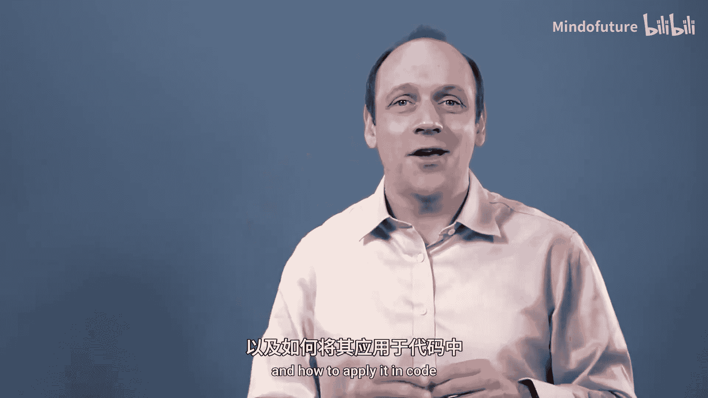
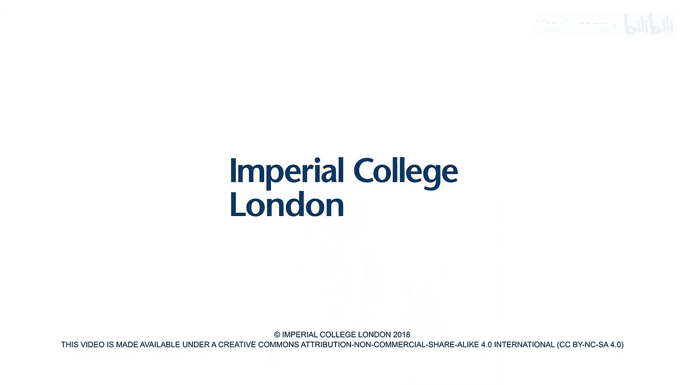

# 【帝国理工学院】机器学习数学：线性代数 ｜ Linear Algebra Machine Learning p36 P36_本线性代数课程总结_05_05_02 -BV1AJYDzEESM_p36-

That's it for this course on linear algebra in our specialisation on mathematics for machine learning。

 our goal was to give you some of the underpinnings of linear algebra in order to enable you to access neural network's machine learning and data science courses more generally。

😊，This is intended as a course for a social scientist engineer or physicist to develop the insight required to access other courses on machine learning tools。

😊，And in order to do useful work in to solve problems with machine learning in the real world。

It's not intended as a foundation for a graduate linear algebra course。

 and nor have we had the time to discuss topics like the cross product that don't have applications in machine learning。

We started out in a course by thinking of some data problems。

 fitting functions to data or the apples and bananas price discoveryover problem。

 which we use to take us on a journey into linear algebra， first vectors and their matrices。😊。

Through it all， you did exercises to try out what you'd learned and then took those into a couple of programming exercises in Python at the end。

😊，This will have given you the confidence to say that you're really getting towards having an intuitive understanding of linear algebra and how to apply it in code。

😊。

If you've enjoyed this course， we continue the journey in machine learning and data science in the next course in this specialization。

 multivariate calculus。 there we look at calculus and how to find the gradients of functions of more than one variable。

 This will let us examine minimization and how to fit models to data once we have minimization and linear algebra and probability。

 You will have all the underpinning mathematical tools and concepts you need to then look at principal component analysis。

 machine learning and neural networks。😊，Sam and Iya and all the team here at Imperial really hope that you found this course valuable and useful and fun。

😊，And of course， we wish you the very best for the future and we'll look forward to seeing you again in the next course。

😊。

