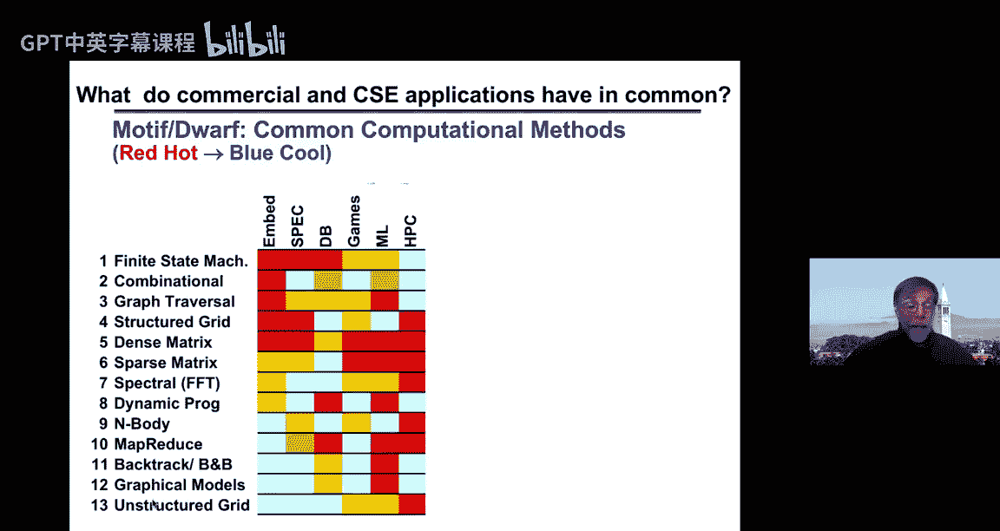
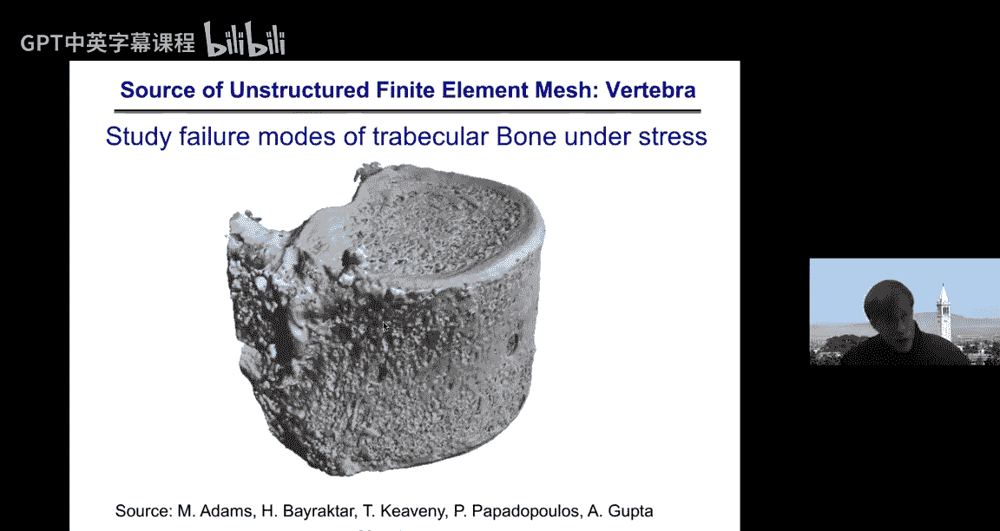
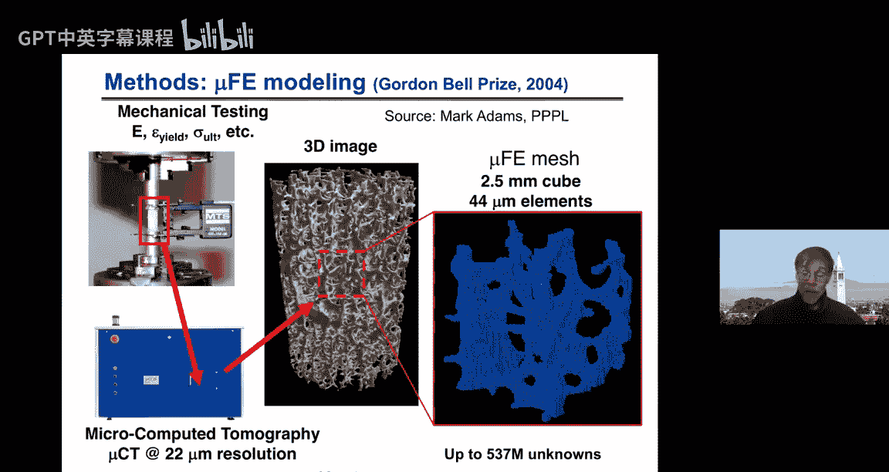
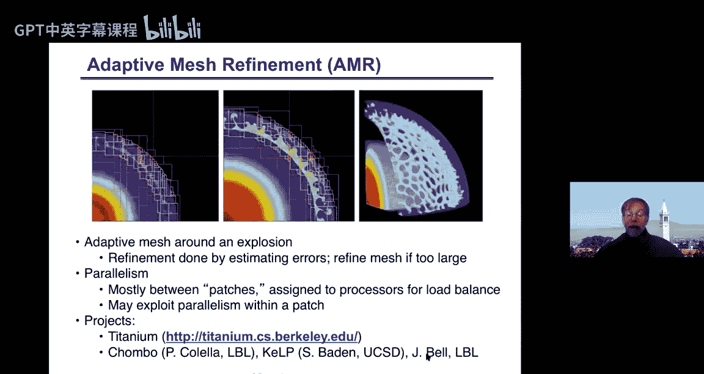
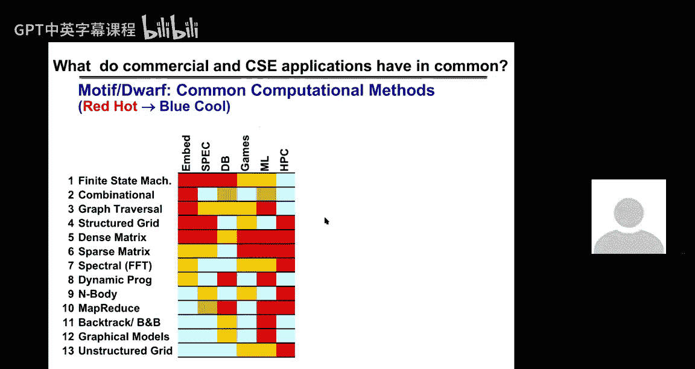
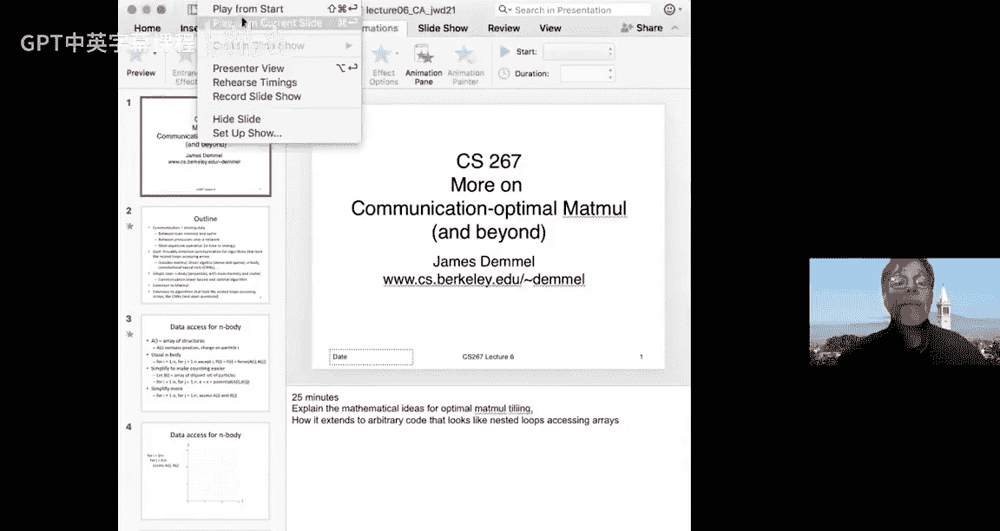
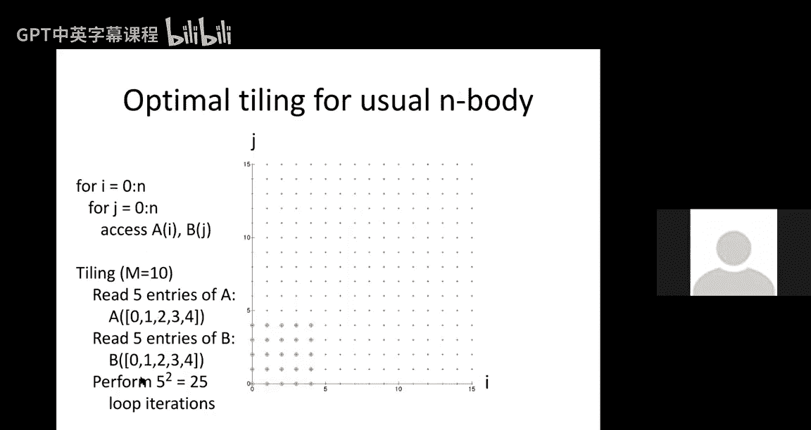

# 【并行计算 CS267 2022】伯克利—中英字幕 p01 CS267 (Sp21) - Lecture 6： Sources of Parallelism and Locality (Part -BV1PS421978D_p1-

Just a quick reminder that the homework 2。1 lab is tomorrow at one。Okay， very good。

 thank you for reminding everybody。Thanks， Julia。So I'm going to start scrolling head to the slide where we're going to pick up from where we left off。

So this is a very quick review， but I will。There we go。

Welcome everyone so we're going to continue with sources of parallelism and there was one I didn't quite finish yesterday and so I just wanted to give you a quick review to motivate the one last topic from ODEs so just to summarize all the different methods that we talked about last time that one of the main takeaways is that they have a common kernel that they many of them need in that sparse matrix vector multiply so explicit methods for ODEs needed to do sparse matrix vector multiply iterative solvers for the implicit methods。

 many of those that are iterative also do sparse matrix vector multiply in the kernel and eigenvalue problems do as well and so that justifies spending a little bit of time on how to parallellyze sparse matrix vector multiply。

So the first thing that we're going to do is talk about what data structure we want to use because sparse matrices are mostly zero so we want to neither store nor do arithmetic on those zeros and so there are a very large number of different data structures that people have invented over time for this here is one of the most commonly used ones and it's called CSR or compressed sparse row format。

And so here is a picture， a cartoon of sparse matrix a， all the white squares are zero entries。

 all the colored squares are non zero entries and so。TheWhat I'm going to do is just store it by row。

 so I'll take the first four entries of。A those are colored in dark red and I'll store those together in an array of values then the second row these three greens and so forth so clearly i'm not storing any extra stuff there except I have to remember in order to use this data structure which column each entry appeared in and so I need another array with that information in it and so the first row the nonzes appear in columns one。

2， five and9 so i'll store one2 five and9 in the second array called index end per indices and so I have all of that。

But I also need to know where does row1 begin， where does row two begin and so forth。

 so I need one more array， which I'll call pointer， which points the beginning of row1， two。

 three and so forth and the last one points to the end。So the question is， given all that。

 how do I implement a matrix vector multiply kernel and the inner loop of that of course is going to multiply AIJ times Xj and add it to YI and so here are the two nested loops that do that。

I'm going to iterate over every row and then in each row I'm going to iterate over all the non zeros。

 so over all these different values， and then I will get the value from the value array。

AndThen I need to find the X that multiplies it， and so I need to get the index array。

 which is a direct， you know man I can find that， but then I have to go somewhere in memory。

 somewhere in the computer and get X。And so that is where all the communication happens because I have to go to some。

know unspecified place in the computer， which could be you know not in cache。

 it could be in a different processor and do this get the data in order to do the multiplication so the question is how do I do that efficiently？

And so let me talk about it in the parallel sparse case。

 and so the questions are which processors are going to store the entries of the y vector。

 the X vector and the matrix， and then once I've decided that which processors will be responsible for computing the entry of Y you know the sparse dot product。

And so what i'm going to do is partition all the rows and assign different rows to different processors。

 so if I have n rows I'll partition them into you know P different sets so here in this case I have four processors so p equals four。

And the goal will be that each processor will store the corresponding and once I assign the rows。

 the processor will store the corresponding entries of Y。

The corresponding rows v and the corresponding entries of x。

So then when I want to do these matrix vector multiply。

 I have an entire each processor has an entire row。

 it needs to go get the entries of X that it needs， which it may own or it may not own。

 it depends on where the nine zeros are， and then it can update the local entry of y that it owns。

So the question is， how do I compute this partitioning in order to maximize performance？

And so what would the ideal data structure look like？嗯。And see did I skip aside？So yes。

 so what would the ideal data structure look like that would require no communication and be perfectly load balanced my matrix would magically be blocked diagonal and in this case I would have each processor would own its own dense green little square it would own all the entries of exit it needs and it would own all the entries of y that it needs and so every processor can work in an embarrassly parallel fashion by doing a local dense matrix vector multiply。

And so of course not every sparse matrix looks like this that's why it's an interesting problem in fact you know most sparse matrices if you just write them down will have nonzes scattered everywhere requiring communication and so the question is how do I make my matrix look as close to this as possible given the freedom that I have to reorder the rows and the columns？

And so what are my goals in this reordering well for one thing I want to balance the load I want to I can always minimize communication by only letting one processor do everything but that's not a goal of parallel computing so how do I measure the load well for every nonzero in the matrix I'm going to do one multiply in one ad and so I want to approximately assign an equal number of non-zes to each processor which is not necessarily an equal number of rows it depends on what the pattern looks like。

I also would like to balance the amount of memory needed and that's pretty much the same problem I'm going to give each processor equal number of non zeros。

And the interesting problem is minimizing communication so that what what that means is I want to minimize the number of non zeros outside these you know diagonal blocks those are all local computations it's all the non zeros out here that I want to avoid。

And then there are a lot of tricks from homework one that you can also use where you can cluster the non zeros in the diagonal blocks and elsewhere into smaller blocks and do loop unrolling and vectorization and all of that。

 but that's a separate topic。So that's our goal and we're going to see that that turns into a problem that we've studied before in this class。

 it'll be a graph partitioning problem。Okay， so I want to remind you of the relationship between sparse matrices and graphs they're going to be synonyms throughout this course and so here is a sparse matrix and here is the graph to which it corresponds and so there is one vertex and I've chosen to keep it simple a symmetric matrix so if the one4 entry is nonze the41 entry is also non-ze I can also handle non-symmetric matrices but you know let's keep it simple for now and so there is one vertex in my graph for every row and column and for every non- zeroro you know for example connecting one to four there's an edge connecting vertex1 to vertex4。

And the vertex four to one means this edge goes in both directions， so it's an undirected graph。

And so the edges in this graph represent the non zeros in the matrix and the question is how should I partition this graph。

 which means partition this matrix into different subsets of rows and columns in order to best。

Assign work to processors and so let me just try an example partitioning and so I've partitioned the graph and the matrix in the same way。

 so one and two belong to one partition three and four belong to another partition and four and and five and six correspond to the last partition。

So how do I measure the amount of communication that would be required to do a matrix vector multiply with this matrix by looking at this graph well every one of these non-zes that's not in a block diagonal is going to require communication for example。

 you know this would be required a communication per the processor one who owns that and processor two who owns that and that corresponds to an edge from this partition to that partition so every edge crossing that you see here corresponds to communication。

And so that is what we want to minimize by choosing this partitioning。

And so this is a common problem that we've seen before in this lecture。

 we talked about it when we were doing domain decomposition and trying to assign nodes in a graph to different processors and so graph partitioning will be seen many times during this semester it's sort of a ubiquitous problem and we'll have a whole lecture on it later and I'm just trying to motivate it right now。

And so to summarize the common problems that we've seen so far。

 there's graph partitioning which came up as I said。

 in discrete event simulation and Sprse matrix sector multiply and that's when you the workload doesn't change over the course of the algorithm sometimes it has to be done dynamically too if the load changes significantly during the job and that could certainly happen we saw that in in the game of life because particles move around and so the workload could change and we'll see it in PDEs as well which is the second part of this lecture so we saw linear algebra and lots of cases solving linear systems eigenvalue problems and we also talked about particle methods。

And so just to remind you of a slide you've seen before， we've， as I said， we've talked about so far。

 we've identified dense linear algebra， sparse linear algebra， FFTs， and body codes。

 and embarrassingly parallel stuff as kernels that we need to solve in order to do these high performance computing problems that we solve。

And there were two others that we mentioned that were done in this report that looked at all the different HPC applications in the Department of Energy and tried to identify the kernels and then the next part of the lecture we'll see where structured grids come up and unstructured grids structured grids meaning there's a certain amount of work associated with each point on a mesh and you have to talk to your nearest neighbors unstructured grids is the same idea except it's for a general unstructured graph so when this report came out recall it was called these seven small kernels were called the sevens dwarfs and then there was a subsequent report written where a bunch of Berkeley faculty said okay this is good enough for high performance computing what are about the rest of the Silicon Valley and so we looked at machine learning and games and databases inspect benchmarks and we said which kernels come up there and we identified six more so for a total of 13 and so what are the new ones finite state machines combinational logic。

erssing graphs， dynamic programming， backtrack branch and bound graphical models and these came up all over the place and so of course now that we have 13 we can't call them the seven dwarfs anymore well it turns out they're worth 13 dwarfs in the hobbit so we couldn't have continued to call them dwarfs but maybe you know next year we'll have 14 or something like that and so now we're calling them motifs。

And then this heat plot which again you've seen before。

 indicates how important each kernel is in each application area。

 so red means it's used very much so dense linear dense matrix dense linear algebra is used you know an HPC and machine learning and games and so forth。

Yellow means it's used， you know， a lot， but not quite as much green it's used a bit and blue means not so much。

So that is the end of the lecture that I wanted to finish last time。

 and so next we're going to go on to PDEs。So while I'm preparing that。

 let me ask if there are any questions。

So now I can see the chat window again and it appears that。

My co instructorors are doing a good job of keeping up on all that。So let me move on now to。

The next one。

Okay。Again， sources of parallelism and locality， part two。

And so this review we don't need to really do since we just did it already。

 we're working our way through our list of discrete event systems， particle systems， ODEs and PDEs。

 and PDEs are what we're going to do today and as we're going to see again。

 the common problems are load balancing and maintaining locality and dealing with the constant tension between these two。

So let's go into PDEs。And so it turns out there are three different kinds of PDEs and they're going to be two different ways of paralyzing them and again as last time you don't have to understand the mathematics or the physics。

That goes behind setting up these problems。I just wanted to emphasize that there's certain patterns in how you paralyze and they come up over and over again。

And so the first class of PDs are called elliptic problems and these are for things like gravity or electrostatic forces and what you have to know about it is that at every point in space you want to compute a function like a potential that depends on the position only so it doesn't change with time and what makes these the very challenging is that the answer at every point depends on the answer everywhere else so you need global communication in order to get the right answer。

The second class of problems is basically the wave equation。

 so you have waves moving around which could be light or sound or earthquakes or whatever you like。

 and so for example， in the case of sound you're trying to compute the pressure as a function of position in time and these are paralyzed in a quite different way because information can only move at the speed of sound or light or an earthquake and so you only have to talk to your nearest neighbors in the graph in order to update the value you're interested in the pressure at each time step。

And then finally there's a third category which combines both of the parallelization issues above and they're called parabolic problems and those are time dependent so we'll have time steps but at every point in time the answer depends on everything else on the data everywhere in the system and so the canonical example that will use for that is heat flow and where you're trying to compute the temperature is a function position in time and so what's interesting here is I said the temperature at time step at the next time step will depend the temperatures everywhere at the preceding time step so in other words information moves infinitely fast which of course violates relativity but you know this equation has been used for several centuries since Fourier wrote it down and it' the standard way that we model heat flow but it applies to diffusion and other quantities as well。

So I want to distinguish here between global and local dependence I did already。

 so in the case of elliptic problems， it's globally dependent。

 the answer at every point depends on the data everywhere。Hperbolic problems， the wave equation。

 it's only finite that's local dependence and parabolic combines the two and of course real PDEs。

 like if you're trying to compute fluid flow by solving na stokes。

 they have all three of these flavors of equations sort of bound into them same thing for elasticity。

And so I'm going to pick a very very simple model problem。

 which will illustrate all the issues and you know tell you give you enough intuition as to where it comes from and this is the heat equation on a。

Metal bar of length one where one end is red hot and the other end is icy coal in water and what I'd like to do is to figure out the temperature at every point in between at every at every position X which is between zero and1 and every time t as t goes forward so u is the temperature so what did Fourier write down or observe two centuries ago what I what the question is。

How fast does the temperature at this point x change with respect to time so that's DDT of the temperature and so here's the simple physical intuition so let's suppose that the temperatures at my left neighbor and myself and my right neighbor are minus1。

 zero and plus1。So what is going to change with x， well x is exactly halfway in between the two neighbors。

 and so it isn't going to want to change at all。What if the temperatures are plus one zero and plus one so my neighbors are hotter my temperature is going to go up how do I capture that in a simple linear way will it take the difference between my temperature and my right neighbor。

Between my temperature and my left neighbor and I will subtract and you know I'll divide by the distance between them。

And so this captures exactly that physical intuition and if you let H go to zero。

 this difference operation converges to the second derivative so that is the heat equation so that is what we want to solve and it turns out we've done almost all the work we need we're going to use exactly this formula in the algorithm where I just need to know my nearest neighbors in order to update the temperature at every time step。

And so there's a heat equation again。And I'm going to basically use the same idea I used in ODEs in order to solve it。

 I'm going to start with something called Forward Euler to approximate the time derivative。

And so I'm going to approximate the time derivative by taking the temperature at time t plus delta minus the temperature t dividing by delta。

 and I'll use the same formula as on the previous slide to approximate the second derivative and so the issue is that I'm going to know the temperature at time t I'm going to want to solve for the temperature at time t plus delta。

And that's going to be very， very easy， so let me just do a little algebra let me simplify this since my temperature appears in two places。

 let me just combine those into one term。And then I'll solve for the temperature at the next time step。

 and it's very simple because it only appears once。

 so if I know the temperature everywhere at time T I just take this little linear combination and I get the temperature at time T plus delta。

So this constant appears you know just all the time。

 so let me just abbreviate it so the conductance times the time step divided by the space step squared。

 and so I get this very simple linear combination of three values to go from time t to time t plus delta。

And of course I don't want to evaluate this at every t and every H。

 I only want to do it at discrete time step so H and 2H and 3H and times delta and 2 deta and 3 delta so let me change this function to an array indexed by you know how many steps I'm taking and so this is the simple thing that's going to appear in the inner loop of my algorithm。

 take nearest take three values in the array that are nearest neighbors and take their weighted average to get the new temperature。

And so let me i'm just going to draw this again and do it graphically and so what i'm going to do is think of all of my。

Yeah。Have this grid in the I and J direction so my material is sort of going from left to right you know is J goes from you know zero up to the top and so and this is time step zero this is time step one this is time step two and at every point when I know all the temperatures at a certain time step i'll just average these three you know values to get the temperature at the next time step and so I can write this down is two nest loops I iterate over the time steps and then for each point on the bar I compute this linear combination。

And I hope that you will recognize that this is really just doing a very simple matrix vector multiply by a very simple matrix item we call T。

 T will stand for tridiaagonal because there are only three non zeros in it and so I'm just combining nearest neighbors on a grid。

And so let me write that formula again up there， that was the inner loop of the algorithm on the previous page。

 and then if I write it down for all the different values of J， all the positions。

I'm going to use MATLb notation and to get from the eighth solution at time I to the i+ first time。

 I'm just doing a matrix vector multiply with this matrix T。

Where every row is basically the same and it's you know z times my neighbor to the left one minus2 z times my value z times my neighbor to my right and let me simplify that a little bit let me pull out the ones from the diagonal and get the identity matrix and then everything else is a factor of z in it so let me pull that out and I'm left with this matrix L and L stands for Laplaceian in this case the 1 d Laplaceian which is going to be you know come up ubiquitously in know science and engineering and it's minus ones twos minus ones and so this is the one dimensionmensal case and so I can also draw by simply saying here's my one dimensionmensal bar here the evenly spaced points which I want to measure the temperature and at every point I'm going to apply the same operation。

1 minus2 z times my value and z times my neighbors and add them up and so this is called a stencil because I'm doing it the same way everywhere and three point stencil obviously and this is the 1D case for the 2D case which is going to be much more challenging this lapplene will have five diagonals in it pentadiaagonal and and that's because of course I have to average not just my left and right neighbors but with my neighbor above me and below me。

And that's where the interesting parallelization and challenges will be that the one dimensional case is quite simple。

So how am I going to parallelze this in the one dimensional case and its sparse matrix vector multiply again just as we saw before for ODs。

 and so again I will use graph partitioning for the general problem。

And so in the 1D case if your intuition is good enough to see exactly what to do。

 I'm going to partition the space， you the iron bar in this case。

 into pea chunks or peas and number of processors so that I can have good load balance。

So every processor will get an equal amount of work to do and to minimize communication so that I have to send as little data as possible from one processor to another。

 and the obvious intuition here is if I have four processors and 12 points， everybody gets a chunk。

 every processor gets a chunk of three adjacent nodes to compute。

 it's obviously load balanced and there's only one communication between each neighbor pair of neighboring processors and you obviously can't do better than that。

And so this is the 1D case， this generalizes to multiple dimensions in arbitrary graphs or arbitrary sparse matrices。

And this is very commonly what's done for hyperbolic equations because as I said。

 you only need to talk to your nearest neighbors。Now here's why it's going to be a problem and why we have to think of different algorithms for the heat equations and that is that this is not a numerically stable algorithm。

 that means that if this quantity here， which was you know z which appeared in the inner loop。

 which was the conductance times the time step divided by the space step squared， if it's too large。

 it's bigger than one half， then the。The solution is going to blow up it's going to be unstable and I'll show you a picture on the next slide。

 so that means that we have to make the time step very small when each is small so let's suppose that I want to。

Refine my mesh to get a better and more accurate solution， and I decide to make H 10 times smaller。

Then that means that the time step has to get100 times smaller and that means the overall cost of the algorithm will be a thousand times more。

 so that is why you know the an explicit approach is not going to be good enough but let's just look and see what happens when we try it anyway and so here is a plot。

In two cases， one where that quantity Z is just less than a half。

 so it should give us the right answer， it should be stable and where it's just greater than a half。

From left to right is the length of the iron bar， it goes from there to there。

The vertical axis so the iron bar at the beginning is red hot in the middle and it's ice cold at the end。

 so we expect that you know if we keep the boundary conditions cold we expect the bar to cool off and the axis coming out out of the slide is time and indeed it's cooling off until it all finally settles down to the temperature at the end point as we expect but if I try to take a slightly larger time step you know and I set z equals you know 0。

58 and it eventually blows up so we can't really use this algorithm very well。

So what do we do instead just as in the ODE case instead of doing a simple matrix vector multiply we' going have to solve a linear system at every step and so what is the linear system here for the heat equation so there's a heat equation again and so just as I switched from forward oiluler to backward Oer for ODEs I'll do the same thing here and so this is the formula that I had know to relate you know the answer times step t plus delta to t and all I did to change it from before is I changed the second derivative evaluated a t to t plus delta so all of these red t plus deltas used to be t。

So now let me put them all on one side and what I need to do is solve this equation for the solution at T+ delta。

I have this linear combination now， so that is a system of linear equations。And again。

 let me do the same kind of you know， change algebra that I did last time I'll take this constant call it Z。

 I'll just look at the answer at time steps delta to delta3 delta and at H2 H3H and change my function u to this array u。

And the equation becomes using notation that I've done before to solve for the solution at time step I plus1。

 I need to solve this linear system with that same matrix L。

 the lapplium that I had before so the difference is now before I had I minus ZL multiplying u at the I time step and now I have to solve it with it on the other side。

So this is actually not a hard system of equations to solve the matrix is tri diagonal。

 you can do it using Gaussian elimination and it's very very cheap and no problem at all。

 but it's when we go into 2D or 3D or more general problems it becomes an interesting challenge。

So for those of you who might be experts let me just say that acknowledge that there's something that's actually done in practice。

 but everything I've told you is relevant so the previous slide derive backward oiler solve the system of linear equations what people do in practice is something called the trapezoidal rule but it has every ingredient that I talked about before you start with a sparse matrix vector multiply times the data you know at time I and it's almost the same matrixes before I've just changed z to z over  two and then you solve a linear system and it's almost the same linear system instead of Z you have Z over two。

And so this is what people actually do in practice。

 so you need both a sparse matrix vector multiply and to do a all。And other problems， for example。

 if you're solving elliptic problems instead of parabolic。

 they yield something that's very similar called Poisson's equation， and that's just L x equal to be。

 but it's the same L matrix as before。So let me just tell you a little bit more about Poisson's equation and where it comes from。

 and this will be sort of the last slide of physics before you know I go on to the algorithmic part。

And so Poisson's equation which was L x equal B where L is Laplian arises in gravity electrostatics in a whole bunch of other places。

 and let me just tell you where it comes from you using freshman physics。

 so we all know what an inverse square law is if I have a particle at the origin and a particle at a position X。

 Yz， the inverse square law says the force on this particle is a vector from particle zero to particle X Yz scaled。

So it goes down by one over R squared where R is a distance。

So what you can observe is that you don't have to compute the force， you can compute。

Scalar function instead called the potential and the potential is simply minus one over the distance and it turns out that if we know that function we can get the force by just differentiating the potential to get the gradient and this potential satisfies Poisson's equation which is right here and so that is why Poisson's equation you know Laplacesian times x equals right hand side is know so useful。

So what does so the 1D case is very simple so let's look at the 2D case and see what the challenges are and there are going to be a lot of different algorithms that people can use for this and for the 3D case so now instead of having an iron bar the simplest thing is a square and I know the temperature on the borders and I want to know the temperature inside and so。

The equation says that I'm now not just going to multiply by you know two times my own value and minus1 times my neighbors because I have more neighbors。

 I'm going to take four times my value and minus one times all my neighbors。

And when you write down the matrix that this corresponds to this is what you get and so in what I need to do in this so I have this is a three by three mesh。

 all these mesh points on the are boundary conditions so they're known the only unknowns is this are these nine values on the inside and so I have to order them in some way to turn them into a vector so I can multiply it by matrix let me just order them1。

2，3，456，789 and so this each row will turn into a four with minus ones on the left and right corresponding to the minus ones on the left and right here and then there's another minus one farther away corresponding to your neighbors above and below。

And so the question is， you know， now I can't simply use Gaussian elimination and have a simple linear algorithm it doesn't work anymore。

 and the three dimensionsal case is analogous except now of course I'll have two more neighbors。

 five altogether， you know coming out of the board and coming into the board。

So this often comes up in if you like office hours。

 let me just give you a sample of office hours and the kind of conversation I often have with a student so a student will come in and say I need to solve a system of linear equations。

 what can you recommend so given that much information I say well there's Gaussian elimination or something called dense LU if you have an end by end system that costs you and cubed and so that's the standard algorithm lots of great software for it？

And then the student says， well， that's too slow。And I say well tell me some more about your matrix and then they say well actually my matrix has a lot of zeros in it if you look at the upper corner here in the lower corner here they're all zeros all the non- zeros are right around the diagonal and then we talk a little bit more and figure out how wide this band is where the non-zes can be and I say oh there's an algorithm called band L band Gaussian elimination that doesn't have to do any work on those non-zes and the complexity goes down from n cubed and squared you must be happy now it's much better right？

And they say， yeah， that's still not fast enough。And I say， well。

 tell me some more about your matrix and they might say， well。

 I actually know a lot more about my matrix for one thing it is positive it's symmetric。

It's positive definite that means all the eigenvalues are positive。 In fact。

 I happen to know what the largest and smallest eigenvalue are because it's kind of a special matrix and in fact。

 there are a lot more zeros in the matrix there's if you look at any one row。

 there are only five non zeros in it。😊，And I say， oh， that's a。

There's another algorithm that's really good for that it's called conjugate gradients and it gets your complexity down to end of the three halves and they say that's still not good enough and then I say well what problem are you really trying to solve and they say well I have this square plate of metal and I know the temperature at the borders and I'm trying to figure out the temperature everywhere inside and I say oh you're trying to solve Poissons equation you should have told me that。

In that case， there are two nearly optimal algorithms， ones based on the Fast Fourier transform。

 it runs in time n log n， and there's another algorithm which is actually asymptotically optimal called multigriit。

 it runs in order in time and of course n is a lower bound because just to print out the answer it costs you order n。

So there are a lot of other algorithms that on this table and that's because depending on the properties of your matrix。

 you any one of them may be the best thing to do， so these are sorted in order from the most general dense Gaus elimination to the most specific these work basically you know FFT and multigrader are good not just for Poisson but for elliptic partial differential equations more generally。

 and they're also obviously sorted by complexity。And these are and the black numbers black formulas are for the 2D Poisson equation and the red ones are for the 3D Poisson equation slightly different and there's some other columns here which are the complexities and some magical。

Pllel computing model called PRAM where you have as many processors as you can possibly use and communication is free。

 but you know these are just sort of sketches to say that these are also sorted in order of how well they parallellyze and there's lots more details in these office hours if you're interested so I will just you know you can read this at your leisure if you're interested in more details。

So given this long list of algorithms， how would you actually choose which one to use？And so。Let me。

Just。Pull up some notes here just a moment。So this is some data from a very old paper and so but it still illustrates the point that I want to make。

 so this is a thousand processor machine that ran at a whopping 1。

8 gigaplops so sort of like your laptop these days and they tried running three different solvers for a problem that was limited by basically the same problem I had before Jacobbe Gausciellan multigrid three which were three of the algorithms in my table there and there。

And what is indicated here is how many operations they perform。

The time it takes the solution and how fast they run。So if you were only interested in raw speed。

 megaloopps per second， then Jacobbi would be best and multigrid。

 because it's a more complicated algorithm， runs much more slowly。

 like six times more slowly in terms of floopps per second。

But if you look at the runtime it is about 300 times faster you know7 versus 2124 and so even though we can't quite get the same performance on this multigrid solver。

 obviously the fact that it's a more efficient algorithm means that is what you want to do so obviously which solver would you select it's multigrid andre often these tradeoffs and algorithms。

 I mean here it's obvious what to do， but you know for other matrices and problems and algorithms sometimes a tradeoff is much more subtle for homework one every algorithm is performing the same number of flops so flops per second and CPU times are will give you the same sorted order in homework one but not always。

So let me summarize our approaches to solving PDEs and it's sort of analogous to what we did for the ODEs。

 there's explicit methods where you can have sparse matrix vector multiply as a kernel once again and implicit methods where you have to solve a large sparse linear system at each step and those breakdown into both direct solvers sometimes you use sparse Gaussian elimination and sometimes you use iterative solvers and again the inner loop is going to turn into sparse matrix vector multiply and so graph partitioning appears once again。

So not all nearest neighbor computations have the same efficiency because it depends on the relative cost of communication and how much work you're doing at each mesh point。

Okay， so are there any questions at this point in the chat before I go on to what more realistic meshes look like because so far I've just been doing 2D and 3D meshes where things are the best understood。

 but in practice the meshes that people deal with are much more irregular。So。

Do my co instructorors want to ask forward any questions？Okay， I'll continue then。

So let me talk a little bit and show you some cool pictures of practical meshes and so one of the reasons I told you about these nice regular 1D 2D and 3D meshes。

Is that they're often building blocks for more complicated ones。Which。

 you and in the real world when you're trying to simulate something。

 practical emotionss are often quite irregular。So the first example I'll show you is where you can build something irreular by just building composites of regular meshes。

 so you know you're trying to you know approximate you'll see a bridge abutment and you can just use that as a bunch of rectangles or cubes all you know glued together at their edges。

You can also have completely unstructured meshes with arbitrary mesh points connectivity that comes out of finite element modeling quite frequently。

 and then the most challenging case are adaptive meshes where the mesh actually changes over time and because you you're trying to follow for example。

 a flame front and the flame is moving what do you do about that and so you have to change the mesh from time step every you know time step to time step or hopefully less frequently。

So let me just show you some examples of how this works so here is a composite mesh。

 a sparse matrix that might know correspond to some mechanical structure you can imagine a chunk of a bridge and so every one of these rectangular looking objects is a perfectly regular mesh and so each point in this graph represents a row or a column in your matrix and if there's an edge from that point to that point then that means there's a non-zero in that location。

And so what I need to do is turn this less regular graph。

 but it's still pretty regular into a matrix and to do that I need to assign numbers to all the different mesh points so let's just do that in a perfectly natural way。

So this first nice regular seven by seven mesh I'll number those mesh points from one to 49 the next six by7 mesh so the next 42 points I'll number them consecutively and just work my way around and so if I just look at these green the first 49 nonzes it's a nice regular mesh and that corresponds to these green dots in the matrix and it's a nice simple band structure it looks like the stuff we've done before and if the whole matrix looked like that I would know how to solve it。

And this next blue chunk of 42 corresponds to that blue chunk。

 this next pink chunk corresponds to that pink band matrix。

 but of course there are other nonzes colored in red because these different chunks are connected to one another so for example。

 these red chunks which glue the green and the blue together correspond to these little red dots which are off the diagonal。

And so I have lots of those， but notice now that when I get here since I can't number everything kind of consecutively。

 this pink chunk is connected much to this green chunk with a much higher number。

 and that corresponds to all these nonzes which are way far away from the diagonal。

And so the question is， how does this affect the cost of my doing linear algebra on this particular matrix？

So let me show you an example of what would happen so this is also going to be another graph partitioning problem let me but it's going to come up in the context of using a direct solver Gaussian elimination or actually a variant of that called Kleski in this case so what I've drawn here is a picture of that sparse matrix that I've shown you before except now I've just colored everything in black so all these black dots represent non-zes and there are a total of about 4000 of them and now what I'm going to do is Gaussian elimination on it but when I do that remember Gaussian elimination adds multiples of one row to another I'm going to fill in a lot of entries that used to be zero and fill them in with non-zes and that's going to raise the cost significantly and so what I've done here is drawn a picture of where all the new non-zes are so the black dots correspond to the original black dots I had to have memory for them anyway and the red ones are all the new non-zes that。

I have to fill in and compute and you can see the number of non zeros has gone up from about 4。

000 to just under 12，000， and it cost about 300，000 floating point operations to do this。

So what can I do about this to improve it well I can reorder the rows and columns of this matrix。

 it's still going to be the same matrix， but I'm going to get a different you know I'm just going to get my answer in a different order and it turns out that you can use graph partitioning on this graph or sparse matrix in order to come up with this matrix。

And these two matrices are actually identical， they only differ in the order of the rows in the columns。

 and when I do it do now do kleski or Gaussian emination。

It is much more efficient the number of non-zes goes down from 12000 to 8000 and the amount of work goes down from 300000 flops to 200。

000 flops This is a very small problem and if I were doing this in a much larger more realistic one you know I would get very large factor speedups so this is yet another you know reason we have to worry about you know ordering things and that will also tell us how to parallelze it so you know in addition to lowering the work we also want to parallellyze it and the graph partitioning will let us do that too we'll have a lecture on that later。

So here's an example of a irregular mesh， if you have MATlab open I think you can just type load airfoil。

 mat and you'll get this and you can plot it and so now you can see that the mesh is much。

 much finer around the tips of this wing and that's not surprisingly because the engineers want to have much more finer resolution about the turbulence around these parts of the wing because that's where all the interesting physics happens。

And so when I plot the matrix for this， it is much less regular than it was before and you can see the black dots scattered around。

 but if I choose the right ordering I can keep most of the things close to the diagonal so I get relatively little fill in and again。

 I have to choose this order very carefully in order for this to happen。

So we can also produce irregular meshes by generating them ourselves using an algorithm called multigrid so here is an example of a nice regular mesh on a tube so it's a hollow tube and so what I want to do to solve this is to come up with a coursear approximation solve the course approximation and use that as a starting guess so here's the trick I will take this mesh and throw away every other mesh point。

So it's about half as big and then if two mesh points used to have a common neighbor that they were connected to then i'll reconnect them with a new edge so that goes from this you know tube with you know n mesh points to about n over two mesh points and it still has a very similar structure but it since it's so much smaller my approach is going to be to get an initial solution on this and use that as a starting guess for this coarser one for this finer mesh now how do I solve this problem it's still pretty large it's half as big。

But if that idea of going from find to course was a good idea， let me just do it recursively。

 so I'll take every other mesh point again and I'll get this thing here that looks kind of like a tube and I will solve it use that as a first as a starting guess for this one and use that as a starting guess for that one repeat that recursively and eventually it doesn't really look like a tube anymore but it still recursively a very good algorithm and that's called multigrid and we will you have lectures on that later in the regular case。

So here's a much more practical example， and this is a joint project that was done a number of years ago。

 professors Kibany and Papadoous in mechanicalchan engineering and a joint postdoc Mark Adams。

And so the motivation here was understanding bone density problems in elderly patients。

 so it's well known that older people， their bones become less dense and they're more subject to breakage if they fall and so the question is how does a doctor diagnose that and give a recommendation the standard approach is to take a little bone sample and measure the density if the density falls below a certain threshold the doctor gives a warning and produces some recommendation for the patient but it's a very coarse approximation and so what these folks wanted to do was use finite element modeling to get a very accurate model of how strong the bone was？

And so here is a real bone from a cadaver， and the question is， how do you measure its strength？

And so what they did was they built a finite element model of this bone， how do you do that。

 you put it in a micro CTt scanner。And you scan it at a 22 micron resolution and you come up with this three dimensional image of what this bone looks like or a small section of that bone。

And as you can see， bone is mostly air， and of course it becomes even more air as the bone density decreases。

 and then they produce a finite element model based on this image and of just a little 2。

5 millimeter cube subcube of this larger bone， and it turned into a matrix with half a billion unknowns。

And so the question is， how do you solve this quickly and that is something that they used multigrid for and back in 2004 when they did this work。

 they won the Gordon Bell Prize for it， which is a prize giving it supercomputing for sort of the biggest fastest cool application that uses a large parallel computer at the time。

And so here's another example also from Berkeley done by a colleague Philcoola at LBL and in this case they're trying to simulate a supernova and so here you can see a star exploding and over time the front of where the outside of the supernova is moves out and so this is a two- dimensionsional slice through a three dimensionional mesh and as you can see the mesh becomes much much finer around the outside where all the action is and eventually here's sort of the these are 2D slices here's a 3D picture and so what you have to do is change the mesh over time。

And this is a very complicated software engineering project。

 even if it weren't parallel and of course it is parallel。

 and so there have been a number of projects over time， in fact。

 a whole programming language was invented at Berkeley called Titanium in order to make this programming easier and there have been projects called Chambo at LBL help at UC San Diego and John Bell has another system at LBL to do this kind of stuff。

Okay and so there are a lot of challenges as you can imagine from these irregular meshes。

 how do you generate them in the first place you can start from a geometric description of an object and use a finite element model but if all you have is a geometric description then how do you generate that well there's tools that people have built over time for that for example there's a package called triangle which is good for 2D mesh generation generates an optimal 2D mesh in a certain way by our colleague John Finuchchuk and he also has a package in the 3D case。

So then I mentioned graph partitioning， how do you decide to assign which subset of the sparse matrix of the graph to which processor and there's lots of different packages I'll just mention one here called Parets we'll have a whole lecture on that later and then there are all these iterative solvers whose names I've mentioned in passing like conjugate gradients in Jacobbe since these are so widely used a great deal of software engineering work has gone into providing solvers for them so you don't have to write them yourself so Pepssi is one example will mention later where know all these algorithms have been paralyzed so what is you your responsibility as a user is to of course you know come up with the right data structure and representation for your sparse matrix using these other tools but then the algorithms themselves have been implemented and so if you recognize that you need to use an existing multi-grid or condugate gradient solver then by all means you should use one of these existing packages。

And in addition to the iterative solvers， there's also some great solvers available for direct versions of Gaussian elimination where the matrix is sparse。

SuperL being one such example。And which was also a Berkeley project。So just to summarize。

 there are seven dwarfs that we've seen， we've just seen two more that came up in PDEs。

 structured grids， which I use the heat equation to illustrate and unstructured grids like bones and supernova but many other places as well。

 so now we've finally seen all seven of them。And so I'll just put up this picture one more time to say we've now covered all seven that are in this last column。

 but we will certainly have lectures later in the semester on graph algorithms and all sorts of other things to illustrate the other ones。

So at this point， that is the end of。The second part of today's lecture。

 and I'd like to know if there are any questions while I move on to the third part。So。Coinstructors。

 is there anything should I move on？No questions I have。 Okay， thank you。

Let me now。Try to share。The third part of today's lecture。Swe。

Wwhich is on the ideas that on communication optimal matrix multiply and this was the idea of tiling in homework one。

 but it turns out that the ideas in that optimal tiling extends not just to homework one but extends much more broadly beyond matrix multiply and of course it also is going to extend to the parallel case so we're going to mostly stick to the sequential case today。

 but all the ideas will come up later when we talk about how to use parallelization in minimize communication。

So just to remind you of the motivation here， communication， that word is means moving data。

 which could either mean between main memory and cache or between processors over a network and as we've said many times in this course and we'll say again it's the most expensive operation on a computer whether you measure in time or energy so what we want to do is minimize that and so our goal are in this goal is to take any algorithm that looks like nested loops accessing arrays so of course matrix multiply that's three nested loops accessing three arrays but there's an awful lot of other algorithms that qualify all of linear algebra you could think of as nested loops accessing arrays。

 the endbody problem， convolutional neural nets you name it and what we'd like to do in all those cases is to generalize the tiling that you did in homework one to minimize communication for all those different problems。

And so what we're going to do is do the simple case which is inbody where we just have a main memory in cache and that's just two nest and loops and that will be easy to see what you know your intuition will be more than enough to see what the lower bound is and what the optimal algorithm is and then we'll talk about how to extend it to matrix multiply and then hopefully we'll also tell you how to extend it to the general case now there's a lot of hard mathematics that I'll just sketch but I'll give you a few more details in the case of convolutional neural net and there's still a bunch of open questions in this area。

So so let me tell you what the end body problem is and this is the simplest case。

 I'm going to take all pairs of particles and the particles are represented by an array。

 so a sub I contains， for example， the position and the charge on particle I。

 and I'm going to loop over all pairs of particles I from one to n J from one to N and for every distinct pair of particles I'm going to compute some function。

 which is the force of particle J on particle I and add it to the force on particle I。

That's the usual in body problem。And I don't need there are a bunch of details in here that I'm going to try to simplify a away to make the accounting easier of how much I have to access memory。

So I'm going to just think about instead of computing a force that differs for every particle i'm just going to compute the overall potential so I can solve you know the more general problem but just to keep the examples simpler so I'm going to take every I'm going to take all I have one set of particles called a particles and another set called B particles I'll take every pair and I'll compute a scalar function the potential and I'll add it up so E is going to sit in a register so the only thing I have to go get out of memory are a particles and B particles。

And I actually don't care you know what the potential function looks like。

 all I really need to know is that i'm accessing a sub I and B sub J doing some work with them and then adding it up so the question is how do I you know come up with a communication lower bound for this algorithm and attain it？

So what I'm going to do is come use a geometric model and it's going to be quite simple in the QD case。

 but we'll extend it to the 3D case for matrix multiply 2。

So I'm going to use this 2D mesh lattice with i points with axes INJ。

 and so each point here has a particular INJ value and it corresponds to a particular iteration of the inner loopop。

So for example， when I equals 3 and j equals 5， that means I'm going to execute that little red dot there。

And so the question is， what data does it need？It needs a sub3 and B sub5 and geometrically that's easy to see。

 I'm going to take that dot and project it down onto the a axis and so that corresponds to a sub3 onto the J axis that corresponds to B sub5 and so I can just think of every point in my inner loop and do these two projections to see what data is needed。

So if I want to do four you know iterate you know do these four particular interlo iterations。

 then I would take these projections onto the I axis and see that I need to have a sub three， four。

 five and seven and I need these three entries of B and the good thing is these two entries share the same values of B so I have one less communication required for B than I do for A。

So now given so this tells me if I have a whole bunch of executions I want to do。

 a whole bunch of red dots， I know how to count how much data is necessary by doing these projections。

So here is the a simple version of the optimization problem， let's suppose。

My cache has size 10 just to keep it simple， so I'm only allowed to have 10 entries of a sub I and B sub J in cache。

So given that， what is the maximum number of loop iterations we can do so this is sort of an intuitive question。

 so I have a bunch of dots， I can have at most 10 projections on the bottom and on the I axis and on the J axis。

How many dots can I have？Well， your intuition is that for every INJ， I get a point。

And so that means that whichever AIs and BJs I get I'm always going to have a rectangle so I can always execute a rectangle so the question is if my rectangle can only have a perimeter of 10 plus 10。

 how can I make it have the biggest area possible in the answer your intuition should say it should be a square。

I'll have five entries of A， five entries of B， and then I can do these 25 iterations of the loop。

 and I can't do anything better than that。So that's the two dimensional notation and of course if I had a cache of size M instead of 10。

 then I could do M over two squared iterations because I could have M over two entries of A and M over two entries of B。

So now here communication lower bound sketch on one slide sort of intuitively。

 so here's my loop again。From i equals1 to n j equals1 to n so when my cache has been filled up with m words of data I know that I can only do as I said in the last slide m squared divided by four loop it iterations so the question is how many times do I have to fill up my cache if I want to do all the loop it iterations i'm going to need to refill my cache。

This ratio times so you know。So because I can only do this many loop iterations when I fill up the cache。

 so that means I need to fill up my cache for n over am the quantity squared times。

So how much does it cost to fill the cache， well the cache is the size M， so it costs M。

So that tells me that I'm going to need to do at least the product of these two quantities reads from main memory and from slow memory into cache。

 this is how many times I need to fill the cache， this is the cost of filling the cache multiply them and I get4 n squared over m so this is basically the number of loop iterations divided by the cache size is my lower bound。

Now this is kind of a hand wavy argument， we can improve the constant slightly and I can you know give you references to literature。

 but so let me in order to not worry about the constant， let me write this as。

Big omega that means it's lower bounded by some constant multiple of n squared over m。

 or more generally it's lower bounded by the number of loop iterations divided by m。

So that's the best I can hope to do for and body and the question is， how do I do it？And。

We've already kind of figured that out because we you know identified this square as the best thing that we could possibly do so here is what the tiling is going to look like again for the case of a cache of size 10 i'm going to read five entries of a zero through four。

 five entries of B zero through four and that gives me enough information to do everything in that red square。

Then I move on and I do that red square equally cheaply， then that red square， then that red square。

 and you can see I can know tile the whole face quite straightforwardly and this is the optimal tiling for the usual in body。

So now I would like to say this idea generalizes to other algorithms。

And so and indeed it looks like anything that looks like nested loops accessing arrays。

 and as I mentioned before this includes linear algebra， grids。

 convolutional neural networks that let's do MATMo because that's you know your first assignment and so now what's MATMo it looks like three nested loops。

And I'm accessing three arrays with these three particular subscripts， and so the question is。

 is there a lower bound on how much data I have to move in order to execute this？

And so I'm going to do something that's quite analogous to in body。

 I'm going to have a geometric intuition of what's going on。

And so I'm going to assume that at any particular time。

 I can only have M entries of these three matrices are available in cache。

I need to find an upper bound on how much useful work I can do in the case of Mbody it was M over2。

 the quantity squared， but for matrix multiply it's going to be different so I need some upper bound called it capital F on the number of loop iterations I can perform given that I only have M words of data available that tells me I need to refill the cache N cubed over f n is the number of loop iterations time over F time to complete the algorithm。

And so that means that my cost is going to be capital M times N cubed over F words that I'm going to have to move to and from the cache。

And so like Nbody， I'm going to represent the iterations and the data geometrically。

And so here is the simplest case， I'm going to do a three by three matrix multiply。

 and so that's going to be represented by a three by three by three cube because I have three nested loops going from one to three。

So each one by one by one subcube of this bigger cube represents an interloiteration。

And so this cube up here is cube113， so that's going to represent multiplying a31 times B31 and adding it to c11 so how do I know what data I need you know if I'm trying to execute that particular cube well just like an end body i'm going to project。

you know onto the faces of the cube or not the axes as an in body but on the faces。

 so the face of this cube corresponds to I equals1 and K equals 3 and so that's the entry of a there ace of 13 in order to execute that block。

This is the B phase and so projecting from that cube onto this face， I need B sub three comma 1。

And this face is the destination I'm putting it in C11。

 and that corresponds to I equals j equals one。So that tells me if I have a whole bunch of cubes。

 you know inter loop iterations that I want to execute。

I know how much data is needed by taking their projections or their shadows on the three faces of this cu。

So the question is if I can only have at most， you know， M， you know。

 little one by one squares on this face， M one by one squares on that face and M1 by one squares in this face。

 how many cubes can I have？So let me give you some intuition and then state the general result so suppose that I want to execute this little bunch of one by one cubes in the middle of my big matrix multiply so this is a bunch of cubes of dimension Z by X by y what entries of A B and C do I need well if I project on this side I clearly need that is projecting under the a phase so those are the entries of a that I need those are the entries of B and those are the entries of C。

And it's easy to count the areas because I've made everything you know rectangled and so what's the volume of the black box？

It's x times y times z by construction how do I get relate the volume here to the number of entries of A B and C well they're the number of entries of a。

 they're the number of entries of B， they're the number of entries of C and magically if I just multiply them all together and take the square root。

I get the exact volume， so all I have to do is take these three areas， multiply them。

 take the square root， and I get the exact amount of work that I can do。

Now this is a simple property of recangle the faces of rectangles。

 but in order to get a bound that says no matter how I organize my algorithm。

 what I need to do is come up with a bound that no matter what。

Subet of loop iterations that I want to execute that's this black blob in the middle。

 how do I relate that to the number of A's that are needed that's its shadow on the a face。

The number of B's that it needs， the shadow and the B phase and the number of Cs that it needs。

 the shadow and the sea phase。So and just to remind you， you know。

 every point in here is indexed by IJK and to figure out what A I need。

 I just you know map IJK to IK that tells me the A entry IJK gets mapped to JK to tell me the B entry and IJK gets mapped to IJ to tell me the C entry。

And so there's this wonderful theorem that's been around 1649 by Lus and Whitney which says that the number of cubes in the set is upper bounded by the square root of the product of those three areas so in the case of this you know brick it was equality but it turns out it's always true as an inequality so all I have to do is take these three areas。

 multiply them and take the square root and that will always give me an upper bound on how much work that I can do。

So that tells me that the number of loopiterations I can do with M words of data is going to be less than or equal to the area of those the number of entries of A B and C I can have。

 multiply them and take the square root， I can obviously have it most M entries of A B and C I'm kind of ignoring constants here and multiply it all together and I get m to the three halves and so that is my F value which was the bound on how much useful work I can do given M words of data and so going back to the earlier part of the proof。

 I need to read and write at least this many words of data and know I plug in f equals m to the three halves and I get the number of loopiterations divided by m to the one half。

And that proves that the tiling that we taught you in an earlier lecture and that we're doing for homework one is indeed optimal。

Now， the question is， how do I generalize this to？But let me explain why that is optimal and then so I can generalize it to other algorithms that are more general than you know three nested loops。

So analogously to embody， we asked， what's the largest set of loop iterations I can do given M entries of A。

 B and C， we just did that。And so more simply， what is the largest set of？

Points in that cube that we can have given about on the sizes of the three shadows， you know。

 the A B and C shadows。And you so the question is， given that bound。

 what is the shape of the largest volume that we can have？

So given a bound on its area right so this gives me an upper bound on how much work I can do。

 what I need to do is actually attain it so I can write down an algorithm so I need a shape you know a set of IJ and K that hits the upper bound。

And the answer was a cube， so if I have a cube where each edge is of length m to the one half its volume is m to the three/ half and that you know attains the optimal size that we proved and and that's indeed where your nested loops come from I'm going to do a B by B mat mu in the inner loops where that is the size of the inner loop。

Okay。So。Let me just say this all applies to the parallel case。

 so this is just sort of repeating you know the sequential case before and we're going to have a whole lecture on the parallel case in a future lecture。

 but I want to say we already know what the lower bound is in communication。

So we have everything we need to know and so now here's going to be my reasoning。

In the sequential case， I worried about data move between fast and slow memory。

 so between cash and DRAM so what fast and slow memory and apparel computer。

 well the fast memory is the stuff that's local on a processor right that you access quickly and the slow memory is the memory that belongs to all the other processor because that's where you have to send messages and do communication。

And so what our goal is， of course， to minimize the number of what we call reads and writes between cash and DRAM now that becomes the number of words between move between one processor and another。

So it's going to be the same formula that I did before。

 which is going to be the upper bat it's going to depend on。How many loop iterations？

Divided by the square of the memory。But now the number of loop iterations isn't N cubed anymore because I have P processors doing the work and if I've load balance it every processor is going to get N cubed over P inter loopiterations to do。

 so my numerator changes from N cubed loop iterations to N cubed over P loop iterations。

Now what's the denominator， what's the memory， well here is the simplest thing you can assume。

I have three matrices， they're all in by end matrices and so that's the total memory in the computer and each processor is going to get an equal fraction。

 so each processor needs to have a memory of three and squared divided by p。

So let me plug that into our formula and I get this lower bound is going to be M times number of luiterations divided by how much local work I can do and I plug in these two formulas and I get this lower bound。

Of n squared divided by a square root of the number of processors。

So this doesn't depend on local cash or anything like that in the processor。

 I just assume I'm using you know the minimum amount of memory I can get away with。

And we'll see there's an algorithm that actually attains this later in the semester。

So here is how we're going to generalize this to arbitrary code。

And i'll just give you a hint of what it looks like for convolutional neurald。

 so just to remind you we started with matrix multiply and we abstracted this to say all I really need to know is that I have a whole bunch of iJKs iterating over some set happens to be a cube and i'm accessing locations。

Indexed by you know these subscripts of my three matrices that's all I really need to know from the matrix so what could more general code look like I could have as many loop iterations as I want I could have as many arrays and lines of code as I want。

I could have any subscripts that I want and as long as there's some linear combination of the loop iterations so that's a very general kind of code and all I need to know about it is that I'm iterating over know some K loop iterations and some subset of K twoples of integers and all I have to remember is what the subscripts are and to call those projections so in other words to access C the projection is going to be this formula I1 plus 2i3 minus I7 which is C subscript and a subscript is much more complicated that's all I need to know。

And so my goal is to have communication lower bounds and optimal algorithms for any program that kind of looks like this。

And so here is going to be the general communication lower bound that works。

And it turns out there's a theorem we can prove that says that any program that looks like that。

Then there's this magical exponent， which I'll call S of HBL。

 HBL are the initials of three famous mathematicians， I'll tell you who they are。

 so if the number of words moved is lower bounded by the number of loop iterations times the fast memory size to this magical exponent minus one。

So in the case of matrix multiply that was three halves in the case of N body it was two for general code it could be anything so where does this magical exponent comes from it comes from solving a linear program and the linear program to write it down you know requires a bunch of advanced mathematics group theory and all that but let me just say it's solvable so we can figure out what this magical exponent is so there groups their ranks of groups you know you can ask me about it later if you're interested。

So what does who does and I should say this proof depends on the recent result in pure mathematics by our colleague Mike Chris in the math department。

 Terry Tao at UCLA and a bunch of other people， and it generalizes what's called the HBL inequality so those are holder brass camp and leap that's where HBL comes from holder inequality goes back to the time of Koshi Schwartz and this generalizes every inequality you've learned ever learned in the math class including Koshi Schwartz in the completely general case so that's what we're depending on。

And the good news is we can always construct an optimal tiling that attains the lower bound。

And the there but there are some assumptions and caveats and open questions， so all of this is big O。

 you know， so we're not worrying about the constants。It depends on the loop dependencies。

 so I'm assuming that I can reorder the loops and do them in any order that I like in the case of matrix multiply obviously I can add up everything in any order and get the right answer。

 but if I took Gaussian elimination and reordered it all I might not get the right answer because I have do things in the right order。

 we can attain the lower bound for Gaussian elimination but you have to study that structure。

And it assumes that the lower bounds are large enough to fit the tile， and so for example。

 the same lower bound for matrix multiply applies to matrix vector multiply。

 but we can't attain it because one of the dimensions of the vector is one andt fit you can't fit a square tile into something of size1。

But we have some recent work on extending this to arbitrary loop bounds。

 assuming all the subscripts are particularly simple so we can deal with large or small loop bounds。

So finally， what about convolutional neural nets， so here is a I want to draw a picture of a convolutional neural net and then reduce its to loops。

So I'm given an image， each image has some width and height。

And a certain number of channels say colors I have a whole bunch of filters that I want to apply to it and I want to get an output so how do I know compute the output I'm going to take each one of these filters and convvolve it that means I'm going to slide it around and compute the dot product of every number that overlaps between the filter you know and the image and do that for every possible position of the filter and that will give me an output with the same width and height but now you know a value for every possible filter。

So and of course I don't have just one image， I have B copies of the image that's going to give me another loop in my loop nest and so here is what I get I'm going to have seven nested loops over all these different parameters and the inner loop looks a little bit like matrix multiple。

Now in practice， I don't just move this filter over by one， I move it over by a shift。

 and so the image it gets a little bit more complicated in the inter loop。

Now how do people do this in practice today most of the time they do it by saying by observing that well in the one dimensional case and so here's my image just 1 d and here's my filter。

 what I'm doing is I'm taking three dot products with the filter with the first three entries the second three entries in the third three entries and what people observed is you can convert this to a single。

Bs two operation matrix times vector all I have to do is take these numbers and copy them into a matrix。

 so one two， three images one two， three， two three，4， three45 and I do a vector matrix multiply。

And why is that useful， it's because if I have multiple filters。

 I'm going to stack the filters on top of one another and it's going to turn into matrix matrix multiply。

 which people have optimized the heck out of。That's the 1D case。

 what about the 2D case which is most common it's the same thing I'm going to convert each 2D image to a matrix that's I have a picture down here but that's called I to call and that's the name that was introduced I believe in MatTLb。

And so then I'm going to convert each 2D filter into a row vector。

 as I did on the last slide and stack them， and again it' was going to turn into a matrix matrix multiply。

And so if I happen to have a 2D filter， I'll turn it into a four vector of that size and if I want to do a five by five image。

 then that turns into a 4 by 20 matrix， that's the m call and if I multiply that vector times that matrix I'm doing all of the convolutions that I want。

Now it turns out that we're doing the same number of operations as the seven nested loops。

 I can exploit matrix multiply and but I do need to replicate the data and people do this a lot。

 so the question is naturally can we communicate less by convol doing convolutions directly and there are some libraries like Intel's MKL DNN and some Nvi libraries which don't use matrix multiply。

 they do do it directly。So here in one slide is our result you can beat matrix multiply there is a communication lower bound and an optimal algorithm that actually can do less communication than matrix multiply and it's pretty complicated so here is our lower bound it's going to be the maximum of five terms。

The size of the output and the size of the two input matrices are obviously you can't move fewer words than that。

 so those are natural terms。Here is a term which is the number of loop iterations。

 capital n divided by the cache size， so it's the same lower bound as n body。

 so it turns out that if your filters are large enough you can beat matrix multiply a lot。

 you know this would be m to the one half for matrix multiply， you can get it down to M。

 but that requires very large filters which aren't that common。So here's the most relevant case。

 here's the new lower bound and it beats matrix multiply by this factor。

 so n capital ns the number of loop iterations n12 same as for matrix multiply。

 but there's this extra term in the denominator which depends on the size of the filters and how much they get shifted。

So we beat matrix multiplied by this factor， and it applies in the common case when the data is not fit in cache。

 but one filter does。And the reason that we can't attain this even better lower bound is that the tile needed to attain this would be too big to fit in the loop bounds。

And it's attainable and it's complicated enough that the student who figured this out。

 Graced in had to write a mathematic code to figure out all the different cases to make sure it worked。

And so I will stop there and ask if there are any questions。

And I should say it's an open problem to implement this in practice and see how well it works。

 the folks at Intel whose paper I mentioned before you know refer to our work。

 but I think there's still things to be done。So。Any questions？I'll ask the question。

So going back to the。And body problem。 I'm wondering if。

 if we also impose communication constraints based on the number and size of a particular architecture's vector registers。

Do we get a different optimal solution to the embo problem？So so let's see here。喂喂。

You can certainly use vector registers and so I guess you're asking if the vector register is bigger。

The vector register is almost certainly going to be smaller than the cash size right why would it be bigger than the cash size that's true and so I think that means that you know this tile here is always going to be bigger than the size of the the vector unit。

You know because this is you know M over two by M over two， which is quite large。嗯哼嗯。😊。

So。Let me。Stop sharing and return to where I can see the chat window and everybody else。Okay。

I don't see any more questions there in the chat。So let me say I'm happy to talk more about this in office hours as people want because there's lots of open problems available。

 but both implementation and theoretical。