# 【并行计算 CS267 2022】伯克利—中英字幕 p02 CS267 (Sp22) - Lecture 1： Introduction and Overview -BV1PS421978D_p2-

Okay welcome everybody， this is spring 2022 version of applications App parallelel computers CS267 I want to thank our Vice chanceancellor for research Ka Yli。

 who used to be an instructor on this class for the last。

At least consecutively for the last five years and many more years before that。

For a majority of these slides。And。there's one unanswered question which is what percentage of the undergrads in the waiting list are going to get in。

 I actually don't know right now the official number is whereful。

We have requested an increase and what happens at the beginning of semester is every class requests these kind of things from a few staff that is supposed to handle all of these changes and they get overwhelmed so we're still hopeful this is going to happen very soon。

 but there's no guarantee and because we're basically asking an exception and saying that because we're posting things online。

 we can go over the room limit we are at the room limit。Ass there will be a room， will ever gather。

So let's start the actual lecture。So what's a parallel computer。

 the title of the course is parallel computing in it。

 its if you go to a machine room in one of these supercomputing centers such as Nse which is up at the hill like I would say 50 feet from where I'm actually standing right now is you're going see all these cables that connect a huge machine together and this is actually a real photo。

 you'll be always surprised with how many cables are in there and that speaks a little bit about how important to interconnect between these machines are but at the end of the day it's really a machine with a lot of different components connected to an interconnector and we'll see different variants of them。

Why do we do that it's really about to get high performance out of whatever task we have。

 if the performance of our computing is not sufficient for our purposes。

 and then we go for really parallel computing。

So let's give a simple example for this， let's say you have lots of lots of numbers and you're going to do factorization of the you might think about this okay here's the simplest way I can handle this thing factorization is expensive for computers and。

And you can say the first number will be factorized by the first processor。

 second number or any other division like you can go cyclic。

 say every other processor will handle this bunch of numbers to factorize so you can divide the number of items you need to factorize the processors and be happy and this might be inefficient because they might be work that you want different processors to share and with this kind of brute first approach you're not going to be able to take advantage of it but it's very simple and it's used to be called embarrassing the parallel computation if you write it this way I think the current name is proud to parallel because people didn't like the negative connotation of it。

Here's another example， let's say you want to add a bunch of numbers and this doesn't need to be adding this can be any reduction it can be multiplication。

 it might be finding the minimum， it might be finding the maximum as long as。

There are some restrictions about what it needs to be such as associivity。

 but of the operation you have， but as long as those are satisfied。

 you can run this computation on any operation and serial is very trivial that you just go over the list and sum them up。

 it takes order and work for a list of size n。Meaning and values to add and in parallel you can build this。

IThink usually they call it the scan operation or prefi sum operation。

 it's like a tree and you can go over this data order log n times。

So you will get essentially an algorithm that does n times loggan computation。

 but it has lots of parallelism because it will just finish in loggan steps assuming you have n processors。

And you can get a significant speed of out of it， so you're kind of doing a little more more work。

 but potentially running much faster if that's what you care， of course， again。

 as I said at the beginning， it needs to be associative for the parallel algorithm to be correct and match the result of the serial algorithm。

Okay， so。For using parallelism， there is a famous code by Cray， which。

You might have heard about supercomputers Sam McCray was I think the founder of the company back in the day and it's been acquired by HPC HPE I think five years ago。

 still makes lots of supercomputers including the ones we use at NC today and the code is really why would you use if you were to plow a field two strong oxen or thousand chickens and of course the analog is you would use chickens because。

I mean I guess it depends on the field and what you're trying to plow how hard the soil is。

 but for a relatively easy one you're going to cover more space， but it's really a confusing analogy。

 but the actual answer from any hardware expert would be that the only sustainable way to increase performance is to increase parallelism。

And we go back and talk about details about why this is happening with an actual example of。

 let's say you want to get certain speed on a certain size data and you'll see that there's no way。

Within the physics laws to do that with a serial computer， but of course。

 there's multiple other reasons for that。So let's go over a couple of examples of parallel computers that we have today。

U。So this is。Three broad classes of computers on the left you see shared memory machiness。

In the middle there will be distributed memory machines and on the right will be like single instruction multiple data CD machines let's go dive into them specifically the so-called SMPs shared memory multiprocessors which literally used to be symmetric multiprocessor that's why it's SP and it's common that a lot of acronyms stick and start meaning something else and we'll see it and actually the distributed memory programming lecture that somehow of the acronyms that are used there actually means something completely different historically but somehow fits the new wording and somehow bands in music use the same kind of logic sometimes they change what they stand for a but the acronyms still matches what they stand for now and they just stick to it and SM is one example we just kind call it shared memory multiprocessor。

or confusion so there's a single memory that is accessed by all processors and there's potentially a bunch of distinct processors it also includes a subclass called multicur processors where these so-cal processors are on a single chip but broadly speaking they don't have to be on a single chip you can just have and SGI and a company used to make these machines that had 1632 however many different。

Distinct processors connected to a network to a single memory。

So it can be different architectures as long as there is a one unique memory that said SMP for our purposes。

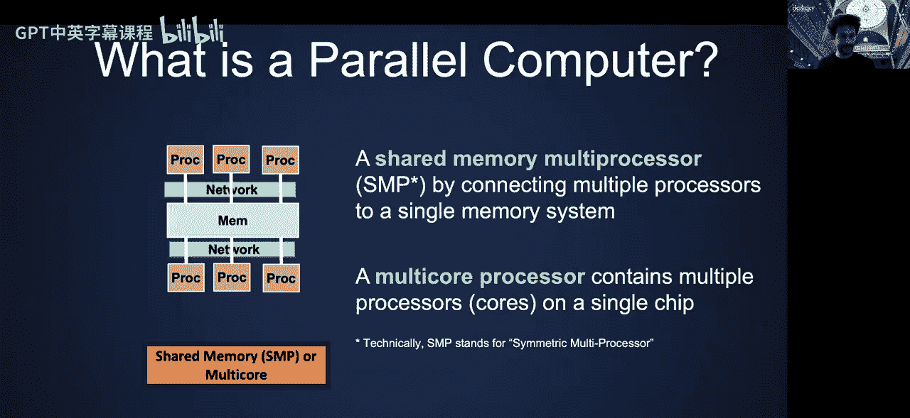

And the second class is distributed memory machines， also called high performance computing systems。

 and these as processors have their own memories， and there's a network that allows these processor to communicate each other。

 move data， send messages。嗯。I think there's one person I need to mute。

If someone has privileges to mute， okay， great， thank you。

These are also called clusters because theses clusters of distinct processors。

 they usually actually are composed of different nodes。

 each node so-called node can include multiple sockets of multico chips today and these nodes are going to be connected to each other in some sort of cabinets and the cabinets will be connected to each other to some sort of higher level networks。

 so there will be layers of networks connecting these things and they will scale up accordingly。

 and we'll see will go actually particular architectures historically and in contemporary of distributed memory machines in the corresponding lecture a couple of weeks。

And finally， single processor， multiple data computers really have multiple processes that perform the same operation。

So the CID actually， you can see that doesn't match the acronym because CinD acronym stands for single instruction。

 multiple data， which I think is a little more， but we're broadly defining here。

And that you can see why it's called that way because all these little cores will do the same exact instruction。

On on a wide data and that wide data allows us to exploit so called data parallels。

And this actually exists in almost every single。Computers， including your laptop。

 they have these so called AVX instructions， vector instructions。

 but the graphic processing units use this to turn extreme。That a lot of what GPUs do is Cindy。

And we're of course， going to have a GPU lecture too。

So I have a couple of questions and probably a slightly better quote from Bill Daley。

 which is the chief scientist at the EM Media and also affiliated with Stanfordville。

 why is high performance computing of synonymous with parallel computing？

It's the question that we're going to answer several times today。

 and why do we care so much about interconnect and communication because the last three slides just basically showed you how these processors are connected to each other in different ways。

And he had this really hammering home to equalalities。

 which I really like used to give these lectures about a decade and a half ago。

 performanceform is parallelism and efficiency is locality。

So the first equality really answers your first question in the slide and the second equality really answers the second question here and these are by a large extent correct today。

So they haven't really aged badly so what's not a parallel computer and what we're not going to cover in this。

嗯。So there is something called a concurrent programming concurrent computing。

 concurrency is not necessarily parallel execution。

 right your system can give you the illusion of parallelism by time sharing between threats。

 which is when your browser is open at the same time while you're typing in word and listening to music and if you have a single processor your operating system will do all these tasks just fine and you're not going to feel any jitters but there's no real parallelism going on in there that things are concurrently executing and the processor is just simply switching from one task to the other fast enough that you don't feel it。

As the user， but that's not really parallelism concurrency can have parallelism， of course。

 but that's the only part we're going to focus in this course multiple tasks are actually active at one time。

For for what。We consider it as real time， right if you're into philosophy and whether time exists or not。

 that's beyond the scope of this class。

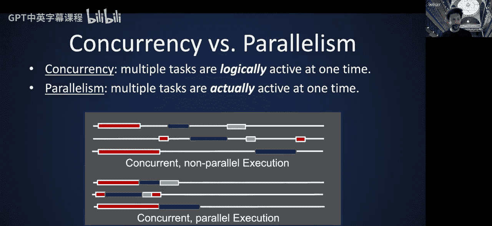

嗯。And there is another thing that you might see and get confused this thing called the distributed system。

And you can think of any websites such as online banking， there is usually a server。Of course。

 we draw it here as a single monothtic entity， but in reality。

 even servers are distributed to make sure that when one component fails。

 you still can access online banking account or when there is high load you can still get reasonable response times but less for a moment ignore that fact that there is one server and lots of clients are coming and going there is there is some sort of。

Perallllism and concurrency happening at this point。

 but these clients are not active at the same time。

they turn active at given points and the system is inherently distributed。

 which is different than what we're going to do when we say distributed memory computers。

 where all these tasks are active at the same time and everything starts together and everything got set together。

So that's really how we're going to use a parallel HPC high performance computing computer。

When we talk about distributed memory and that's not really a distributed system in this picture sense。

Okay， hopefully this clarified some of the differences between terminologies。😊，So let's。

Let's talk about some realities which is the fastest computers at least the ones that we know and publicly available have been parallel for a long time and we believe the ones that are not publicly available are also parallel right there is a ranking system called top 500 has been going on for。

I think it started at late '80s。So you did the math 35 years about that much。

 so you can get a lot of historical data， it ranks supercomputers。

 at least those that make themselves publicly known。There's lots of。

Machines that are owned by companies and the defense industry。That are probably not public。

 but have the same equivalent computing capacity。嗯。So what when you hear supercomput today。

 we're really talking about parallel programming， so that's an important thing to think about in the future this might change。

 supercomp might become synonymous with quantum computing or some other technology that might overcome the barriers of standard one Neman architectures。

 but today when we say supercomp， we're really talking about parallelism。And Nur。

 which is up at the hill again， is what you're going to do most of your homeworks on this machine Corey。

 which is named after the first American women that won Nobel Prize Curti Teresa Corey。

 actually born in。And now defunct an empire called Austrahungarian Empire。So。Let's look at this list。

 but before we do that， how do we measure performance？

And the real units of measure for high performance computing are generally so called flops floating point operations per second and somewhat confusingly。

The flops， if you don't put the forward slash， is really talking about the number of operations。

If you put the forward slash before S， you're really talking about floating point operations per second。

And of course， you talk about bitetes because that matters a lot and determines how fast you can run things and how big your communication cost are and so on。

And these are for 10 to the three there's kilo mega you have probably heard about those things from your personal computers。

 but you might not have heard about things beyond maybe Terra。

 so there's PE is 10 to the 15 X is 10 to 18 which is what we're almost about to achieve hopefully bit in the next 12 months or so。

 meaning there will be a machine that。At least projected to be that can perform kind to the 18 flaps per second and when we say this we talk about double precision operations and this goes on Zetayta and。

And so on。To avoid distinction。To avoid confusion and to address a lawsuit that came up。

 people actually started talking about these KIBMD as opposed to MB which are like bites are represented and you can see that as a computer scientist 10 to the 6 is 2020 almost but not quite so there's usually a distinction。

Between those things and。The eye is actually added to address the differences and there are some quiz questions you might have to answer just read the notes about how you should take a kilo whether you should take it 10 to the three for example or two to 10。

 so just make sure that you read the fine code in your questions。So again。

 TIFI founded is really about the most powerful computers in the world updated to us yearly in two big conferences。

 one almost always happens in Germany in June and one almost always happens in November in the United States and the yardstick how we rank these things is called the floating point operations per second doing so-called running the Li benchmark。

 which is solving a system of linear equations， a dense system， so the A is a dense matrix。

It is you know random entries and the cost will be dominated by dense matrix multiply if you implemented correctly of course wanting to notice this is not an embarrassingly or proudly parallel computation despite dance matrix multiply achieving really good performance in modern architectures this operation still involvess a fair amount of communication so it's not like image processing where everybody gets their own piece of data and crunches numbers with no communication there is a lot of communication going on in there it's just a computation is is it a higher order than communication so it's somewhat easier than some other computation that we're going to cover today。

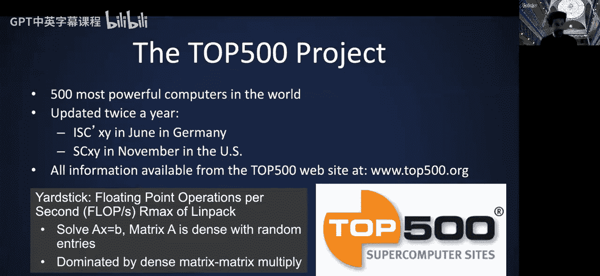

Here's the current ranking from November 2021。Which is the latest listing so what's going on with this color coding I tried to。

The colors。Those government machines that have。NVD accelerators as far as I know the accelerator concept became up to debate so I'm just going to call it NVD accelerators and those are the red ones and there as you can see the majority is in certain supercomputing centers like the Department of Energy has Oak Ridge Livermore and Lorence Perle La here Pearl motherder this machine is actually。

Somewhat up and running half of it， but it's not publicly accessible yet to everybody that's why we're not doing our homework there yet and hopefully next year and there is now an actual mission from a company and media that they publicly acknowledge and took numbers years which is at ranking six。

The green ones， I highlighted them green because by a certain argument， they don't have accelerators。

They have have their just CPUs， some of them are CPUs that we don't use today like the Fugaku machine or the subway Tite machine is not the kind of Intels or AMDs you're used to today。

And finally， I colored the number 10 entry because it's actually a cloud computing provider's entry here it's Microsoft Azure as a ranking desktop store。

So one thing that is relatively surprising here is that there is no NSF machine here。

 National Science Foundation has no machines at the top 10 and they have a lot of machines beyond top 10。

 but they no longer have any machine at top 10。The fastest machine in the United States is So-called Summit。

 which is composed of node that have two socal sockets。

 which is this identical pieces of thing that are connected to a PCIE bus in between each one of these nodes have two power 9 IBM processors and six Nmedia test of 100 GPUs。

It does actually extra ops， but these are not real flops because they're not double precision so they don't count in the race to exofflop。

 so to speak。The fastest machine in the world beyond the United States is Fugaku in Japan。

 they have these Fuduu CPUs and no GPs， at least none of them doing any computation。

 you can see a little bit of a difference here what summit has achieved here is only less than 5000 nodes because each node is really fat with a lot of compute power。

With all these six and GPUs and Fugaku by contrast， went to a completely a different route of having。

I would say almost two orders of magnitude more nodes here and no。嗯。

No accelerators so there's different ways of achieving the same performance if you look at other rankings about what about the energy efficiency of these machines it turns out actually for Gku is better。

But we're not going to cover too much about that。The coate nurse that you're going to be using is not even number one in Berkeley。

 I used to say number one in Berkeley， but we now have pel mothers。

 its number one in Berkeley among the ones you public can access today。And it has actually two。

So-called phases， we no longer call them phases actually it just like two pieces of this machine。

 one of them has more traditional Hal CPUs that are close to what youre used to as a multicore processors and the other ones have so-called KNL nice landing processors。

 which aH have much many more cores， but less powerful cores and you can tell it from the frequency of each core。

So this is the machine you're going to be using for most of your homework。

So one thing I said was P P fund that allows us to look back in time。

And see the trends of performance over the years and these are this is really nice because it shows you not only the the top ranking machine。

 which is this。Yellow line， but it also shows you the machine at the 500 rack。

And the sum of all the entries in the 500。So somehow the historical trend for the fastest machine number one machine is still holding today that is following a certain trend that's been going on since the list has started。

 by contrast and around 29，2009 the machine at 500 rank as well as okay。

 actually the first machine in 500 rank started dropping from its trend and started going into a slower slope of increasing performance。

And if this continues。The processor number 500 will be lagging by a factor of 10 from its historical trend line。

 note that the y axis is logarithmic， the change might look minimal。

 but it has a huge impact in actual numbers。And the sum is also started dropping from its historical trend a little later。

 like you can say 2015 is when this happened。So of course you can say that I can be smarter while are we solving the system of linear equations with in one particular way。

 in fact researchers of course look at this question as well and they say if we used a different way of solving Ax equals B。

 instead of doing it with Gaussian elimination， we can just do it with。

With a different method that flows it in lower precision and does iterator refinement after that。

 you can actually get a significantly higher。Fop rate so called mixed precision high performance impact and exoffl。

 but unfortunately this is not allowed by benchmark rules， so that's not an。Accepted entry。

 on the other hand， you actually get the same accuracy。With the original ones。

 so algorithmic advances are not allowed with respect to this benchmark is I think all I wanted to say here it's really about looking at how machines are evolving。

 not how algorithms are evolving。So again， looking back historically。What has happened。

 I did not update the slide after 2000。18， mostly because。Again。

 the definition of accelerated I think created sufficient confusion and debate that they stopped allowing people to choose that as a distinct category。

 so the top I founded no longer actually。Allows you to draw the accelerator as a distinct entity。

So this slide is going to stay as a snapshot for a while。

 but what you can see here is the clusters are dominated。😊。

Even the accelerated part is actually a cluster right it's not an X86 cluster maybe it's an X6。

 but it's not getting all of its performance from the CPUU。

 it's getting a lot of its performance from GPUs， but overall it's an HPC system of distributed memory clusters。

But that was not always the case， if you go back by a quarter century。

 you will see that the fastest machines actually did not involve any clusters。

And they had quite a lot of other machines， including symmetric multiprocesors and vector machines even before that so what does this really tell us is。

The back in the day。The instead of building a really huge machine that's a really expensive interconnect。

 didn't actually work out very well because by the time you finished building it。

 the CPUs were getting faster so much within that period that with the Moore's law actually in full force that people were able to just weighted out and get a shared memory system quickly and replaced it every 18 months。

And that would actually be the supercomputers of that decade。

How do we program these things back in the day when we had symmetric multiprocessors。

 single memory machines or vector machines， we could actually let the compiler do a lot of the work you can write almost serial looking code and annotate it with certain pragmas and say okay。

 this loop is parallelzable， it doesn't have any dependencies。

 please do it so and it would work out fine and it would be vectorized and parallellyzed accordingly。

 nowadays though almost all computing is done by rethinking algorithms and software because of clusters domination of this whole era relying on a compiler does no longer work and almost everybody writes their algorithms and parallelizes them by rethinking the process from scratch。

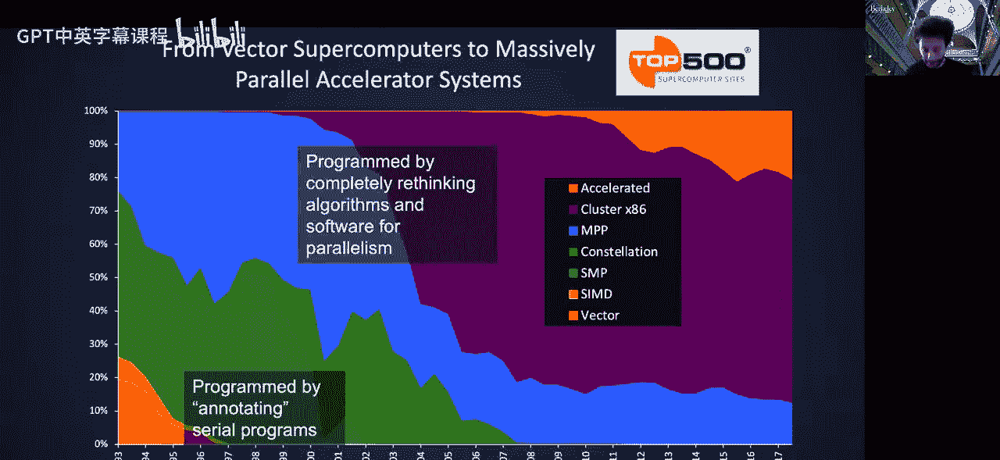

I don't really know why the resolution of this thing went so bad it actually was great when I was going over these slides before so I just wanted to show the。

This is really。Strange resolution hopefully you can download a version that has better resolution from the website let me know if that one also looks bad and i'll find a different way of getting this source of the slide to you。

So what do we see here？This is the accelerators， remember Intel KNL also count as an accelerator and there's some AMD but most of these accelerators are in medias GPUs and this number that they reach is 150 is。

And from the bad resolution， you're not probably seeing that。

 what that really says just a little under one third of all systems have accelerators and core processes today。

 and this is just a system count。嗯。The Y axis is the number of systems。

 the actual performance share is significantly higher。So that's the trend。

 what about the chip technology， how's it evolving well？At least。

Nowadays we're seeing some real competition reemerging here， in the last decade or so。

 we have seen Intel's share getting bigger and bigger almost to 95% plus of machines on the CPU end again。

 this doesn't include the GPs here where Intel CPUUs nowadays we see the AMD getting back up in this game。

 and there's actually quite a bit of arm based processors that you can run your computations on cloud instances that are not reported in top 500。

And one example is Amazon's so called graviton processor， if you haven't heard about it。

 you can just Google that there at their third generation today。

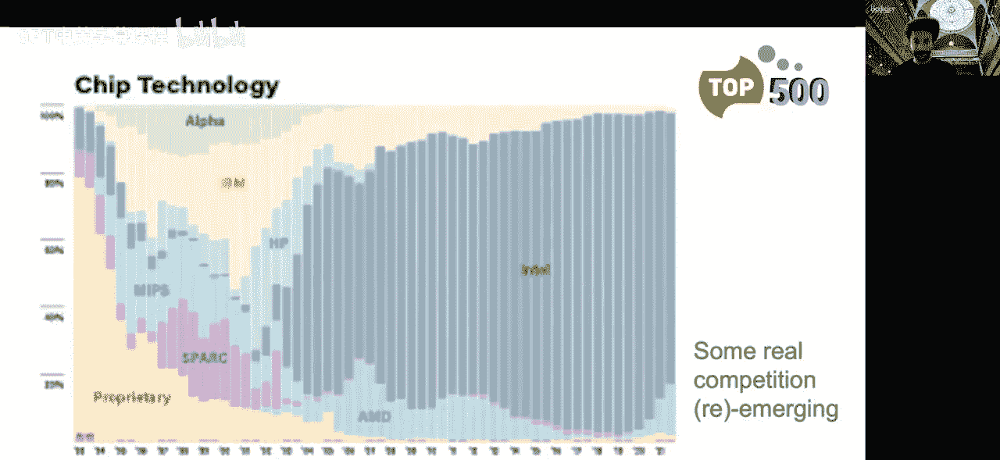

What other changes is happening？As we said that back a quarter century ago。

 you would just wait it out instead of building a massive machine。

 you would just replace it very frequently with the CPU generations getting faster twice as much every 18 months nowadays that's not happening and the cost of replacing a machine is really prohibitive for a lot of the supercompetuting centers。

 so the replacement time has increased significantly and average system age is really high up compared to its historical trend。

And the other reason， of course， is the CPUs are not getting faster at the same rate that they used to。

 so the incremental value of upgrading your system is lower。

 so there's the cost and there's the value。啊。so I talked a lot about top 500 of ranking processes。

 but there's another way of ranking things， which is the actual real application performance。

 and Golden Bell， one of the pioneers of HPC back in the day said if you can show me real speedups on a real application。

I'm going to give you， I don't know if it was always this much， this amount of dollars。

 I don't know the historical number what it used to be。

And that became the so called Golden Bell Award that's been handed out at the SC conference every year。

 and its scope has been broadened to include not just raw performance on real applications。

 but generally innovations。In applying high performance computing to science。

 engineering and data analytics problems。And you see a picture of two teams sharing the award 2018。

 one of the teams is actually stationed here at Lowsburgton National Laboratory。

 the people on the right are mostly from there。It's actually not true they're all over the place this picture people just this is two distinct them。

 one led by Oak Rich， one led by Praatt here。Yes and Kay Ylic did this plot which compares the performance of the Golden be winners to the top 500 fes machine and Y axis you see the flps1 floating point operations per second with the nice forward1 percent you see that surprisingly I mean maybe counter inruly the trend is holding maybe that's just the bias of the Golden Bell award committee to to choose things that perform very all or maybe that people actually。

They are able to take advantage of these supercomputers as much as the T5 funded high performance impact B like this。

You see that there's almost a strong correlation between these two numbers what you might find slightly strange is that at certain years the Gordon bell winners。

Operation performance rate is higher than top 500 so we know top 500 is a relatively easy problem solving a dense system of equations。

But we also know that it's not an emssing the parallel problem so'。It's not a super hard application。

 but it's not trivial either， but the real reason why this can be so much higher。

 remember this is why axis is log scale is that there are different ways of computing flos。

TheTough I found it only reports the double precision rate。

And some of these entries actually don't use double precision。In particular。

 this number is from the teams that I showed in the previous slide。

 both of those are using reduced precision。Operations like8 bits， 16 bit。

 four bit depending on the application， and we call them AI ops or AI flops。

Nothing to no pun intended here because they can get away with reduced precision arithmetic and still get the same result。

So we're going to go a little bit about science examples using HPC。

you might have seen this picture what used to be three pillars of science were theory experiment and simulation。

 obviously before that there was two pillars of science， there were theory and experimentation。

 and the simulation became the first you know commonly accepted third pillar of science。

 what simulation really means that we put the known mathematical laws into a computer program and let the so-called computer model of whatever we're trying to simulate the whatever phenomena we're trying to simulate evolve over time。

 and that's really called simulating。

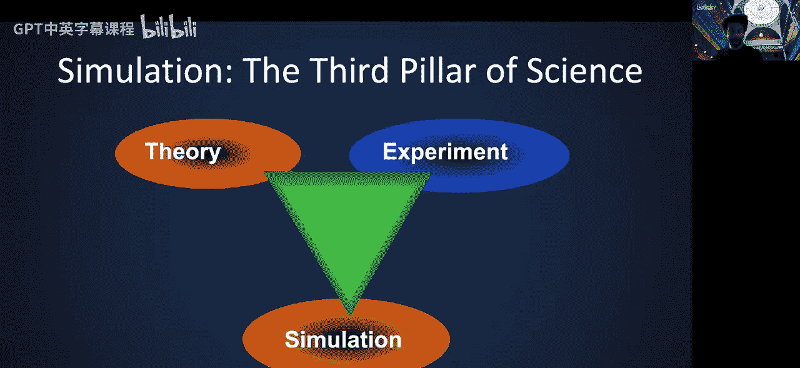

And why would we do that， sometimes we want to look at things that are too big to observe。

Or too small to observe happening too fast。For us to capture we happening too slow we can't really wait for it and it might be too dangerous and these are very different examples。

 for example， the universe。We can't really wait it out， we can't go back in time either。

 climate change， we have to do forward simulations。

 we can't wait until you know postty elyipse comes and jet engines we can't always do the experimentation safely。

 we have to simulate a lot of these things， airplanes before they get certified and they have to do a lot of simulations about what can go wrong and so on。

嗯。I'm hoping this resolution will be good。But this just shows a simulation of what would happen。

To the globe， if the climate warms up by a couple of degrees。

And here you can see certain hurricanes are forming。

And the way this is mapped to a supercomputer is you divide up your globe into certain shapes。

 I mean there's obviously the preferred methods over the others。

 scientists have studied the right ways of discretizing globe， they do it in hexagons and so on。

And each processor will get a piece of it to simulate this sounds like too easy and it's not in practice because obviously some event happening at location A will affect location B as that weather moves throughout the globe so there has to be a lot of communication between processors so you can't just simulate your own little piece of globe independently from other processors。

And so why do we need faster computers， right？Let's play this again。

 so you see two different pictures here。simulation of the same phenomena on different generations of super computers and that's kind of why the resolution is different on the top you see a resolution so called 200 kilometers。

And the bottom is 25 kilometers， so it's eight times better。Is that true？

I guess so eight times better resolution at the bottom。

And that's enabled by the more powerful supercomputers it's not just it's visually。

More interesting right the bottom one is visually more interesting you can see a lot of different things that you can't see at the top at top things kind of are sorted out due to lack of resolution but you're actually learning more at the bottom you don't see the formation of hurricanes and extreme weather events at the 200 kilometer resolution but you can see them at the bottom picture。

So it's not really just visual effects。High performance computing is and simulation in particular used a lot in industry as well。

 and a lot of the same technology that's been developed over the years are actually usable in the space as well。

 so's just one example， this code was developed called Chmbo was developed for subsurface modeling of Earth。

And it turned out that you can apply this thing to something called pulping in paper manufacturing。

 so paper manufacturing is very energy hungry and the majority of the energy is wasted in this process of cooking wood chips to open up the fibers the so-called pulping to create the paper materials。

And I don't know if there is a， yeah， there is a simulation good。😊，嗯。Okay。

So you can see how the same code can be used for this purpose versus subsurface Earth subsurface modeling right and both of these applications used a technology called adaptive mesh refinement。

 the so-cal AMR， and we're going to cover some of the principles of AMR in the later lectures。

Pably it done。Here's a different kind of application so far what we talked about was really large scale simulations。

 one huge simulation or a bunch of。Similulations such as the one that we did with climate modeling where we had like。

 okay， let's simulate 10 different scenarios， but each simulation was really large。

But by contrast here， this materials project started with a high throughput use of high performance computing。

 so you would get different materials with different properties and you would do massive amounts of simulations one per material and try to predict well。

 try to simulate the properties of the material。Over the years。

 the project has evolved to use more and more machine learning。

 especially for guiding the search space of discovering new materials with certain design properties and。

But it really started as a high throughput， high performance computing project。And finally， no。

 not finally， I have a couple more simulation examples。

 you can use hyperforms computing and simulations to figure out how to capture carbon instead of releasing it back to the atmosphere。

 how to capture capture it and to avoid climate well， warming of the earth or climate change。

 whatever is the politically correct word to use。And of course， it's been used to simulate。

Materials that can be used as drugs for COVID 19， you'll see lots of lots of papers published on this space。

 which ones will bind better to the spike protein and you can just simulate all known compounds that are used and accepted as drugs by FDA and see if any of these things actually would be useful for us。

 right？And that's been done。And many many other things are done too。

 so I'm going to stop giving examples of more and more simulation applications here。

 but let's just say that a lot of these simulation projects are now part of this big umbrella project within the Department of Energy。

 the so-called Exscale computing project and we do a lot of those we take part in a lot of those within the Brkkeley Lab itself。

 the so-called Longresbergley National Laboratory in this picture the last two ones are not simulation projects。

 the genomics and photon science and we're going to talk a little bit about the genomics case in the highperform state analytics part in a couple of minutes。

Okay， so we covered simulation and how high performance computing can be used in that the fourth socal paradigm of science and this I believe is also sufficiently commonly accepted is data analysis remember the big big data phrase of a decade ago。

And remember， we're not actually analyzing。Experimental and observational data were also。

Potentially analyzing output of simulations， sometimes we just run a large simulation and it just creates terabytes and  petabytes of data and which we have to then analyze so there's two kinds of data that we can analyze observational and experimental data as well as the output of simulations。

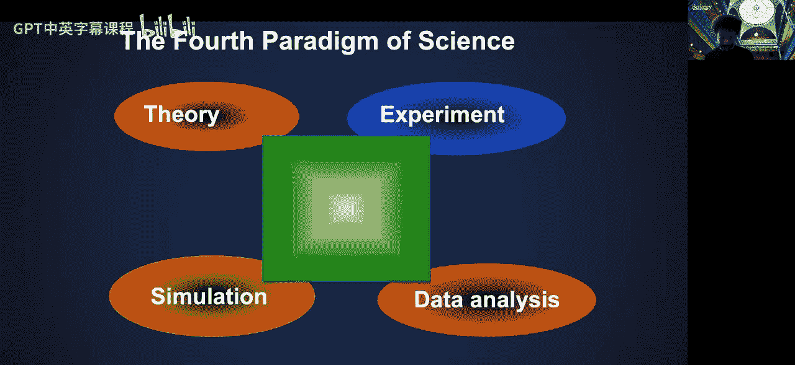

And symmetrically to as simulation cases， this is also used for data sets that are too big。

 too complex， too fast， meaning the data is moving too fast before we can capture happens a lot with particle detectors and using used in particle physics。

 too noisy or too heterogeneous。And a couple of these examples are shown here。

 you can argue that all of it's not just like one right so you can say the genomes from sequences are too big。

 but you can also say they're too noisy as well， so more than one attribute applies to each one of these problems。

So。There is two highlights of this slide that I want to go over， one is that it seems like。

Our compute performance increases at least on a single processor。

Is not keeping up with the growth of certain data sets。

The detector's output from particle physics is this red line。

 the sequencer output that is for genome sequencers is the orange line。

 and both of which are growing faster。Then the process of speed。

And verse from the memory performance and so what that really means that in order to be able to analyze data sets that are coming from these data sources like detectors and sequences。

 we have to do more than just。Mapping them to computers efficiently。

 we have to take advantage of parallelism as well as potentially more clever algorithms。

And the other parentheses side note， which is a conclusion of this picture。

 is this gap between processor and memory。As that's been opening up is why we care about data movement because the cost of accessing data is relatively increasing relative to the process of speed。

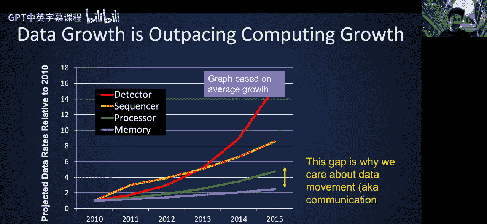

And we going， of course cover Jim will cover a lot about communication awarding algorithms as part of the。

Sources of parallelism lectures， and we're going to come back to that theme over and over again throughout the semester。

So this project that that high performance data analytics of HPDH in short for genomics was led by Kathy Aic。

 which was。One of the instructors， as I said before she became the vice chancellor for research and here's it's really not a single genome but so called metagenome。

 which is this group of organisms that kind of live together on。Bacteria， viruses。

 archaea and fungi that you would get and they have their own dynamics and you can look at things like what happens to those dynamics after wildlife and how do microbes affect disease and growth of certain plants that we care about for bioenergy and so on。

And lots of。TheCl algorithms are developed and are running on large scale computers including the summit。

 which is the number one machine that we have at US and of course。

 all the machines that we have at NRSC。And this。If I say this。

 these data sets are massive for the kind of computation that they run。

 each one of them are larger than a terabyte， up to 10 terabytes of data。

And another application of hyperforms computing to genomics was actually from that picture that won the Golden Bell Award in 2018 where they looked at combinations of genes that do certain tasks。

 and this is really giant so-called Gwa study， genomewide the Association study。

 what combinations of genes， create what phenotype， and they basically but first looked at。

All three way combinations， I think， and they were able to use reduced precision arithmetic on the GPs and sumummit and achieved over two Xa ops。

per second on the summit computers again， thanks to using lower precision。

 they were able to break the excess scale barriers because the machine is not actually capable of doing double precision Xflop。

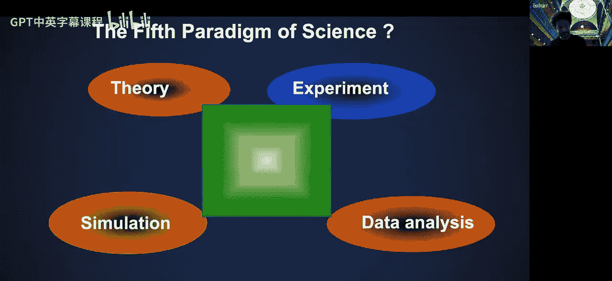

Is there a fifth paradigm of science or are we done yet well there is an argument that the fifth paradigm of science is machine learning。

嗯。And this is not as commonly accepted yet you can argue that machine learning fits within data analysis。

 or you can argue that machine learning fits in simulation too， so it's somewhere in between and。

We're just going to talk about it without arguing strongly either way。

But the actual problem from the perspective of computing is that。This figure that is from open AI。

Shows that the shows the computing need of different。Deep learning models。Over the years。

 starting from Alexeth。In 2012， I think。And at ends in 2019， I believe the trend is still con。

And over those nine years， the compute needs of these models have increased by a whopping 300000 x。

To compare that with what the fastest machine in top 500 did。

 its performance only increased by less than 10x。So that's。What does it say。

 it means in order to be able to keep up with the increased computational demands of deep learning and in general machine learning。

 we might be building more and more powerful computers in the future。

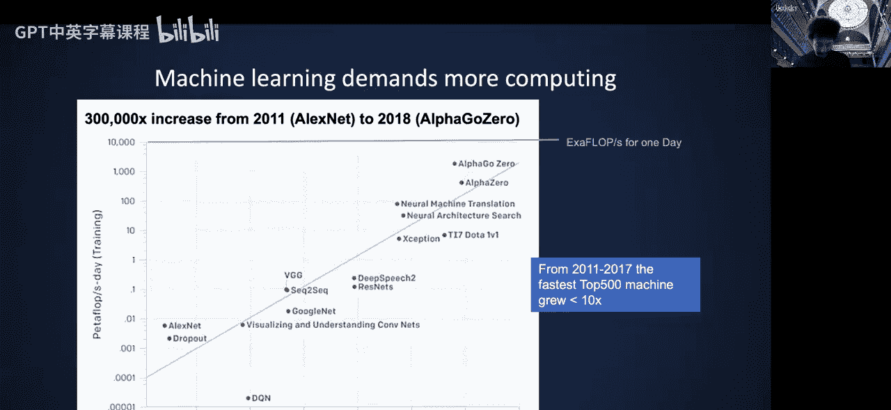

Yeah。So。This is a source slides from Prabat， which used to lead the data analytics group at Ble La now he's at Microsoft Azure running their cloud services leading their efforts at the HPC for cloud so-called。

 but this just shows you the analogy between what the industry and the science do with disimil technologies。

 the classifying pictures and objects in the pictures involve obviously localizing object detection segmentation and classification。

And you can directly apply the same ideas to classify extreme weather events。

 whether they are hurricanes or atmospheric rivers。

 you can say this localization is object detection， segmentation and classification。

So there's quite a lot of technology transfer that's possible across domains。

 obviously scale is very different looking at this data， that's this climate simulation。

 that's a huge data compared to picture。But machine learning is actually successful in playing well with the simulations in general。

😊，So this is again from the same 2018 or I keep going back to the same Golden Bell award because there are two different teams so I can talk about different parts of it。

 they use deep learning to predict the extreme weather events。

And there's the ground root that they can measure their success against。

 and it turned out that the deep learning results。We were better。

 meaning smoothters than the heuristically made labels that they used to use before the deep learning solution and this achieved over again an exflop ex op。

Performance on the same machine， the Oak Ridge Summit machine。

And here's what we see is let me see if there's an animation here。

There doesn't seem to be an animation people using machine learning for generating scientific data。

 so generally as I said， people use simulations to generate scientific data but you can use certain kinds of machine learning methods such as in this case generative adversarial networks to build convergence maps of gravitational landingnsing and the important thing it doesn't matter what the actual application is the output of these game based method was physically realistic。

 meaning it was statistically indistinguishable from the output coming from the detailed simulations and why would we then do that potentially GAS can be made more accurate or can be made faster。

So they have the potential to replace some of the simulations we do。

Okay so that's enough for pillars of science now we're going to go back to parallel computing and classifying different applications and written by their kernels by the kind of computations they do you might actually feel like overwhelmed at this point。

 so let me see if they're unanswered questions so far。嗯。I've seen that。The website one looks bad。

 okay？I'll send you the。I'll send the whole class the high resolution pictures。

For those low resolutionversions， okay。呃。Looks like。嗯。

Things are self answered thanks very much you might feel overwhelmed at this point because there's all these。

Complicated applications running on these complicated hardware。

 how do you even go about getting good performance out of this thing and how do you keep coming back to a new application。

 figuring out how to run it on a supercomputers it seems like a daunting task and it really is but there's things that help us which is we can look at a big class of applications and figure out what is common across them and that's really important because otherwise you'll have to start from scratch for every single applications and try to rewrite everything and learn the same things that your colleagues already learned about how to map that class of applications to supercomputers。

Yeah。嗯。So this started with Phil Kalach。So， I think。

Professor Emeritus now used to be at the lab he also retired from the laboratory as well。

 he gave this talk。Never published about it， he talked about the seven dwarfs of scientific computing in the DRPA presentation。

 he actually was talking about simulation only at the time。Remember， this is almost two decades ago。

And he identified seven things， then sparsing algebra， particle methods。

 structured and unstructured grids， spectral methods and Monte Carlo simulations。

 and we've got to cover everything except Monte Carlo， I believe in this class。

And we no longer use the dwarfs for various political reasons。

But that was the historical thing if you need to look for that presentation。

 you will have to write the exact。Coode in there under thewarf dwarf pictures。So。One of the。

The large projects within each department led by， I believe Dave Patterson was the director。

 David Patterson is Parla parallel computingut laboratoryatory。

And the goal of App parallelupp was really to tackle the multiple parallelism。

That was prevalent and was daunting for the industry， a lot of people in mid 2000s。And within that。

 yours Jim De， which is my co instructor， is actually a part of this laboratory。

 and I came to Berkeley at the Low Berkeley Lab right towards the end of this project。

And they looked at the wider class of applications and these are not necessarily large scale distributed memory parallelism。

 these are the kind of things that you would run every day。in your laptop， multi corere processors。

 so it includes a lot of things like you know playing music or browsing and so on。

 not just the large scale parallel simulations and they identified socalled motifs of 13 of them and then the color density or not the density warmness of the color identifies how important it is for a particular application。

 which basically means take sparse matrices， they're mildly important for let's say the spec benchmark or。

A very important for machine learning， not at all important， perhaps for browsers and so on。

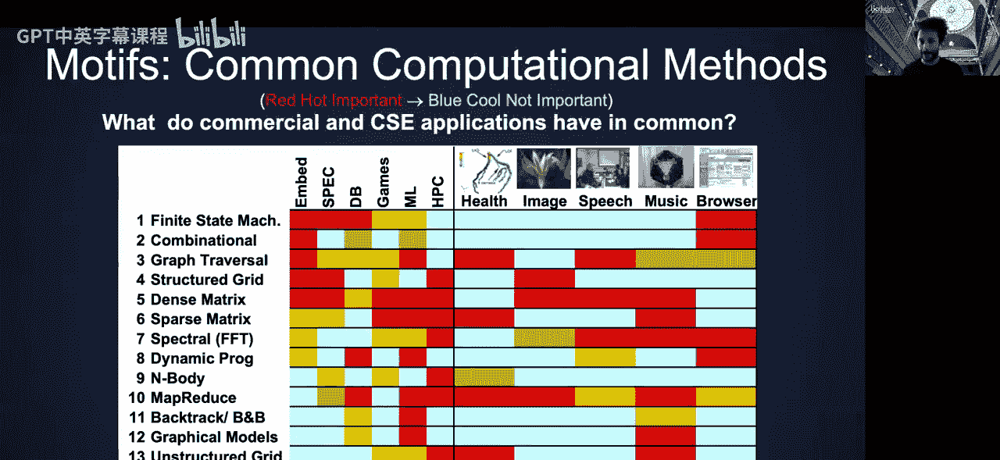

Later， National Academy'ies report， which actually some of the faculty in Berkeley。

 including Michael Mahoney at the Stas Department have contributed to this。

Classified seven giants of data， they wanted to call this giants。

 I suppose because the title of the report talked about massive data analysis。

 so calling these things dwarfs or moifs wasn't enough it had to be called giants and they identified seven again。

 maybe they just wanted to stay symmetric with the Phil Colella's dwarfs。

And we're going to see that some of these things like generalized em body and alignment actually comes up a lot in computational biology。

 overall it's commonly accepted that these are a good place to start for looking at basic computational kernels to do data analysis just as seven dwarfs of simulation was actually commonly accepted with a few exceptions as the really important kernels that you should optimize on a new machine。

And another study that I contributed and led by catic。

 we looked at motifs of genomic data and analysis， meaning you have large genome data。

 and we broadly defined genomes to include a lot of things like transcriptomes。

 which is the RNA proteins。And metagenomes， which is these clusters of genomes we talked about that live together。

嗯。And identified some of the commonly happening things， which is dense sparse， alignment。

 generalized and body and grasp， you'll see that five of these at the bottom is common with what we have on the seven giants of data。

Except that the sing and hash tables as was not covered by either simulation or。

Or the seven giants of data from the National acadeies report so that's the new stuff that's going on here and。

Okay， we're in a good place now for the old version of the slide said why the fastest computers are parallel。

And we already talked about this， remember the Bill Dli code that's necessarily。

Perllism is the only way to get performance in a sustainable way。

But we have a new version of this slide， which is why all computers are parallel computers。

 including your cell phone and your laptop and potentially even your car。Um。

 that is running all these car playss and so on and detecting the objects that are coming and breaking before or alerting you to break and so on。

So let's talk about some well known law called the Moores law。

And Mosla really talks about transisted density。The transistor density increases every the way Gordon Moore has stated。

 which is who is the cofounder of Intel， that the transistor density would double roughly every 18 months。

First this trend you know held for a long time， again there is no law here。

 this is not a physical law， this is a statement about the observations or prediction of the future。

嗯。And so it's kind of incorrect to call it law， but it holds for a long time， health for a long time。

And then it slowed first。And first， it became every two years。

And then it started falling off from there， but you can see that for a good while。

 things worked out just fine， and two different things have happened actually。

 not only the transistor density doubled at the rate Gordon Moore has predicted。

 but also the frequency the clock frequency of CPUs。

 also increased in a particular trend that followed the predictions。Not necessarily the same slope。

 but the slope somewhat stayed constant throughout the decades。So， okay。

More recent data suggests this is no longer going to happen。

 but let's talk about a couple of other things， what happens when you try to shrink transistors by a certain size。

Well， when you look at the transistor and one dimension of it， you shrink by a factor of x。嗯。

The clock rate goes by up by x because the wires become shorter。I mean。

 theres some issues about power leakage and that's the reason why this no longer holds。

 but that the leakage was small enough in the past that it was pretty close to X。

And because the area is square of one dimension， the transistor per unit area goes up by。

X squared and usually the chips got bigger the die size increased that used to be approximately x to again a lot of things are back off the envelope in the slide which is how people actually to run this business so potentially the raw computing power could go up by x to the four again area goes up x squared clock rate goes up by x dieize increases x you put all of them together x to the four and usually x cube ofuff was devoted to more caches or getting extracting more parallelism using instruction level parallelism so you got like x times faster。

Overall。But what's the limit of this thing， how much you can push this idea if you you can again。

 this is a a bit of a over generalized。Example， let's say you want to build a terra fl machine using one bite of data and you want this machine to be a sequential machine。

 you don't want it to use any parallels。So。Well， and you have to assume that you're going to actually make good use of this data so you cant just get two floating point values and keep multiplying them you know。

Until infinity， that would actually run very well， but let's assume you're doing actually a good computation。

 important computation that accesses this one  triyte of data。

 so you have to go back and forth and get data from the memory to the processor。Well。

 if you do the mathematics， you'll see that you have to kind of fit this data。Within the 0。

3 millimeters。Of the processors， because any farther then you can't get it fast enough to sustain the one terabys per second rate。

So the data needs to live really within a certain area close to the processors so that your processor is not starving for data。

 and if you do the math beyond that， how do you put one terabyte of storage in that area so close to the processors while that means each bit will have to occupy one square angstrom。

 which is the size of a small atom。That looks already fairly impossible。

 but even if it did happen that would be your limit。

 so you have basically no choice but to increase parallelism to get more performance。

So that's really one way to look at。Why you need parallelism？There's other issues， which is heat。

 right？And you a， very famous figure from about， I think this is 15 years ago。

 what people are figured out is if they did business。

As usual and try to increase frequencies as they did in late 90s。They would reach the power leakage。

 basically， the power density of the sun surface eventually。So that's why。

I was an undergrad when I got a three gigahHrsse machine and it's been a long time I still get。

I don't even get three dig herse machines anymore right they kind of tonened it down a little bit so that they can tack。

More coar and but really it's it's about leakage when you when the transistors go so small then a lot of the power actually dissipates and。

That becomes unsustainable so you could。The dynamic power is proportional to the square of voltage and frequency times the capacitance。

 the solution people have found instead of increasing frequencies。

 they can still increase transistor density。But instead of increasing frequency。

 they're just going to add more pes and put more and more corear。And this is not just for power。

 of course that was the real issue， the power wall。

 so called the other benefit of this is the serial processes were wasting a lot of energy。

In order to extract a lot of performance， they were doing lots of speculative execution and wasting a lot of energy during computations that actually never materialized。

So we still have more transistors， in some sense， Moore's law。

 by definition of transistor density is not dead yet。

It is just morphed into something different instead of getting higher clock frequencies and faster serial processors。

 which was usually an illusion anyway。You get more course。

What is dead is this so-called denar scaling， which is the transistor dimensions were going down by a certain factors。

 and that was reducing the area quadraically and this said this really virtuous cycle that eventually the power consumption we're decreasing by 50% and you can read about denard scaling if you care too much but because of leakages no longer working out。

嗯。で？The other yield for perism is。Chiip manufacturers figured out that there's a lot of defects and they had to throw away a lot of。

Processors that they built， so if they have a lot of cores in a single processor， they can build it。

嗯。With the optimum goal that they'll be， like they can say to the manufacturers， give us 76 core。

And if up to eight of them are bad， it doesn't matter because they're advertising to the customer that they're only 68 functional course。

So that allows them a lot of margin。And they get good yield for that so sometimes when you buy a chip it is possible that there are some there is more functional chips in there。

 it's just not on because it's just by chance was manufactured correctly。

 the company wasn't hoping them to be functional。That's one way to improve your yield。

So we already talked about this， the denard scaling is debt， so because of power issues。

 and the expectation is move' law， the transistor density will follow it。

But the takeaway for our course is that there will be a growing burden on software to deliver better performance by extracting more parallels。

So finally we get this reinterpreted merge's law， the number of course per chip can double every two years。

 it might not happen， but it can。Clock speed will not increase。

 it might only decrease because putting more chips might have your full processor go out of the power budget。

Very quickly， and in which case the。The chip manufacturers might opt to actually decrease your clock speed。

There'll be lots of concurrent threats and you have to deal with internship and internship parallels and there's actually a slightly different way of looking at it。

These days that are if you buy。Niv Mac laptop up。You probably have an M1 processor。

 which is actually a heterogeneous machine with different kinds of CPUs in there and different kinds of GPUs in there。

 so it's not just homogeneous parallelism either anymore。嗯。Well， I don't think it ended。Still there。

 so I'm going to update the slides maybe after this。

But overall parallelism is everywhere every single mission you can get your hands off is some sort of parallelism these pictures are actually somewhat。

Hmogenous coursear。But a lot of。Things that started from mobile like your cell phone or iPad that already had heterogeneous chips and now it's moving into the bigger products like laptops with the N one that I just mentioned。

So there'll be a lot of parallelism people will take advantage of them。

There are there is a kriatto we have to kind of。Talk about this thing called andal law。

If you have a big competition with lots of stages。And you choose to parallellyze only a fraction of it。

 no， it doesn't matter how big the fraction is as long as you don't parallellyze all of it。

Which it says that your speed up will not be linear。

No matter how good of a job you do algorithmically and implementation lies。

Even if your components of the ones that you parallellyze are independent of each other and they don't communicate at all。

 if you miss a fraction that will come back and that fraction， let's say it's 10%。

 what does that mean you put that number in there says your speed up will be limited to one over 10% which is basically 10。

Right so。So you're trying to make this S go to zero。So that you can get as much speed up as possible。

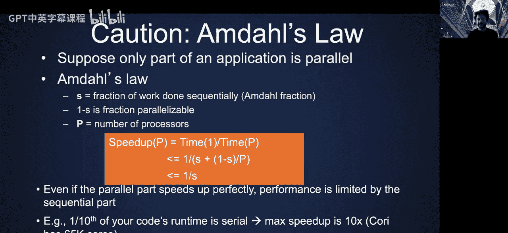

Okay， I'm going to go forward。And。Instead of talking more about Moore's law。

 I'm going to talk a little bit about course logistics。

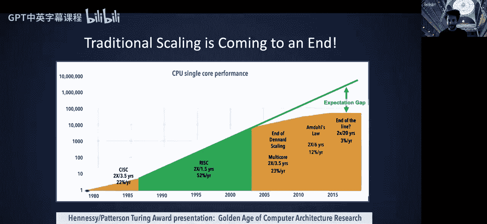

This is our new website and almost everything you need is in the website。

 including this email address， instead of emailing each instructor independently。

 which you people can miss that email depending on where they are that day， you can email。

 you should email us at this address， which is also on the class website。

This goes to every six of us， which brings me to the course staff。嗯。

I'm hoping the course majority of the course staff is here， so I'm item Bch。

I'm at the Is Department and at the Low Berkeley National Laboratory。And my coin instructor， Jim。

I will hopefully have people on video and introduce themselves。At least the people who are online。

So hello， look forward to teaching the next lecture。On Thursday。

Yes that's right the course schedule is also online there might be some minor changes on dates on some of the lectures。

 but overall it should be stable for the next couple of weeks。If the GSIs are here。

Can they introduce themselves as well briefly？With the order that's in the slide。Hello， I'm Vivik。

 I am a GSI and a second year PhD student here。Hello， everyone。 I'm Lian Ming。

 I'm a third year PhD student working on distributed machine learning。Any other gide online？Okay。

 well it's okay because we didn't actually have everybody signed up。

 there is usually going to be at least one GSI that's signed up to be online throughout the course and that will help answer some of your questions when the instructor is busy giving the lecture。

As for instructors， we try to attend each other's lectures except for you know travel or vacation days and so on。

 that should also help answer some of the questions， there might be some unavoidable conflicts。

 but overall we strive to actually attend lectures。And we have an excellent GSI team for people all。

AndThis should be enough for this number of students so far involved。

So this is the statistics of the officially enrolled students that I just drew yesterday。

So it excludes all the undergrads， we're still awaiting class expansion sorry and for the reasons I gave right before I started the lectures。

 it's really the staff is overwhelmed at the beginning of the semesters and this is not like a elastic Amazon cloud that you can just higher span of 10 other clusters when the demand increases and turned them off when the demand decreases this is actual human labor。

So let's give it a couple of more days and if it doesn't happen we might not be able to expand the class because the homework one will be out on Thursday and people will start forming teams so that kind of puts us a kind of a strict deadline。

What do we see here among the grad students， we have a lot of PhDs and masters I tried to subdivide the particular master's things to get higher resolution here。

 we see a huge crowd of computer science than Es in general students。

On the left plot this is somewhat higher than its historical trend and it's mostly due to the masters of engineering students that is the 44% of masters of engineering students I would say almost all of the Marsh Es students so that's why it creates a big chunk of it but we do have quite a bit of interesting majors there as well and you can see that lots of these little pieces of the pie for resolution reasons they were not drone they are 18 different departments in total。

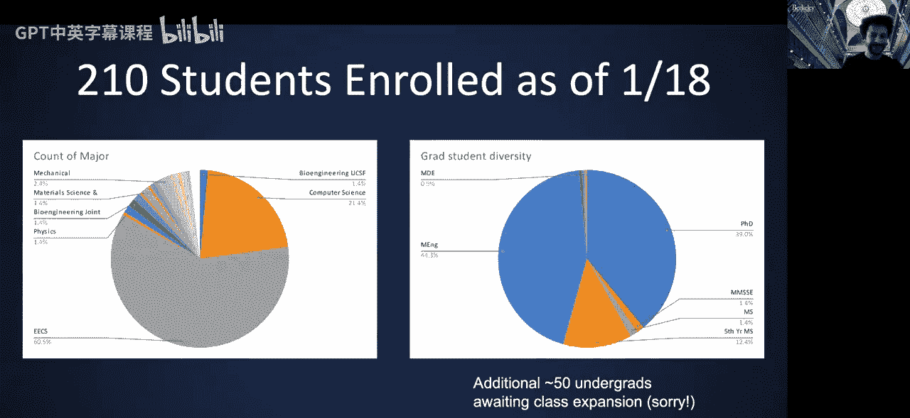

Oh Jim did this math great yes a version of this class is also broadcasted to an NSF project to many。

 many other universities over the years， I don't know what subset of the are taking this year but this is somewhat of a union of different universities that took a version of this class mostly they follow the lectures that have been captured last year so that they can go out of sync from us safely。

😊，And we're going to talk about the different programming languages and different paradigms of programming。

 distributed memory machines， data parallel， shared memory will use these languages will cover a lot of performance models。

And hierarchical algorithms， communication avoidance。

 lots of important laws in parallelism like the ones that I talked about AndA's laws and Mo law。

 but also equally important little law， lots of applications in machine learning biology and cosmology。

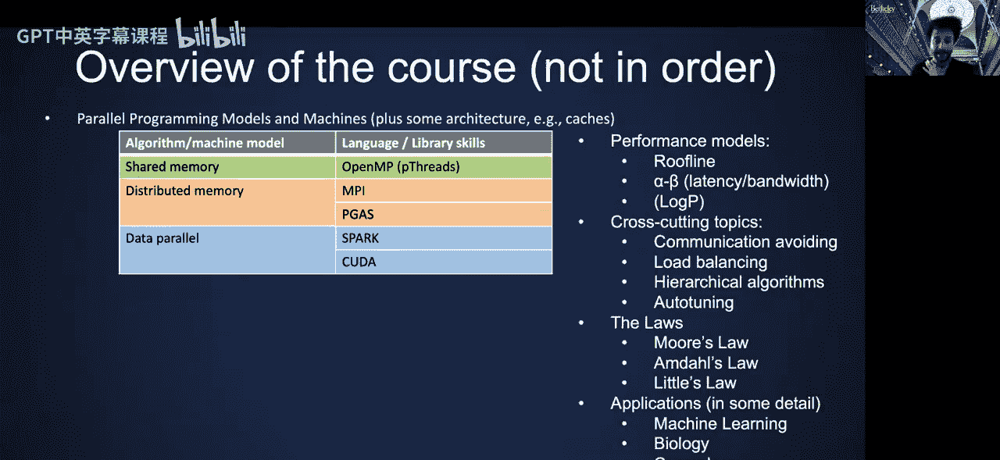

And some techniques for motifs in scientific computing and data。

That we're going to cover in distinct lectures， you can see。

 as I said the full schedule on the class website， just for record repeated here once more。

 we will have quizzes that's important。Every lecture， a couple hours after each lecture。

 we're going to release quizzes and you'll have time until the beginning of the next lecture to take that quiz it's usually just five questions。

So you just need to be aware of the contents。Of the lectures and these will constitute a percentage of your grade as as listed on the class website I should update this labs we'll use Wednesday s for optional labs and one per homework it will be updated。

We will assign you groups for homework one。And sometimes these groups persist throughout the semester and be reused for subsequent homeworks。

 but you don't have to only for homework one， we're going to assign you groups。

If you're not in Piazza， I added everybody who was either on a waitlist or officially signed up last week。

 but Im not going to go back and add more people from these lists the way to sign up is just clicking on this and join as a student。

 anybody with a Berkeley Edu address can actually join as a student to Piazza。And finally。

 look for an email from us tomorrow morning to sign up for an account at NRSC this is the platform you're going to use for your first homework。

 the reason we're waiting is because Nse is going through its annual transition。

Which means they don't actually accept new users until 8 am tomorrow。

So thank you very much and looking forward to a great semester together。😊，Yeah。

