# 【并行计算 CS267 2022】伯克利—中英字幕 p03 CS267 (Sp22) - Lecture 2： Memory Hierarchies and Matrix Multiplicat -BV1PS421978D_p3-

So there's two things I want to remind three things I want to remind you of before we get started。

 one is to fill out the precourse survey so that we have a better idea of your backgrounds and so forth and can assign you to the first homework assignment in teams。

 many of you have done that， but just in case please finish that。

The pre proposalpos for your class project is due January 27， that's not binding or anything。

 but we're going to post them on B courses and that'll help you folks read them and find who has a common interest and perhaps identify partners for your class project。

And then you should have also gotten an announcement about applying for a N account so you can do the first homework。

So is there any or is there anything else that needs to be announced and reminded of？So。Not truly。

 very good。I'll be answering Piaz the opposed during the lecture。Thank you very much。

So let me talk about what conclusions you could draw from today's lecture because we have a very broad audience and this lecture is designed to you know talk to everybody。

 you know computer scientists and non-computer scientists。

 you might decide that computer architecture is fascinating because of how complex they are and you might decide that all of the algorithms we're going to talk about which exploit all those details are also fascinating。

On the other hand， you may decide that most of the time you can hope you can call libraries so you don't have to worry about all those details。

 and indeed that is true for matrixtri multiplication， which is the first homework assignment。

 but it's not true from any other algorithms that we care about because not everybody you has not every algorithm has been optimized the extent matrix multiply has。

 which is one of the most studied algorithms that there is。Yeah。

So you might say that well these are a lot of details。

 I wish the compiler would handle everything for me and we will talk about some about what compilers can and can't do。

 but this is not the case so far， compilers are ala not currently smart enough to do all of these transformations although but there's a lot of ongoing research about how to build better and smarter compilers to do that and so you might decide I would like to write a compiler that could handle all of these details。

And finally， you could decide that I want to understand how meltdown specter worked。

 that security loophole that was came out in the news a few years ago because how that works is a function of all of these architectural details。

So let's start with single processors。And the reason to talk about single processors is that most applications run at only 10% of the peak performance for you know so we really need to look under the hood and that's what this gentleman is doing here this hood he's looking under is the supercomputer up at N and this is a picture of the machine room。

So in particular， you know， for matrixtri multiply， you know。

 you can even get maybe just 1% of the performance if you write the naive algorithm。

And so much of the performance is lost。😊，By writing code that runs on a single processor and moving data。

And so so in fact， what I want to remind you of is that when you do your final project。

 it's important that you measure have some sort of metric of what fraction of peak you're running at because if you take a very naive。

 slow algorithm that's orders of magnitude slower sequentially and you parallelize it and so you might say well。

 I've gone a lot faster but it's still a slow algorithm and so over the course of the semester we're going to give you several metrics for saying you know what fraction of peak is my application actually getting and your goal should be to get a reasonable fraction of that peak be it a sequential algorithm or a parallel algorithm。

好。So here is some are some examples for matrix multiply in particular of performance of different implementations。

 the different colors are different implementations。

 the horizontal axis is the size of the matrix on a log scale from you know eight by8 up to 1000 by1000 and the vertical axis is a runtime also on a log scale so the green line which is a straight lines a naive three nested loops and you can see that it is orders of magnitude slower than the red line which is。

😊，Taking a single threaded code and doing some basic optimizations of the sort that you'll learn in this class the purple line under that is eight times faster and that's where you're doing a multithreaded code and finally the bottom one is the one that was optimized for this particular platform by the vendor doing all sorts of other magic under the hood and it's faster yet。

And so paralyzing only so there's 131 x speed up using just a single core by doing basic optimizations here。

And so linear speed up on the green line is not necessarily the fastest code that you get。

 you really want to be on that red or blue or purple or blue line。And as I said。

 matrix multiplies extreme， but 10x by missing out on sequential optimizations is really quite common。

😊，So here's an outline of the talk we're going to talk about idealized models and compare that to actual costs and you know there are different levels of detail in which you can model costs we're going to give you one that's you know simple enough to think about but accurate enough to you know give you good ideas about how to optimize your codes a lot of that depends on memory hierarchies。

嗯。It dependss on memory hierarchies。And understanding where the time goes in there。

 it turns out there's also parallelism in a single processor。

 you know many processors will do you know four multiplies or eight or 16 or more at the same time。

 and so it's important to take advantage of that。And then finally we'll begin with our case study。

 we won't finish it today， which is how do you optimize matrix multiply and these are basic ideas that you'll certainly use in your first assignment and then we'll tell you some more practical optimizations that you can use on top of what we're going to talk about here。

So this is going to be a review for the computer scientists in the audience probably。

 and it'll be a very quick introduction to basic computer architecture and compilers for non computer scientists。

 a crash course。So here is going to be our idealized unitproor model。

 you have a processor and you have some main memory。

 and when the processor wants to do some work it has to go get data from the memory。😊。

And so what so the question is you write a program， how in some high level language。

 how does it get mapped to this very simple object here。

 so the processor has certain excuse me your program has certain variables in it and those variables map to things that the processor understands which could be integers。

 floating point numbers， single precision， double precision， there's pointers。

 arrays and structures and all these other data types that you have。

And the processor performs operations on those variables。

 so that means inside the processor there's some sort of unit special hardware that does arithmetic。

😊，Yes。You know， but also logical operations ands and ors and all that sort of thing。

So the processor also has to control the order in which all these instructions are executed and as specified by your program。

 and so that means there has to be some part of the hardware that understands what if statements mean and loops and function calls and all of that to jump around among all the instructions。

And so what is the simplest cost model you can have for something like this。

 simply every operation you do， a plus multiply has the same cost more or less。

 and you don't pay any attention to the cost of getting data from main memory or wherever it happens to be。

 so that is the idealized cost。So that's not quite true， though。呃。

So real so let's go through this now and talk about another level of detail so these objects that are in your program integers floats array arrays and structures are really bytes and words that live in the address space so each of these things has an address it says where in main memory it actually lives and they could be of different sizes which is going to affect their cost。

The operation the arithmetic performs operations on those variables。😊，And what to come as before。

And what the compiler has to do is to translate all of your you know stuff like if statements and loops into natural lower level instructions because there's you branches and things that the compiler has to do and the hardware executes the instructions in the order specified by the compiler。

And so when you write some data， it'll go off into memory and when you read it。

 it'll get the most recently written data， and so the compiler has to make sure things are done in the correct order so that when you use a variable that you've written before in your program。

 it was actually written before in the hardware。And there's the idealized cost again。

So so now let's start talking about you know the time to do all of these different things and so if you have a let's say a1 gigahertz clock which is you know order of magnitude what things run at today。

 that means that each of those operations is going to cost about one nanosecond that's what a gigahertz means。

 but going off to main memory is going to be a lot lot slower if you you know read data from there it could be100 times the cost of an addition a multiplication a logical statement like an and and so forth。

And so。The load and store operations move variables between the memory and the registers。

 and those are inserted by the compiler somewhat invisibly to you and those are the operations those invisible operations cost an extra 100 x compared to all the arithmetic operations you may be doing it on。

And so the idealized cost， is sort of a rough model of what the real cost is。

So let's talk a little bit more about how compilers。

Generate assembly code by saying what does a compiler take as input。

 a program which has a statement in it which says variable C is a sum of A and B。

 and what does a compiler have to do for languages like C or C plus plus it needs to get that data A from main memory so it executes a load instruction and puts that into a register。

 which is a bit of a tiny bit of memory on the processor itself。

 it goes and gets B then it takes register one and register2 A and B and it puts them in register3 and finally it puts register3 back into main memory in the address indicated by C。

And so what the。What these variables A and B and C actually mean over here。

 they're actually addresses that indicate where and memory all of this stuff in store。

 but you know these three instructions， load A load B， store R3， as I said。

 can cost 100 x times the thing in the middle which is all that you see in your program。

So the question is how compile what do compilers have to do to you know decide how to you use the few registers that are available to them to take the stuff that from memory and use it in the most efficient way and there's a huge literature on this I'm just going to give you a little hint a tour as to what to do this because the point is that the memory is enormous gigabytes。

 the number of registers that you can store and do arithmetic on at any moment in time is much。

 much smaller could be dozens or hundreds or perhaps thousands。

And so here are three lines of code that and what the compiler needs to do。

And the extra fact that the compiler knows is that farther down in your program A and E are never used again。

 but after this b and D and f those variables are are used again after this stretch of code so what is the compiler going to do to take that into account it wants to keep b c d and f alive that means living in registers without。

Taking the cost of putting them out in memory again。

 but it's okay to throw away A and E once they've been used up and so here is the code that turns out to be the right thing to do you load b c and D into these registers and then you add。

C and D， and that gives you A， then you add A and B and you can overwrite A。

 so the answer is overr the input because you're never going to use A again。And then finally。

 so now r1 contains E and E is never used again， so you can subtract1 from E and put that there and that R1 contains F。

And so how does the compiler figure out that it can get away with four variables instead of four registers instead of six registers it creates a graph indicating what are the relationships among all of the different variables that they have and so you know for example so here I have one node in this graph for each variable and I have。

😊，BC and BC D and F are alive so they are all connected to one another by an edge in this graph indicating that I can't put them in the same register because I need to have separate values for them before and there's a whole bunch of other rules that indicate where this complicated graph comes from and they're in the notes at the bottom of the slide so what the compiler needs to do is build this graph and then say I am going to I can assign a register to the same register to two different variables only if they're not connected by an edge and it says what are the fewest。

Coor one of the fewest registers I can get away with and that's a well known problem in computer science called the graph coloring problem and I have a graph and I want to color it with a minimum number of colors each different color is a different register。

And so that no two vertices。Variables that are connected by an edge have the same color and that will tell me how few registers I can get away with。

And so that's been done for a long time， modern compilers like for Java that do just in time compilation may use something cheaper because this is obviously a fair amount of analysis to do。

So there's a lot of interesting mathematics and algorithms hidden inside compilers。

 even if you write pretty simple looking code like this。

So what what does the compiler do here's we'll talk more about this later。

 especially when you get hints on homework one。Here's the kind of things that compilers can do。

🎼They can unroll loops， which means if you have a loop and you're accessing an array computing a sum。

 it may decide that to unroll it， which means it'll access ace sub I a sub I plus one a sub I plus2 a sub I plus3 explicitly inside the loop instead of looping over every entry value of I and it turns out that that's cheaper because all those if statements to loop around cost more than actually doing those accesses。

 it can take two different loops that are separate and put them together also to make it cheaper to do all of the controls of the loops。

 it can reorder them that can give you the advantage of doing things in parallel or reusing data using fewer registers it can throw away code that it can prove that is never going to be taken and never generate it it can reorder the instructions so that you can register reuse data without having to put it out into memory。

And it can change actually change your instructions。

 so if you you know are multiplying a number by two。

 then it'll say oh I have an instruction that just shifts bits left and that's much cheaper than doing a multiplication。

 so it does all these kinds of things。So why am I telling you this because you know if the compiler is your friend and it's trying to do the best thing possible。

 sometimes it works very well and sometimes it doesn't and you sort of have to you know。

Sort of coordinate with what you do the compiler what you do for the compiler so this could come up in your matrix multiply assignment because one of the optimizations here is unrolling loops as I mentioned before and so it turns out that compiler you if you're unrolling the loop by writing your code that way that will affect the decision the compiler makes whether to unroll it more and so you can't may not be able to directly control how much the compiler unrolls it know if you're trying to do it at the same time so these are why it makes code optimization a little complicated。

Okay。So。Here is so that is the outline we've gone through processors and registers and what compilers do about it。

 and so this is a good time to see if there are any questions before I go on to memory hierarchies。

You can unmute yourself。Oh， I have a question。 I want to know。

 Is there a ways that we can control the unrolling of the loops。

 sayy I have a code that only want the code to be unroll by two times or only unroll by four times。

 Can I explicitly telling the compiler not to do that by like 30 times or 40 times。

 So so the idea is you the natural thing to do is you would unroll it directly。

 But you might need to， know， depending on the compiler。

 there might be theyre usually flags minus0203 that say what level of optimization， you know。

 how aggressive do you want the compiler to be， So by setting some of those flags。

 you might be able to you。Have the compiler optimize more or less， and if you do it less。

 then you have more direct control yourself。So and you know， if you really。

 really want to know what's going on， you can look at the assembly language output of the compiler to see what it actually did。

😊，Right， so it is a tricky business。But good question。Any other questions？不是。

I'm just curious like in Laac or things like that do people write like a lot in assembly or is this yeah。

 we'll talk about that later the idea there is that for those kinds of algorithms it turns out you can hide most of those machine dependent optimizes in a small library called the bs the basic linear algebra subrines and that has matrix multiply matrix vector multiply things like that and that is a standard library there's a standard interface that the whole world is agreed on and everything underneath that is the vendors are responsible for so Intel has its own team of ninja programmers who optimize the heck out of matrix multiply and their platforms you know and every other company does something similar and when you write your code you will call matrix multiply and whatever platform you're on you will hopefully have the vendors optimized version and so for linear algebra we've identified that interface where which below that interface the vendors are。

aboveve that， the programmer is responsible， but that's not true for other areas that are as well understood as dense linear algebra。

 so there's lots of work in this area。好。Okay well let's go on happy to take more questions later。

 so I want to talk about memory hierarchies and so talk about locality。

 how we take advantage of that， tell you some of the basics of cash caches and then using microbechmarks to characterize performance。

😊，So here is a more realistic unitprosor model so when。

You execute a load or a store instruction to move data between the main memory and the processor here how do we measure its costs there're actually going to be two different numbers that are hardware dependent the first one is called the latency and that's basically the cost to load or store one particular number and we're going to use the shorthand alpha for latency going forward throughout the semester and the other one is the bandwidth and that is if you ask not just for one word but you ask for a long stream of consecutive words a large chunk of data then that comes in in a streaming fashion and and that comes in much much faster so for the first word to arrive you have to wait this long the latency but the others arrive much much faster and instead of bandwidth which is bytes per second we're going to just take its reciprocal and and at the time per byte so the simplest model。

You can imagine if you say please load in n words from main memory is alpha the latency plus beta times n。

 the time per word times a number of words， so that's the simple linear model of how much it takes。

To load in data so why are there two numbers latency and bandwidth and so here is an example where the physics is a little bit simpler what are the latency and bandwidth of a hose well skinny hose is load bandwidth because you can't get many you know gallons per minute or bytes per second out of the end a big hose you know in the same amount of time you're going to get more gallons per second or bytes per second so this the analogous thing might be you know how many wires are there and the latency depends on a different property of the hose how long is it。

A short hose， it takes less time for the first gallon to arrive in the unit of seconds and here's a high latency hose it's going to take a long time for the water to get from that end to that end。

So and the physics for moving bits is much more complicated， but it's sort of the same in my view。

So let me do some comparisons of。show you some data on how the gap between the bandwidth and the latency is compared to floating point operations。

So what I was telling you is that the rate at which the computer can do floating point operations measured in gigaplops per second is much faster than the speed of bandwidth。

 how fast we can get billions of words per second out of the memory。And the thing is that gap。

 that ratio is getting worse over time so and here is a historical plot with a little bit of data to show you that so starting from 1990 up to know 2017 or something like that and the vertical axis is again on a log scale so you can see this straight line on a log scale saying it's the bandwidth is getting exponentially slower compared to latency so it's getting two times slower every 5。

2 years。So， you know， even if bandwidth isn't your bottleneck today。

 it may be next year or the year after that， so you should design your algorithms appropriately。

So that's how fast memory bandwidth is falling behind flop speeds。And here I've added one more plot。

 which is how。Much and memory latency is falling behind and you can see its orders of magnitude worse。

That the latency to go to memory is you know。can be much much worse than the bandwidth and this is a picture for memory latency and if I were to draw a similar picture for you networking you know ethernet that sort of thing then these pictures you know scale even worse so if you have a parallel system or if you're trying to compute in the cloud and going over the internet then you know all of these pictures you know just tell you the communication is even more expensive。

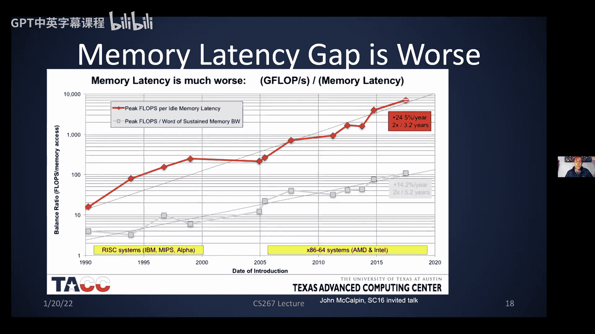

哦。So let me talk about how hardware has responded to this problem and they do it by building more and more levels of memory。

So instead of just having the processor and the main memory。

 what we're going to have is several levels of caches in between。

And the idea is that each level of cash is going to be you know。

Faster than the next level below it but it's going to be smaller and so on the chip i'm going to have a cache where I can have maybe you know100 times as much data as it registers。

 but it's also going to be a little bit slower to get to。

And since you know still if that's only a size a thousand words that's still not big enough for all my data。

 so I'm still going to have something off the chip which is a bigger cache that's going to be a little bit slower to get to and so on recursively so so maybe the analogy is that suppose you're sitting at your desk and you need to write something and you need a pencil so the first thing you'll do is you'll look at the top of your desk and if there's a pencil there you'll pick it up that's a register now what if there's no pencil on your desk you'll open a drawer and take out a little box of pencils。

And bring that up to the top of your desk， that is a cache and that box of pencils is what's called a cash line。

Because it's you know you might as well get a bunch of pencils at the same time now what if your desk drawer doesn't have any pencils in it you'll get up go to the closet and you'll get a big box of pencils and that'll take much longer to get up and go get it and you'll get more pencils while you're at it and that's a second level cash and then finally you have to go to the store and buy pencils and finally you have to cut down a tree and make new pencils and know that's when you store stuff on tape or the cloud and so forth so each of these as we go over here their size increases by orders of magnitude factors of1 thousand0 megaytes gigabytes terabytes petabytes and the speed also slows down by factors you know orders of magnitude and sometimes more than one order of magnitude。

And so the idea is how do we organize our algorithms so that the stuff up here is reused as much as possible and there's two ideas for that。

 one of them is spatial locality， that means that if I'm going to bring a word say you know an entry of an array up from main memory into cache。

 I might as well get a whole bunch of adjacent words in that array because I'm probably going to touch them too。

😊，And so that's called spatial locality， accessing things that are nearby your previous accesses like other things close by in your array and temporal locality means reusing an item that you've previously accessed so if you're computing a sum。

😊，You're you're accumulating it one variable S， you want to keep s in cache because you keep touching it over and over again。

 and so all of these caches which are controlled by hardware are organized to take advantage of both spatial and temporal locality。

哦。呃。So the idea is that you know， for many， many programs you have spatial and temporal locality and if you optimize it you'll have more and so the hierarchy is going to speed this up。

So let's talk about how caches work to make this possible so suppose you have a bunch of values that you have stored in main memory and the question is where do you put them in the cache so that you can find them easily。

So because the cache is too small to store everything here， so the idea which is very simple。

 is that if you have a value whose value is ACTG because you're doing genomics and it's stored out in memory and this is the address where it's stored in memory。

 this is the actual location of it and it ends in zero zero。😊，And you're going to say， oh。

 I'm going to store that in the corresponding entry in the cache where everything that ends in 0 zero is going to get stored in the same place。

So that means， of course， that if you you can't keep too different。

Memory entries in there if they both end in 0 zero， the cache is going to have to choose one。

And if it ends in 01， it'll store in a different place and so forth。 So if you have a cache size4。

 you look at the last two bits and that'll tell you where to go。

And if you have a bigger cache like size 1024， you'd look at the last 10 bits to tell you。

 you know what to store。So this is a very simple kind of cache it's called direct mapped because you know exactly。

 you know just by looking at these last two bits where it's going to go in your cache and there can only be one value there。

😊，And this is entirely managed by the hardware。😊，And so there's all sorts of other optimizations here。

So that means that if the processor executes a load instruction and it wants to load ACTG and it's already in the cache。

 it'll be much more expensive。On the other hand， if it wants to access something different。

 for example。😊，At once， let's see。呃呃。It wants to get this value 13， but this address。

 which contains 29 is stored in the memory， then you'll have a miss and it'll take a while because it'll longer because it has to go off to memory to get the value 13 that you want。

So。TheTo take advantage of spatial locality is that when you when the processor goes out to memory to get。

A particular location say that ends in 1100， it's going to say， oh。

 I want not just that one location， I'm going to get ones that are nearby。So。In this case， these are。

If you get either one of these， they both agree in the last ones and it's going to get both of them。

So this consists of one cache line。So only depending on the leading bits， then you grab。

 in this case， four different words that all you know share these two bits one one。

And so that means you get all these four values at once stored in cache in one line。

 and if your code accesses them too， you'll already have them and it'll be much quicker。

So the other thing that to get around the fact that， well。

 if you want to access two different variables， it both end in 1100。

 they can't both be in here at the same time， well。

 we'll change the hardware and have something called associative。So instead of just having one。

Value that ends in 1100 you're allowed to have two or four or whatever。

 so that means the cache is going to have to keep track of how many different copies it has at that same time。

So so when would this come up， here's a simple example。

 suppose I have a matrix a two-diional array that stored row wise。

 then if I grab if I'm accessing it by rows then all of those will have addresses that are one right after the other and so if I grab you know the first entry of the array I'll get the next four in the row and if I keep if I want to touch them all is good。

Now what if I'm accessing my matrix column wise and my matrix has dimension 1024 that means that the first two adjacent entries in a column。

 their last 10 bits are always going to agree and so they're always going to want to go to the same cache line and so that means accessing a matrix by columns would be very slow but associivity says。

 oh we can have several entries from the same column all at once and so know so it makes those sort of standard addressing things much faster。

😊，So why do we want to have multiple levels of cash？On chip caches。

 you know where you don't have to go along some slow wire off the chip or obviously faster。

 but they since they have to fit on one ship， they have to be smaller too。

And so that means that you have to go off chip if you want to have larger caches。

And so that means that you have to have hardware to check these longer addresses and that takes more time and if you have a sosocitivity which gives a more general set of data in the cache that also takes long more time so it isn't always better to add more levels of cash and some historical examples were a supercomputer that used to be at Nsk a long time ago the C T3E。

😊，Between two generations， they took out one level of cash and that was because there were enough misses that you know checking every level of cash to say。

 oh you're missing， oh you're missing oh you're missing。

 it was too slow and so they took out one level of cash to minimize the number of times that check had to happen。

And on an Intel Hawell， which is part of Corey， it has a funny level of cash called a victim cash。

And that is when something gets thrown out of level three because you you've brought in somebody else and there's no room left in the sociattivity。

 you don't put it all the way into slow memory， you store it in the next level of cash。

So that eliminates the need to go all the way to the slowest memory， you know， when something has to。

 you know。Doesn't fit in cash anymore。And there are many other levels of the memory hierarchy that we're not going to talk about in detail。

 so for example， you can have if your data doesn't fit in DRAM at all。

 that means it's going to have to go to disk and that is done in units of what are called pages so that sort of corresponds to a cache line except it's really really big thousands and thousands of words。

And to figure out where that is， there's all this sort of special hardware called the translation。

 look aside buffer to figure out you know what， where and memory that particular page lives。

And in fact， we've been， it's also possible that memory isn't always a hierarchy that you know that you have a level one cache。

 which is sort of， and then if that doesn't fit， it goes into level two。

 it can be much more complicated than that and we'll see that when we program on GPUs。

So so how do we deal with memory latency which is you know the biggest number by far so the best thing you can do is to reuse all the values in fast memory over and over again so that means your program has to be written with temporal locality that means you reuse data。

knowFquently， once you've put it into cash。You can also move larger chunks of data and so you know instead of grabbing one entry of an array at a time。

 you'll grab you know a big chunk of a row or maybe even a big subma of it and operate on that and that means your program your algorithm has to have the property of spatial locality if it accesses something it'll access other stuff nearby and so you might as well bring it all in all at once。

Sometimes the hardware， even if you have what you think is a sequential processor。

 can do multiple reads and write in a single instruction。

So these are called like SD instructions or vector instructions where you might take an array of four or eight or 16 numbers and add it to another array of the same number。

 so let's say four numbers plus four numbers it does all those four additions simultaneously in parallel the hardware is set up for that and so that's parallelism on a single processor and so you want to make sure that you know all those four numbers are available at the same time。

And the other thing that you can do is issue multiple threads。Let me make sure I'm。

On the right page here yes so to hide latency you can have multiple reads and writes going on in parallel so that you know you issue one read and you know it's going to take a long time but then you issue another one right away and so one so for example if you know that you're going to need a particular entry a while from now but not immediately then you can prefetch it that you can tell the you know you can issue a read instruction long before you need the data and by the time you get the instruction that actually needs it it'll be there so sometimes compilers do that for you sometimes you know there's special hints you know or pragmas you can put in your program to do that there's also。

Right the buffering， which means that the。You you know， so you。You wait until you finished up。

Updating all the entries of a data structure before you put it out into memory and both of these require that you don't have any dependencies so that you know if you fetch something early then you don't want to you know you have to make sure that you're not going to change it its value before you know it' arrive so you you want to make sure you don't get an old out of- dateate value and so the compiler to you needs to do that very carefully。

And both of these involve doing multiple things at the same time。So。Yeah。

So how much concurrency do you need to hide latency？

And to go at the top speed of the machine which is a function of the bandwidth well there's a theorem from queuing theory called Little's law which says that if you have a certain latency and bandwidth how many operations you need to run at the same time hide the latency so it looks like you're running at full speed and the answer is very simple just multiply latency times bandwidth and you get the answer and so here is you know the simplest example you could imagine suppose the latency is 10 seconds just to make the mass easy and the bandwidth is two bytes per second so if you kept you know。

Loading one thing after another， you'd get something every 10 seconds instead of two bytes per second。

So if you want the hardware to appear as though it's doing things at two bytes per second。

 then imagine that you did 20 reads all at once。So then 10 seconds later。

 you're going to get 20 bytes arriving。So that means you're going to get 20 bytes after 10 seconds that's still two bytes per second。

And so that means that you're in some sense， over overruling the latency and running at the full bandwidth speed of the machine。

 but it depends on you know finding enough perism in your code to know ahead of time what you need to load to go get it and just a little bit of history we've benefited from little in two ways at least this person was a professor at MIT when he invented this stuff and his son also named little founded the mathworks so if he' use MAlaabb you also benefit from little。

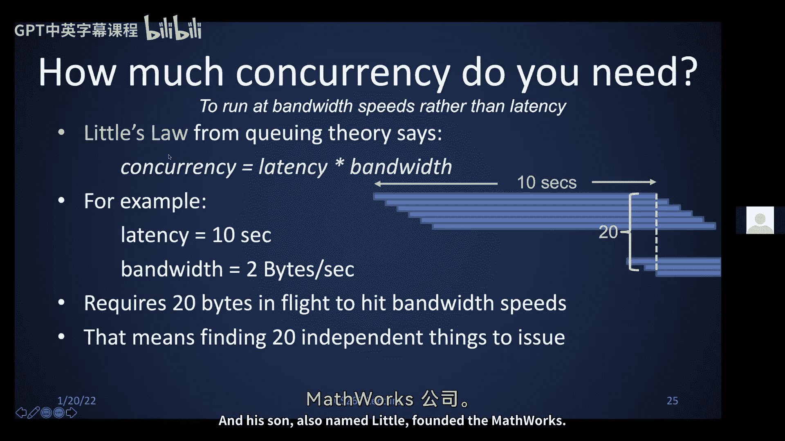

So here is another example for a slightly more realistic set of numbers than 10 seconds and two bytes per second。

 this is from a 2005 era Opron processor and so here the latency is 160 nanoseconds was 16 nanoseconds the bandwidth was 6。

4 bytes per second and so that's 10 nanoseconds per 64 bit cacheline。

And so the idea is that if you can issue a load request you know every often enough。

 so here's the pipeline， you know I'm issuing a load， here's the latency。

 the data arrives then I issue another load I wait a little while the data arrives if I can keep up to six of these in flight at once。

 then that's enough so that I'm running at the full speed of the machine。

So and each request has to be launched at least 16 nanoseconds before data is needed so so what i'm saying is we don't need to issue all of these six requests simultaneously。

 we just need to pipeline them。😊，And that's enough to keep the bandwidth saturated over time。

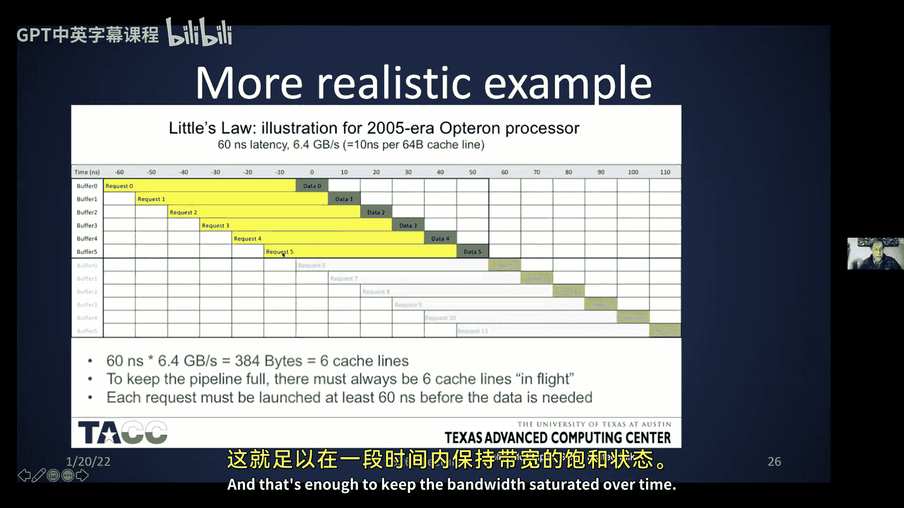

So let's talk about a corey has well known and just to sort of give you some ideas about what more modern hardware looks like that you'll be programming on so i'm not going to do all the details here some of this is you know basically so that you if you want to do more。

Detailed performance modeling for homework or for your projects。

 you have the data here available for you， so one node of course there's thousands of nodes consists of two sockets。

😊，And each socket has 16 cores each。And so here's a picture of what that looks like each of these yellow areas。

 yellow ellipses contains four cores， each core runs at 2。

3 gigahertz and and it has you can do a very wide vector operations so one instruction can do 256 bits worth of arithmetic at the same time。

 which could be a certain number of 32 bit operations， half as many 64 bit operations。

And so the peak。In theory， if you multiply it all together， comes out to 1。2 terofops per node。So。

Here is another picture of what a Corrry node looks like。

Excuse me this is a canL node not a has well node this has 68 cores in it each core is slower than a Ha well core it's smaller and uses less power but there are more of them and so you can still take advantage of it but you have to be able to find more parallelism in order to do so。

😊，So if we look inside one of those canL nodes， what you have is 36 tiles arranged in a six by6 mesh and they're all connected to their nearest neighbors by a 2D mesh interconnects so everybody's connected to their you know。

 north， south， east and west neighbors。And then there are some wires that go off the chip to connect other things and there's some local RAM as well。

 and so again I don't want to go through all the details of this。

 but this is a level of complexity if you want to write down a detailed performance model about how fast things actually go so given the complexity of the hardware how do we abstract this to come up with just a simple model that a programmer can use without worrying about all these details？

And the answer is to use a benchmark。And so this is called cash bench and it's there's a whole bunch of different memory benchmarks out there there's also called the stream benchmark that's somewhat similar and so what this is going to do is you know estimate for you the latency and the bandwidth and the cache sizes so what we're going to do is run these loops。

And collect all the data， and from that we're going to magically figure out what's in the hardware。

So let me just explain this， so we're going to try a whole bunch of different lengths of vectors so or arrays。

 so we're going to try an array of length 4，8， 16， 32 and so forth。

And then we're going to do some timings and what are we going to do in the timings。

 we're going to repeatedly go off and add up all the entries in this array。

 so I'll add these four numbers， you know compute the sum and then do it over and over again。

 you know some number of times and do and do timing。So for the timing to be accurate。

 I have to run this many times。But there's another reason i'm going to run it many times。

 so suppose that I read in this array of eight numbers and eight is smaller than the cache size then once I read into cache it' going to stay there so the next time I execute this you know compute the sum I don't have any more memory access so after the first set of reads accessing this is super cheap it's all sitting in cache。

But what happened that so that's good so if it's smaller than the cache size it's going to run fast。

 what happens if the array is bigger than the cache size so I read all this in and then when I start reading this in it has to evict some of these other entries。

😊，So that means that the second time through， it's not all stored in memory and I have to read it from memory again。

 so once the array doesn't fit in cache， this iteration is going to go much， much slower。

And so by looking at that timing and big how big the array size was。

 that we'll be able to infer how big the cache size was。😊，So let's look at some data。

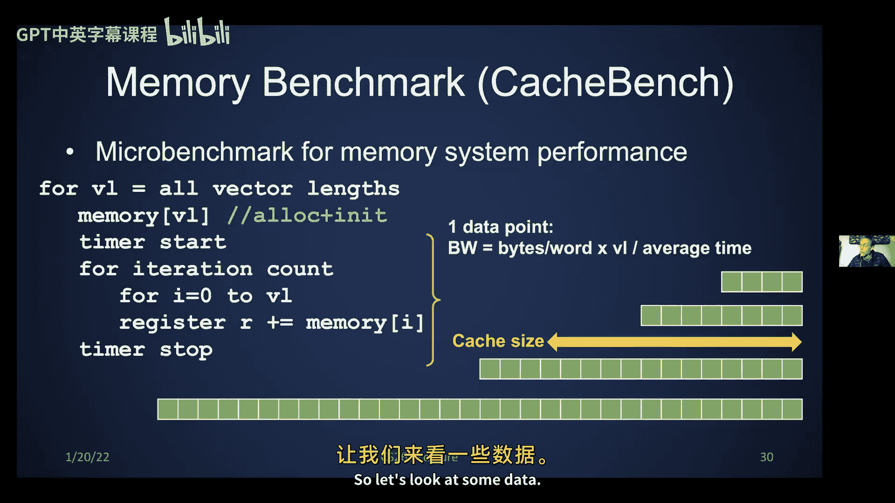

And see what it tells us。And so this is for a whole bunch of different platforms， and it tells us。

 what is the measured， speed of the algorithm in gigabytes per second as a function of the length of that array。

And what I've put in here and there's different curves on here for different processors。

 you know Corey Cannell as well， some Amazon cloud instances。And in addition。

 we have some vertical lines， which is the size of L1， which is common to all of these platforms。😊。

The size of Cory has well L2 cache， all the other cache is in L3 so let's just look at this red line here。

 which is the now let's do this one which is the AWS large instance and you can see this is pretty flat。

And so that means that up to a size of about 64， then everything fits in cash and it's running at full speed。

 but once they get larger than 64， it drops off。So that tells me that this first level of cash is of that particular size。

 64 kilobytes。And so then I hit another level area。

 and so that means that it all fits in cache again you know until I hit this line and it drops off so that tells me the next level of cash is going to be this size。

 which is a megabyte。😊，And that is indeed the size of the L2 for the others。

 and so by looking at with the flat parts and the cliffs， excuse me。

We can tell what the cache size is and so forth and so this is you know a typical benchmark and it tells you very much what you can expect from your hardware。

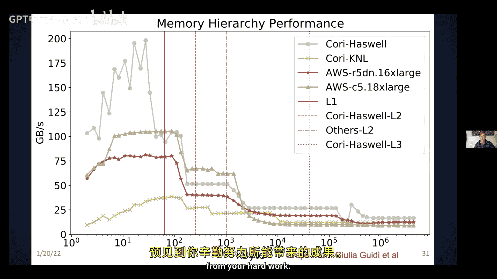

So here are some takeaways from all of this quick tour one is that performance is complicated right so I didn't try to explain all these jagged lines here that could come from the compiler doing strange things or SD operations I don't know。

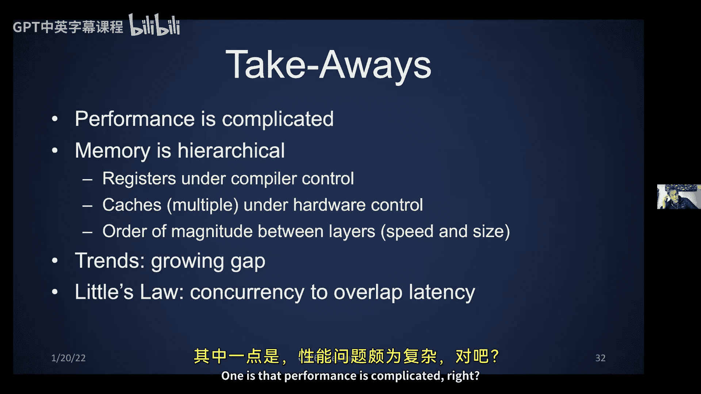

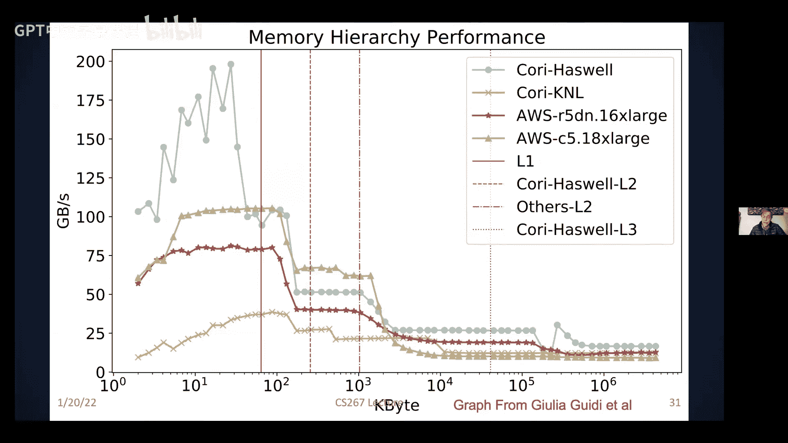

But we need some simple models in order to guide us in writing efficient code。

The other one is that memory has hierarchies。😊，So you know the registers。

 they're small and theirre caches are multiple sizes， the registers are controlled by the compiler。

 you know or you if you want to write assembly language。

 you know who gets assigned to which which variable gets assigned to which registers， the caches。

 all those different layers are controlled by the hardware and so understanding what the hardware does is important to get you know write your algorithm in a correspondingly efficient way。

And there's orders of magnitude gaps between these different layers in speed and size and the trend over time is these gaps are growing。

😊，And from Little's law， we know how much parallelism we need， concurrency。

 different loads and stores going on at the same time in order to hide the latency and go at the full bandwidth speed。

啊。Okay， so when I before I had this picture。

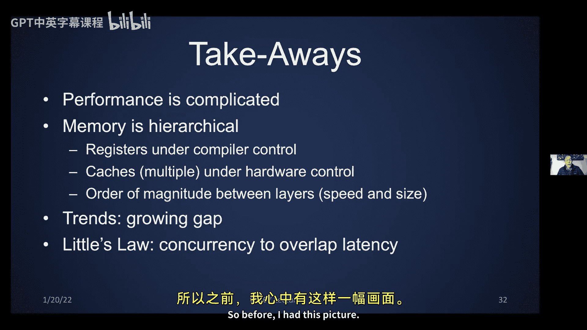

Of this， and I refer to it as pipelining where you start an operation。

 you start the next operation a little later and at any one time of many operations going on at the same time。

I want to now go into more detail on that。

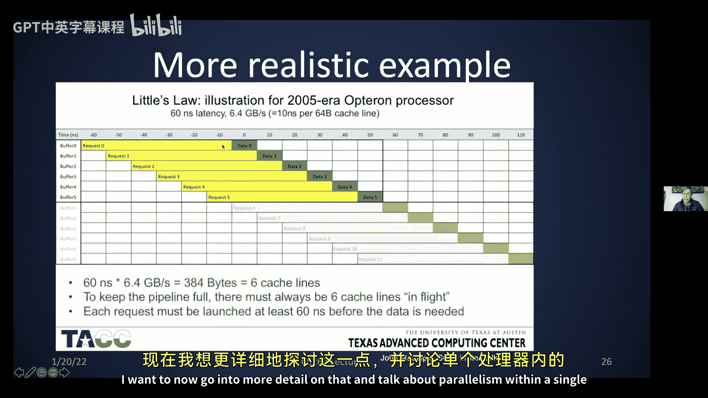

And talk about periling within a single processor， which includes pipelining。

But are there any questions about that whirlwind tour of memory hierarchies before I go on？

Hi professor I had a quick question about the the chart that you just showed showing the performance dropping off as we increase the size of the array Yes how come one yeah how come until the performance doesn't drop immediately when it hits the size of the cache Well this is because the hardware is doing its best to reuse it right when when you go past the edge it's going to keep some of the array but not all of it and it depends on which parts it throws out。

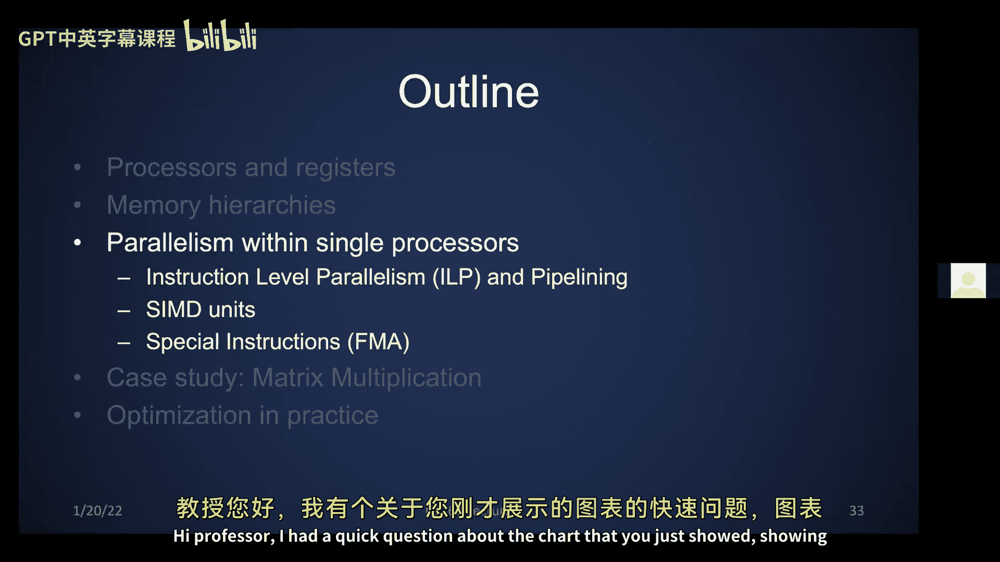

And so yes， it you know so it's not like it throws out everything in that's stored there immediately and depending on who it decides to evict。

 it may you know some of the data may be there and some of it may not be。

 so if you only have a little bit of extra， then it will hopefully not evict most of what you need。

 but eventually it will。I see thanks。哦。

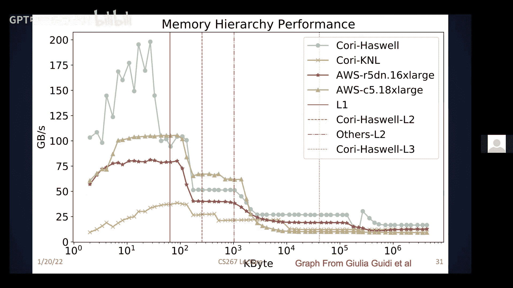

Okay。If there are no more questions， then we'll move on to perilism inside a single processor。嗯。

So here is a picture that Dave Patterson has used for many years to understand latency and bandwidth by the way it works to the laundromat。

 so suppose your washer takes 30 minutes， your dryer takes 40 minutes and it takes you 20 minutes to fold。

What is and you have four loads of laundry how long will it take to do all of those loads well if you did it the silly way and waited until you finished folding one load before you did the next one。

 it would take you four times 90 minutes you know because one load finishes in 90 minutes it would take you six hours to finish all your laundry。

But we're all smarter than that。 And you know as soon as the washer is done。

 we can start it again or maybe 10 minutes later since it's you know there's no point in having it done before the dryer is done And so we can start the next load and then start the next load to start the next load and then you know in the middle and also do a folding at the same time So these three operations folding drying and。

Washing are all independent and so by overlapping those pipelining it。

 we can get done much more quickly and it will take。So the pipeline execution。

 you know there's a startup time of 30 minutes for the first wash and then after that the bottleneck is the four uses of the dryer and then there's 20 minutes of folding at the end and only takes three and a half hours so the bandwidth or loads per hour is four six loads per hour without pipelining but it's four divided by three and a half loads with pipelining and if you have enough loads of laundry you can get all the way up to 1。

5 loads per hour by doing pipeing。So the pipelining doesn't change the latency， which is 90 minutes。

 but it does improve you know the bandwidth significantly。

 so the bandwidth is limited by the slowest pipeline stage。

 so in a perfect world each of these stages which are 30。

 40 and 20 would be the same and in that case the peak speedup you could get by doing this would be the number of stages。

 so the number of stages three in this case is an upper bound on any speed up。

So here we can plot the effective bandwidth of doing the laundry as a function of how many loads you need to run and if you're only doing one load then you know you don't get any you know then everything is sequential and you're getting you know this you know two- thirdds of the peak bandwidth but you know if you have an infinite number of loads。

 then this is how fast you can get and this is how close you get as you increase the number of loads and so ideally we want to have you know a lot of things pushing through the pipeline。

So where does？Pipelining come up in the hardware and so it comes up in lots of different places。

 it comes up even in executing you know basic instructions。

And so here is a typical five stageage pipeline taken from Patterson in Tennesseenessee of how an instruction is executed。

 you hear the phases， you have to go get the instruction。

 which means you know you have to figure out what the program counter address is。

 go to memory that can happen at the same time as for the previous instruction you're decoding it。

 taking it apart， figuring it out you know what it wants you to do and getting the registers that you need then you can execute it。

And then you have to write the answer back to memory。Now， that is for an instruction that。

I should say that's the top line here instruction， instruction decode， execute。

 that's what happens if you only are working on data that's already sitting in registers。

 you could also have a memory read or write in that case you also can have five stages but they and they're but they're different either fetching from memory doing an address calculation if it's a right and putting it back into memory and so you can have all of those operations going on at the same time all of those stages as the executing an instruction like an addition or a subtraction。

So the details here don't matter， but the point is the hardware will be smart and try to execute different instructions in parallel if they need different hardware resources。

So pipelining is actually also used inside the arithmetic logic unit so even inside this little box here there could be separate pipelining and the reason for that is that some operations are just slower so floating point multiplication takes a while more than addition and it could might take 10 cycles but。

If you're doing a whole bunch of multiplies in a row。

 you can pipeline those through and get a through point of one per cycle。

And that so you multiplies and ads may have different properties in that。adss are faster。

So another feature of the basic hardware or SD instruction single instruction multiple data is what that stands for and so we've been thinking about you know an addition operation is taking a single number and a register adding it to another number and putting it in another register but most machines now can do that for many registers at the same time。

 so it can take these four registers。😊，With four different values added to these four registers and put the answer in another four registers and four is actually quite small by today's standards it's being done for much larger operations and this is often visible to the software for example。

 if you program in coUDa as we will later for GPUs these are very explicit instructions that you have to write。

So on KNL， they have the way this is done is that theres a unit called ADx 512。

And it has the property that whatever data types you can fit into 512 bits it can do in parallel so for example。

 you could eight add eight double precision numbers at the same time because eight times 64 is 512 or you could do。

6This many 16 bit floating point operations four times as many all at the same time because the hardware will reconfigured it itself and if you have。

Working on individual bytes， you can have even more app perism because the hardware will reconfigure itself。

So and so all of these operations as I said do all these ads and multiplies or logical operations in parallel and so you need to expose the parallels into the compiler。

 you can do that by unrolling loops for example， or giving the compiler hints and all of this data has to be living in contiguous memory locations in order for the compiler to have a chance of being able to generate this and often it should be aligned at the beginning of a cache line to so it's not starting in the middle of a cache line it's starting at the beginning。

So what are the problems that prevent compilers from doing this for you all the time or you writing it by hand？

Is that parallelism can get the wrong answer if you reschedule the operations in a different order in order to take parallelism into account so what are the different things that could go wrong so in the hardware world these are called hazards and in the compiler world these are called dependencies but it's the same idea and there's three different kinds the first one is called read after write。

Suppose I execute these two instructions one after the other。

 so first I assign the value of a to x and then the value of x to B。

 so B should be equal to a when I'm done。But if I do this in the opposite order。

 if I assign b to x first， B will get the old value of x， not the value of a。

 so this is called a read after write or a raw hazard。The other， similarly。

 if you have a write after a read， then this could go wrong because I assign a to xation of the old value of x。

 but if I do this first a will be equal to B， so that's not a good thing so that's called right after read。

Right after right seems a little oddtter that you'd want to do it。

 but again obviously if I did these in a different order， x would have the wrong answer at the end。

And the good news， of course， there's no problem with read after read because youll look get the same answer no matter what you do。

And so what the hardware or the compiler has to do is that if it sees these kind of dependencies。

 it can't reschedule it because it'll get the wrong answer and so understanding whether this is actually going to happen in your code sometimes is hard to understand and so that means that the the compiler may be just conservative in the decisions it makes。

So the other thing that can go wrong is that。If you have non contiguous memory accesses that can be slower so let's suppose that I have I'm loading every fourth entry of an array then that。

These my notes。So this could happen because for example， suppose I have。

I'm accessing an array which is stored two dimensional array which is stored row wise。

 but I'm accessing it by columns， then this might be the way I access it by columns。And so this is。

 could be a problem in understanding whether this location is the same as another location。

And even trickier is that if if I have indirect progressdressing。

 so I have a pointer or an index in one array and I use that as a subscript in another and if I'm doing a read it's called a gather if i'm doing a write it's called a scatter and understanding whether two locations would conflict can be very complicated and and so。

😊，YouSometimes it's something that the user has to do so where does this so this comes up in accessing arrays all the time this comes up in in both graph theory you know we're often used following pointers in graphs or in sparse matrices turns out that sparse matrices and graphs you know are pretty much identical in a lot of the algorithms and data structures that we use we'll hear about that later。

So here's another thing that is in the hardware that's good to take advantage of。

 there's a special instruction in most hardware for something called a fued multiply ad。

So that means that you take not two numbers and produce an answer。

 you take three numbers and you produce an answer， so you do a multiply followed by an ad and I hope you can recognize that this is exactly what the inner loop of a dot product looks like or matrix multiplication and so the fact that there's special hardware to make this go fast is important to you know to take advantage of you when you're doing certain optimizations and it does these two operations know in the same time as you would do one of these operations so it gives you speed up of two。

It's also more accurate because instead of doing a multiply。

 getting a rounding error and doing an addition， getting a rounding error。

 it only gets one rounding error for the whole thing。

 so the answer x is the correctly rounded value of this entire expression。

 which can be useful for certain high precision algorithms too。So what does this all mean to you？😊。

Ideally， the compiler would understand all of this and it'll all rearrange all your instructions to maximize parallelism and usefuse multily adsbs and SID instructions and understand all the dependencies in your code。

😊，To make sure that it doesn't have a hazard or you know。

 like read after write problems and give you the wrong answer。But in practice。

 the compiler may need your help because you know it's not smart enough to necessarily understand all the things that you do so。

One example is that you may have two arrays and access them you know that A and B are different but the compiler doesn't know that they don't overlap you know that a sub I and B sub J you know if you're paranoid and the compiler should be paranoid it say oh those could overlap and that will limit the kind of optimizations but you may know better and so you can choose so you need to help one way you can do that is by using optimization flags and so forth different compilers do different kinds of optimization。

You can rearrange your code and there are certain intrinsics that say you know just where you're telling the compiler to overrule all its internal rules and just do it and all of those are possible to。

And again， for things like matrixtri multiplly that are well optimized。

 you don't have to worry about it， but there are a lot of programs that haven't been so well optimized。

And so here is a list of all these different optimizations that compilers typically do i'm not going to go into the details here。

 there's a wonderful survey by Professor Graham and her students located here where she does a great survey of all of these different things and how they're done。

😊，And I've only given you a very high level description of some of them。

 so there can be much more general reorganizations of code in terms of taking loops and merging them together or doing loops in different orders。

 dependencies permitting to get more data reuse and all sorts of things like that。Okay。

 so the takeaways here are that every。Cerial processor actually has perilism hidden inside of it。

 it could be instruction level parallelism， know SimD instructions cu multiply ads and compilers will help。

 but the programmer can still do more on top of that。Okay。

Are there any questions before we go on to matrix multiplication？是吧。Okay。So now this is。

 we're not going to finish this today， know we're going to get part way into it and this will continue next time。

So we're going to give you a simple performance model to understand which is an approximation of what real computers do know but based on what we've talked about already。

 but it'll let us reason about different ways to organize matrix multiply and pick a good way to do it we're going to do a warm up by just analyzing a simpler algorithm which is matrix vector multiply which can't be optimized very much and then we'll talk about tiled matrix multiply and for sure next time we'll have to talk about a cache oblis。

So why matrix multiplication it's an important kernel in many many problems dense linear algebra is we listed that as a motif in every list of applications and turns out that know matrix multiply is the building block for all the other dense linear algebra algorithms。

It applies to other problems that sound different completely like in graph theory like transitive closure that turns out that's also a matrix multiply and if you want to know what most computers these days are spending their time doing it may be training neural nets and matrix multiplly as the bottleneck there too which is why the Googles of the world have built their tensor processing unit accelerators to make matrix multiply specifically go faster so the optimization ideas for matrix multiply can be applied elsewhere too they generalize in lots of ways so that's another reason to talk about it and it's in some sense a best case we can get enormous speedups as I've hinted at already orders of magnitude and it is indeed the most well studieded algorithm in high performance computing so let me give you some hints of this so this is a graph from a former PhD student here has been on the faculty at Cornell for quite a while and so this is。

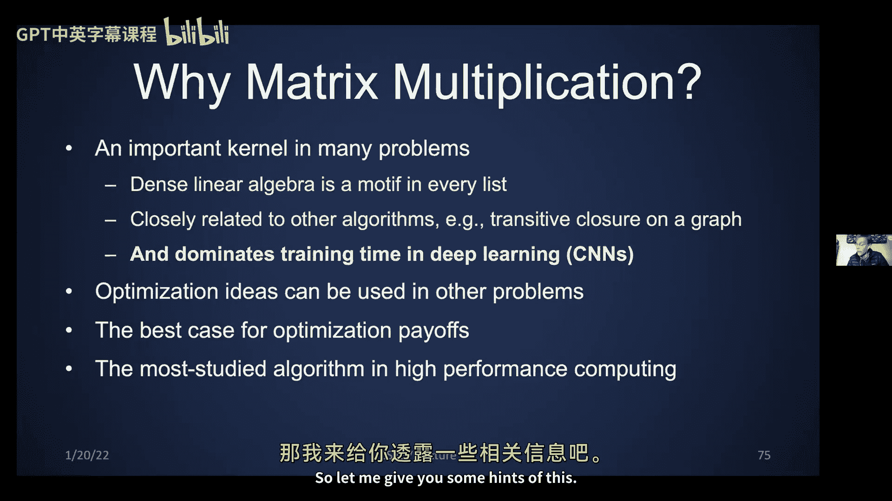

So three different performance curves for matrix multiply， vertical axis is speed。

Up is good and the horizontal axis is the dimension of the matrix and if you just do the naive three nested loops that's in red and by the time it gets large enough that it doesn't fit in cache you're getting a very low performance so these you know peak levels the data fits in cache so just like our memory benchmark things are good you know with occasional problems but then it has to slow down。

😊，If you do the blocked version that we're going to tell you about。

Today and in the simplest possible form， then you get much better performance by you minimizing the number of cash misses。

 but there are occasional places where it doesn't work quite right。

 even though in theory it should and then David did a much more careful implementation of it and you know he gets this fraction of performance。

So that is just， you know， David Bidle's implementations。

 how does this compare to what the vendor can do where they have a team of experts on this particular architecture。

And so here is the same plot。😊，Shown at the bottom with the vendor thrown in at the top。

 so the vertical axis has changed。And you can see that the vendor is getting three to four times faster by taking advantage of all the different things i've told you about so far and probably more so this is this shows you you know what you know opportunities you have in homework one to go all the way from here to here to here if you want you don't have to but you know these are the possibilities。

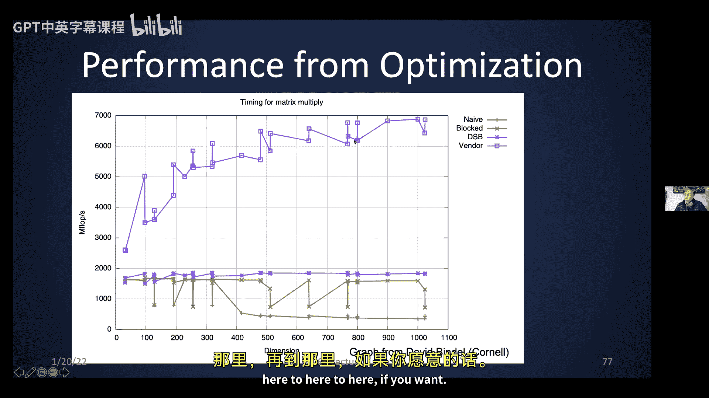

So here's going to be our model of memory in order to motivate our design of the algorithm。

 and we're just going to assume there's two levels of memory fast and slow。

Initially all the data is going to be sitting in slow memory and we're going to worry about how much data moves between slow and fast and so I'm going to write down some code and then write down a performance model and so to do that I need to count M the number of words move between fast and slow memory that'll depend on the algorithm。

Then I'll have another parameter which depends on the hardware only。

 which is the time per slow memory operation， so the inverse of the bandwidth in the best case。

 then I'll count the number of floating point operations I do and that's going to be the same for all the algorithms I'm just going to use classical N cubed matrix multiply or two n cubed matrix multiply。

😊，And then I have the time for arithmetic operation， which， as we've talked about is much。

 much faster than moving a word of memory。Okay。So。And then I'm also going to have the computational intensity and so that is going to be a measure of how many flops I can do and the same time that it takes to move one piece of memory one word from slow memory to fast memory and you know since。

Oops， sorry。Back up that I'll get to that in the next line the computational intensity is the number of flops that the algorithm does divided by the number of memory or the slow memory movement that it does。

And so what I would like is that to have a very high computational intensity。

 so I would like to do lots of flops and very you know which is going to be a constant2N cube。

 and I'd like to do very few memory move very little memory。

And so that number here is going to depend on how my algorithm is organized and so and I'm going to know compute that later。

OopsSo what is the minimum possible time to run the algorithm。

 it's when all the data is already in fast memory， so if my matrix is small enough and it's already there in that case I'm not doing M is zero and so the minimum time is the number of flops times the time per flop。

😊，And the actual time is the time per foop。😊，Times the number of flops plus the memory movement。

 which is the number of words move times the time per words。

 this is a very simple model assuming no parallelism。And if I factor out the minimum time。

 flops times time per flop， I'm left with one plus。This ratio。

 which is very large because I know that moving data is much slower than doing arithmetic and it's multiplied by one over the computational intensity so since this number is very large I want the computational intensity to be very large too so that this thing this product isn't very large and gets as close as possible to the minimum which is just the fop time。

😊，And so the larger computational intensity means the time is closer to the minimum。😊。

So how do I reorganize my code to get as close to the minimum as possible？

So that's the computational intensity and just reminding us of the notation here。

And this other number here is called the machine balance。

 so the computational intensity that's going to be a function of my algorithm and how clever I am and this number here。

 this ratio is just given to me by the architecture and I have no control over it。😊。

So let's get a warm up by doing matrix vector multiply so I have two nested loops and I'm just going to loop over all of the entry。

 all the rows， all the entries of y then i'll loop over all the columns of a and do a dot product I'm going to take the dot product of the Irow of a with the vector X and accumulate it into there so this is the simplest algorithm you can imagine and so now let me annotate it with when it's doing reading and writing so this you these comments in orange are just my description of what's going on they're not it's not the code itself so let me assume that I have enough room to fit three vectors of length n into fast memory。

But I can't fit the whole matrix， I can't fit n squared in。

 but everything is initially in slow memory， so I have to read X in because I'm going to use it。

Over and over again， I'm going to read Y in， and I'm going to use it。😊。

Then I loop over all the rows of A and I read in row I， then I do my dot product。

And in this inner loop everything is already in fast memory there's nothing left to do you know so at this point I can do everything I need to do you with data and fast memory so it runs at full speed and when I'm finally done at the end of the algorithm I take the vector Y which I've assumed is in fast memory and put it back in slow so how so let's count the number of slow memory references is that I've read X once red y once and written y once that's three times n。

And I've read a exactly one each row of a once that's n squared the number of arithmetic operations is2 n squared yes know n times n times2。

And so the computational intensity f divided by m is about two， which is very slow。😊。

I have no hope here of accelerating matrix vector multiply。

 it's going to be limited by the slow memory speed because the computational intensity。

 I can't get it bigger than two。So。We assumed here that there's to make it easy is that I assumed the Fop speed was constant t sub F I assumed the fast memory was large enough to hold three vectors know I could do the analysis more generally but you know this gave us the intuition that we're not going to do very well here for matrix vector multiply I assume that the cost of a fast memory access is zero so if fast memory is L1 it's a little bit slower but it's still a reasonable model and I assumed a constant memory latency。

So I could do this model in different ways， but it's not going to change the basic idea that the computational intensity of two is not going to let us go faster。

The time to read the matrix is always going to dominate。So let's now look at naive matrix multiply。

And so now I have three nested loops， Ij and K， and in the inside， what am I doing。

 I'm taking the dot product of the I row of a and the JF column of B and you know computing the IJth entry of C。

And so I'm how many flops am I doing it's two n cubed you know n times n times n times2 and I'm working on just three n squared words of memory A B and C or n squared So the computational intensity how big and I'm going to use cus a shorthand for that here change of notation It could potentially be as large as the total number of flops to n cubed divided by。

😊，The total amount of memory， assuming I only magically could read A B and C once。

 which isn't going to happen， but you know this but this is an upper bound so I could have a computational intensely as big as an。

If I did this same analysis for matrix vector multiply， I'd get a two here。

 and so I'd know upfront that I can't do very well。

 but here there's a potential to have a large computational intensity if I do something smart。

So let's do naive matrix multiply and I've put in the orange comments again that say what happens if I again I'm going to assume that I have room for。

2。And I have a room for a row of a， a row， a column of B， and one entry of C。

So what am I going to do， I'm going to read row I of a into fast memory because the outermost loop is over eye。

Then the inner loop does J， so I'll read Cj in there because I need to compute it。

And then I'm going to read column J because I need to do the dot product in this inner loop that does the dot product。

 everything is in fast memory so it's fast when I'm done CIJ is done and I put it back into slow memory。

😊，So how many slow memory reads have I done？I've done n cube to read each because I'm reading each column of B n time and so that means I'm reading the whole matrix of B over and over again n time so that's N cube。

😊，I read each row of a exactly once and keep it and I'm done with it。

 and I read and write each entry of C exactly once。

 so the total number of memory operations is N cube。

And so the computational intensity is no better than matrix vector multiply， it's two， it's really。

 really bad。😊，And so it turns out there's a better way to do it and given the time I'm just going to give you a hint and then come back to it in the next lecture。

 what we're going to do is something called blocking or tiling。😊。

And so I'm going to think of my three little n by little n matrices as capital n by capital N matrices where each entry is a block。

😊，And the blocks are of size B by B。And so so for example， you know， if I had thousand00。

 if little N was0 by000 matrices， I could think of them as 100 by 100 matrices of 10 by 10 blocks。

And so what I'm going to do is loop over all of these blocks and in the inner loop。

 I'm going to have it looks like the same line of code as I had before。

 but now this is a 10 by 10 block， that's a 10 by 10 block and that's a 10 by or B by B block B by B block。

 and so I'm going to do a B by B matrix multiply。😊，And update this B by B block of C。

And so this inner loop here is in fact three more nested loops。

 so the entire algorithm is in fact six nested loops。

 and the idea is that if I choose the size of B so that I can have that fit in cache。

 that fit in cache and that fit in cache all at the same time。

 then there's no more memory traffic when I call this inner routine。

To do the B by V matrix multiply and that's where I'm going to get all the benefits and exactly how much benefit we'll talk about next time because it's already 1230。

😊，So are there any questions？Hey， professor， I have a question when you computing the theoretical potential for computation intensity。

 you only including three image read as like the total image， you know。

 movement between the fast and slow memory， right， you have this3 n square right't and that would be true and that would be true So and that would be attainable if n were so small I could fit all three matrices into cache。

Yeah， I guess like my question is why it's not for because you still have to write out the same bike to the original like the see matrix here if all if all of the。

Data is small enough to fit in cache simultaneously。

 I could just quit at the end after I've computed C and it's just living in cache。

So if I insisted that the program end with C back in slow memory， then you're right。

 it would be for n squared。But if all I insist is I have the right answer living somewhere。

 cash is okay， then it's3 n squared。Yeah， so efficient。

I'm sort of assuming here that A B and C start in slow memory， so I have to read them at least once。

 but at the end C could be when I'm done C could still be in fast memory。

 but if I insist that I start and slow and end in slow it would be4 n squared as you said。I get it。

 thanks a lot。The difference between three and four won't matter too much later。

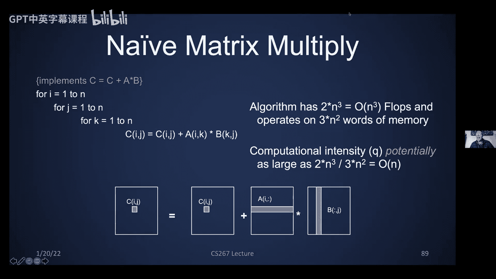