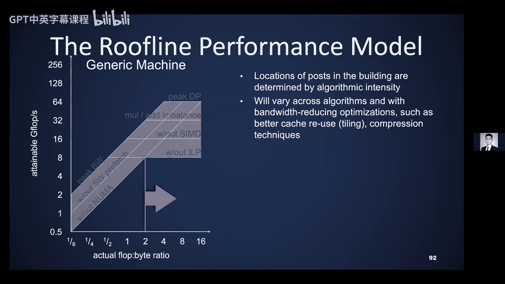

# 【并行计算 CS267 2022】伯克利—中英字幕 p04 CS267 (Sp22) - Lecture 3： More Matrix Multiplication and the Roofli -BV1PS421978D_p4-

Welcome back everybody to CS 267 and before we get started there is one thing that is due this week。

 which is the pre proposalpoal do Thursday at midnight which is just meant to be a very informal description of a project that you might potentially be interested in so you can try to find partners it's in no way binding and what you'd like to do so today we're going to talk about go on and talk about matrix multiplication and the roof line model。

And just to remind you of the simple model of memory we're going to use for this to try to come up with an optimal algorithm in this in terms of this simple model。

 we're going to assume there' are just two levels in the memory hierarchy。

 fast and slow and we'll say more about what happens on a real computer when there's three or four many levels of memory and all data is initially in the slow memory and so we're going to have some parameters that measure all this stuff we're going to count the number m。

 the number of words move between fast and slow memory that's going to be the bottleneck that we're going to try to decrease by being clever and then TM is the time for you know slow memory operation to read or write something and we're only worried about bandwidth would here we're not worried about the latency term。

We're going to count the number of flops and all the algorithms we're going to do at the beginning of the lecture are going to do the same2N cubed roughly operations so that'll be that and then there's the time for flop and then the computational intensity is going to be the average number of flops for slow memory access and we would like that to be as high as possible in our algorithm so that we get as much reuse as possible and make m as small as possible。

And so there is our computational intensity， which is the measure of our algorithmic efficiency and so the minimum possible time of course。

 if all the data fit in fast memory would be just number of flops times a time per flop but the actual time is you have to add in the number of words moved times the time per word moved so let's think of that as the minimum time times a factor bigger than one so one plus and。

😊，This number here。Here is the machine balance。 So this Tm divided by Tf is the number of flops you can do in one memory in moving one word of memory and that's a number that's larger than one much larger and growing over time with technology changes and the computational intensity isn't the denominator and so we would like to make that as big as possible so that this。

Product of the balance divided by the intensity is close as small as possible。

So recalling naive matrix multiply and why that was a bad idea， that was just three nested loops。

And the inner loop basically did a dot product of the I row of a with a J column of B and put that in C sub ij and when we did the counting last time every time if you're if n is if you can't fit the whole matrix in your fast memory which is the assumption then every time you read a column of BN you're going to have to read it in again for every other row of a with which you do a dot product so you're going to read each column of B little n times and is a dimension and so you're going to have n cubed reads of the matrix B and so the computational intensity is going to be you know basically two two flops per word moved you're basically just doing a bunch of matrix vector multiplies which we analyze last time and it's no better than that no benefits so how do we improve on that。

And the idea we proposed last time was something called block matrix multiply。😊。

And what we're going to do is think of our little n by little n matrices as matrices where each entry is a B by B block and so these are going to be big n by big n matrices where each entry is a little B by little B block and so that and that little block size is going to be little n divided by big n and so what we're going to do is assume that I can fit in memory this B by B block that B by B block and the one over here。

😊，And so what I'm going to do is read in these two read in all three of these blocks。

 I'm going to assume three B by B blocks fit in cache and then do all the operations to multiply that by that。

 that's a B by B matrix multiply。And so I'm sort of converting it into a smaller matrix multiply。

 if you like， not in the terms of flops， but how many reads and writes I have to do。

 because I only need to touch each of these once to update that。

And so here is the code with some annotations so we can do some counting as to how many reads and write we actually do so again i'm going to have three nested loops but it's now one to big end because these are now considered big end by big n matrix multiplies so I have three nested loops in the inner loop looks like it does before where i'm just updating this entry of the matrix but this entry is now a B by B block so this multiplication。

Is now not a scalar but a B by B matrix multiply and so this is actually three more nested loops which i'm not writing out so the whole thing is actually six nested loops。

 not three nested loops so the idea is if I can fit three of these blue blocks into fast memory at the same time I will read that one and then I will read that one read that one all three sitting there and then there's no more memory traffic when I do this little B by B matrix multiply while it's inside the cache。

And so yeah， so the box size， so there's three nested loops inside that and the box size are the loop。

The loop bounds。And so this works whether I'm tiing for registers or caches and I can you know do this you know multiply。

 so if I had more than one level of cash， this could be done the same way and I could sort of tile this the same way if I have three or four or five levels of cash。

 but we're not going to worry about that detail right now。

So now let me go do the counting more carefully and see how much memory traffic I actually have assuming I can fit these three3 B by B blocks in fast memory all at the same time。

 so I'm going to read this block in and it is of size little B squared how many times am I going to read that block in it's capital n by capital n so it's capital n squared。

And there's a factor of two because I'm both reading it and writing it。

 so the total amount of memory traffic is to read and write each block of C exactly once and since little n times B is since capital n times B is little n it's just two n squared。

 so that's the lower bound I read and write each entry of C exactly once。😊。

So now inside these three nested loops， I'm going to read this block of A。

 and so that means I'm going to do capital n times capital n times capital N or capital N cubed。

Reads of blocks of a， how big is the block， it's a size b squared。

 and so to do a little cancellation， B is little n divided by big n and that turns into capital n times little n squared。

Same story for capital B because it appears in the same place in the code。

 and so it's capital n times little n squared to read each block of B。

And so the total number of words moved， little M is reads and writes of C。

 reads and write of a reads of a and reads of B， and altogether that's basically you know proportional to capital n times little n squared the computational intensity now is divide the number of flops。

 which hasn't changed to n cubed over the number of words moved。😊。

And that turns into little n divided by big n roughly or B。

 so the computational intensity is B as long as you know these are large enough matrices。😊。

And so obviously， I would like to pick B as big as I can to get more and more computational intensity。

😊，So how big can I make me？So I had an assumption， which was that I had three B by B blocks had to fit in fast memory。

So that means that 3B squared has to fit in cache or 3B squared is less than m or solving for b b is less than the square root of M over 3 and so that gives me an upper bound on this particular approach to how much computational intensity that I can get。

So now all that' said and done， so we're going to come back and ask ourselves， you know。

 is that the best I can possibly do， but I want to do another approach right now。

 which is more elegant。And it's going to be more elegant because it's going to have the property that it doesn't depend on the cache size to write that last to implement that last algorithm。

 you have to know what hardware you're running on， you have to know the size of capital M and furthermore。

 if you had multiple levels of cache which most computers do。

 you'd have to know where all of those levels of cache is how big they are and have more nested loops for each one of them。

And so the question is， is there a way to do it which avoids all those complexities？😊。

And the answer is yes， we can write down something that in theory does just as well as that last algorithm you saw。

 but does not depend on the hardware in any obvious way。

 it just makes assumptions about how the cache works。

And so this is going to be recursive matrix multiply so here I've written out a two by2 matrix multiply in all the gory details so C00 is a00 b00 plus a01 b10 and so forth and what you need to observe is that this algebraic identity is true not just when this is a two by2 matrix and these are all scalar operations but when this is an n by n matrix and each sub matrix is an n over2 by n over2 and in that case this is an n over2 by n over two matrix multiply and similarly addition。

😊，And so the idea is we're going to use this idea recursively I'm going to change n by n matrix multiply a times b into lots and lots of little n over two by n over two matrix multiplies how do I do that I change them into n over four by n over four matrix multiplies and so on recursively now I'm going to assume。

😊，To keep the presentation simple， that I'm dealing with square matrices whose。

Dimenssions are a power of two， but we can deal with a general rectangular case。

 it just makes the code a little bit more complicated。

And so let me write down recursive matrix multiplier or RMM for short。

 it's recursive so it needs a base case。And so the dimension is going to be one of the arguments。

 and so if the dimension is one， that's the base case and I'm just doing a scalar multiplication。

Otherwise， I need to compute all four sub matrices N over two by N over two sub matrices of C。

 and I'm just going to use that formula by calling recursive matrix multiply eight times to do all of these eight。

Nover 2 by Nover2 matrix multiplies that you saw in the last slide。

 and then this is an Nover2 by Nover2 matrix addition。So this code is sort of correct， you know。

 you know， just it's sort of， you know， hopefully no proof is required。

 you know if it's true for one， it's true by induction for two for four and so forth。

So let's count the number of flops it does and the number of memory moves。

 and since the code is recursive。😊，We're going to get a formula induction to solve。

So we're going to let ath of n be the number of arithmetic operations in that formula。

 and then we're going to get a recurrence。And the recurrence says。

 well how much arithmetic do I need to do， what I'm going to call this subroutine eight times1，2。

 three，4，5， six，7，8， so I'm going to have eight calls to a subroutine of size n over two。😊。

And then I have to do these four editions of N over2 by N over 2 sub matrices。

 and so I have four N over2 squared。That truth ends greater than one， otherwise。

 the base case here is one。So I have to solve this recurrence。And。😊。

I'm not going to go through the details and it turns out to be two n cubed minus n squared it's the same as a standard algorithm we're just doing the same operations in a different order now why is it minus n squared that's because I don't start by initializing C to zero and then accumulating stuff in it you know I'm computing those sums with one each entry of C with one fewer addition and so that's why it's minus n squared but it's basically the same algorithm。

So what about？The amount of data moved。So there is just to repeat that。

 so there is the number of floating point operations。Sorry about the animations here。

 so now I'm going to write down a recursion for W event。

 which is a number of words move between fast and slow memory。

 and this is going to depend on the cache size solving this recurrence。

 even though the algorithm does not depend on the cache size。😊，And so here。

 so we're going to have eight calls to this subrtine of size n over two。

 so I'll have eight times the number of words moved by doing N over2 matrix multiply。

Now I have some more cache movement because of these four line four matrix additions。

 so I have to read that matrix of size n over2 read that matrix and write that matrix so each line of code costs three reads and writes of n over2 by N over 2 submrices and there're four lines of code so that's what it comes down to now that is true if these matrices do not all fit in cache so that's true if3 n squared is bigger then the size the fast memory。

😊，Otherwise， let's suppose A and B fit in fast memory。

 then all of this recursive stuff will never touch slow memory again。

 it's all going to fit in fast memory and so the way the size of the fast memory appears is that this recursion is only true if the problem is big enough。

 otherwise I read it once and write at once and I'm done。

And so now I can solve that and I won't do the mathematics。

 but it's n cubed divided by the square root of the cache size you know plus in order n square term and it's the same as the Bch matrix multiply so there's no need to know the details of your algorithm to write this the details of your architecture to write this code。

😊，And furthermore。If I had multiple levels of cash， this would automatically deal with those。

 assuming all the cash policies were the same， did the right thing。

 then if I had an L1 cache an L2 cache and an L3 cache。

 this proof would say I'm minimizing the data movement。

 attaining amount of data movement between every level of cash， which is the best I can hope for。

Okay。So here's some。So this algorithm is called cash oblivious as opposed to cashware that's a term that appears in the literature。

 and there's a lot of ways to optimize this and here's some data that shows how people have done this in the past。

So in particular you don't want to do recursion all the way down to one by one problem because you're going all the overhead from the subrtine calls is going to overwhelm the cost of arithmetic of doing a one by one matrix multiply or a two by two or four by four for that matter so in practice what people do is that they write a micro kernelnel they write some very highly optimized code that assumes all the data in cache and that does know a particularly small size as fast as possible and then the recursion breaks off when you hit that size and calls that so in fact these algorithms are machine dependent to some extent because the micro kernelnel is done that way。

 it only hides all the layers of cache and so here is some old data where people compared a lot of different versions of both the the explicitly tiled algorithm blocked algorithm and the recursive algorithm and I'm just going to point to the top two curves here the very top one。

Is these pink boxes and that was iterative so that means it was explicitly tiled and it used Atlas to sort of optimize all the block sizes that's an auto tuner we mentioned before and so that's sort of the peak that they could get out of this machine and then right below it these upside down red triangles that's recursive and again they had a microcurnal that they called at some point that was optimized by Atlas but they used recursion for the rest of it and that got pretty close so i'm not going to talk about all these other variants it just shows you that there's a lot of tuning that can be done in a lot of variations on these algorithms so this was a 2014 study so obviously there's been a lot of work you know since then too。

So one thing that this might make you think of is that if we want to minimize memory traffic and take into account that the accessing memory is the fastest when you're grabbing consecutive entries because otherwise you have this extra latency problem if you want to maximize bandwidth it's best to read consecutive items from the slow memory to the fast memory and so sometimes it pays off to do an optimization called copy optimization and that means before you even start your algorithm。

 you reorganize your input data to be stored in a different order than the usual order。

So that when you access it and you access a block it's always in consecutive memory locations。

 so there's two ways that have been explored for this out of several so one way is you break your matrix into little blocks you know where you choose it depending on your architecture B by B and then you store everything in that B by B block then everything in that B by B block and then you and then it' sort of row major order but each thing you store is a B by B block where B you depends on your cache size。

So here you have to pick a block size and this sort of makes sense if you have one level of cache。

 but what if you have multiple level of caches and there's this interesting recursive data structure called Z Morton order。

😊，And so here， the idea is that if you have this end by N matrix。

 what we'd like to do is make sure that whenever I grab a sub matrix。

 it's going to be in consecutive entries as nearly likely as possible。

And so the idea is that I will store this upper corner altogether first then so you know the00 corner then the01 then the 10 then the11 corner so but how do I store this it's still a pretty big matrix。

 the zero1 corner， this zero0 corner I'm going to do it recursively I'll store its upper corner then that corner then that corner than that corner and this ordering is called Z order which is and you can imagine there's other orders that people have explored and you order and then you just keep doing this down recursively until you get to someplace where you stop and then it's just row major inside there。

Now so this will work for again， you know， no matter what。

Your memory hierarchy looks like and you know how many layers of cache and what sizes they are。

 but you can imagine that the index calculations get to be more expensive and so that's why you need to switch to row order at some point inside the inner loop。

😊，Okay。So are there any questions I see。Vivek has been answering them。Are there any other questions？

You know people are asking about Strawin so that's about that's going to come up very soon so don't worry about I don't have a question I want to know why does the Z odor saying is like oblivious to any catch size because it seems to be like just ordering the block major order。

So what I'm saying， so the thing is no matter the idea about this is that whatever sub matrix you grab。

The chances are it's going to be most of it is going to be in nearby memory location。

 so you're going to get good spatial locality。Right so if I grab this sub matrix here for some reason。

 then then the orange corner will be all consecutive， you know this corner will be all consecutive。

 that one will be and that one will be so I can have it most sort of four jumps。

If you like in my accessing of it。And that's independent of the cash size。

Does that answer your question？Yeah， so you can think about， you know。

 take any square sub matrix and you know， it's going to have four subbs， you know。

 or maybe a few more， which are all consecutive。Okay。

 so now let me summarize in one slide what is known about whether we're how close we are to optimal and this is going to include some references to later lectures just sort of as a teaser。

So it turns out that there's an old theorem from 1981 that says that both those algorithms we just showed you are asymptotically optimal。

😊，That means that if you start with the usual2N cubed matrix multiply operations。

And you're allowed to reorganize them any way you like is as long as you're only as long as you're still doing the same twoN cubed operations。

 so all we're letting you do is do reads and writes to memory in some different order。

And and so you can say that mathematically is that you're only allowed to use commutivity and insociivity to reorganize stuff。

 you're still doing the same two un cubed operations then no matter how you reorganize matrix multiply。

 it can't have a computational intensity。😊，Bigger than the square root of the cache size。

And so you can't move so the number of words move between fast and slow memory is lower bounded。

 big omega means it's lower bounded by n cube divided by the square root of the fast of the cache size and that's exactly what those two algorithms we showed you attain recursive and tile they get n cube divided by the square to the f cache size so we now we know that you know there's some constants hiding in there but we know the constants2 and we can attain them that that's the lower bound。

So what else is known？There have been a lot of extensions to this。

 and I'm just going to have one half slide here of a teaser because we're going to talk about it later in the course。

And so there're going to be a lot of。Extensions of this theorem' using completely different proofs and a lot of new algorithms that actually attain these lower bounds。

So obviously we're going to talk about parallel matrix multiply and there's a lower bound for that as well that it's attainable and in addition to worrying about bandwidth。

 we're also going to optimize the latency， we're going to have a lower bound for latency and the algorithm will actually attain it。

😊，Because latency is important too， in the per case， particularly。

So it turns out it all works for the rest of linear algebra。

 there are lower bounds and optimal algorithms for Gaussian elimination for least squares problems for know tensor contractions。

 things like that， then it turns out that you can extend all this theory to much more general code than linear algebra oh and I should say when the rest of linear algebra that includes sparse cases。

😊，It also extends to nested loops accessing arrays now you know you can think of linear algebra as three nested loops and some pretty simple ways to access icon comma J as subscripts but you can have as many nested loops as you like you can have as many arrays as you like and they can have know more complicated subscripts and so this includes for example some graph algorithms like all pairs short as paths and body problem and all of this theory about is there a lower bound and can we attain it can all be extended to those cases。

But you know if the math gets kind of hard here， so there are plenty of open problems。

 so for example， if we have a lower bound for matrix matrix multiply。

 why can't you think of matrix vector multiply as a special case right it's just that one your vectors has one of your matrices has dimension one when it's matrix times vector。

Well， the question is how does all of this theory extend when one of your matrices gets skinnier and skinnier and finally turns into a vector well we can extend the bounds and optimal algorithms in that case and but there's still lots of open problems and then there also there's dependencies because all of these。

Reorganizations depend on the fact that the algorithm gives us a lot of freedom to do the operations in a different order in matrix multiply you can do all those additions in any order you like you get the same answer except for floating point roundoff errors。

But you know a lot of algorithms if you do things in an arbitrary order you'll get the wrong answer。

 certainly in Gaussian elimination， you know you can't do everything in an arbitrary order and so the question is how do we take dependencies in account。

 sometimes we can， like as I said for some linear algebra algorithms and for all pair short as paths but in the general case there's lots of interesting open questions in ongoing work。

😊，So that's just a teaser for later lectures in the semester。Okay。

 so since Strssen came up in the questions， let's talk about that now。

 so far I've been talking about N cubed algorithms。

 but it turns out that you can do matrix multiply and all the rest of linear algebra doing fewer than order N cubed algorithms。

😊，And so let me talk about the first one that was discovered back in the 60s and instead of doing N cube。

 it does N to this funny number here， which happens to be the log base two of seven。😊，Of course。

 the log base two of eight would be three， there'd be an N cube algorithm。

 and so we'll see where the seven comes from in a moment。

It's going to be recursive just like the algorithm we showed。

 except it turns out there' is a somewhat magical way to multiply two by two matrices。

 not with eight multiplies， but just with seven。😊，And here they are their names are P1 through P7。

 and I'm not just multiplying like A11 times B11， I'm multiplying these linear combinations。

And given these seven different numbers， I can add and subtract them so that all the terms that I don't want cancel and I'm left with the answer that I want。

So multiplying these two by two matrices cost me seven multiplies and 18 editions if you count them all up so this would be not a good idea to multiply actual two by two matrices but if I do it by divide and conquer I'm doing seven matrix multiplies which is definitely cheaper than eight matrix multiplies and the extra additions are much cheaper because adding matrices is much cheaper than multiplying matrices so i'm going to use all of these formulas in a divide and conquer algorithm which I won't write down but you know so i'm going to call。

Stroson seven times wherever you see a star， and I'm going to call you addition or subtraction of matrices every time you see a plus or minus。

So how long what does it take， it's going to be a recursion again。

 and I called this aith of n when I did it for the N cubed algorithm and the only difference with this recursion that I had before is now instead of doing eight multiplies I do seven。

And instead of doing four editions of subtractions， I'm doing 18。That 18 doesn't matter。

 all that really matters for the complexity is the seven。

And that appears up here in the exponent and instead of having the log base two of eight for the classical algorithm。

 which would be a three， I have the log base two of7 which gives me 2。81 and so。😊。

This has been optimized you know over the years and it definitely is several times faster for large and in practice。

 you know so people can do this。And it's also possible to extend the communication lower bound that I mentioned to Strau and so it turns out this recursive algorithm you avoids you know does you know less communication than an obvious way of doing it and and it attains a lower bound and the lower bound which used to be n cubed divided by the square root of M all I'm going to do is change that to this formula here so if I were change that7 to an eight this would be n cubed divided by the square root of m so but now it's en base2 of7。

And that's log base two of7 divided by two minus one and as I said， if this were you know。

 it's not three hals minus one or a half， so the numerator gets smaller and the denominator。

 this exponent is smaller too， and this one a best paper prize when we published it about 10 years ago。

And this all extends to the parallel case as well。Now。

 let me just give you a little short history because people have been trying to make matrix multiply and the rest of linear algebra faster for decades now。

Stratroson's algorithm was 1969 for then people kept working on it and there was a world's record that lasted for many years in 1987 where they got the exponent down from 2。

81。To 2。37548 so why am I bothering you with all these digits because subsequent improvements have improved these trailing digits？

So there was a new record that was from 2013 where that 548 was reduced to this sequence of digits。

And I have a very nice memory because when Virginia Williams。

 who was a postdoc at Berkeley at the time， got this result。

 she presented it in a seminar in the Wozniak Lounge in Soda Hall and I remember being there when she presented this result。

 which was very exciting。So that was 2011， then a few years later。

 somebody managed to reduce these trailing digits。😊，Down to from 3，7，286 to 37，29，3。 and so this is。

Oops， Im I left out a。An intervening optimization， so then it gets down to this particular yeah。

 sorry about this， I'm leaving out a little history here。😊，But you can see that it's still improving。

 but very slowly。Okay。And then the latest record was in 2020。

 when Virginia Williams and a colleague got that trailing digits down to trailing 596。So anyway。

 I will fix these digits before I post these lectures here。

 but you can see the point is that know there's not much progress in the sense that it all people are working very hard。

 it's very deep mathematics， but it's just the trailing digits that are improving。

So that aside what the actual trailing digits are， let me say that all of that that lower bound that I mentioned on communication can also be extended to all of these algorithms。

And that was a thesis here in the math department by Jacob Scott in 2015。

 he showed that all of these algorithms can have a lower bound in communication of N to that magical exponent。

 whatever it is。Divided by the cache size to that magical exponent over two minus1。

 so all of that theory applies。😊，Then long before this recent progress was made。

 we published a paper that said that they can all be made numerically stable in theory so they can be made trustworthy。

And you can do the rest of linear algebra solving linear systems。

 eigenvalue problems least squares just as fast， so in other words。

 if somebody comes up with an end to the 2。2 matrix multiply， we'll have an end to the 2。

2 linear equation solver。Now， is any of this practical？

I only I only have one slide on this because these fast methods are generally impractical besides Strosin。

 which is faster in practice， most of these algorithms will need unrealistically large n they're called jokingly galactic algorithms because that's how big n has to be before you finally see it because the constant hidden in the Big O is so enormous。

😊，Okay。Yeah。So what happens in practice， let's go back to what people do in practice because matrixtri multiply is so important。

 a lot of effort has gone into you know not just optimizing it for each particular platform but providing a standard interface so that users can access the optimal version no matter what platform when they're on by using the same name which you know makes programming efficient programming much more efficient which many of the people in the audience here I'm sure are mostly concerned with and so there's an industry standard called the bs。

 the basic linear algebra subroutines here some websites for it。

This is a mixture of you know academics and industrial folks you know computer vendors and so forth who get together periodically to try to update this it's been stable for a very long time there was just a change publish a year ago so you know technology is moving and so the history goes back to the 1970s when people decided。

That。They were writing a lot of code with things like dot products in the inner loopop or Sac speeds。

 which is a scalar times a vector plus a vector and computing the root sum squares of a vector it's two norm and they didn't want to keep writing these loops over and over again so this the original version of this committee got together and standardize the names of 15 operations on vectors or pairs of vectors that performed these operations and the idea back then was that what was the fastest computer of the time they were vector computers craze and so forth and it was worthwhile knowing that you were going to do a dot product because you could vectorize it which was what SD instructions were called in those days but the computational intensity was quite low if you're doing a dot product you're doing2N operations on2N data and so this didn't help on machines with caches but that wasn't the concern back then in the 1970s it was arithmetic with the bottleneck。

So then people decided a few years later that in addition to doing dot products and so forth。

 they were doing other operations like matrix vector multiply and and other things and that they wanted these to be in the library so they wouldn't have to write those over and over again because there were good ways to optimize them so they added 25 more operations for like matrix vector multiply and other things and now it actually did improve the computational intensity a little bit if you think about n by N matrix vector multiply as we said before the computational intensity is two it's a little bit better。

😊，But finally in the late 80s people said okay， we have to move to Bs3 matrix matrix operations and we just explained why that was a good idea so if you want to remember what's the difference between Bs1 B2 and Bs3Bs one does order n to the one operations B2 does order n squared operations and B3 does order n cubed operations that's sort of the easiest way to remember it。

Okay。And so we will you know say more about the bs later because we're going to use them when we show how to optimize a higher level linear algebra routine。

 so when we reorganize Gaussian elimination it's kind to be done in a way it spends nearly all of its time calling matrix multiply in the innermost loop。

So here's just some old data you know comparing the peak performance from matrix multiply。

 so DGM is bs lingo for double precision general dense matrix matrix multiply and that's matrix vector multiply。

 here's a bunch of old machines， blue is always higher than red matrix multiply is always higher faster than matrix vector multiply the vertical axis is speed and so you know this is what happens in practice。

😊，嗯。And so here is one more plot of the same kind where now I just have one platform。

 but different problem sizes， and you can see that matrix multiply is getting close to the machine peak。

 which is eight flops per cycle， and so we know we can't get faster than that。

 whereas matrix vector multiply is a small fraction of that。

Okay so there's lots and lots of references matrix multiply is one of the most studied algorithms in the world this list of references needs to be updated but you know we'll do that in the future in the meantime the BBop webage is our local resource where we have a lot of publications on on algorithms there Atlas as I mentioned is an auto tuner that's widely used you know the bs also has its own web page and here the libraries we'll talk about later in the semester briefly that use。

That reorganize linear algebra to call matrix multiply in the inner loop。

And there's lots and lots of recent work， as I mentioned the latest。Worl's record was sent in 2020。

Okay， so just to summarize， you know matrix multiply we're doing two n cube flops on three n squared data so we can get the computational intensity up to order n。

 but there's a theorem that says we can't do better than。😊，Then the square root of M over three。

 and we can get that by blocking or otherwise known as cache aware or by cache oblivious algorithms where we use recursion。

And there's lots and lots of optimized libraries， so you're going to be exploring how these optimizations work。

 not because you're going to use that in the future。

 if you need a matrix multi play you will call the B， but it's because all of these optimizations。😊。

You know optimize libraries don't exist for every code that you care about and so sometimes you have to do it yourself and so that's why the first homework assignment is sort of taking you down to the low level in the hardware。

Okay， so that's the end of the first part of the lecture and the second part is something called a roofline model。

 which is a model of how fast your algorithm can go in practice and you know whether you have speed up opportunities。

 but this is a good time for questions。And I see that。Ruvek has been keeping up with questions。So。

So Cassidy， as the question， says，I've heard Strauston is less numerically stable。

 the people avoid it for that reason。Or is it widely used？Now there's actually。

 it's not widely used for a funny reason， it's not the accuracy because as we mentioned。

 I think before people are now doing you know 16 bit matrix multiplies all the time in machine learning and you so they're doing that because accuracy doesn't matter so much anymore。

if you're for a lot of machine learning algorithms。

But the reason it's not so widely optimized is almost a political reason。

 so there's this thing called the Iact benchmark which you heard about in the first lecture which ranks all the world supercomputers by how fast they can do Gaussian elimination。

And in fact， that depends on how fast they do matrix multiply and the rules in that benchmark say thou shalt not use Strosin you know to do a fair comparison between the speed of two machines you want them to run the same algorithm so they all have to do the two in cubed flavor of matrix multiply so all the vendors in the world spend their time optimizing that as opposed to Strosin you know but there are some you know optimized libraries but that that's the main reason and yes it is Strosin is a little bit less numerically stable but you know。

Most of the time， it's just fine。So any other。Right and the other thing about Strauston is since it's recursive。

 you will also you know somewhere at the bottom say I'm not going to recurs， you know。

 once you hit a certain problem size， you know let's say fits in the L1 cache you'll switch to the usual N cubed algorithm for once the problem is small enough I mean you would do that same trick for any recursive algorithm。

 you don't recurse down to one by one， you recurse down to where you have a fast micro kernelnal。O。

So any more questions？Before I go into the refineine。Yeah。Okay， so。

The question is we're going to talk about the roofline is a certain kind of performance model and the question is why do we have performance models because there's a lot of different ways to estimate performance theres and we've talked about how lots of these things impact your algorithm than your design there's the running time itself there's the bandwidth know how much memory traffic you do there's you know whether your algorithm fits in different levels of the memory hierarchy at different points you know oftentimes there's the energy usage and then there's the percent of peak you know how close you are to the peak which is you tells you whether it's worth putting in any more effort to do optimization。

And you， here's some examples of formulas we've seen so far。

 so you know the running time could be order in。For you know a linear time algorithm which you know gives you some sense of how fast it runs but it leaves off a lot of details this term we use for matrix multiply in the simple case of a twolevel memory hierarchy so that's a little bit more complex and takes a little more detail into account of the architecture and finally when we get into the parallel case we will worry about not just the bandwidth term you know so bandwidth is the reciprocal of t sub m but we'll also worry about the latency so this is the time to move X words of memory X words of data from you know across a network say it's the latency to get the message started plus。

The length of the message divided by the bandwidth。

And so what is the point of having all of these different algorithms， different performance models。

 it's because when we are in the process of taking an algorithm and moving it to a new architecture and optimizing it。

 we want to know have a simple enough model of that architecture to know what the right optimizations are。

😊，And whether we can attain how close we are at a peak。And also， for example。

 if you're running in a very high level language like writing Python。

 know how much performance are you leaving on the table because Python adds all this overhead？

So what we'd like is some metric that says you're this close to the peak performance without doing a whole lot of work and that will tell you whether it's worth putting a lot more effort into your optimization and that's what the roof line is going to tell us。

The other thing is that the roof line is good for is you can apply it to parts of your algorithm and label and come up with different bottlenecks for each part。

 so this is。😊，So an example of a performance plot from a genomics benchmark you'll learn more about genomics later and there's several different colors here and the point is that these colors represent different parts of the code you know so they all add up to 100% and so you can see that as you scale up the number of cores these tiny little parts down here are taking more time but this yellow stuff is far and away the bottleneck so you should put all your effort obviously into improving the yellow part but know if you speed it up a factor of 10 it may be that these little bands at the bottom become the bottlenecks so this is so what you may need to do is have a performance model for each phase of your algorithm。

哦。And so that will tell you whether you need a more clever algorithm， better optimizations。

 whether you're at the hardware limits， or you need to switch the algorithm entirely。好。So and。

In particular， in terms of the effort that programmers put in， it'll tell you when you should say。

 I'm done， I can't go any faster， time to go on to the next problem。And that's always good to know。

And all of this analysis that I've talked about at a very high level。

 this is something that you're going to do in your class project。

 we want you to analyze the performance of your class project by building performance models for each phase。

 roofline is the most basic one and tell us whether you know how much performance you left on the table。

 we don't expect everybody to get a large fraction of peak。

 but we want you to understand what fraction of peak you're actually getting。Yeah。

So this performance model。That I'm going to tell you about I'm going to explain it in the case of a sequential computer so there's a processor。

 there's a cache， there's a one level of memory and then there's some sort of network that connects the cache to the memory but it's also used in more general architectures which will come up later in the semester and in particular it comes up in the shared memory case where I can have multiple processors all accessing a common shared memory over some kind of network and so this will be applicable to both sequential machines and shared memory machines。

And so there's going to be parallelism both， you know， here。

 there's obviously parallelisms I have multiple processors。

 but there's also going to be parallelism that's going to affect you know our performance model on a single processor and we've mentioned it before instruction level parallelism because。

You can even a single processor can do many additions or multiplications at the same time。

For example， using CD and you also have memory bandwidth and latency。

 but we're just going to concentrate on the bandwidth part。So just a little history here。

 so the roofline model was invented by Sam Williams when he was a Berkeley PhD student back in 2008 and his thesis involved doing lots and lots of different performance optimizations on a lot of different architectures and his PhD advisor。

 David Patterson， asked him to come up with a common framework to sort of explain what all these different optimizations had in mind。

And so that's when he invented the roofline model， and this has now become a very。

 very widely used way to model architectures and the paper which was has now a little over 2。

000 citations， and this was an insightful visual performance model from multicore architectures and so Sam and another grad student and Dave Patterson were the co-authors。

And it's actually become a verb people are now saying to roofline an algorithm。

 so if you come up with a word that turns into a verb when you didn't do that yourself that tells you you've had some impact so so where is Sam now he's a staff scientist at Lawrence Berkeley National lab and continuing to do。

Lots of performance analysis and optimization。Okay。

And so you can see him locally to ask questions about it if you like。Okay。

 so the idea is that the roof line is going to come up with a simplified model without taking all the architectural details into account and that will let it apply across multiple architectures but you can add as many details you know as you like you know as you you know if you want to ask the question okay what if I took advantage of this particular aspect of the architecture for this particular aspect how much faster could I go but we're only going to worry about。

Basically bandwidth and compute and you know so bandwidth obviously is what you know hurts us and is our limit in matrix vector multiply and compute is what limits us if we do matrix matrix multiply correctly。

So there are going to be three components to this model。

 two describing the computer and one describing your application。

 and that's going to be enough to tell us how close your application is to running at the peak speed on that machine。

好。So the first earth component for the machine is going to be its peak speed and doing arithmetic and you know and for us that metric is going to be floating point operations flops per second now we could do integer operations too。

 but we're just going to keep it flops for here。And you can take into account。

 so this basically depends on the clock speed， but it also depends on the parallelism。

 as I mentioned， instruction level parallelism， CD and whether you have multico。

And we're also going to look at the memory bandwidth， not including latency。

 we're just going to look at the peak memory bandwidth from whatever memory hierarchy level you're interested in。

 which is probably DRAM for a large problem you know to the L1 cache to the fastest level of the cache so that's those are the two parameters we need from your machine。

And for the application， all we need to know is the computational intensity。

 which we've talked about in detail already for matrix vector in matrix matrix multiply。😊。

And so this is going to， you know， tell us how well your algorithm， know。

 whether it's going to be bound bottlenecked by the memory bandwidth or by the arithmetic performance。

And to keep it simple。We're going to before I get there。

 we're going to use the computational intensity， not with some very clever tiling algorithm。

 we're going to just count the number of flops your algorithm does and then count the size of the input and the output to get an upper bound on the computational intensity and that will tell us and if that's very high then that'll tell us that something like tiling or blocking could be useful。

So here's the graph that's going to underlie our performance model， so on the horizontal axis。😊。

Is going to be the computational intensity measured in flops per byte to DRAM and notice that it's on a log scale。

So you know， if the answer is one， that means I can do one flop in the time it takes to move one byte between cache and DRAM。

 so this is going to be when I finally you know say where your algorithm lives。

 this is where your algorithm is going to， you know。

 we're going to compute the computational intensity and choose the X axis。

The vertical axis is going to be the attainable gigaplops also on a log scale and so this is going to be where the roof is you know so we're going to say you can't go beyond a certain speed which is going to depend on your computational intensity so。

😊，Here let's talk about the different roofs in the roof line model and they're going to be different limitations to how fast you can go so they're going to be different levels in the roof depending on what kind of analysis you do so for example it may be that you can do 64 gigaplops per second。

 that's the peak double precision floating point of the machine if you use if there's no bottlenecks of any other kind so you're using all of the floating point units they're all running in parallel if there is parallelism that's the peak。

So it could be that you can't go that fast and you may have another roof that's relevant to your algorithm so for example。

 most machines get their peak double precision floating point if they have an equal number of multiplies and ads。

 that's because they have instructions called fused multiply ad FMA one instruction that does a multiply and an ad。

But if your algorithm for some reason is only doing additions， you can only go half as fast。

 so if you have that imbalance， you might your roof might only be at 32。

 Now that still assumes you can do SD instructions。

 This is architecture dependent where these roofs lie I'm just giving you examples。

If you don't have any symdiization possible， you might be another factor of two slower and if you have very irregular code without instruction level and parallelism。

 you may lose another factor of two。😊，So these horizontal lines don't depend on the computational intensity yet。

 they only depend on the hardware。Oops。So the hope is that。😊，By plotting these lines。

 they will tell you that there are opportunities to improve your algorithm。

 if your algorithm has no ILP， then the first thing you might consider is can I reorganize it。

 somehow optimize it to have instruction level parallelism available。And if that's true。

 that gives you a factor of two potentially in speedup。And so。

So identifying these different horizontal lines， these different roofs。

 tells you the potential for speed up by using different aspects of the hardware。

And so this is a plot that I had before， and so this would distinguish between DGM and DGMV。

So it's peaks。So let us now come up with a better model for matrix vector multiply because merely having sorry merely having the peak speed of the machine does not distinguish between DGM V and DGM right we know that matrix multiply is faster than matrix vector but merely knowing the peak speed of the machine isn't enough to explain this difference。

So for matrix vector multiply， that's where the computational intensity is going to come in。😊。

And as we did this analysis before， the best case that you can do is two floating point operations per word right because for every entry of a you're going to multiply it by an entry of x。

 so you're going to do two n squared flops on n squared data and so the best case is two now。

Because the word word is you know depends on whether it's double precision or single precision or whatever。

 we're going to think in terms of bytes to sort of normalize that and so if you're doing single precision arithmetic。

That's four bytes and so that's only a half a flop per byte that and for single precision arithmetic and it's only a quarter of a flop per byte if you're doing double precision arithmetic so that's the unit we're going to use on the horizontal axis。

😊，So here is the data movement complexity， so let's assume that we're bounded by data movement and so how are we going to estimate it and of course you know it's going to be hard to do without cache details。

 but we can at least you know get a simple model which is what the roofline model is going to give us。

😊，And we're only going to measure compulsory data movement， so in other words。

 what's the size of the input and the size of the output？😊。

And without worrying about all the data weuse and so for a dot product。

 you have order n squared flops on order n squared data。

 so order n is going to be this number for matrix vector multiply。

 you have order n squared flops on order n squared data， so the ratio is one。

Matrix multiply we know is better， this ratio n cubed divided by n squared is as big as n and we know we can't attain that it's going to be the square root of n。

 but this is going to be our course model for using the roof line。Nbody is similar。

 it's n squared flops and order N data and N FFT， which we'll talk about optimizing in great detail in a later lecture。

 you know you're doing order n log n flops and order N data。😊。

So what the roof line is going to give us is a performance upper bound that we're guaranteed not to exceed。

So let's say how this fits into the roofline model。

So what I need to know is to improve the roofline model is something called the balance。

And the balance is the peak double precision flops per second。

 so we'll just pick double precision for now。And divided by the peak bandwidth。

And so this is going to tell us how to draw。The roof line and understand where bandwidth limited as opposed to Fop limited。

And so what is typical for this particular balance？You often can do five to 10 flops per bitete。

You know， because the flops go much， much faster than the memory bandwidth and it's not getting better over time。

 it's getting worse。And so just so you know， for the machines you're going to be using this semester and Corrry has well。

 this ratio is 10 flops per byte。😊，Night's landing is 34 flops per bitete。

 which means you're even more memory limited and so what they did on that machine is they put in another level of memory hierarchy called the high bandwidth memory HBM。

😊，And it's smaller than the DRAM that it sits between DRAM and the cache and it is faster。

 so it does seven flops per byte so this was so if all of your data fits in the high bandwidth memory in the HM。

 then this is the number you would use， but if you have to go all the way out to DRAM。

 then you would use this number instead and you would get a different roof line limit。😊，Okay。

 sorry for the animations here。可。Okay， so we also have the computational intensity。

 which is a number of flops performed divided by the data move。😊，Yeah。Okay， so there it all is again。

So here are some examples of computational intensities of different algorithms and where they're going to appear on the horizontal axis in our roofline model。

So this is you know again going to be on a log scale。

 so the best you can do is endbody because that's doing n squared flops on an order n data so that ratio is n flops per word matrix multiply is good。

 but it's not quite as good。At the other extreme you have sparse matrix vector multiply。

 which is like matrix vector multiply is doing two flops per matrix entry。

 but because the matrix is sparse， you have all this extra overhead to get into season and so forth。

 so there's actually more data movement to do sparse matrix vector multiply than per per flop than to do dense matrix vector multiply which is a little bit higher and then there operate so that's order one。

Flops per word。Then theres stencils this comes up in PDEs where you're averaging with your nearest neighbors in a 2D or 3D mesh。

 similar you so these are the same idea for higher meshes and there's a fast Fourier transform where you're doing log n flops per word and so these algorithms will appear on different places in our roofline model。

So。Let us now figure out how to put in another part of the roof to get our limit。

So we're going to assume， as we have before， that we have these idealized processors and one level of cash。

And we're assuming all the data starts in DRAM。And we're going to compute the total time。

And it's going to be the max of the time spent on flops and the time spent on data movement。

 so this is going to be a very simplistic model。😊，And so it's going to be the number of flops divided by the peak gigapop rate。

And it's going to be the number of bytes move divided by the peak bandwidth， gigabytes per second。

So you might ask， why am I computing the max rather than the sum？

And the reason is that it's going to make the algebra on the next slide much simpler。

 but it's also going to reflect the fact that these could potentially run in parallel。

 I could overlap the memory traffic with the arithmetic。😊，Okay。So here is。

Why using the max makes it particularly easy， I can compute the gigaplops per second by taking。😊。

The number of floating point operations divided by this time。

 and since the time appears in the denominator， I now get the min of two terms。If I'm going to be。

Bound by arithmetic then the peak gigaphops per second is going to be my limit。

 otherwise I'm going to be bounded by memory traffic and that's going to be equal to this quantity here。

 which is going to be you know the balance times the peak gigabytes per second。😊，Sorry。

 this is yes this is the computational intensity times the peak gigabytes per second。

 so if I know the computational intensity I will have this bound and then you know this is the other bound that doesn't depend on that。

😊，Okay。So here is， so now we're going to fill in the whole roof line model。

 the peak double this was the peak floating point rate that I had before double position floOps per second。

This is the machine balance。 This is the point where if your computational intensity is four or bigger。

 then you're going to be limited by。The speed of the flops。

 but if your computational intensity is less than four you're going to be limited by bandwidth so right this is how many flops per word by you have to do to hit the peak speed of the machine and below that you're going to be bandwidth limited。

So how is it going to be bandwidth limited，s you're going to get this other side of the roof。

And so this side here says that if my flops per byte are two， instead of four。

 I can only get half of peak， so I go down from 64 to 32。

So so because of the way I've drawn this scale here， a log scale here。

 a log scale here and you know with the same scaling， this actually has a slope of one by design。

 so this slope here is always one the way I've drawn it， you know if I drew it slightly differently。

 this slope would depend on the memory bandwidth。😊，So if your computational intensity is out here。

 you're going to be limited by the peak double precision floating point and if your computational intensity is low down here。

 you're going to be limited by wherever you hit this part of the roof。😊。

So this is why it's called a roofline model。So yes。

So this this just says in words what I was saying before， so here if your algorithm is over here。

 your bandwidth bound and over here your compute bound。So as I mentioned， there are multiple roofs。

 depending on which parts of the architecture you can take advantage of。

 there is also multiple slanted parts of the roof。So depending on which optimizations you perform in the algorithm。

 you may hit the limit in different places， so this is what's going to tell you which optimizations you should still take advantage of to try to move forward。

So this was。The peak double precision floating point。

But this was a factor of two smaller if you were only doing additions， not multiplications。

 This was another factor of two slower if you didn't have any Sday instructions。

 another factor of two if you didn't have any ILP。 So those were the different horizontal parts of the roof we saw last time。

 but they're also different。Part the slanted part of the roof， different bandwidth limits。

So the one I talked about so far was the peak bandwidth of the machine。

 so you know whatever the vendor advertises is the fastest you can go to get the bandwidth。

 but not every algorithm will attain that so you might have an effectively lower bandwidth which just drags this part of the roof down if you for example。

 can't use software prefetching。It may be that you can only attain the peak bandwidth if you use software prefetching and so there's another factor of two in that direction。

And。In shared memory machines， it may they have more complicated memory hierarchies that you'll hear about in a future lecture。

 but it turns out that。Some parts of the memory are closer to some processors than to other processors just because of the way a computer is built。

 so one DRAM may be close to one core， one processor and far from another， they can both access it。

 but the close one can access it faster。So if you spend all your time accessing data that's far away。

 you'll be down here too， and you'll hear about that more in a future lecture on architectures。

 so this tells you that if you want to improve your memory bandwidth limit because you have a low computational intensity and you're stuck down here。

 you may want to use prefeting or store your data closer to your parallel processor so there's lots of hints that these things give you。

And of course， if you want to improve matters by moving in that direction so your limit your speed limit improves by going up here。

 this is what tiling will do for you or other optimizations or or completely a better algorithms to move sideways under this picture so you know you take your algorithm you figure out where you live under all these roofs and then you decide whether it's easier to go that direction and up or that direction and up so this tells you all the different optimizations that are possible。

Okay。So let me， let's see， are there any questions？Quite a few here。Okay， so Vivek is answering them。

 maybe I will and I will come back to them after I finish because I'm getting close to done with this lecture。

 happy to answer questions。So here is a simple example of。😊。

TheRine model for something called the triad so this is a very standard memory benchmark and it's written for shared memory machines and so there's something called a pragma OM openmp parallel for so what this does and you'll learn about this lingo in a later lecture it says please execute all these loops in this iteration in parallel if you can on different processors so what am I doing I'm just looping I'm taking one vector multiplying it by a scalar adding it to another vector writing it out in a third vector。

So this is a very simple algorithm and it obviously has a very low computational intensity I'm accessing three arrays and and writing it out here so I'm doing so three reads in one right and I'm doing a total of two floating point operations and so I have a very low computational intensity of 0。

083 and so that's where I'm going to be limited is to how fast I can go because I'm there on the horizontal axis and so that's my peak speed。

😊，Which is a computational intensity times a peak speed on this particular platform。😊。

So here's another example so and so this is you know。

 we use this because this is a very common memory benchmark that is used to measure bandwidth on a computer。

So here's another example from something more complicated from what's called a stencil operation。

 which comes from doing PDEs， and so what I'm doing is I have a three dimensional array。

And at each point in the array， I'm taking a weighted sum of all my neighbors to my left right above below in and out。

 and so that's here I'm you know so here's the linear combination times my neighbors plus my current value and I update that to be the new one。

And so if I optimize this， if I did this in the obvious way， I would have seven reads， one， two。

 three， four， five， six， seven reads to get the inputs and one store to do the output per point。

 and so my computational intensity would be a very low 0。

11 flops per byte if I just implemented this in the most naive way possible。

So does this give me a hint of how I could do better and it turns out that if I order my loops in the right way。

 suppose I do the bottom layer of this cube， do all of that。

 and then that let's suppose that fits in cache。Then when I do the next layer of the cube。

 all the entries on these layers are going to be already sitting in cache。

 I'm only going to need one read and one write for this new value here。

And so if my cache is smart enough and I order my loops in the right order。

 I can get down from seven reads and one store or write per point down to one read and one write per store。

 and that's going to improve the computational intensity to 0。

44 flops per byte if I do this the right way。And so that will make the seven point stencil go from down here over here。

 it's going to move it sideways and get all the way up to this point on the roof line。Okay。

So here having said that are some more complete pictures of analyses of different algorithms that have been done on a variety of processors and where they fit on the roof line and what limits them so over here I have a shared memory processor and over here I have a GPU so which can also be considered a shared memory processor obviously it's more complicated architecture and so here are the different layers of the roof line and I have three roofs here depending on whether I'm running at single precision peak。

😊，Which is faster than double precision by a factor of two and then there's if I'm only doing additions I lose another factor of two。

So this red blob here is DJM not surprising it's the fastest and its you know it's a blob because depending on the problem size。

 my computational intensity may vary and so so that's why it's you know I have a blob over here but it's all getting very close to the roof line which is double precision peak so it's just fine。

So if you have some other examples， here is the wave equation and you can see it has a lower computational intensity。

 but it's still getting close to the bandwidth benchmark。Here's the seven point stencil。

Here that I showed you before， and here's a different version because instead of the seven nearest neighbors。

 I'm touching and working on the 27 nearest neighbors because it's more complicated physics and you can see the computational intensity has gone up by over a factor of two because there's a lot more data reuse if I'm using more nearest neighbors。

😊，In my array， and I can get a little bit higher performance because of that。

Here' are some other benchmarks， some scientific simulations。

And these are particle and cell methods GCC that we'll talk about later and finally this down here。

 you know the worst case is sparse matrix vector multiply and there's three of them because how the computational intensity of sparse matrix vector multiply depends a lot on how sparse your matrix is and so。

😊，If you have a nicely structured， fairly dense matrix。

 then you may get a lot of reuse and your computational intensity will go up to one quarter。

 but this if you have a very irregular very sparse matrix， you may have very poor intensity。

And there's sort of a similar story here for GPUs， but you know things appear in different places on the you in particular this particle and cell method is the has the most difficulty getting speed ups。

Okay， so here are the takeaways from the roofline model。

 its the roofline is meant to give you an upper bound in performance and give you hints as to where the bottlenecks and your code are and where you should try to improve things。

😊，And it's very simple because it just takes the minimum of two upper bounds for a machine。

 the peak flops。And and we can refine that by asking， you know。

 are you doing single or double or you know multiplies adsds or not。

 and it also just depends on the peak memory bandwidth。

 you know it doesn't take latency into account。And then you just need one number about your algorithm which is the computational intensity and if you're tiling and doing very clever things。

 then you can refine that number too as a but in the simplest case。

 it's simply the number of flops divided by the number of inputs and the number of outputs。😊。

So this was originally used for single processors and SMPs， but now it's been widely used。

 you know thousands of citations and it's been adapted to any situation where you're trying to understand。

 are you limited by bandwidth or compute？And so this will be a useful tool going forward。

 you can try it for homework One， if you like， but I think we understand matrix multiply well enough not to need this。

 but for your class project in particular， you should try to use this model to say how much performance have you left on the table how much improvements are our potential where should one put one's time in the future。

 even if we're not expecting everybody to get to hit the roof line。

 but you should know where you are with respect to the roof line。Okay， so I think that is。

The last slide， are there any questions？Hey professors I do have a question I want to know is there any modified version of of the roofline model because in the roofline model we sort of make a simple assumption that you know all the data movement is only like the data input and the data output right but in the matrix multiplication case you know the input is reused multiple times right there are a potential that you are you know reading the matrix A for like 10 times reading matrix B for like 20 times right so the answer is that once you know what algorithm you have and how you've optimized it。

Matrix multiply in particular， you will know that your computational intensity isn't in the upper bound。

 it's going to be the square root of the cache size。

 so that will tell you where what the horizontal axis where on the horizontal axis you should put your dot to measure your performance。

😊，And so the more you know about your algorithm， the more you can refine the roofline either by you know getting the right horizontal coordinate for your point。

 you know or by knowing where your roof actually is you know am I using all the S instructions am I using ILP you know that'll tell you which roof to use so yeah the roofline model has you know can be refined and continuously until and you know depending on what you know about your algorithm and what you know about your hardware。

Does that make sense？It makes sense about， okay。Hi， professoror。Please。Yeah， yeah。

 my question is like on page 89， why is the machine balance equals to four or like in other words。

 what determines that like machine balance？Okay， so so the balance。Is。

How many flops per byte do you have to do so that you hit the peak speed because you're either going to be limited by you know so you're going to be limited by the men of these two quantities and the balance is when they are equal you know and so this is a hardware parameter。

 this is a hardware parameter。This number here。How how big does it have to be so that this product is equal to that number。

 that's the machine balance。So this is determined yeah， yeah。

 it's determined by the hardware you solve， you know， this number equals that number。And yeah。

 so you just have to divide peak flops divided by peak gigabytes per second to solve for that computational intensity there。

Okay， thank you， sure and I should say that， you know。

 where that occurs depends on whether you know gigaplops is is doing single precision or double precision right。

 you know， so they're different you know depending on that'll you'll have different roofs。

And so let me just go ahead here。So obviously in this picture， the balance point here is different。😊。

Than it is here， because these roofs intersect in different places。And so， you know。

 so the balance point you know， depends on which features of the hardware you're using。Yeah。

 that makes sense， thank you。

