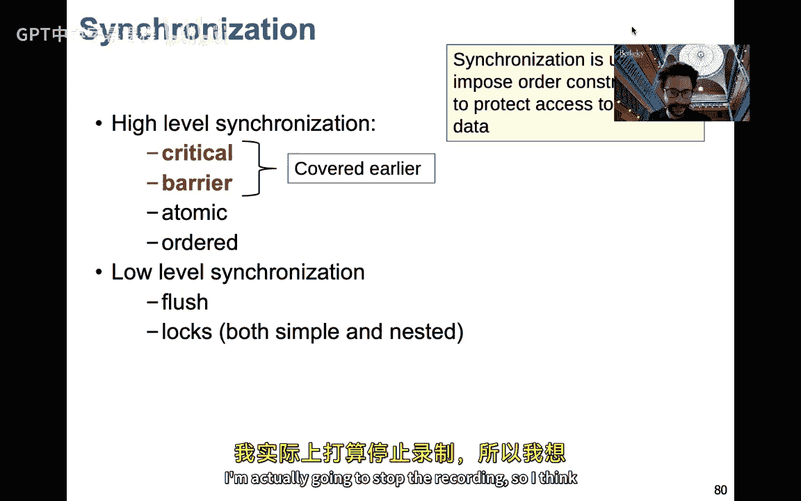

# 【并行计算 CS267 2022】伯克利—中英字幕 p05 CS267 (Sp22) - Lecture 4： Shared-memory programming with (mostly) O -BV1PS421978D_p5-

Glad I heard that welcome everyone todays。😊，Lecture on shared memory programming and you're going to be doing your homework。

Two， one， using most of the things that I'm talking about today。

We're going to start by covering the basics of shared memory programming and then spend the majority of our time on the actual platform you're going to be doing your homework。

 which is openM。Let's start with a little bit of recap of。

What app parallel architecture looked right is a bunch of processors。

 there's some network that connects them to memory and this network allows processors to talk to themselves as well as the processors to talk to memory。

And how this network is designed basically is the difference between whether it's a shared memory architecture or distributed memory architecture or the other architectures we talked about in the introductory class。

And another recap of parallel languages， this is really to put ourselves in context。

 remember is these are the things we're going to talk about throughout this course and essentially we are in the shared memory multiprocessor land here and this is actually if you remember this acronym didn't used to stand for shared memory it used to stand for symmetric multiprocessors but that's kind of a historical context and today I'll be just speaking briefly about plastic threads it's one way of programming SP machines and mostly on openM and we're going to be seeing quite a few of these NPI and QUudDa and cloud computing later in the class。

然后。Let's just recap and today's lecture outline is as follows。

 we're just going to go right in there to see what makes shared memory special different from the distributed memory architectures。

So remember a program is just a collection of threats of control and threats can be created dynamically at mid execution in most languages。

Think of a threat as a subber team， really that gets called on one processor and potentially executed in another doesn't have to be。

嗯。And each thread has their own private variables。within their stack and also some shared variables and we're going to go over which ones are shared。

 which ones are private depending on the language you use。

 of course those are different in shared memory threads do not communicate usually by message passing even though you could technically simulate it it usually the communication happens implicitly by writing or reading shared variables that kind of works as your medium of communication。

And they also synchronize usually based on shared variables。

And you can conceptualize this by looking at this diagram here where there is a private memory that is inaccessible to other threads and there's a shared memory that's accessible by all threats。

Then this is ensured by usually the compiler and the language and OS in general， of course。

 there's a single set of memory and it's accessible physically speaking but。

There's barriers between to ensure correctness。So how do we program shared memory machines with threads。

 the most low level way of doing this thing is to use so-called Pos threads Posss is portable operating system interface and P threadreads is just a shorthand for plastic tradinging interface this generally works on every Uniix like platform。

They contain support for app parallelism to synchronization and theres no explicit support for communication as most systems do and again I will repeat that there's nothing that stops you from programming a shared memory machine with explicit message passing。

You can run NPI explicit message passing and but that's not usually the most convenient way and this is why we're talking about P threads and open MP there and so on。

 all of which do the communication between threads implicitly。

The example some of the basics of creating a thread。

 imagine you have a function and you want this to run as a threat a the independent thread of execution you can。

Use this quite ugly syntax i'm sorry about I apologize for this C syntax so the third parameter you're passing to P create is the function pointer that the function actually you want to write you want to execute as a thread and the rest is really the thread ID and the arguments of the function you're passing this looks really abstract so i'm not going to you know。

let you hurt your eyes by looking at it too much an example makes it much more clear。

 let's say your function you want to run in a multithd environment in many。

 many instances is say hello okay。And the way you would do that is you would create an areaial threats。

Priets and then call Periread create in each one of those handles with the function， say hello。

 pass to it。And since。In this case， there's no parameters。

 but you could pass all your parameters in the now after a sale。

And if you compile it with the LP thread， which calls the P threadt library。

It will compile and it will print hello work 16 times in some form and we'll talk about what form that's going to happen。

But in general we don't really want tellover over 16 times right the common use case of parallelization would be loop level parallelism that's the most basic way of getting parallelism out of a program。

 especially scientific applications with a lot of loops in them。

So you can have this kind of case where you have a double nested loop and there's a function that updates a cell on an array。

In this case， we call that array my stuff。So what's going on in this example。

 I'll actually use this example to illustrate some of the issues with P2S one thing to differentiate。

Platform like Pes versus OpenM， what we're going to see later in this lecture is that Pette is imperative。

When you say P thread create that creates a threat。

 it's not a suggestion it is not a may create issue， it's a must create issue。

 meaning in this case there will be n squared threads created。

And there will be n square threads running the update cell function。

So it is potentially going to do two bad things one is。

If your number of processors is smaller than n square， it's going to oversubscribe your processors。

And that has significant overhead because the operating system needs to schedule and square threads on。

 let's say， 10。Actual course。And there will be a context switching overhead。

And you will probably run slower。And the other issue is there is an overhead of creating these threads and once the functions in these threads complete。

 there is an overhead of destroying those threads， so the only way to get speed up in this case would be to have the update cell function to have significant amount of work so that the threat creation overhead is amortized。

And the other requirement is you have processes as many as n square in this case。

 so that each one of them has one p of the total work。

Otherwise you'll probably not see too much speed up and how would you change this code to get good speed up is you can manually make sure you divide the n square space to key pieces。

 assuming each one of them is balanced， meaning each call to update cell takes about the same time and that will ensure there is no over subscription and this will likely ensure that there is enough work in each update cell so that the thread creation is amortized so you can see that you'll have to do some manual work to think in terms of what's the number of processes I have and how can I divide the work to threads accordingly。

Yeah。One other thing I want to talk about before we go into OpenMP。

 it's a very important construct in our concept in shared memory programming is the data race。

You might have seen this in other classes， but let me go over it again。

 a database raise officially speaking is when there is multiple processor to threats or processes actually。

Actually threats of execution is a better abstraction here， access the same variable。

 and at least one of them does a right。In this example， both threads are writing to the variable S。

But it could have been just reading to in this case， let's say。

If threat2 wasn't writing to S but reading S and writing it to let's say our this would still be a database because there's one right and one read that's enough for a database race but in this case there's there's even a bigger problem so the aes are concurrent and there doesn't seem to be a way to ensure that。

The threads go one after the other， there doesn't seem to be any way to protect these regions from overriding each other's results and you can imagine that you can get effectively many different answers。

Based on this code， because in this execution the T one might get the value of s。

 which is let's say at that point three and。And before it can write it back by adding the result of F of AI。

 let's say F of AI is5， it's about to write8 at which point the operating system will interlea the threads and the second thread will update the value of S to something else。

 but Tread one still thinks that it is three so you can see how this is going to cause problems in terms of nondeterministic results。

 that's why it's called a database。And how do we avoid them， there's many ways of avoiding them。

You should know at least some of the conceptual ones such as this one is muttexes called mutual exclusion。

 it's a lock so you can lock a variable with a mutex。

And which means no other thread can actually update that region unless you release the lock okay。

 so lock search mutes in general， affect only the processor that are using them so the other thread cannot unlock your lock or release your lock you have to do it yourself if assuming your thread A。

And there's quite a bit of。Languages that support this kind of mut Texas Open MP has a lock scheme。

 P threads we're going to talk C in the next slide。There is a generalization of these mutes。

 which is summer for I don't we're not going to go over them， but they're a little different than。

ItsJust mutes that are more general because they actually allow other threats to change this variable it's more like a signaling mechanism than a locking mechanism。

If used properly， so let's not worry about that in this class。

But let's see how the mutix lock is used in plastic strength， should you decide to use it？You can。与。

You can create a lock by initializing it or calling retx initializer lock your region in the syntax and destroy it after the fact。

What a common problem that can happen？And you should definitely be aware of is a deadlock。

Let's say I have this。Variable a that I'm the lock a， and I received the lock and threadread one。

But I somehow want to receive the locks and threadread two in the opposite order so in threadread one I want to。

Acquire the logs in order AB and in trade2， I want to acquire the logs in B。

 so what can go wrong here？Thread one can get the lock in a， thread two can get the lock on B。

 and at which point thread one will never get the lock B。And threat two will never get to lock A。

 and at which at that point the program is stall indefinitely and that's called a deadlock。

To avoid this in this example， you can avoid this by making sure that every Tread。

 if there's multiple lus require， they get the lus in the same order。

 like if T one is getting it in AB order， then Tread two gets it in AB order as well。

 that will ensure their Lux1 happen in this case， but in general。

 of course the problem is not that simple to fix so know that this is a possibility when you're using low levell programming languages like P threads。

So I think that's enough for me to go over key threats。

 which is not something youre actually expected to use， but know that this is。

Is still a very common way of writing shared memory code。

Platforms like OpenM compile your code into some sort of trading library， it can be P threadreads。

 it can be a different trading library like lighter weight ones such as Q threads and so on。

So the whole concepts underneath the covers is useful to at least be aware of。

But as an application programmers， you're better off avoiding these Pri programming due to the pitfalls we have talked about。

 such as the need to manually assign work， balance it out， and make sure there is no oversion。

 make sure the dead lucks do not happen， so those are the common pitfalls and pitTs。

 which force people to design concurency platforms。

So this is the summary Peter et such commonly used by。Most programming languages。But。

Essentially what I said in the last slide is。It's listed here many pitfalls， threat creation。

 data race box， deadlocks。So we're going to talk about Open MP for the rest of the lecture。

So what is openM， this stands for open specification of multiproces it's been around for a long time。

I haven't actually looked whether there's an open MP6 yet。I'm hoping we're still at 5。0。

It's a fairly long standard， it's based on compiler directives。

So you annotate your code with things like pragmas。

 this is the majority of OpenM there are a few library calls and explicit calls and some environment variables。

 so generally it's done by pragmas。Okay。So the。What will Open MP do for you is it will allow yours。

Program to be separated into regions where there is lots of work to do and you can parallelze those into parallel regions。

And then essentially the rest of your program where there is no parallelism in there alone and as it was before。

So you can incrementally add parallelism to your code。 In some sense。

 people find it an easier way of entry to parallelism than to take your algorithm completely apart and reimment it from scratch with a parallelism in mind。

OpenM will provide you some better synchronization construct than Proid does and hide some stack management。

 but however， you're not getting automatic parallelization。

 you can still get no speed up depending on your application and the way you code it。

And you can still get data racists， even though it's a little harder than PS。

What kind of spec are we looking for？I didn't pluck the。5。0， but it's essentially doubled from 4。5。

 which is not a good sign for compiler riders， but one of the reasons this is happening is because OpenM is becoming a standard for things that are beyond just CPUs and it's trying to bring GPU support so that's why it's loadlo up very significantly recently。

呃。Even though this kind of looks very daunting some of the。Most commonly used。

Contracts can be you know put into a single cheat sheet like the following。

 whereas OMP parallel is probably the one that you have to use in every parallel program。

 there's some synchronization constructs we're going to go over， work sharing。

 constructs we're going to go over reductions scheduling。

In this lecture I'm going to go over I think every single one of these constructs on the left and three more。

 and that's going to be it， hopefully as time allows。Any questions so far， I don't see any。嗯。5。2。

 thank you。Will Openmp still create plastic thread underneath it doesn't have to。

 there is no requirement by the spec to use a particular trading library。

Depends on the implementation of openmp all the open MP is provided by the compiler right so you can it comes with your Gcc。

 it comes with your In compilers， it started coming with clk I think though it took a little longer and many other compilers。

And they don't have to use a particular trading library， but they can use Ps。

 they can use other trading libraries， they can use their own proprietary trading library。

The spec is not specific on that。Which is a good thing， I think。

So the stack really looks like the following you're the application user on top and you interact with the Openmp library and its pragmas and A variables and there's a runtime。

And operating system support for threading and shared memory。

 this is the part that open MP developers themselves right and this is how it's executed right you're really all the way up there so on the orange line。

Some syntax。But we're going to go over these。Yeah。In detail， anyway。

 the important thing to note here is when you put a pragma and you start a code block。

With these curl brackets， let's say see++。Lingo or fortran lingo。

 whatever you use to define that code block， the open MP construct right before that code block will apply to the whole code block。

Think of the code block as an unnamed function。And that， I think makes it easier。

So let's write a program that print hello word。Remember we had a hello word。

 but we didn't talk about what the output would be in the Piots create example。

But actually the output will be just the same here， so we'll see。

I write the hello word and I compile it。At least this used to work last year using these。

Compilr parameters F open MPU Gcc and ICC and。Portland KG must I think it's easier。

 the safest thing to do is not to rely on my slides， which can get outdated any time。

 just to look at the latest help on the compiler to see what you need to pass to enable Openmp。

You have to basically compile it with that， otherwise it's not automatically enabled in general。

And you have to include open oM。h and that's all there is。

So without this line Omp parallel there's no parallelism in an oldmp code and if you don't include this line it's just going to be a serial program once I add this it will be a parallel program。

嗯。And。Potentially will out with something like this。

Now this would actually be the same output potentially again， it's every time you run it。

 you might see a different kind of hello work there。

And it's quite likely that you would see a different kind of hello word in Peter's example as well。

 because I'm not doing anything to enforce synchronization across threads。

 so the output can be hells and words in any order and spaces in between at this point。And。

In this example， it doesn't matter， but in general， it tells you how the threats are interleaed。

So what is happening conceptually in a diagram is unless you're inside a parallel region。

 only one thread is executing， this is called a master threat。

 hopefully OpenM will make it will find a better term for this， it's 2022 at point。

And as soon as you enter a parallelel region， many threats are created。

And then once you exit the parallel region， again， you only have one thread of execution left and it creates again and so on。

Now， an important thing to notice here is Open MP is not forced to。

Kill these threats and recreate them and kill these threats。

 it can do more efficient things on the background。

 it can suspend the threats and send them back to its threat pool and reuse them in the next parallel region generation。

And that would eliminate some of the overheads of creating them and destroying them in the first place。

 so that's one of the benefits of using a higher level library that is not imperative。

 so the compiler and the runtime has leeway to choose whether it's worth destroying the threads and reclaiming the memory or just keeping them alive and just suspending them so there's quite a bit of freedom for the compiler and the library。

Okay。These are the parallel regions， but what can happen what can go wrong here and does law。

 you remember if you don't parallelize one S of your computation。

 your parallelism is limited right we will remember in the previous lectures so if your serial sections here takes sufficiently long time。

They will determine the maximum amount of speed up you can have。

 so pay attention to those regions and make sure that they're as smallest as negligible as possible。

And what number you need to achieve that depends on what kind of speed up you're expecting from your shared memory program and how many processes you have。

Yes， exactly it potentially is going to create several threads ahead and recycle those threads。Again。

 it doesn't have to it can the basic implementation can just create the threads and。

And destroy them and create them， it's all about the quality of the open MP runtime。

But this is open standards， the good news is there is multiple OMP implementations by different vendors and the open source community。

So you can choose the best performing one if you have options。All right。

One thing you can tell the system is how many twists？You want to run the next？You know。

 region and you can do that by saying OM set numb threats so this is not a pragma。

 this is actually a function。And this is this small less than one fifth of the library's explicit functions like this。

 and as I said， the majority of them are pragmas。And you can get the Tt ID if you're inside a parallel region and use that thread ID to call a function。

 let's say。Your function meets the thread ID and you can use that and you're not going to get a nonsensical number like your process ID you'll actually get a thread ID starting from zero till number of threats minus one。

So that's good。Again， we was saying we。Yeah， so what's going on is everybody's executing the same proof function with a different parameter ID。

Fairly simple now the important thing to remember is open MP runtime。呃。Doesn't have to give you。

For threats。Right， so。嗯。An implementation effectively can give you a team with favorite threats。

It won't give you a team with more trades than you requested。

 but it's quite possible that if it has only two course or decides that that loop is not。

I network worth paralyzing you might get fever threats so this is only essentially a suggestion to the openmp runtime there is actually a limit on the maximum number of threats and as soon as you start that your program that is kind of the upper limit and you can control that various different ways and some of it has to do with the environmental variables like OMP number threats。

You can set it up before you start the program。If not。

 usually the open MP runtime will use the number of。U。But。

Virtual course you have what does that mean if you have no hyper threadread it will be the number of core you have and if you have hyper threadreading that will be the number of course multiplied by the hyper threadreading concurrerency you have so these you can set yourself or let the runtime figure out from the OS。

嗯。O。I think this is。And if it's a good way， good practice to actually ask how many threads are in there。

 so this function will only return a reasonable number if it's inside a parallel region。

 so OMT get number of threads will return you number larger than one potentially larger than one only inside a parallel region。

So you requested four threats and you can know how many threats you got by calling it inside the parallel region and that's a good practice to make sure that you actually are operating with the right number of threats that you expected。

Any questions there is one。What's the difference between threats and processes within the context of openmp there are actually no。

These are all trading libraries。These are not processes。

 so we probably don't need to think about processes within the context of。我不能 be。

Okay let's go over an example and going to re use this example while we introduce different constructs in OpenM。

So this is a calculating。Ps， the number pies。And you can there's millions ways of calculating pi right this is the ratio circumference to diameter in this case I believe we're using the ratio of the area of a circle to the area of its enclosing unit square and you can do some variations and convince yourself that this formula integrated will approximate pi。

And sorry， it will calculate by we can approximate the integral with the little rectangles as usual。

 and by choosing a sufficiently small step sized delta x。

 this will be arbitrarily more accurate as the delta x goes to0。

So don't worry about the mathematics if you're not interested on different ways of calculating pi。

 but let's look at an implementation。So listed is， I choose my。Step size。

The number of steps to be 100，000 meaning I am creating 100。

000 little rectangles to approximate my integral or pi and using those step size I can calculate how wide each step should be。

 this step is basically the delta x here， right？And。And I will figure out what the X is。

 so this is taking the it from the middle of the。The height and using just the formula we described in the previous slide for divided by one plus x square so this is an ideal candidate to parallelize because there's quite a bit of steps there's 1100000 news here but if you want more accuracy you can just increase it and create more work for you。

If you wanted to get to how long it takes it。Single thread run。

 you can still use Openmp because it has a nice get walk lock time function ormp getW W time。

And you'll figure out how long it's going to take so that's a way of doing it serially now I can jump into how to do it in openmp。

 but instead I want to take open up parentheses and talk about some pitfalls of。

Programming shared memory before we go into our first attempt on paralyzing this。

And this actually is an interesting coincidence， one of my colleagues on Twitter was asking how many of the computer scientists know the concept X。

 and this is what I'm going to describe today。And this is just coincidentally this morning。So。

Remember， basic shared memory architecture， this is what we're talking about。嗯。

And there is a concept of a cache for high performance because the latency to memory is so high and so expensive。

 the caches kind of provide us a way to access data in much fewer clock cycles so that our processors that are getting much。

 much faster compared to how fast the memory is getting are not constantly waiting for memory。

So these deep caches has been around for decades， right and L1， L2 L3 caches。

 some of which are shared， some of which are private。

 these has been around and we talked about them already。In the previous lectures。

 but how do an operating system？Ensure that the caches are coherent across different course in this case the processes processes so why is this a problem imagine what's going on I have a variable called u it's sitting on the memory main memory and processor one excesses u。

And guess it' into his cash， these dollar signs are cash。Some sort of。

I guess pun on the way of it's pronounced identically。And then Pro three gets it into his cache。

So what's going to happen after processor three， imagine is updating the value of u to seven。Well。

Processor one。And Dan wants to read you， how does it get the updated value of K3？

So that's the basically cash coherence problem。You want processor one。To read the latest value。

 which is seven in this case， coming from P3， how do I ensure that this update is propagated to P1 in the most efficient and timely manner。

 and that is the cash coance problem。So there is different ways of designing a cache。

 one way is to do it is write back cash。Andy啊。呃。In this case。

 the value written into memory really depends on which caches flushes and when this right back happens。

And there needs to be a protocol to make sure that the data P1 is accessing is the latest one。呃。

And this is a this。Doesn't create a lot of rights back。

 but then somebody needs to make sure that when they try to read the variable U。

 they see the latest version of it， and that creates scalable problems beyond certain processes。

There's another way of designing the cache， which is a right through cache。And。

It does simplify the cache coherence problem a little bit。

 but it has some issues to inrite through cache immediately after a variable view is updated。

 you would basically propagate that updates to the main memory and that simplifies the cache coherence protocol。

 it doesn't eliminate it but it creates extra memory traffic because a lot of rights are a lot of the memory operations and rights。

 every time there's a right you have to create extra traffic to the main memory。

You don't really need to know about all these details。

 but know that there is a cashquaance protocol that's running under the covers every time you use。

A shared member system with caches。can be implemented right back or right through。

 and this is usually a subject of a different class and there is a various different cachequeance protocols like slooping the bus to see where the transactions are happening and so on。

You would not need to worry about those in this class。

 just know that this kind of traffic is happening underneath the covers。

But let's get back to our own program that's the important part hopefully。At this point。

 you know that。There is something underneath the covers that are propagating rights to propagating updates to shared variables so that each processor sees an up to date version。

And go back to the pipe problem and try to parallelze this。

So when I tried to parallelze this code using a。嗯。Simple method， which is， let's say I have。

For threads， I'll define a number of threads on top。

 but I can change it when I have different number of threads i'm going to create。An Irish。

As of the same size as the length， the number of threads I have。And I will update it。

So this is some numb threats and each thread will update its own section of this array。

So this seems like actually。It's quite a reasonable way to do it， it's a little ugly。

 you can see that I manually determined。How this loop is。Split between tracks。 So for each。

For each thread。I'm getting like the every。And threat variable， so I'm getting the zero。4our812。

 1620 and then the next thread is getting1，5，9 and so on and this is ensured by the for loop and everybody's writing to an independent variable so there is no data so all I did in this example is divide the iteration space across the threads manually and ensuring that everybody is writing to a different part of the summary and then after the parallel region is over。

I serial sum these members of the sum into a single global pie variable。

This will run correctly and compute pi， but what you might be seeing is。Yeah。Even though I have。诶。

For hyper threats， which can I'm not even getting2 x speed up so that's a。

That's a bit of a concern here。And when I do this thing with a more modern。Architecture。

I should probably update this again， but no， I think this is my current computer actually。

I get about。4 x speed up so it's not too bad， but it's not ideal so why might that be happening and what does it have to do with what we talked about in terms of cash coherence？

So。Let's go back to the reality that when the cash coherence protocol runs。

 the caches are not operating。On。On individual variables。We did talk about this。

How to write back the variable for into memory， but a cache line。

 when U is actually fetched to the cache from the main memory。

 it doesn't come by itself it comes as a whole block of 64 or 128 bikes that's called a cache line。

 so the vicinity of U all the variables around you are also fetched to the private cache of P1。

And that's essentially the whole cause of what we're going to see。In this example。

 the whole cache line is fetched to a particular course private memory。And。And if。Two course are。

Accessing distinct variables on the same cache line。

They would think that they're writing to the same variable and the cache coherence protocol will basically say。

 I have to make sure that the other processor sees the correct value。

 so I have to propagate every right along the memory bus so that everybody can see it。

This is a bit complicated to understand it first so you know。Raise your hand or mark it up if。

You need this to be repeated it's actually a fairly important concept and performance optimization for shared memory false sharing is the name of the the reason is' called false sharing is because。

Even though this。This course are actually operating on distinct variables。

The cache Co protocol cannot tell the difference because those variables that happen to be sitting in the same cache line。

 which depending on the of the cache line as well as the size of the variables you're talking about can be eight to 16 distinct variables。

Right see。Well understood and so that's probably one of the reasons why this wasn't scaling very loss。

 so let me see if I can fix this by a fairly invasive method， which is padding。

How can I pad this variable I can get。Convert my sum array。

 which is a one dimensional array into a two dimensional array of threads and pad and I chose the padding size eight because I'm assuming my cache line is 64 you can look it up in your processor spec and figure out what the right number is。

So that's one of the reasons this is not the most elegant solution you move it to a different processor you will need to update this pad variable。

 but what's going to happen is when you look at the sum variable in memory some zero，Well be。Eight。

Words apart from someone， basically one cash line apart from。S1 and some two and some three。

So this way， when I'm updating the thread zero is updating its own some ID。

 this will not be on the same cache line as Tread once some ID。

 so there will be no extra traffic due to false sharing。But I'm doing these rights。And indeed。

 it seems to actually matter in practice。When I look at the runtime with the padded versus unpaded version。

 I do see almost two x performance difference。Now just to confuse you， not necessarily confuse you。

 maybe， but just to make sure that。You don't freak out when you don't see this rental up this depends on how the caches are implemented and what's the cost of the cash coherence protocol sometimes you might not see big of a difference with panic。

For example， on a different architecture， I only solve modest scales。

wa a little faster but not by much in fact I can't even explain the single thread difference this can be due to two different things one is the false sharing cost was low to begin with so this didn't matter or the second alternative is this has more threats there's not enough parallelism to scale it up so but at least when it's a problem when the problem is caused by false sharing you can see that it can make a big difference。

All right， but that doesn't look like the most elegant way of avoiding false sharing how can I parallellyze this loop in a more elegant and sustainable way let's talk about synchronization car strike and openmp。

There are two that we're going to talk about， what is critical？

And one is barriers really the concept of synchronization is imposing ordering constraints so that you protect access to the shared data。

So if I put OMP critical。We didn't。Within a parallel region， it works like a mutual meat lack。

It's like an easy to use muttex lock this is probably a best way to explain you can give names to critical reason regions you can nest them。

And so on。What's going to happen is this line。Will be executed。By all threat eventually。

 but one at a time。So no threat two threats will execute this line at the same time concurrently。

So those accesses will be serialized。嗯。You can convince yourself that's effectively doing the same thing as locking。

But syntically in a much easier way， it's a critical section。Okay。

But what about the barriers a barrier just。Says that no。

No threats will be allowed to proceed beyond this line。Until all the threats reached there。For me。

 the name of barrier was fairly intuitive， but if it gets confusing。

I think this is a valid and clear definition。If one thread moved beyond the barrier。

 that means everybody at least reached the barrier line。Sorry。

 I'm looking at the chat should the pad be 16 instead because the integers are。Four bys long。

That is a very good question。嗯。But the sum variable is double。So， that's why。是的。It is。I mean。

 this is， of course， I recommend people not to code like this。

This is to put the whole code into a single page please make a new line after the enter so that the double starts at the next one and it's clear for the reader so anything after this double。

You know， the pie and the sum I all double。对。Sorry for the stylistic。

Al winnerness of the code to fit it on the slides。 So these are the two things。

 So let's use it to our example。Very simple now I don't actually need to create a peddiary。

 I can keep the same sum。And say that。And everybodybody is going to use a private。Some variable。

 so how am I ensuring that some variable is private instead of declaring it。

Outside the parallel region， any variable that is declared within the parallel region is private to that threat and inaccessible to other threats。

 so it won't creating a race conditions by creating the sound variable inside the parallel region and making it private so everybody is updating its own sound。

And I have to now do something because as soon as I exit the parallel region and the code block associated with it。

This。Okay。some will go out of scope。I need to make sure that I add its contributions to the main path before it goes out of scope。

So and I do that with a critical region， why is this not a performance bottleneck because we talk that locks can be expensive。

And critical regions are equally expensive。And the reason this is not a performance bottleneck is because it's 100000 times executing looppi without a critical region。

 the only place where the runtime needs to ensure。Ordering and consistency is this part where which gets executed only four times。

So the relative cost of this line is negligible compared to what's happening on the bulkky loop over。

 that's why this is not going to impact your performance in any significant way。

And sister there are no arrays， there is no false sharing。And what do we get。

 we get this performance， which is almost identical to the paded one。So okay， so far though。

 I have endured the ugliness of this code where I decide how I spread the iteration space in this way I did it in a cyclic manner。

 right， zero，4，8，12 and1， five，9， and I could have done it in a block manner and so on but I did it myself。

And that's kind of a little bit of a hassle I also had to ensure that。

The zero threat gets special treatment and so on so everything is correct how can I not do that and let the compiler。

You know。Do the workshop sharinging for me and I of course openmp gives you that ability that's the syntactic sugar of saying okay。

Divide this for loop。For me， actually it's more than a syntactic sugar because you can annotate it and say divide it in this platform。

 divide it in this granularity and we'll talk about them in a minute。

And OpenM will automatically divide this loop。Into pieces。

And there's a default way of doing this thing， but you can have a lot of control over that and you can say divide it in such a way that each processor。

 each thread gets a block of size 16 and so on。This is not so。Really。

 if there's anitations here and there's key threats， everybody's getting approximately n over T。

Iterations of this。So you got this ugly version above to this nice clean version at the bottom。

 so that's what the workshop sharinging construct allows you to clean up your code。

And turns out this can even be further simplified now this is really syntactic sugar instead of always seeing pragmy OMP parallel and then pragmy OMP force。

You can get a shortcut which is pragma OMP parallel for。

 but these are identical codes in functionality wise。

 it's just collapsing this statement into one line and that's just the shortcut OpenM gives you。

Question。Okay。In general， can we safely assume that two independent declared variables in the global heap will not reside on the same cache line。

 it's hard to say actually。Like you have。Sm1， sum two， some three。

 some four as distinct doubles instead of an array next to it。There's no。

Nothing that stops the compiler to put them next to each other。嗯。But I think I might be wrong there。

So it's worth actually looking it up。诶。I would would assume that。

There must be a way of forcing this thing if it matters。But compiler wouldn't。

Give a whole cache line of space between。consecutive variables on the hip declared independently from each other。

It's hard for me to think that。You can safely assume that。Yeah。

The answer is no at least to the best of my knowledge。

 so I said that you can have a lot of control over how the the for loop is executing。In general。

 if you have the program， which predictable schedule。

Meaning you look at the code and you know how long each execution of the for loop。

 each duration of the for loop is going to take。And they're relatively load balanced。

Then you can use the default static scheduling。And if you want to be explicit， which is a nice thing。

 you can say schedule in parentheses static and if you want you can specify the chunk size as I said how many iterations is assigned to each thread at once and if you have。

Many small chunks that have。嗯。Variable work， meaning。Unpredictable。

 you don't know exactly how much wall clock time each execution of the iteration will take and each one of them takes a small amount of time。

 you can use the dynamic one。So dynamic does scheduling dynamically at run time that's basically the difference the static basically looks at the loop looks at your code before the code starts。

 it allocates the work to processors and it doesn't change it dynamically in run time and dynamic just the exam just the name suggests will。

Reassign the work to different threads if let's say one thread has finished this job and the other thread there's a lot of things still assigned to it。

That usually ensures that load balance is better， but there is a certain overhead with dynamically reassigning work。

 as you can imagine。So you don't need to use it unless you need it because of its overhead。

Now I want to actually say something about a third case， which is you have highly variable work。

But not enough pieces of it。But you have a loop that iterates only， let's say 20 times。

And you have 10 threats。And each iteration of thelut takes a very different variable amount of time。

Essentially， there is no way to get good perfect speed up in this case。

 because if they have variable amounts of time and big chunks。

There's not much you can do to reassign them， theres a big chunk that someone needs to do and it cannot be divided further。

Into smaller pieces， so reassigning it to a different thread will not solve the problem because that whole chunk needs to be done by somebody。

So those kind of。Problems means you need to somehow decompose your actual problem into smaller pieces if you have variable。

Work in each iteration so that the dynamic can help you in runtime if you have few highly variable workloads chunks and there's not much any scheduling can do for you。

Okay， let's go over a real example that I had implemented last year for this class when I was playing with it。

 there is a version of matrix multiply where both actually let me ask you some questions that's been sitting there。

嗯。Okay。In slide 47。嗯。How to ensure that pipe plus sum step is a critical region。

If there's no mutex lock， will there still be a race condition？Let's go over to slide 47。嗯。

While we basically say it's OMP critical， once you put that pragma OMP critical。

 this effectively ensures that the following line。Is only executed。Byu one thread at a time。So。

ThatThat's implicitly doing a mutix lag for you。Okay。

 so I think that was answered already let's continue with our lectures if I did this。

And sorry for the accent it's what ends up happening even if I turn on the automatic transcript is if you can't clearly understand the automatic transcript will have difficulty and there's a lot of cleaning up that we need to do。

Even even with Jim's clear accent， because we talk about a lot of technical things and automated transcript tools do not actually catch those technical terms very well in any case。

And but the actual reason we're not turning it on is because they're going to basically overlap with the。

With the transcript， the captioning that comes by the company from the company that we're going to hire。

So in this example， I am doing block matrix multiply， let's say I want to multiply two matrices。

A and D and write it to an output called C。And these matrices are sparse when you have sparse matrices。

 depending on how sparse each block is the matrix multiplication will take a different amount of time。

 it can take five seconds in one call of this speed jam which stands for sparse generalized matrix multiplication and in another call it might take 10 seconds so that already creates load imbalance in this and that's as much as you need to know。

So how can I parallellyze this block matrix multiply in general。

 let's assume that B that I'm dividing this thing is something small like 10。I can of course。

 start by saying I'm going to do Tragma MPP parallel for on the outermost loop。Unfortunately。

 that's usually not enough parallelism because capital B is the my block size is small。

So how can I get more parallelism， I can say I can do parallellyze boat loops。And I could insert。

Praggno MP4 inside this and do nest it。there's a nicer way of doing this thing instead you can say prag anti parallel for collapse so what this does is depending on the number you give in the collapse。

 it will see the iteration space off the next and if collapses n。In this example。

 my collapse parameter is two， so it's collapsing the first two loops。

 so it's creating the iteration space of the size b square。Wwhich is approximately 100 and so on。

 so that's large enough and in dividing that B square iteration space is if it's a single linear iteration space。

So that's doubling iteration space I get some scaling almost twice as fast。

 but almost twice as fast doesn't seem to be a good thing because I have four cores and eight hyper threads why am I not getting better because as I said these are sparse matrix multiplications and they have variable。

Workload so the default scheduling is static and it' likely dividing this up in a load imbalance way How can I。

Fix this thing， I can use the schedule dynamic that I talked about in the previous。

Examples inserted there andvoa。In this example it seems to be doing a sufficiently good job I have four core and i'm almost four times faster I suspect you can do better than this but。

At least this is fairly good。So here's a。Before I finish with loops， there's one last slide I have。

Which is。If you have difficulty。Palllyzing certain loops because there's a loop carried dependency。

 the basic approach to fix this thing is to change that variable to eliminate the loop carried dependency What does that mean so in this for loop I can't just put a。

Ormp parallel here because。诶。There is a variable J。

 and that's getting incremented at every iteration。

And the compiler doesn't actually have a good sense of。

Controlling for J like it doesn't know that the J is not changing， for example， somewhere else。

So it can't。Execcutute this loop properly and can't parallelize this。

 but if I know that all that's happening to J is it's independently determined by the value of I。

 which is my iteration space。My I is going from zero to max。

 and j is just the you know function of I， meaning for every independent I， I can compete to J。

In that has nothing to do with the previous iterations of I， I can write J that way。

 which is the case。And this way I remove the luary dependence and I think I can execute this very efficiently。

So let's talk about the last way to parallellyze our example， which is a reduction。

 this is very common it's all over the place and one of the reasons where it has spatial treatment in open MP。

So the syntax of it is really just adding a little bit of verts for the OMP parallel construct。

 OMP parallel4 construct， you would basically say reduction。

And then you will say what is the operation you're doing and what is the variables。

 what is the set of variables you're reducing on？嗯。

And the variables in list must be shared variables for you。

 so in this example I'm reducing on the shared variable average a。

And the reduction I'm doing is plus。So what this is magically telling the compiler is somehow。

I am adding variables to this Ave if I didn't put this reduction variable。

 I would have a race condition。But make that go away and the compiler internally will convert your code to one of the previous versions we' have seen。

 which is。Either create a critical region or divide iteration space into different independent variables that are not for shared and so on。

对。Likely they I didn't last long。And this is going to get the same effect and there's a predefined set of operations。

呃。Operators， which this is a technical term。And with their initial values and you can probably look them up if there's more more of them out there nowadays。

 and these are the things that you can pass to the reduction clause。And going back to apply example。

 now it's much more simplified right， I can just do OMP for reduction plus sum and don't worry about anything I。

No padding no critical region think and it will just do it for me of course it's it's good that we learn the other instances because the number of operators that you can do this reduction seems to be limited at this point so it's good to know how to do the other examples。

And surprisingly， this is a slightly slower than。The pattern and the critical region version。

 I'm not exactly sure if this is。consistent across architectures or was just a peculiarity of this architecture that these numbers were collected。

Okay。So。Barriers， we did talk about barriers one thing you should know is。A lot of contracts。啊。

In Open MP have implicit barriers， and this is good for safety。

And making sure the programs are correct， but sometimes this can get expensive。For example。

 a OMP parallel4， which is equivalent to this code where。

There is an OMP4 inside a parallel region has an implicit barrier at the end of it。Actually。

 you can assume that almost every。OMP clause has a barrier and look it up if it doesn't。

 I think very few of them don't have a implicit barrier at the exit。

So there is an implicit barrier at the end of our MP4。

And if this matters and sometimes it does in terms of performance。

And if you know that it's not needed， you can add this extra keyword called no weight。

And why is this working in this example while I have some sort of calculation that is。

That doesn't need to synchronize at the end because the next calculation doesn't use。

The updates to the beer。So I can just say no wait because you can just go on and run the next big calculation as well concurrently to the big calculation too。

 and this will eliminate some of the synchronization costs。That are unnecessary。So you can add that。

 but be careful。So here' is a。Here's where things get really hairy。

We said that variables that are outside the parallel region unless they're declared in the stack。

 they're shared， and things that are in the parallel region。Oge private。

But there is actually ways of declaring what needs to be private。

 what needs to be shared instead of relying all the defaults。So let's go with example in this case。

 what do we see we see a variable called capital a and array。And。And we have a function called work。

Which has its own temporary variable inside it， an aesthetic static variable inside it。So。

Since capital A is declared outside the parallel region， it's shared。By all the processors。And。

The temporaryoraries didn't private to each thread because it's defined inside the code block work。

You can just imagine this code block immediately sitting in here How about the static end count that's actually special because static makes it。

Shared across all tracks。By aesthetically declaring that variable no matter where it's defined。

 so that's the kind of the difference， you have actually three different ways of specifying what each variable should be shared private or first private。

And。This is if you don't want the openmp to make default decisions on you。

 you should generally write。Which variables are shared。

 which variables are private and first private， and I'll describe what does mean。

And if you want to make sure that you don't forget to define them。

And if you want to compiler to complain to you。When you forget to define a variable。

 whether it's shared or private inside the loop， you can say default none and once you say default none inside the YMP parallel force and you didn't define a particular variable you storage attribute as shared or private。

 the compiler will complain to you。All right。嗯。To the private class。

 that seems to be the simplest one。It creates a new local copy。For each trick。

If things are defined within the parallel region。Well。

 that's nice because they're already private anyway， what if I define something？

That was declared outside a parallel region as private in my parallel force。Well。

 every Tread will get a copy of the TMP。Unfortunately， they will be uninitialized。

 this seems like a little crazy but。That's why there's first private。

 so TmpP's initial value doesn't exist。And once the loop is over。

 because this parallel of4 is only affecting the immediate code block underneath it， which is4 loop。

U。The value of TmpP will reset back to zero。It will go back to the original value。

How can I make sure that this？嗯。TMP when generated when it becomes a private variable inside the for loop is going to have a good initial value。

 meaningful initial value， I can use the first private class and that ensures that each thread。

Not only gets its own copy of that variable， but it also gets the initial value from what it was before。

 which in this case is zero。And if this was a complex object， like a C++ object。

Then this will call the copy constructors。While creating this private copy of the increment variable。

So let's go over an example and I recommend you to look at these every time you need to write them so you don't get them wrong because these can get really confusing fairly easily and it's it's good to keep it cheat sheet around this so we have these variables ABC。

And we say OMP， a pragmo OM parallel， private B first private C。

So what's going to happen is a is going to be shared by all threats and it's。

V there will be one initially， of course。B and C will be private。B， because it's private。

 it's going to have an undefined uninitialized value。C， because it's first private。

 it will have its value equally one。After the parallel region is over。

 once we go back to the serial region， B and C will revert back to its original values of one。

 and a can be anything depending on whats happens inside the parallel loop right or the parallel region if a is incremented by some threadreads or updated。

That update will live on and the new value of a will be whatever the update has happened to it inside the region。

 it's not going to revert back to one。嗯。And we talked about what none does if you don't declare it。

 it complains。Okay， so I'm going to talk about this tasks concept as my last topic of today's lecture。

These lecture always things studies。Yes， first private seems to be always better than private。

 which is what my feeling is to， but there are some places where。你咩事。

I think you're right though let's go over the tasks this is the last important thing I want to talk about today。

So this is an afterthought in Openmp。These are independent units of work。

That have a piece of code to execute and the data it can execute with。

And threads are basically assigned to tasks or vice versa you can think of it a task needs to be completed by some threat and you can assign these tasks to threats。

And this is a concept that comes up in many more modern tradingreading interfaces like Silk or TBB。

 and OpenM basically defined its own tasks， seeing the success of tasking in other concurrency platforms。

And this allows you to nest problems by creating tasks that are common in recursively defined programs。

We should probably just see an example to understand how tasks work。

 unfortunately before we can even go to an example， we have the。

Jump over some hoops on an open MP and talk about something called single。So single。

Contract says that only one。Threread， not necessarily the master threat。

 just one threat out of all the parallel threats that are alive in that parallel region will execute that line。

That follows the singles。You can do many things that are happening in parallel here。

 do many things that run by all the threats in this parallel region。

Exchange boundaries will happen only by。One thread。

 we don't specify which threat we could there's a different construct for that。

 but single doesn't say that。Some threat， but only one of them will exchange the boundaries。

 and then we'll go back to doing things in parallel by all the threats。

So why am I explaining this thing because？It seems like the only way to create tasks in OpenM。

Is to use this single construct so remember there's no parallelism in openmp without using Omp parallel prag MP parallel。

 so that's where all the parallelism starts。Unfortunately。

 you can't start creating tasks within a parallel region。

You have to first make sure that the control goes back to。

A single threat that will fire up all the tasks and will get distributed now this is a lot of syntactic baggage and i'm sorry。

 but I verified with Omp openmp developers that this is the way to go you have to。

So tell the OMP compiler that。A parallelel region is started and then you have to say only one thread execute please。

 and then you can start firing up your tasks of these are different functions that your're。快噶嘅。诶。

The OMP parallel task is one of the few。Contracts in openmp that doesn't have an implicit weight after it so I said that most OM clauses have an implicit weight test doesn't have it because if it did and you wouldn't get a lot of parallels。

So this task is fired， Fred starts executing and we don't need to wait and synchronize for F and its potential subrouts to finish。

 we can just move to the next slide。One to grid term threats。

 one0 packages task and text are executed by some threat in some order。

 so there is no weight implied across them。If you need to。Weight。

 you have to explicitly say task weight and why would you do that。

 let's say in your example that the Billy task will use some of the things that are generated by Fred and Daisy and you don't want Billy task to start before both Fred and Daisy and all of its descendants complete。

And in which case you can say。Task wait years and Fred and Daisy must complete before Billy starts。

 but that's how it will go。嗯。There's some data scoping realities as one of your。Colleagues。

Mentioned first private seems to be better than private in general。嗯。

That seems to be true here as well， I can't say it in general， but if you're using。

A private variable。Within taskking， Open MP will automatically convert it to first private。

Don't shoot to messengers， but they did the right thing here so that you don't get a lot of initialized values。

 but if you declared it，Private。Here open MP actually grandmother you and make it first private strange as it seems。

So let's go over an example and finish this lecture a Fibonac numbers。

 if you know the definition of Fibonac numbers it's just fn equals Fn minus1 plus Fn minus2。

 you could implement this in this exponential form。

Fairly bad way of computing F1 arch numbers because you're not taking advantage of shared computation。

 but it is a correct way to compute51 arch numbers。Very inefficient please don't do that。

 but it's a great way of。Talking about how to use test parallels。And how would I？

Paralyze this thing using tasks I would。First， create a parallel region。And of course。

 call andP single。And so that there's one thread of control and fire up my Fibonac task and within that I am simply getting these tasks I have to say promote the X to a shared variable so that it's。

粤。It will continue living beyond its immediate execution because I want X to be shared on child task so they don't create their own first private copies。

That's why I'm promoting them to shared， same for why I'm promoting it to a shared variable。

 so the children of Fibonacci and minus1 and minus two will actually not create their own first private copies。

And then I have to synchronize with OMP task weight so that X and y are complete and they have valid values before I can sum them up and return to Fibonacci。

 and you can see that this is going to create a big subre。And it's going to look like this， right？

The problem will be split into sub problems and so on until there are no more problems and it will start returning。

 so you should imagine the recursor three here for it to make sense。I think。

The last thing I you want to know is。There is an OMP max Act2 levels。

 which tells you how many levels of nested parallelism。

It is allowed by the runtime and this can be a different number depending on the runtime。

 but you can change it。And if that number is small。

 like I think in the runtime I used the default was two， and I was wondering why despite having more。

Of courseour， I wasn't getting reasonable perism when I opened up the test scheduler is because these are considered nested levels of perism。

 if you don't increase this number， you're not actually getting parallelism across this task tree。

So this is actually a slightly bigger concept than。Then we can talk about， but I think。

This is a good place to stop。And come。Look at the questions that you might have had。呃。Single is like。

Single is like if I equals zero do something yes， but we don't know what ID equals zero is I I equals equals zero would be master。

 which is like。The zero ID threat do the job。Single is like one of them。

 but we don't know which one is going to execute。Only once that code will execute if if what if you call a function in a parallel region and that function is a parallel region。

 that's called nastyty parallelism。And it will create myed parallelism like in that task example that we said。

 and it doesn't need to be tasking。You can do a praggno empty parallel force。

 write a for loop and do a pragma empty parallel force。

 write another parallel that's also listed parallelism。

And they will execute fine as long as the number of active levels。

Is said to be higher than the number of nestings you have。

 so if you have nested parallelism and your active levels is only two they will only parallelize two layers。

if you need to increase that if you want to get three levels up nesting and so on。

So if you're calling code with like this with open MP stuff in it。

 you have to be careful to increase the level。Yes， exactly。 so the increasing that level has。

Obviously issues with runtime and。The overheads。I'm actually going to stop the recording， so I think。

