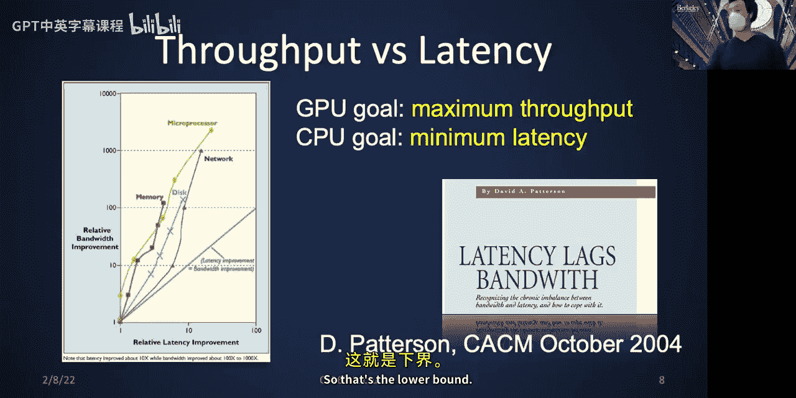
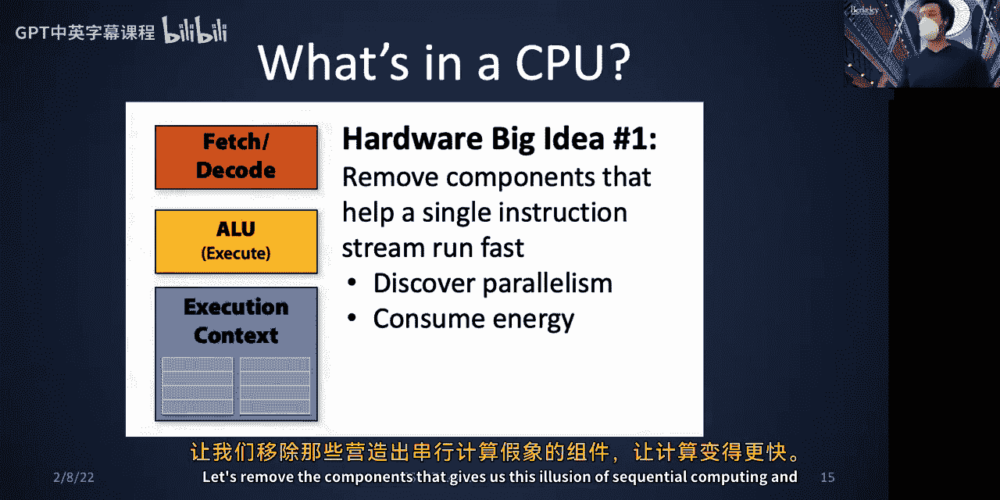
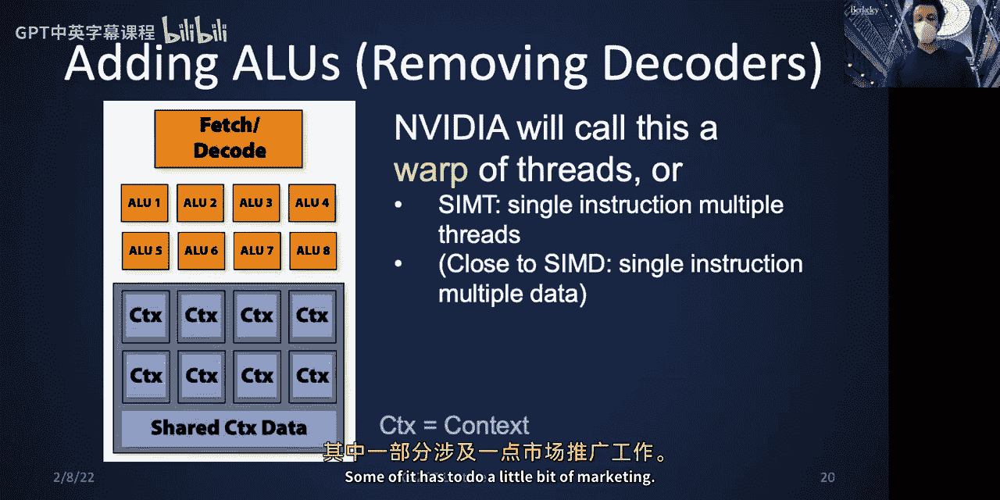
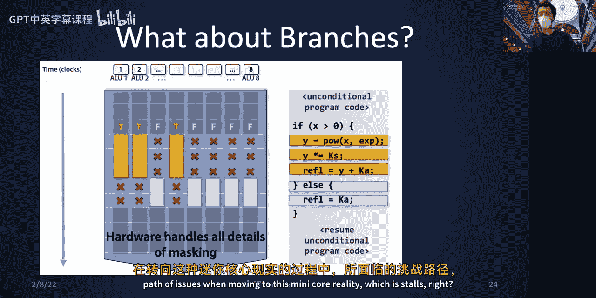
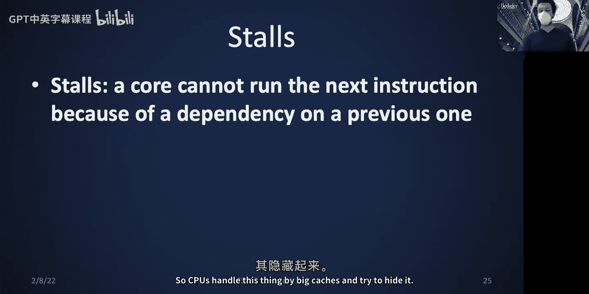
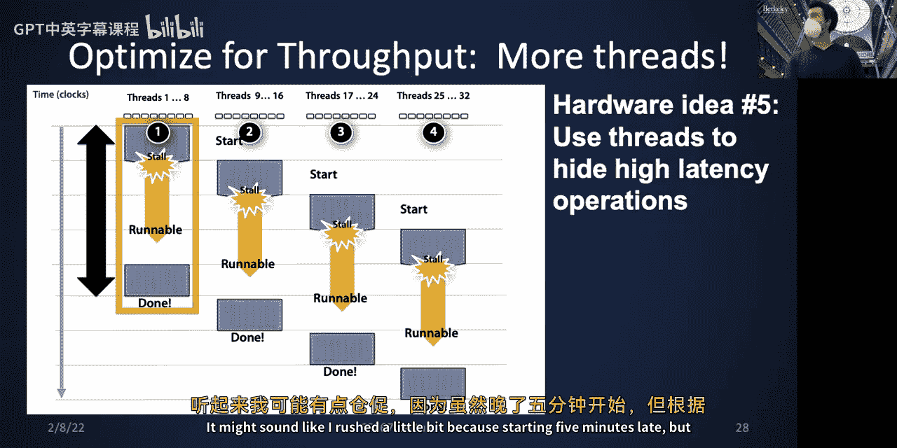
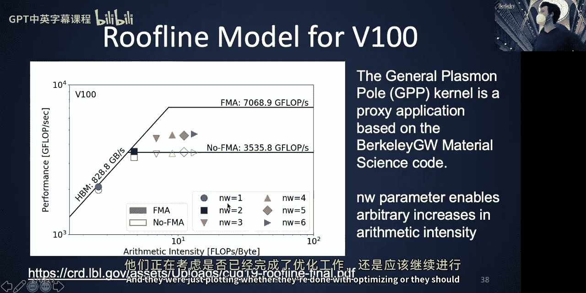
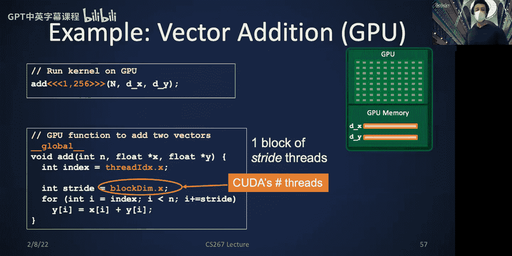
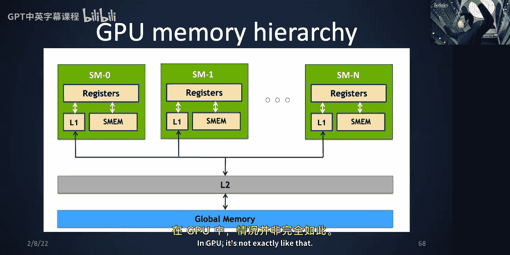
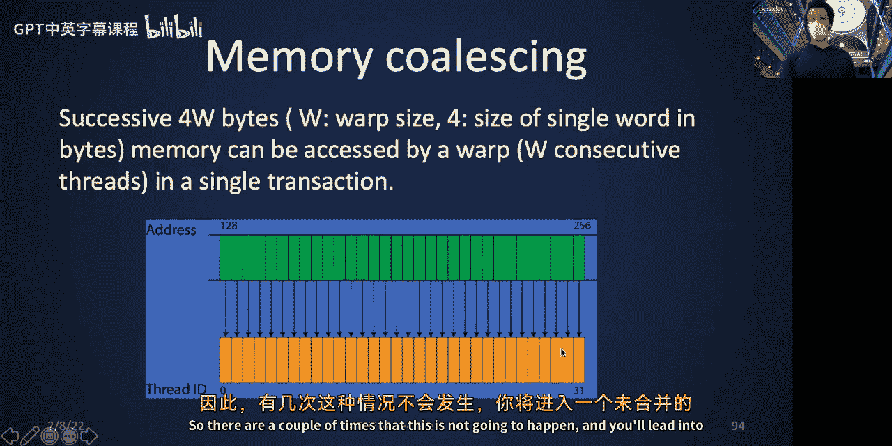

# 【并行计算 CS267 2022】伯克利—中英字幕 p06 CS267 (Sp22) - Lecture 7： Introduction to Graphics Processing Units -BV1PS421978D_p6-

er7。Only five minutes late， we're going to talk about GPUs today。

And you're going to have a homework about GPUs it's called。2。

3 so it's kind of a little awkward because we're going to first talk about GPUs because it aligns well with the tricks with trees and data parallel lecture which Jack Jim will give on Thursday and then we're going to do distributed memory programming。

Your first homework will be distributed memory programming actually before the GPU。

 but everything will be covered before your homework is due so no worry about that。

Many people have contributed to these slides knowingly or not knowingly and many of these people actually have given versions of this lecture before in the past and I might not be correct about the whole coverage I'm sure some people maybe Brian gave a guest lecture years ago decades ago Jim might remember。

So。Let's start with some status of how things are in terms of large scale distributed clusters。

 meaning Exscale computer so-called that we're trying to achieve。

 and this whole thing started by a projection back in mid 2000 2010 around 2010 where people basically looked at business as usual and figured out how much power it would take。

To build an Exosscale machine， given what kind of powered constraints and the budgets were available for peddaal computers。

 and then they noticed that。They would need 200 megawatts。

If if the standard chip scale continued and that's not tenable because it's you know we don't have that much power。

 you can translate megawatt to millions of dollars。

 it's like a backup of the envelope calculation and that would take way too much money and we don't have that much budget to actually run a super computing center。

And in reality。These numbers up in there Fugaku and Tianha too， these are actual machines。

 these are not projections。And they're somewhere around 20s megawatts。

 so the goal of Exscale energy budget was to keep it around 20 megawatts。

 but given how things are going， it looks like we're going to be staying in 50 megawatts。So。

What am I trying to actually say is the number one issue with scaling computing these days is energy。

And that's going to actually nicely tie into some of the things that we're going to talk about in GPUs today。

And this is just talking about large scale centers that the so-called HBC centers around the world。

 mostly run by government， but the same is true for cloud computers they don't have a magic bullet either。

 and that takes about the same amount of energy。Aford them to poverty things as well。So。

Where does the energy go， And that's actually a。 So here's an old slide from。

On the left is a picture from a talk Bill Dley gave in mid 2010s。

 where you can see how much different each data movement， how much energy each often takes。

 the metric there is pickcojos。So you know you don't need to really worry about what picojoule means you can just use them as relative measures。

 doing one 64 bit double precision floating point operation is 20 picojoule these numbers might have changed today。

 but the relative ratios only actually got worse and moving data around within the chip to a farther location place you can see that it costs more energy to move the data。

So data movement really dominates energy costs。And you'll see that if you open up a CPU today and look at where the real estate on that CPU is gone。

 and this is one really again， an old AM&D， but nothing has really changed fundamentally。

 what is highlighted in these red boxes are the things that actually do compute。

 meaning arithmetic units。And everything else is really real estate devoted to managing data movement。

 caches and instruction caches， data caches， and if you can totally zoom into these things load store units and very few you know very very little of the space is actually devoted into arithmetic so data movement really not only dominates energy costs。

 but it also dominates the die size。So then the GPUs come GPUs。

 where do we use GPs for they're fundamentally designed for graphics applications。

 and that's not surprising， the name stands for a graphics processing unit。

And what do we mean in graphics they can be video games or they can be movies like what we're seeing here I actually want to have a nice question to some of you。

 let's say you have a battery you have a cell phone which has only 5% battery you're in an airplane。

And you have internet， let's say it's rare， right these days， what would you do with 5% battery？

And you don't have a charge， so you can write maybe three emails， respond to two texts。

 open up website and your phone will die。Some of guaranteed right that's enough like it will take like three minutes if you do these things actively。

But if you open up YouTube。And start watching a movie。

Especially with headphones where the energy is coming from there。

You can actually watch it for half an hour。 Try it next time。 I mean， the numbers will change。

 I'm sure based on your machine， but you'll get more mileage in terms of number of hours。

 even though it looks like the machine is actually doing something more energy consuming because it' you is a full screen on in YouTube all that stuff。

 the reason for that is those are specialized course。

 you're actually running on graphics processing course and specialized computing is always more energy efficient And it's just the nature of the beast and in your emails and your websites are running on the CPU。

 which has to do a lot of different things。It's not specialized enough。

 so it's a little more energy efficient。So that's actually nicetheizing into the energy efficiency conversation。

But what really makes GPUs from the performance point of view。

 not the energy point of view O different from CPUUs is what they're designed for GPUs are designed for maximizing throughput of the computation。

 they don't really care if your task one little task finishes the completion earlier as early as possible。

 they care about how many tasks can finish per second best throughput。

Okay and CPUUs on the other hand， they're designed to minimize latency。

 of course people learn from each other and GPUs over decades try to become more friendly for applications that care about latency and of course CPUUs learn that they can actually address a bigger market in let's say deep learning and so on by increasing their capabilities of maximizing triple。

 but the original design goals of these architectures are fundamentally different。

And here this has been identified many， many times。

 one of the earliest references is this communications of the ICM article by Dave Patterson。

 which saysLatency lags bandwidth， meaning latency doesn't improve。

As fast as anything else in computing frankly speaking right it lags bandwidth and bandwidth lags compute and so on and this of course had led to lots of cool algorithms Jim led the development of communication awarding algorithms because communication is expensive but really among the different aspects of communication。

 the one that improves slowest is latency and in fact there is a wall for this。

 there is a nice saying which says you can always buy more bandwidth。

Because it's a matter of how much dollars you want to invest on that。

 you can never buy lower latency than the speed of light。Right， so that's the lower bound。

So what's in a GPU I mean GPU really looks like this。There is all these。Cours that are specialized。

 you don't really need to know about what they mean these are shadedr cores。

 the fact that of the matter is this is a heterogeneous machine which different cores doing different things。

 there's a ch that's designed for text there's a is a core for shaders and there's a restizer video decoder and now the actually interesting part is this work distributors which kind of assign work to these shader course and textual course and all that stuff and that can be actually a hardware distributor or software distributor different implementations are possible the point of the slide is really you have a heterogeneous chip multiprocessor and that's tuned for graphics。

Now we want to actually contrast this to what looks like in a CPU。A CPU has a fetch decocode unit。

 which means you want to get your instruction。You want to decode what that instruction means。

And then it's going to go to ALE arithmetic unit that's actually due the compute for you。

 and there's a context about all these things like registers and so on。Of your execution。

And then there is these expensive parts that's been developed especially in 90s to maximize parallelism and that's out of order control unit。

 what does that mean is theres some instructions actually can execute out of order there is a branch predictor because predicting the wrong waiting until the branch comes makes the process of wait for memory so what's usually going to happen is there is an expensive branch predictors that will say okay this is likely going to happen this way so let me actually fetch that data that's going to be where the control flow is going that way if there's a mistake of course that's expensive but in general these are actually fairly successful tools memory freefe again whatever the branch predictors predict then you have to fetch that memory these are gotten better as well。

And there's a huge data cache， L1 L2 L3 usually L3 is not on the chip and is shared across course。

 what I mean with the chip is a single course generally in this slide only。

 the truth is actually the chip is the whole thing。So what was the big idea first？In a GPU。

 and let me get back to my slide。Remove the components that help a single instruction run fast。Again。

 remember。嗯。Performance is parallel。There is actually very few ways of increasing performance than increasing parallelism。

And all these tricks are actually to increase parallelism， one way notice pipeline parallelism。

 data parallelism， task parallelism， and hardware， what has been doing over the 90s and 2000s were trying to hide parallelism from you。

 trying to give you the illusion of sequential computing。

 but a lot of the performance was coming from instructional level parallelism improvements。

 and then multicors came and then that became no longer just instruction level parallelism and explicit multicore parallelism。

 these CD units we talked about yet you were optimizing for your matrix multiply is also parallelism。

 right？So let's remove the components。That gives us this illusion of sequential computing and make it fast。

 and so what can we do well in multi course that has been done by adding more cores into a chip。

But what？What Miniccops has done is really， we want to simplify this chip。And make many。

 many more versions of this， instead of just having a few big， strong cores。

 like identical cores that we had in know the mid 200s， we want to get many。

 many simpler cores into a dive。咁。So what's going to happen。

 the implication of this thing is you need a lot of parallelism to keep these many。

 many courses alive and doing useful work。And the GPU idea was to push that burden onto the program。

And usually this parallelism is in the form of data parallelism， this is not 100% correct。

 but for first order approximation that is correct。

And that's why the lecture Jim is going to give is fairly important within this context。

 so it really ties nicely to GPU's parallels。Now what does data parallel mean again。

 you're just applying the same operation on a long area of data。

 that data doesn't need to be continuous in some the instructions that you played with AVx cu that necessarily required it to be a continuous segment。

 I believe that might even be changing in CPUUs， but that used to be the case that the whole vector of instructions that you're operating had to be a chunk correct me if things have improved with AVX and that you can do like with scattered stuff much better in GPUs that is not required either so you can actually be doing you know operations on sparse data。

 meaning the first element， 1000 elements， 2000 elements and so on。Okay。So are we， this is good。

Hardware big idea number three， well， if we are doing data parallelism。

 meaning apply the same instruction to many， many pieces of the data。

 why do we need an instruction decoder？For each course。

And the answer is we don't right so we can just take out that。Ftch the code unit。

For that is attached to every single arithmetic unit right ALU well of course the converse of that is instead of taking the fetch deccode unit。

 we can say for one fetch deccode unit， we can have a lot of arithmetic units。

Because they're going to be decoding the same instruction and executing the same instruction anyway。

So Nvio calls this ST。Single instruction multiple threads and the way they differentiate from Cdy is in two ways one is what I said which is Cdi is usually a continuous vector that you're operating on and CIti can be anywhere it just needs to be the same instruction the data doesn't need to be living in the same location though there very advantages and we're going to come to that towards the end of the lecture due to memory coalescing and keep that road in mind the other relation is threads live。

In a GPU， in some sense， at least virtually continuously， whereas in the SI instructions。

 you have a control flow that is as if it's sequential， and then you suddenly put an AVX instruction。

 then you do it with a single cycle operations on 512 bits of data and youll go back to the single stream。

Meaning。The default is to do scalar operations and sometimes you go into this regime of doing vector operations whereas in Cti those threats are alive continuously so that's the standard mode of operation there is no like spawning a big vector instruction and then going back to the scalar stream but those are kind of not that important actually some of it has to do a little bit of marketing。

So what about branches right we have branches and a lot of cool algorithms。

 intelligent algorithms are full of branches， so there has to be a way of dealing with them。

There's actually even a research area it's called branch avoiding algorithms so that they map in better in GPU so how does a GPU handle this thing is one example。

 let's say there is a if statement and if the x value is positive， you do this。

 if the x value is negative， you do that。What's going to happen on a GPU？Is first。Everybody。Well。

All the versions of x now imagine x as a vector right which is what in this case is happening。

 so x is really a long vector of elements， x1 x2 x3 x4。

 and for those pieces of x that where the if statement evaluatevalus to true。

 you're going to execute this orange path。And what's going to happen to all the other threats is they're going to have to just wait。

Because we have to share the instructions street so they can't be doing something else right and then once those if statement positive case is finished。

Then the negative case will actually execute now this time， the second part。

The first part of the threats that X was positive will just have to wait for the other case to happen。

 So now this doesn't look so bad right， whether looking at this picture。

 it seems as if the worst case， you're only two times slow。If both of them are the same。

But that's not true because first of all， there's no guarantee that you'll have only an if and else。

 there can be a bigger conditional of five cases first you can be nested if and else。

 imagine that there's if else and then within itself there's another ifL statement and if you write your code without paying attention to this reality that threads within a socalled warp and I'll explain what a warp is will。

Will be serialize the branches then you can go into a place where only one trade is active within the nest of if statements。

 so that's a bit of a problem and so you have to be war about this fact。Okay， what is the warp。

 by the way， warp is with the enviious concept of threats that execute the same instruction。

In one cycle， and I believe in this generation we have 32。 so if you have 32 threads。

That means they're going to execute the same instruction and if there's divergence。

 you're just going to wait for both cases to execute。

So you can see that if you have 32 threads in the worst case。

 you can be 32 times slower if you have enough nested if and L statements such that everybody is doing a different part of the FL statement。

Okay， let's continue on N。path of issues when moving to this mini core reality。

Which is stalls， right， St is an issue in GP or CPU or any computer。 Why is that happening。

 Because a CPU runs on right3 Gz。 So we can do a lot of operations in a second。

But if my operation depends on the data that hasn't arrived to the CPUU registers yet or a GPU registers yet。

 I have to wait for that data to come and that's super expensive。

You'll be basically spending thousands of cycles just waiting for that data to come from the DM or wherever it's sitting。

 even if it's like an L3 cache， there is enough waiting time so。CPUs handle this thing by。Big cash。

And try to hide it。

But exactly what we said。So CPUs have the fancy caches and prefeched logic， what GPUus is doing is。

They say I don't care about the latency of this operation， I care about throughput。

 so which means I only care about how many different operation。

 how many total number of operations I can do in a second in a given end unit of time。

 so that's the definition of throughput， so if I have some set of threads that are stalled waiting for data。

I'll just switch to a different set of threads。And then start executing them。

So I'm essentially trying to hide latency。I'm not trying to minimize latency。

 I'm hiding latency by quickly context switching to a different sets of threads。

And that's the other big idea。Optimizing for throughputs by using threats and just context switching as soon as there is a stall。

Okay。Any questions so far？It might sound like I rushed a little bit because starting five minutes late。

 but think that。

On track based on my measurement。嗯。Not that important， so let's get into practice。

You might have read a lot about GPUs being so powerful。

That they're going to be the only complete device left on Earth in five years from today。

Maybe that's a little exaggerated。But you clearly have seen these projections from companies that sell GPUs。

 and generally the answer is if somebody is selling something。

You have to always take it but a little bit of a grain of salt if that's true for books too。

 if someone is advocating a theory about a book， make sure that it's not what he's selling or she's selling in the first place。

Yeah， yeah， the slide is basically。At the。At the blue line we see single threaded performance of CPUs。

And on the green line we see GPU computing throughput performance now these are very different things。

Right you have to so what we see on the blue line is improvement has been stalling significantly sorry about this light I have to probably turn。

ok。🤧H。This is a risky move。No。hu wellhu。It didn't improve as much as I thought。

 but at least turned off the lights that I thought it would turn off。Interesting， okay。

 so what else do we see there is this green。Green thing is trupit。

The CPUs are not improving like this right they add more cores and they get more performance from that so the bottom line of the blue is singleatory performance so there's a little misleading that is tapered off because CPU manufacturers started adding more corears and it's actually increasing by summary maybe not as great as GPU and it's kind of comparing apples to oranges because of that and it's projecting out all the little dots are projections out and expecting a 10000。

X change in three years from today。 I'm not sorry，00 x change in three years from today。

 We'll see if we're gonna get there， but I'm dubious。 So here's a。

 here's a slightly more balanced analysis。 This is really how much operations each one of these machines can do。

 There is no real benchmark ground fundersistic。 You just look at product data and says。

 what's the peak performance of a bunch of CPU and a bunch of GPus manufactured by the same manufacturer。

So they wanted to take that equation out， so there's only machines。

 only chips that are manufactured by TSMC， theverse leading Fab。And this includes AMDs。

 this includes NviDs and some of these are。Actually， Intels。

 I'm sure Intels are actually manufacturerd than Intel。 so let me take that back。

But you can see it's a little more bursty single precision performances on the left。

 so what is the coloring scheme here？Is all the GPUs have these axis and all the CPUs have these。

Circleles and this is the total performance on the whole chip。

The trends are a little more bursted than you would realize that it's not so obvious whether the gap is increasing or shrinking。

In double precision， it's even worse， but don't worry about that， The reason this is happening is。

The certain applications care about double performance。

 certain applications don't care about double performance。

 so what you get in the GPU land is if a GPU is targeting video games only。

Then they're not going to put fast double precision units on it。

 but if that is targeting also scientific computing。Then they're going to put it。

 so that's why you get this funny zigzas。So I think single precision is a little bit more smooth to understand what's going on。

 but overall what I'm trying to say here is。嗯。The argument by GPU makers that everything is only going to be GPU computing a couple years from today is probably not correct。

Let's move on to the practical machines， this is a Cory's GPU note。

 you're not going to to use Cory for your homework， you might use it for your project。

 but the reason I'm keeping this figure is it's almost identical to bridges to it's the same V100vol architectures and it also has eight such GPUs on the note。

The actual connection might be slightly different， but I put a link again， not perfectly visible。

 but the slides you'll be able to click through them。By the way， the slides are on the website。

 so if you have trouble with some of the backgrounds。

 you can just quickly download them and follow them to your laptop。If you feel it's more comfortable。

It's clear that these slides were designed for online presentation and not so much from the actual glare of the lecture room so what is inside one of these B100s you're only going to use one of them by the way the point here is you're only going to be using one of these v100s for your homework for your project you can use the whole note and do multi GPU single note projects。

But for the homework， you're just doing single V100， and let's look what's inside there。

To there's this。嗯。There'sThere's a bunch of these processes within there so- calledled streaming multipros this is Nvidia's name for each one of these pieces and within each one of them there is a dispatch unit there is a big register file now you have to do the math to understand how big this piece is the register file is 16000。

You know， single precision units and that's。A lot if you look at your CPUs register file。

 it's nowhere near like that。And if you actually。In general， this is bigger than。Yours。呃。

let me actually make sure this is correct。 This is half the size of your。

Combined L1 and shared memory， so there' is a space that can be either used as a cache L1 cache or can be used as a shared memory。

And the registers are half the size of that， so that's huge。We see 64 bit units here。

 we say integer units execution units here， 32 bit single precision units there and there is this mysterious beast called Tensor course there and they keep changing every generation if youre heard about them that's great if you haven't。

They're just basically specialized course that do matrix multiply accumulate。

That's really all there is and the multiplication part of the matrix multiply accumulate happens in 16 bits and the accumulation happens in 32 bits and there's reasons for that to make sure that the provision somewhat stays acceptable that they are really the workers of multi。

mixedix precision arithmetic。They've been introduced in Walta， I believe。

But after that they've been evolved to support other precision formats and currently a 100th the amF architecture has even more different bits that they support。

 but we're not going to actually you talk about Tensor course。

In the homework and we're're not going to focus on them， you can do your homework。

 sorry your project with them。This is just what the GPUs on Car look like， not too important。

This is the GPU is on Bridges2 now Bs2 actually has more notes。Thank Corey。

 this is one of the reasons you're doing your homework there。But it still is a constrained resource。

Your query has 2000 notes or something， the cans。And here we have only 24 nodes。 So start early。

 use bad jobs。Yeah， this is a little bit of a more constrained resource。

 luckily you are able to get a single GPU on hold， I believe。

So the actual number of distinct elements you can schedule your jobs on are 24 times eight。

 it's not that bad。But start early。Okay。This is a bit of a。With you everyone， I'm good。From now on。

 I'll actually move to programming the GPUs， but。I want to say that the things that you learned for roof lines in the last two weeks ago as lectures are applicable to GPUs as well。

 when you're trying to perform optimize your code to see whether it's the bandwidth bottleneck or the compute bottleneck。

 you can actually use the same roofline ideas there and you'll be able to say。

 okay what is my memory in this case， let's say in your in GPU I have a HM high bandwidth memory and I can plot this thing with the arithmetic intensity on the X axis。

 performance expected on the Y axis and see how much of my code is usingfuse multily ads。

 FMA meansfuse multiply ad。And based on that ratio， you can say， okay， I am somewhere here。

 I am somewhere there， and this is just an example of a code that has done that with varying degrees of intensity。

 arithmetic intensity， this code has a parameter that changes arithmetic intensity， NW。

And they were just plotting whether they're done with optimizing or they should continue optimizing。

And you can do that for your homework as well。Let's get to the programming part。

 this is actually fun。诶。At least my perspective。嗯。But again， remember this is very different。

 we have lots of compute units， there are 80 streaming multiprocessors on a V100。

And each one of these streaming multi processor has a lot of。

Little floating point or other integer units right so we zoomed into that thing。

And through each simultaneous streaming multiprocessors， you have 64 ws。

So they're going to execute in sync， right？So you can do the math， how many trans per warp。

 how many SMs， and you'll find a number that approximately 150。

000 ways of parallelism is in a GPU will be 100。That's by contrast to how much parallelism is in a sky lake。

 which is a couple of orders of magnitude lowish。So you have to expose a lot more parallelism in your program to keep that all these cores on the GPU and I'm using the core word。

Really loosely because these are not the equivalent cores， right？Bsy。啊啊。Not important。

 let's start with an example。So but actually this is a good slide before the example。

 what really happens is you have a how do you even launch a kernel， the operating system doesn't sit。

😊，On the GPU， the operating system sits on the CPU and your program starts on the CPU。

And the main application code runs on the CP。And let's say you have an expensive part of your code that has a lot of parallelism and has higherrithmetic intensity。

 those are great things to run on a GPU， you can just say I'm going to get that piece of kernel implemented on a GPU and then the CPU will call that as a kernel and then get the data back。

That's one way to kind of incrementally add parallelism to your code through heterogeneous CPUU GP computing。

But even if you just use a GPU on the code， CPU will launch a kernel anyway。

And then you'll be launching much of much of Kiff and we'll go over an example。

 this is a typical example that illustrates。The fundamentals of programming at GPU。

This is vector addition。 You have two vectors， or you want to add them。Two dance vectors。

 And a CPU that's fairly trivial。 You generate the data， you initialize the data。 Let's say again。

 this is the toy example。The vector x is going to be full of ones， vector y will be full of twos。

And I'm going to add them， the adding is just a writing a loop。And then of course。

 if I care about performance， I'm going to make sure that this vector is correctly。

By somehow reading the vectorization report or looking at the assembly and so on。

 but once it vectorizes correctly， this is going to run at the speed of so called。

bandwidthandth limit。This is a very bandwidth intensive computing。ok啊。So how can I do it on the GPU？

Let's actually start with the。With the examples。CPU and GPU usually communicate to something called a PCI express bus。

 even though different technologies have been introduced， that's actually a good。

Way of thinking about what's going on in terms of the data transfers。

I will do the same thing by generating allocating memory on the CPU。Assigning them values。

Now what I need to do to get this data to the GPU is I have to copy it。Before I can copy it。

 I have to allocate space on the GPU for x and y to be stored。

And I would call these things D underscore x and D underscore y。

Because that seems to be the convention when you're allocating memory on the device on the GPU。

 usually if your variable is called x， people will call it d underscore x。

And that's going to help you read a lot of GPU code to see which variable it's sitting with。

And the way I allocate memory is sounds like meoc， except it's called kuda meoc。

Right and the syntax is somewhat funky but copy and paste， so it's not too much of a deal。

And then of course， after I do the computation， I'm going to free this memory at the above。

But what's going to happen in the middle？Well， I will obviously copy back the result to the host。

 but actual computing is an interesting part， which is this。Add。

Function this is the kernel launch and the GPU and this so called triple Cheevron syntax is Kuda's addition to C plus plus I mean it's not an addition to C plus plus this is but you know their own syntax to signify a kernel launch triplele Cheron syntax。

And。And what it's really saying with one one is。Run it on one thread block。

 which is a thing that I haven't explained。Using one thread。

So this is going to be a single trade of code for now。

And the ad loop really looks awfully similar to the one that we have done for the CPU。

 except that there is a qualifier before it says global。

What that really means is this function is callable from both the CPU side and the GP side。

 that means it's globally callable。Well， this is great except that this is a horrible way of using a GPU because we have 150。

000 way of peism and we're only going to be using one it's going to run on one of these really big winimpy course of GPU serially。

It's going to correctly compute the result。But it's going to run slower than the CPUU because CPUs have faster core。

Okay， so this is not the right way to write this code， so how can we do this？

We can start by remembering what it looks in a single streaming multiprocessor。

We want each thread to compute on different elements because they share the instruction stream and there's a lot of these little ALUs in a streaming multiproces right？

We can just add more threads。That seems to make sense and how do I add threads so this syntax next to the kernel launch is first again the thread block。

 which I'm not actually touching yet is a concept。But the second one is the number of threats。

So I'm going to use 256 threads to launch this code。Well， the trouble is now， I used to have a loop。

And I no longer have a loop。And how is this actually successfully computing？

The vector addition without a loop is because simultaneously， the 256 threads are alive。

And each one of them is computing one piece of the addition threadread zero is computing the addition of a0 and B0。

Right， no， x0 and y0， sorry， the variables。And you know， thread1 is computing x1 and x y1 submission。

 and I use my thread ID to index to the array， both the input arrays and the output array I'm writing to。

It seems magical and it actually takes away the loop except。Of course。

 this is not correct unless you have exactly 256 elements in your array。

 if you have more elements or then you're not going to compute some of the result。

 and if you have fewer elements， thatpers， you're going to get a segmentation fault or whatever the equivalent of a GPU error。

Now if the things are actually better than GPU， you can get your error when I first programmed these beasts in 2007。

You wouldn't get it。It would run to completion。And you would get junk。

Silently producing junk for you。If it went out of bounds or something。

At least you get your second fault acting these days。So。Okay， so how can I make this work？

On correctly， with arbitrary number of。Aea elements。So I can do the following。I can。

 let's say if I have more than 256。Elements in my area。I can say， well， within my edition function。

 I want to figure out what my block dim is， which is the Qd' number of threads and。

First do the first 256， so I have a loop here。So what's happening here is in my first iteration of the loop。

 I'm doing the 256。Elements， the first 256 elements in the array in my second loop。

 I'm doing the second 256。 So this block Id block them X is exactly。This 256。

I determine what that value is。Think of this， the first variable is this。Number of distinct。

When they call it black， I consider it as a team of threads。

 there is one team of threads and the size of them is 256。Could I just call them thread blocks。

 they don't call it thread deeps and that's so within that block of threads， there's 256 ones。

I execute 256 of the elements and then I do the jump to the next 256 and I have a loop around the stick。

Well， this is fine。But there are some issues， again， what are those issues？One is。Well。

 there is a limit on the number of threats， so I'm taking care of them by looping。First of all。

 this will work for arbitrary N and arbitrary thrusts and blocks。

 but there will be only one block running。And there are a couple of issues with this thing。

It will likely run on a single simultaneous multiprocessor because streaming multiprocessor。

 because there is only one trade blocklock， it won't split it into those。嗯。There is。There's also。

So let's see how I can fix this problem with multiple blocks。

 but instead of doing a single block and looping over them and wasting all my others 79 streaming multiprocessors。

 I can create many mini thread blocks so that they can be scheduled on different streaming multiprocessors。

 does it make sense？Oh good， any questions？So the reason we went from this design that has only one threadblock is this will only use one as。

And all the other attempts will sit idle。And I'm just going to be looping over them here。

And that's not enough parallelism， this only has 256 way of parallelism。

 and I can't really increase it too much because the hardware says the maximum number of threats I can push in a single block is 1024。

With this loop in there I'm kind of stuck at that limit to increase that I want to use more threadb so how can I do this I'll show you two different ways of doing this The first one is how you're going to read this in most forces on the internet。

 which is this monolithic kernel I'm going to look at my block I'm going to look at my data size。

 which is capital n。Determinine a block size 256 I determine it can be5 to2 whatever。And of course。

 compute how many blocks I should create。To compute addition of this size of error and。

And this is just a simple arithmetic right divided by the block size and so on。

 and this way I'll get a bunch of blocks and determine my block size。

 which is already I determined them beforehand。Within the code。

 I'm going to write this thing that says。As long as my index is less than an。Simply。Add them。

 So this is。This is fine。And the limit on the total number of blocks。

 there was actually a limit on the total number of blocks as well。

But that has increased so much that it's probably not a big deal。

 I think it's 2 to the 31 at this point。So it's like the all the addressibility to your range is possible the only problem here is。

呃。Well。It creates all these stress and keeps them alive。

And that actually has certain costs in terms of scheduling。

And it actually stops you from optimizing for those variables。

 So what if you determine that 256 is not the good number and you want to do something else。

The recommended method to actually write these loops， the previous one has no problems。

 99% of the case， and you can stick to it， by the way。

But a more elegant way of writing this kind of code is the so called grid str loop。

So you can this way limit the number of blocks to tune your performance。In the previous one。

 I was just getting my data in。And making sure that the number of blocks times the number of threats in each block。

 equal and。So like。So I was doing this without a loop。

 so I was creating all these threads and forcing the hardware to schedule them。All at once。

 and if I have a really large array。With you know billions of elements。

 that might actually put a lot of constraints on the hardware。 So the recommended method is。

To actually use this grid stride loops， so what's happening here is within the loop。

 just like in our first one of the first attempts， we're actually putting a little bit of a loop and that jumps from one stride to the other。

 but the stride size is determined by the number of threads in the block which is blocked them。

Times the grid them， which is the total number of things that we're executing so far。

 so this is the multiplication of this number with that number。The total number of threats I created。

So this way I'm just basically jumping through the next one。This might。

By limiting the number of migrant grids， the threats are going to be reused for multiple competitions and is potentially going to amortize the threat。

 creation and destruction。So this might actually。Look a little abstract。

 So what is gr right we've seen the stairs The grid is really the。Oh。

Total number of blocks launched by this term。So here's an example。

You you have the first thread block which is 256， which is exactly what we were use that's called block ID zero and then you have the second one block ID1 and so on let's say you created you know 4096。

Blocks， each one of them has 256 threads。 your grid dim is really however many blocks you launched。

That's why I'm multiplying that。Here with the block size to see how much I should jump ahead。

If I ever need to。So。This code is actually independent of the end size。

 so I'm not actually determining the number of blocks I'm executing based on my array size。

It is I'm just looping if I have a longer array， but the jump is so large that I don't really worry about this thing the amount of parallelism here is constant no no matter how much threads I use and that parallelism is determined by grid them times the number of threads so there is。

A millionian water isn here， I think。Is that correct， yeah。Exact a millionware parallels。

 if it's not enough， you can increase it。Okay， any questions so far？To people， yes。就我关。

You mean for the 256 or for the number of blocks？The question was。

 is there a reason why I' limiting the number of threats we didn't block them？To 256， yes。

 there are sometimes better numbers based on hardware。

 which ones are going to give you better performance， in fact， this previous example。Actually。I mean。

 it's not exactly doing that。 It's actually fixing the threat count and optimize the number of。

Blocks by calling the machine say， you know give me your preferred size。so on。

 because depending on how many simultaneous multiprocessses。

 you might want tune that number independent of the array size。 And that's true for the trade count。

 too。Some trade council， the other thing， no， actually there's a deeper answer to this question。

 a deeper answer to this question is registers。There is it's a fixed resource that is very valuable。

 nothing as fast as the registers on the GP， the more threats you launch。

 the more threats are competing for the register file。And depending on your computation， now。

 this is， again， there is no good answer to this， because if your loop doesn't use a lot of things in the register。

 then you can increase the number of threads without。

Spilling that data from the registers to the expanive memory。

But if your loop is using a lot of elements on the data that you need to keep on the registers。

Then you want to keep that number of threats low so that things don't spill。

And that's actually a little fragile。Like， you can get。I'm just going to make makeup numbers。

 100 gigabopps。With a certain data size。 And then you'll just change one line。

So that the things will start spilling out of registers。

And then you're going to go from 100 gigablos to 10 gigablots， you'll be like。

 you may that's because if one thing is slow， everybody is slow。

You're waiting for the slowest thing and that actually actually happened to me and I was so amazed like then I went back to theres some sort of assembly like thing intermediate language and you can see the difference。

 everything was fitting on the registers perfectly and then the three variables just spill。😊。

And three variables split is as bad as almost everybody's builted。

Because you're waiting for the slow things。So that's actually a very good question to clear up that you might want to tune these variables so that you're。

Input fits， especially the ones that you repeatedly access， fits into registers as much as possible。

ok企。We have actually got ahead of ourselves and talked about grids。In the example before。Which is。

So you might be wondering what are these dot x's， right， Block them dot x。

Tread ID that X well thread ID is the ID of the thread within the block block ID is the ID of the block in the whole grid。

So there's the grid is' composed of blocks。 Each block is composed of threats。Thats soldiers。嗯。

Why are they called this way， I don't know， it kind of makes sense if you get used to it。

But the Xes mean that Nvidia wanted you to。诶。Be able to flexibly map your multidimensal arrays and multidimensional problems into their hardware without linearizing them in your head。

If you have a 2D array， a 3D tensor。They wanted you to be able to map them without thinking about what the indices would be if you'll linearize everything。

 so it allows you to index this space。X， Y， and Z coordinates， if you don't use a coordinate。

Then all that space is available to you in X。Let's say。

 let's say your maximum addressable dimension is in t 1024。

 you can either address all of them in x to 0 to 1023， or if you're going to use two dimensions。

And the first dimension is 32 then you have only what 32 left for the second dimension。

 so you're not gaining or losing anything， it's just like different ways of indexing the space and it's convenience。

So you can do one dimensional grid of one dimensional blocks。

 you can do three dimensional grid of one dimensional blocks。

And this mathematics is you're going to get used to this thing， which is。

let's say you're trying to understand。Your I。Your I is your Tread I plus the offset。

 and the offset is which block you are， times what is the size of each block。

 right that's how much your offset is。 It's easy in  one D in 2D， it's not that hard eatish。So first。

 you need to figure out your global ID。Which is。Where you are in the second dimension of the block space times how many blocks are in the first dimension。

 grid that x times block ID though y plus block ID x。

 this is really addressing a two dimensional array。If you had to do the mathematics yourself。

And then you're going to do the same kind of mathematics for getting the T ID because now you know the block ID。

 you can do the same thing as in the previous slide。

And if you program this thing for one day feature will be just copy paste of these things you'll get used to the。

Sa same arithme。And you can do a 2D grid of 2D blocks， totally。

 which means your blockses now have threats that are indexed by 2D。Okay。

 let's move on to interesting things。 Our previous example was embarrassing the parallels。

 We just added two arrays。And every trade wrote to a different output index。

It seems a little too easy to be a standard use case。

 so let's talk about something that where you actually have to do some sort of data sharing and synchronization。

For that， let's also remember what the GPU memory looked like。This is actually a。

Very old picture from the early K80 days， but the fundamental picture didn't change。

You have a GPU grid， you have blocks， so what's really happening is the registers are for per thread。

And local memory is also per threat， these are not accessible by any other threat or any other block。

But there is this beast called shared memory。Which is accessible by all threats。规定呢。Read a block。

So if you have 256 threads in the previous example。

 all of them can access this shared memory and this is a way to share data across threats。

A convenient way of sharing data across threats。But if you want to communicate with threads on a different block。

 you can't use shared memory because shared memory is constrained for。

To be only accessible by the threats within a single block。

If you want to communicate with a different thread in a different block you need a different mechanism。

 I will talk about。And then there is the global device memory， which is shared by everybody。

 so you can use that， you can read and write to the global memory as a way of synchronizing with threats on different blocks。

And what do I mean with reading and writing， you can use atomic operations， for example。

So that's good what you need to know is。Something being in the registers or locals versus something being all the way in the global memory。

Is a factor of 100。 So it's important。 That's why it's all these spills and things matter。

If you've drill this thing。You'll see that。In general。

 the registers are as big as the sum of L1 cash and the shared memory。

That is designed that is for that SM I mean we've seen concrete numbers that it was half the size。

 but half the size is almost comparable right in computer science these are constants we don't worry too much and。

So this is actually sometimes we called the inverted。呃。In merchant memory hierarchy。

 because in the CPU， the memory hierarchy always goes like this very fee of registers。

Fe well1 cash size like and then much bigger L2 cache。Veryay bigger L3 cash。

RightThat that's got the p there in GPU， it's not exactly like that。

 So there's the registers are unexpectedly large。

And there's a reason for that because we're kind of trying to keep many， many threads alive。

And that's fundamentally necessary。O。We already talked about this。

 we need to use both threads and blocks because there's a limit on the number of threads in a block。

 so you won't get enough parallelism for a large array。And if you want to share shared memory。

Then you need multiple blocks to。Okay。So。How do I use this so-cal shared memory this is a fast memory and how can I make sure that I put some data into shared memory technically it's very simple all I need to do is put a qualifier called shared underscore underscore shared underscore underscore。

And this will be allocated within the block and it will be on the fast on chip memory and you will manage this stick。

 so it's not like a Ke coherence protocol or anything like that user managed。

And no other threads in other blocks will see it， so I'm kind of repeating myself here。

 which means that it's a good time to go through the example， which is a one dimensional stencil。

Does't even make sense， I thought the stencil gets it name from the shape of it。

So but it's a very simple computation， so what we're doing is。😊，For each data point， X I。系啊。

Getting the。For each data point Y I sorry in the output， I am summing。Exi。Plus the radius around it。

 and I'll define the radius differently whether it is five point stencil or seven point stencil if this was a five point stencil。

It is a radius of  two， meaning I'm summing X -1， X -2， X， X plus 1 and X plus 2。

But if I increase radius by one， I'll get a seven point stencil and I'll call it the radius history。

 So that's the example。What there's one thing that I'm going to disallow for this example。

 which is this clever way of probably doing this so you can potentially do a think about a serial algorithm where。

You're going to look at Y I minus1？Right， and then subtract x。

I minus3 and add X I plus2 to it and somehow save two arimetic operations。

 but you're going to create a dependency。On the previous element。

And there are ways to break that dependency through prefix sums and some of these things that are going to be covered again on Thursday。

 but let's disallow that thing let's say that you're only allowed to do this dump thing。

 which is go to the x， read values of five elements for five point stencil or seven elements for seven point stencil and write it to the output。

No clever algorithms that uses elements from Y。Okay。So we're going to do what's known as a。

The same technology， each thread will process one output element， right。

 we're going to use this array of x as read on me。And。We're not going to reuse Y elements。

 the strategy we're going to employ is so called owner computes。Meaning the owner of the output x Yi。

We'll be just doing the whole computation， adding the five elements。

This is a very common strategy in parallel computingut。

And a fundamental reason why owner computes this。Popular is it avoids all sorts of data races if the owner of the output does the competition without help from anybody else。

Then you can't have right conflicts that's as simple as that there are places that you might want to break this paradigm。

If there are benefits of doing so， but it's actually a very convenient way of thinking about it so I have divided my output error into blocks because I want to use as many blocks as I can given the number of threat limit within each block so。

If from an element in the middle of this block， things are simple right if I'm in the middle of my block。

 I have access to the data on the left because this is within my thread block so called。Okay。

 let me back up。呃。First of all， I have a simple way of writing this code without using fast memory。

 I can just say the input is going to sit in global memory。

And all the threats will access them as they need to。But that's going to be a bad idea。Because。

How many times do I need to access x？On average。Five times， right？

So when I was streaming vector additions。I was accessing each element of X only once。

 so there was no reuse there， there is zero reuse of data。

 so there was no point in caching it to get to a fast memory because once I touch XI to do addition with Yi。

 I would just get rid of it。Now it's not true because I'm going to get Xi and it's going to be used five different times。

Just the way because it's five points tensil。So it's a little bit of reuse。

 so it makes sense for me to get these pieces of the input into a fast place shared by all the threadreads so I can kind of access it again and again a little faster。

 so I'm going to pay the price of getting that data to the shared memory。

Fatster memory once so that every other axis， the four subsequent axis are cheaper。

But what's going to happen is if I divide this in some boundaries here。

And put each one of these blocks of air。Into shared memory。The， the things on the edges need data。

That I haven't feed to my shared memory。But just look at this element。

 hopefully my cursor is visible。It needs data。From its neighbors on the right。

 two elements on the right， which would not be fetched into the shared memory if I shared nothing across shared memory elements。

 so I need to fetch something slightly bigger。Then exactly dividing these things。

 and these are called halo regions。Or ghost regions。

 And this is actually something you're going to do in your homework too。

So it's a good concept to get used to so what i'm doing is instead of fetching into my shared memory only my piece of the array。

 I'm also going to fetch radius on the right。And radius on the left for five points tencil。

 the radius was two for seven points tensil， the radius will be three and so on。So in total。

 I'm fetching slightly more data than absolutely necessary。

But that will help me access these elements without going to a global memory。

And it will pay benefits。O。And these Halo regions are read only。

 so that's the nice benefit for this application， not all Halo regions are read only。

But since they are read only， meaning I'm only reading X and writing Y。

 I don't need to synchronize the elements of these halo regions。

 I don't need to worry that some other processor is also touching this thing， yes。

 they are touching the same。In so called value， but nobody's updating that value， so who cares？ok 嗯。

Remember this formula that we keep seeing it。The global index is really。Of where you are accessing。

Will be。TheYour block ID。Times the the block dimension。In this case， for example。

 your block ID is one and the block dimension is 256 let's say so you're jumping that far plus your thread ID so that's your global index in the whole array that you're writing for the output what is a local index local index is what I fetch to my shared memory。

And what did I fetch to my shared memory， only the things that I'm going to write。

Plus two times radius。Radius on the left radius on the right。

 so when I'm accessing my local array that is cached in my shared memory。

 my local index will be my trade ID plus radius。Because of these。Good， so let's start with the code。

 input and output is in and out， I'm creating this temporary in the shared memory with the correct qualifier called shared。

And allocating as much space。My block size plus two tonch radius。

Then I'm computing my global and local index， as I said in the previous slide， beautiful。

And now I need to fetch those elements to the shared memory somehow。And for that。

 I'm always doing an assignment operation， some copy。 First I fill in the haloos。

So this one is filling the elements that are all the elements except the halo。

And now I need to do the halos and I can devise 10。

000 different ways of deciding who's going to fill the halos because there's only four of them and I have many more threads somehow this code decides that if the Tread ID is smaller than radius。

And for Radius 2， there'll be only two threads that right thread  zero and tried one。

Each one of them will be responsible for filling。One at the beginning I one at the end。

Now you could actually do something different and you could say thread ID less than two tons radius and there wouldn't be two instructions here there'll be one instruction like you can devise many。

 many different methods。Now let's keep with this one。And continue with the previous one。

 then we're going to apply our stencils， which I'm not actually showing here。

And then we're going to write the output from the temporary to the result。Result， again。

 is sitting on the global memory。And since this onm computes。

 I don't need to worry about synchronization there。

 everybody's writing to a different part of the output。And it's all good， okay。

Do you see any problems for those who are not looking far into the slides？

Do you see a problem with this code？It's not super obvious because it's you know semantics of GPU。

 I haven't explained much， so it's understandable that it looks all correct。But if you go back。

In this line， so all the threads did one copy。Of对的。And then。

A few threads that whose IDs are smaller than Raius had a few other things to do。Yeah。

 which is to copy the Halo regions。And there is no semantic reason why。

The other threat should wait for them。Okay， the other choice might have continued。Totally possibly。

And started computing their stencil here。Right。And there stencil。Might potentially depend on my。

The the Halo regions， those those work。Coing。Now you can probably assign。A work distribution。

That ensures that。Only the processors that will need the he of regions are the ones that are doing the copying。

That way you wouldn't need any extra statements， so if all the processor that will use these Haer regions are the ones that are doing the copying themselves。

Then there would have be an issues。 But here there are issues because potentially。

 I can depend on anhaler region as this processor and。There's no synchronization。

To ensure that the copying of the Hala region finished before the stencil application code started。

And obviously， there is a simple way of fixing this thing。Again， I'm talking about race condition。

 you can read through this thing and convince yourself that this is possible。

I'm just going to give you the solution， which is this line。

 one single line of synchron sync threads that says all these threads。Between the t block。

Should come to this place， which is like a barrier in open empty。

 we've seen a barrier like all the threads should come to this line before any other threat to continue。

And you're going to see a barrier concept in MPI as well， very commonly used in parallel computing。

Yeah， and the important thing about all the barriers。

 not just coa barriers is if you are trying to synchronize with a barriers， some group of threads。

 processes， anything。You have to make sure that the sink threats or barrier is called by all the threats or processes。

Because imagine if this syn was inside anish statement。And some trust will call it。

 some trust will not， and then you'll get a deadlock。

That's actually the only dead I got in MPI by calling an MPI barrier within a conditional in my life。

 so this is very real。Okay， so how do I modify my s cell kernel to make sure that it doesn't have data race。

 I'll just after the halo region finished， I'll just put syn threads， make sure that everybody。

Came to this line before the stencil application starts and there's no other reason for any data races and things will be just fine。

To generalize this example， there is a few ways of synchronization within the thread。

 within a thread block， sorry， within a thread plugs。

 thread synchronized potentially by the statement we use sync threads。

If you want the threats in different blocks to coordinate， so called coordinate， and this is again。

 terminology by NMe gets a little confusing， what's the difference between coordinate versus synchronized。

 right？You can use it atomic roots and R for global memory。

I a signaling mechanism or you can look up something called cooperative thread groups。

 which I'm not going to cover in today's lecture and there's other ways for threads in different blocks to coordinate and again in quotations。

One thing you need to know is。When you're calling kernels like this， again。

 we're looking at a single GPU kernel so far， but all of these were called from a CPU line， right。

 There was an ad。Blocks them。Number of threads in a block， that's how we launched the GPU kernel。

And of course the ad will not be the only single GPU kernels。

 right there'll be a bunch of GPU kernels， we'll do this， we'll do that。

 we'll do a matrix multiply then we'll do add， then we your convolution， we'll do a lot of things。

And there is an implicit synchronization in between these kernel cough。 So know that。

And that can be expensive and if your kernels don't have enough parallelism， you might be saying。

 well， my kernel doesn't have enough parallel， it's not going to use all of the GPU efficiently。

So how can I make sure that multiple kernels execute in the GPU， there is a way to do that。

 which I'm not covering today， there is a way to asynchronously launch kernels。Meaning。

you launch the kernel， it's fast executing， but there's no implicit synchronization and you can launch another kernel。

 so then you have to make sure that those kernels themselves are not creating data races across each other。

But you know if you Google a synchronous kernel launch on Kuda， you'll get something。

And it'll teach you how to do that。Okay。We have a few minutes， which is good。

A couple of important things for。GPU programming when you're writing your block code like your logic for。

嗯。Execution for a single threadb。You have to think of them as。Being independent execution units。

 not necessarily running at the same time。When you think about threats within a single thread block。

 you can think of tomorrow alive at the same time and running at the same time。

 making progress at the same time。When you think about different thread blockss。

 that's not true because you can launch 10，000 threadbs。

 you have only 80 simultaneous multiprocesses。Okay。

 and there is no GPU doesn't give you a guarantee that all thousand of these blocks that you have launched will be alive and executing something at the same time。

It might only 80 of them might be alive if it doesn't need more parallelism to hide latency。

 the chances are。The scheduler will only schedule 80 of those。

Blocks and run them to completion and then do the next AD0。And you don't know which80 will run first。

 so you have to write your blocks as if they're independent units of execution and don't assume too much that some other block is alive at the same time and you can coordinate with that necessarily without writing special code。

You will likely lead into bedlocks if you assume that somebody else is alive。 The blocks need to be。

Independent and they can be running concurrently or sequentially。

 you don't know and NVD scheduler will determine that so you can't rely on that。

You can't synchronize between blocks as I said， because the other block might not be even alive at the same time。

 and if you try to use the shared lock， you'll likely deadlock。It's an important thing。

But this is actually a there is a， you know， silver lineage。 If you write to a code like that。

 it's likely going to scale very well。Okay， there's all these syntax that you can read through。

 I'm not going to read them。嗯。I only actually care about one important thing that I want to talk about。

Which is called memorypoli think in my one minute。This wasn't in last year's lecture。

This is a little counterintuitive。When you're fetching data。From。Global memory。

To somewhere for execution， you don't even need to copy it to some shared memory。

 you can be fetching it for execution to registers。Successive 4 w bytes。

 let's say your warp size is W。Again， in the current generation is 32， I think。And four is the。

 of course， the size of a single word。Single precision word。

Successive4 w bytes will be accessed by a W in a single transaction。

 like all these things will come to the registers in a single transaction much more efficiently it's called memory colonistic。

 these won't create doubly distinct transactions and that's going to be much more efficient to do it this way。

And it's only going to work。If these are consecutive。Right。

 so there are a couple of times that this is not going to happen。

And you'll lead into an uncoalesed load， which will mean that you're doing 32 different transactions if you break the coalescing。

 and if memory is not sequential， meaning there are gaps on them。

Right or if there is an alignment issue。And then you won't actually get this。Benefit of coaling。

 So it's important to pay attention to that。 And I actually have a silly example to describe this thing。

That tells you the difference between threats as a concept in CPUs versus threats as a concept in GPs。

 when we think about the CPU， if this was your two dimensional error。Of four columns and 16 rows。

In a CPU thread， you're thinking of this as independent。Mapping to independent course。

 and you would just say I'm going to say threadread one， run through the row one。

 threadread two run through the row two， and let's say you're doing some sort of summation across them。

That seems like a good idea。Except that threats and GPU is very different threats are like really。

' to be it's like Cindy units。Right， the 16 threads want to access consecutive elements for memory coalcing and if you access the threads like this in a row major data you're skipping by four you'll lose all the memory coalescing you want to actually convert that data to column major so that all these threads over the GPU will access consecutive elements for memory coalescing there is a potentially a factor of 16 that you can gain by making sure that the consecutive threads access the consecutive elements in the array。

And that's about it。The summary is， we get。GPU get efficiency from simple core and loss of parallelism。

And so called Sti， single instruction， multiple threads。

That does latency hiding for you because it can context switch to a next set of threats。

But it gives you a lot of the load， mental load for extracting parallelism to the user。

 meaning the programmers， so you have to actually express that。

And you need to understand how the threads communicate within a block and how the threads across blocks can share data and what is the fast memory。

 what is the slow memory and how can I make sure that I get my data into fast memory if I'm going to reuse them later。

 and that's all about it。GPU and this is a much deeper field than 80 minutes of lecture can provide。

But I think it's a good introduction and your homework will solidify your understanding。

Thanks very much。