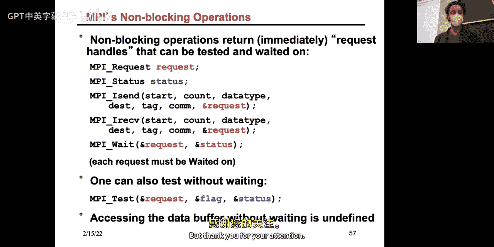

# 【并行计算 CS267 2022】伯克利—中英字幕 p07 CS267 (Sp22) - Lecture 9： Distributed Memory Machines and Programmi -BV1PS421978D_p7-

And we should be ready。 So there's been a couple of。

Fsed about how this lecture is actually happening， people seem to be confused that。You know。

 this is online on zoom， but there' is also an in person component。

 I totally understand that might sound like a little confusing。

Well that's why I actually turned off the background for those on the zoom so this is actually the lecture hall in juvenile hall 145 if you're in the vicinity you're welcome to join there's quite a bit of people in the lecture hall today。

As much as probably people that are online at the moment。

 so sold up to you so we try to kind of support both formats and we're doing this on zoom so that people who are not in the country。

 not in the Bay Area and so on can get a live experience because the course caption that's given by the university will only release the video a couple hours after the。

Actual lecture， so you get to use the slot that you signed up for， which is 11 to 1230。

That's how we're supporting this thing and additional disclaimer I will have for this lecture is these are recorded and after closed captioning is done and we already closed caption some of the lectures these might be publicly accessible so it's not necessarily public public but it's going to be unlisted on YouTube I mean the camera is not to you so it's。

If you， let me actually。Through the speaker wheelve myself so that the recording only has myself。诶。

Okay， if you ask questions during the lecture， please do so unless you don't want your voice to be recorded and be on YouTube。

But if you're concerned about that， you can just type it and I'll ask the question。

 it's all right as well。So this is a necessary disclaimer。Well today's is lecture nine。

 we'll be talking about distributed memory machines and programming。

And this is going to be your homework 2。2。Yes， that's going to be the one that's going to be released sometime today as far as I remember。

 and we're going to finish this topic on Thursday。啊。Okay， so this is really the outline。

 We're going to spend the first half of the lecture， given the。

An overview of what are distributed memory architectures。

What are the performance models to analyze costs of complexity。

 communication and competition costs from those architectures。

 what are the available topologies of networks out there。

And then we're going to spend half of the lectures giving a beginning。

Overview on programming these things and we're going to continue on Thursday for advanced programming on this machines。

 and we're going to talk a lot more on Thursday about programming。So。

This is the similar plot that I showed。In the introduction lectures where the what percentage of machines out there in the top 500s。

 remember top 500 ranked supercomputers based on how fast they can solve a dense system of linear equations。

 so called the high performance impact benchmark。And the point of this slide is it kind of ends in 2018。

 I think， but the trend is continuing if you plot it now， if you go to top500。org。

 you can plot it yourself in real time。That the share of clusters。

 which are really distributed memory machines have been increasing continuously since 2005 or so。

 maybe even before 2002。And it seems to be dominating everything else you can get your hands on so。

Again， this is really the fastest machine owner earth just doesn't necessarily have to be the honest。

pllatform you're going to write your code， maybe your problem is not as sufficiently big to take advantage of these machines and having a single GPU or you know mount a note with six GPUs is more than enough for your needs。

 but for the things that really compete for the top right now there doesn't seem to be any competitor compared to distributed member machines。

So let's talk a little bit about history about this。

 the early distributed memory machines were really。嗯。Designed to be nearest neighbor communication。

 there's a collection of microprocessors， they had cues in each one of them and they could just store and forward packages。

To their nearest neighbors。What does that really mean in terms of the implication is the runtime was more or less determined？

By how many hops。Did the message take because in each hub the processor on the nearest neighbors will have to store your package and then forward it to the next hub so really the time it took for your message to go from a source to the destination was proportional to the number of hops。

So this is no longer the case right now we have things like wormha routing。

 which is the message doesn't have to be stored and forwarded。

But these really influenced the design of the networks back in the day。

But from more relevant to our time， we're going to talk。About these concepts like what is a language。

 the distance， so on？And it seems like the best analogy is to think of these networks as streets。

Rightr a link in a network is a street， a switch is an intersection。

The distance in terms of hops is the number of blocks traveled right and your travel plan when you go to Google Maps is really your routing algorithm in the network。

So there is no really like a bus like in shared memory that sends messages all over fully connected。

 there is always some sort of topology involved and you can't really have a thousand node system fully connected to each other。

 there would be too much too many wires and too expensive and there's nothing that stops you in terms of physics about it。

 but there would be way too cost prohibitive， which is why there's always some sort of topology of network。

The two important concepts is latency， which is。If you want to go from point A to point B。

 how fast you can go in ideal conditions。 There's no traffic condition， congestion and so on。

It's like you have one car， you have the highway to yourself， how fast you can arrive。

The bandwidth is really how many cars can travel per unit time on that highway。

Which translating to network language is really how much data can be moved per unit time。

Now you can think about variables in this thing， which is the density I can pack my highway much more densely cars really following each other more compactly and there would move more cars but if you push that too much。

 it will create traffic people will have to break unexpectedly and will create congestion so how much density you have is kind of this delicate game and it's true for the networks as well you can density the packet but at some point you can create congestion and it might slow you down。

And the other variable is of course how many lanes you have。

 you can always add another lane to the highway， similarly you can always add another wire to your network。

 that's why it's actually possible to buy more bandwidth。

But you can't really buy lower latency after a certain point。

There's speed limits and there's speed of light here as well。

 so this makes sense you can increase bandwidth by just adding lanes。

 but you can't really lower your latency beyond the certain。So the topologies， there's plentiful。

 we're going to go over some of them， including the topology of the nurse supercomputer you have。

 which is the dragonfly， it's actually where we're going to stop。

And talking about different topologies。We're going to talk a little bit about rout algorithms。

 there is you know historically speaking switching strategies used to be relevant。

 where whether the whole the path from point A to point B。

 which is first to destination was reserved to that package。Which was called circuit switching。

 or is as packets traveling independently from each other without reserving a path。

 which is packet switching。 Nowadays， everything is working like a packet switch。

Flow control again used to be very important when there's congestion。

 you might see this more in your networking class， but we're not going to actually go over them。

 but they are relevant at the bottom levels of the network。

For things that we will care on this lecture is the concepts like what's the diameter of the network which is。

Given all notes， pick the one pair that's farthest apart from each other in terms of the number of hubs。

 So how many hops does it take。The maximum shortest path between any pair of points in the network is the diameter。

What's the latency which is？嗯。What we talked about。

 how fast you can send one package from point A to point B。

This is actually a metric that varies much more widely， at least historically。And。

There is a concept of distinguishing between hardware and software latency。

 what does that mean when you look at the craze specs， they will talk about hardware latency。

How fast the message will go over the wire， but as a programmer you care about the software latency。

 which is。You know how long it will take for my message that when I go and code it。

 so that' adds the software barrier overheads as well。

 and that's slightly more relevant to your application performance。

And that's going to be determined not only by the hardware characteristics。

 but also by the software that's implementing the message passing。嗯。So if you have small messages。

like your program is written in a way that has many， many small messages。

 then the latency will usually be the determinant factor in terms of real time。

 so you actually want to increase your message size so that you're no longer latetnt about because latency as we talked in the GPU lecture doesn't improve much historically speaking。

And here's actually a slightly more relevant plot， which shows latencies on microseconds。Over。

 I would say， almost。Three decades， it starts in 1990 so what we hear here is there isn't an obvious trend in some sense。

 if you look at this machine T3 from 1997，And the lowest latency you can get any point in time。

It's pretty much equivalent， right， this is the area Zion is the coreri hassmal。Partition。

Kur care and all practitioneritions here so these are really software latencies right because it's actually the same machine one of them has a faster processor it clearly sends messages faster so it involves a lot of variables。

So the fastest case， which means the lowest latency case did not improve。

 but it seems like the bottom of the market has dropped what that means is you don't get to see like 100 microsecond latencies anymore these days。

So things have kind of the variance have went down。

 there used to be a huge variance of latency now is things are a little clustered over here。

 which is a good thing， but it doesn't seem like we're going to see latencies that are under one microsecond。

So it seems to be a lower bond in terms of。Things in practice。So we talked about latency。

 let's talk about bandwidth， which is really。Banddth of a link is number of wires per time per bit。

 seems like a convoluted definition is really how many words you can move per unit time is clearly more useful to you。

This is usually reported in gigabytes per second。And some vendors will actually report it in gigabbits。

 so make sure you're convert by a factor of eight。You have to lower it by a factor of divided by eight。

You have to think about this concept of effective bandwidth because when you send a package in a package switching network。

You're sending this data payload， but you also have this header information that takes up space and there's the error code。

 there's the trailing bits， so the bigger your payload。

 the higher your effective bandwidth compared to your nominal bandwidth。

And so that's one consideration。And just like latency is important and the runtime determinant factor for programs with small messages。

 bandwidth is going to be what's determining the runtime of applications with large messages。

And again， bandwidth improves better than latency， so it's good to keep large messages if you can。嗯。

It a relatively old plot， but the point that the plot wants to make is still relevant， which is。

Banddth really depends on software just as much as latency does。

 so the the things that I want to highlight here is。Let's take this。IBM， for example。

Two IBM machines， this is the same machine， these are two the same machines。

 one of them is this red line using NPI。Which is a message passing interface we're going to see。

 which is standard so you can write one NPR program is's going to run everywhere。

Whereas LAAPI is IBM's proprietary networking interface。And that's you can see the top line。

 the sea on line， so it's significantly faster。And。You know， acrosss the board。

Right faster than the MPI version， despite using the same hardware， the same trend is happening。

 if you look at T3E performance in MPI versus Cham。

 though it seems like towards the large message land。

 things are kind of converging to each other and MP software overheads are becoming negligible so software overheads are relevant here in the bandwidth land as well。

Performance properties of a network so now we're going to go over these diameter concept and the bisection bandwidth so this is a useful metric its bisection bandwidth is the bandwidth across the smallest sc that divides your network into two equal hubs。

So。You can think of it as。You know， in layman terms。

 the cut across the narrowest part of the network。It's pretty simple to see on the line network over here。

Which is six nodes connected to each other and the bisection cut is going to be in the middle。

If you look at this two dimensional6 by6 mesh， the bisection cut also will be in the middle now this one is not a bisection cut。

 the green one， because it's not the narrowest cut。

The one I drew with the bluish color is cutting on the six。

Links and the other one is cutting eight links， I think。Is that true， yeah。

So that's not the bisection card， the nervous cut is going to be the bisection card Now。

 why is this important Because if your algorithm is communicating in an all to all manner。

 meaning all processors are sending messages to all other processors。

The bisection bandwidth will determine the communication time pretty much。Yeah。

So we're going to go over a bunch of topologies and how these metrics like diameter and bisection bandwidth vary based on these topologies。

 Now， you would ideally like to。嗯。Abstract away all these details about topology from you。

 but in certain machines it actually matters if you're trying to get the best performance out of your hardware。

 knowing the topology sometimes matters， so we're going to at least spend 10，15 minutes on this。

A linear array is the simplest thing you can think of。

 which is all the processors are in linear fashion connected to nearest neighbors only。

And here your diameter is n minus1 pretty long。And the bisection bandwidth is one。

 just like in the previous example， this cut is the bisection bandwidth。So the。I mean， again。

 we're reporting bisection bandwidth in terms of the number of links。

It's actually bisection bandwidth is really the links bandwidth。TimeTime1。

But we're just going to get rid of the links band term and we're just going to say one for the purposes of this whole comparison。

You can actually increase this diameter as well as the bisection bandwidth by a factor of two by just adding one link and making a linear array a ring。

People sometimes call this a Tarus， but usually they also refer to things that are。

Two and three and more dimensions， tous， and in one dimensions is's usually called a ring。

So there by just adding one link， I lowered the diameter to N over2 and my bysection bandwidth is not two。

 okay？So this is actually， this exists。 This seems like a very simple topology。

 But if you have a small on chip network， meaning。It used to be the case that。Xbox 3。

Was a processor of people use the program。It's called the cell Pro。

 in fact the world fastest supercomputing supercomputer called roadrunner I think in Los Alamos labbs 2008 was powered by a bunch of IBM cell processor really they got a lot of Xbox and put them together really hard to program。

But the cell processor network was a ring。And a lot of。Again。

 because these are like not enough processes to matter。嗯。So let's continue。

With the higher dimensional variance of these rings and linear arrays。

A two dimensional mesh is the higher two dimensional analog of a linear array。

They're the diameter instead of scaling with。And it's scaling with square root of n， which is good。

 and is the number of processors。 The bisection bandwidth also improves。From one to square root of n。

 So that's also good。 So the improvements are under order of square root of n。If you have a Taurus。

 which means you add these wraparound links。To the mesh。

 then you increase your you still get the same factor of two improvement compared to the non tous case。

 So okay， this seems like a good analogy。 and you can extend this to you know， three dimensions。

 four dimensions， four dimensions is really hard to visualize。

 but it is possible and you can imagine what happens right if you have a three dimensional。

Trous let's say， instead of having a square root of n diameter， you get a cube root of。当然突然售网。

So the exponent on n goes from1 over two to1 over three in a four dimensional tarus where will become one over four and so on。

And this actually is used in practice。Some of the supercomputers within the last decade had 4D toruss in them。

The IBM blue jeans I think at them。Now and the previous iteration of nurse machines at a 3D tour so these are fairly well used and there's a version of this it's almost it actually takes you a couple of seconds to tell the difference what's between a mesh and a hyperce。

Which is the hypercus。It's really acute and high dimensions。So。For any D。

 you have a fixed number of nodes you can think of right if you have a three dimensional hypercue。

 but you have to have eight processors， if you have a four dimensional hypercue now you have to have 16 processors and so on。

 So what's different from this compared to。A mesh is in a mesh。

 you can fix the dimension and say like okay， I have a three dimensional mesh and I'm going to increase the number of processor in a hypercube in some sense the dimension dictates how many processes do you have。

So it's kind of a little more constraining， but it has slight benefits。

 which is they have some perfect numbers here what do we see the diameter is log ethnicic in the number of nodes？

But because and the bisection bandwidth is great and over two。

 it's really hard to get it any better than that。So this seems like a great design。

 The problems with this is， again， it needs to be。It has two issues。 One of them is。Well。

 it's a little constraining to have。呃。The dimension matching the number of node。

So when those things are not perfectly dividing each other。

 it's not actually feasible to build a hyperce without cutting corners。And the other issue was。

Each of these switches， now you can imagine， has to support a lot of legs。Now in 4D I need to in 3D。

 I need to support three linkss in 4D， I need to support four links and this kind of keeps increasing。

嗯。And that kind of puts them。Constraints on what kind of technologies you can use。

Now trees are very popular， but the basic tree you see in computer science data structures。

 classes is not that useful， the binary tree has a good diameter。Which is log n。

 But its bisection bandwidth is horrible because the the top of the tree。

Is the bottleneck when processor on one side of the tree are trying to message us to the processes on the other side of the tree。

 they have to travel through that bottleneck link。That's not a good design， however。

 there is a simple solution that has been implemented in a thinking machine CM5 like three decades ago and still used in practice。

 I believe OchidD summit supercomputer uses this technology and many。

 many other machines are using it， it's called a factory。So as you go up at the network， tree level。

Let's say at the bottom level， the bandwidth is， let's say and。And then at the second level。

 you have two end。So each link is doubled as you go up on the tree。

So here you have four end yes you have eight and。And N is like whatever the network bandwidth at the bottom level was。

So that ensures that the bisection bandwidth。It stays。As good as possible， right？

And you get an N over two bisection bandwidth。It has some downsides， you have to support many。

 many more links towards the end， so you'll have however many layers here。

 let's say your network is login deep then you have obviously in over two links here。

So that's slightly expensive， but it's high performance。

Now I want to actually talk about some of the technology， which is called a butterfly。

But it also not only is useful on its own， it also helps you think about what a hypercbic really is。

I kind of think of this as an unfolded version of a hypercbe。呃。The。

The hypercue required increasing the rads of switches， as we talked about。

 meaning as you increase the number of dimensions on a hypercue。

 you needed to have a switch with a high ras high ras means how many external links it can support how many different buckets outgoing packets you can send to different destinations。

And those high raic switches were not available at the time。

 they were really expensive to make back in 1990s and so on in 1980s。

 so they came up with this idea of using a butterfly。

Which is really a series of lower raic switches on the same node as opposed to a one high raic switch。

 so a whole row of a butterfly is really a single node in a hyperce。

And the routing in these messages are also pretty。Simple， let's say I want to go from。

The processor whose code， the binary code is 101 to the processor whose binary code is 110 so all I need to do is compare the first bits if they're identical。

 I just stay where I am。If they're different， I go down。I mean， it's really hard to see here。

 but let's see。I can if I can get to the place that I can get to。So I start with。

101 and it's the same so I go down here to I stay in the same place and then it's different。

 which means I take a different route。And it's different again。

 I take a different route as opposed to staying in the same place， so I indeed correctly came to 110。

So what's the advantage compared to hypercue you can see that each radix each each switch here is only supporting two outgoing length。

 it's a very low radix switch as opposed to an equivalent hypercube which would need to support a higher radix it's not really the difference is not drastic here because you're comparing three dimensional cube to a butterfly but if you go to higher higher dimensions let's say seven dimensional hypercue then the radix here stays constant in butterfly and hyperc it would go up to seven。

Which is no is not a big problem， again， this is a little historical。

People built high rating switches today just fine。You might want to ask like okay does this really matter like do we really need to know about topology I guess sometimes if you can take advantage of the topology then it matters。

 so this is actually a performance plot from the paper by Professor Deil and one of his students at the time now the faculty at UICUC what do we hear here is the XC6 and X5 are Cane machines。

And they did not allow you to take advantage of the topology。 So you couldn't really。

Map your algorithm to the topology in the best possible way。

Because there was just no way of controlling that。And as you can see。

 the number of nodes increased the effective bandwidth。Per processor went down。So。

It's like condition and you can't control it by contrast bluejean P。

 the IBM blue gene machine at the time allowed you to map your algorithm perfectly to the hardware it would give you a chunk of hardware that's a perfect four dimensional tous and then you can place your processor it's like more work。

But the reward was not only your effective bandwidth didn't go down， it actually went up。

Because now you can actually take advantage of the topology and fully map your algorithm to it。

So if you can take advantage of it， I think it's useful。😊。

Especially if you're in the bleeding edge of performance。There's a huge drop here， right。

 There's a factor of。40。嗯。So why there are so many different topologies out there。

 but because different systems have different needs， if you have， as we said， only a cell processor。

 IBM cell processor with a few cores in them， a ring is just fine。

But if you have a supercomputer with 8000 nodes， a ring is not fine。Danniiels。

Then your diameter will be huge and messages will take really long time。

The other thing is like what's the how much money you're willing to put there。

 you can choose the optimal technology， but if it's going to cost you so much money that you don't have。

 then you get something somewhat suboptimal with least complexity。Physical constraints。

And then finally， technological changes， which are， as we said， higher ra switches。

Became economical recently and which is a consequence of Moore's law。

So that also another thing that changes fiber optic became feasible。

 so the distance between cabinets stopped matter。Now these two last technological changes actually drove this last topology I'm going to talk about。

 which is dragonfly， this is used in Edison， the previous generation of N machine and Corry。

 which is the machine that you're using these days to do your homeworks。

The motivation behind dragon fire was。To exploit the gap in cost and performance and electrical and optical interconnects。

The optical fibers were expensive。But when there's long length。

 they had higher bandwidth compared to the electrical ones。

And electrical copper networks were much cheaper。But only faster when they were short distance。

So the idea was。ok企。😊，You do something hierarchical。Create many many groups of nodes。

 And each group is connected within itself with potentially。Anyway， it doesn't matter。

 but with electrical cables with copper wire。And each group was connected to another group。

Byia fiber optic fiber optic wire， okay and those are necessarily， almost always all all connected。

So you can see the long distance wires were fiber optic， short distance wires were electrical。

 and you combine them in a hierarchy。And we'll see pictures of them。

And it used to then randomized writingut algorithm， and we're going to go over。This， in some sense。

 is where we want it to be， which is the programme more or less ignores topology because it's using a randomized algorithm to route anyway。

 so you can't really control much of it。So maybe we're in a place that all these topologies won't matter。

 but I guess I've been around long enough that history repeats itself so five to 1 years later。

 maybe it will matter again right？So what does it look like in practice？

Its there is an electrical group， I mean there's a chassis， this is that important。

Which is like a whole blade of notes in them， but then you have this electrical group。In this case。

 it's all all connected， but it doesn't have to be， it can be any connection。

And the electrical groups are connected across each other。Tworu optical cables。

Now why is this called a dragonfly， apparently that's what the dragonfly looks like。

 which is a fat bodydy densely connected and long wings， skinny， long wigs， right？

It's also a pun on the butterfly world。So there's history behind those names。So in NRSt。

 I hope this link still works， by the way， maybe it doesn't because this Edison。

 I should update that。But the network is the same for Corier as well。

 this is the actual realization of that， which is the at the system level optical cables as the cabinet level copper cables and within the Shassis。

 whatever is going on。And you might think that this is a。

Constrain that because these needs to be all all connected and so on。

 but obviously the engineers find solutions， you don't need to have a perfect case of everyone connecting to everyone。

 if you have one cabinet short， then they'll make it so。嗯。I'm going to update that so what is that。

The routing algorithm and why does that matter？So first of all。

 I want to open a little bit of parentheses here， which is。

This algorithm that I'm going to talk about is really old， it's older than me。

Asspied due to Lesley valt， which is a Turing laureate。

But he didn't win Tinggo workforcefor his parallel computing work。

 he used to do parallel computing in 80s and then he started doing this learning theory work right probably approximately correct and that's why he won a Tinggo workforce but he has quite a few papers in parallel computing in the 80s and this is one of them。

The idea is actually very simple。And it relies on the following issue， so let's say you have this。

 these are your electrical groups。Think of the dragonfly again， when he designed this system。

 there was no dragonfly， it was a more abstract concept of hierarchical communication。

There was no dragonfly network， dragonfly was invented。

at least for the first time proposing this Isco paper by Bill Delhi and Company， so it's only 12。

 14 years old。Whereas this algorithm is 40 years old。嗯。So this is your electrical group， let's say。

 and you have three different electrical groups。😊，And within each one of them。

 let's say you have only two processor， and two routers。And I want to send a package。

From source to this destination， which is this。RD， so I want to send it from Rs to RD。Now。

 the minimal routing， which is going to take the shortest amount of hops。What it will do is first。

 it will check。If the router of the source has a direct connection。

 optical connection to some other the router。In the destination group。In this case。

 it doesn't because。Each electrical group。Has only one representative that is connected to another electrical group。

All so in this case， Rs doesn't have a direct connection。To anybody in group D GD。

 which is this destination group， so it has to forward this package within the electrical group to the router that has a link。

To do to the other group okay， which in this case is R a it's a little hard to read。

 but that's an a so and that processor since it has a direct connection willll use this link we see one link to。

Clearly your router in the destination group。Which doesn't happen to be。

The exact destination we want to go， so there is another extra routing that happens within the electrical group of the destination。

 so that's the minimal routing。You check whether you have a link if you don't you send it to your peer in your network in your group that has a link。

 he sends it across the optical link and then within that destination electrical group internal routing happens with one hubs so you can go there in three hubs why don't we use this because。

There are certain adversarial traffic patterns where this is going to perform catastrophically that。

And because there's only one connection， let's say， from this group to the other group。

 if lots of messages are moving from processors in this group to the processors in that group。

 this link will going to be bottlenecked。So instead， the randomized writing does the following。

It does the same thing in the beginning， which is if。IfYou're not。

 you don't have a direct connection to the destination。

 you do send it to someone who has a direct connection。

But instead of sending it to the destination directly。You send it to a random group。

Which is this red link。You choose a random。Random group and send it to the router。

That's connected to you。And then it goes tries to send it back to the destination。

 so it seems like it's randomly choosing another group to use as an intermediate hub。

So this increases the routing by from three to five in this case and it's pretty much the same for any case you can imagine you can be faster if you do have a direct connection。

 it can be in the best case， it can be one。But it's increasing it to three， in the worst case。

 it's increasing from three to five。But what it's really doing is。

It's increasing the load balance in case theres a bad traffic pattern。

And you can analyze this and it actually will lower your load balance over this potentially vulnerable link。

And a good analogy I can think of is。Back in the early days of Google Maps。When you wanted tosa。

 you're sitting in your office in South Berkeley。You want to get to San Francisco？Back in the day。

 it would always give you this aspir route。From there， take the Aspi Avenue， merge to the highway。

 go to San Francisco。Well， if you ever drove across Ashby。

 you know it's a one lane street certain parts of Ashby， so it actually used to get clogged up。

 even though there's no traffic on the highway， there's no traffic in Berkeley。And I started to say。

I wish Google Maps had a randomized routing algorithm and because clearly it makes more sense to use the links within Berkeley more efficiently。

 half of those people can use D， half of them can be used AshHP and because there's no congestion at the highway entrance or within Berkeley for that matter。

 we're just using the same link which is this vulnerable link potentially to create artificial congestion so that's the same idea they actually now do and you can experiment with this if you care。

And that sometimes it's going to give you alternative routes。

 which doesn't make too much sense to you， it increases your travel time by one minute。

 but overall everybody's happier。It's okay。So。Let's briefly talk about performance models。

 and we're going to go over programming。What the performance models we have seen in shared memory。

 which actually we didn't use too much because it's an unrealistic performance model。

 which is the generalization of the RAM model， random access machine， to parallel computers。

 we didn't use this because it ignored communication costs。

 which is one of the most important things that determine the Ram type。

And it also ignored memory hierarchy and so on。For distributed memory we're definitely not going to use it because communication matters even more distributed memory than in shared memory。

 instead we're going to use this model frequently called the alphabetta model。Now。

 I have heard different names people call this model。诶。

Like I've seen people call it the postal model， I've seen people attributed to some particular names and they say X's model。

But alphaphabetta model is， I think， what we've been using。In this model， the time。

It takes to send a message of length end。I is the latency。To send that message。

 which is a fixed cost。Plus。The message size divided by bandwidth。

So and then you can take this divided by bandwidth think。And take the inverse of it。

 which is one hour bandwidth to be a term we will represent it better。This is the inverse bandwidth。

So the time becomes proportional to alpha， which is the latency plus。

The message size n times inverse bandwidth beta。And it's pretty simple。

 there's caveats and I'll go over them， but overall this is a very good model as a first order of approximation。

Again， lets remember some facts latency is significantly higher than inverse bandwidth。

Which itself is significantly higher than the time it takes to do one flop。

One floatinging point operation or any other operation for that matter。

 so you can do a lot more arithmetic or interviewteger operations。

In the time it takes to send one word of message to。So keep that in mind。And of course。

 the lesson is of this reality of alpha being larger than beta。

 which itself is larger than time for fl is， you want to have a large computation to communication ratio for your application to scale up efficiently。

And there's other performance models for those who are interested in doing research here。

 which one of the most popular ones of those is LockP， also invented here in Berkeley in 1990s。

But instead， I'm going to actually talk about a shortcoming of many of these models。

 especially the alphabeta model we're going to use， which is。

The fact that we have multi corere machines。In general or even if it's not multichse。

 we tend to have like eight GPUs in a node， which is what bridges2 looks like。

But also current GPUs look like。So what does that mean。

 let's say you have your K&L node 64 course in oneNot。Deadash。

Connected not these 868 cores are not connected to the。

Network right there's only one network interface card in a node or maybe two sometimes I don't know。

 but a very small number compared to the number of cores you have。

So all these cores need to use the same interface card。

 this network interface card think of them is your highway entrance。

 let's continue with the analogy of Bque traffic。And when you try to exit university to the highway。

 there is this traffic light right， it turns green and then five seconds later it turns red and so on。

 it's the congestion control。And there's many cars that are trying to get to the highway that that traffic light is the network interface car。

 that's the bottle left there。So the alphabetta model was invented before multichos existed。

 and there was only one。Single trade processor here。 Turn node。

And it had his own network interface card， so there was never a bottleneck of sharing that entrance to the highway。

But nowadays， things are a little different。 So that's why you need to remember this fact。

 So this almost。Unreadable plot， actually I'm going to read it to you。啊诶。

And when you download the slide as more apparent， this is the pingpon time of effective bandwidth。

And these numbers here from1 to 16。Is。How many MPI processors are active， additional note？

So like these are you're mapping one MPI process to the node， two， three， four。

 five all the way to 16， and there's more than 16 coreds， you can map more。

But what happens to effective bandwidth when you do that is initially you actually get a performance improvement。

 like when you go from one MP active MP process per node to two。

 you get a little bit of performance increase in effective bandwidth because a single MPI process doesn't use all of the highway entrance effectively。

But and this continues until four and then you see a performance de aggregation。

At the extreme and when you have 16 MI processes active in a note trying to communicate at the same time through the same interface part。

You're actually slower than any other case， that's the slowest case。

 so you have to basically choose the number of active communicating processor in each node to get the best of that effective bandwidth。

And that's just something to know of， there isn't an alternative。

Model that captures this thing succinctly without becoming a burden right all models are wrong。

 some are useful。And you know， what we're saying is there is something wrong with the alphabeta model。

 but we don't have a more useful model。All of them will be wrong anyway。

 so just know the caveat and know that you might you know get some unexpected performance when you increase the number of factor processes。

All right。So we can now come to the programming part of this lecture， which I have like 33 minutes。

 which is great。Slides from a lot of people。Now we're going to talk about this thing called message Pass Inter NI。

It is ubiquitous。It's everywhere。Next time we're also going to talk about some alternative interfaces that。

Recently coming up， like Nvidia has something called nickel。You know。

 N Media Collective Communics library， I guess what it's called。

Intel has its own collective communications library。And。Facebook has something called glue。

We're going to briefly mention them but almost all of them kind of look like MP and MP is standard just like open MPs and you can find it in any laptop by just if it's already there good if it's not you can just say。

You know，Pip install MPI or brew install MPI is just going to show up pretty quickly。

And before MPI became a standard， there was a lot of competing message passing libraries and it was not as much fun。

 let's put it that way because your message， your code would only run in that particular machine because it had a different API。

So MPI allows you to write portable parallel code in the member mission。

It does do that by in some sense。嗯。Sometimes it is higher overhead and bulky。

But that's like the trade off with standards。So what's inside MPI？

There's communication calls and there's synchronization calls。

 there is no shared variables unlike shared memory programming。

Which is maybe not that true you can think of it as shared variables illusion of shared variables exist potentially but there are no real shared variables for that matter cyber routineoutines for point to point communication and collective communication these are very different point to point means I am sending a message to one person in the room。

And a particular destination collective means I'm broadcasting a message or I'm gathering everybody's exams right so it's like many to one one to many or many to many communication is all called the collective communication。

And then there is the synchronization primitives like barriers this is actually probably not correct anymore we do have locks in NPI so I'm going to update this slide these slides were done with the older version of NPI there was no concept of a lock or a shared variable as we said there is a concept of a shared variable you can make your own variable。

Visible to across the network by exposing it。 And this is some of those things we're going to see on on Thursday。

But those came to the MPI standard later， not in the initial version。So the features of NPIR。

 the things that you probably want to know most is there's the concept of communicator data types。

 we don't really need to go over them on the slide， we're going to see it by example as we go over。

I was able to update this slide。Because thankfully， MPI committee。

Is you know flourishing and alive and wild， and they've been releasing a new version pretty much once a decade。

 and they just released MPI4。Like six months ago， eight months ago。

 so this was the change from last year， there's probably a lot of stuff in MPI for that I'm not aware of and you don't need to know about at the moment。

Let's see how useful they will be because just because the standard has been released doesn't mean there's an useful implementation similar to compiler like C+ plus let's say 11 came and compiler support came a little later then just like that there doesn't seem to be all the implementations available for people to take advantage of the latest standard so soon。

There's lots of books about NI going to。Going back all the way to 1990s。

 some more recent books covered the。The modern modern MPI， which is the 3。0 and beyond。

I like those books pretty much I like all these books here， except MPI too。

 I would avoid that if you。If you're going to read any of these things， you can skip MPI too。Because。

Many MP programmers and designers will accept that。A lot of features that I put in NPI too。

In retrospect were mistakes because。MPI 1 and3 came with stand with implementations， meaning。

There were a couple of implementations， proof of concept。

And they showed it to the committee they say， hey， these are great ideas and they work in practice。

 why don't we standardize them？Which is the right ways of right way of standardizing something。

 standardized practice。Whereas MPI2 was designed by people that said。

 why don't we have this great feature？And they put it in a standard without any supporting implementation。

 and a decade later people were still figuring out how to implement them because it turned out to be infeasible to implement them in practice。

So a lot of those things were either kind of rolled back in MPI3 or just deprecated。Okay。

So when you try to write app parallel program， just like an openmp threats。

 you want to be able to answer two questions， which is。

Who am I right so which processor am I and how many processes are around me that I can communicate？

These are the things that Openmp allowed us to query which what is my thread ID。

 how many threads are alive and of course MPI does it too these are done by MPI comm size which reports the number of total number of processes MP comm rank reports the rank of。

This particular process that you're coring on。And here's an example， ups， here's an example。

 you can basically say addmppi。h。Initialized NPI these are mandatory if you call NPI without initial initialized。

Then it's it's。Practically going to sickfold。And if you exit the program without finalize it might take fault too so this really kind of sets up environmental variables and starts up library。

This one clears up all these things that have been set up。So these are。

In it time finalized are necessary in each program， the rank and size we're just using as an example。

 right？So MPI Con is all the MPI processes within this program。

 It's this built in concept of the whole word of processes。

 And we're going to talk a little bit about what that means。Soon。

And you can get your own rank and you can get the size and the output of this will be like I am zero of five。

 I am one of five， I am two of five， three of five five。Co。And how do you run this program？

First of all， you're probably going to compile this thing with a wrapper。And。

If you go to the N website， I'll tell you like you should use a compiler wrapper called CC。

 capital CC。I mean。This is really a compiler wrapper that calls MPI and a lot of other things。

In your own laptop， if you are in installed， it's often something like。NPICC。Or sometimes it's。

MPI CxX， if this is C++。And so on。 And there doesn't seem to be a standard because it's really a wrapper around your existing compiler。

 That's what is happening。嗯。You can just say NRS compiling NPI programs。

 I will tell you what exact wrap it is， whether you're compiling C code or C++ code。

How do you run it， well surprisingly that also is not mentioned in the standard。In general。

 in your laptop in a lot of places， the MPI run is the standard command。

And then you specify the number of processes with MP at NERSC it's not the same at NERSC it's the same thing which is eRA。

A nurseur can then you'll be like。Dash N is opposed to D NPP。

 and let's say you want to run it with four processes。

This is pretty much standard and it again another sm jobstart thing it will internally call MPI run maybe and I don't even know。

It seems like mysterious， but the real thing that feels mysterious about all of this is and it took me honestly。

A couple of weeks to wrap my mind around。How does this program run？And print。嗯。Like I am zero， four。

 I am one0 four， like how does these four statements come up。

It's very different than programming P threats where you explicitly say create for threats or open MP。

 say create a parallel region。I didn't say anything like that， right。

 I didn't say create a parallel region。Because in API。The programming model is called spinindi。

 which is single program， multiple data。 So what happens when you go and say NPR run MP4。

Some script creates four。Copies of your program。And starts running them on four distinct cores or four distinct nodes wherever you place them。

The same process， the same executable starts executing four times。If you do it on your laptop。

 the same process will start executing four times in your own laptop。

 even if you don't have four course， it will happen because the operating system will take care of time sharing it。

So that's what it means like single program， multiple data。嗯。The data is actually single too。

 but each one of these copies。We'll have a different rank。The MI unit will ensure that， you know。

 one of them gets ranked，0， one of them gets ranked two and 3 and4。

 And now you can start being able to write programs that says， if I'm process one。

Then send data to process zero。And then it starts making sense， so everything is parallel by default。

The startup script ensures that and copies of your programs。Start at the same time， more or less。

And run on the destinations you determine it to be。

 whether it's the mapping to one process to core or one process to note and so on。

 so there is no starting a parallel region concept。It's all parallel all the time。Okay。

 now let's go to how to send data and receive data。Well， that seems to be very simple。

 but the things that we probably want to say is， okay。

 what's my data composed of it is floating point， data， is it integer data， what is it？

How am I going to identify the process that i'm sending how am I going to make sure that my data has arrived on the destination what does it mean to arrive so those things we're going to talk about a little bit。

系啊。And then there's other concepts like I've already used this MPI convert without telling you exactly what this is。

 this is when you start your MPI job with MPI run。Or是 restaurant。

All the executables are part of NPI Col。All the processes are part of CO by default。Now。

 from that con word， you can create subgroups。And with something some obscure concept called context。

 we're going to not talk about， that creates a communicator that you can send messages within。

So what is really telling you is you don't have to rely on common word all the time。

 you can just say。I only want to communicate to the left side of this。

Aphitheats on the right side or the middle side， the middle section and you can create three different subvers of communicators。

 they can be distinct， they can be overlapping it's all fine and this way you can come up with clever algorithms that are hierarchical in nature nature that communicate within groups and then groups communicate with other groups and so on and they come in handy and a lot of matrix algorithms where you can map columns to one dimension of the processor rows to one dimension of the processor and we're going to go over them on Thursday as well。

So you don't need to always use Con。And a simple reason why not is imagine you have 100。

000 processes。Communicating a message or broadcasting a message to 100。

000 processes can be very inefficient。And creating a hierarchy of grouping is useful。

Then we're going to talk about those。The other thing I said is， you know， am I sending an integer？

Am I sending a double precision value， Well， it's encoded in this thing called an MPI data type。

And you're sending a message seems like a pretty boring concept， but it is pretty flexible。

 there is predefined built in ones like in double and so on。There is also more advanced data types。

Create an arbitrarystruct。And tell MPI， this is my data fact。I'm gonna to send an area ofstructs。

For that， you have to commit that data type， it says some sort of hash table internally that keeps track of your data type。

But。You can also， of course， go to。You know strideed accesses and so on。

 these are pretty advanced ways of specifying data types， but it's possible。In some architectures。

 there is the performance degradationation that comes with complex data types in some architectures there isn't。

 it depends on you know what hardware provides for default。

 but sometimes you really need to use these data types。

And this is actually one of the shortcomings of NTI。

And you'll see it in in the sand and Re what it means。Finally， there's this concept of a tag。

Which I'm not going to go too much is really let's say you send many。

 many messages from point A to point B send one message， send another message。

 send another message MPI doesn't guarantee。嗯。Exactly which one will match which one。

First come first out， in some sense， but there can be many messages that you're expecting。

 which one you're receiving。You can can use it tag， it says， okay， let's say the tag one， tag two。

 tag three to make sure that you get them in the right order。

And then any tag means I want to receive a message， I don't care what the tag is。

 you can use it on the receiver side。ok。We went over these abstract concepts and。

Didn't go over an example。You know， examples clarify things。Let's look at MPI Sand receive。

 the simplest case of communicating。So the input you're going to give is the address of the variable you're sending。

 so if you're sending a single variable like integer you'll get the address。

 if you're sending an array， it's already an address。So you can just send the error name， right？

And then you say how many of such elements you're sending count， in this case。

 I'm sending 10 doubles doubled precision floating points。What's the data type well it's a double。

And the receiving site。It's strangely receiving。20。

 and this is because the programmer doesn't know how much it will be sent and it's actually okay to expect to receive more than 10。

You probably would write just1， but I'm giving you an example it's okay to receive。

Fever packet stand。Fever elements than diser sense。

 but it's not okay to try to receive more than you intend to。What needs to be taken care of here is。

You have to make sure that there is enough space and B。To receive data。

Means you have to allocate the memory for B。You can't just declare it。

 you have to kind of mall it because the data will be put there。

And the fourth variable here is the destination， so process zero is sending to process one and process one is receiving from process zero。

It's just a function signature you'll get used to it。

And there's the tag that I talked to you about and finally what communicator I'm on。

 is it the NPI convert or is it the subcommunicator and you can all specify in this syntax。呃。Okay。

 let's go with the example。So I created this fake example， which is。

Process zero sense and process one receives some arbitrary number，1，2， three， four， five，6。

Since this is a single element of integer。I am obviously I have to give the address in dissent。

And on the receiver side， I also have to give the address。

So what's going to happen is see there everything is。The same code is executing everywhere。

 but it's kind of protected with these if statement if rank is zero。Then do this。

And if my rank is one， I do that so different parts of the code is executing on different processes。

Assume that I started this program with only。Two processes。

 so I just went and said H run and2 or MPI run MP2 to start this code。

And nothing interesting is happening here is just going to the receiver will print receipt one， two。

 three， four， five， six。Pairly simple example， and I need to finalize。So。What if we say。

 you can query the status of the message。Let's say you did a receive。

And you kind of try to receive a message from any send with any tag。

So you probably don't want to write a program like this， but you can。

And then you can say how much data I received， you can say， give me the count of the data I received。

Give me the tag of the message I received。And give me the source of the message。

I don't recommend your write code like this like except random packets from everyone。

 but it's kind of an extreme illustration of what the status can do for you。

You ideally want to use status for debugging， like did some package drop， did I miss some packages。

 you can query it with the status to make sure that something is not going wrong。嗯。

There' is an initial claim that you can write every program with sends and receipts I don't actually。

Recommend that I think collective communication is much more productive and faster。

And the reason is faster is if I want to broadcast a message in this room。With Sandon receives。

 I will have to send distinct， however many 60 messages。

And there is a cost to that if I do a broadcast I can just say okay。

 I'm just going to send a message to the first two people on the front row three people and they will each send it to three other people and that you can see that you're creating a communication three with aity of three and it's going to get to the destination much faster。

Thenhan me individually sending 60 messages。So a lot of broad collective communication algorithms have been developed and we're going to go over them on Thursday that are much faster than doing point to point for that task。

And clearly much less error prone because if you write everything send and receive yourself。

 you can get into a lot of situations like deadlocks and so on。Okay， and the collectives， of course。

 are very convenient。Here's it。Here's a strange statistic I found it surprising。

 it's not strange to me， I am happy that it turned out to be that way。

But it turns out that this is a survey from the projects that are part of the Exscale computing。

Project this is a Department of Energy super large project that builds and programs accessical computers。

The first one of which is probably going to come out live pretty soon。

And the survey at the time asked， what is the percentage of point to point applications that use point to point communications？

Versus。Collective communication， so。So if you look at this， 96% of applications used point to point。

When the survey was happening。And。86 of them use collective communication。 Now。

 what they expected at the end of this project。And we should go back and verify this is indeed the case。

Point to point they expected a drop in the point to point of communication percentage of applications and an increase on the collective communication now whether this realized or not I don't know。

 but clearly the programmers wanted to move to collective communication at larger scale and the other things I really like about this thing is these neighborhood collective communications which is instead of communicating with everyone you create hierarchies of them and neighborhoods。

They wanted to increase the percentage of them from 14 to 32。

 and they also wanted to increase the percentage of one side of communications。

 which is also we're going to see on Thursday。From 36% to 50%。

And similar kind of data you can read more of this thing， they also want to。

It's surprising the high percentage of projects that want to。

And or are already using neighborhood collectives。But let's actually start getting into our famous example of computing pi。

But we're going to do it with MPI。Which is you know this little rectangles that we were integrating over and we did this example using openmp so we're going to do it with MPI this time we're going to say you know。

If you're going to run this code。Whi。Four processes。

Cically they will cyclically compute the rectangles， which is actually a good idea。

 You know why it's actually a better idea to compute something cyclic it increases load balance in this case。

 you can argue that computing the area of a big rectangle。

Is the same as computing area of a small rectangle。

 but if the rectangle size was proportional to the runtime。

 making cyclic distribution of data to processes is actually a good way to ensure load balance and this applies in a lot of other problems。

You can imagine those cases， but we're going to use the same pattern。

 each process will do every fort rectangle area， and then they're going to sum it up。

 use the formula to divide it to get an approximate number for pi。Here's the code。

 my expected value of pi up to。25 digits is there to report the error at the end of the computation。

 I add my MPI header nicely。I get my size and rank。And then you know I decide a number of intervals。

 number of intervals is how smaller will my rectangles be， the smaller it is。

 the more I will approximate， I suppose。Is that true， yes。嗯。And I'm going to broadcast this number。

So and then every process。We'll do every ant rectangle right so I'm going to start with my ID let's say my process ID is one then I'm going to or let's say my process ID is 10 I start with the 11th rectangle。

And if theres 20 processes， I'll do 31st rectangle，51st rectangle，71st rectangle and so on。

 cyclically jump over。 and I compute a partial sum。 This is not the total sum of the area。

 It's just my view of the partial sum。And once I compute that， I call it reduction。

 which is the same as open MP reduction。A you're reducing lower we some variables able to get a global sum。

And the key point of that reduction is I'm entering my local variable my Pi with the address。

And the big， the pie without my is。Is the global pie that's the destination of the reduction you can just read the signature of reduction。

 none of these need to be learned it's all look it up every time you use it it's okay。

What do I say I'm reducing the double precision floating value。

I am reducing it at the first processor I could have chosen the somewhat no sorry， this is the count。

 how many variables I'm reducing。And what is the reduction， am I choosing a max， am I choosing a sum。

 in this case， I'm doing a sum。And the reduction is happening。At the root note zero。

 I can choose a different note， we can say reduction always happens at 10。But zero is great because。

It's never going to crash。If you have one processor， it will still correct around。

But if you do the reduction on the fifth processor。

 it will crash whenever there is fewer process right。

 very simple and the zero processor will you know say this is the result and it's going to print the error。

So it's a program that uses not only MPI broadcast， but to get the number of intervals。

 but it's also doing reduction to get the sum and it's one way of doing parallelism for piI in MPI。

So what happens to the data， we kind of said the data is getting sent。嗯。But。Where does it go。

In reality， there is usually local buffering in MPI。

 the default mode of when you send the data and receiver data。Your data goes to a local buffer。

 it's some sort of array that's not visible to you in your memory space。And once the。

MPI send function returns all that means that you can safely delete the memory or change the contents of the memory that you're sending once that MP send function。

 the blocking send returns。The memory use of the contents that you're sending。

Is taken to some local buffer potential， so you can touch that application code memory at that point。

 it doesn't mean the receiver has received it。Right because that's kind of the MP library's job to make sure that this package continues its travel from the local buffer to the network to the local buffer of the processor and so on。

 it needs to ensure there's enough space in each one of these things so it doesn't bedlock。

But for the user's perspective， you can start fiddling with that memory that you're sending。

There is a way to do this differently。You can avoid copies by directly sending it there。But there's。

There's other caveats that this is usually not the standard behavior。For reasons that are。

Slightly more technical。So what we've been talking about is blocking communication。

But MPI S doesn't complete until the buffer is empty， so like this is the user buffer。

 this is not the application buffer and receive doesn't complete until the data is full in the application side。

嗯。So。What can go wrong。 So here's what can go wrong because of buffering， writing a code。So。

Let's say I want to send some large message from process zero to process one。嗯。

If there is insufficient storage at the destination。

The send must wait for the user to provide some memory space。 So when I write a code such that。

The process 0 is sending a message to process 1， and process 1 is sending a message to process 0。

And I somehow posted these messages in this order。In the past。

 I used to think that this would always build luck。

But then I understood how the MPI handles buffering。

 it doesn't have to deadlock if theres enough memories in the buffer space within the MPI library。

 this will not deadlock。But if there isn't enough memory buffer that it cannot store both messages。

 both the receiving message and the send message at the same time。

 so like the send message occupies the whole buffer available for MPI， then this will deadline。

Which is actually the first time' dialing all the time。Because then I don't know when it deadlocks。

 it's an undeterministic case， sadly， but this is unsafe。How do I make it safe？ Well。

 you can use some brain power and say that I have to reorder these calls in the appropriate way such that。

 you know， when process0 is sending to process one is receiving。And vice versa。

 as opposed to them trying to send at the same time first， just reordering the operations。

There's actually a simpler way to do this thing called send Reive because this turns out such a standard mechanism of two processors exchanging data。

 NPI gave us a more convenient function called send Reive。So you can just say send received from one。

 send received to zero， it essentially does what's going on up there， but without an error。

But it turns out theres other ways to make sure this doesn't bed luck。

You can use this particular thing called the Bcent， which is。

You supply your own buffer space what did we say we say if MPI has enough buffer space。

 the code will not deadlock okay？How can you ensure it doesn't that luck you can provide their own space so as an application user you give MP a buffer space and use this obscure function called V I don't recommend this thing actually it's not used very much but it's an option。

And the more convenient option is to do something called an Iand I receive。Ice stands for immediate。

 it actually doesn't mean immediate sand， it means immediately return the handle back to me。

So this is an asynchronous scent when the I sand returns。There's no guarantee that editing happened。

 It just checks the input variables。 And if they are fine。

 it returns the handle back to the programmer。And the sand hasn't happened。

 buffering hasn't happened， nothing has happened。And you cannot touch the application buffer space until you call something called the weight。

This ensures completion of the functions you called。Before。

 so this is an asynchronous handling mechanism and it's very much used。 And in this case。

 you're not going to deadlock。And you can just sloppily say I and I receive and then do a weight all and everything will be okay。

So。What does it actually look like in practice if you're waiting on something you need to get handles to wait on right and that's really called the request。

So when I。Say an immediate scent， a unblocking operation。

I do actually pass this thing called the request， these are my handles。

And same for I receive and then when I want a raton。

 which is this thing that makes sure that the messages that I'm waiting on have completed。

 I'm going to use these request handles。So that's how you kind of keep track of。

Any communication calls that hasn't finished potentially。You can also。

Test whether it' completed without weighting on them in a tight loop。

 you can kind of test this thing occasionally， but weight is usually what people use。

And you can wait on many different ways。 You can wait on all of the requests。

 which means all of the requests should finish before wait all returns。We wait any。

 which means any of these requests， if one of them kind of completes。

 then you can return and wait some， there's different use cases that these are all relevant。

And finally。We're going to finish this lecture by saying。There is other。

Communication modes we already have seen the blocking mode。

 which is the default when MP San MP received those are blocking modes。

 we have briefly mentioned the buffer mode， which is the user supplies the buffer not very much to use。

I like the concept of a synchronous mode， which is。

Assent will not complete until a matching receive on the other side has begun。

 which converts all unsafe programs to deadlocking programs。

 so it sometimes makes your debugging easier。There is the ready mode。

 which is as an application programmer， you guarantee that a receiver has been posted before a sender happens。

Which is actually harder than you think， because that means you have to actually synchronize the clocks。

嗯。But this allows you to access the fast protocols of matching messages。And there is。

No blocking versions of each one of them， and there's actually non blocking versions of collective calls too like there is i broadcast there is I reduced there is。

You know， whatever， and we'll see some of those on Thursday and hopefully some other collective communication libraries will briefly go over two examples。

 but thank you for your attention。😊。

That's all for。对。Okay。Okay。对。Okay。

Okay。