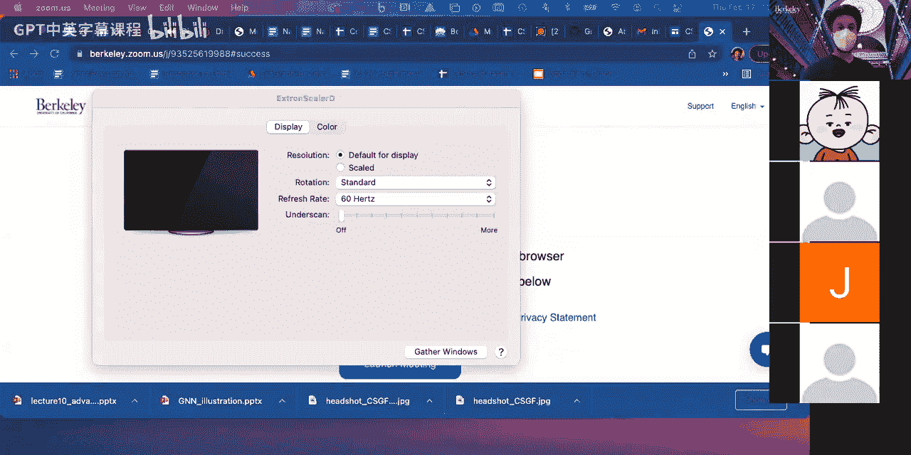
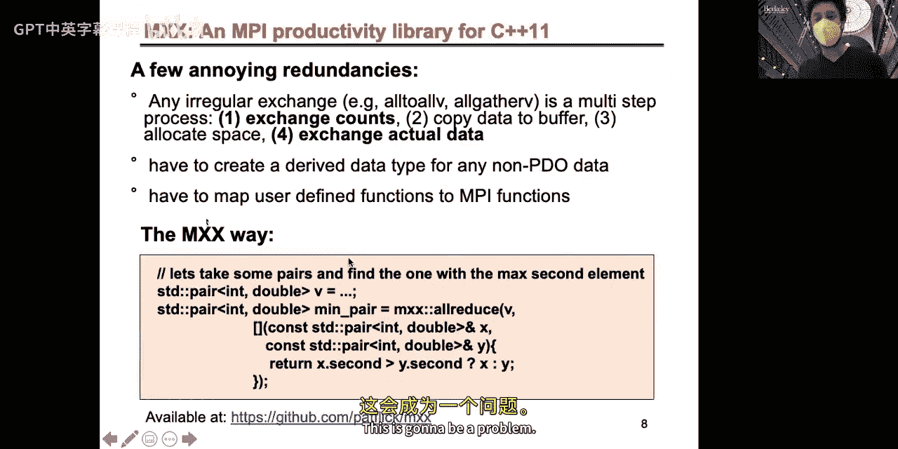
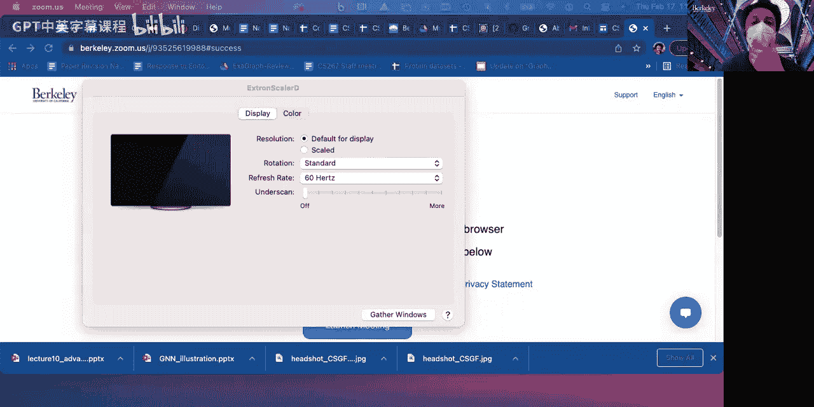
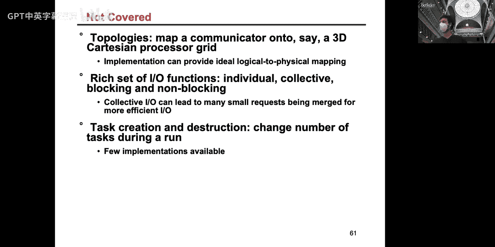
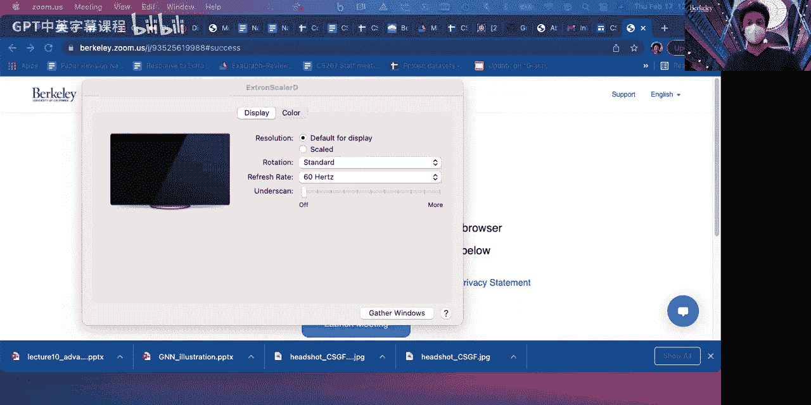

# 【并行计算 CS267 2022】伯克利—中英字幕 p08 CS267 (Sp22) - Lecture 10： Advanced MPI and Collective Communicatio -BV1PS421978D_p8-

I can。Yeah， let's do that， I have just noticed that the batteries in the classroom are dead。

Like there's 20 empty batteries and there doesn't seem to be a。

 I don't know if you had encountered this， the other bins are empty。

No here I just called them and they said we're going to send someone on our way it's kind of funny this is this works like there's no way of looking at this。

 they only do it when someone complains。

Somewhat fascinating to me，'s there should be someone in 117 dnell。Yeah， I mean。

 they said it's quickly going to show up， but you know， we're already past the classroom。

 so we'll probably。I'll probably start by screaming around for the people in the room。

 you guys on the phone are the lucky people。嗯。In some sense。Okay。

And I getA going to wear the microphone？Well， when the batteries come， I will wear the microphone。

There doesn't seem to be a。You know。Good news of them at the moment， let's see。对。なの。Com。St screen。

Here。hello。Batteries， yes， please， which basket I should put them。The green one， okay。

You can give one of them to me， and I will。I will and put the rest of them there。

 that will be excellent。Oh yeah。Thank you for being here so quickly Yeah we're just right around oh yeah。

 we locked out does anyone take these bins of some regularity？😊，Like个。No I mean。

 the red ones it's almost full right they're all empty I tried like five， six of them。

 all of them are empty。Yeah。Yeah。Can you hear me the classroom？Okay。This is。And the online。

People can hear me as well。Yes， yes。😊，Thanks very much。All right， which means we can start。

 it's fascinating another exciting moment。We're got to continue on MPIs。

 you have seen your MP homework。So you might not need a lot of things in this particular lecture for your homework。

 but if you're going to do programming in MTIs in a productive and efficient way。

I think the contents of this lecture are very important。

 I want you to actually think about MPI not as an interface for sending and receiving messages。

 but as an interface for doing spiny programming on collectives。

And what do I mean with collectives is here's an example， for example。

You are into this popular area of distributed machine learning and deep learning。

You'll see that MPI is not the only thing out there is。

Possibly the most popular way of writing distributed。Deep learning code。

 which is to Torch distributed library。And it gives you a couple of options as backhands。

And which ones I supported on which architecture CPU GPR are listed here。

 this is from last year's screenshot it's quite possible that some Xes became checkmarks today。

 you know， check it out， maybe it has improved but you see three different backends。

 one of them is Facebook's blue which stands for a collective communications library。

For multi machine training， and then the other one is the MPR， we all know that。And there's Nicel。

 which is NVDdia Collective Communications Library。

 the thing to highlight in those two other backhands other than MPI is the stress on collector。

They actually start with collectives like remember the example we had about pi。

Where we had to reduce everybody's partial approximation of pi。

This is actually what I would like you to think about because that's much more productive in spinindi。

 all the processes start at the same time and end at the same time。

 and the better way to actually organize their communication is true collective communications and the sense and receives should be your exception when you need to。

That's going to make your programming much much safer and productive。

So that's where we're going to start today's lecture and collectors。

And there's quite a lot of ways of doing collectives， one is broadcasting data。

Whi is the examples I gave last time that I want some message to go to everybody and there's various different algorithms i'm not going to talk about broadcast algorithms i'm going to talk about I believe。

Either reduction。Or something like that today， or gatherish， probably gatherdish。

 but you'll get the idea that there're all similar algorithms。嗯。Scattered。And gather。

 you can think of these as inverses of each other。ButG means everybody has a piece of data。

 ABCD in different processes， and you want to gather all of ABCD in one process。

And scatter is the opposite。 One process is ABCD， and it wants to scatter it to all the processes in in the communicator。

 the group is communicating。Okay， and there is all versions of these。

 which means if I'm doing an allga instead of one process receiving ABCD。

 all four processes will receive ABCD。ButSo it's going to be gathered the data will be gathered and replicated on all process。

So。All collective communications must be called by all the processes in the communicator that's very important for avoiding deadlocks you're going to discover this pretty quickly if you do it wrong。

What does that mean if there is a broadcast among time processes and there is some sort of if statement？

Within some of these processes that one of them doesn't participate on their broadcast doesn't call the function。

 it's going to hang。Because the call is， in some sense， think of this as having a barrier。

Implicit barrier， all the collectives is an implicit barrier。

And if the barrier is not called by all the processes in the collective。

 obviously it's going to deadlock。 So that's that's the semantics of it。嗯。

And in general when you have the variance of these without the all prefix meaning broadcast scatter gather without the all prefix。

 meaning not the allga， not so on then there is some sort of concept of a root processor what does that mean we already did this in reduction but there was a root and then the reduction data was reduced on process zero in this example similarly the scatter the gather is happening of the root scatter is starting from the root and broadcast is starting from the root in these examples is always p0 you can give it another process ID it's okay。

But I already talked to you about one particular benefit always using zero。

 which is you can never crash because even if you run this program with one process it's still correct and if you choose your route to be an arbitrary number and run it fewer than that processes。

Yeah， I mean， what does that mean？Okay， we said that there's variants of these collectives with all prefix and this is what you expect all get is really the data gather to at every process as opposed to in just one now there is actually a simple way of writing these things as composition of existing ones that's not necessarily always the best idea what do I mean with this you can implement all gather by doing for example。

😊，P broadcasts。But it's more efficient to do it in you know specialized algorithms for。

 and there's actually a process to make sure that your MPI implementation is safe。

 meaning there is a silly way of doing this thing， like what I can do it all ghetto is I can gather the data in one process and then broadcast it back。

To everybody， that works。And if doing it that way is faster than calling the specialized or get。

 your MPI implementation is a problem。Meaning that you know somebody implemented cool algorithms in one function and forget to propagate it in the other functions。

 that luckily most MP implementations do those internal checks like internal quality checks。

 this doesn't affect correctness。😊，And all to all is a specialized message。

 this is kind of the most general thing， every process has some data to send to every other process。

It's like I have if we are in this room with 50 people， I have 50 messages。

 including one to myself and one to everybody， these are individualized and everybody else in the room has again。

 50 other messages individualized to everybody else。That's the very general thing。

 so you can use this even if you don't have some messages to some people。

 even if you have only 20 messages out of 50， you can give zero to the other 30 and call this it will work。

But with the。They always say no to this。诶。Alright。This is going to be a problem。

Please don't ask for transcript because。We're not going to and I can't really turn myself。

I don't know why this has happened。Yeah。

Okay。All right。With all to all， generality comes the price， which is there is usually not。

 there are no algorithms that are particularly faster than doing this with you know many。

 many little messages of sends and receives and waiting on them。

SoWe talked about how to do I send I receive and wait。If you actually do it that way， like sending。

 everybody issues P Iense and issues PI receives。And thus wait off。

 It's pretty much the same thing as doing all told。So there isn't a lot of fancy algorithms there。

But for the reductions and scans and broadcasts， there is a lot of good out。So what is a reduction。

 this is the example we gave。In the pie example， instead of concatetnating like you would do in the gather here you。

Applying some function。Wwhichch can be sum， which can be max。

 it can actually be arbitrary in the sense that it can be concatetnation too。

So in some sense you can simulate gather with reduction。

 but I don't want you to go into that esoteric route。

 you have to write your own reduction function that would do the concatenation and would work fine。

 but one of the benefits of reduction is the data stays the same size in gather everybody stands let's say one unit of data the receiver receives P units of data。

In reduction， if your reduction is actually keeping the data size the same。Meaning it's a sum。

 it's a max， you know two inputs come in and one input gets out if that's the case。

 the receiver is only receiving one unit of data。The reduced data as opposed to a P units of data。

So that kind of has implications in terms of performance。

And scan is this thing that we have seen in Jim's lecture the prefix sums。

 that's really the name here is scan and there's a version of it called。X scan。

 which is exclusive scan this really matters whether the P0 gets sum item like the first element or the P1 gets the first element and P0 gets0 all it is all there is the difference。

You might wonder why there are two different versions。 So there's there's variance of them。

 this ones we have seen are。Fixed size of data。per process， meaning when I do and all gather。

 every process has， let's say， three units of integers， three integers， fixed number of integers。

 whatever it is。But I can generalize this thing to be an all ghetto weed。

Which means they will have variable numbers。One process will have four units of integers。

 the other one will have seven units of integers， and there'll be an extra vector that describes how long each process is input。

To the gather functionists and every single one of these collectives has a V version Now you might think V is variable。

 V actually doesn't stand for variable， V stands for vector。😊。

To signify the vectors that you're passing to tell how long each process is impetus。

 but that's like a historical reason， you can think of it as variable。

 I think it would be a better way of naming it。Luckily， they all stand for a week。

And then there is a W version I haven't used in my life。

 which allows you to actually do different data types， why would you do that， I don't know。

 but let's assume I want to do all to all， but one process wants to send integer。

 the other one wants to send the float。There is a way to do with that with that。Well。

 obviously with MPI。It seems very general， there is a price that gets a little complicated。

You might find writing code in a very repetitive way， meaning。You will， if you're writing C++ code。

 you're almost always going to have a bunch of vectors。And then you're working on it， you say， okay。

 this data needs to go to process one， this data needs to go to process two。

 let me put it in create a vector of vectors。The messages that are going to each outgoing process。

Is stored in an extendable vector so I'm pushing back on this or a list。

And so I keep a vector of vectors， one vector per recipient buffer。

 and then I pack them all into a single array because that's what the MPI wants。

And then I count the sizes of them to determine the displacement units， you'll see it in the syntax。

And you'll keep doing this thing over and over again for every collective function call and one of the PhD students that was an intern with me got annoyed with this and wrote a library that simplifies this。

 we're not allowed to use this in the homework。I don't even know if it compiles it graduates。

 but you'll see how this is nice that you can just test the data in original format and it's going to do all this packing and creating actually in this case。

 for example， the reduction operator for you because MPI is a very aug impacts of how to create a reduction operator if you're not using one of the default ones。

 the default ones we're going to go over， I think we already did actually last class Maxs mean some。

 and if you want to do something fancy。AndThat's not within one of those predefined ones。

 there's an ugly way of doing it thing， but you know。

 you can automate it I'm just putting this reference for you to kind of。

Maybe get inspired from the mechanisms that are used to create these data types due to automatic copying and so on。

But we're going to go over and explain something I really like and I find very efficient。

 which is subcommunicators， as we said MPI programs start with a default communicator called MPI_ Com underscore World。

 which is all the processes。Within that MP run script like everybody when you say MPI run and00 or s run and00 that's all the 100 processes there。

 but you'll be able to generate actually a subsets of them as we talked about and I'm going to go over this example through this matrix multip algorithm which actually Jim will cover in more detail next week in dense linear algebra so i'm not going to spend too much time explaining why this works and but it's very simple it's like an auto product algorithm the。

At any stage。嗰啲。K a K way auto product is happening。 What does that mean you choose。A block。

Lengngth of either a single row or single or a set of columns， block of columns。

 these are described here the red stripe of the set of columns on first matrix and the set of rows on the second matrix It's on colored with blue。

 So you' kind of broadcasting that panel。The columns are broadcasted。

 the first processes columns are broadcasted rowwise， meaning the communication is only happening。

Within these four processes， if I am this processored， let's say is。

Let me number processes in a two dimensional way。So this process will be zero。No，3，0，3，1。One， two。

 three， one， okay， and he will or you know， it will only broadcast along the process rope of the the processes that are in the third row。

And similarly， the process here， which is in one4， will only broadcast along the process column。

 so only to those processes within the fourth column。

But what's also happening simultaneously is all the others。

Processes that own some piece of this panel are also broadcasting right the process here which which is at one1 broadcasting down one one2 is broadcasting down and so on so simultaneously four processes are broadcasting down to their respective groups and four processes are broadcasting to the right in some sense if you want to think about it as geometrically。

But they don't broadcast to all the processes， not all the 16， but only to groups of four。

And the recipient of these panels will just do a multiplication of this。

Subsubet of columns and the subset of rows and update their own output which is the owner computes idea right because that process owns the CJ piece and he's just going to update it and keep doing it until all the panels this panel will shift next time we're going to get the next panel next time we're going to get the next panel and at some point a different process will start broadcasting。

Because then these sets of processes will start owning the active panel。

And once all the panels are broadcasted and updated， the algorithm will stop。Okay。

 how can I create teams of four processes each？4our teams of four processes each。

Right that's that's the question and thats NPI obviously has a very simple answer to this because this pattern comes up very often in hierarchical algorithms in multidimensional algorithms and so on it's called NPI Com split you give the original communicators let's say NPI con word stuff that you started with and then you give two parameters one is。

So the algorithm is just。Its science。All the processes that have the same color to the same communicative。

So in my example， I want to create a team of processes within a row。

 so I say these processes should have colored。You know。

 green and green is not a thing that you can represent and see， so it's you use the enumerated type。

The the processes that are in the first row will be called first the process in the second row will have the colors two processes in the third row will have color three and so on。

And then they will get get a new key and a communicative okay。Really， internally。

 what MPI does is irrelevant for you。So what you're really telling them is which processor it will have the same colors。

And。And which order the keys should be assigned。 So let's get into practice。 remember。

 this was the algorithm。Let me use this split function to write a shoot code for the summer algorithm。

And I don't know if I ever run this code will it ever work。

 I don't know I'm going to assume that we're using a perfect square grid。

 so it's not like five by7 it's。It's some sort of perfect square。So。And what do I do， I first say？

Remember， rank was the rank within the whole communicator， assuming you got the rank。

 So if I divide my rank。By the number of processes in the column， in this case， squared of P。

What I get is。The for all the processes in the process row， meaning all the processes up here。

 they'll get the same number right because this is zero，1， two， three， four， five。

And the number of square root of p is four when I divide all these processes by four。

 everybody here gets zero truncation of integers to the down and everybody in the second row will get number one。

 everybody in the third row will get number two， everybody in the fourth row will get number three。

 zero index。Now I essentially split the things into colors four different colors now I can do the same trick for columns instead of using integer division。

 I can use modular。And I will essentially pack all the processes in the first column into a group which color 0 and so on。

 And essentially， that's exactly what I do。 I get back。

Column color by doing a modulus of rank with the squared of P in this case， don't worry about PC。

 it's just squared of P for simplicity， and I get my new column communicators fill it like actually created with split。

Function that I described。And it's all good。And why am I passing this rank。

 this rank will ensure that the rank order will be preserved that I'm passing the original rank so that these processes which have numbers。

 let's say four five， six，7 will get numbered0，12 three in the new communicator so it preserves the rank order。

 but MPI allows you to actually not preserve it， you can pass an arbitrary order there and it determines the new order。

 but I don't I haven't found a good use of that。And then what do I do well， okay。

 I basically simulate my algorithm from now on it's fairly simple if I am。

The owner of the panel that's broadcasting。I'm going to copy my data to the temporary and broadcast it with myself being the root。

And and every durationeration the root will change so I simplify this algorithm so that the panel length is equal to the number of columns each process owns。

So k is equal to n over squared of p。Imagine this tunnel being as fat to cover this whole area。

So every process only broadcast wants。That's the minimum number of you can do。

And in this case youll be like， okay， is this my turn to broadcast， yes。

 then ma'm copy my input to the output buffer called the MPI broadcast with that output buffer is the input。

And me is the root of the broadcast and everybody else will receive。

Everybody else will have aT uninitialized。Because they're not the root of the broadcast。

So after the broadcast is done， everybody has some valid data in ATamp and BT so they can just do their simple DJ matrix multiply。

 update their output and move on。So if they do it square of p times。

 this is the dumbus s algorithm you can write。And it will work most it's not super general question。

Sorry， so those each process。What is the they're doing matrix multiplies。

 what is the calculation each process doing？They are receiving。The panels， the out product panels。

 and they're multiplying these two pieces to update CIJ。Which is my process ID。You know， plus equals。

The， the panel from A， the panel from B。I think these should be actually colored the opposite strangely。

 blues here are colored with red here。For obviously historical reasons。啊。Okay。

 I told you that there is a set of built in collective reduction operators。Maxine product， some。

 so on。You can Google them up， and I'm sure there's a website that lists more updated versions of these if they have been expended。

But let's get into some of the algorithms that power collective communications so how are they implemented I want you to actually get a sense of why we're using these things other than syntactic benefits I think the syntactic benefits are themselves really good once you get the syntax of collectives the number of times you can introduce bugs go down significantly but it's it just it doesn't end there the actual benefits also come from。

Better algorithms that have been developed and fine tuned by the implementers。

So we're going to start with， you know。Let's not worry about this thing we're going to talk a little bit about what is the best thing we can do。

So for these this is a table from a paper that's listed down there。And。

These are the best things you can do， meaning you can never beat the latency of log P。

 logarithmic on the number of processes for any of these things， or reduce or gather， whatnot。

And the bandwidth is。The amount of data that needs to be transferred。To one processor。

Alalto in doesn't matter。So these are per process numbers in bandwidth。嗯。

And what you're going to see is really。嗯。Let's think about this broadcast。

The data is that I'm broadcasting is of size。And。So I can't really beat this thing。

Very much right and so as the root， somehow that order and data needs to leave me。

And I am the bottleneck in this case。 So the， the processor that sends the maximum of data will determine the bandwidth number there。

 And now imagine I'm doing Gad。And I am ultimately gathering an order and vector from processes。

 each one of which have NOP pieces。Well， I have my own in over P P。

 and I have to receive P -1 divided by P。Times N data。

Well you can see that these are simple lower bounds。

 these are not very fancy if you think about them by five seconds you'll figure out the lower bound what is magical to me is almost all of these lower bonds are somehow attainable。

😊，Sometimes simultaneously， sometimes not。But you there's an algorithm that it attains one or the other。

And if you can attain both of them at the same time with the one algorithm。

 meaning you get you match the latency lower bound and bandwidth， that's great。Even if you don't。

Usually there is a moment where。You can say the latency dominates or band dominates and you can change your algorithm based on domestic size or the process count and we'll talk about them as an example。

Let's go over all G。This is actually very commonly used in deep learning。Actually， alls use morph。

 but I like to describe all gather。The version of it that doesn't reduce。

So the simple algorithm is a ring algorithm。The time T and the data you received in the previous time step to the right and receive data from the left。

 so it's like a carousel， the data kind of moves around as a ring， very simple idea。嗯。Well。

 this actually has optimal bandwidth use， if you do calculation about how much data each process send。

 it is n times p minus1 over p。It doesn't get better than this。Obviously。

 because everybody needs to gather this much data。The latency looks horrible。

And because instead of lock P lower bound， we are doing p minus1 and if we are working on a ring of thousand processes。

The difference between 32 and 1，000 matters for highlights and networks。But for things that are。

Like a single GPU or or a single node with four GPus。 It doesn't matter。

 The difference between log4 and。You know， three， four minus one doesn't matter。

 which is why a lot of on chip algorithms are ring algorithms。

 they're very simple and they work fine for low numbers of processes。

And it's actually not as bad as it sounds if it's pipeline， for example。

 NVdia's Nikckel will exclusively use this kind of ring algorithm for almost all collectives it implements to my shock initially。

And even if we're distributed。Collective， not just for single node。

 but it turns out it's not a bad idea。 If you change the semantics。

 MP semantics is kind of restrictive that once you call all getters。The whole process。

 the whole set of processes should finish， they all get it for anyone to move on。

And then the latency starts bindinging you。But the way Nicel implements this is actually is a pipeline manage。

 like it divides the data into small pieces and starts to ring and as soon as that starts。

The as soon as I the zero process sends the data to the first process。

 it starts sending another piece of data right so it's like the whole the whole thing is not like waiting for a single data there is all the links that activate at any given time and the semantics is a little more relaxed in the sense that nickel calls can exit without the whole。

Collective finishes in all processes if my job of passing data around in the carousel is done。

 I can actually start the next function。The semantics allows the function to return。

And it's not as bad as it sounds is what I mean。Now let's get to some fancier algorithms。

 this is a recursor doubling algorithm。At any time T。

 what the process I is going to do is it's going to send and receive its current data。

 meaning all the data it originally had plus everything it has received so far。But the process。

 whose Id is。Plus O equals plus minus2 T。 So initially I'm exchanging data with my neighbors。

 Then I'm exchanging data with my two hub neighbors，4 hub neighbors。

And this is you can clearly ensure yourself after looking at it for a little bit that this is going to send data for at least powers of two。

It's going to complete and all the data will be everywhere。

In the right order magically and data exchange a each step is obviously an overp。

 then it to N overp and then a for N overp。 and if you this is a geometric series with the。You know。

 with the multiplier N overP and the exponent。I'm not exponent， eye equal too。And if you solve it。

Do I have anything like that？You know， like this is what do I mean with this thing？说第四个呢。

It's going to solve to this st and all we're doing is a equals n over P and r equals2。

 and if you solve this thingin。You'll see that。This is just going to solve to the bandwidth formula you have down there because there is log p minus log p steps to finish this stick the problem with this algorithm is it's tricky for a non power of two。

It's possible， but you have to create some empty fictitious processes。

And there's a better algorithm that is actually slightly more general and works better with powers of two。

 the idea seems almost identical so what's going on。At point T。The process I will receive。

The data from process i plus 2 T is also the same and sends all the data to I。

Minus 2 T seems like the same idea so far， right？Except。That。It doesn't go all the way too。

The last step， so it stops exchanging in the lower bound of log P steps So if you have， let's say。

 100 processes。It stops after six steps。So some data hasn't been exchanged。

's lower bound of lock P so you're at this moment right you did your exchanges， you' here。

 you haven't finished the last two pieces and at that point it just switches to something of sending and receiving whatever else is needed。

So it's a very simple modification from recursor doubling。And。

And then this is fine except that it's going to get the data in the incorrect order。

 so you have to do a local shuffle to get the data correct order。

 it doesn't matter now why is this Spanish。By stopping a little early。

The magical part is the previous one is doing seal of lockpeat。And this is doing a flow of P plus1。

Now flu of P plus one is so much better than ceiling of Lo P for latency termss。

 imagine you have100 processes。😊，You're talking about， I'm not1。

000 is not a good number because it's already000 is a good number actually。Floor is。诶。

What do we have？嗯。The。So anyway， there's this。嗯。Where did I get stuck？嗯。For P equals1000。嗯。Okay。

The difference between this and that is the previous algorithm actually does two times。

Three times log P and now I remember because you have the and this one will just do ceiling of lock P。

 so that's actually the difference。So the recursor doubling does two times lower bound。

 so the floor of log P and this one will do seal of log P steps and the ceiling comes from the last step。

So we stop in the floor and do one more。 And if you take a random number， like。P equals 1000。And。

 you know。The log base two of this number will be。The floor of this will be。嗯。31。

 so the difference between two times this or 32 is a factor of two almost right more or less。

 so that's the benefit。And you can see it in practice， so here's what's going on。On the。

 I should turn off this light。嗯嗯。So minor differences。Okay。Okay， tiny of bit of distance again。

So you see the recursive doubling algorithm as this is zza line。

The straight line and the dotted line that's kind of more smooth is the bro algorithm we talked about。

Wwhich stops the exchanges after flow of lockP steps and does one extra exchange。

 so it does in the latency term becomes ceiling of lock P as opposed to two times flow of lock p。

 it's almost always better except when you have powers of two when it's power of two recursor doubling is at least as good or sometimes just a little better。

But whenever it's not the power of two the BRC algorithmist is significantly faster。

 so that's exactly what you would expect from the theory and it's kind of satisfying to see theory to actually apply so much so well to the empirical data。

Now on the right you see a different scenario where you're comparing the ring algorithm versus recursive doubling so what do we see here the ring is the dashed line at the bottom。

This is microseconds， so the lower is better。And the recursive doubling is on the top。

And instead of increasing number here I'm increasing the number of processes here I'm actually increasing the message size and what does that mean if I'm increasing the message size。

 I should actually use my mouth so that this is recorded better if I'm increasing the message size the latency stops being important right the more messages there are the latency stays constant。

But the bandwidth term gets bigger， so the ring algorithm， which is a high latency。

Will no longer be hampered so much and indeed the Ling algorithms is performing you know。

 the same as recursive doubling with the message length of one megabyte。

And eventually it's significantly faster than recursor doubleubick。

Now the theory doesn't actually tell you that it should be this much faster。Right。

 but since the ring algorithm is only doing nearest neighbor communication it' actually in practice is faster here the theory is actually not predicting this much to be faster here is it's a more practical issue that nearest neighbor communication is faster。

😊，And what's also not shown here is the smallest messy size on the right picture is one megabyte。

 which is not that small。If you took it really small。Like a kilobyte。

The ring algorithm would be much， much slower because there the latency would dominate。

And then the cost of this having alphapha times P minus1 cost would start showing up。

And you can clearly interpolate to the left side from here。

And this last thing is this is actually using 64 processes， if you use more processes。

 the latency's impact will increase。So all of these things。

 all of these collectors more or less use similar ideas。

 like reductions use the same thing as all gathers， or sorry， reductions use similar ideas as gather。

 except the data gets reduced at every stage within the network。Right？

There you would be using something called a recursive haullink。As opposed to double link， what else？

There is something called a reduce scatter。 and you'll figure it out if you need to。

 It's like doing a reduction and then scattering the pieces。

 MPI actually has a better way of doing it than first reducing and manually scattering。

So look at the full list of collectives to find which one matches your application's needs。

 most of them are fairly obvious。We know the barrier concept。

 the barrier is I only find it useful when you want to debug something。

 all collectives have implicit barriers question。This。也可以吧。没见。好。所有将。で。Well， for those two algorithms。

They have very similar patterns except that one of them does two times floor of logP steps。

 the other one does ceiling of lockP steps and so what you don't need to know much of this thing if you're using the correct MPI implementation。

 what they're going to do is they're going to fine tune this。And the internal library， again。

 assuming it's implemented well。We'll switch to one algorithm if you're calling it with powers of two processes and switch to the other one if you're not。

And in fact， the more pronounced switches are happening on the other algorithms。

 which is it's going to look at the process count you're running。

And the message side you're running and we's going to switch between， let's say。

 the ring algorithm and recursive doubleubick。Or the bro algorithm。

 So you taste like all these things implemented。And one of the things that happens when you get a new supercomputer。

Is a fine tuning process， lots of lots of messages exchanged benchmark and the cutoffs are determined about when to switch from algorithm A to algorithm B。

 and these are kind of built in into your environmental variables。

 you can change them if you know what you're doing better than the benchmarking。

 but generally I avoid it。I'm more or less teaching this thing so that。

If you go and start working in a company like Deep Learning company and do work on the communications library。

 you don't end up reinventing these wheels because I think that's been done many many times I have seen。

 for example， there is a very nice algorithm called Ruubens Fers's algorithm forge。

All reduces have been rediscovered in the last decade by 500 papers。So it's all there， right？

I recommend actually reading this optimization of collective communication operations and MPPH。

 a little two specific MP pitch is and MPI implementation。😊，But the paper is really nice， yeah。

 actually that was the name I was trying to find Robin's Feer。the。So all of these algorithms are。

 in some sense， there is not much invention that can happen there because they all match the lower bump。

Lauralists。Okay， let's get into something slightly more semantically interesting than collectives。

These are non blocking collectiveors， so we talked about non blocking communication right I sand I receive and a simple way of writing code that doesn't deadlock is to just say I send I receive weight all good。

There is versions of collective operations that are non blocking as well， every single one of them。

I broadcast， sounds like iPhone as you know an Apple invented these things。

 but I remember stands for Imedia， which means immediately return the function handle after checking for input。

And don't actually necessarily start the broadcast。Now I think I want to highlight this。

There is no guaranteed progress here， so don't magically assume that just because you called eye broadcastad。

Communication started happening， and you're already like。

Free communication is happening while you do data。 It depends on the quality of MP implementation。

 It's not a trivial problem， meaning how let's imagine you're the MP library designer。

 How can you ensure that when someone calls eye broadcast and doesn't wait yet。

You can ensure communication is happening on the background。

There's a couple of design choices you can spawn off a threadread that constantly sends this data in the background。

 but that's going to eat resources， is that a good idea？

If you have a network interface card that can copy data。Without disturbing the CPU。

 you can offload that task to that。So called RDM engine we're going to talk about it and Kay will talk about it next week。

 remote data， remote。RDMA direct memory access， remote direct memory access engine and these are implemented。

 but it really depends on hardware availability and MPI implementation quality so sometimes you might actually need to pull the network with tests to wake it up and have it make progress。

And this might come disappointing to you。Because it comes disappointing to a lot of people when they see the semantics。

 they think that they're just going to put them。I send and everything will progress immediately。

 it depends on the quality。Why would we do this thing， There's a lot of good reasons， One is。

So that you can do a synchronous progression， software pipeing， these are all very important points。

Allowing overlapping of communication with computation， right。

 you can say Icent and start doing some expensive computation and then hopefully the data moves again。

 depending on implementation。But one thing I actually want to highlight， which is more subtle。

Is decoupling data transfer and synchronization， that's not so obvious。Because when we synchronize。

 we usually think of MPR blocking collectives as know synchronizing。So every time you communicate。

 you necessarily have to synchronize with the process or you communicate。

Here you can decouple those aspects， you can send data to someone without necessarily being at the same place in the code with them and why would we do that that's really noise resiliency sometimes one process gets slowed down by some you know hardware error。

 some error correction kicks in。But。You as the other processor who didn't get slowed down will probably have the same noise later in the program。

 So if you don't always synchronize things will even up sometimes。

 but by over synchronizing youre kind of。Letting that noise affect everybody。

So this synchronization and data transfer decoupling is fairly important but subtle point。Okay。

 let's let us。Do this summer。I'll go with them again， but this time。

We're going do it with eye broadcasts。 And let's hope that maybe this will overlap some stuff。

Next year I'm going to actually run this thing and try to give performance numbers whether it's overlapping or not。

 but for now let's get the concept so remember the last time I did the algorithm a little trivial way where I said I'm going to broadcast the whole。

😊，嗯。完毕。What did I do， I said， I'm going to broadcast the hold。Cannel。

 meaning these processes that are in the first process column will broadcast their whole matrix。

And these processes within the first process row will broadcast their own blue matrices down。

 so I made my panels to be as wide as a whole sub matrix。

Now I can't do overlapping like that because。Everybody will send only one data。

 So what I'm going to do is I'm going to actually divide each person's data into two。

 meaning now my panels will be only as wide as half of each sub matrix， so。

Two panel updates for one sub matrix， and I do that by。Splitting my data first in the middle。

Everybody splits their data， so each processes is two pieces of subrices to send。

So I'm doing this thing so I can overlap This is like a double buffering is the technical term。

 but you don't need to know that so I start。Initially， my broadcast， if I'm a broadcasting processor。

 I copy my first part of my data matrix into the temporary。And again。

 if I'm the broadcasting processor for the second matrix， I do the same。And I start my。MPI。

 I broadcast functions。With those data。The first piece of my data and I have to keep track of my requests request are is handles that are return from all the all the immediate。

Functions on MPI， which is all the functions that start with I。So I keep track of my requests。

 what happened， hopefully communication started。Again， no guarantees。

But if the MPI implementation is good， communication start， now I go into into my actual loop。

I'm going to trade it on this loop and now again， if I am the broadcasting processor still。

 I do the second part of my data。And I start broadcasting that。Now。

 here's the magic slightly magical part。Now I'm going to have to wait off。

 but I'm not waiting on the the things I just started。

 I'm waiting on the things I started in the previous page。So these requests。

 requests one are the ones from the initial broadcast that I started。

So I'm hoping that by the time I came here， some progress has happened and I'm now waiting off。

On those requests to make sure they finished because as soon as they finish。

Now I'm going to use that data， AT 1 and AT two are here from the data that I was trying to broadcast in my first i broadcast。

And waitto ensures that that data is present upon return， I can now multiply those。And update my MC。

 my local matrix。Now， maybe not enough overlapping has happened because all I did was start communication。

And start another communication。But that's just kind of the lead in time to start the pipeline。

But now the actual things are going to happen， so remember I started the second broadcast year。

I waited all and I am doing an expensive calculation of matrix multipl。

The chances are the broadcasts of the second pieces are happening in the background if the implementation is good。

NPI implementation is good and now I can start the third broadcast。

With the first requests and then wait on the second broadcast I did。

Likely the second broadcast overlapped with the DJM I did。And I can do the。

 you can see how this is going， right？I am always having two broadcasts。

 two groups of broadcasts active。And I'm waiting on the older one before I start the multiplication。

 and while I do that multiplication， the newer broadcast。Is overlapping， hopefully， with my Dja。

Call simple DJ call and so on。 So this might overlap essentially everything if the implementation is good except the the first and the last pieces because those are the ones that are needed to fill the pipeline and empty the pipeline。

And of course I have this extra line of finishing the pipeline， nothing interesting。But yeah。

 this is the general idea how you can， in some sense， overlap communication and computation。

 it does a few better things than overlapping on computation。

 which is imagine that these D jams version。Load imbalance in DJ there is not much load imbalance because these are dense matrices。

 but they can be again the noise issues area correcting code might have kicked in and so on。嗯。

If you are using sparse matrices， there is potentially going to be lots of load imbalance in these pieces。

 but overall the sum of them might not be load imbalance。

 what does that mean it might be the case that I have some load imbalance， which is not a big deal。

 20%。But when I break it down into pieces of you know10 computation I need to do。

 that 20% gets amplified。It becomes the factor of two and in practice this is true you're cutting this piece into smaller smaller pieces and making everyone synchronize at the end of them。

 the load imbalance gets amplified and this way I'm decoupling the synchronization from that so。

Not everybody have to be in the same place when I do a broadcast this isn't perfectly decoupled again there's a better way to do this。

Because you're still synchronizing and weight off。So you kind of。

Only decoupling a certain amount of synchronization。

The fully asynchronous one would basically use something that we're going to see towards the end of the lecture。

 which is one sided operations。This is only fixing half of the problem。 Now。

 let's get the programming with threat。 Today， we have machines that have。嗯。A multi course。

All over the place when NI was designed， it wasn't the case。Every note had a single toilet processor。

So now we have 64， whatever number of threats available to us， 68 times4 actually in KNL， right。

 and we have to do something about it。Commonly what people do is。They do Ns。

perer note or maybe two MPI processes per note， maybe four I gave you some numbers that says maybe one is not great。

 having more than one might be better for bandwidth utilization of the network interface card that depends on the network。

 but mapping each MPI process per core is too much。

So you wanted to use the rest of the course in the note by treading。And you can use。

One of the three ideas， which is MPI plus MPI， I didn't call it MPI， it's called all MPI。

So you can create a hierarchy of Ns， right？Or MPI plus open MP， NPI+ threats。

 what that means is you use MPI to communicate across nodes and open MP to do your multi thread。

So we're going to talk a little bit about that case， MPI plus Open MP。嗯。So。What would that mean。

 so what that means is all threats。Within that process， we'll share the MPI objects。

Because it's multi threadreading， right， if I declare a communicators， all threads will see it。

If there is the request that I just showed in MPII broadcast， all the threats will see it。

 so you have all these issues with making sure that threats you know when they're running concurrently。

Data races do not happen， or if they happen， they're benign。

 some people will say there's no such thing as benign data race。And you can agree with them。

We'll go over a two example as opposed to theizing too much。

MPI gives you four different quality of implementations。The you can。

Quer this thing when you try to initialize your MPI instead of using MPI in it。

 if you're trying to write multi threaded code with MPI。You're going to have to call MPI in it。Dread。

And you're going to request one of these four threat safety limits。Or you know thresholds。

 whatever you call it， and MPI will respond to you。Either with what you requested。Or something lower。

If it doesn't support what you requested。So MPI to single is definitely the lowest thing。

 which is equivalent to MPI in it。It doesn't support any multiatthtic。

MPI T funnel is supposed kind of multi threadreading， but only one thread can make MPI calls。Everish。

ok。NPI thread serialized sounds like the same as funnel， but not quite。

 it says only one thread can make。An MPI call at a given time。

 so different threats can make it as long as they are not concurrent。对。😊。

An NPI threat multiple is multiple multiple threats can make NPI calls。Concurrently。Again。

 that doesn't mean it's correct because you as the programmers。

 still need to make sure data races don't happen on the places it matters。Now。

 this is all hierarchical in the sense that they're inclusive if you're supporting serialize。

 of course you're supporting funnel。All。NPI implementations。I believe all support funneled。

 even if they don't accept it。And the multiple support had actually come out。

20 years ago and started getting more and more common。

 I think you can find multitra implementations all over the place now。Okay。

 there are no threats in the program， remember it looked like this。MPR unit do stuff。

 NPR stuff finalize。 Okay， what happens when you have funneled is。I initialize the threat。

 I make sure I get the support I want， if I don't get the support I want。

 I'll say I'm going to abort and then I go into a parallel region， open MP parallel region。

And do stuff and do MPI stuff。 So what the the catch， the catch is that。

I don't do MPR calls within the parallel region。OnlyOnly the single threaded region of my open MP call is doing NPR calls。

 that's what the funnel requires me to do， only one thread and only that thread。Okay。

 what if I wanted to serialize， well I can do something a little better。

So I can start doing NPR calls。Within in a parallel region。Except that remember， it has to happen。

One at a time， different threats can call it， but they have to do it one at a time。

So to make sure that it's only happening one at a time， I have to put maybe OMP critical。

 you can do it at different synchronization mechanisms， we talked about this。

 but critical ensures that only one thread is active within that line at a given time。

So it's beautiful， this is going to run correctly assuming the MPI implementation indeed supports serializes it claims。

And finally， with no restrictions。I can basically do MP stuff within the parallel region。

At the same time concurrently， so that's kind of the general template。

Of what it means to support these different levels。ok 啊。I told these things already。

So complicated here's why things get a little more complicated。

When MP here and I don't expect you to kind of。Memorize these things。

 just make sure that you go back and read these things and the whenever you get into the land of multi trading programming with NPI。

Whenever you get into multitra programming， you should be careful。

 that's the number one place to make mistakes。So here's this obscure legal language where multiple threads make NP calls concurrently。

 the outcome will be as if the cause executed sequentially in sum any of these orders。

ordering is maintained within each thread， but then。

MPI is not going to fix your make your unsafe multi traded program safe。

 right so there's no such thing。If you are making concurrent calls。

And you cannot ensure ordering across different threats。Well， you're in questionable grounds。

 you have to make sure that those calls are not accessing the same variables they'm modifying at the same time。

And these are really fairly usual pitfalls of multitra programming， nothing really special to API。😊。

Okay。So what happens is if you're doing collective calls on the same communicator。

 meaning you're communicating along calm word and theres a reduction and there is a barrier。

 I'll actually give you an example。And multiple threats are calling this。

 one of them is calling reduction， one of them is calling a barrier。

It can get matched into the wrong one。But that's a problem。so we'll talk about that with an example。

 the thing that to highlight is blocking MPI costs will only block the calling threat and will not prevent other threats from running。

This is a nice behavior。That's actually one thing that NPI gives you as a benefit。

So why does this matter because remember our deadlocking program？

Sand receive in the wrong order was deadlocking， okay？You can argue that this should dead luck。

Because Tread one。Is calling。Receive from process one。And threatread two is sending the process one。

And what the first line we said suggests almost that this should deadlock because the ordering is as if these calls are executed sequentially in some order。

 you can say that what if they executed in the wrong order， then it will deadlock。

But the good news is the other rule says blocking MPI calls will only block the colon thread。

 so this can not deadlock and the MPI implementation should make sure that it doesn't deadlock because when threadread one blocks here。

It doesn't block thread red1。Try two， sorry， so the successfully the Santaan receives should finish the execution。

 finish the completion。So that's the nice thing about it。啊。

But there is other ways to so this is a correct example， what about a few incorrect examples。

 this is exactly what I said。There is a broadcast。And another collective， they say NPR barriers。

On the same communicator。Now。It's quite possible that Tread onces broadcast will match the threat。

Sorry， process zeros。Broadcast on T one will match this blue MPI barrier on the other thread。

And this is actually undefined behavior。So what's going to happen？呃。

And another way of making mistakes is freeing a resource that the other thread needs。

 this is more obvious because if you're freeing some other processes resource in a multitd program like another thread resource I mean you're going to get a segmentation fault like that。

 sos nothing specific if T one is trying to do a broadcast and you're freeing that communicator without making sure that broadcast finished。

 yeah this is not really MPI problem。This is an object management problem。Okay。

This is all there is about， I want to say about multitra programs。嗯。I would say。

The statements I list here。Have all you know caveats and grain of salt in general。

 you should start with something like a。Funneled。And hope that there is enough parallelism in your program。

And just one process doing NPR communication。One trip doing NPR community at a time is good。

And that might work 80% of the time。And it's way safer。

But there are some cases where remember the AmDs law， if there is a serial portion of the code。

It will eventually come back and bite you。People have shown that creating all these threats。

At the beginning of the program and continuously maintaining them throughout the whole execution。

Which is like all pes all the way from the beginning and the end。

Is way more efficient and way more scalable than this fork joint model of you know this， which is。

Where is that example？Create a parallel region， do another parallel region。

 do another parallel region， folk join， destroys parallelism。

And stresses all the parts of serial communication， or computation。

The NPI trade multiple allows you to create all the threads in the beginning and keep them alive throughout the competition and for certain problems。

 it is almost a requirement to get great scalability。I don't recommend it as your first route。

 but if you want to be on the bleeding edge， it's probably vert the hassle of multitd programming it's been demonstrated to be superior in terms of performance even if it's tricky。

Okay the last thing I'm going to talk in my 13， 14 minutes is one side of communication and one of the reasons I don't need to talk too much about it is the UPC++ lecture next week。

He's going to cover a lot of one side of communication。

 That's another way of doing one side of communication and other things mind you。

But MTTI allows you to do that， so what is the thing it's again。

 to decouple data movement with synchronization。In some sense， similar to。The immediate calls。

 but even more general than that。So you don't even actually need， yeah。This。

Came out initially in MPI too。And was not the right semantics and has's been corrected subsequently in MPI3 right now。

 I think I believe the semantics of one sided communication in MPI is fairly good。

So what does that really mean， I want to expose my private memory。To other processes。So far。

 everything we've done looked like this。 I had private memory。

And it wasn't accessible by anyone else， I had to send a message or broadcast or do something else to send any of my data to someone。

 and I was sending it in the sense that I was still not exposing it， I was explicitly sending it。

Now what I'm going to do instead is I'm going to make some part of my memory remotely accessible。

Using NPR calls and that's really the main idea of one side of communication。

And the other processes can read or write， depending on what I allowed them to do。All right。

And this is generally called a global address space。

 collectively all this remotely accessible memory is called the global address space。

And I can just basically access other people's memory assuming they exposed so okay。

 illustration of how this works。It's probably。Two cartoonish to be useful。But it can bypass the。

The other processor is， I think the whole thing of this long。

Long illustration is trying to show when I'm actually accessing somebody else's memory。

 the trick is that processor doesn't need to wake up。

I can actually touch the other person's memory without disturbing the CPU。

And that's the real magic of one side of communication。

 How is this even possible usually in in a lot of high performance networks such as。😊。

In Fni band or Cor's network， like all the crane networks。

 all the supercomputers you can think of today implement as an RDMA engine。

 remote data memory access。 So there is some sort of little processor whose only job is to do data copying。

Copy pastes and some atomic operations on simple arithmetic objects like integers。

 increment values and so on。And they do this job。As opposed to the central processing unit。

So the central processing unit can continue doing this matrix multiplies。So that's the beauty。Okay。

 and what's the practical impact of it when when the process one is delayed by some noise or some expensive calculation。

 and I want to communicate with process one， well I am delayed too。In normal one sided communication。

 sorry， two sided communication， send and receive model。In the one sided land。

 if process one is delayed， and I want to put some data to its memory or fetch some data from its memory from globally accessible memory。

I don't care if he's delayed because I'm not worried about his CPU。

As long as his network interface card is functioning well。

 and that process is expose this data to me， I can fetch it， or I can update it。Good。Okay。

 the question is how can I create this data and how can I update it， let's talk about it。

Normally when I create memory is I call Meloc， right？Once that memory is allocated。

 I have to now make it accessible because by default， things are not。Accessible。

And so the MPI's name for a memory that's remotely accessible is a window。

And for whatever strange reasons。This memory creation needs to be collective and it's not that strange。

 there are some reasons for it。Here's four different ways of window creation。嗯。

The first one is you already have a buffer and you want to in some sense。

 upgrade it to be remotely accessible。The second one is you ask MPI with bin allocate。

 I don't have a buffer， I don't have malloc yet。You ballot it for me in the place that you think is appropriate。

And why did that matter， it gives MPI a little bit of flexibility to choose the correct memory。

And what might that mean is， well， it might choose a。

Address that starts exactly in the same location in every process if it's possible。

And then it simplifies the bookkeeping because if my address starts at 0064， blah， blah。

 and somebody else's address starts is 0048， blah， blah。No。

When communication happens you don't see this thing， but MP needs to keep track of this thing。

 it needs to know the bottom of each process and this is kind of a little too nerdy。诶。

But it's subtle。Think of this as bottom。Like this is the this is the zero of remotely accessible memory when I'm updating somebody's memory。

 MPI now needs to know what was this process once。Zero here。

 like what it offset was and try to calculate it。 and if everybody's buttons are different。Then。

I need to keep track of P minus1 buttons。If everybody's beginning address is the same。

 it's called a symmetric keep， then I don't need to keep track of it， simplifies a lot of things。

 I don't need to keep all giant hash tables in every process。

So MPI win allocate that allows you do that and MPI will create dynamic is。

You create the window first。you meoc later and attach it。ok。

Let's see this is the syntax syntax is not that important。You'll get used to it by using it。

 let's worry about how to use it。I want MPI to create me a window。So what do I say， I say， okay。

The size。Displacement unit， what is the unit of each element？What is the third parameterche？嗯。Sorry。

 the wrong item， the third parameter is info and the four parameters the communicator is generated。

And finally。It's going to return me to the window。And it's going to create。100 integers in a。

And expose it in that window。And now this this a array of 1000 integers created by MPI is accessible by all processes and within here this。

All these processes within the communicator can access each other's As。That's all of is。

Either update or you know get or so on， and then I'll free this window。

Window create dynamic is we talked about this thing。

 I create the window first without attaching any actual object to it。

 it's just a freestanding window。I then declare the memory。With malloc or Ne or whatever。

Private memory。Do normal computations on them and then upgrade it to the window to be remotely accessible by win attached later。

 so I attach the RAA to the window with the correct size I created it。

And I need to now detached later and free， so this is a little bit of bookkeeping。

 but there's another model。Now， I only talked about how to create the window。

 So once you create the window， now， what do you want to do with this， You can do one of the。

One of the six things。Which is put， get， accumulate。Yet accumulate this to obscure。

 but it's important。If you have yet wise， what is get accumulate comparing and swap and fetching up our standard。

Atomic functions。Ftnop is a generalization of fetchnet， it's used in incration。

 but it also can be used in reductions and so on compare S is more powerful。You can look it up。

Put is really you know the origin process puts some data in the target process that's remotely accessible。

 get is get the name is very simple right the difference you need to know is you'll be surprised that Twitter is twice as fast。

For a small data size， why， because you're just putting it。Get is a round trip。know， at that level。

 it might not matter， but just think about it that way。

So now you have to have a data access model like how can I make sure that synchronization happens。

 I can totally create a window in the beginning of my program。And the window at the end。

And let everybody go wild in between。The chances are I have a very parallel program with everybody's window accessible everybody's data accessible to everybody。

 but the chances are there'll be all sorts of data races it now I got my distributed memory program and created this wild beast of multitrad program almost。

Except the latency has increased by a factor of whatever the network00。

Like it's going to be full of data races。 the synchronization models that MPI provides are really there to avoid data races and ensuring completion of。

You know， communication， because once I say taught。

I need to have a sense of how to complete that put or get。So these synchronization models。

And they do it through this epoch is telling you in some sense， okay。

 this put and gets that happened in this epoch has finished。So now I can use that data。

 it's a valid piece of data。That's why they're important。A couple of things。

 if you do concurrent puts to the same location， it's undefined。If you do concurrent。Get with a put。

 it's also undefined。Okay， again， these are standard rules of data races。

 if one of them is the right， then it's undefined， right？However。

 there is a way to actually make it defined， which is if you use accumulate。😊。

With the replace operation， you can do this concurrently， it turns out。In the way they're older。

 so accumulate this has some it's a little more expensive。

 but it ensures certain benefits accumulate and get accumulate。

You can replace your atomic get with get to accumulate with operationeration no op。

And then the ordering is also defined， so accumulate is usually more powerful in terms of the semantics。

😊，Which also means it's going to be a little more expensive， but know that difference。啊。Okay。

 so what are the modes in my last few minutes is there's an active target mode。

 which means the the target says I'm posting my exposure epoch。 You can start。

Communicating with my data。 and then it's going to wait。

I find this obscure and not really one sided enough if the target processor is active。

 is this really one side up？The actual one side that I like is a passive target mode。

 which is use code unquote block。Something and you get the whatever memory you're getting from the recipient。

And then you unlock。It's like the same analogy as open MP the word lock and unlock is kind of misnomerous。

 you're not really locking anything in practice， you're just saying when unlock happens to get finished。

Because the NPR program will make sure that when the unlock returns。

The data that you're trying to get has arrived and completed， and you can now use it。

So that's really， again。Areas of exposure epochs are to make sure that your one sided operations have completed。

And that's otherwise， you can't use that data。Okay， that's I think all I wanted to say。

 you can read more about this if you need to， there's a couple of things in MPI that I didn't cover。

 topologies， lots of IO functions， IO is actually useful。

 collective reads and writes of big files are possible with MPI and it's usually faster than what you can do yourself。

So if you have big files to read and write， I recommend you look at NPI。are you。

There is a way of dynamically creating tasks and distracting them。

 I don't recommend this thing this has been in the standard for decades。

Very few functioning implementations of this are available because it's not very feasible actually。啊。

Yeah， so。Thank you very much this is the end of NPI next week Kathy Eick will talk about the UPC++ and our GSI will talk about the research and the project ideas on Thursday。

Good。

Yeah。