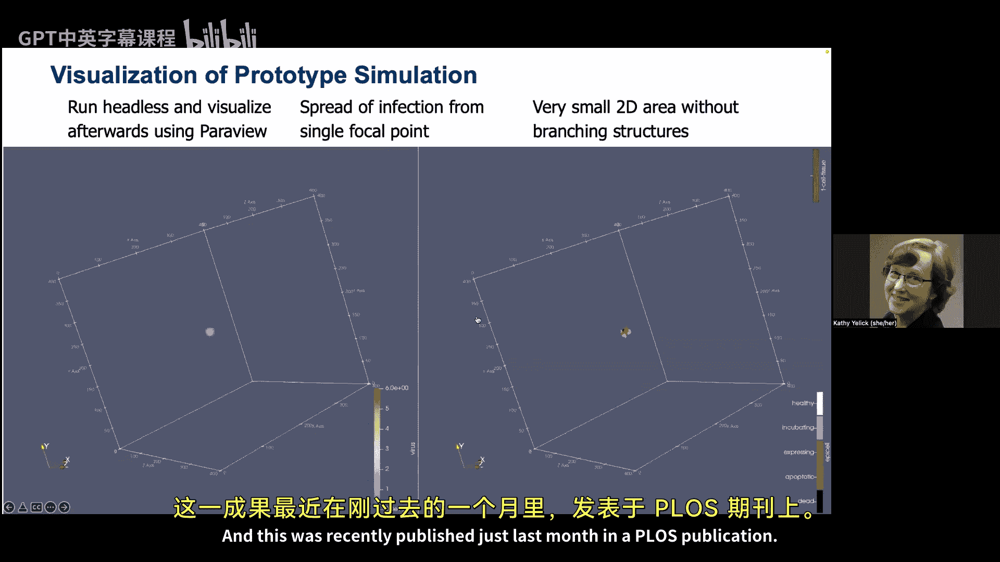
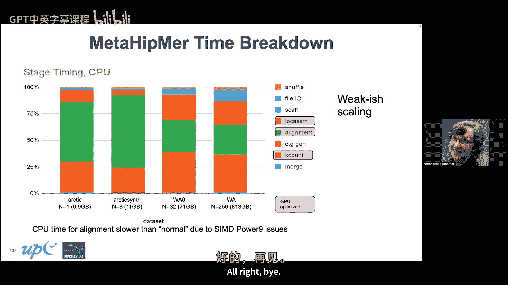

# 【并行计算 CS267 2022】伯克利—中英字幕 p09 CS267 (Sp22) - Lecture 11： UPC++： An Asynchronous RMA⧸RPC Library f -BV1PS421978D_p9-

Right welcomelcome to 267 I'm Kay Yick and I'm giving this lecture I normally am have been one of the three lectures in this class but I've taken a new job on campus so this is the one lecture I'll be giving this up this fall this spring。

 whatever it is anyway so I just wanted to first of all let you know that on Thursday all of your GSIs are going to be talking about some of their research and how it relates to parallel computingut and hopefully also give you some project ideas that if you're interested in you don't yet have an idea of what you want to work on then you can hear from each of them about their work and maybe some ideas。

 I will also try to give you a few ideas of sort of general areas for final project。

So but today I'm going to talk mostly about UPC++ which is a C++based programming model for parallel computing it's what we call an asynchronous R RRPC library so I will tell you what those different acronyms mean as well as the word asynchronous but it's for large scale parallel or distributed memory C++ application so you can think of it as a little bit like MPI and a little bit like Openmp and I'll try to give you an idea of sort of how it's a little bit like both this is based on work mostly funded by the Department of Energy and as part of the Exscale computing project and I won't read all the other acronyms there but I will just say that UPC++ was actually designed by a team of people the names are here and I think we have at least a couple of people online on zoom so Dan Boche I believe it's here and maybe Damien Ruan as well so and these slides were put together by a group of both。

Forour of us so anyway you may be getting so if if you happen to be on Zoom and you have some detailed questions。

 please go ahead and put them in chat and you may get some better answers even then we can get in the lecture hall but if you have questions here in the lecture hall please go ahead and ask them as well and I can let me know if there's questions coming in from chat that I should answer so let's just sort of look at our cartoon of what apparel machine looks like on the left-hand side we have a shared memory machine you've had experience programming it with openmp I think maybe talked a little bit about threads but maybe haven't maybe some of youve done some threadlevel programming but basically you should communicate in those parallel programs by reading and writing to shared variables and shared data structures and it's generally considered a little bit easier to program we can debate about this a little bit but it tends to be easier to take a serial program and turn it into an openmp program than it is to take a serial program and turn it into an MP program and't where you at in the MP you've done the MP homework yet no just was that。

It's currently out okay， so maybe some of you are way ahead and have started it but okay and so in MPI where you really are thinking about the fact that you're programming a distributed memory machine。

 you instead of communicating between the processes by reading and writing shared variables you communicate by sending messages using send and receive and collective communication operations and the big advantage of that is you get better scalability and so what that means is you can build a much bigger distributed memory machine than you can build a shared memory machine shared memory machines you can get up to maybe tens of cores but you typically don't get to thousands or hundreds of thousands of cores as you would in distributed memory。

So。This partition global addressbased model is sort of a in between these two it actually can be the same physical hardware as and is typically the same physical hardware as either the shared memory machine or the distributed memory machine the subtle difference here between the middle and the right-hand cartoon if you noticed is that the memories are connected to the network as opposed to the processor being connect to the network physically it's going to be the same machine but mentally what you think about is oh I can communicate kind of directly to a remote processors memory if I'm a processor on one node where is in a message passing kind of two-sided message passing model and MPI that is the traditional sended receive model I'm communicating with another process that that is sitting there on another processor so my abstract model of the machine is slightly different that I'm communicating once again I can communicate by reading a writing shared variables big shared data structures as I do in the shared memory model but。

But I could do this now in a distributed memory setting so how do you get better scalability when you still you've got this idea that you're reading and Read shared variables and the key feature and kind of original insight into these partition global addressbased languages is that you don't cache remote memory and so what that means and I think when when I lectured about openmp he talk a little bit about the complexities of cache coherence if you've got a whole bunch of processors and they're all accessing some shared memory and they all have their own caches you've got to keep those caches as a hardware designer you've got to keep those caches coherent or one processor thinks the value of x's2 and the other one thinks the value of Xs 14 and your program is not going to work correctly and so the key idea here is that if I'm the processor that owns X that it's in my own memory space I can put it in my cache but if not I'm not going to put it in my cache I might make a copy of it and hits another variable is my problem to figure out as a program or what that means。

But the hardware isn't going to automatically cache those remote variables and that's why we can run these partition global address based languages at the same scale and get very good efficiency as you can get an MPI and in fact I'll say in a minute away you can even get better performance in some cases。

Now there's kind of two highlevel motivations for these partition global addressbased languages and the first one is from the applications and the second one is from trends in the hardware。

 the applications that you that tend to be a good fit for these part global addressbased languages or I would say are less of a good fit for the sended。

 receive model and MPI are things that are very irregular。

 and they have very irregular data structures， so things like adaptive meshes。

 which I think you'll hear about later in the semester， sparse matrices， hash tables and histograms。

 graph things that are doing graph analytics and things that have dynamic work stealing and all of these are topics that you'll hear about later in the semester。

 but if you just think about things that are not for example。

 dense you know matrices or structured grids that have 2D or 3D matrix underlying them。

And the irregular， what we also mean by irregular is that there's unpredictable data movement。

 the communication pattern across the machine is unpredictable， so it can be unpredictable in space。

 that means I don't know where I'm communicating with as an individual processor I can't predict that ahead of time whereas in something like you know when you're talking about matrix multiply and I think Jim has already talked about distributed memory parallel matrix multiply。

 you can still you know exactly where those blocks are moving in an algorithm like canon's algorithm ahead of time。

 it doesn't really matter what's in what values are in the matrix irregular problems you don't know where things are going to go and I see if you have a timer on this which is very irritating and that the question of when the data moves。

 you don't know exactly when it's going to happen either whereas in a lot of these and that'll lead to asynchrony and a lot of these more synchronous regular algorithms。

 you kind of have these distinct phases， everybody computes than everybody communicates and everybody computes whereas the communication。

Can happen in other sort of whenever one processor needs to communicate and the size of the data can also be unpredictable until runtime。

Okay。Oh sorry okay the parallel density in algebras next week。 Well。

 you've heard about shared memory parallel you have to think about the fact that even those those density yeah matrix algorithms are still very predictable in terms of how much computing you're going to do and when you're going do it but let's talk about an irregular problem just to sort of think about this let's talk about building a histogram So imagine that every processor you've got a huge distributed memory machine you've got a big huge data set every processor is going be reading some piece of that input data stream and it's going to try to count the number of words that start with a letter A the number of the words that start with the letter B and so on So that would be a little histogram Well I want to know is how many words start with a letter A。

 Now obviously this is a tiny little histogram and there's other ways that we could do this Now imagine that histogram is really large that not 26 characters in the alphabet but I'm actually trying to build a much larger table and count how many of the words Apple and pair and so on there are and I want to entry for each one of those words So now I have a big。

diistributed data structure and there's a counter associated with each one of them。

 the problem is that as kind of if I think about myself as a processor i've got this stream of words coming in。

 I can look at it say oh， I can have an algorithm that says well Apple goes on processor zero I'm going to send you know a plus one message to processor one or I'm going to send the word Apple over there and let it figure out what to do with it。

 but in any case。Processor zero doesn't necessarily kind of know at any point。

 you know that I'm seeing the word apple so it can't say receive specifically to match the send operation so that's sort of motivating this idea of this asynchrony I want to be able to say hey plus one over there on the memory that you are owning inside of that distributed data structure。

😡，Any questions？Okay so let's talk about the hardware trend so when I started this research in these partition global addressbased languages along with a number of other people you know 20 plus years ago。

 the machines looked a little bit different but one of the things that has changed and changed in the next several years was the way the networks were being built so first of all if we look in general at what Exscale systems that I know we've heard a little bit about plans to build these Exscale systems and that actually there are a couple of them already in China that the number of cores per node is growing in order to build these larger scale machines then the cores themselves are getting simpler so if you look inside of a GPU and you if you think about each one of those little cores。

 those ALUs that are associated with an individual GPU thread that's a very simple sort of core if you look at the amount of memory per core I was actually just in a meeting last week with some scientists and the leaders in high performance computing。

ally and one of the big concerns is that the memory per core or per processor is continuing to drop as we look forward and the latency across the machine is limited by the speed of light as well as by software overhead and is not really improving so this means that we need to reduce the amount of the cost of communication and the main trick that we have for reducing latency cost is by overlapping latency with other work so takes me let's say five microseconds if microseconds to get across the machine I would actually be a pretty fast message that's happening。

 I don't want to sit here and wait for that message to arrive so one of the ability to hide hide of the latency we also want to be able to use smaller and more frequent message。

 there's a constant tension when you're writing things like MPI programs to make the messages larger and larger and we will have that tension even in these PgaAS models because there is a cost of every message you send so you want to send usually fewer larger messages。

than a larger number of smaller messages， however the problem is when you do that you tend to sort of blow up your memory footprint because you're keeping things around for a while getting them ready to send out in a larger message and so one of the things that's been happening that happened in the hardware was the ability for processors to directly read and write memory across the network and this is called remote direct memory access or remote memory access so that rA that you saw in the title slide or this RDMA which is what people usually use at the network level is going to give you that ability to directly read and write memory across the network without involving the processor on the other side so let's look at what this also looks like just to kind of focus in on the difference between what we consider a two-sided communication so by that I mean something like send and receive and a one- sided communication which would be something like a put operation。

Put operation versus in a two-sided message what does your message actually look like under the covers what's got some data which is the thing that you as a programr application program actually see I'm going to pack up my array or whatever I'm going ship it off as a message that's the data payload but then I also have a message ID and that is something that says that's built into the MPI library and that when that message goes across the network the information about what to do with that data payload is actually being stored inside the receive operation which is on the other CPU on the other side so what happens is the message comes in it has to be matched up somehow with a receive operation which will then say oh the receive operation says put that data right here and this location and memory so the address that it goes in is sitting over on the other side in a different part of the program and so that causes some amount of overhead in order to coordinate between sender and receiver you may have heard when when we talk about optimizingI。

Applications， you can do things like prepost your receives to make sure that before the send actually comes in before the message comes in the receive has already happened that will help reduce the latency cost of that communication but nevertheless it's fundamentally separating the information that the data in the message the metadata is really split between the two the information that's in the send side in the information that's on the receive side in comparison we have something like a put message it also has let's say the same data payload RA or whatever of user variables and but associated with that is an address that it's going to land in memory and when it gets to a network interface。

 any of the modern network interfaces and this includes even things like infinnoband networks and there's any of these higher performance or more modern networks and we're getting these in ethernet sort of systems as well are going to have the network interface itself is going to be able to look at that message find the address and then directly right that data payload into a location and memory and doesn't have to。

the CPU on the other side so that can lead to some performance advantages so this is some data on the network system that is underneath UPC++ which is called Ganet Ganet is also used by some of these other partition global addressbased languages and I won't read through all of the different graphs here but the main thing to point out is that the green dash curve which has the word twosided next to it those are MPI send and receive and all of the other lines are some variation of a one sided message passing model in particular gasnet and then there's also an MPI and I think when I talked about MPI he talked about the RMI which is really modeled after the fact that a bunch of people were talking about the advantage of this sort of one- sided communication it ended up in the MPI standard as well as this one- sided model and these are bandwidth numbers so up is better in the X axises the size of the message。

With any of these things， you know， you're going to get better bandwidth if you're sending larger messages。

 but you can see for some of these message sizes and some of these machines。

 there's a huge advantage of sending a one sided message rather than a two sided message。Okay。

 so UPC++ not really switch to that in terms of what it looks like as a programming model a is based on C。

 it doesn't we call it a compiler free programming model because it doesn't involve a compiler。

 some of the other， in fact， most of the other PGAS programming models are languages that have a compiler associated with them that has certain advantages in terms of the syntax。

 but it also has some advantage disadvantages in terms of maintenance of the programming model and keeping a compiler up and running and so on and so UPC++ leverages a bunch of things that are in the C++ standards but it can use any standard C++ compiler。

And then it's going to be built on Gasnet or what's called Gasnet EX。

 which is the Exscale version of Gasnet for its low overhead communication。

 it'll use this RDMA features so think of those lowleve put and gap operations and it's going to it also has something built in called active messages。

 which was an idea that came out of David Col's group also 20 plus years ago and is the basis for building higher level mechanisms which are RPCs remote procedure calls in UPC++。

And it is highly portable across a lot of different systems。

 including laptops and all the major production supercomputers。

 and it's designed for interoperability so you can mix it together with MPI and in fact。

 one of the applications I may mention a little bit later is a hybrid MPI UPC++ application。

So what does the program look like this is kind of enough of the sort of high-level motivation and now we'll talk a little bit more about what UPC+ plus code looks like it's a single program multiple data model or spmD model which is what you heard about in MPI it's also by the way sort of similar to what you see on GPUs so the basic idea at least inside of those little kernels and what you' what you're seeing here is the main function so this is our hello world application and it has you can see some UPc+ plus syntax so this is c++ that means and the way to say that is part of the UPC++ library is UPc XX so that colon colon says you know initialize the。

The runtime system and then it has a hello operation and so this Bmy kind of cartoon says all of the processors are going to do a print operation。

 which is the first see out and then after the barrier which is this purple thing there's another see out just by the by process zero which is that one statement there so it's just that kind of a bulk synchronous model is still what you're able to write in that's kind of the underlying model is all of the threads start at the beginning and all of our processes start at the beginning and all the UPC+ plus processes run until the end。

But they can branch and do whatever they want in between so I'm not going to read through this slide。

 but this just gives you the syntax for how to run the UPC++ programs on the coreI system at NRSRC you load the UPC++ module。

 there's the compiler command which is a as I said it's not really a separate compiler but it wraps in the stuff you need in order to pick up the right libraries and so on and then there's a special command to launch a UPC++ application as well。

And you can download it， it's all open source， so if you want to install it on your own system。

 you're certainly welcome to do that as well。Okay， so a little bit more about the hellello world example。

 so this is a version with just the single print statement and what you see here in the bottom is that you know there's the initialization and by the way the finalized statements so that should go at the beginning of the end of any UPC++ program very similar to an MPI program in the middle here we have these print statements if we have four processes that are running the order in which those print statements will come out is not defined by the application。

So。Now that Ho world example is sort of fine， let me just make sure there are no questions about it。

Okay but in order to write any interesting parallel program we have to be able to share some variables or communicate between the processes so this has for communicating four processes not communicating at all。

 so let's do some communication and we'll do that by reading and writing these variables and we'll do that through something called global pointers so a global pointer is used to create some data structures that are kind of logically shared but physically distributed and so in this picture right here we have a linked list and that linked list has say a value x a field X in which has got a one in the first processor five and process process one a seven and process2 and so on and then it's got the next pointers and these are global pointers so those global pointers are allowed to point from one node in the system to another one across the network and each process can also has it has both some place where these shared kind of distributed data structures can live and then it。

hass its own private memory so you can think of the private memory as things like the program stack if you're familiar with what the implementation of the runtime system for one of these languages looks like。

 and that's you know if you just declare a regular variable inside of a function。

 it'll sit down here in the private memory space， but you can allocate something that sits up in the global space and then other processes can refer to it。

So we also define or UPC++ defines the a notion of affinity which says a particular data structure or piece of a data structure has affinity to the process that allocated it in its own memory so for example this first node in the linked list that has a one in it has affinity to process zero and so。

You should think of a global pointer as being having enough information inside of a global pointer well what does a regular pointer have it has an address in memory that says this thing points to this particular location and memory a global pointer will also say which process it's associated with so there's some way that the UPC++ runtime can find anything by saying oh at this address in this process and now those are a little bit more expensive to use and so it's often the case that you want to still use C+ plus regular old C++ pointers which are just an address and you can do that if you happen to know that the data structure is living within that you have affinity to that process as affinity to the data structure so these narrower black pointers here are pointing just within within that set of the memory space in which you have affinity。

So kind of those are sort of the basic features that you've got to start building your applications。

 you've got this FMD parallel execution model and then you've got these global pointers now in terms of actual communication there's a couple of main ways of doing that in U PCC++ the first one is this RmaA which is based on this idea of puts and get operations so think of those as read and write operations but they can go across the network through these using these global pointers they're very low overhead they don't take they have the advantages that you saw in terms of the performance of that one- sided model the second way way of communicating is through RPCs or remote procedure calls and I'll say more about what those look like。

So a lot of things in UPC plus plus are asynchronous by default and the R communication is no exception。

 so this is a little bit of code here of UPC+ plus code that is going to that shows you what it looks like to have one of these R operations and the fact that it's asynchronous so we've got our global pointer GptTR1 and it's been initialized somehow I'm not really showing that code here and we now can when we want to do a get on that so let's say that that GPptTR1 is is pointing off to some other node as you can see in this picture here and so we want to do a get on it and get the value that it points to that's in that location and put it into a local variable the data type that I'm that it's going to be used when I get something is going to be called a future and a future if you're not familiar with this idea is。

Kind of wrapping up a box， if you will around the actual value that's going to come back and says I'm not going to look at it right away so you can go off and fill in this box for me at some point and then I will look at it later when I need to look at it I'll do a weight operation and that says unbox the whatever that F1。

 that future head inside of it and I'll get the T1 that little 123 that was on the inside。Yeah。

Okay so let's try to use this in a running example now and I'm going to use a very simple example which I don't think you've used yet in this class。

 which is the monoparparlo pi calculation so I'm going to estimate the value of pi by throwing darts at a unit square we haven't used this yet are use the other one yeah okay there's a couple of different versions of this this is going be the dart throwing one。

 not the little skinny sliver one so this one which I think is used in the openmp lecture so this one I'm going to have a unit square so one by one square so it has area1 and I'm going to just say I'm going to pick two random numbers and sort of figure out where is the dart that those two numbers represent inside that so two random numbers between0 and1 and and then I'm just going to calculate the number of darts that land inside underneath the circle by checking to see whether x square plus y square those two values are less than one If so it points it's sort of a hit inside of the blue circle otherwise。

A miss it's outside of it and by looking at the ratio of the total number of the number of darts that land in the blue area to the total number of darts that are thrown。

 I can then use the simple formula to estimate pi。Questions。

Okay so let's do this here is my code and UPC++ for this and there's a little helper code that's in another slide i'll show in a minute so what does this look like well first of all there is the initialization of the finalized code so any UPC++ code has starts off of the initialize and finalize and then i'm going to make up some variables here I have a variable called hits which is the number of it's going to keep track of how many of the darts that I throw or landing inside of that blue the pi shape of of the inside of the circle and trials is the total number of darts thone and then i'm going to have my estimate for the pi variable okay so now I read something the input arguments which are given to me and I'm going to put that in the trials variables so that's going to keep track of how many darts I'm going to throw this is a little bit of just C++ syntax so look at the argument types。

And if I didn't pass in an extra argument I'll default to I think that is 1 million maybe it's 100。

000， I don't know I should have economists in there but anyway so all right so each rank can by the way use these input arguments so it can look at RB and R C for example so all the processes are running that code together and they're all seeing the input arguments so now let's say because we want to throw these darts and they need to have random numbers we need to seed our random number generator so we'll do that and part of what we're going to use to seed the random number generator right you need to start it with some value I want to make sure that they don't all get the same sequence of random numbers because then I'm not going to get a very good estimate of pi instead they'll each use different random numbers and I do that by seeding it with my rank rank being my processor ID so rank me is the processor ID。

And then I go into a loop which just throws these darts over and over again and there's a little function here called hit which is which I'll show you the code for but we won't really read through it that's just computing you know two random numbers squaring them。

 checking to see whether or not their sum is less than one and then it returns either a zero or a one depending on whether if it returns a one if it's inside so I just increment with whatever value comes back from the the hits function。

And then when I'm done with that， I compute the value of pi and then print it out and then I do。

 so each rank is calling these hit functions separately with its own random number generator or seated camera。

Number generator。And just because the code didn't all fit in the slide。

 here are the includes that you need in order to actually run this code and this is the hit function that is just calculated x squared plus y squared after computing the two random numbers okay。

 so that's just a little helper function that we'll use throughout the slides。What this example。

All right， okay， so any questions about that？Yes。Yes。

 so this is a kind of a stupid parallel program right now and so yes the hit there's the hit function and there's the hits variable that's declared right there and they all are going to' they're you know just going to be doing this in parallel but they're not really working together to get a single。

 they're all going to get different values of pi。Right so this is just like that original hello world example where they're all printing out you know the different values apply pie so let's just you know as they were printing out hellello world so in order to actually do something interesting we need to understand which variables are going to be shared between all of the processes and which ones are going to be private to a process and we're going to have to make sure that we're using them carefully so if we want to have a variable that's actually shared between them we're going to we can allocate it in this we tend to draw these pictures and all these Pga models that have a private part of this the address based down here which are regular old variables c plus+ variables that have been declared inside of functions and so on and then there's variables up here that I've allocated with new underscore and delete underscore and so and by the way i'm going to drop these be these should all have the UPc+ plus colon colon in front of them but just the slides get to be too wordy with that so all the green things I've tried to。

Highlight everything in green if it's a UPC plus plus builtin library function just assume that there's a Ucxx colon colon in front of each one of those and so here's how it would allocate something that's in the global space I would I can say here's a global pointer so notice it's type is a global pointer in this case of type int so it's a parameterized type templated type and I do a new on it and then I can initialize it to my rank and so what you get is this picture here at the bottom which is GPR points up to。

Yeah， GPTR points up to something in the shared part of the address space。

 but is initialized to my process ID， so each rank zero has a zero and so on。

Now the next thing we need， so that allows us to get some things that are sitting up there and can be in principle shared。

 but we still need a way of sharing them somehow， so to get things off the ground we're going to use something like a broadcast and there's other various ways of doing that but if we here we can do a broadcast and this is just to make the code as simple as possible a single shared variable that's living in on has affinity to process zero and it is initialized to the value 24 so this is a new in that so something in that shared space it's initialized to 24 it's being it's going to be broadcast from processor0 and then it's going to be given that every processor's global pointer GPTR will point to that one shared instance this is by the way this code is a little bit poorly written because all of the processes are doing this allocation here but only one of them is really getting used there's a bunch of sort of shadows in here just to make a really simple example。

But hopefully you can see now in this how to use a basic broadcast to give every process access to one of these shared variables。

 yes。怎么把？Okay。Yes。Yeah， so and the way to think of these collective operations and you'll see this in MPI as well and it it could take a little bit of time to get your head wrapped around this SPIMD sort of execution model。

 all you know， 1600 or whatever of the processes I'll say broadcast and because of this argument in here says。

I'mIf I'm processoror Ze， I'm the sender and so that if is sort of built into the broadcast。

 if you will， that says I'm the sender so I'm going to send it to everybody else and exactly how it gets to them is inside the broadcast implementation good question and other questions。

Okay so and now let's say that we want to do a we want to read or write these things right so we could do something like a remote put or a remote get and so that will do either that will allow us to access one of these shared variables and any one of the processes can do this and these are done with these asynchronous remote operation so one of the design philosophies and UP+ plus was kind of get rid of the latency cost as much as possible that is make everything happen in a way that is asynchronous and nonblocking so that progress on you know that work can continue and as soon as you actually need the value for example of a remote get then you go and make sure that the value is there but you don't stop immediately when youve said you know get me a value the value from this shared variable I want to be able to continue executing code that doesn't depend on that。

So let's see here is so we're going to when we do this asynchronously either a put or a get there's a question of how do you know if you're done。

 how do you know if the put has actually happened and how do you know if the value actually come back and we saw this before in what we call the future so we're going to put this in this little we're going to put a value that comes back into a box that that's called a future and these are used in other is a concept that's used in a number of other places but it's used here for the sort of distributed memory parallel R operations these remote put and get operations so if I do an R get so that's a UPC plus plus operation you know UPC Xx colon colon R get on my global pointer what comes back from that is something of type future and so there's our temporary variable which is of type future and then let's say that you know I've got some other work I can do I don't need it right away so I do something expensive while it's coming back。

And then I do a weight on it and I get the value out of the temporary that I made up there。

 and at that point that all of the ranks have if they've all once they've all passed that weight statement。

 they all have the value 24， assuming nobody else was writing at the same time。Okay。

Any questions about what the future is or anything？H。😊，So to speak。Okay， so let's see。In general。

 these futures are they hold a sequence of values so you can as I said oh you could have another processor that is writing to that future and it could be doing it with an our or it could be process zero which happens to be the one that has affinity to that particular box that particular shared variable that it's writing it through a local pointer or something like that and actually it shouldn't be doing that if it's going to get the synchronization so you should always use the ours and R gets and so it's going to have a series of these values that come from the ourput operations and you can then the state of them can be either of a future it's going to be ready or not ready mixing up the shared variable here let's see so let's look at this example we've got two global pointers here GPptTR1 and2 and we've got two R getss to get both of their values out so we've got these two different boxes of shared that。

That contains shared variables and what we get out of them are two futures that come back from them and we can also check to see if the future is ready yet that has't been filled in and that doesn't that doesn't stall the program at that point so you can go off and do something else if it's not ready maybe you want to run some other unrelated code otherwise and then once you really need it in order to execute your next statements then you do a weight on it and so the ready can also do something different if it's。

If it's ready， but。That tells you whether or not the value。

 the future is filled in with a ready value。And you get to reuse that future then multiple times。

Which will give it a sequence of values。So there's also ways of doing outputs and ourGTS and larger data structures so even though we're using this very lightweight kind of communication。

 it is still the case that it's typically going to be more efficient。

 you'll get better bandwidth as you saw from those earlier bandwidth curves if you're sending somewhat larger chunks of data so you can send an RGT or output can send us a chunk of data which is given some size you can see just the signatures here they have both of them have a remote and local pointer and it has and then it has a size operation。

 the size that tells you how much data is going to be sent or how much is going to be received and once again these will also these will return futures of both cases。

The other thing that a lot of times you want to send a chunk of data。

 but it doesn't happen to be contiguous in memory and this is something that I know is very tedious code to write one of my grad students many years ago who had been writing pretty low level code actually at the active message layer level for a year or two said you know this parallel programming stuff is fine except I really don't want to write any more pack and unpack routines and UPC+ plus does a lot to help you with that so one of them is it will give you the ability to have strided operations which would be something like I have a row and sorry a column and a row major layout and twodimensional array or even a threedimensional array who has fairly sophisticated notion of strides that allow you to get chunks of that are at some constant offset of one another。

And you can also do what's called a gather scatter style for gather means it's a read。

 scatter means it's a write for things that have a list of say indiceacy index offsets which are very useful。

 you'll hear about them when you hear more about as spars as matrices。😡。

And there's also features for being able to serialize that is to pack and unpack other sorts of data structures。

 basically things that are built into the standard template library and C++。

 I may mention a little bit more about them later。B。

There's one other sort of interesting kind of way of writing across the network and this comes up a lot in practice and is actually closely related to an MPI send and receive。

 there are times when the other side needs to know that the data has been received right so a put operation and the future that you get back from a put says I as the one who put the data knows that that data has actually been written when that future is ready。

 but if I want to but if the other side wants to know that the data is ready。

 then there's something called a signaling put here and it's done as as this RPC and so there's the sorry the R which has something called a callback which is going to run on the other side a little function that says run this function when that put has actually completed and so there is a way of getting that kind of sendre style synchronization in cases where you need。

I think that again， going back to the philosophy， it sort of gave you the underlying mechanisms that you need for the particular communication pattern and the data structure pattern that you have in your application rather than trying to fit into a。

a single model3。Okay， so this one will perform the RmaA put and then informs the other side that it's ready and then runs the call back。

And you know it also uses it can also send the data payload along with it。All right。

 so you've seen this already in the example but just to highlight there is a barrier built in it looks very much like barrier that you've seen in other languages so it wills at the barrier point。

 all the processes wait for all the other processes to reach the barrier there is also something called an asynchronous barrier and that may sound like an oxymoron like what do you mean asynchronous the whole point of barrier is to synchronize but the point is that you may have some some work that depends on some other work having been done but other work that's unrelated to it。

 so I can say you know I as a process I'm ready for this barrier。

 my data is already for others to use it for example。

 I can now execute the barrier statement but I can go on now and do some other unrelated work rather waiting for everybody else to get to the barrier as long as the work that I'm doing doesn't depend on them having reached the barrier it'll be okay and so it's sort of a what we sometimes call a split phase barrier that there's a point it says I'm ready everybody else may not be and now there's a later point。

It says， okay， now I need to wait for everybody else to actually be at the barrier and so that would be one of these asynchronous barriers that splits the initiation of the barrier from the completion of the barrier。

All right so let's go back to our pie example and this is a code that looks a little bit similar so this and now we're going to try to get something more reasonable in which all of them are throwing darts together we're going to have a little problem in this program so you can look for that so first of all。

All of them are going to read the input， which is the number of trials and they're going to then divide that by the total rank in order to get the number of trials that this particular process is responsible the number of darts that this processor has to throw so just dividing by N or dividing by P the number of ranks for you want to call it NP and then i'm going to broadcast a pointer to some shared memory that is going to live on rank zero this is very much like the 24 example that we talked about in some detail it's just sitting on one of the processors it's allocated in that shared space it's initialized to zero by the way and and is it's on process zero and they're all going to wait for that broadcast to complete so at the end of that they all have a valid pointer to that shared location。

I ran I have to still do my random number generator and stuff like that。

 but that's all that's kind of the same code as before so now I can go into a loop that ism going to do a an R get on that shared variable that was called hits right hits is now with an S on it is the shared that one shared variable that lives in process zero so I do an R get on it I wait on it I add whatever。

Whatever the return value is of the hit function so it's either a one or is zero I add that to the value I got from that shared location and then I do a weight to make sure that it's completed and so i'm accumulating the hits and i'm blocking now on the communication so but but it's kind of my decision as an application program i'm going to wait for the R get to complete and then i'm going to wait for the R to complete so I do an R get I add one or zero and then I put it back。

Then I have a barrier after everything is done and this is something that we will see in the。

This the print statement is something that's going to allow us to get a faster version。

 a local version of the of the regular sorry of the global pointer which will allow the print statement to work correctly and i'll talk more about local a little bit later so what's the problem with this yes。

对。Right， so the answer is that between my RG and my R。

 somebody else made I've also done it R get and our and I will have a steel value that I'm adding to I' when I write it back with the output I'm going to clobber whatever they get updated as a race condition of a classic this race condition by the way because of the way it's going across the network and everything very likely to be exposed。

 there's a lot of time in between when I first read that thing and when when it probably gets written back so I mean any race condition like this is bad this one is probably going be very visible in terms of losing a lot of the updates that are going to happen here so we need to we need to fix that and I will do that in a minute I want to talk first about this local statement just to make sure it's clear what we're doing so I talked when I showed you global pointers the idea that a particular process if it has affinity to something that's in the global address base and that shared part of the address space can have can get a regular old pointer to it or just a regular。

Plus plus pointer and I can do that by taking a global pointer and doing a dot local on it and that will give me a local pointer that points to my own thing this can only be done on something that is I actually have affinity to otherwise。

😡，It will it will fail so here's our our grid global pointer in this little。Example。

 and I do a local audit I can also I can assign that to something of type just you know double star so is a pointer to double as opposed to grid GPTR the global pointer is the is the global pointer of double so both of these things are pointing the same data structure assuming that the processor that executes this is the one that has affinity to that shared data structure okay so a local is just allowing me to get a more efficient pointer to something that I actually have ownership。

Okay so and now let me look at the synchronization problem right we had a race condition problem there and and in order to address that one of the things I can use and there are a number of different things you could do but one of them is to use a atomic operations and atomics are indivisible read modify write operations did you talk about them in shared memory yes so you talked about atomics so I do some kind of a read a modify and a write things like fetch and ad so that's what i'm going to have here so this is。

Okay right so there's there's a few different atomic operations that are pretty common the most common ones are test and sets that is just tell me whether something is a one or a0 and set it to a one but do that atomically and and then there's there's fetch and ad and then there's something called compare and swap so UPc plus plus will provide some of these kinds of atomics such as the fetch ad is what we're going to want in here and so you can see this fetch a let me just make sure okay there so here's how you declare something to be an atomic variable is its once again it's a templated type so atomic domain of some type so i'm going to have an atomic integer that i'm going to be adding to I'm going to be doing fetch ad operations on and this when I create it I say what operations do I want to be able to do on it I want to be able to do a fetch ad but I also want to be able to do a read which is called a load and so these are some built-in operations that。

Tell you what are the things that you can do on this particular atomic one why do you provide those because there's sometimes hardware versions of these atomic operations that can be used depending on what it is that you want to do with them and it allows the implementation to optimize for your particular use case rather than building an overly conservative and therefore slower implementation but you have to declare upfront what you're going to do and then you can here's the fetch ad on my a in thing so it was。

嗯。This can be used inside of hits in order to add my hits。

 which is my local accumulation of the number of things that have succeeded and here is something that says that it's going to atomically update this shared variable。

 but I don't actually care about the order in which those updates happen that is the memory order can be relaxed。

And。The once we have the variable that's been accessed with these we can we always should use the atomics so even though you might you know there's a barrier here and there's only one thread that is one process rank zero that's executing this print statement here after the barrier because you've done everything else with atomics on that variable you should always use atomic so you shouldn't you know you' can't you shouldn't mix atomic and non-atomic operations so this is still doing a load operation in order to read that variable rather than just doing regular old trying to you know just sort of look inside of that data structure somehow。

You shouldn't be going around casting it or something like that。Okay。

 and that's just to make it easier to get an implementation， as I said。

 that's efficient and correct for you。Now the other way that you can solve these kinds of race condition problems is to use collectives。

 UPC plus plus and MPI is a very rich set of collectives。

 it's a large piece of the a chunk of the specification for MP did I just lose my microphone。

No okay but the and Uc plus plus theyre all going to be asynchronous so in keeping with the spirit of even things like asynchronous barrier so there's broadcast and this is what the broadcast looks like we've seen it so I won't say too much more about it there's also。

There's a reduction operation that and the broadcast can be both can get both a single value and get a chunk of values and the reductions are taking a bunch of values a different processor say adding them together or doing whatever operation you want to when you're doing reductions and there's different versions of reduction that are not both shown here。

 but that can reduce to a single process versus you know giving all the processes the value of the reduction。

And。All of these take what's called a team argument which is the set of ranks and this is similar to what if you've seen in MPI。

 the idea of a team， so sometimes you want to do collects by a group of processes， for example。

 all the processes that own a block in a particular column of a distributed matrix。

 don't want to you want to do a broadcast or reduction across that set of processes。

 so that would be done with a team。ok。So here's our pi example using collective style communication and this is doing using the reduce one operation which is going to take so we've got a separate loop here that is computing all of the that's accumulating all the hits using the hit function but it's accumulating into a regular local variable。

 so no communication is happening， this is just very fast code。

 it' computing random numbers and so on doing all those local darts so think of it as now each process has its own little board it's throwing its own darts。

 it does its own count and then it's going to just and at the beginning remember you divided up the total number of darts to be thrown so every processoror is throwing one piece of all of the darts and now we're going to just accumulate all of the ones that hits inside of the circular region and use that to print out to calculate on say thread zero and process zero。

 what is the estimated value of pi here。And because of this reduction operation and because it's coming back to process zero。

 you don't need a separate barrier， once that reduction has returned。

 process zero knows that it's got the answer from all of the processes so it's built in。

Questions about reduce。ok。So I don't think I really showed you the code with atomics。

 but you can also use those atomics to fix the problem and。

You can also use now RPCs and so these RPCs so atomics are a very narrow limited set of functions that you can do do things like a fetch and ad it doesn't have you can't put an arbitrary piece of code in these thing so here's here's a what RPC looks like which is going to do something on another process so we're going execute a function another processor and give it the arguments to run on and then it can also return a result that which will come back to you as the initiator。

So here's our initiating process， for example， going to call RPC and it's going to pass in the target which says what is the process ID that I want to run the RPC。

 where do I want to run the RPC， what is the function I want to run so you have to give that function I want to give the arguments that are going to be to supply to that function and that's just sort of that's the signature for RPC。

So what's going to happen after you initiate that is on the other side。

 it's going to execute function， FN， whatever you told it to execute with argument one and argument two。

 and it happens on the other process side。And I think this animation got will cumbersome okay so and then the last one is it can return a value that comes back and that's that that will come back as a future so once again the initiating processorcessor can wait on that future。

Okay so what does it look like to use this RPC inside of the pi example so what we're going to do these RPCs on the remote side are going to execute serially they're going to execute one at a time in whatever order we don't really know exactly what order they'll come in but doesn't matter right because all all we're doing in this case is trying to increment an integer so we don't really care what order those increment operations happen in so here's our code example again this is the RC is going to refer to a global variable which is declared outside of the main function and there's the RPC which refers to that hits variable and see it's incrementing that that global variable hits and it's adding H to it and H is the is the argument that's being passed into the RPC。

Which is going to be the result of that of that hit hits function which is right here Now this is kind of a silly thing to do what what are we doing here is we've got a loop and every time we throw a dart we're going to do an RPC do another process and say oh here's the results of my Dar this one's either as Eurouror1 so clearly this is not the best most efficient way to execute this this should be correct because it'll because everything will get serialized on the other side in terms of how those Rcs RPC when it starts that function runs it'll completely run it to completion so I don't have this problem that I had with the original program where I was reading a value and then writing it later and might have lost some of the updates so the updates will happen correctly but this is pretty slow and so。

That these are and these you know may seem a little bit like atomics， but in this case。

 these are going to run on a CPU on the other process。

 not run somewhere in some other kind of special hardware， which some of the atomics can do。

So here's a more optimized version， it looks about the same except that once again I have a loop outside of here。

Your local variable my hits the total number of hits that I'm going to so the total number of darts that this particular process is is going to accumulate and then just a single RPC from each one of the processes to increment the the hits variable the shared hits variable with the total。

The total of my hits value there。So it's passing in my hits into that function。

 which is just adding to and adding the hits so that's going to send the update to process zero。Okay。

 so。There's something else that you can use and that are often useful。

With these futures when you're you know waiting for something to happen which is to say rather than just putting a weight statement and then executing the code that's going to wait after that's going to execute after the future sometimes you want to say here's some code that should run I don't really care when it runs as long as it runs after the future and so you can attach what's called a callback to a future with something the then statement and so this is what the syntax looks like it says I'm going to do an our gap for example and the result of that is a future and so。

When that future is ready to be used， I'm going to execute this other code that's going to do an update。

 look at the value， for example， update the value in some grid。And。

And so this is going to then produces this particular the scalar value that gets produced by this can also be attached with in the right update it can use the previous value。

And you can also chain these things and I think in order to make sure I have some time to talk about some of the applications。

 I won't go through these in too much detail except sometimes you do want to chain these callbacks together so I can do an RG and then for example compute you know some value comes back from the Rget I want to compute its log for whatever reason and then once I've got that log value I want to then compute some other I want to put it on another processor so what this example is doing without reading through all the code it's doing Rge。

 a computation which is the log function and then an R and so it's taking a value from one process computing its log and then putting it on a third process so there's three processes involved here。

Okay， and you can also kind of conjoin so that's sort of you know chaining these things together in a long sequence serial chain。

 if you will， you can also put a bunch of them together to make it easier to synchronize on these these futures。

 and so this is using something called a when all。And so there's a we all that's waiting on a whole multiple futures。

 so future one and future two， and then you can also you know chain that into something else。

All right。I think the last thing I want to really talk about is what are called distributed objects or dis objects and this is based on the experience that we've had over a number of years in building these kinds of applications that are using these R operations。

 remote atomic operations and to some extent the RPCs as well。

 that a very common pattern of building these data structures。

 let's say that we're building something like a histogram is to say each process is going to have a chunk of the histogram。

 I want to think of that as one big shared distributed shared data structure even though it's physically distributed across the nodes。

 but node each process has one chunk of it， and so that sort of style is what's encapsulated in this dis object and so it says that I can have a distributed object is an object that's partitioned over these processes or in a particular team so I can pass in a team。

And so this is， you know， there was a lot of work done to make sure that they can be efficiently created and used and that we don't have a whole bunch of pointers。

 for example， that are which that each process doesn't have to hold a pointer for every other process in the system。

 part of this is worrying about things like Exscale computing or something else。

 you other very large scale machines where you may get to tens or hundreds of thousands of processes and you can't have non-scaleable data structures that become p squared sort of data structures where each process holds three different things。

So this is what a disk object looks like for the all hits variable so this is going to create one of these disob of type ins these are all the hints so you can also think of this by the way as being sort of an array of these integers。

 one array one inch per process okay so it's just it's an array of P things or rank things and each one of them has one of those elements。

 this is a very simple example normally this would be something know more complicated data structure and we can dereference it to get the value out of it and we can we can get some other remote value you know one of the other elements of that that diskobs by using the fetch operation。

So here's a slightly more interesting example of distributed data structure which would be a distributed hash table or DHT。

 so this can actually be built on top of the standard template library's unordered map。

 so an unordered map has key value pairs that it's storing in something like a hash table for example。

 we don't need to actually worry or know what is inside of the C++ standard template library implementation。

 although it may affect the performance of it and so let's say that we're using both strings for both the keys and the values here。

And we have it and this thing is going to be distributed。

 so there's one of these these uneardered maps on each one of the processes。

 but they get glued together so that you as a programmer can now think of them as a single distributed object。

 a single distributed hash table as opposed to a bunch of separate ones。

And you can kind of use either the local that is the separate view or the shared version depending of what you're trying to do with them。

 so here's a little bit of code to for this class， the distributed map class。

 which is going to use this unordered map of types you know string and string so this is as I said the key and the value are going to be in this particular example are both of type string in this distributed hash table and then we can construct the a local map which is being constructed on each one of the processors。

And then you can。Return if you want to get one of the things that you want to be able to do inside of this distributed hash table is if you're inserting or looking something up。

 given a key you need to say which of the local maps does that live in which process owns that so a very simple algorithm for doing this is i'm going to hash the key and then just take a mod of the number of ranks and that'll tell me which i'm just going to make sure that everything ends up in the that corresponding local hash table the unordered map。

So if I want to do the insert on this type now I'll just do a here's my insert function it takes in the key and the value so these pointers to the string these two strings and that I do and I return an RPC and after getting the target so that tells me right the RPC the first argument to an RPC is which is the process that the RPC is supposed to run on and so you get the target rank of the key out this you know slightly cumbersome c++ syntax is giving you the function that's actually going to do the local insert into into the local map that's on the other side and。

ThisAnd using key the full key and the value that are being used for this distributed memory insert。

And so。ThisThis local map， by the way， is UPC++'s way of allowing you to refer to the local the piece of that distributed data structure that has affinity to whatever process is executing the RPC。

And the key and the value are still， as I said， the original ones， okay。

And there's the find operation is similar， it's going to do the same thing。

 I won't read through the code in this case， but it's going to figure out which processor to do the find on and then it will return whatever you look up from that local hash table。

And this code actually scales， this is running on up to 32，000 cores and。

This particular example is for randomly distributed keys but I think that the fact that you can use the standard template library that you're building on top of that and then you're using the RPCs and the RA operations gives you a pretty efficient and and not a fairly easy implementation。

So I'll just mention kind of in the spirit of project ideas that you certainly I think the UPC++ team would be very happy to help give you some suggestions of specific applications or algorithms that you could implement various data structures for example data structure libraries or you know numerical libraries or other graph libraries or things like that machine learning libraries。

 all kinds of different things that could be implemented inside of UPC++ there is a project being done by Ben Brock who's a PhD students of itemss in mine who is building something called the Berkeley containertain library。

 which is based on this general idea of these distributed partition global Adbased data structures。

 it actually has various implementations not just UPC++ it has one that is directly over the lower levelvel gasnet layer and there is a version that is on top of UPC++ as well as well as another library。

 which has these one- sided ideas called Open Schchm。So that's another set of， you know。

 it can be done either in UPC++ or in the context of BCL。

So let's see I guess I do need to mention that one of the things you need to worry about with these RPCs is whether or not they're making progress so you sort of ship off some function to another process if that function is in the middle of doing a big huge dense matrix multiply you may not want to interrupt it right because you don't want to destroy its cache context and everything to make the multiply go fast and so it doesn't it's not going to the UPC plus plus runtime is not going to interrupt something like that computation and so instead you may have to encourage it to to do the。

To make sure that the RPC actually makes progress so I'm going to just talk about the fact that there's two things that have to make progress。

 there's UPC+ plus its own internal sort of runtime stuff that it is doing to keep all of these RPCs and everything working correctly and then then there's your RPCs that you know about as an application programmer and as well as your callbacks remember the then things that you attached onto futures that are also these functions kind of sitting there hanging they're waiting to run as soon as some event occurs and so to ensure progress you you can help at the application level by calling the progress function explicitly UPC++ will also make sure that progress happens at some of these blocking call such as the weight call and a barrier call but in some cases especially if you're going to go off and do a whole bunch of matrix multiplies or whatever in between those you may want to call progress to make sure that things are not getting hung up in the network and that can be important for reducing the amount of memory。

That gets used right if a whole bunch of things are sort of sitting around waiting to execute。

 it can consume memory and also just to make sure that you know that your whole algorithm is sort of running as you want it to。

And I'll just mention that you can that that UPC++ builds in this idea of serialization so that it makes it easier to pack and unpack complicated data structures including things that are built into the standard template library and I'm not going to talk about those or views in more detail I want to talk a little bit about some of the applications we talked a little bit about being able to cast to locals and I will just say the last few slides here talk about memory kinds so there is the ability to name the memory space that's associated with say a GPU or some other accelerator one of the things that we're seen increasingly in these largescale systems as different memory spaces some of which have to be managed in a software and so the memory kind says I can allocate something that's in a particular kind of memory like in the GPU memory and then when I do our gets and our puts I can either do it to a local a remote CPU memory or a remote GPU memory for example。

All right， so there are a number of applications or a higher level algorithms that have been written in UPC++ and one a couple of those that I'll mention here in the last few minutes is are a simulation for COVID of lungs and a metahitmer genome assemblymbler and I think Ien will talk a little bit more about that when he talks about computational biology work later in the semester and then if there's time which probably won't be I may talk a little bit about a sparse matrix solver that part of the lecture would make more sense after you've actually seen the sparse linear solverrs part of the lecture but these are all sort of fairly irregular kind of hard to program are hard to paralyze things that have a lot of load imbalance and challenges in terms of how you distribute work and so on that make them attractive for the PgaAS model and UPC++ in particular。

So Simcobe is a spatial model of the immune response response in in the lungs to COVID-19 this was started in 2020 in the spring of 2020 shortly after COVID started of course and you know I'm sure you're all aware of the fact that the immune and response is really critical in understanding how a patient is going to react to COVID-19 most of the articles that you would have seen the popular press are talking about the antibodies and the antibodies are working outside of the cells or trying to prevent the cells from being attacked but once the virus gets inside of the cell then it's really the T cells job to try to fight off the virus from within the cells and so the question is sort of how are these T cells behaving and there was actually an article in yesterday's New York Times talking about the antibody response in these virals it seems to be somewhat good news about those of us who have been boosted which is hopefully everybody here and this is what's called an agent。

ModelSo you've talked about the motifs of parallel。

Computing this is going to look a lot like a particle method and but each one of these particles is sort of an active thing。

 it' can be a T cell， it can be a coronavirus cell。

 it can be an antibody and the goal was to simulate an entire model of the lungs because they were trying to really understand what happened to various patients why did some patients get better in other patients get worse even given sort of a similar level of infection based on what kind of measurements they were making at the time so the goal was to do 100 billion epithelial cell simulation with hundreds of millions of these T cells and this is a very complicated structure of the lungs as you might know is like this fractal patterns so these are very they're very complicated simulations in terms of the structure that were moving around in and so this was code that was written by Steve Hooffmere who had it was in collaboration with some researchers at other universities。

And he built it in over a period of I would say a couple of months， maybe the initial version of it。

 and based on a use of a lot of these RPCs。And this just gives you an idea of the different kinds of states that the different kind of particles can be in。

 and they also use CT data in order to initialize the simulation。

 also to validate the model that is actually you know if you look at a patient over some period of time。

 they're CT scans of that is a simulation accurately reflecting what's happening in the patients and to give it some sort of initial state for some of the other kind of simulations and I won't read through these。

 but these are showing the viral load predictions from SIM COV and comparing it to both some earlier simulations for some of the smaller ones and also comparing it to observational data。

And this was recently published just last month in a plus publication。

I'm going to show that so the last one I'll talk about last application I'll talk about is this metagenome asmbler which has actually been under development now for several years it started actually as a UPC application predecessor to UPC plus plus and we're looking at analyzing very largescale multiterabyte data sets of microbial data and so this is genomic data so this is data with know ACT andG that comes out of the sequencers as these fragments of reads where this particular asler is focused on what are called shortread data so about 150 characters long they can have errors in it so it can have insertions and deletions and so on and so it's like putting together a puzzle where you're trying to figure out how these pieces all fit into the genome now we tend to not do assembly like this or what's called de novo assembly in the human genome because we have a reference genome that we use and so it's kind of like having you know in the human genome case you've got the cover of the puzzle and we took up a piece and we can say oh there。

It belonglongs in that piece that place right there in the genome but for these microbial communities some of them have never been even you know grown in a laboratory environment。

 they haven't been sequenced， we don't know what they look like so it's like building a puzzle where we don't know what the cover is and moreover when we scoop up some soil and it might have a thousand different species in it it's like somebody's taken all the puzzle pieces and dumped them all together on the floore because you sequence that and you get all these different fragments that come from all the different species in that so this has been used for some very large environmental samples I'll just say a couple of the things that we're planning on doing with this one is called the Terra oceanans data set which is going to be 84 terabytes of data I just mentioned that to point out you can't just do this on say your local shared memory machine you really need a distributed memory implementation and we also may look at the human microbiome data which is about 100 terabytes of data。

And so those are two of the large data sets which really require distributed memory machines。And。

I don't think I really have time to go through the data structures here or talk about them in detail except to say that there's a lot of different hash tables that come up throughout this computation。

 you do things like counting， you do things like hasching and building them using those hash tables as graphs walking through the graphs and those kinds of algorithms are really what dominate the computation and I'll just mention finally some of the most recent work we've been doing and there is certainly opportunities for more here is so these are the four stages kind of major stages of the assembly process。

 you chop these strings into what are called cameras so fixed length strings put them in a hash table and count them you throw out the ones that only occur once because those are probably errors we walk through them as a graph we run some kind of string alignment on them and then we do something called local assembly and so some of these phases。

 three of them now have been optimized for GPUs and。

These are the three dominant here these are across a few different data sets and so those have been optimized for GPUs and and so it's using the UPC++ support for the fact that you can you could do these distributed memory data structures but also that you can support GPUs so with that I will stop and let me just see if there are any last final questions。

有个。こは。Can we save the chat？全更。こ。Well， others might want to see them okay。Sounds good， okay。

 or send it or stick it on the website someplace， whatever， yeah。

Thank you Dan for doing that yes Dan is one of the developers one of the leads for developing new PC++ as well as gas net EX and so thank you for being online and correcting anything too right bye。

