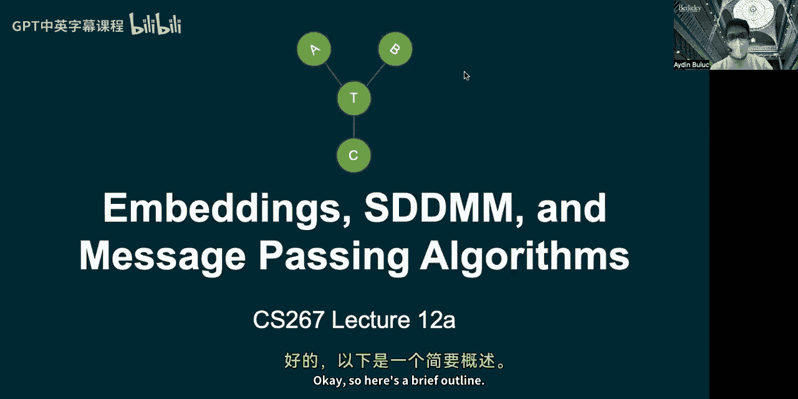
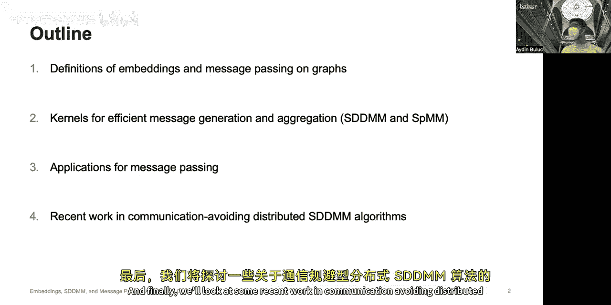
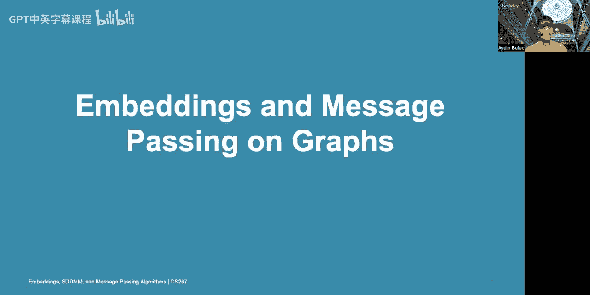
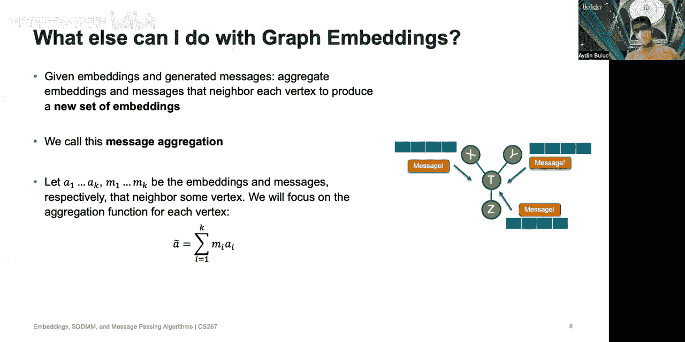
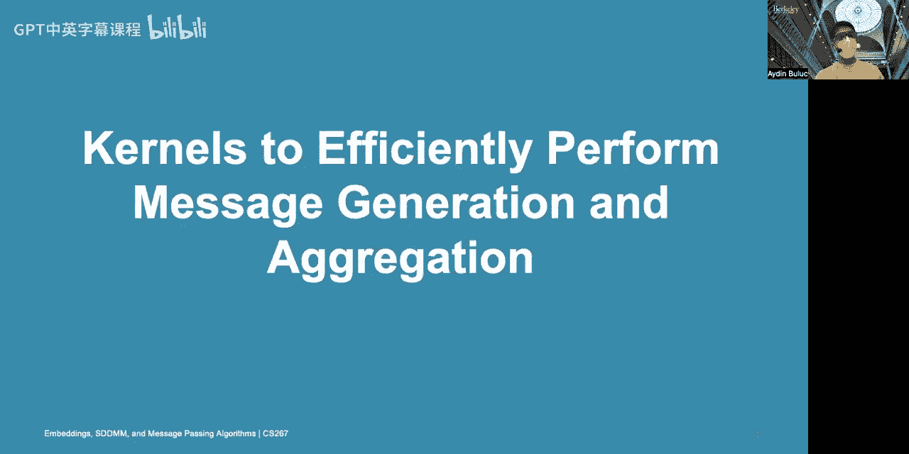
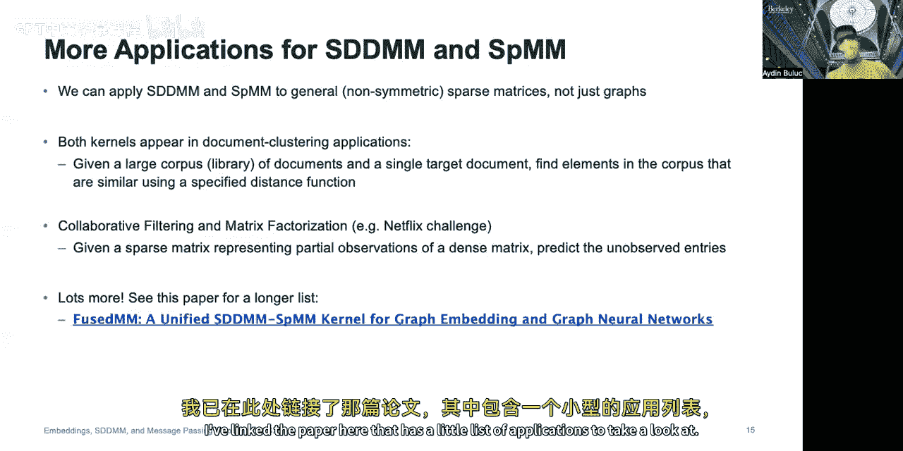
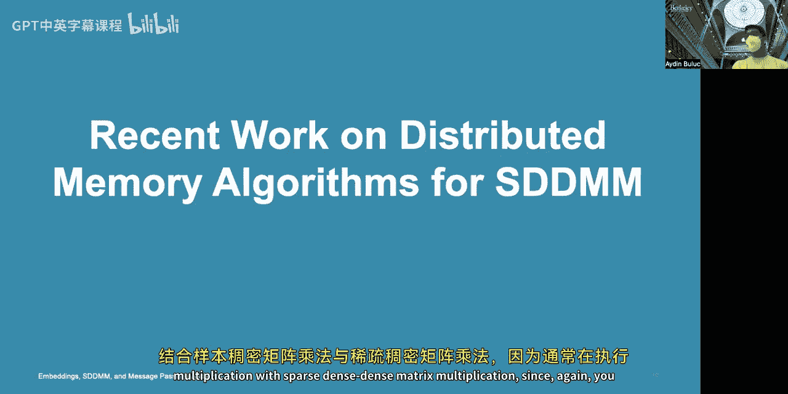
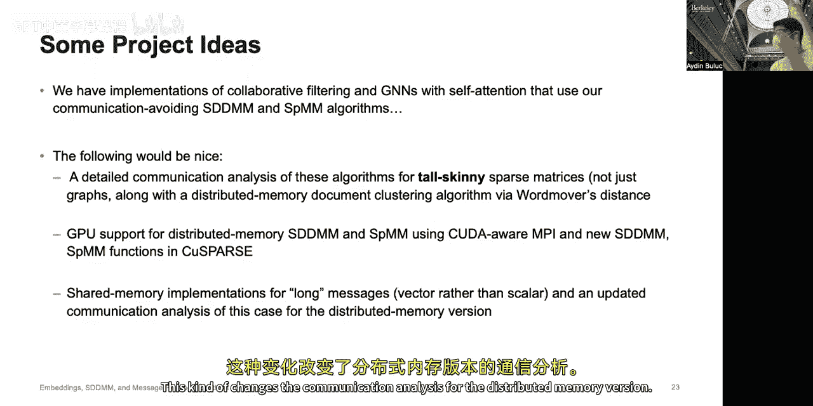
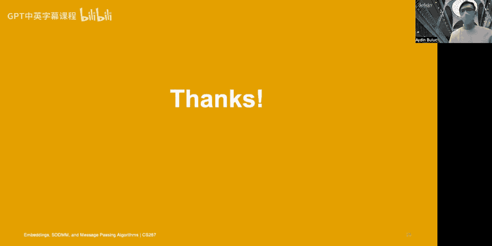

# 【并行计算 CS267 2022】伯克利—中英字幕 p10 CS267 (Sp22) - Lecture 12：  GSI Research Presentations -BV1PS421978D_p10-

audioio is very poor， Okay， it's good now apparently， it's good， Okay， good。So hello everyone。

 my name is Reveic I'm a second year PhD student I work with Jim and ID。

 some of my interests include tensor decomposition tensors are generalizations of matrices and vectors to higher dimensions I'm also interested in sparse linear algebra specifically a couple of kernels called sportstime dense matrix multiplication and sample dense dense matrix multiplication and I'll be talking about one of these kernels today as well as the concept of embeddings and message passing algorithms on graphs。

Okay， so let's get started。

Okay， so here's a brief outline， I'm going to go ahead and define what embedding is and talk about what message passing algorithms do on graphs。

We're going to look at some kernels to efficiently do this message generation aggregation。

 these are specifically the STDMM kernel and SPMM kernel sample dense dense matrix multiplication far times dense matrix multiplication。

And then we'll look at some applications for message passing and I have a couple of neat little animations that I can show you。

And finally， we'll look at some recent work in communication avoiding distributed SDDMM algorithms。

 and I'll give you guys some project ideas。

Okay， so let's talk about embeddings and message passing on graphs。

So what is an embedding and embedding is just a map from a discrete set into a continuous factor space and embedding encode information about each element is a discrete set。

 for example， let's say I have these three drinks， I have milk。

 Cocacola and water if I label these as drink one drink two and drink three as's completely useless because that tells you nothing about these drinks whatsoever。

But if I then provide you a little vector with the nutritional information。

 that actually encodes something about the content of these three things and that's more useful。

So embedding have some desirable properties， first of all embedding vectors consist of differentiable parameters。

 so you can incorporate embedding as part of a larger machine learning setup and basically train that using something like Pwork or Tensorflow backdrop and these parameters change so you can actually learn things about input variables that are discrete。

And in addition， assuming you trained your embedding well。

 the idea is that the distance between two embeddings。

 you could take the difference between two embedding vectors and take the norm L2 or L1。

 this distance function provides some measure of similarity ideally between objects。

Now the embeddings that I showed you on the previous slide they had a clean interpretation。

 each element of that vector was some kind of nutritional information but they don't have to have this kind of interpretation。

 we often want to learn embeddings that are most useful for certain learning tasks and they may not have this know clean structure。

So a typical problem is if we have a graph that consists of vertices and edges。

 we want to learn and embedding for every vertex， this graph。Okay， to discuss graphing embeddings。

 we're going to need some notation， let's suppose that my graph is N vertices。

Let's denote by us the adjacency matrix of this graph。

 it has one in the entries that denote an edge between indiceses I and J at zero otherwise uses a sports matrix。

And let's say that for every vertex I have an embedding of length R。

 what I'm going to do is I'm going to stacknsh all these ems up to produce an n by R matrix that I'm going to call a。

Okay， and let's say that I just hand you a graph better， what can you do with this？😡。

Well there's a couple of key operations， the first operation is for every edge。

You can use the embeddings at the vertices that span that edge。To compute some information。

 in this case， we're just going to compute a single scalr on each edge。

And we call this message generation so here I have X and T， I combine them in some way。

 I produce a scale of message on that edge between X and T and I'm going to do the same things between Y and T and Z and T I just have to illustrated it here。

So let's let AI and BJ be the embedding vectors of the two neighboring vertices and there's lots of ways to generate my scale and message from these two embeddings。

 I could take norm of the difference between these two vectors。

I could pass both vector to a small neural network that produces a scalar output and grass neural networks with self attention do this。

Or I could just take the dot product of these two vectors and for simplicity it's just kind of nice to focus on this case of just taking the dot product in these two vectors。

 but the data access pattern is kind of the same for all three of these。Okay。

 so I can generate a message on each edge， what else can I do once I have a graph embeddeddding？Well。

 given a set of embeddings and generated messages on each edge。

I can aggregate the embeddings and messages that neighbor each vertex produce a new set of embeddings for each vertex so in this example I have embeddings on X Y and z and I also have an embedding fatigue but I don't care about that for now and I have a message generated on each of my three edges and what I want to do is I want to aggregate all this information onto to note t and I want to produce a new embedding。

And this is called message aggregation。So I'm going to focus on an aggregation that looks like the following。

Let A1 through AK and M1 through MKB the vectors and the messages respectively。

And I'm just going to focus on an aggregation function that does the following8 Hilda is going to be my new embedding for the central node teeth。

 I'm going to sum up the vectors AI weighted by the messages Emma。

This is just what I just said。Okay， so these are those kind of two fundamental operations that you can do。

With message passing and message aggregation now how do we actually do this efficiently I'm going to talk about two kernels that。

A basically in sparse linear algebra that can perform this message generation and aggregation efficiently。

So let's start with message generation。Here's the first panel we're going to talk about。

 given dense matrices A and B dimensions N by R and n by respectively。

 and let's say we have the sparse matrix S dimensions M by N。

 we define sample dense dense matrix multiplication as an element wise product between S and the matrix product a times B transpose。

Here's a little diagram of what that looks like， I have the sparse matrix functions as a mask here。

 and I have the matrix product a times from transpose。

And the output of this kernel has locations identical to s。

 and you know we're working at the grass case， so we're just going to take a equals to B。

So if you look at what this kernel is actually doing。

 you'll see that the IJ entry of the output of the SDDMM operation is exactly the message that we want to generate。

 assuming that you generate messages using data products on the IJ edge。Now in practice。

 you never actually execute this kernel by performing a matrix matrix multiplication and taking an elementwise product that would be extremely wasteful。

 you only need to perform computation where there is a nonzero s。

And it turns out you can optimize this kernel using very similar blocking techniquess。

 the ones that you studied in Home one， the block shapes tend to be very tall and skinny instead of closer to square rectangular like you saw。

 but the technique of encouraging cash reuse is the same。

Now let's talk about how we aggregate messages efficiently。

So let's say that I have a dense matrix a dimensions n by R and it's sparse matrix x。

 a dimensions n by n again in the matrix case it'ssymmetric symmetric squared sparse matrix。

 so it's just n by N so we define sparse times dense matrix multiplication exactly as you would imagine it's just taking the matrix product between S and A。

Now the output of this is a dense matrix and each row of that dense matrix is a new embedding that is produced by an aggregation that aggregation is exactly what the aggregation operation I showed you on the graph on the previous slide。

And you can also optimize this kernel by blocking。If you want to weight the embeddings by messages instead of just using us。

In other words， aggregate the messages generated on each edge instead of ignoring them。

 you replace us with the output of the SDVMM operation， which is Spe。

 and then you get the message generation aggregation flow that I showed you。Okay。

 so here are the two fundamental kernels we use for message generation navigation。

 you probably want to see an example of one。So here's a kind of flash animation。

 flashy example of message generation application， we call this application spring embedding。Okay。

 so here are two kind of pretty unrecognizable graphs， the idea is that each of these graphs。

The edges have known length， they're labeled with their known length。

 but I don't really know their positions in space， so I want to find the positions in space for the vertices。

😡，That respect my known edgelights。So in this case the embedding has an interpretation。

 it's a location in space for the top， it's a location in 2D space down here it's location in 3D space。

And now my algorithm is I'm going to start with some random ver positions。

 I'm cheating a little bit here， I didn' start completely random positions but new。

Because the point of this algorithm is not to denoy a completely starting from a completely randomed position。

 but okay， random enough。And what I'm going to do is I'm going to treat each edge as a spring that's either in tension or compression based on the deviation from the ideal length。

 and I'm going to treat my vertices as point masses。

So I'm going to actually just start running the algorithm and talking about it。

 you can see all the verses start changing positions。

 you can see that there's kind of a creepy monkeyhead in the dreamy case forming you kind of squint and hopefully it should be clear that a bear is forming up there。

So what's happening here is I'm just summing up with forces on each vertex induced by my springs that are either intention or compression。

 and I'm evolving the system in time using sum f equals M。

The message generation step here is I'm computing the force by each spring on each edge。

 and the message agregation phase is I'm computing the sum of forces on each vertex using SPF。

Now again there's some cheating here， this is not exactly the sample denseense matrix multiplication operation。

 I'm using hook Spring force law and not just using a dot product。

 but it's close enough and the data access pattern is the same。Here's a more serious example。

 this is message passing in graph convolutional neural networks。

With self-attention so graph neural networks use a sequence of graph convolution operations this is exactly the SPMM kernel linear transformations and nonlinear activation functions to form a variety of cap on graphs。

 for example， you can predict labels for nodes on graphs after training your graph neural network or unlabeled nodes you can predict the presence or absence of edges in a graph this is the case of things like knowledge graphs where you have certain entities and you want to predict relationships between these entities it's good to know whether or not there's an edge between certain nodes。

Or you can classify entire graphs or compute certain quantities for entire graphs。

 these include classing molecules or computing activation or free energies for certain compounds。

And again has CDdMM and SPmM are the key computation kernels。

 the image on the right is courtesy of another grad student in the lab who implemented the SPMM operation as part of a workflow that trains graph neural networks the message generation in this case is。

Given to embeddings at neighboring nodes， you can compute a self attention score on each edge capturing the interaction between the information of those two nodes and the message aggregation phase you saw the embeddings at the neighbors of each node weighted by self attention scores。

 and this captures neighborhood structure。And there are plenty more applications。

 you can apply both of these kernels to general non symmetric sparse matrices。

 it doesn't have to be a graph。And both models appear in document clustering applications。

 so for example， given a large library of documents in a single target。

 I want to find every element in my library that is close enough by some distance function metric to my given target document and they also appear in things like Netflix challenge type problems these include collaborative filtering matrix saization。

 we have a sparse matrix representing partial observations of some dense matrix and I want to predict the unobserved entries。

And there's lots more， I've linked the paper here that has like a little list of applications you to take a look at。

Okay， so let's talk about some recent work， distributed memory algorithms for sample dense dense matrix multiplication。

 and in fact combining sample dense dense matrix multiplication with sparse dense dense matrix multiplication since again。

 you usually perform a message generation step before a message application step。

So both of these kernels actually have identical data access patterns。

 every non zero IJ sparse matrix interacts two rows at the dense matrix input。

The only difference between them is that they treat different operators as inputs and outputs。

And there's been lots of work on shared memory algorithms for both of these kernels and distributed memory algorithms for just sparse times dense matrix multiplication。

 It turns out that you can convert these distributed memory algorithms for sparse times dense matrix multiplication into algorithms for sample dense dense matrix multiplication using a simple transformation process and you can go back and forth between them and so now we have a family of distributed memory SCDM algorithms。

 we have a communication analysis for each algorithm and we have implementations with a kind of unified interface。

 you can drop these into whatever application you're doing despite the fact that each algorithm has a different underlying data distribution。

And we actually do this， we actually drop these into two applications。

 grass neuralal networks with self attention and collaborative filtering and showcase them。So。

When you create these distributed memory algorithms for STDMM。

 it turns out that they have the same data distribution as the corresponding SPMM operation and these algorithms save communication by replicating parts of their inputs among processors we duplicate parts of the input or outputs using broadcast of reductions and this actually saves communication overhead。

 you can further save communication overhead by fusing these two kernels together。

 these effectively eliminate unnecessaryary communication phases and changes the amount of replication you need to do。

You don't need to know the details of these flow charts。

 but this is the flowchar of the data movement of what happens when you just make an SDBMM call followed by an STMM call。

 and in these flow charts below I'm just exercising parts of this in two different ways to show that you can remove unnecessary communication and the byproduct that this is in scale up or down the replication factor。

Our algorithms are chronic with sparsity agnostic， they don't benefit from any kind of reordering the sparse matrix non zeros。

They operate in manner similar to algorithms for dense matrix multiplication in a distributed setting。

 and I think Jim will cover this in a future lecture。

And the keytra here is to balance the time you spend doing replication versus intermediate shifts of the subat needs during the algorithm。

Here's some quick benchmarks that I can show you， all those colorful lines down there are our various flavors of algorithms。

 the black line up there is PEC， which is a popular toolkit for performing scientific machine learning and I guess the takeaway messages that because for a variety of reasons we outperform PETC by a pretty wide market。

And the choice of algorithm depends on the sparse matrix density， we have a calculation to show this。

 and finally we embed our application in collaborative filtering using alternatively squares and graphic retention networks。

So some project ideas， so we have implementations of these algorithms and applications that include collaborative filtering in GNNs。

 it would be really nice to have a detailed communication analysis of these algorithms in a case where the sparse matrix is tall skinny。

嗯。This shows up a lot in document clustering applications。

 it would be nice to have GPU support for distributed memory SDMM and SPMM。

 there are new functions in cooseFs that perform SDMM and SPMM。Even with reordering the non heroess。

 so that would be nice。And in addition， it would be nice to also handle the case where you have long messages generated。

 these include messages that are vectors and not single scalrs。

 this kind of changes the communication analysis for the distributed memory version。

So here are some references you can read about if you'd like to learn more， thanks so much。

 I'll pass it over to the next GR。喂，听来吗？う。不清楚。No。这个。没法。い。Yeah， this is。嗯。I would recommend。

 let me try to do this if you don't mind thanks hiding in the case， it was touching the。

Is the audio clear？

II turned this off。Is the audio clear for that？Zoom people， I think， is what matters。Yes， great。

Which one was yours， this one is。Thanks a lot。Okay。Great， hello everyone。 My name is Zn Donong。

 and I'm currently a fourth year PhD student at Berkeley。

 Today I'm going to talk about some of my research and also the project ideas for CS S 267。😊。

My research basically is working I'm working on efficient deep learning and model compression neuro architecture search I know that those directions are not exactly related to the parallel computing。

 but I'll just cover the basic idea first we know that the model size and computation are increasing as the figure shows like lastier。

😊，Or years before last year， we have G2， which has 1。5 billion parameters。 but just。

 but then we directly have G 3， which has 100 times more parameters。

 and the computation also are growing drastically。In order to呃 like do the computation for those large models。

We have like used cloud computing such as the Google cloud， AWS and so on。However。

 we cannot always apply cloud computing because of these three issues I'm going to mention。

 the first one is privacy， for example， we don't want our private data such as the medical data our messages and also the search search history to be uploaded to the to the cloud server。

 so that's one of the reason of edge computing where we do computation on edge devices such as mobile phones or Apple Watch。

The other consideration here is the power consumption。So we know that on a lot of applications。

 we cannot afford a large power consumption like on the connection to cloud server。

 so people have developed FPGs AsI chips and also other mobile devices to to run the deep neural network models at the edge。

Also on the IoT applications， that's also very necessary。

The third the third problem here is the latency。 Sometimes we don't have the time to send all the data back to cloud computing。

 for example， when we are monitoring the street or doing like real time recommendation these are all those things are latency sensitive and we need to do edge computing。

So model compression is a very good technique to accelerate the neural networks and run them on on the edge。

So model compression here is a like it is like it contains a lot of different research directions。

 For example， we have quantization。😊，Pruning and also knowledge distillation and factorization。Here。

 I'll just briefly talk about quantization where we want to map the original。

Full precision neural network to a lower precision， for example，8 bit or four bit。That is。

 that is to say we run a lower bit with when we do the inference so that we can have a speed up and a smaller a smaller model size。

😊，Also， quantization is also necessary to address the power consumption problem because from previous research。

 people know that moving data is super expensive comparing to the computation。

We like model compression can definitely reduce the memory that is needed for deep neural networks。

In our research we are exploring mixed precision quantization where we address different layers with different quantization bitwes。

 that is to say， for example， a neural network with 50 layers。

 each layer we can have a different bitwes such as4 bit2 bit or even binary。

 this will lead to an exponential search space。And。

And our way to address this huge search space is that we apply second order sensitivity analysis。

 a brief idea here is that as shown on the figure we can see at the zero point all the all the gradients are zero。

 but definitely the sensitivity of these three lines are different， so this character。😊，Cellphones。

 Bluetooth。Sometimes it just decides to do。Swa。呃。Yeah。Can me ask them if they can。I see audio clear。

and z check。Yes， we back just said that awesome。2。佢嚟嘢。嗯。Yeah。

 so we can measure these characteristics by using ca information。😊。

Here we don't form the entire Hasian matrix because it's massive and costly。

 we just leverage some of the matrix such as the trace of the Hasing matrix or the eiggonvalue。

 the largest eiggonvalue， something like that in our previous previous work Hasianware quantization we use the top one eigvalue as the matrix and we measure the sensitities throughout different neural networks and apply quantization bit with accordingly。

This leads to very good results on， for example，2 bit。

A2 bit quantization on weights and four bit quantization on activations and hope we too with restnet can work pretty good on imagenet and so so as other networks this the generalization ability of those kind of methods。

😊，Are pretty good since we also did experiments on Roberta on NLP or other different detectors on object detection。

So I'll just skip those things。And in order to have a further or more efficient development deployment of those new networks on hardware platforms。

 we also need。For example， compilers such as TVM to convert the software code onto our different hardware platforms。

AndSo in in this work， we further。诶。Appli TVVM and then do the hardware software Co search。

 where we consider the hardware latency， as well as the software sensitivity or the quantization sensitivity。

So in this figure， we can see that。The， the speed up order gain from applying quantization is quite it quite significant。

 For example， this one is applying TVM with in integer 8。

 So the8 bit operation is we can see is quite much more faster than the floating point counterpart。

 So here we use M X net as an example。 and M S M S net M X net is a mainstream like deep learning。😊。

A deep learning framework。 So it should be similar to P or even faster。

 So we can see that applying lower bandwidth width is necessary。

And even to like to make things better， we can also。P push the quantization between to in and。

Currently， the Nvidia T4 GPU can support the they have like inter4 tensor core that can support integer4 operations。

So we from the figure， we can see that in4 can have a potential two times speed up comparing to in 8 if we。

 if we do the optimization well and address the overhead。😊。

So we also achieve quite good end to end speed up running Resnet 18 on Nvidia T4 GPU。This。OhYes。

 for a bit。ok，呃 these are for呃。These are for， for the。Inference parts。

 and then I'll talk about something more related to our project ideas。 So first。

 as this will be covered in later C， S 2，67 lectures and also。

I think other GS S factors will also mention some of the some of the ideas。So we。

 we know that deep learning requires data parallelism。 when we have a distributed system。

 we have a lot of machines。 we can separate the batches or the data to different machines。

 And then we do the computation on different GPs。 And finally。

 we do a like we collect the gradient and do。Let me check the chat。

Simon asked how is the accuracy affected by4bi quantization， Is there a significant job。

 So that that should be like people are doing those kind of research are trying to address this problem if you directly apply4 bit。

 you will see a quite significant job but with some training or we call it quantization where training this job can be can be alleviated or or maybe we can just close the gap。

😊，So诶。Yes， so data so we know that data parallelism is important in distributed training。

 but there there are also problems in those masses。For example。Yeah， for example， here。

 we show that it's an illustration of the time time cost of the distributed training。

 We can see we have some time spent on computing the gradient。

 and we spend some time on calculating the average gradient。 And finally。

 we update the gradients across different machines or different GPus。

 But when we have a very large model size。 So we know the the size of gradients should be the size should be the same as the size of the the model。

 So when we have a super large model， such as the state of the art LP models。

 the time used to calculate the gradients or calculate the average gradient should be very large。

 And this will cost to a。This will cost a very large overhead。

A bunch of works has been proposed to address those problems。

 so the first one is to do gradient specification where people just like only communicate important gradients and get rid of the others there are proofs and counts I just listed here and you can check if interested。

Problems exist on those gradient specification methods。The first one is that we。

 it requires a very high level of sparsity and。For example， here。

 you can see that 99% sprsity is not even enough， we may need the sprsity to be as high as 99。8%。

To to overcome the overhead。And the other problem is the ability to scale， for example。

 when we have over 100 GPUs， each GPU will give you a sparse a very sparse vector。

 but after you do the gradient accumulation or the average after you averaging the gradient。

 you will get a dense vector， so that's also the problem。Another problem is that。

The current methods treat different layers or every parameter with the same importance。 So。

 so that the communication are selected based on the solely on the parameter size。

 that may not that's also will cause some problem， because the the importance of parameters are。

D quite different in different parts of the neural network。So。

A simple like a simple solution we stored on is we。

 we are trying to also leverage the heing information to guide like to show the importance of different parameters and in order to address the overcome to address the overhead of supporting sparsity we are trying to make the sparsity granularity to。

 to a channel level。 That is to say we， we use channel as structured sparsity instead of pixel as pixel as sparsity。

So that leads to our project ideas， the first one is so we know that those channel as sparsity are quite are not very normal in previous applications since the sparsity pattern will change every iteration。

When you do the distributed training。And and also the the sparsity level can be adjusted。

 it is a trade off between the sparsity level and the training efficiency or the final performance。

 So thinking of a wise way to do this sparse or reduce should be something important。And。

So in later CS 267 class， I think it will be covered that people have developed have developed a lot of methods to do or reduce wisely。

 for example， they have the parameter server or the butterfly or reduce and ring or reduce and so on。

 so but for spas or reduce in this specific scenario maybe some new some new methods can be come up。

And yeah， and achieve good optimization or efficiency。So here is an example。

 So people have developed different or reduce methods other than those standard。 I just mentioned。

 For example， this is the 2 D Torus or reduce。 And people from Google has also developed mesh or reduce。

 So， and a better implementation also need to consider。The topology of the of your server。

 for example， in this。In this8 in this DJX server containing8 V 100 GPUs。对看。The connection are。Yeah。

 the connection from。The order communication are not。not connected for all the GPSs。

 So this is also something to consider。 And the other project to no town is the optimization of no no operations。

 So we know there are a bunch of new type of convolutions coming up。

 and it's good to explore the optimization on those communication convolutions instead of only focusing on the the the the standard one。

😊，So the final project idea is to design GPU efficient operations。 For example。

 we know different neural networks have very different throughput on different GPU machines。

 So considering that and some GPU machines have tensor course with into8 or into4 support。

 So especially considering that you can design very efficient or GPU friendly operations and you build up your neural network with those operations。

😊，So thanks for listening， and I'll pass it on to Lemin。哦，关华，than。呃你怎么。Unroll technology continuous。

Okay。Okay。Oh。好能。我个车宝。Okay。对。You want to see it there because。Yes， okay。好。Ohello。我就是他的没。Yeah， works。

So anyone on Zoom can hear me or not。O。H everyone， I'm a final year PT T student in the rest lab by Berkeley Adv by Proor Young St。

 Today， I want to talk about some of my research on the distributedtri machine learning systems。😊。

So the deep neural networks in power still there results across many different applications。

 such as the image classification， on speech recognition， robotics control， and also game playing。

To speed up the DNAN training inference data paradigm and model algorithm are to widely adopted approaches in data paradigm。

 each machine or each GPU holds the full copy of the model。

 and they train on separate input data periodically。

 they need to do something called model synchronization。And in most paradigm。

 they share the same input data during both training and inference stages。

 but they need to transfer a lot of other intermediate results， such as gradients or activation。Yeah。

Communic is a main cause for system inefficiency in distributedtriing machine as you can see on the left hand side figure because we need to do something called model civilization during data power training that can be huge communication overhead and in mod parallel they need to transfer a lot of things like the feature maps or gradient that is also a huge amount of communication overhead。

So to mitigate the communication overhead in data power training， we propose a blink project。

 basically given arbitrary networking environment， we can provide the optimal solution for model synchronization in data power training。

And to eliminate the model parallel to eliminate the communication in model parallel tri inference。

 we propose a sensor project， which basically decouple a base model into a bunch of disconnected sub thus we can eliminate the communication in between。

Yeah， these are the two works I want Tao about today and yeah that first dive into the blink for that which is fast and generic collective for distributed learning this is a joint work with my colleagues at Wisconsin Medicine and Microsoft Research。

So to speed up the DN training， we can use data parallel。

 as you can see in this figure by adopting data parallel training。

 we can reduce the number of hours for training from 150 to just 5。And in their training。

 there is one thing called modelchization。 So what does modelization do basically after each ship you generate local gradient what modelization does they basically try to aggregate those gradient together。

 sum it up and then prop or broadcast this aggregated gradient to all the G use。

 This is what we call model civilizationization。Despite there are many performance of meditations on the most synchronization still consume a lot of time during the data parallel training。

 And you can see in these two different figures by either using Tensorflow or P。

 the model synchronization overhead can be up to 90% of the under2 and DNA training time。But yeah。

 to alleviate the communication bottle recently， there have been big improvements in both hardware South Waless。

OnOn hardware side， video provided the steel without hardware like the DJ X1， DD X 2 machines。

So what's inside on the competition side， they provide you the best GPU like the P 100 or V100 or A100 GPUs and on the communication side they provide you faster interconnects。

 for example， they provide you the PCE30 and they also provide something called enVlink which is GPU exclusive and point to point competition links only within the GPUs。

 which has higher bandwidth compared with the PCIE。And in year 2020。

 they also provide a new hardware called NV switch， which basically is a fully connected crossbar。

 And each link on this crossbar can give you six x and bandwidth。

On the software side instead of their software from different company like the media。

 Uber or Facebook， they all provide their own collective communication protocols。

 but all of them are ring based collectives。So one question we want to ask is。

 can these hardware and software improvements really alleviate to the computational bottleneck in data power？

But now really here yeah， here we can see in this figure by adopting still there are Halloween and software。

 The communication overhead can still be as much as 50% of the end to end during training time。

So while we still have such a big communication over has even by adopting skate of the art。

 hardware and software， it is because the communication over has become more pronounced when we increase the GPU communication power。

AndThus， we need faster correct for distributed machine running。On next Taba the challenges。

 the first challenge is we may have different server configurations。

 as you can see on the left hand side figure if the DJx1 is embedded with P100 GPPUs。

Tology is formed very regular topology， what we call hypercube。

 But if the D X1 is embedded with V 100 GPp， which is shown the red high figure。

 as you can see here the topology is kind of irregular because beside that hypercu。

 they add another additional ring which is denoted as those red arrow dash line on the red hand figure。

So the protocol needs to be to project where you order to effectively use our hardware links。

This is the first challenge and the first challenge is we have different links within the system for the difficult to communicate。

As you can see in these two figures， in order to communicate gradients or anything。

 we have two kind of links on the left hand side。 it shows the PC and on the right hand side。

 it shows everything link right now， the ring based solution can only use homogeneously。

So they can either use enV link or use PE， but not use both。呃，So why this happens。

 It is because the low band with PE will be the bottleneck if it is included in a high band with NV0 cream。

The third challenge is the fragmentation issue in marketing cluster。

 as you can see in this bar graph here we monitor 40，000 multi job at Microsoft。

Even though people always require total the power of X number of GPPUs。

 but the real GPPU placement within each H GPU server can be weirded number such as 3，5，6， and 7。

Some other fragment allocation example can be， for example， we have 8 GP PU job across two servers。

 We may allocate 3 GPP on one server and 5 GP P on the other or2 GPPU on one server and 6 on the other。

And because of this kind of fragmentation issue， we may form some irre already it looks like this。

 for example， one job only use CPU 0，1 and4， because there are only two of link in between thus we cannot form more ring。

And in this case。Existing solution will fall back to PC because they cannot format the。

So can we do better than still there software are given those three challenges under the umbrellas quality hydrogenality？

Yeah， that's a really proposal link for that。啊So at high level， how不 handles supportgene。

Given that we may have different server configurations like the DJ one embedded with P 100 or V 100Qs blink probe available links at the job run time。

嗯 given that we have link heterogeneity， which means coexist of PCI and en link。

 blinklink can to concur data transfer over heterogeneous links。And given that。

 we may have the fragmentation issue in myant clusters。

 which has some irregular to that does not allow us to form ring and in this case。

 B can use spinning trees rather than rings which are more flexible and can give you optimal solution。

Furthermoremore， we also provide ni compatibleible API。

 which means our solution can be seamlessly integrated with Tenorflow and title。

Here I want to give you an example why treess are better than range。

 As you can see in this six GP topology， here， we want to do a broadcast from the GPPU3 on the left to all the other GPPUs。

So what ring based solution does this basically create two unidirectional ring。

 One is in the clockwise direction， The other is in the counterclockwise direction。

 But as you can see in these two rings， there are several link unus。

 which are benoted as those red dash dial line with a crossbar on top。Actually， in this case。

 by packing Spanish tree within the topology， blink and pack three Spanish trees within the same topology because we have three concurrent data transfer channel。

 which is more than two rings。We can have a higher throughput for the collective communication。

 and because we use all the links available in this technology。

 our solution is guaranteed to be optimal。😊，验收。The B solution basically given an arbitrary network。

 We try to pack as many as possible of the spinning trees and use these spinning trees for collective communication。

 That's like the high level idea。 I will skip this mathematical detail。

And if the system may have something called switch or any kind of switch。

What niel does basically or what ringb solution does basically here if we want do a reduce from GPPU1 on the top to the GPPU4。

 ringb solution will do like a four hop ring here。And in our solution。

 we allow all the CPU to communicate together to the root code。

And we can only you here we only have one half tree。

 which guarantee you have the minimum vacency compared with this four half ring。

And we can extend it to or reduce all any other stuff。Yeah。

 here is some micro benchmarkchmarks on the DTX machine as you guys here we want to do our reduce using GPU 4。

5，6 and 7， which are those orange circles on the left。

And the link in between did not take as those error lines。In this case。

 what ring based solution does basically they can create two rings The first ring is the black a length across the border。

 The second ring is the green dash a lens in the middle， however there is widely con used here I。对。

And in this case， why we have higher through food because we can create three complicated terminals simultaneously。

As you can see let's figure here and we use our the links。

And we can achieve up to like 40% to an again2 time reduction by using blink run ringway solution。

Yeah and right now blink use inside Microsoft and also draw a lot of attention from like the Titor team at Facebook and buy desk Company and also Ba tocent。

For for the research project in this course I propose it called blink+。

 which is do the collective communication over something what we call set channel。Yeah。

 for single tenancy scenario， because we have a global view of all the network links。

 thus we can very easily do some kind of optimization or network scheduling。But in a multi cluster。

 there iss kind of different。Because for example， if one party only use CPU A and B。

 the other part use C and D。 And as you can see， this two link here。

 whichnoted that those red dash will never be used during the D training and we want to use this kind of idle links to do some kind of data forwarding。

 and by using this idle link， we can create something what we call set channel。 For example。

 if A here want to do a broadcast to B。 instead of using the link between A B and A。

 it can also forward some data to D and D can forward data to C and B。

 this is what we call a set channel。 we can do similar things in some other cases。

The second part is about the Sun project， which is common competition where class comparison for fast influence landed。

ACon neural is specialized in that enable computers to excel on vision learning tasks。

 such as image classification， object detection and sematic segmentation。Right now。

 we see the trends that both the model and the input data sets are growing drastically。

As you can see in this figure here， from the original Google net to recently our mobile net。

 the number of parameters almost increase 200 times。And， and they can achieve better accuracy。

So in order to achieve better model serving accuracy， the model set grows a lot。

 that we may have higher latency during the model serving stage。And we also see the input data。

 the image resolution also increased a lot from original safer to the image 9 to Cococa La image resolution also contribute that we may have higher latency during the model stage。

One point we want to make is making faster decisions on live data is becoming more and more important for example autonomous driving for a company like women or Cru。

 if the camera capture frame of image that contain potasropia。

 it may save people's life if we can make the stop decisions slightly earlier。

Recently giant banks like the DP Morgan and Goldman Sa。

 they try to use machine learning for automatic stop trading and in this case。

 if one party can make the trading decision several milliseconds faster than the others。

 it can bring in huge amount of profits。And from a system perspective。

 making faster decision on live data， meaning making faster decision on each single incoming data item。

 such as a single image world the stocks is continuous price。Or in this case。

 neither data pair nor model person can reduce live data serving littency because we cannot split an atomic input piece into pieces and do data parallel inference。

And for multiple part them， even though they share the same input data。

 but they need to transfer a lot of intermediate results， such as the gradient or the feature map。

 and the time for transmitting those intermediate results can often be order of magnitude longer than doing single image inference on a single review。

So can we achieve lower latency for land data inference that motivation for a C project。

Here is a direct comparison among data， motorpar and sensitiveus clusterism。

 as you can see on the right time size figure， basically essentially we decouple a base model into a bunch of binary class or we do something what we call a divide conquer scheme for example the base model here is a classifier class。

 whether image contains cat or dog， we deco it into two different subness。

 the first one is only responsible for decision making of whether it's cat or not。

The second one is only for decision making of whether it's stop or not， and during the middle。

 there is no communication at all， and we only need to aggregate one's float value at the very。

Indicating whether it's开 or not开到或 not。Yeah， so the workflow looks like the first we assume you have a F train base model and we pass the one plus of training image for the F train model and then do something what we call class specific point to pull out those binary class file from the base model。

And during the second stage， what we call retraining。

 basically we retaintrain the binary classifier put product from the first stage in order to regain some possibly lost test accuracy because of the previous pruning。

And then we just aggregate those one float value at the barrier。To make the decision。放开视频。

You what thing want to highlight is during the retraining stage。

 Y Sha of binary class far is reed independently， which means there is no communication at all about all the binary class fars。

嗯。没有。那这个。Yeah， so the sum for the for the results of we can reduce litency by 6 x of stiff and also6 x of。

About the extension here， we first add the four tolerance feature on top of the physicsensus cluster。

U something what we callcycl coding basically previously， each subs do not have class coverage。

 but right now， we try to add some redundancy such that。

Each span transfer or group transfer have some overlap class coverage。

 thus for each overlap class we can do something very simple like a majorter route in order to avoid the cases that some machines go on。

And we also extend3 to control system in drone。 Right now。

 the control system in drone is centralized。 We try to discover it into much smaller control unit。

 where each control unit is only responsible for decision making of a single per color。

呃也都 are the peoples involved in this project。If so summary here is in blink。

 we argue that that packing spending trading were all efficient and kind of achieve optimal performance than forming rings。

 and for Thursday， we can eliminate the communication by using our transparency。

Yeah recently I was invited to give a lot of talks in both India and industry。

 and I have a book will be published next month。 Thank you。怎嗯。Thank。好。Okay。6，4，1，4。어不。Yeah。没有。Okay。

 that。我听不到。喂。です。Okay， really。helello， yes上歌O。嗯，hello， everyone，I'm连明正。是。

I'm a 30 year PhD student advised by Y Sic and Joseph In this talk。

 I'm going to talk about our recent work， Alpa， automating inter and in operator parallel for distributed machine learning。

 SoPA is a system we built to automate the model parallel training of large neural networks。

To begin with， let me introduce some background on large models and distributed training。

Several of the recent advance in deep learning has been a direct result of significant increase in model size。

 For example， gaining language models such as G3 to hundreds of billions of parameters and chain them on much larger data set enables fundamentally new capabilitiesens。

 So it's no surprise that the number of parameters in state of the art models have grown as an exponential rate。

As shown this figure in recent four years。The number of parameters in this state of the art model are around five times larger。

 around 5000 times larger。However， training these large models is very challenging because model can have more than 100 billions of parameters。

 You cannot fit the model into a single accelerator due to the memory constraint。 So basically， you。

 you cannot simply apply data parallel。In addition。

 it would take several hundreds of years to train such a model on a single accelerator。 Therefore。

 distributed training is the only way you can train them。However。

 distributed training is not an easy task today。 People have to build specialized systems just for training certain models。

 There are several popular techniques such as data parallelism。

 Tensor partitioning and pipeline parallelism。 There are also different tradeoffs among them。

 So training a large scale model typically requires a combination of them。 Basically。

 you need to look at model architecture。 Try different parallelization techniques and find a way to combine these techniques。

Here are two examples of expert design strategies。The one on the left hand side is the megatro L M strategy for paraing the self attention model in the transformer layer。

 The first weight matrices has to be column partition。

 while the second weight mates has to be row partition。

And the one on the right hand side is the G sharp strategy for sparse mixture of expert transformer models。

 The expert layers are positioneded along the expert dimension。

 while the non expert layers are parted along the data batch dimension。

And to apply these parallelization strategies， model developers have to rewrite their model definition scripts to specify the partition strategy and insert necessary communication primitives。

 So this makes developing new model or heterogeneous model very challenging。And in this project。

 our goal is to unify all these parallelization strategies and build a compiler to automatically generate the optimal combination of them。

So first， we summarize the existing parallelization techniques into two types。 So， for example。

 this is a computational graph。 How can we run it on multiple devices。

The first type is intra operator parallel。 So for each operator。

 we can assign different regions of it to different devices。 So， for example， if we have two devices。

 they can execute the first met mode together and then execute the second met mode together and then execute the addition together。

 So in this， in this case， we exploit the inherent parallel inside a single operator。

 So we call it in operator parallel。And the second type is inter operator parallel。 In this case。

 we exploit a higher level of parallel on the whole graph。So， for example。

 we can assign the first half of the graph to device1 and assign the second half to device 2。

So however， due to data depend， the device two has to wait for the device one to generate the input data。

 So some devices might be idle at some time to fix this issue。

 typicallyically we use pipeline to to send multiple micro batteriesies into the pipeline and achieve parallel。

And then we can classify conventional techniques in into these two categories。

 So the figure below shows some popular parallelization。Techniques for training a two layer M LP。

 for example， data parallelism is one type of in parallel。Because in data parallel。

 the data and activation are partitioned along the data dimension while the weights are replicated and the and the megacha style meta partitioning also belongs to this category and other variants of data parallel such as the zero optimizer also fell into this fell into this category。

And for inter operator parallel， device placement and pipeline parallel are two notable techniques。

 The device placement just plays different operators to different devices。 However， it relies on。

The concurrent branch in the original graph to achieve parallelism。And on the other hand。

 in pipeline parallel， we split the data into several micro batchs。

 So this effectively creates many concurrent branches in the graph so we can have more parallel opportunities。

There are trade offs among these two categories for in or credituralism。

 It requires a lot of collective communication。 So high bandwidth connections among devices are desired。

But for inter of parallelism， because we only need to communicate the tensor between the boundary of the graphs。

 So we require less communication。 but due to data data dependency， some devices may be idle。

As you can see， there are so many parallelization techniques and changing a large model efficiently often requires a combination of them。

Relying on manual design strategy requires a lot of engineering effort。

 So there are several search based autoization projects。嗯However。

They have a lot of limitations and cannot efficiently train state of art models。 So actually。

 like none of the large models are trained with these auto parallelization systems。Because。

Their search space first， their search space is limited because they only consider limited parallelization techniques and they cannot none of them can cover all the parallelization techniques I mentioned before and their search algorithm either rely on random search or strong assumption of the model so they cannot scale to large models。

嗯。So， for example， some travel work such as black flow and tofu。

 They don't consider pipeline parallel or partial replicate tens。And P and Dpo。

 they don't consider operatorism。 So they just cannot exploit all parallelism opportunities。

And unlike existing systems， we build opera by taking a different view of parallelization techniques。

As summarize above， we classify existing parallelization techniques into interop parallel and intra operator parallel。

We then find that we can organize these two kinds of parallel as a twolel hierarchical structure。

 and this hierarchical structure naturally maps to the hierarchical structure of today's common GPU cluster。

 So in today's common GPU cluster。 We have fast interconnect between GPUs inside a node such as NV link and relatively slower interconnect between different nodes such as Ethernet。

And we can map the。We can favor the inter operator parallel on slow connections and favor intraop parallelism on fast connections。

To this end， we construct a two level hierarchical search space and design algorithms to derive the optimal plan at each level。

 So let me explain our approach in detail。We can start with the overall architecture of alphapha。

Because we want to do auto parallelization， which means the users do not need to change their model definition code。

 So our system will convert a single device code into a multiple device code automatically。

 So our system follows a compile architecture。 we can start with the wrongtime part。

As I mentioned before in today's GPU cluster， GPs are typically organized as a two layer topology where we have fast connection inside the node and slower connection between nodes。

 So we use like a2 d mesh to denote this topology as in as showing this figure like we can have a device 0 device  one device2 and device3。

 they have faster connections inside the worker and relatively slower connection between worker。

inside device match， we can access to fast connections so we can use the more communication heavy in charge of the。

And in order to do interop parallel， we can stitch multiple meshe together and form a pipeline among them。

 So this is how our runtime architecture combines these two parallelization techniques。

And on the compiler side， our inputs is a computational graph and a device cluster specification。

We first run an inter O P pass to slice the graph into multiple pipeline stages and slice the device cluster into a multiple。

Dub device matches。 And then each device mesh will run a pipeline stage。Then for each stage。

 we run an in pass to slice to partition each operator in the graph on all g in the device match。

 so then we can achieve in operator part inside the device match。Finally。

 we follow a pipeline schedule and compile the matchsh exccutables and compile matchsh excables。

 One matchsh exceable encodes a list of static instructions so can reduce the wrong time scheduling overhead。

And then the matchsh executables are sent to the corresponding device me for execution。

So in this architecture。The most important components are these two passes for automatic inter operator parallel and intra operator parallel。

The inter O P pass generates the locally optimal strategy for inter O P parallel by solving a dynamic programming and the。

OP pass generates locally optimal interOP paradigm strategy by solving an integralte linear programming。

And the。During the completion pass， the higher level in2 P pass will also call the low level。

 lower level in2 pass to get feedback。So this is like a two level hierarchical organization。 So I。

 let me introduce the two passes， one by one。So。For the in pass， we follow the SMD style。

 So which means we will partition each operator evenly across all GPU in a device mesh。

 and each GPPU in a device match， they execute the same instruction at the same time。

 The instruction can be computer instruction or communication instruction。

This SPMD style simplifies a lot of things， but it's very powerful。

 It can cover data like conventional techniques such as data parallel， operator parallel。

 zero optimizer and their combinations。And the goal for this pass is to find a partition strategy for each operator。

So as shown in this figure， which is a forward graph for two layer and LP and for the weight。Quaiite。

 it can be either like role partitioned or fallen partitioned or fully replicated or partially replicated。

 So it has a partition strategy set。And for the magic fabric， it also。

Had several parallelization algorithms to run it。 for example。

 we can partition weight the matrix modificationplication correspond to three level four loop。

 like we can paralyize one loop or we can paraze like a combination of two loop。

 so they are like dozens of possible parallelization algorithm to run this much and different parallelization different algorithm to run this manpower requires different input layouts。

 So if the weight tensor。Doesn't meet the input layout。 Then we need a layout conversion on the edge。

 which which corresponds to a communication cost。So in summary， to execute this computational graph。

 we have the computer cost on nodes and communication cost on edges。And I will skip the detail here。

 So basically we enumerate all possible priorization strategies for the weight tensors and compute operators。

 and we also compute the communication cost for on all edges for all strategy peers。 and then。

It formulate this problem as an intra linear program problem and solve it with an off shelf server。

And it can discover a lot of previously expert design strategies。Compared to prior work。

 we support general graphs and support more device topology and support additional partition strategies。

ok， and then啊 let let's look at the inter of pass。So here we mainly target pipeline parallel because it's the most efficient techniques。

 efficient in of pass for training large models。And the goal of inter pass is to slice the computational graph and device cluster into stage and submatash pairs。

To do this。嗯。We we flatten the graph first， and then we slice it into several stages and then we also slice sub matchess from the input。

 the big input  to the device mesh。 and then we place each one stage on one mesh and then execute them in a pipeline fashion。

So呃 this part the pipeline latency is a this expression。

 like it contains a warm up face and a stable face。And for for each for H TI。

 we can profile them by running the lower path。And then this objective can be minimized by like a variant of dynamic programming algorithm。

ok嗯。So how does alpha perform。 Let me show some experimental results。

 we evaluate Al on an A WS cluster with eight nodes and each node has8 100 GPU。 So we have 8 by8。

 which is 64 GPU in total。 and we evaluate evaluate alpha by training large scale models with over billions of parameters。

 including G3 style models。 G sh spae transformer M O E and wide rest net。

Our setting is weak scaling or model size。 So with more GPs。

 we want to change larger models and fix the batch size。嗯。As shown in these three figures。

 we compare the blue bar is Al and the red and green bar are like the best menu baseline。

 So in in summary， Al can match specialized match specialized menu systems on G3 and outperform the best menu systems on M O E and for white West net its a。

Peter genius model。 So there is no manual design manually designed strategy for it。

 And Alpa can still generalize to these kind of models and maintain a good scalingk result。ok嗯。

Then I will talk about some research， some project ideas for this course。

So like a first further idea is a communication library for model product training。As I mentioned in。

This architecture figure。嗯。We have in this architecture figure in order to do pipeline parallel。

 we have to send a tensor from one device mesh to another device mesh。

 and the tensor can be positioned or can be replicated。

 and the link is also and the network top under this link are also like two level。Hegeneous links。

 so this communication involves a lot of complicated patterns。

 how to minimize the communication and also utilize available MP primitives is a complicated problem currently we only use some heuristic rules to generate a communication plan and as a follow up。

 we want to formalize this problem and solve it by finding the optimal plans for this crossmesh communication。

This is a。First， a project idea。A communication library for model product training。And。

Another project idea is model parallelism for novel neural network architectures。

 because currently we only evaluate Elpa on some popular networks。

 such as transformer based networks and Renet。 However， there are also。

Some novel neural network architectures such as Nerf and Alpha fold and graph neural networks。

 we want to extend our approach to these kind of novel neural network architectures。诶啊呃 that's all。

 thank you 。Yes我都不知。Of course， everybody。And the slides are going to be online as usual。

 and there'll be a quiz as usual， well see you next week。Thank you very much。

For this strange logistic。Challenges， that was great。是。Let's see where we are。

Yeah。Yeah。