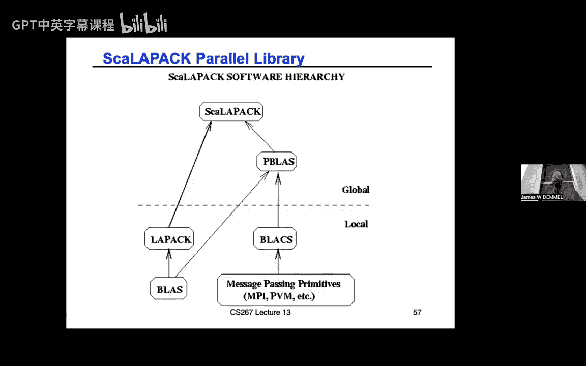

# 【并行计算 CS267 2022】伯克利—中英字幕 p11 CS267 (Sp22) - Lecture 13： Dense Linear Algebra： History and Struct -BV1PS421978D_p11-

Today is the first of two lectures on dense linear algebra。

 and so today I'm going to talk a little bit about what dense linear algebra means because it's a lot more than what we did in homework one。

 which is matrixtri multiply that's certainly part of it， but then I'll do parallel matrix multiply。

But first， I'd like to do a review of。An earlier lecture， very quickly， just one slide。

So what do you call？A program written in Pygas， that's a global address based language based on Python。

And it uses a Monte Carlo simulation to approximate pi。

 so that was done by throwing darts and seeing if they land inside a circle or not。

And it has the race condition so that it gives you a different， funny answer every time you run it。

Any idea？Monty Python。So anyway， so this will not be a formal quiz question so anyway。

 so that's the review of the last lecture。So what are we going to talk about today。

 we're going to talk about the history and motivation of dense linear your algebra and how it evolved evolveded over time。

And then I'll preach to the choir for a couple of slides and remind you why we want to minimize communication and then tell you about the lower bounds on communication that we want to attain for all of our linear algebra algorithms。

And then I will go into some detail about parallel matrix multiply and how we attain that lower bound。

 and the next lecture will be about the rest of linear algebra， dense linear algebra。

So here is just to remind you of where linear algebra shows up in lots of different applications so these are the 13 motifs and including the seven dwarfs that were presented earlier in this semester and the dense linear algebra or dense matrix is highlighted here in blue and you can see and red means they show up a lot and orange a little bit in green not so much and so of course they show up in high performance computing but also in machine learning and games in the spec benchmarks embedded computing and databases even to a certain extent so that's why it's worth' spending a couple of lectures on the dense linear algebra and how to parallelze it。

So what is dense linear algebra beyond matrix multiply。

 It certainly includes solving linear systems of equations。

 but more than that involves least squares problems。 So in that case。

 my matrix A maybe have more rows than columns and so I want to want to minimize the two norm。

 the root sum squares of a x minus B and so that can be an overdetermined problems I just said。

 you know a has more constraints， more rows and columns so I can't solve this exactly or it can be underdetermined so I could a could have more columns and rows in which case there's lots of different x's that minimize it and I want to pick one of them。

It can be unconstrained the way it's written here or you could add some constraints to it so for example。

 you could say I want all the components of x to add up to1 that would be the case if you're solving a problem or the answer is proportions of a population you want them all to add up to one and then it could be weighted you could say some equations are more important than others and so I'm going to weight the error in that equation more than others and that is also done by something called Rige regression so here's a variation of it where I penalize know by picking a positive lambda I I don't want my solution to get too large。

So then there's eigenvalues and eigenvectors of course and for symmetric matrices in that case the standard problem is solving Ax equals lambda x lamb is the eigenvalue x is the eigenvector and if the matrix is symmetric you have extra information that you want to take advantage of you know the eigenvalues are all real and you know the eigvectors are all orthogonal to one another that helps but this also comes up in another case where I have not just one matrix but two matrixrices so AX equals lambda Bx so this comes up you know in civil engineering where I'm looking for frequencies of vibration of a building so I have a mass matrix and a stiffness matrix or to come up in electrical engineering and similarly you're trying to find a vibrational frequencies。

Then all of this applies not just to those common symmetric cases that arise in applications but also to just general non-symmetric matrices and in that case we just we want to find more than just eigenvectors or' things like invariant subspaces and so forth and we also they come with you one matrix or two matrices or even more matrices and in fact they don't even have to be square anymore。

 they could be rectangular that comes up in control theory where we're trying to you know understand the controllability or observability of a system。

Then there's a singular value decomposition also known as the principal component analysis。

 and it uses variations in those algorithms。So in addition to all those mathematical possibilities。

 there's also different lots of different matrix structures that people care about。

 so your matrix could be real or complex， it could be symmetric。

 or in the complex case it could be hermeian， the matrix is equal to its conjugate transpose。

It could on top of that be positive definite all the eigenvalues are positive in that case you can do lots of things much faster than before and dense just doesn't mean all the entries could be nonzero。

 it also includes triangular matrices because you know solving triangular systems comes up a lot band matrices where you have a know where the matrix is only nonzero near the band all of these are included under dense linear algebra。

And in addition to solving all these problems， users want different kinds of answers they want the simple thing right they type a backslash B into MatTLAb and they just want the solution to you know AX equals B but sometimes they want error bound sometimes they want to compute it with extra precision or lower precision or other options and sometimes they want to access the lowle routines too so so far I've talked about this all in the context of deterministic algorithms know you give your matrix and it sort of gives you some guarantees out at the end there's a lot of randomized algorithms too and their class project available on those because when the problem gets big enough you can't afford to run the classical deterministic know N cubed algorithms anymore but people still want to solve it so what they do is they use randomization to create much smaller problems。

Now I can't go over all this complexity in one lecture so or two lectures even so there's lots of books and websites that are available。

To give you more information about all of this so one of the standard libraries for all of this is LAPAC that we're corespons for and so you can find that book online or you know take my math 221 course which is at 8 a today and there's also a lot of website so let me just mention this one this is the guide to available Ma software gams and it's maintained by the National Institute of Standard and Technology and so if you go to that website。

And click around， you can say I want to find all the linear algebra software you click on linear algebra and then you can say I want to solve ax equal B。

 you click on that and you want to then you can say I have a dense you real matrix you click on that and eventually it points you to the software so that you know there's a lot of different tools to help you find all this stuff。

So let me give you， this is going to be spread out over several slides。

 a little history of how this is developed over time and how we got to the point where we are today where there's still a lot of work going on。

So in the beginning was the do loop， that's all that people had in the 1960s and that was enough to build the first version of some of these libraries and the first one which was for eigenvalue problems was called ice packC。

And then a committee got together and decided okay。

 we want to come up with some standards for how to do this because they recognized that there were a lot of you know loops that looked the same in all these different programs and they said why don't we just automate this so that people don't have to write it over and over again and do all the optimization themselves and this was called the Blause one。

The basic linear algebra is separate。And this was a standard library of 15 operations mostly on vectors。

 and the most basic one is called AxB， where I took a scalar alpha times a vector x and added to another vector y。

 but dot products scaling and so forth。And there were four versions of each for different precision。

 single， double， single complex， double complex and about 3。

300 lines of code altogether in the unoptimized reference implementation。

So what were the goals of this？嗯。Yes。As I mentioned。

 it was a common pattern which is you know to ease programming and readability of course。

 but there were also robustness issues so for example if you want to compute the two norm of a vector the root sum squares of all the entries the obvious algorithm is use some x1 squared plus x2 squared etc and take the square root so what could go wrong you know if one of those x's is so large that its square overflows you're going to get an infinity or in those days the machine would crash and you know and then where so you have to do all this careful tedious kind of scaling to make sure that doesn't happen and so they just did all that once and for all so that users could just rely on those routines。

And then the idea was that this was a standard and all the computer manufacturers would take these road routines and optimize them for their own architectures。

So they would write them in assembly language or whatever of the day。

 and so it would go as fast as possible on that platform。

 but the interface would be the same you could always call it on whatever machine you were on and it would always run fast and that's still true today and so if you ever want to use matrixtri multiply。

 it's a later version of this and it's highly optimized。So why is this called the Blause one。

 besides being the first committee， you could remember it by saying they do end the one operations on order end the one data。

And that was used in libraries that followed iceP called LiPAC。

 which was a bunch of linear equation solvers， and that is the source of the name the LiPAC benchmark obviously people still don't use the code from 1960s for that but that is the source of the name。

And just to remind you of the latest record for linear equation solving， which is the Iact benchmark。

And I think this was mentioned in the first lecture and the machine did not change between 2020 and 2021 it's the same old machine。

 it's a fugaku a supercomputer at Reichn Center in Japan and it gets 442 petaflops out of a peak speed of 537 so it spend most of its time doing matrix multiplies and that's on the million by million matrix so pretty large。

You could actually call it an exafloop machine because it also does 16 bit floating point and in that case it does exceed the exaflo know10 to the 18th operations how much parallelism is in this particular platform it has about 160。

000 processors each of which has 48 cores so altogether together 7。

6 million way parallelism so yes you have to program that carefully to use all of that so this is the latest machine but this benchmark has been around for a very long time and there's a lot of historical data available so if you go and look at it this is from 23 years ago I think a little palm pilot this was in an early handheld device and so it got a whopping 1。

7 kilolops on 100 by100 matrix so you can watch this information evolve over time exponentially。

So what happened after the Blaze1？Let's look at its computational intensity because you know that's going to be the bottle inneck communication it wasn't when it was first invented so if I look at AxB I'm doing two n floating point operations you know I'm multiplying an ad on three n reads and writes so I read X I read y and I write y and so the computational intensity is two3hirs。

😡，And so that's way too low to run at the peak speed of the machine because the reads and the write are going to completely dominate the cost of the floating point on modern computers and it also was hard to vectorize on the supercomputers that people started building back then so the committee got together again and said we need a new version of the library and they called it the buse too。

And this was a standard library of 25 operations， mostly on pairs of matrices and vectors。

And therere natural things like matrix vector multiply or gem V for short。

 so scalar times of matrix a times a vector x plus scalar beta times vector y。

Rannk one update so x is a column y transposeses a row so each entry of a is updated that way and also triangular matrices so this means solve the triangular systems of equations by doing know either forward substitution or back substitution。

And again， there were four versions of each routine and another 18，000 lines of code。

 so how do we remember what's in the b too besides being the second committee。

 now they're doing n squared operations on n squared data。

And so the computational intensity has improved， so for matrixtri vector multiply I'm doing about two n squared multiplies and adds on n squared data。

 so I've gone up from two thirdds to two， which is an improvement but which was okay for the vector machines of the day。

 but it's certainly obviously not good enough for modern architectures with memory hierarchies。

So the next step is B three。And that people finally decided didn't take very many years this time that they needed to work on pairs of matrices or even triples of matrices。

 and the most common operation is matrix multiply， which was homework one。

 so matrix times matrix times a scalar you know and added to scalar times another matrix。

 you can also multiply a times a transpose。You know。

 which comes up a lot if I have a symmetric matrix and for example least squares problems and now triangular systems where I have not just one right hand side where I can have many right hand side so B B is a rectangular matrix。

So how do I remember Bs three， I'm now finally doing n cubed operations on n squared data。

And so the computational intensity， which we've talked about before has got now。

 how many flops to n cubed for n by N matrix multiplied on n squared data， read A， read B， read C。

 write C， and so now I have a very large computational intensity at last so I can do all those optimizations we've heard about before and that we'll continue to do。

So this added another 142 routines and 31，000 lines of code to the reference implementations and I should say that when people release code like this。

 they don't just release the software itself you have to release testing code otherwise nobody will trust it and so there's about as many lines of testing code as there is a regular code and that's sort of a general rule you know in this world so the people trust your software so there's。

So what people do， I mean what companies do like AMD and Intel and all these companies is that they have teams of programmers whose job it is to optimize all of these bs in incredible detail for their specific architectures。

 so there's one interface so you know everybody can call the bs with the same interface but whatever platform you're on as long as you link in the vendor's library。

 it will go at nearly the peak speed of the machine。

So you might ask why did you learn about this in homework one it's because the vendors only do these kinds of optimizations for these few subines like this and a few others and so if you want to go fast for your own algorithm you're going to have to do those optimizations yourself so that's why homework one is still important。

So despite all this complexity。The entire description of all these subrts fits on one side。

Which is you know a good summary I'm not going to this is just sort of to show you that it's the complexity is sort of limited。

 it all fits on one slide and so you might ask is it all done？

And the answer is no the committee started meeting again back in 2016 because technology keeps changing and so the question is what are the new things that people decided they wanted and the first thing that people decided they wanted and companies are already doing this is something called the batched laws so that's where you want to do lots and lots of let's say matrix multiplies on small matrices all at the same time。

This comes up in machine learning， no surprise and so what you'd like to do is you may have 100 or 1000 small you know 20 by 20 matrix multiplies and you want to have one subbertine called it spreads that over all your parallel processors in the most efficient way possible。

And all the companies were building their own interfaces and they decided， well。

 we should have a common interface for all the same reasons as before portability。

So the next reason the committee got together was called reproducibility。

 and so that addresses the expectation that users expect to be able to run their code twice。

And get the same answer， bit wise identical answers just by typing A dot out twice。

So why would that not be the case， well it's because Floating Point Ed is not associative。

And so that means that if you're on apparel computer and you're assigned different numbers of processors you know different points from the run。

 depending on who else is assign you know you're sharing that computer with you may have a different number of processors performing your matrix multiplies or your dot products or whatever so you may end up summing numbers in a different order and the computer will just do whatever is the fastest and because of roundoff they'll differ in the last few bits and so most of the time people don't care about that and they're happy to get the same answer to within know machine epsilon but it turns out there were a lot of。

Interesting reasons that people have now thought that was important and the committee got together again。

 so I got interested in it you know back you know a year or two before this because there was an email posting to this website called any digestigest where people asked questions about numerical stuff and there was a。

Company that produced parallel numerical software and they asked。

 does anybody have a parallel sparse linear equation solver that's guaranteed to be bitwise reproducible to get the same answers every time you run it and so why did they want that because that company had customers who were civil engineers？

And those civil engineers were building finite element tools for their customers。

And those customers who were building buildings had lawyers。

And the lawyer said that whenever we run your program to decide if this building will fall down in an earthquake or not。

 it can't change its mind。It has to give you bitwise identical guarantees of safety from run to run。

And so I thought that was an interesting request and so I sent out email to the 100 or so Berkeley faculty who are in this group who do high performance computing and scientific computing and said did you folks know that reproducibility is gone。

 you know you can't trust it anymore， dependent on anymore even in your laptop。Because you know。

 multi core laptops， they can do the same kind of optimizations， and there was an enormous response。

 Most people said， well， how will I ever debug？If I can't run the program again and get the same bug。

 that was the biggest response， but there were some other interesting ones。

 so one colleague Sanjay Govanji in civil engineering said well I do fracture mechanics so I do these largescale simulations looking for these very very rare events and when there were rare event occurs I need to go back and resimulate it and compute all this side information to figure out why it happened and if I can't reproduce that rare event I can't do my science。

And then there was another colleague， Stuart Russell， who's。

has a program which is used 24 by7 by the United Nations to detect illegal underground nuclear testing and so he said。

 well what if my code says they did it and then they didn't do it。

 that would just be a political mess of the United Nations。

So there's all sorts of reasons for this and and following on all this there were all these meetings and conferences and so forth to deal with it and some companies responded。

 Intel produced a version of their MKL library which promises to be bitwise identical every time you run it if you set a flag and promise to run in the same number of coreds so it will go a little bit slower and it just simply promises to do all the operations in the same order every time you run it。

 but it doesn't scale up to large processor， so anyway on this committee we decided how to fix that and we came up with a new algorithm which makes floating point edition associated again。

And it's sort of complicated floating point kind of stuff it requires an accumulator of six floating point words that's enough to make it all associative and in addition to that。

 another committee was meeting at the same time which is the IEE floatinglo point standards committee and I propose a new instruction which they adopted which will make this new algorithm for floating point addition faster you know by a factor of two or three depending on how people do it in hardware so that was sort of the second thing the committee has been dealing with and then there's low precision everybody wants to take advantage of 16 bit arithmetic and of course some people do 16 bit arithmetic one way the IEE standard way some people do it using Google's B floatat 16 so it's all kind of different。

And you so this committee has。made several other attempts in the past to you know add you know sparse bs。

 extended precision bs， some of these have succeeded some of them haven't and I should know because sometimes they just got too complicated and people didn't want to implement it and there's also of course the graph bs which I believe you've heard about that's something that In is working on。

So。What did what happened after the Blas1 Blas2 and Blas3 what was the next step it's a library called LAPAC which implements all of these dense linear algebra operations using the Blas3 as much as possible and so just to give one example beyond matrix multiply the way you probably learned how to do Gaussian elimination and freshman or sophomore class as you take one row of the matrix and add it to the next row to zero out and entry below the column and so forth so the natural way to do it is all what we call Blas1 operations adding a multiple of one row to another but that's going to go very slowly and so what we had to do is reorganize all the algorithms so they spent almost all their time doing matrix multiplies and so how you reorganize Gaussian elimination to do matrix multiplies instead is the next lecture but know that was a big part of it。

And so some algorithms we succeeded in being nearly 100% matrix multiply。

 so linear systems in least squares， but for eigenvalues and singular valuess。

 they only spend about half their time doing matrix multiply and the other half is bs 2 and the slow stuff。

There's also a bounds for everything and lots of variations depending on the structure of band matrices。

 symmetric matrices， and so forth。So our last release was last June and it was about 2。

000 routines altogether and 800，000 lines of code and the testing was about half a million lines of code so as I said you know testing is important for all this and you know we're continuing to develop this and there's various class projects and it's not just Berkeley there's a whole bunch of there's a whole community that contributes to this。

So LAPAC was in the preparallel days and so the easiest way to parallelze it is simply to say， okay。

 if you're spending all of your time calling matrixtri multiply calling theBs then we'll just make the bs parallel and hide all the parallelism inside there and that works fine in a shared memory environment but it obviously doesn't work on the big distributed memory machines which are one of the main topics of this class and so the next project got started in N 95 called Scala packC for scalable LAPAC it's used for distributed memory it uses MPI and much more complex data structures you'll hear more about them later today and in the next lecture。

And since these algorithms are much more complicated。

 there's only a subset of LAPACs functionality available。

 and so we'll hear more about that next time。So let me just tell you about one success story for all of this code。

 they've been widely adopted so if you're if you use MATLAb or the libraries in any of these standard machines or call it nuumpy。

 it's LA packC in the bs under the coverss， even if they provide a different interface。

So one scientific local collaboration where this paid off was an interesting one that was joined between the campus in Lawrence Berkeley labb。

 which was this cover article in Nature back in 2003 and so the science question that they asked and we'll have a guest speaker on this later in the semester because this project is continuing is what is the fate of the universe okay so here in a kind of a nonscientific way are three different possible fates of the universe you walk out at night and look up at the sky and there are three possibilities。

It looks the same as it does now。Or that's first possibility。

 the second possibility is that the sky is empty， that means the universe is expanding very much more rapidly and everything is getting farther and farther away。

The third possibility is you go out and look up at the sky at night and say， oh oh。

 there's going to be another big bang。Because gravity has caused everything to stop expanding the universe has been expanding and start contracting again。

 and so we're going to have this periodic you know big bangs over and over again and so the question is how do you tell。

You know what's the most likely of those three scenarios and it depends on measuring the cosmic microwave background radiation。

So it turns out there's all this radiation from all the different parts of the sky。

 whether there's stars there or not， that were caused by the original big bangang and all that radiation is streaming back and people can measure that and that was first discovered in won a Nobel Prize back in the '60s and people have been measuring it much more carefully ever since。

And what the physics says is that it turns into a linear algebra problem to decide the fate of the universe。

 so what they do is that they put up in this case， a balloon with a very strong sensors on it from 2003。

 and they aim the sensor at every pixel in the sky。

And what they measure is the cosmic micron background radiation coming from every pixel。

And then they form a matrix， which is the correlation between every pair of pixels。

So there's a row for every pixel， a column for every pixel and the matrix entry is the correlation between those two signals over time and it turns out that depending on the height and that gives you a symmetric matrix。

And it turns out the distribution of the eigenvalues。

 will be different depending on which of those three scenarios of the universe expands more rapidly。

 expands about the same or collapses again。And so the good news from you。

 2003 is that it looks like we're in the range where it's just going to continue expanding gradually about the same rate as it does now。

 it's not neither going to accelerate and make the sky empty nor have another big bang。

And so this also won a Gordon Bell Prize for the biggest supercomputing stuff back then。

 and Julian Burrell will be a guest lecture later in the semester。

 Julian's scientist at Lawrence Berkeley Lab， who will tell you about sort of the latest work in cosmic microwave background radiation and the numerical parallel computing involved。

So people have， you know things did not stop with Scalop。

 architectures keep evolving and so let me just tell you about some of the more common the ongoing projects now。

 plasma， D plasma and magma are projects at done by Jack Dongarret at the University of Tennessee he's collaborator and all the LAPAC and Scalopakac stuff and those were motivated by dealing with multicore and GPU systems and heterogeneous systems where you have mixtures of Multicore and GPUs。

And so therere all these different systems because heterogeneity made it very complicated to try to you have just have one version of all these algorithms for all these different architectures and so there's you know attempts underway to try to automate this process to sort of automatically generate the best code depending on the architecture and there's lots and there's websites for if you want to go look so these are all mostly shared memory。

You heterogeneous but in worry of GPUs attached to a multicore platform Sc has also evolved and there's another project called Slate which is its follow on that's also mostly done by Jack Donguera's group it tries to deal with accelerators and different data layouts and all the stuff that users are asked for elemental also attempted to sort of come up with an easier to use version you know gave you easier data structures and so forth unfortunately it's not maintained anymore and then Fane was an attempt to automate everything。

Done at the University of Texas， Austin and Flame stands for a formal linear algebra method environment where again。

 automating it all， and that project's not active anymore either。

 you know but it made some progress on all of that。And so far。

 let me just say that communication is not minimized in any of these algorithms for in any of these libraries for all the different possibilities so so what I want to do now is having given you that history this is my last slide on history I want to go into the theory of what it takes to come up with。

Prorovably optimal algorithms that minimize communication and as I said。

 not even matrix our optimal algorithms for matrix multiplies in all these libraries yet。

So let me just preach the choir for three slides， you've been told this before。

Algorithms have two kinds of costs， arithmetic and moving data。

 and moving data is called communication， and so that it's either between DRAM and cache or between different processors over a network。

And so my model for deciding whether I have a good algorithm or not is I'm going to count the number of flops it performs。

 I'll count the number of words it moves along any one of those wires and I'll count the number of messages it sends so a message is a bunch of words you pack them together in one chunk and send it all at once。

So these three terms are functions of your algorithm。

They're all multiplied by hardware parameters that depend on your hardware。 So time per flop。

 the time per word moved or the reciprocal of the bandwidth and the time per message or the latency。

And so just to put up one slide to show you how far apart these all are。

 this is data from Patterson and Henessy's 2019 textbook that I with permission made a plot out of and so the horizontal axis is you know the year going back quite a few years and the vertical axis is the time。

Over many， many orders of magnitudeal log scale， and so the bottom curve。

 the blue curve is the time per flop。And all the lines above it are either the reciprocal bandwidth or the latency and I have four curves because I'm showing it both for DRAM and for ethernet you for networked communication and so who's the worst one up here which is like seven or eight orders of magnitudes slower than doing a flop。

 it's the latency over the ethernet so this is you know so if you're going to send a message to another processor you better know be planning to do you order 10 to the eighth operations on it to amortize that cost。

And the latency for DRA access is also very large， and then the bandwidth terms are down here。

And so and these are all on log scale occurs， right that we've heard about the end of Moore's law on the end of Denard scaling。

 but they're still you roughly you know straight lines on a log scale so exponential。

And so we want to minimize communication to save time that's the story。

 but the final reason is energy and I'm not sure you've seen this slide before。

 so the vertical action axis is also on a log scale。

 but now it's measuring energy per operation not time per operation。And so and we have red and blue。

 blue is old technology， 65 nanometer and red is slightly more modern technology。

 this is a little out of date， 11 nanometer technology and so you know over this time when the things got smaller the energy costs went down pretty much。

But if you compare the energy to do， and so here is the energy to do arithmetic a flop。

Here's the energy to move stuff around on the chip。You know。

 either in a register or just one millimeter on the chip or five millimeters on the chip。

 and that's all cheap。But once you go off the chip， all these numbers。

 then it's like one or two orders of magnitude， more energy to move data off the chip。

And so we also want to minimize communication to save energy。

So here is our goal for reorganizing linear algebra。

 I want to avoid communication for all those reasons between all the levels of memory hierarchy between all of the wire on all the wires I told you about so between L1 and L2 cache L2 cache and DRAM going over the network and so when I say avoid communication that means more than simply hiding it overlapping communication and computation that's a good idea but if I were able to overlap perfectly communication and computation that could give me at most a speed up of a factor of two。

Factors of two are important， but I want to get large factors。

And so the algorithms that have been invented by ourselves and others show very large speedups and possible energy savings。

 and so we're going to have the same goal for other computational patterns。

 this idea goes well beyond linear algebra， and we have some theories about how to do this for sort of general code that looks like nested loops accessing arrays but there's lots and lots of open problems。

So let me review a previous lecture for the sequential matrix multiply and then do the parallel matrix multiply and say what the lower bound is and what the optimal algorithm is。

So this should be familiar， I want to multiply a times B and this is you know so imagine have they fit in DRAM。

 they don't fit in cache and so how am I going to do it， I'm going to break them up into blocks。

And so if I think of each of these， you know， C sub Ij that represents a B by B sub block of my matrix C。

And a sub IK is a B by B subb so what I'm going to do is have three nested loops and I'm going to loop over all the blocks so if they're n by n matrices I have n over B blocks in each direction and in the innermost loop what am I going to do I'm going to read that B by B matrix into cache that B by B matrix。

Do that matrix multiply with no more memory traffic and update C。And so if B were one。

 this would be the naive algorithm， three nested loops。

And so I want to make B larger so that I can do as much work as possible without any memory traffic and so how big can I make B。

 I need to be able to keep three B by B matrices in cache。

 so3 B squared has to be at most M and that means I can do N cube divided by the squared of M reads and writes。

 you know ignoring constants。So we did this before。

And I think we also mentioned that what if we have more levels of so this assumed I just had two levels of memory。

 DRAM and cache， but a real computer would have L1 cache， L twoth cache and all of that。

 and we can either have three more nested loops for every level of cache or we can do that cache oblivious recursive algorithm we talked about before。

So that is a review of what we did before， I want to generalize the parallel case。

And so here is the lower bound which we also talked about before。

 but we have to generalize the parallel case so assume I'm going to just do the usual N cubed algorithm so not strauossen or anything that's faster than N cube and all I'm allowed to do is reorganize is do the same N cubed operations in a different order so my freedom is I do my reads and writes differently but I'm still doing the same multiplies and ads。

And what they proved is that no matter how I reorganize all those multiplies and add。

 my lower bound is in cube， the number of flops divided by the square root of the cache size。

 which is what we attained on the previous slide by that simple blocking algorithm and the cache oblivious as well。

Okay， so now how does this generalize the parallel case？

So I still need to have the flos in the numerator and the square root of the memory size and the denominator。

 the question is what does that mean in the parallel case？

So M is going to be the memory per processor， okay that's whatever is local on the processor。

And so what is my fast memory， it's what is what I own on my processor， what's the slow memory。

 the analog of D Rams， all the memory and all the other processor。

 that's what I don't want to have to go to。😡，So M is my local memory。

And so that's going to be in the denominator and I'm going to assume quite reasonably that it's load balanced。

 if I didn't want to communicate to all the other processors。

 I could just have one processor do all the work that would minimize communication， but it be slow。

 so I'm going to assume it's a load balanced。So then what's in the numerator。

 I'm not doing N cube flops anymore， it's going to be N cube divided by P。

 every processor gets assigned one piece of the work。And the denominator is still m the1 half。

 so I have to pick the size of my local memory。And so the natural thing to do is to say I want to use as little memory as possible。

 I always assume I have one copy of each of all the data so one copy of a of b and of c so that's 3 n squared altogether and if it's all spread out over all the processors each processor has three n squared over p local memory because it's one piece of all the data so if I plug M equals3 n squared over p into here and there's little cancellation the lower bound turns into n squared over the square root of p that is going to be my lower bound that I'm going to aspire to attain for doing matrix multiplied when I use this little memory as possible。

And this is attained by algorithms that were invented in some cases。

 decades before people discovered the lower amount。

This is not unusual that you know people come up with algorithms， they optimize them。

 and then sometime later people prove there's you you can't do better。On the other hand， sometimes。

 and we had this experience。 we proved the lower bound first。

 They were better than the best algorithms Then we discovered a new algorithm。

 so it can happen either way。😊，Okay， so let me say how this generalizes beyond matrix multiply to make our goal clear。

So M is going to continue to be the fast memory size per processor。

 and that could be the cache size in the sequential case。

 or n squared over P in the parallel case where everybody gets one piece of all the data。

And so the lower bound for the number of words moved either per processor in the parallel case。

Is lower bounded by the numerator is the number of flops， whatever that is。

 and the denominator is m to the one half。 And this doesn't depend on you doing matrix multiply。

 It just depends on。Having three nested loops that sort of smell like matrix multiply so you're accessing three arrays and they have subscripts like i comma K K comm J that kind of stuff。

 so it looks like it。And that's enough to generalize not just to matrix multiply。

 but it covers all the rest of dense linear algebra。

 so all the rest of the bs have the same kind of structure inside of them。

 Gaussian elimination or LUD composition looks the same least squares problems， QR。

 eigenvalue problems， the SVD， even tensor contractions。So what are tensors。

 they're not two dimensional matrices， they could have any number of dimensions and when you multiply them。

 I could have as many nested loops as I like depending on which indices I'm contracting。

 but it's still this theory still applies and that's still the lower bound。

It applies not just to know individual subroutines like this。

 it applies sometimes to whole sequences of these operations， so for example。

 if I'm trying to compute a power of a matrix，So that's going to be multiple matrix multiplies。

 then this theory says that no matter how I interleave all these different matrix multiplies。

 I can't do better than doing them one at a time in applying the lower bound to each one。

It applies not just to dense linear algebra， where the number of flops is like N cubed。

 it applies to sparse linear algebra。In that case， the numerator could depend on the sparsity structure in some complicated way。

 but it's still a lower bound。Now we can't always attain the lower bound in the sparse case。

 so imagine you're multiplying by a diagonal matrix then the obvious algorithm you just scale each row by a scalar you can't beat that and there's no data reuse so you can't attain this lower bound but it's still the theory still works as a lower bound it applies in sequential and parallel cases I said and it applies to algorithms that don't do linear algebra so we don't have to do multiplies and ads in the inner loop can all we have to do is access the data and so for example the all pair shortest path algorithm called Floyd Wel it still looks like those same three nestested loops and all these lower bounds apply and we also have a much faster algorithm for that graph theory algorithm and I'll just say there are generalizations to strauss and algorithms in more general code that looks like loops accessing arrays but I'm just going to talk about linear algebra for today's lecture in next time。

So how do I get a lower bound on the latency， so this is all lower bound of the number of words moved。

 how do I get a lower bound in the number of messages？Well。

 a very simple idea is that I simply say I'm always going to send the largest possible message that would minimize the number of messages。

So I'm just going to take all of these words and pack them into messages that are as large as possible。

 how big is the largest possible message， the whole memory。

 so this is simply a factor of M smaller than this one because if each message is of size M and so that lower bound also turns out to be attainable for matrix multiply。

So let me now plug in the values for matrix multiply into these two formulas in both the sequential case and the parallel case。

 just for contrast。So in the sequential case， n by n matrices， n cubed flops。

 and as we've seen before， the number of words moved is n cubed over the square root of M and the number of messages。

 so if you can pack things to move between DRAM and cache。

 it's N cubed divided by m to the three hats。So what about in parallel。

 so I'm going to assume it's load balanced， so each processor does one piece of all the N tube flops。

And I'll make the assumption for now that I only do I'm going to use as little memory as possible。

 I'm going to have one copy of the data， it's all load balanced。

 so every processor gets n squared divided by P words and if I plug n cubed over P into the numerator and m into the denominator the number of words moved is n squared divided by the square root of P and the number of messages sent is the square root of P。

So you can see there's a tradeoff here that if I make P larger and larger。

 I'm going to communicate less， which is good， I'll also do fewer flops。

 but I'm going to have to send more messages and so there's a trade off which may depend on your architecture as to how to pick the best value of P for any particular problem。

So。When we discovered these bounds， we asked ourselves。

 you know do the classical algorithms that people have been using for decades like an LA pack and Scal pack attain these bounds and mostly not。

 and so there's you know some of them have been improved and there's still some work in progress。

And but in particular， we found a lot of other algorithms that do。

So the goals for our algorithms and I'm just going to talk about matrix multiply today and some of the other algorithms later is I want to minimize the number of words moved。

 I want to minimize the number of messages sent sometimes that's going to require different data structures so we're not going to store matrices in the usual you know arrays that you're used to。

I also want to deal with multiple levels of the memory hierarchy。

 and I also want to do the fewest possible flops when the matrix fits in cache and it turns out that cache oblivious algorithms don't always attain this so I do want to have explicitly tiled algorithms。

And so we have this know in theory a lot for everything， some of them are practical。

 some of them are more theoretical know these algorithms exist。

 but the constants maybe make them impractical， and so they're just a few prototype implementations of those and there are class projects available and we do have as I said in the sparse case。

 it depends a lot on the sparsity structure， and so you have to make some assumptions。

 but it turns out that for Kleski， which is solving ax equal B when your matrix is symmetric and positive definite。

 so it's a simple version of Gaussian elimination。For certain sparseity structures that are very common。

 like you have a two dimensional finite element model then we can attain the lower bound and also and you heard about this the students have been you know student presentations last time mentioned sparse times dense matrix multiply there's also lots and lots of work on that and that comes up in machine learning。

Okay， so now let's talk about parallel matrix multiply and attaining the lower bound。

And so the first thing we have to do is talk about what is the data structure for spreading out my matrix over a bunch of parallel processors in this case four。

 and there's a bunch of natural ones， simple ones that aren't good enough。

 but let me walk through them and until we get to the one that we really going to use。

So the simplest thing you can imagine is taking， if I have four processors。

 just do a column block layout， so every processor gets n over four columns。

 so processor zero gets the first n over four columns。

And we'll see that you cannot attain the lower bound if we use that nice simple layout。

 Another way to say this can't possibly be optimal for lots of other algorithms is imagine I'm doing Gaussian elimination so that in that case I'm sort of processing the matrix starting in this corner and working my way down and just processing you the trailing sub matrix at every step so after the first n over four steps I'm completely done with these first n over four columns and processor zero will be idle for the rest of the algorithm so this is clearly not a good way to do the work so I can fix that maybe by handing out the columns like a deck of cards so that means every processor will get every piece column so processor zero will get column zero column4 column 8 and so forth。

And so that fixes the problem for Gaussian elimination maybe because every trailing sub matrix will still be load balanced。

 every processor will own about a quarter of it。But on the other hand。

 what am I going to do locally there， If I'm storing the matrix this way。

 I can't do matrix multiplies anymore because I only have individual column stored。

 So that is going to mess up my local performance。So here's a compromise I will choose some block size B for which matrix multiply I get some performance and I'll hand out blocks of B in a you like a deck of card so processor zero gets the first group of B。

 the fourth group of B and so forth and so now I can do local matrix multiplies it's still sort of load balanced and trailing submatrices but now I have a different problem that comes up because in Gaussian elimination。

There's only going to be one processor responsible for all the work pretty much on this set of B columns that it owns。

 so there's no parallelism on a single column and that's going to turn out to be a bottleneck。

The same thing is true if I do row versions of all of these。

 so I need to have a layout which breaks it up both by rows and by columns。

And so here is a row and column block layout and so every processor owns a quarter of the rows and half the rows and half the columns。

But now I have that same load balancing problem， if I'm doing Gaussian elimination by the time I get halfway through。

 then only processor three will be busy for the second half of the algorithm and processor 0。

1 and  two will be idle。So here is the layout that works for pretty much everything。

 it's called a 2D Bxcyclic layout。So what I'm going to do is break up my matrix into little B by B blocks so each of these little squares is B by B and I'll lay them out so that each processor owns one B by B block in each of these groups of four so01。

2，3，0，1，23 and so forth So now if I take any square sub matrix it's load balanced every processor owns about a quarter of it and if I take one block column it's also parallel it's not four processors participating anymore it's two processors but that's enough parallelism to hit the lower bound。

So this is going to make the algorithms and layouts a bit more complicated。

 but that's what we need to do。So any questions about that。

 I'm going to obviously use that layout shortly。But before I do that。

 what I want to do is parallellyze matrix vector multiply just as a warm up to so we can get used to the notation。

And so here's what I want to do， I want to parallellyze a times x plus y， where A is a dense matrix。

And I'm going to do it with a 1 D rowb layout。 So here's the layout。

 And so my matrix is going to be broken up into four pieces。

 Proor0 we'll on the first interval over four rows。

 Proor  one will'll on the next interval over4 rows and so forth。And so and similarly。

 processor zero will own the first n over four entries of y and of x。

 processor one will own the next n over four entries of y and of x and so forth。

 so that's my starting layout。And the question is， what is the algorithm that I need to do to do a times x？

And so what I need is that。The processoror zero owns all these rows， so if it had all of x。

 it could just multiply a times x， it doesn't need any more data， and then it owns the destination Y。

So the obstacle is that it only owns a quarter of x。

 so that means the first step is that each processor needs to broadcast its quarter of x to every other processor。

 then every processor gets a redundant copy of x， and then they just do a local matrix vector multiply of their big rectangle times all of x。

And so that's the formula that breaks it up， so each entry of y is just going to be the dot product of the I row of a and X。

So。The communication here， just to repeat， all the arithmetic is perfectly parallel。

 The communication， the bottleneck was every processor has to broadcast its sub entriesries of X to every other processor。

So what happens if I were to do a column block layout instead of a rowblock layout， would that help？

So now I don't have to broadcast x anymore because Pro zero if it owns that block。

 it has everything it needs to own of X， but instead of doing the broadcast。

 I need to do a reduction because every processor is going to update every entry of y。

 and so that means I have to do a global reduction to compute this y by summing every processor's contribution to it。

And so that may so there's a similar bottleneck there。And so then I could also do this 2D layout。

And so now I have 16 processors here to make the picture a little bit easier。

 so processor0 owns that N over 4 by N over4 sub matrixx of a processor 1 owns that N over 4 sub matrix and so forth。

 and I'll similarly assume that processor  zero owns that chunk of X and that chunk of y and so forth and so now I need to do both broadcast X to every processor that needs this processor will have to send x to processor 4。

8 and 12， this processor p1 will have to send that bunch of x to processors 5。

9 and 13 and similarly I'll have to do reduction sideways to get the entries of Y。

 but now I only have square root of P processors participating in each reduction or broadcast which may help。

So now let me move up to matrix matrix multiply， and I'll just and ask you know。

 how does the answer depend on the data layout？And so one of the questions is。

 am I going to use a one dimensional layout or that two dimensional layout？

The other one is which processors are allowed to talk to one another at the same time。

 so the simplest thing you could imagine is just a one dimensional ring where everybody can talk to the nearest neighbor on the left to the right。

Or you could imagine a tous where the last processor can talk to the first processor。

 or it could also be a two dimensional tous， so every processor can talk to their neighbor left or right or up or down。

And so those are going to lead to different algorithms。

 or at least they're going to let us have to scale to schedule the communication differently。

And so my performance model that I'll write down for all of these different algorithms is for communication is the latency is going to be of sending one message will be alpha。

And the number of words moved is n， and the time per word moved is beta。

And so I'm going to just to keep it simple， I'm going to normalize it so that gamma。

 the time per flop is one， so alpha will actually be know latency divided by the time per flps。

 it'll be a big number。And how am I going to measure how well I do。

 I'm going to measure the efficiency， and the efficiency is going to be the serial time divided by p times the parallel time。

Now if I were to parallelze it perfectly， this ratio would be1。

 I would go p times faster in parallel， but you know efficiency will be less than one because it won't be perfect and so the question is how close to one am I that's how'm going to compare different algorithms。

And so let's start with the simplest case with a 1D column layout and see how well I can do matrix multiply。

 and we'll see that I cannot hit the lower bound， but I can still get a high efficiency。

 but I won't hit the lower bound。And so I can have。

 let's say eight processors and each processor is going to own n over eight columns of the matrix A。

 and I'm going to use the notation a sub I to refer to that block。

 so a sub I is going to be an n by n over P sub matrixx of A that's owned by processor I and similarly for B and C。

And then I'm going to use another bit of notation B sub Ij is going to be just a little n over P by n over P block。

 so B11 will be that block of p B21 will be that block of P and so forth。

And so what is the algorithm going to do， it's going to say that the I column block of C is the matrix A times the I column block of B。

And so that means I have to take each column block of a。

 so this is an n by n over P matrix and multiply it by that particular n over p by n over P matrix。

So that those are the chunks in which I'm going to send around all the data。

 so if you know if all of these were scalrs， this would be kind of an obvious algorithm。

 but know there are blocks of N over repeat。So there's the formula。

And so the question is how expensive will this and I'm going to do it on two architectures。

 the first one is sort of the toy architecture， it's where everybody is sitting on a bus or let's say an ethernet where only two processors are allowed to use the wire at a time so one processor can send to another but then they own it during that time and you can't have multiple communications going on。

You know there are some networks like that and the second one is a little bit better。

 quite a bit better I should say they're all connected on a rings everybody can talk to their nearest neighbor at the same time。

So here is the sort of simple algorithm when I'm on a bus and only two processors can talk at the same time。

 and so before I get started， before I do any communication。

 each processor owns enough data to do a little bit of work。

So my PRC is the identity of each local processor， so it's going to take the column block of C that it owns。

 the column block of A that it owns and multiply it by the little n over P by n over P sub matrix of B that it owns。

 so it owns all this data it doesn't need anymore。So now what I need to do is move a around。

 so if I look at this formula， every processor， the I processor is going to need the a sub J for every value of J so I have to sort of make sure that every each column of a eventually is communicated to every other processor。

And so what I'll do is take every I'll loop over every pair of processors。

 so I is0 to p minus1 and J is looping over also0 to processor minus1 except the if1。

And processor I will send what it owns its block of a to column J， so there's the communication。

And then I do that same matrix multiply this n by n over P tall skinny matrix times that little square matrix。

And so this is you know really bad I have to loop over all pairs of processors so I'm doing this p squared time roughly and what's the cost of the inner loop well the computation is in matrix of size n by n over P by n over P by n over P so there's the number of flops in the inner loop。

And the communication is one message。 and the size， of the message is the size of this block。

 which is N。By n over P or n squared over p。 so there's the cost of one message。

So that's the cost of the inner loop。And I'm just repeating that here。

 and so since only one pair of processors are active on any iteration。

 the algorithm is basically almost entirely sequential and the running time is going to be the number of interloop iterations。

 which is roughly p squared times the cost of the innerlo。

 and so two n cubed flops is a completely sequential algorithm。

 p squared messages and p times n squared data sent。

So this is worse than the serial time and it grows with P so this is obviously a terrible idea so why would I even bother telling you about it well if you were in a situation where you only had a terrible network like an ethernet where only one you know two processors could talk at the same time and your matrix was so big you had no choice but to spread it out over P processors then you you might do this。

But let's go on to a better network。Which is a ring where everybody can talk to their nearest neighbors and the left to the right so I can do lots of communication in parallel。

And so now I'm going to use the same trick as in the simple sharks and fish algorithm that we talked about earlier。

 so every processor is going to send its data to its neighbor。At the same time。

 So everything is just going to do a circular shift around on this ring。

And so I'm going to do that by having a temporary array so I need to double my memory。

 so' I'm going to copy my tall skinny n by n over P sub matrix of A into this temporary array。

 I again do my local work that I don't need communication for and then I only have to do P steps now and I'm going to send my local data to my processor to my processor to my right。

And that's。It's my pro number plus one， and it's mod P because at the end。

 it loops around to the front。And then I'm going to receive the data from my Pro to my left。

And then I do my local update。And so the time of the inner loop is going to be pretty much the same as it was before the cost of the6s multiply and now let's just say two messages so I'm going to you know send something to my neighbor to my right and receive something from my left so it's the same cost of the previous inner loop but there's a factor of two there。

So there's the cost of the inter loop again， but I'm only executing the inter loop p times。

 so this is p times faster than the previous one， which is really good。And so what's the total cost。

 it's2 N cube over P fluxps， so that's perfect speed up。 I've completely paralyzed the arithmetic。

And now I'm sending P messages， and so p times alpha is the latency cost。

 and the bandwidth cost is n squared。Or two n squared so you know because I have to send all the matrix everywhere and this it turns out to be it's optimal if I assume that I only have this one dimensionional layout and I really can't do any better than this So if I'm assuming that's what my network looks like why is it optimal well I've sped up the arithmeta perfectly you know2 n cube divided by p and since I have to move my my local submax of a my n by n over P sub matrixx of a to every other processor that the cost of that since I have to go neighbor to neighbor to neighbor is p minus1 times the cost of sending that many words so that's kind of a lower bound and I attain it。

So， but it's still way above the lower amount。In fact。

 this is a factor of the square root of p too large。

 both of these terms are bigger than the lower bound by a factor of the square root of P。

 but let me just compute the parallel efficiency， which is the serial time divided by p times the total time。

And， after I do a little algebra， it's one divided by one plus a term that looks like P over n。

So if n is a lot bigger than P， which is the usual case。

 my matrix is a lot bigger than the number of processors。

 and this is small and the efficiency is close to one。

So this is not a bad algorithm if n is huge compared to P， but as I said。

 we're really far from the lower bound， both of these terms are a factor of the square root of P too large。

So the only way around this is to go back and use this particular two dimensional layout。

And there are historically two algorithms that attain this layout。

 one of them is called sumumma which is short for scalable universal matrix multiply algorithm and it attains the lower bound within a factor of log P。

 you can actually get rid of that log P factor using a more complicated variation but I won't bother telling you that and then the first one was invented was a 1969 PhD thesis and by a canon this is called Cannon's algorithm but he had a bunch of assumptions that A and B were square and the number of processors was a perfect square so it was a nice thesis but you we want something much more general that deals with rectangular matrices and arbitrary numbers of processors。

So after this we you know looked at our lower bound and we realized we can actually beat this optimal algorithm by using more memory。

 so it turns out that if you're willing to use not the minimum amount of memory but if you have enough memory to have multiple copies of your data。

 the lower bound goes down and there's a new algorithm that actually attains that lower bound so I will tell you about that one and then it all extends to Strosin but and theyre different lower bounds。

 I'll just mention that briefly and passing。So this algorithm has been rediscovered many times。

 it's a very natural algorithm， this presentation is going to be based on work of Vanigagon and Wats and it's used in the parallel version of the bs which are called the PBs。

 so it's used in Scala pack and so forth。So I'm going to solve my do my matrix multiply by doing what's called an outer product you can imagine matrix multiply as doing a bunch of inner products。

 you know the I row of a and the J column of B to get a sub I j but i'm going to write it differently。

 I'm going to take the each column of a the case column of a and multiply it by the case row of B so that's a column times a row。

That's a rank one matrix， and that touches every entry of C。

 So this is the way I'm going to organize the loops。

And I'm not going to just multiply a single column of a times a single row of B at a time。

 I'm going to break up a into blocks of columns and B into blocks of rows so this says take the first four columns of a and multiply them by the first four rows of B and update C then take the next four columns of a and the next four rows of B and so this is know what the sum is going to look like so each of these steps is what I'm going to be paralyzing so here's a picture of what I'm doing so imagine I have 16 processors and so p equals 16 in this picture so this represents processor you 0102 and so forth it also refers to the n over 4 by n over4 sub matrix that this processor owns so this is both a picture of the processors and the matrices。

And so at every step， what am I going to do， I'm going to take mathematically a block of columns。

Let's say these are B columns and I'm going to broadcast that sideways so every processor that owns that particular red block is going to send it to all its neighbors in its row then I'm going to take that block of B rows and broadcast it down。

So every processor that owns that a particular you know B by n over four block is going to broadcast it down so everybody has a copy。

 so these arrows mean broadcast。Then every processor will get a message from its neighbor。

 it's in the row， a message from its neighbor in its column andll so it'll get a red block and a blue block。

 and then it'll do a local matrix matrix multipier， it'll do red times blue and add it to the green。

And so that is and so then I'll just loop over all these blocks。

 red going from left to right and blue going from top to bottom。So here is the code。

So I'm going to loop over all the blocks， if B is the block size， or n over B blocks。

 then for each of these rows and their square root of P of them。

 the owner of that red block will do a broadcast。And then for each of these block columns and there's squared P of those。

 these are parallel for all means it's done in parallel。

 it'll take that block of bones and broadcast it down。

 then there's you know we'll receive the data and we'll do a local matrix multiplyier。

So that's what the parallel algorithm is。And I've just written it here again。

 and I've annotated it with what the cost of each line of code is。😡。

So I'm broadcasting something how much does that cost well the number of words moved is going to be the size of the block and it's a be by n over square root of P block that's how big that red block is and if I'm doing a tree broadcasts as a binary tree it'll be log square root of P steps as I do the binary tree。

And since I'm doing a broadcast and the depth of the tree is loggged squared of P。

 that's how many messages I'm sending。And this it's going to be the same for the broadcast of the blue block and then now I do the flops and I'm multiplying a matrix of size。

N over p， n over square root of p by b by b by n over square root of P， that's the number of flaps。

And so the total number of words moved is n squared divided by the square root of P。

So because I just take this number and I multiply it by the number of loop iterations。

 which is n over B so the B cancels and I get n squared。

And that's within a factor of log P of the lower bound。N squared over root t is the lower bound。

And there's a more complicated algorithm that gets rid of the log P factor。

 but I won't bother with that。And what's the total number of messages，s again。

 it's n over B times log P。And so so how do I get close to the lower bound what I want to do is send as few messages as possible。

 so I'm going to make B bigger and bigger and if I pick B equal to its maximum so I'm going to the maximum means I'm sending the whole subb that I own all at once。

 then this turns into the square root of P。But that's going to double the memory which you know。

 I may or may not be possible to do。And the flops are perfect， it's2 N cubed over P。

So this attains the lower bound， let me show you some performance data。

And so this is on some old processors， I'm going to show you some more modern processor shortly。

And so what I have here， each row refers to a machine， and in the data for each machine。

 I have four processors， 16 processors and 64 processors。

 and I'm running it on a matrix of size 2000 by 2000 or 4，000 or 10，000。

So I'm doing this so we can see what the trends are。

And maybe the easiest way to see the trend is not to look at the raw performance。

 but it's to look at the performance compared to perfect speedup so what I'm going to do is take all these numbers and say how fast am I going compared to just running DJM locally and assuming communication were free。

So this number here， 0。73 says I'm going at 73% of peak。knowIf communication were free， you know。

 I could only get up to one， so for this particular problem on four processors 2000 by 2000 I'm getting 73% a peak。

And all these other numbers， you can see they're about 0。5 or bigger。

 so I'm always getting at least half of peak。SoBut here are the two trends that are interesting is I increase the number of processors。

 so as I go down in any of these tables， the efficiency goes down。

And that's because if I have a fixed problem size and I'm spreading it out over more processors and the communication gets relatively larger and becomes more of a bottleneck so you know it's still faster so but instead of going 16 times faster。

 you know it' you know going from 0。73 to 。58 I'm not quite going 16 times faster。

So that's one trend， the other trend is if I look sideways。

 so I'm going to keep the number of processor fixed and make the problem larger。

 the efficiency goes up， it goes up if I go sideways and that's because for a larger machine for a larger matrix with a fixed machine I'm spending more time doing local matrix multiplies and it becomes more dominated by arithmetic and the communication doesn't matter so much so I get a higher fraction of peak。

So that's sort of a general trend that you can expect on this。

 this is just some old data we'll have some more modern data。So。As I said。

 this was assumed to be the optimal algorithm for many years。

 and then we realized we could beat the optimal algorithm。

And that's because we had an assumption that we were only going to use the minimum amount of memory。

 we're going to have one copy of all the data， which means that n squared over p was that M and the denominator。

But if our matrix is small enough that we can fit multiple copies of it into memory。

 we could make the denominator bigger by a factor of C。

 like if we could fit four copies of all the matrices， I could change M。

to you know4 n squared over P and so if I plug that into the denominator and if I'm allowed to have C copies of the data。

 my lower bound for the number of words moved gets smaller by a factor of the square root of C and the number of messages goes down by a factor of C to the three hs。

And so if I can afford to have 16 copies of the data。

 I can go four times less arithmetic and 64 times less messages。So the question is。

 can we attain this new lower bound？And it turns out there was a special case that had been known and rediscovered many times in the literature for the very special situation where you can afford to have P to the one third copies of all your data。

😊，And this was， you which is not necessarily very realistic， so if I have 1 thousand0 processors。

 that means I need 10 times a memory。And the way it works is that all the processors are organized。

 not just in a square root of P by square root of P grid， they're organized in a 3D grid。

 that's why it's called 3D matin， so they form a cube。

 P to the one third by P to the one by P to the one third。And in that case。

 each processor can actually hit this lower bound where you plug in C equals P to the one third。

 but the thing is there's not always that much memory available。

So we figured out how to do it in general， no matter how much extra memory you have。

 and so here's a high level description of the algorithm。

So suppose I can fit C copies of the data in all my processors。

 I'm going to lay out my P processors in this sort of three dimensional grid。

 there's going to be C layers， each layer is going to get a separate copy of the data and then each layer will have P over C processors total arranged in the square so here's what it looks like if I can afford to two copies of the data。

So to write down the algorithm let me just use these indices and so if we assume that all the data is initially living just in the top because it fits there so that processor owns you know that n over4 by n over four sub matrixtrix then the first step of the algorithm is that that processor will broadcast its submatrices of A and B down so every layer will get a copy so I have C layers I have C copies。

Then each layer will run one see of the sum algorithm。

 in this case it'll perform one half of all the partial sums that it needs just based on the data that it owns。

When I'm done with that， all of the partial sums that I need to add up to get the final answer will be on top of one another in one of these columns。

 so then I'll just do a vertical reductions in each column to get the final answer so that the final answer appears at the top。

So this turns out to scale perfectly。So here's some data that shows you how it scales so this is a fixed problem size of 65 k by 65K matrix on an IBMBGP going from 25060 2048 processors and each time I doubled the number of processors I use all the memory that's available so so there I can have two copies of the data for copies and eight copies and so forth and the vertical axis is this percentage of peak and it's flat for this algorithm that means it's scales perfectly whereas if I assume I only have one copy of the data it keeps getting less and less efficient so here's another example on smaller data so here is an 8k by 8K matrix and it got a 12x speed up。

So the vertical axis percentage of peak and so the classical algorithm with just one copy of the data was getting like5% of peak。

 but when I allowed myself to make copies， I was getting more like 25% of peak。

And so and for a larger matrix， I also got a big speed up， but it wasn't quite as good。

So if I do a breakdown of where the time got saved。

 so here this is normalized to have the one copy of the data and here it's you know I'm allowed to have many copies of the data and I've color coded by how much time is spent communicating。

 how much time is spent idle doing nothing useful and how much time is spent doing arithmetic。

And both the communication the idle time went down by a factor of well， 95%。

 So I got rid of 95% of the communication and surprisingly。

 even the flocks went down So how could that be because I'm doing the same number of floating point operations。

It turns out that in the new algorithm， the local matrix multiplies are faster because I'm running them on bigger I'm doing matrix multiplies of bigger matrices so the local bs went faster that gave me a 12 x speed up。

And for this larger matrix， I also got rid of most of the communication， but since the green part。

 the flops were already as fast as possible， I couldn't improve those。

 but if most of my energy were spent communication。

 I may have gotten rid of a large fraction of my energy。So this won a distinguished paper award。

 and I'm pleased to say that a few years ago I was teaching this algorithm in this class and there was a student who thought it was a good idea and did a startup called Nirvana。

 and it was acquired by Intel a few years later。He had a lot of other ideas too。Okay。

 so let me just look at the time here， it turns out we get you can prove this algorithm gets perfect strong scaling。

 I showed you the picture where the line was horizontal。

 but the theory says that every time I increase the number of processors by a factor of C。

 the total memory increases by a factor of C。And so if I use that and do the algebra。

 it turns out the number of flops goes down by the proportional to the increase of the number to C。

 the memory， the bandwidth cost goes down by a factor of C and the latency cost goes down by a factor of C。

 so it's perfect scaling。And I just I won't do all the algebra。

 we have a similar model for energy where we count the number of joules for doing a flop for doing moving a word of data or for doing a message。

 we also count the energy for keeping the memory alive so Juules per second of words and then leakage and all of that so this is a fairly detailed model and it turns out we get perfect scaling in energy if I double the number of processors I can do the matrix multiplies twice as fast for the same amount of energy。

So how can that be， I have twice as many processors， they're all burning power at the same rate。

 but they're only turned on half as long， so you know that cancels and it's the same amount of energy。

So this is a perfect you sort of the best thing you can imagine from an algorithm。

But it all hits a limit at P to the one third， you can't go keep increasing the memory and keep going faster forever。

 by the time you hit P to the one third copies it all ends and that's the best you can go。Yeah。

And there's a bunch of papers on this。So I'll just quickly say how does this extend to Strosin so here are all the lower bounds that I mentioned for matrix multiply and I've written them there so you can see there's a three appearing in many places and all you have to do when to compare it to Strosin is change that three to log base2 of7 so this is very simple PowerPoint but the math is a lot harder。

So the communication lower bound is now I take that n over m to the one half the third power and change it to the log base two of seven。

The number of messages there's a similar bit of algebra。

 and I can only go up to not P to the one third processors。

 but this funny thing one minus two over log base two of seven。

 and that sort of gives you hard limits on how fast you can make everything go。

And this won another best paper prize。And so just to close， i'm almost done here。

 so here's some real timing data on a matrix of a fixed size in 94K by 94K matrix on processors going from 49 up to you know about 3000 y49 it's seven squared and seven is a number that's drawss and likes so this is why we chose these particular layouts and each curve shows you the speed。

 the gigaplos for different implementations of matrix multiply and the horizontal dotted line is the machine peak。

For a classical algorithm so how do we measure how do we compare algorithms that do different numbers of flops to be have a fair comparison What we do is we take n cube divided by the time whatever the algorithm is so that means if Strosston is doing you know fewer flops it's fair to compare n cube divided by time you know and say it's faster so this is how it works so here's the classical 2D algorithm and you know it's getting like half of machine peak。

Up here is where we do the 2。5 d algorithm where we have multiple copies and it's getting closer to machine peak。

The blue lines are previous attempts to paralyze dawson and the red one is our new version where we take advantage of the same trick having multiple copies of the data and it's much faster than everything else this was sort of a world's record for making matrix multiply go fast。

So just to close today's lecture， all of these parts are going to appear later。

 we've talked about the bs， we've talked about MPI。

 MPI is going to be the building block for what we call the basic linear algebra communication sub teams so we can send one submax to another from one pro to another。

That combined with applause， gives us the parallellause。

And then LAPAC I mentioned runs on one processor and you put all those together。

 and that's how we're going to create the general parallel library called ScPA。

And so and I'll tell you in more detail about that next time。So I'll end there。

Are there any questions？On chat or anywhere else。Okay， see you on Thursday。

