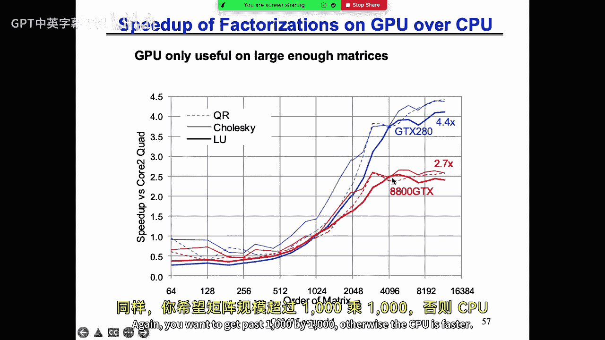
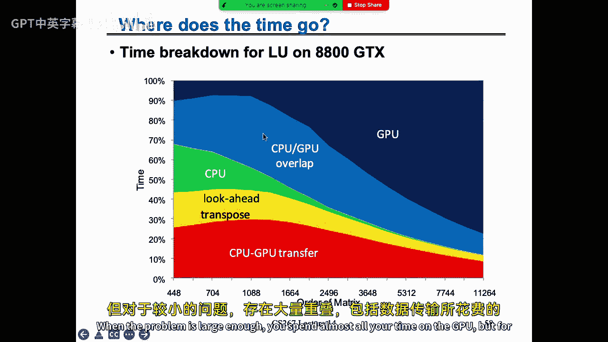
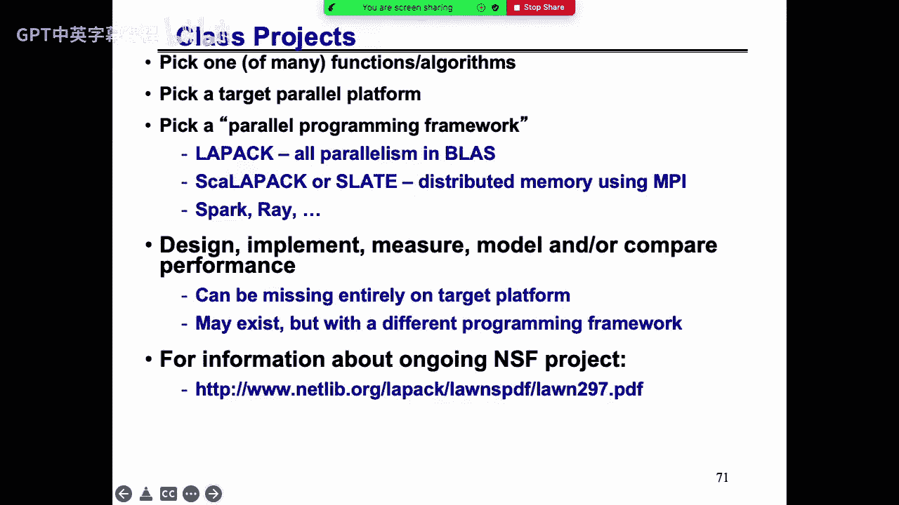

# 【并行计算 CS267 2022】伯克利—中英字幕 p12 CS267 (Sp22) - Lecture 14： Dense Linear Algebra： Parallel Gaussian -BV1PS421978D_p12-

rry for the delay， everybody。I hope everybody can hear me， yes。And today。

 we're gonna have the second of two lectures on dense linear algebra。

 And I'm going last time we did matrix multipa。 And today I'm going concentrate on Gaussian elimination and Q R。

 But the ideas extend to the rest of dense linear algebra。

 And so let me recall the optimization goals that we had last time。 So well。

 we're gonna to start by reviewing the optimization goals， minimizing communication。

 Then I'll review Gaussian elimination for solving a X equal B。

 I'll start with the you know freshman or sophomore version。 you learn。

 Turn it into three lines of code that we can then reason about more easily。😊。

And then I'll talk about what we've done what has been done for many years for the conventional optimization to minimize communication of Gaussian elimination just for cache is on sequential machines。

 And so the idea is to try to use as much matrix multiply as possible。

 But that turns out not to hit the communication lower bound， exactly。

 And so it turns out there is a recursive algorithm。

 which is analogous to the recursive algorithm that we did for matrix multiply that does hit the bandwidth lower bound。

 And it's possible to tweak it to hit the latency lower bound， too。

 But I won't go into those details。 And then look to the parallel case。

 And I'll talk about data layouts on parallel machines， which I introduced last time。

 And I'll say in more detail why we have to use the 2 D blockscyclic layout。

 Then I'll talk about how it's done in scal a pack， which is parallel Gaussian elimination。😊。

And it turns out that it doesn't hit the lower bound。So theres some a new algorithm that we need。

 which changes the way we do pivoting。 and it's called communication avoiding L U。 And。

 and so this is， you know， we have a prototype for it。

 but it's not in the general release yet that does hit the lower bound by pivoting in a different way。

And then I'll summarize the rest of dense linear algebra。And including Q R。

 And just give a high level outline of that。Then I will move on to GPus because there's a completely different set of issues you have to deal with with GPs and talk about how that works。

And then dynamically scheduled L U for multi core。 So， there's， again。

 a whole different approach for making this work， as quickly as possible on multi core machines。

And I'm pleased to say that the ideas in this talk for optimizing Gaussian elimination in Q R won a best paper Pri back in 2016。

 So these were， you know， novel ideas。😊，And the GPU work， which was done by a former C S 2。

67 GS I Vasili Volkov， who now works in NviDdia， that also won a best paper Pri。 And more recently。

 it won a test of time award because it's been cited over 100 times since it was published， you know。

 back in 2008 when he was a GSI。So what are our optimization goals。Minimizing communication。

 of course， we want to do about the same number of flops。

 It turns out we're gonna do order n squared more flops than the classical algorithm。

 which does N cubes。 So we don't mind because the amount of communication will reduce more than makes up for the few extra additional flops。

😊，So we want to make sure we get the right answer， modular round off。

 And so the change in the algorithm is going to be how we change pivoting。

 and pivoting is essential to get the right answer。

 So it'll be a different answer than the traditional algorithm。

 But it's roughly the same error bounds。So just to remind you。

 what are the communication goals for both bandwidth and latency。

 And so this is the case where I have a cache of size M， just a two layer memory hierarchy。

 The number of words moved is the flops and cube divided by M to the one half。

 And the number of messages is smaller by a factor of M。

 If you send the largest messages all the time。So what about。

 what are the parallel communication goals。 So there are two cases。

 The first cases when we just used the least memory possible。 So one copy of all the data。

 And in that case， the number of words moved is n squared divided by the squared of P。

 And the summa algorithm for matrix multiply attain that。

 And the number of messages was P to the one2。And again， that was attained by summa algorithm。

 But we had an additional goal。 Remember， which is if we have additional memory and we can afford to replicate the data C times。

 can we do better。 So here's what we did for matrix multiply。

 We decrease the number of words moved by a factor of C to the one half。

 the number of copies to the one half。😊，And we decrease the number of messages by a factor of C to the three hs。

So needless to say， these same lower bounds do apply to Gaussian elimination and Q R and and other algorithms。

 So for a long time， we tried and tried to attain these lower bounds。

 and we could attain this lower bound。 The number of words move。

 But we couldn't ever attain this lower bound of the number of messages。

 So what do you do when you can't invent an algorithm。 You that goes as fast as you want。

 You prove a new lower bound。And so what we did was we proved there's a new lower bound for the latency for Gaussian elimination in Q。

 R that is significantly larger。So it goes up by C。 So if we're going。

 if we have C copies of the data， then the number of messages is going to go up。 And so you can。

 and so basically， what we proved is that the product of this term and that term is always at least n squared。

And， and so if you make the number of words go down， you can make the latency go up。

 So the number of copies is a tuning parameter， depending on the relative cost of latency and bandwidth。

 Yes， a question。What is QR。Excuse me。So this is solving least squares problems。

 So L U is Gaussian elimination。 And Q R is solving least squares。 And so this refers to， you know。

 how we fact the matrix factorization。 A equals L U。

 You factored into lower triangular L times upper triangular U。 And for least squares。

 you factor it into orthogonal matrix Q times an upper triangular matrix R。 And。

 and so I'll go into more detail。 you know， on that math background when we get there。

 But most of the this is going to be about Gaussian elimination。And so as I said。

 the way we could attain these new lower bounds is we had to replace partial pivoting。 You know。

 the classical thing that I'll remind you of from， you know。

 freshman and sophomore days about how we get the right answer。😊，So now。

 let me take a few slides and start with freshman and sophomore numerical linear algebra Gausian elimination and change it into three lines of code。

 which I can then reason about how to optimize it。 So how do we solve the system of equations。

 What we're going to do is take a multiples of each row and add them to later rows to  zero out the matrix below the diagonal。

😊，So what we're gonna to do is loop over all the columns and0 it up below the diagonal by adding multiples of of row I to rows I plus1。

 I plus 2 and I plus 3。 So here are the three nested loops that do that。 And so I have to compute。

 So I take。And so what's the multiplier。 So the， the innermost loop adds a multiple of row I to row J。

 And， you know， and so K is looping over all the entries in the row。

 And there's the multiplier that creates those zeros。Okay， so that is， I hope the。

 the algorithm that you're familiar with。 And I'm gonna to sort of change it one line at a time to get it to be three lines of code。

So there's the initial version again。 And I'm just， here's the first modification。

 which is that I don't want to do this division inside the inner loop。 That's silly。

 I should just compute that once and then reuse it。

 So I'll precompute that multiplier and then just use it inside the inner loop。😊。

So now you can see the inner loop is what， you know， is a blast of one operation。

 We're multiplying a vector times a scalar and adding it to another vector。

 And so M is going to be this multiplier。So I just repeated the code up there。

 And the next simple optimization is， what am I doing with this row。

 I'm zeroing it out below the below the diagonal。 So why compute zeros， That's a waste of time。 I。

 If I know the answer is 0， I'm just going to loop instead of going from I to N。

 I'll go from I plus one to N， because I know what the answer is in column I at 0。

 So I'm not gonna bother。 So I just change I to I plus1。So， the next。

Optimization is I'm going to need those multipliers later。 And you'll see why。

 And so where do I put them， I'm going to put them in that entry that I would have zeroed out。

So that zero entry is now going to store the multiplier。

 So M gets overwritten and the entry would be zeroed out。 And that， and so that。Becomes M。

And so now I hope you can see this is starting to smell like matrix multiply。 If you look at this。

 you know， look at the subscripts。 J， I， I K， J K， This is what matrix multiply is really doing。

 So this is getting closer and closer to matrix multiply。😊。

So there's those three lines of code again。 And this next simple optimization is I'm just going to split this inner loop。

 So first， I'm going compute all the multipliers in the first loop。 So I'll you know。

 compute this entire column of multipliers。 And then I'll do all of the additions of one row to later rows in the next two loops。

 So this is identical to that， except for having split the loop。 So this you。

4 J loop appears twice and there it appeared once。😊，Okay， so there it is again。 And now I'm。

 I'm going to get the three lines of code。 So there's what I had before。

 And what I'm going to recognize is that both of these nested loops are a single call to the blas。

 a single call to the basically neural algebra subberines。 So here's a picture of what we're doing。😊。

After I steps， what have I've done， I finished computing all these rows of U。

 I finished computing all those multipliers。 And then what do I do。

 I take all these entries that I would have zeroed out， and I just divide by the diagonal。

 That's a buse1 routine。 You know， scaling a vector by a vector by a constant。

 And then I take that column。 and multiply it by that row and subtract it from that trailing sub matrix。

😊，And so that's called， if you remember the math， updating the short compliment。

 And so this is a rank1 update。 I take each entry there。

 multipplied by that entry and subtract it from that entry。

And so that's another single call to the Blas。 It's the Bz 2 routine， though， right。

 because I'm doing order n squared work on order n squared data。And so there it is， again。

 the three lines of code， classical Gaussian elimination。 And so let me write down the。

 the math that says， what have I actually done by the time I finished this。

So let me call that all those multipliers that I filled in below the diagonal。

 I'm going to call that a matrix M。 That's a strictly lower triangular matrix。

 So it just I'm just making it up mathematically。 So I'll call that M。

 So it's 0 everywhere except where I've put the multipliers below the diagonal。 And then again。

 this is just you know， a mathematical construction。 I'm going to imagine a lower triangular matrix。

 which has M below。 And then ones in the diagonal。 And so I don't need to store the ones there are implicit。

😊，And so， and also， I have an upper triangular matrix when I'm done。 I'll call that you。

So the lemma is that what I've really done is I've taken my original matrix A。

 and I've factored into a product of L times U， lower triangular times upper triangular。

 That's what we've really done with Gaussian elimination。😊。

And now I can use that to solve a X equal B。 How do I do that， I do that factorization。

 That's the lion's share of the cost。 It's two thirds n cubed。

 Then I'm going to use those L U factors to solve。 So first。

 I'm gonna solve L times y equals B for y。 And that's just substitution because it's a triangular system of equations。

 And then given why， I solve u times x equals y。 again， just doing substitution。

 And I claim is that's my answer。 So let me just confirm it。 what's a times x。

 That's L times u times X。😊，And u times x is y。 And then L times y is B。 So A X equals B as desired。

 And this is the standard algorithm that we always use。 We do this factorization first。

 And then these are just two calls to the bs，2 triangular solves。And so just to draw the picture。

 I'm overriding the matrix A with this lower triangular part and this upper triangular part。

 where the ones in the diagonal of L are implicit。Now。

 is this a good idea to implement this as three lines of code。

You could just call the library the do the bs。 But we know this is the b 1 and the plus 2 are not very fast。

 And so that's a problem。 And so we know， we need to fix that。

 We want to go at the peak speed of the machine， which is matrix multiply。

 which we talked about before， that's going to go fast。

 The other problem with this algorithm is that what if AI I is 0 or something very tiny。 You know。

 And I divide by it。 Something is going go wrong numerically。

 And so what I need to do is change the order of the rows to make sure I don't divide by a tiny number。

 That's called pivoting。So let me just， you know， do those two fixes。

 and that'll give us the final correct algorithm that we need to， for optimization。

So here's an example that， obviously， if I tried to divide。A，2，1， that one by 0。

 It would fail immediately。 But this is a trivial matrix to solve。 We shouldn't have any problem。

 So what is the standard approach， If the diagonal is too small， look below it。

 find a big entry and swap it， swap those two rows。 So in this case， I would swap these two rows。

 and I'd have one on the diagonal and everything else would be fine。😊，And so otherwise。

 something could go wrong。 So even if it weren't 0， but just tiny， I would get a wrong answer。

So here is the modified code that does it all。So when I get to the I column， I'm going look。

Starting at the diagonal and below， And I'll find the largest entry in absolute value。

 So that means you know， find the largest A JI。And if it's 0， that tells me I have a singular matrix。

 So I have to return with a warning。Otherwise， I， if K， if the largest entry is not on the diagonal。

 I swap the two rows and I keep track of that swap。 And then the rest of the code is the same。

And so now， notice that this AI I is the biggest entry among all of these。

 So each quotient is less than or equal to one。 And that keeps things stable。

And so how does that change the factorization， I'm not computing a equals L times U anymore。

 I'm computing a equals a permutation times L times U。And so， oops。

And so that means when I do the solve， I need to keep track of that permutation。

 But that's a very cheap thing to do。 I just have to take one of my vectors and reorder it。

 That's an order and operation。And so this this code is a building block。 We're going to use later。

 And so I'm， I'm going to use this not on square matrices。

 I'm gonna use it on rectangular matrices when I do the blocking or the tiling of the algorithm。

 And so this， and this is an Lpac subroutine。😊，Okay， so now we're going get the right answer。

 But now we have to fix the communication， the performance issues。

And so just to repeat this thing before， if I'm， if this is the code that I run， you know。

 except for the pivoting， then this is gonna run at Blas 1 speed， which is down here。

 And this is going run at Blas 2 speed， which is down here？

 So this is speed versus the size of the problem， There's the peak of the machine。

 And only if I do bs 3 matrix multiply。 Am I ever going to have a chance to get close。

 So how do I reorganize these three lines of code， So I'm doing matrix multiplies instead。😊。

And so this is harder than， you know， doing it for， you know， matrix multiply itself。

 It was kind of obvious。 So here， the idea that's going to be used for Gaussian elimination and everything else is called delayed updates。

So that means that instead of updating the entire trailing matrix， instead of， you know， doing。

 you know， updating every trailing column， I'm going to save up a lot of my the work and apply them all at once。

So saving them up and applying them all at once， that turns it into a matrix multiply。

And we'll see that code in a second。And so that means I'll spend most of my work doing a matrix multiply。

 I hope。The same idea works for a lot of linear algebra。 So least squares and， you know。

 other kinds of linear systems。 It doesn't work completely for eigenvalue problems or the singular value decomposition。

 PC A。 We need more ideas for that， but it's still important。 There're still， you know。

 it's still a tool。So the first approach is that we need to choose a block size。 We have to。

 So what we're gonna to do is process my matrix B columns at a time。

 And I'm gonna just do gausian elimination on those B columns。

 And I'm gonna not touch the rest of the matrix。Then when I'm done with those B columns。

 I'm going update the whole rest of the matrix with one big， you， matrix multiply operation。

And so how do I choose this block size， Ily， So I'm gonna have an N by B sub matrix， You know。

 a tall thin sub matrix。 Ideally， that would fit in cache。You know， you know。

 and then I wouldn't have。 And then the Blas 1 and bs 2 would be fine。 And。

 but B should be large enough so that later， when I do a matrix multiply and one of the matrix dimensions is B。

 it B should be big enough that matrix multiply runs fast。So let me show you the algorithm。And I I。

 I won't choose B on here。 It'll be a parameter。 So what I'm going to do is process the matrix B columns at a time。

 And so I'm gonna loop， you know， from one to N， step B。And so I'm gonna go from， you know。

 column I B to end。 That's going be my chunk of columns。

 So if I've gotten part way through the algorithm， where， what have I done。

 I finished computing this part of the U， and I finished computing that part of the L。

 And I'm working on that trailing square sub matrix right there。

So the first thing I'm going do is just run that。Blas 1 and bs 2 Gaus elimination on that tall skinny matrix right there。

 which has you know， some number of rows， but only B columns。

 And I'm going to factor it into a permutation times a lower triangular matrix。

 which is going to be of this dimension times a little upper triangular matrix。

 And so this is what it's going to look like。 This matrix here is going to get overwritten by the L factor。

 So that's the lower triangular part。 It's going fill in all of that。

 Time U And U is going to be this little tiny triangangle up there。😊，So that is going to， you know。

 fill in this matrix here。So the next thing I need to do is start updating all the rest of the matrix。

 hopefully using Blas 3。And so let me let L， L just be that tiny little triangle there right at the top。

 And then the next operation I need to do is update this matrix。

 And that's going to be a single call to a buse 3 routine。

 which does a triangular solve with L L and all of those columns。😊，So that's going to runyme。

 hopefully， at peak speed。So L， L inverse times all of those columns， the pink matrix。

And then finally， the matrix multiply is Id take that blue matrix。

 multiply it by the pick matrix and subtract it from the green matrix。😊。

And that's hopefully going to be where all the time is spent。 and will go as fast as possible。

So let me show you some performance data as to how well this works And you know。

 that we still have some goals。 This doesn't solve all our problems。

So here are some really old machines。 I'll show you some more modern machines shortly。

 So the horizontal axis is a bunch of machines， and the top is efficiency。

 where I've measured the efficiency in three different ways。

So the red curve is the speed of that algorithm I just showed you divided by the speed of matrix multiply because we can't go faster than matrix multiply。

 And so you can see we're getting you know， a decent fraction of the peak speed of matrix multiply。

 But there are some， you know， drops down to 50%。 in particular。

 let's look at going from a single processor on this platform， or crazy C 90 up to 16 processors。😊。

So this means that going from here， where we got like almost 100% efficiency。

 we only got 50% efficiency here。 So instead of getting a 16 x speed up， we got an 8 x speed up。

 And that's because the matrices were too small to take full advantage of all 16 processors。

 So it just didn't run as fast。If you compare the speed of that algorithm I just showed you to the best hand tuneed version。

 you get the black line。 And as we know from homework 1。

 there's lots of fine tuning you can do by hand to make these， these codes run faster if you， you。

 tune lots of things rather than just using you know， a standard tiled algorithm。 But anyway。

 that's the starting point。 And it， it gives you， you know， pretty good speed ups。😊。

So now let's go on the parallel case。 And the first thing I want to do is give you a very simple one slide explanation of why we can't do better than matrix multiply。

 that the communication lower bound is going to be the same for Gaussian elimination as matrix multiply。

And the reason that's true is very simple。 I can reduce。

 I can use Gaussian elimination to do matrix multiply。

And so I can't do less communication for Gaussian elimination than matrix multiply because it's kind of embedded in it。

 So let's， let me build that block matrix。 You know， I want to multiply A and B。

 And so these are all N by N blocks。And when I run Gaussian elimination， lo and behold。

 there appears a times B。 That's the answer。 So any Gaussian elimination algorithm that runs on this has to do a matrix multiply implicitly。

 And so I can't， you know， hit a lower bound than that。

 And so I'm gonna have the same communication goals。😊，So， so let's ask ourselves。

 does this hit the lower bound in the sequential case， And the answer is only sometimes。

 So here I I'm just repeating this code from before。

 And so without doing all the complicated counting。

 let me just tell you when it does and when it doesn't。The first case is when the matrix is huge。

 You can't even fit a single column in the cache。 So n is bigger than M。 In that case。

 it attains the lower bound。 And the optimal block size is the same as matrix multiply square root of M by square root of M。

 So that's the easy case。Case 2， which is also easy。 The matrix is so tiny。

 The whole thing fits in cache。 In that case， you read it in and you can use any algorithm you want。

 You touch it once。The hard case is， when it's medium sized。You can fit one column into cache。

 But you know， it's， you can't fit a square into cache。 a medium size matrix。In that case， you， you。

 this does not hit the lower bound， no matter what block size you pick。 So B is my parameter。

 I can twiddle to try to hit the lower bound， and I can't do it。

 I'm always off by at least a factor of， well， it's not a big factor。

 The sixth root of the cache size。And so I need a new idea。And remember， when we did matrix multiply。

 we said， well， there's a tiled algorithm， but there was also this recursive algorithm where I broke the problem up into four smaller sub blocks and multiplied those and just kept doing that recursively。

 I'm going to use the same trick for Gaussian elimination。😊，And so the question is。

 how do I take a matrix and divide it up and do Gaussian elimination。So here is this is。

 this algorithm goes back a long time，1997。 And basically， I'm going， it's called recursive L U。

 So R L U。 And basically， I'm gonna do L U in the left half of the matrix。

And then I'll do L U on the right half of the matrix。 So that's the。

 the very simple divide and conquer。And， and here it is in code。

 So I'm gonna take my matrix and divide it in half left and right。

 And then I'll just call this routine recursively on the left half。 And when I'm done， I'm gonna。

 it'll return U 1 and L1。 Okay， by this recursive call。😊，Now。

 I have to update the right half of the matrix。So the first thing I have to do is update that。

 And that's just a big triangular solve with L1，1 and the block that was up there。 So that's a。

 you know， a call to， you know， a Buse 3 routine。Then I have to update that trailing matrix。

 And now that's that I multiply the blue sub matrix times a red sub matrix and subtract it from the green one。

 So that's another call to matrix multiply。 This is the same algorithm as before。

 I'm just doing the operations in a different order。😊，And then I call it recursively on that block。

 and I get L 2 times U 2 equals a 2，2。And so， and I haven't put in pivoting here。

 but you can do pivoting as well。So let me just repeat the code up there and write down the analysis。

 the recurrence that says how many words I've moved。So now， so W of M。

 N is how many words this algorithm moves as a function of the number of rows M and the number of columns n。

And so this is the call on the left half of the matrix， Sam number of of rows。

 but half as many columns。Then I do this triangular solve in this matrix multiply。 That's this term。

 And then I call it recursively， again， on this smaller sub matrix。M minus N with fewer。

 both fewer rows and half as many columns as I had before。

And then when I go ahead and solve this recurrence。

 I get basically what I expected to within a factor of log M。

 It's the number of flops M N squared divided by the squared to the cache size。 You know。

 but there's an extra log M term factor。 So it， it hits the lower bound to within a factor of log M。

And so it doesn't hit the latency lower bound。But that's fixable。 It's pretty complicated。

 And it's much I So what I'd rather do is spend my time telling you about the parallel case where we have to use a different kind of pivoting because pivoting turns out to be the problem。

So are there any questions about the sequential case before I go on to the parallel case。

So they are going be four steps， you know， which are pretty typical for all parallelization efforts when somebody hands you an algorithm and wants you to parallellyze it。

 So I have to decompose it， you know， identify lots of work that I can do in parallel。 And， you know。

 just with matrix multiply， I have in cube things I could potentially do in parallel。

 But I don't want to break it up into that many。 I want to break it up into blocks。 You know。

 that I can then assign to processors。 So then I'm going to， you know。

 load balance the work by assigning whatever， you know。

 I've blocks I've decomposed into among threads or processors。Then I have to， you know。

 get the dependencies right。 I can't do all this work in any arbitrary order。

 And I have to make sure things are done in the right order to get the right answer。

 And then finally， I will assign it to processors so that， you know。

 I can maintain locality if necessary。 you know， if if two， you know， particular threads share data。

 they should go together on the same processor。And so let me just say。

 if we didn't care about communication and we had as many pros as we wanted。

 how long would Gaussian elimination take。And so it turns out that if。

 if I look at the Bze 2 implementation， you know， the really simple three nested loops。

What am I doing in this inner loop， I'm doing a multiply and an ad。

 and I'm updating an entry of this trailing matrix。

 I could do all of those in parallel if I had n squared processors。

And so if with n squared processors， I could run in three n parallel steps。 right。

 So this is one step that multiplies the step。 and then that adds the step。Now， what。

 what about pivoting。That means that each， whenever I get to a column。

 I would have to look down the column and find the largest entry。That requires a reduction operation。

 And that costs me log n。 And so I would have an extra factor of log n in， in the parallel case。

 But this is obviously too fine grainined。 I'm ignoring communication。 So I'm going to have to。

 I want to break the problem up into bigger sub blockss that I'm going to assign to processors。

So we had this picture last time。 and I want to explain in more detail why we're going to use this more complicated data layout at the bottom。

 The first layout， the simplest one is that every processor gets n over four columns。

 If I have four processors。 And that's a bad idea for Gaussian elimination， obviously。

 because after the first n over four steps， processor  zero is completely idle。

 because I'm only working on the trailing sub matrix。

So that could potentially be fixed by dealing out the columns like a deck of cards。

 So every processor gets， you know， one， you know。You know。

 every fourth column in the case of four processors。 So every trailing sub matrix is load balanced。

 But now I don't have any big blocks to multiply。 I can't call the bze 3。 So that's a bad idea。

I could try to compromise by dealing by breaking up the matrix into blocks of B columns and dealing them out like a deck of cards。

 So I， I will be able to do matrix multiplies with the dimension B and still get load balance。

 But now I have a bottleneck， because I only have one processor responsible for the entire L UD composition of that tall thin blue matrix。

 and that'll be the bottleneck。😊，So here's a clever layout that I didn't talk about before。

 And so I assigned the first row to all four processors and the second row to all four processors。

 But I rotate them， right， So I've just taken， you know，0，1，2 and put  three over in that side。

And the next row is rotated again。 The next row is rotated again。

 And so the clever thing about this layout is that now every column is owned is split over4 or P processors。

 and every row is split over P processors。 So I have perfect load balance in every column in every row。

 And， you know， then's trailing sub matrices， too。😊。

And so it turns out this is gonna would complicate the addressing， you know。

 in writing the code quite a bit。 And we don't actually need full parallelism in each column in order to do the pivoting。

 We can hit the lower bounds and not have a bottleneck if we only have the the layout down here where。

 where I only have square root of P processors sharing each column。So this one is。

 so I need to divide up the ver and columns。 And this was a bad idea because， again。

 after n over two steps， processor 3 is the only one working。 So that's not a good idea。

 And so what we ended up was this was the winner。 We break up our matrix into little B by B blocks。

 And I hand them out in this periodic fashion。 So processor 0 gets， you know。

 So so this is four processors So 0，1，2，3，0，1，2，3。 So every trailing sub matrix is load balanced。

 And every column is owned by square root of P processors and every row is owned by square root of P processors。

 So this is gonna to be the layout in which I then run the algorithm on the next two slides。😊。

So what I'm gonna do is lay out my matrix this way。 And here is the algorithm just in pictures。

 because it's， you know， rather than writing all the detailed code。

So I'm going to loop over the matrix as I， as I described in groups of B columns at a time。

 update those B columns and then update the trailing sub matrix。

 And I have pictures here to show you what's happening at each step of the algorithm。

 So suppose I've finished， you know， you know， with all those columns and all those rows。

 And I'm just working on this trailing sub matrix。 And here's a group of B columns that is owned by squared to P processor。

 So what are they gonna do。 I need to find the pivot。

 So what they're going to do is run a reduction operation。

 find the maximum entry in absolute value in that column。 So that's a single， you know。

 MP reduce operation。😊，Then what they have to do is swap the rows。

 So the biggest guy is on the diagonal。 So that's sort of， so they。

 so what I need to do is is share the indices， broadcast the index of the biggest guy to everybody。

 And then broadcast the row to everybody So everybody gets a copy of it because everybody's going to need to you know。

 do a local， arithmetic with that， with that row。 And then I'll also swap the two rows。Then， I will。

Take the column。 Each processor will take the column it owns and divide by the diagonal entry。

 So that's embarrassingly parallel。 Everybody's just， you know， doing you know。

 the arithmetic divide by the pivot on their locally owned data。And then。

 so there's no communication required there。 And again， no communication here。

 I'm gonna take the subro， the sub column I own， the sub row that I own and update the sub matrix that I own。

 So everybody's doing a local rank one update just for their local data。

And that's embarrassingly parallel。 And then when I'm done。

 Ive finished the L UD composition of this entire block。

 And none of the other processors have been participating。 It's just the processors that are。

 you know， sharing， you know， that block。😊，And so when I'm done。

 I have the L UD composition of that block。Now， it's time to get all the other processors involved。

 So the first thing I have to do is I've done B pivots。 So I've， I've swapped potentially B rows。

 So I need to broadcast all that pivoting information to everybody else。

 So each processor knows the pivots。😊，And so it's going to do a broadcast to all the other processors in its row to let them know what all the pivots are。

Then every processor is going to talk to the ones in its column and do the swapping。 going， you know。

 according to that permutation。 So everybody owns the right， you know， sub rows at that point。

And so now all the data has been reorganized。 And now we get to the part where most of the work is done。

 This little triangle needs to be broadcast sideways。

It'll be received by all these processors here who own a subset of the entries of you that need to get updated。

 And then each one of those is just going to call a triangular solve。

 They're going to do a local buse 3 routine to multiply the inverse of that triangle times that block down。

Finally， the matrix multiply。 I need to multiply the blue sub matrix times the pink sub matrix and subtracted from the green 1。

 So I broadcast the blues all sideways。 I broadcast the pinks all down。 Everybody receives。

 a blue sub matrix in the pink sub matrix。 and does a local matrix multiply。😊。

And so that's where most of the work is done。 And that's how it's all orchestrated。And obviously。

 I haven't tried to put in all the code in detail。 But， you know， that's high level what it's doing。

So let me show you some performance data。And actually。

 this is a slide from last time because I'm gonna show you sort of the same outline of the performance data。

 So just to remind you， I'm gonna to take a bunch of different old machines。

 I'll show you some modern machines too。 And for each one。

 I'm going to try a bunch of different problem sizes in a bunch of different numbers of processors and ask how fast am I compared to the peak and the peak would be if I were just doing matrix multiply。

 embarrassingly parallel。 So if this were one， that would tell me I'm going at the peak speed。

 as though everything was just doing independent matrix multiplies。 So what are the trends here。

 Well， first of all， all these numbers are mostly bigger than a half。

 So I'm within a factor of two of peak。 That's good。 and this is for matrix multiply。

 I'll do Gaussian elimination the next slide。 But if I fix the problem size and increase the number of processors。

 the efficiency goes down， That's because communication gets more and more expensive。

 We'll see that for Gaussian elimination 2。😊，And if I fix the。

 the number of processors and increase the problem size， the efficiency goes up because if the， if I。

 if my problem is larger， then the flops get to dominate communication。 You know。

 the N cube gets more important compared to the n squared communication。

 So the efficiency goes up again。So let's now look at the same kind of data for Gaussian elimination。

And so the top one here is is exactly that。 I'm going to take the speed of Gaussian elimination divided by。

 you know， the speed of parallel matrix multiply because I can't possibly go faster than that。

 And you can see the same kinds of trends。 But now I'm getting a rather smaller fraction of matrix multiply。

 you know， like 16%， you know， in， in some cases。 But again。

 if I fix the number of processors do a bigger problem。

 I get a good fraction of the peak speed of the machine， parallel matrix multiply。 or you know， if I。

 but if I fix the problem size and increase the number of processors。

 the efficiency goes down because communication is getting to be more dominant。😊。

So the other comparison I could do is， so this was comparing speed， megaphps。

I could also compare the time。 So how fast do we expect matrix multiply to be with respect to Gausian elimination。

 Well， remember， matrix multiply cost me to N cubed。

And Gaussian elimination cost me two thirds in cube。 So in principle， you know。

 we could hope that we would run in one third of the time。 You know。

 if they ran at exactly the same speed because it's doing。

 because Gausian elimination is doing one third of the flops。And if the problem is big enough。

 you know， it's not 033。 It's 。40。 So it's know， not too bad， but it's slower than matrix multiply。

 If you have a small problem on a large number of processors。 So that's just giving you。

 a sense of how these things scale。Okay， so now the next question is。

 does that algorithm I just showed you minimize communication。

And so we had two bounds we were aiming at。 One is the number of words sent in squared of root P。

 And the number of messages is square root of P。 And， you know， we did that for matrix multiply。

 And for scale pack， the algorithm I showed you， it does within a factor of log P hit the lower bound in the number of words moved。

 So that's great。 But the number of messages can be arbitrarily larger， right？

 So the number of messages is n log P。 So why is that， Because for every column。

 I have to do a reduction operation to find the biggest。😊。

I have N columns and a reduction costs me log P messages。

 So that can be arbitrarily larger than the square root of P， know， because N is， you know。

 can be whatever it wants to be。And so what I need to do is replace partial pivoting。 You know。

 the replace the need to find the biggest entry in every column to reduce the number of messages。

And so here's the trick。 What I want to do is in one reduction operation。Find not just one row to。

 you know， to pivot， but I want to find B rows where B is the width of the panel。 right， So I I。

 I'm working on an N by B sub matrix。 So I have to find B pivots。

 And I want to do that with one reduction instead of B reductions。

And so there a bunch of people explored this in the， this algorithm。

 which I'll show in the next slide， is called tall skinny L U， because it's you know。

 designed to work on one reduction on a tall skinny matrix。🤧And so。

The way it works is something called tournament pivoting。

 And we call it tournament because it's sort of like a sports game。

 And so there's gonna be a quarterfinals and semifinals and so forth。 So here's how it works。

 So suppose I have this N by B matrix。 And it's spread out over four processors。

 And I want to find the best B rows from all of these processors。

 So here's the way I'm gonna to do it。 Each of these。

 I'm gonna run locally without any communication， Gaussian elimination with partial pivoting。

 And that's gonna pick B rows from each of these submatrices。😊，So I have the best B roses from W 1。

 the best B roses from W2 and so forth。 And I'll call them W1 prime W 2 prime。

 just to give a name for it。So these are the teams that are going to start the tournament。

So now I'm gonna do a reduction。 I'm going take processoror  one's， best B rows， Proor  twos。

 best B rows， put them together， do gause elimination on them again。

 And I'll get the best B rows from processors 1 and 2。😊，And similarly，3 and 4 will do the same thing。

 I'll get the best B roasts from them。 that's the semifinals。And in the finals。

 I take the best B rows from Proors 1 and 2， the best B rows from Proors 3 and 4， put them together。

 do Gaussian elimination one more time。 And this is on a little matrix， right， It's just2 B by B。

 And I'll get the best B rows from that。 And then I'll go back and say those are my original rows that I'm gonna use。

 I I'll do pivot them all in one step。 And then do Gaussian elimination with no pivoting anymore on that for those B columns。

😊，And so this does not pick the same rows that classical partial pivoting does。It's。

 it's going to make different choices。 But， you know， there is a proof that it still does a good job。

 you know， and you still get an accurate answer。So let me just draw this algorithm again with a simple little picture here to see。

 I'm just doing a reduction。 So I'm taking each of these subsets of you know rows in each processor。

 I'll do L U。 Pick the best B rows。 And then I run this binary reduction tree in principle。

 I take the best B rows from there。 And there I do L U。

 So you could think of this as as a reduction operation where Gaussian elimination is the reduction operator。

 As opposed to， you know， plus or max。😊，So that's how we run it in parallel to minimize communication。

 What about the sequential case。So suppose that this， these are， you know， this is a bit。 this。

 this is a tall， skinny matrix。 It fits in D Ram， but it doesn't fit in cash。

How do I pick B pivots and only touch the data once。It's exactly the same algorithm。

 I'm just gonna have a different shape reduction tree。

So what the way I'm gonna to do this is I'll read in the first。

 Suppose I can fit only n over four rows of my matrix in cache。

 So I'll read in the first n over four rows。Dke Gaus elimination。 pick the best B。

 then read in the next n over four rows。 stack you know。

 the ones I still have sitting there on top of these N over 4 Duke Gaus elimination again。

 I'll get the best B rows there。 Keep repeating it。 I'll read in all of these sub matrices once。

 I'll touch the data once， and I'll still get my B pivots。😊，Now。

 what if I have a more complicated architecture， You know。

 I could have dual core so I could have parallel you know。

 Gaussian nomination going on and reading stuff off the cache。

 so I could have a different reduction tree。 You know， but real computers are complicated。 You。

 I could have a multicore and multi socket and multi rack and blah， blah， blah。 So basically。

 I can choose the reduction tree dynamically。 I will know it runtime。

 what hardware I have available to me。 And I will， know。

 lay it out over the processor in the best possible way。

 So that means that every time I run the code， I might get a slightly different answer。 But。

 you know， that's the price we're going to pay。 you know， for going as fast as possible。😊。

So let me show you some speedups for running this algorithm。

So I'll show you both on tall skinny matrices。 And when we plug it into， you know。

 square Gaussian elimination。 So these are some old results for starters。

 So this is a very tall skinny matrix， a million by 150 on 16 processors。

 And it's sped up over a factor of 4 by doing partial pivoting。 This one， a factor of5 and a half。

 And then when we plug that into a square matrix， we also got speed ups on the order of 2。😊。

And this is some old results。 And there's some work getting it into the Fo on product of a Scalop pack。

 It's called Slate。And this was just published last month or two months ago。

 And they did it on very large matrices on very few processors。 So the， you know。

 the the partial pivoting wasn't so much the bottleneck， but they still got speedups。And so。

 so this is， is worth it。So let me show you now some predicted modeled performance as to how much we could get a speed up by using this on。

 you know， a very， very large machine。 So this is a very simple model that just， you know。

 assumes that， you know， that there's an alpha and a beta and a gamma that we've used before and writes down the formulas and says how much faster we could possibly go。

 So the horizontal axis is the log of the number of processors， you know， from just you know。

 one processor on up to 2 to the 14th processors。 And the vertical axis is the matrix size also on a log scale。

 So 10 to the  fifth，10 to the  sixth。😊，And what the color code says is how much faster we can go by doing。

This new kind of pivoting compared to the classical stuff。Now。

 all these entries are white because we run out of memory。

 So these matrices here fill up the entire memory of the machine。

 And there's no speed up here in the dark blue region because the N cube flops completely dominate the cost of the communication。

 But over here， we get speed ups for And so these are for small matrices on large numbers of processors。

 and there's potential speed ups of 80， because it turns out the bottleneck is going to be， you know。

 this partial pivoting as opposed to the matrix multiplies。 So these are the potential speed ups。

 You know， if you want to throw a large number of processor that relatively small problems。😊，Now。

 that's， I think all I wanted to say about Gaussian elimination。

 And I want to move on to the rest of dense linear algebra now。

 And I'm going to use the same idea that I just showed you this tournament stuff to make Lee squares go much faster。

😊，So it's going be the same， same sort of idea。 But， obviously。

 I'm doing a different mathematical problem。So what I'd like to do now is not do an L U factorization。

 But I'd like to do what's called a Q R factorization。

 So that means I want to take this matrix and factor it as a product of an orthogonal matrix。

Times a little triangular matrix R。 And so， again， harking back to you know。

 sophomore linear algebra， maybe you learned about Graham Schmidt or some algorithm like that。

 which would you know compute Q for you and R for you。 know， So I have a bunch of columns。

 I want an orthogonal columns that span the same ones。

 And I want to say that each one of these columns is a linear combination given by R of these orthogonal columns。

 So how am I going to do that。It's going to be the same kind of reduction operation。 So each。

 so if I have four processors and each one owns just a quarter of the rows。

 each one will do a local Q， R D composition just on the data that it owns。

And so no communication at all。 Now， what have I done implicitly， mathematically。

 What I've done is I've factored this matrix。😊，Into a product of this block diagonal matrix with orthogonal matrices sitting down the diagonal times the stack of four triangles。

So， you know， this matrix， you know， is that matrix。 This is what I've implicitly computed。

And so since these matrices are orthogonal， this whole big matrix is orthogonal。

 And this is not one little triangle。 It's 4， but this is the first step。

 So I want to reduce these four little triangles to one。

So now I start doing the communication and the same pattern as I did before。

 The processors that own these two triangles share them。 And then so this is a little， you know。

2 B by B matrix。 And then they do a local Q R decomposition of Os。

 So so I'll do a Q R on those two little matrices， A Q R on those。 And again， implicitly。

 Ive factored this stack of four triangles And this block diagonal orthogonal matrix times two triangles。

 Ha as many triangles。😊，One more step。 I take the last two triangles。

 put them together in one processoror， do Q R。 And so now I claim I'm done。

 This R here is the same as the R that I want in the in the， you know。Q R decomposition。

 But how have I represented Q， Q is a product of that orthogonal matrix times that orthogonal matrix times that orthogonal matrix。

 And then R。 So this is a completely different way of representing Q than the normal algorithm would do。

 But it's useful for all the purposes that anybody ever does Q R for for solving least squares or you name it。

 So so I'm just going have this completely different data structure。

 And the output is going to be all of these little cus you know。

 spread out over the machine And the last little R factor。So again。

 I can sort of summarize this by saying， I'm just doing a reduction operation。 And。

 but now in the last slide， this reduction operation was L U。 Now it's Q R。

 So all I'm doing is doing a binary reduction tree where I doing Q R factorizations。😊，And again。

 if I want to minimize communication on for Q R on a sequential problem where I can't fit the whole matrix into cache。

 it's the same picture as before。I'll read in the first n over four rows。 do Q R。

 Read in the next N over four rows。 do Q R of everything there。 and when I'm done。I'll again。

 have the R factor I want。 But now Q will be represented differently。And as before， you know。

 depending on the architecture， I can choose the reduction tree dynamically。

So what speedups are available from this。 Theyre quite large。

 So 8 x speed up on this old multicore platform， you know， on 6。

7 x speed up on this cluster 13 x on a GPU。 So this this made a particularly big deal in a GPU。

 So what is the grid。 The grid is an architecture where you have a bunch of parallel computers that are that are connected over the Internet in different cities。

 And this particular experiment was done in France。 So four cities connected in France。

 And it turns out we went four times faster on four cities versus one city。

 So we almost completely hid the， the bandwidth and latency costs of going over the Internet。😊。

And you can also do it since I sort of hintted this as just sort of doing reduction operations。

 You can do it with a couple of calls to map produceuce， You know， you know。

 in that kind of parallel computing environment。 But the best speed up we ever got was infinite。

 So how do you get an infinite speed up。 So the student who was doing the experiments was trying to do Q R on a matrix that was too big on his laptop that was too big to fit in D Ram。

 right， So it had to go to disk。😊，And when he called the classical algorithm。

 It was thrashing the disk。 and it just took so long he finally hit control C。 You know， And。

 it wouldn't stop。 But it turns out that this algorithm that I just showed you almost completely hid the cost of going to disk。

 It was only two times slower versus as though we had infinite D Ram。 So the， the cost of， you know。

 doing all the disk accesses， you know， was， you know， only the cost of running the algorithm itself。

So， and if you're interested， I should say， in doing the singular value decomposition of such a tall。

 skinny matrix， this is the first step you do two T S Q R。

 and then you do the S VD just as the little R matrix。

 And you get the same speed ups from all of those。😊，Okay， so let me summarize。The rest of。

Dense linear algebra。 and say what's known not just for the Blas 3。

 but for all the other things that people like to do。 So I'm not going to go into these in detail。

 These are just going be pointers to literature。 So Blas 3 is matrix multiplying a bunch of other operations。

 Kleski is， you know， solving linear systems that are symmetric and positive， definite L U。

 I did talk about。Sysymmetric and deffinite is solving linear systems。

 which are symmetric A equals a transpose， but you can't use Kleski。

 Q R I talked about eigenvalue problems for symmetric matrices。

 the singular value decomposition and just general eigenvalue problems。 And so the question is。

 what is known about hitting the are there algorithms for hitting the communication lower bound in the simple case where have a two levell memory。

 So these are sequential algorithms or multiple levels of cache。 know， L1， L 2， L3。

 And are there algorithms that minimize the number of words and the number of messages。

And so here are pointers to the literature。So I'm， I'm。

 so I'm just saying people have been working on this for a long time。

 And all of these references are in this paper here。 So you can go look it up。 It's on the web page。

 And so some of these algorithms are recursive。 They're underlined， you know。

 using that divide and conquer trick。Some of them are randomized， only a few eigenvalue problems。

 So we we couldn't ever figure out a deterministic algorithm to get the right answer。

 So we just have to sort of give you the answer with high probability。 Some of them。

 a few of them are in L pack。 More of them now， this slide needs to be updated。

 So there's more red examples。 And then， you know， a lot of people have worked on it。 So， you know。

 the green ones are things that we publish in the black ones are things that other people publish。

 So this is what's known in the sequential case。And so now here's what's known in the parallel case。

So， again， the same set of algorithms。 And， and so here's the one。

 the algorithms that minimize the number of words。 And， you know， some of these are in scala pack。

 And these are the ones that minimize the number of messages。 And you can see there' are still。

 you know， quite a few that don't minimize number of messages because that would require， you know。

 that trick with tournament pivoting that we don't have in in the algorithm yet。

And so given all these， you know， many missing algorithms there are class projects here。

 because we have a current ongoing NSF project that you know， is funding us to， you know。

 build a lot of this code。So one more step here。 And because with matrix multiply， we said。

 you can go faster if you are allowed to use more memory。

 So if I'm allowed to have C copies of the data。 And so what I want to do now is tell you。

 what's known for doing this for Gaussian elimination and how much can it benefit。😊。

So for matrix multiply， the number of words moved would go down by a factor of the number of copies to the one half。

 and the number of messages could go down for C to the three halves。But as I said。

 you can't do that for Elu and Klesski because if you lower the number of words by this bound C to the one half。

 the number of messages will actually go up。And so here are the lower bounds that we do know how to attain by。

 you know， you， replicating the data。 the words go down by C to the one half， and the messages go up。

So what I want to do is show you some performance results。But again。

 there are a bunch of class projects here because we haven't implemented everything。

And so here are some speedups that that are come from a combination of doing that new pivoting scheme that I told you about and by doing replication。

 So those are two different optimizations。 And so the horizontal axis here。

 this is for a fixed matrix size。 This is a strong scaling 65 k matrix。

 And we're going from 256 up to 2 k processors。 and the vertical axis is a percentage machine peaks。

 So up is good。 and the bottom line is scaleal a pack。 So it's just doing classical partial pivoting。

 one copy of the data， and you can see it's getting less than 10% of peak。

 know by the time we get to 2000 processors。 Now， if we just go to the new kind of pivoting that I talked about。

 the tournament and pivoting， it's better。 but it' it's also slowing down。 But if I do both tricks。

 partial pivoting So the new kind of pivoting and replicating the data。

 then I get you a factor of two or three faster than what was possible。😊，Before。

So let me do now a timing breakdown as to where， what these， you know， where the time actually goes。

And so this is， you know， a timing breakdown of what we're just looking at。

 And so I'm going show you the case for no pivoting where I do replication。

And where I do the new kind of pivoting with with and without replication。

 So the fastest thing you could possibly do is replicate the data and don't pivot at all。

 And that gives you a factor of two speed up overdoing the one copy of the data with no pivoting。

 And you can see the flops。 The green is flops。 The red is communication cost。

 And the blue is idle time because processors， you just sitting around waiting for messages to arrive。

 And you can see there's a two x speed up。😊，Pivoting costs， right。

 There's a factor of two slow down to get pivoting to get the right answer。

 But you can see that much of the communication went away。

 And so these are the kind of benefits that you get。Okay， so that is all I wanted to say about。

 you know。running this in large supercomputers。 I now want to switch architectures and say。

 what are the optimizations which are going be quite different to do this on either GPus or multi core。

So there any questions。O。So， let me tell you about。GPUs， so which you had a lecture on before。

 And so the。Thing that makes this complicated is that， you know， if you have a GP attached to a CPU。

 the question is， what work should be assigned to which processor。

 Because GPs are great at some operations and not so great at others。

 So what's the right way to balance the workload。And this is， you know， Cha。

 this was a challenge when this work was done some years ago。

 and it machines are only getting more heterogeneous。 So the question is。

 how do we do this assignment。And in the multi core case， the question is。

 I have all these parallel tasks with， you know， complicated dependencies on one another。

 Some share data， Some don't。 How do we schedule them all to minimize the idle time？

 So it turns out that， you know， that simple pattern just mimicking what I did on a distributed memory machine and。

 you know， preassigning all the work to processors isn't the best thing to do in multi core。

So this is going to be based on former CS S 2，67 GSI Vaciili Voloff's paper that he published in supercomputing 08。

 which won a best student paper award and a test of time award。

 And so and so the architectures have obviously changed since then。

 but a lot of the issues of GPU's complexity are the same。

 And so let me just remind you what the issues were about know that make GPU optimization harder。

 So first of all， a much more complicated memory hierarchy。

 It's not just like L1 is inside L 2 anymore。 It's not nested。

 And so we have to choose which memory to use more carefully because some are faster and some are slower。

 And we also have to do the data movement you ourselves rather than just hoping the cache will do it for us。

So then， as I said， the GP does some operations faster than the CPU， but not all。

 And it turns out that the CPU and the GP， like different data layouts。

So the CPU is best for columnwise matrix storage。 And the GP turns out to be best for rowwise storage。

 So what we're going have to do is swap our data structures as we move back and forth between the CPU and the GP。

 And it turns out that sounds expensive， but it pays off。

So here was the hierarchy of the on these old GPs that we were using at the time。

 So there's a register file and there shared memory。

And the register file was by far the largest and the fastest。

 So this is the one you try to use most of， but。It's， if you want to use all the processors， you。

 you want to have them share some data。 And so you needed there was also this much smaller 16 kB store。

 And， and so why was that。Painful to use。 It's because it was， first of all， smaller。

 It also had lower bandwidth。 And furthermore， if you did an operation like， you know。

 a multiplier or an ad and one of the operations was in this memory and one of the operations operas was in this memory。

 It would run more slowly。 You could only get 66% of peak compared to all the data being in the vector registers。

😊，And so， let me show you what that means in terms of performance。And。

 and this is Nvidia's first attempt to put out their linear algebra library。

 So I have the horizontal axis is flops。 So to the right is faster。 And this the green is the GP。

 and the black is the attached CPU， you know， which was controlling the GP。😊，So the peak speed。

 if you just do， you know， A times B plus C， you know， a fuse multiply ad， you know。

 the GP could potentially this one run at 350 gigps compared to the CPU， which was， you know。

 much slower。 But this is Nvidia's first version of matrixtri multiply library。

 and it went way below peak。😊，呃，你 know。Less than twice as fast as the Intel M K L library。 you know。

 So， is quite a bit slower。 But the worst thing was when they tried to implement the， you know。

 L A Pac library， you know， to that I explained earlier in。

 in the lecture that tries to move most of its data you know。

 have most of the operations being done by matrix multiply。It was slower。

 So the cost of sending all those matrix matrices from the CPU to the GP and doing the matrix multiply there and bringing them back made it all slower。

 So it wasn't worth having the GPU at all。 So this was the starting point。

 And so Vaili tried to figure out why this was going wrong。 And he had two results。

 The first one is that he had came up with new coding recommendations。

 It turns out Nvidia published a list of know how to best use a GPU for programmers。

 And it turns out they were wrong some of the time。 And Va silly had some different recommendations。

 I'll show you on the next slide。 And then he came up with much new newer and much faster variances of L U and Q R and Klesski。

😊，So， here are the。Vacilities coding recommendations。 The first two he agreed with NviDdia。

 the last two， he did not。So obviously， you want to minimize communication with a CPU memory。

 moveve data back and forth as little as possible。 You want to keep as much data and the vector register as as possible because that's the largest and fastest GPU memory。

 And， but you， you know， you can only do vector operations there。Here's where he disagreed。

Nvidia said， use as much shared memory as possible。

 And Vaciili said use as little shared memory as possible。 And why it's smaller。

 It's slower than the registers。 As I said， you can't hit the peak。

 And it's good for communication between the different processors。 in particular。

 you can only get 66% of peak when you have one of the arguments in your operation is in shared memory。

The other thing that he disagreed with NviDdia is they said， make your vectors as long as possible。

 So in that case， you could， have vectors that up to size 512。

It turns out it's better to use smaller vectors。Why is that， It turns out that the。

 the machine sort of hit its peak speed at 64。And when you were doing an operation like a saxsby。

 a scalar times a vector， then the way the hardware works is it replicates the scalar in this case。

64 times versus 512 times。And it and if you have to replicate it 512 times。

 it uses a lot more memory and your vectors can't be as long。So anyway， it turns out that， that。

 you know， it's much more efficient to in both memory and speed to use shorter vectors。

 So this is what he did in his implementation。And when he finally did all this。

 his final matrix multiply code turned out to be， which was very close to optimal。

 I'll show you the speeds were very close to previous versions that people had done。😊。

So here in Kuta is the entire optimal matrix multiply。 You know， this is old code。

 And most of the time is spent in this inner loop， which is doing a 16 by 16 update of the matrix。

 So the inner loop turns out what the right thing to do is to take a column of 16 entries of a。

 a row of 16 entries of B。 and multiply that column times that row to do a rank1 update on a 16 by 16 sub matrix of C。

 And that's where all the time is spent。 And， and that and that made it run almost as fast as possible。

😊，So， here's the performance。Comparing Vacill's code to the peak and to Nvidia's original matrix multiply。

 So the horizontal axis is the matrix size。 The vertical axis is the fraction of peak。

And the peak here is if you're doing a multiply ad。

 you know operation and one of the operas is in shared memory， you can only get 66% of peak。😊。

And it got facility got 60% a peak， whereas Nvidia's code only got 37% a peak。

So this was the first step。And so。So just to measure the progress。

 So this is the peak speed of the machine。 if everything is in registers。

Here is the 66% of peak that if you do use shared memory， so we can't go faster than that。

 There's the CPU。So here is Vailili's matrix multiply。 It's getting 60% instead of 66%。

 whereas Kublas Nvidias was only getting 37%。 And I should say right after publication。

 they adopted Vciili's code， and that became Kublas 2。0 instead of 1。0。

But it didn't make matrix multiply much faster。 So if you still use the same approach to just doing the matrix multiplies on the GPU。

It went a little faster to use facilities， but it still wasn't， you know， It was only， you know。

15% faster than the CPU。 So there was still a bunch of work to do。

 And so the next question was to do a detailed performance。Alysis， where was all the time going。

 Why was， you know， this enormous slowdown。And so the first thing that Vaciilili discovered is that their pivoting was enormously slow。

 It could take half the time just to do those pivots。😊，And so， and one of the reasons for that。

Was that it was using the CPU data layout， which is storing matrix matrices column wise。

So what does that mean if you want to swap two rows and the matrix is stored column wise。

 That means that you know， adjacent entries in a row are very far apart in memory because the data is stored columnwise。

 You're not adjacent。And so， but if you change your matrix to be in row major order。

 instead a column major order， you got a 40 x speed up in swapping two rows because they're contiguous。

 So what that meant is that we had to use a different data layout。

 row wise on the GP and column wise on the CPU。 So that means that every time we go back and forth between the two processors。

 we had to transpose the matrix。😊，Which sounds expensive， but it was worth it。

So the next thing was that the bs 1 were terrible on the CP P on the GPU。 And so in particular。

 if you're going to take。The entry of a column of a matrix。

 if you want to scale a vector by dividing by， you know， the pivot。

 then here is the time as a function of the length。 And you can see that it's almost flat。

 And that's because the cost of just calling a Blas1 subrtine on the GPU was 4 microseconds。

 There was this enormous overhead just to get the GP to start up and do anything。 And， you know。

 and then increasing the vector length， you know， from 100 up to 16000 barely slowed it down， right。

 because it was all the startup cost。😊，And this was also， this is true on a couple of。

 of different GPs。 So small tasks on the GPU are totally bound by the overhead of calling。

 So you want to do that on the CPU。So here is a comparison of doing that whole， you know。

Factorization of a tall skinny matrix。 So doing Gaussian elimination on on a panel on the CPU in black versus the GP in blue。

 And this is for a n by 64 matrix。 So a tall skinny matrix， you know， up to like， you know。

32000 by 64。 And it isn't until you get up to like a 12000 rows that it's that you want to do the。

Tall， skinny Gaussian elimination on the GPU。 Otherwise， you might as well do it on。

 You should do it on the CPU。So this said that we're going to split the work by having the CPU do the tall。

 skinny Ls and then have the。GPU do all the updates to the trailing sub matrix。So。

 so to summarize that entire structure。We're going to use the GPs just for matrix multiply。

 We're not going to have it do any bze 2 or B 1 operations that's going to do be done entirely on the CPU where they factor the tall skinny matrices。

Then we want the CPU and GP to work in parallel。 And so while the GPU is busy updating the rest of the matrix。

 we're gonna have the CPU factor the next column。 So there're gonna to be sort of。

 there's gonna to be a pipeline of work going on there。As I said。

 we're going have different data structures。 Col a major on the CPU and row major on the GP。

 So whenever they share data， they're going have to convert it on the fly。This changed actually。

 the numerics。 Remember， one of the things we had to do was take a little triangular matrix and do this solve where X was a。

 you know， a short wide panel。 And it turns out that the GPU was not very good at doing these little triangular solves。

 So what we decided to do was explicitly invert that little matrix。

 sendend the explicit inverse to the GPU and have it do a matrix multiply instead of a solve。😊，And。

That turns out that it you're risking some numerical stability， but it's O。

 We can sort of double check that。 And it hardly ever was a problem。

So the way I've described this so far is that the panels。

 we were breaking up the matrix into B columns at a time。

 It turns out the best thing to do is to have that be variable。

 So at different stages is the algorithm will use different widths。

And to balance what the CPU and the GPU is doing。And we also wanted to paralyze it on multiple GPUs。

 And the right way to do that turned out to， to be have the GPU be responsible。

 One GPU be responsible for the even numbered columns and the other one for the odd numbered columns。

 know， And so sort of just bouncing back and forth。

 And if you had four GPus would be sort of similar。 each processor would be responsible for。

 you know， every fourth column。So what is the performance when we finally do all these optimizations。

 And so the horizontal axis is the dimension。 The vertical axis is gigapflps。 So up is good。

 And these are three different standard Gauss3 linear algebra routines， Gaussian emination。

 least squares or Q R and kleski。 And so you can see that the GP is doing， significantly faster。

 these are the red than the blue or two different GPs， much faster than the CPU。

 The CPU is getting a bigger fraction of peaks，78%。 But these other ones are going much faster。

 And so by the time so in the crossover point is about 00 by thousand0。 So below that。

 you might as well use the CPU。😊，It so here's another sort of picture which says that the GP P is only useful on large enough matrices。

 Again， you， you want to get past 1000 by 1000。 Otherwise， the CPU is faster。

And let me skip these slides。 This is the， the breakdown when the problem is large enough。

 you spend almost all your time in the GPU。 But you know， when for smaller problems。

 there's a lot of overlap， you know， time spent transferring and so forth。 So let me skip ahead。

And so， the final result。Is that there is the peak speed of the machine。

66% of peak because of shared memory。 There is matrix multiply。 you know， running it close to that。

 And there is the new version of Gaussian elimination。

 which is getting a decent fraction of matrix multiply。 Okay。

 so that's all I wanted to say about GPs。😊，And in the last few minutes。

I want to talk about multi core。And， and how this is scheduled。So， again。

 we have all these different tasks。And what， and they're all dependent on one another in Gaussian elimination。

 We have to do them in a specific order。 So the question is。

 how do we assign that to different cores。To go as fast as possible。 So that nobody's idle。

And so we're what we're going to do。 And this has now been adopted in open MP 4。0。

 So a lot of people had worked on this， and it finally became a sort of a standard。

 So what we're going to do is describe our algorithm by a dag。

 a directed acyclic graph where the nodes in the graph are tasks you want to call。 They could be。

 you know， lines of code， or they could be， subroutines like matrix， little matrix multiplies。😊。

And if there's an edge in the graph， that means， you know， you got to do S1 before you do S2。

 So the question is， how do I do this scheduling to do be as parallel as possible？

 And so here is a three nested loop algorithm。 It's it's kleski， which is， know。

 a version of Gaussian elimination on symmetric matrices。

 But all I'm doing is sort of the similar thing to Gausian elimination。 I'm。

 updating a column you know， updating a trailing sub matrix and dividing by a diagonal。

And so I can write the code here and have a statement。

 So each of these lines of code corresponds to a node in the graph。And so this line of code。

 which is just a multiply in an ad， that statement 1。But I'm parameterizing it by， you know。

 it's working on the case entry， you know， and updating it with the K N entry。 So it's K N。

 So here all these lines of code are parameterized。

 And here are the are the parameters are are the dependencies。 I have to do S1 before I can do S 2。

 You know， on the same column and so forth。 So there are all these different dependencies。

 And so what I'd like to do is use this graph to figure out what I can do at the same time。 Now。

 the trouble with building this graph is that there are as many nodes in it as there are floating point operations。

 This graph is ridiculously large。 I'm not going build it。

What I'm going to do instead is block the algorithm。 I'm going to tie it。

 So the same trick I did before。 So instead of thinking of this。Working on scalrs。

 each of these is now going to represent little B by B submatrices。

 And that's what I want to schedule。 And so this line of code before。

 which is a multiply in an ad now turns into a matrix matrix multiply of this square sub matrix times its transpose。

 So that's a b call。 This was taking the square root。

 That's now a little B by B unblocked algorithm running Cleski on that。 So that's a call。

 This scalar multiply and an ad turns into a gem， a matrix multiply。

 And dividing by the diagonal turns into a triangular solve。

 So now I have pretty much the same graph， But I have very， very fewer vertices。

 And these are the tasks that I want to schedule。 Which processor responsible for that matrix multiply。

 which one's responsible for that matrix multiply。 What order should they do it in。😊。

So let me show you the graph when I have break it into blocks。

 So there are only five blocks in each dimension。 Here's what the entire graph looks like。

And so this blue color represents doing a little 5 by5 n over 5 by n over 5。 Klesski。

 the green ones or matrix multiplies and so forth。 And these edges， I have to follow those edges。

 So how am I going to schedule this， I have to do that one first。And once I've done that。

 in principle， I could do all of those next。And once I've done all of those。

 if I have enough processors， I could do all of those next。So the question is。

 how do I do that scheduling to use all the available processor。And， you know， of course。

 depending on your algorithm， your graph could look completely different。

 So this is just a particular example。 So people have been doing research in this for quite a while。

 As I said， it finally got standardized and open MP 4。0。

 Some people tried static scheduling where the compiler was responsible for building the dag and scheduling it。

 Other people tried the dynamic approach where they would just greedily grab whatever everyone was next。

And so let me just give you a list of all of the tools that people have built over time。

 Silk is short for a language of the sea Ilk。 It was designed to do this scheduling in C。

 It was created at M I T by Charles Lyesson and acquired by Intel at some point。

SM S S was built at the Barcelona Supercomputer Center。 They had their own version。

 and plasma was done by collaborators Jack Dongarra etal at University of Tennessee。 And finally。

 Open MP 4。0 took sort of a version of this and made it available。

 So let me show you how well it work。😊，And so here is Kleski on four cores。

 and the horizontal axis is time。 Each little block refers to a call to a matrix multiply or a triangular solve or whatever。

 And you can see how it's been scheduled。 And if you see a white space。

 that means processors are idle。And so these are four different schedulers， Sil， S S S and plasma。

 And you can see plasma， you know， because it used different strategy。

 does a much better job of packing all these tasks together。 So it finishes earlier。😊，Right。

 so the horizontal axis is time。 So if you finish to the left， you're faster。And。

 and so here's just some more data of the same kind。And so anyway。

 so if you're programming on a multi core machine， you might want to consider using this feature of open MP 4。

0。And let me just skip these other performance ones and close with some class projects。

So if you're interested in this， there is a lot of different functions that people haven't implemented yet。

 So you could pick one of the many that I mentioned。 You could pick a target parallel platform。

 You know， your favorite one， whatever that is。You could also pick a parallel programming framework。

 We have many of these projects going on now because we have a big NSF grant to update all these libraries。

 And then you could do some mixture of designing and implementing， measuring and modeling， you know。

 the performance and see how fast you go， you know， roof liing， of course。😊，And。

 and so some of these， you know， are completely missing on certain target platforms。

 Some of them may exist， but use a different programming environment。

 And so we have a long list of open problems。 And if you're interested， here is。

 a link to a description of our NSF project that we're doing right now。And all the open problems。

So this is actually from two years ago。 So some of them have have have progress on them。

 but there's still lots and lots of tasks there。Okay， so that's where I will close。

 Thank you very much。Are there any more remote questions。Okay。I ended on time。

