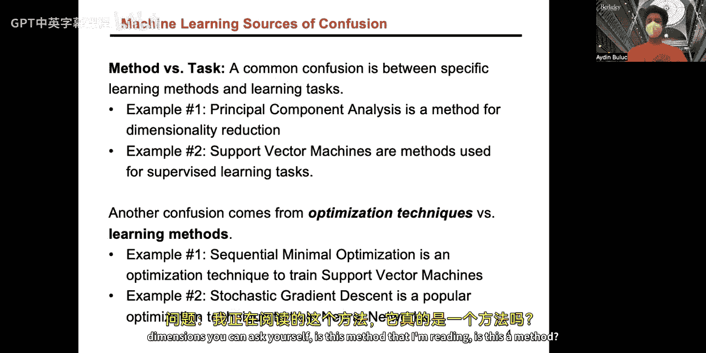
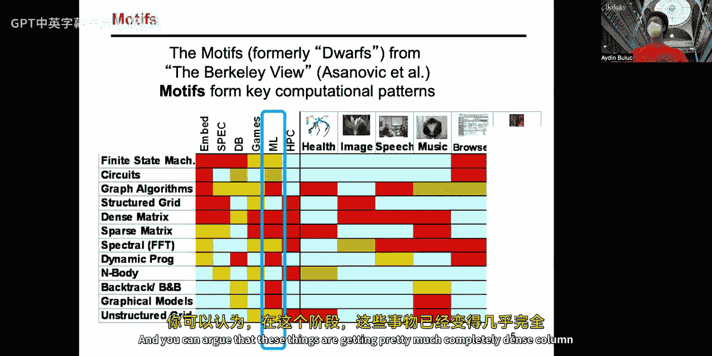
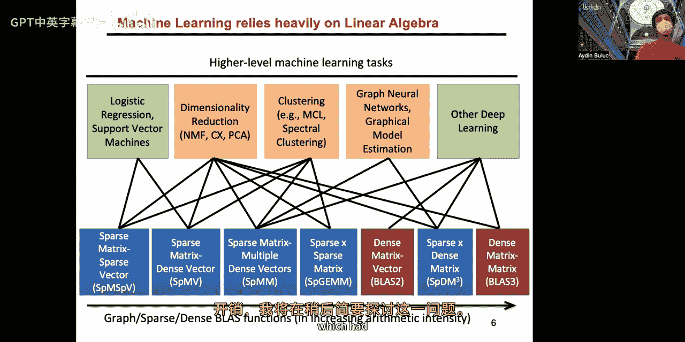
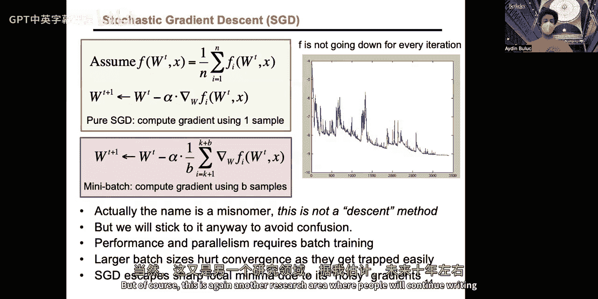
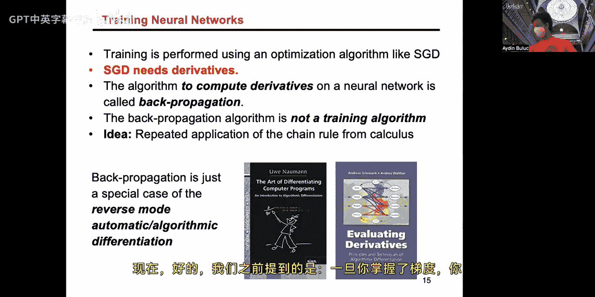
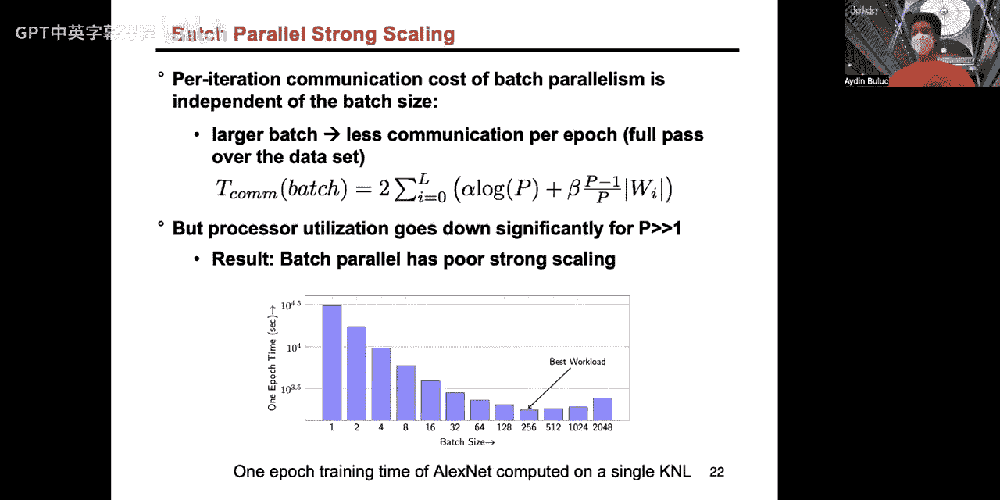
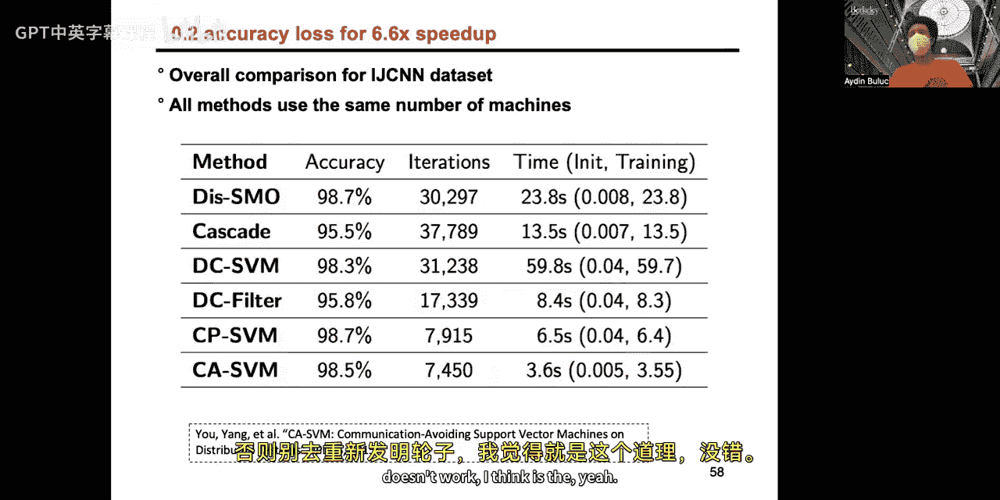

# 【并行计算 CS267 2022】伯克利—中英字幕 p13 CS267 (Sp22) - Lecture 15： Parallel Machine Learning 1 (Supervised -BV1PS421978D_p13-

Okay， it's time to start。Welcome everyone， CS267， lecture 15， if I counted correctly。

This is going to be part of a two part lecture， we're going to go over machine learning。

 some of your geosI has already gone over some of the aspects of machine learning。

 especially deep learning parallelization。And I'll try to stay relatively high level because you can technically spend the whole semester of。

Pallism in deep learning and not just one lecture and this is going to be on supervised learning most of our time will be spent on deep learning and a little bit about support vector machines so that you get a flavor of other things out there。

And I， of course， owe a lot to these slides to many different people that have contributed。

So I'll just start with some of the basics that we already probably know。

 but just to be self contained， we'll just talk about。Different kinds of machine learning。

 what is actually machine learning events？The main question there is how can we build systems that automatically improve its experience and what are the fundamental laws that go on this process the first one is more about systems building the second part of this question is more about the theory of what's learnable what's not neither one of these are exactly our scope we more care about what is the parallelism aspects and how we can extract as much high performance as possible。

And in fact， one can argue that machine learning is what made high performance computing hot again in the last decade or so。

 because a lot of the advances we see owe it to the views of the power of GPUs and high performance computing in general。

 and this is just a diagram of many different kinds of machine learning。

 supervised semi superupervised unsupervised reinforcement。

 we're not going to cover reinforcement learning， but we're going to cover some of the supervised learning today and some semi supervised and unsupervised learning on Thursday。

A couple of first of confusion just again to repeat because I am 100% sure that the people who already do research on this have no sets of confusions。

 but just in case you're new to the field a common confusion is between methods learning methods and the tasks right it' just an example PCA so-called principle component analysis is a method for dimensional reduction so the task there is to reduce the dimension of your data you have apparently millions of variables but you know that most of them are correlated and do not represent with a new dimension so how can you do that you can do it the principal component analysis but you can do it many。

 many other methods。And the task would be， for example， what we're going to talk about today。

 supervised learning where we have labels on the data already and we want to train on that labels and predict things that on the data sets that we haven't labeled yet。

 so that's really the definition of supervised learning。

And a method for that would be deep learning architectures and method would be support vector machines。

 both of which we're going to cover today。The other confusion comes from really the particular optimization technique because at the end of the day most of these machine learning methods are cast as an optimization problem there's some objective function that we're trying to minimize often minimize you can maximize it to if you write it that way and then there's a particular method that's best suited for optimizing that function which becomes the training process so sequential minimal optimization for example what we're going to cover towards the end of the lecture is one of the most well-known techniques to train and support vector emissions used to be the cheapest method some parallelism problems that I'm going to discuss the other example problem more popular is schastic gradient descent is a popular optimization technique to train deep neural networks right？

So it's kind of。In case you feel a little confused。

 these are some of the good dimensions you you can ask yourself， is this method that I'm reading。

 is this a method， is this an optimization technique， is this a learning algorithm？

So then you can place yourself in a more grounded state。

So going back to what we've been coming back from all the way from the introduction lecture and repeatedly over the course of the semester was these Brkke Vi motifs right and one of the columns there was machine learning。

What kinds of different computational motifs constitute machine learning now at this point is actually wet revisiting this in terms of the density of these particular boxes after 15 years machine learning nowadays is touching more than what's already actually a fairly dense column there right you can see that almost everything except a couple has。

has some sort of color right then the warmer the color。

 the more it was dependent on it so you can see that backtracking branch and bound graphical models。

 dynamic programming， sparse matrices， dance matrices and graph algorithms are already read here so it's heavily used in machine learning and various sort of things like spectral methods。

 unstructured grids are。And finance stake machines are orange。

 which means they're relatively well represented， and you can argue that these things are getting pretty much completely dense column there at this point。

嗯。So it's worth saying that what we've been learning in this class in the last couple of weeks about linear algebra。

 Jim has been talking about a lot in the last two lectures last week。

 very relevant to machine learning， you can actually make this bipartite graph that I just drew several years ago which chooses a selection of machine learning。

Tasks like nationality reduction this is actually kind of going against what I did because the boxes actually represent methods as well as tasks so。

The ones that are green colored are supervised learning methods well kind if you can make them useful for unsupervised learning as well if you want right and the ones that are I would call the salmon colored ones are the unsupervised ones and you can see a bunch of different linear algebraic kernels。

 meaning basic operations like b level operations， both using dense matrices and sparse matrices or both and then these the dependencies between them。

So it comes' no surprise that。The initial sets of deep learning libraries were reliant on existing linear algebra packages as the need for higher performance arose during those years。

 it started making sense to write specialized implementations that do not call BLA for certain tasks。

The one example was like original QDa implementation of conventionalvolutional neural networks were actually using matrix multiplications。

 and then over the years they were able to devote more resources to extract more performance and wrote direct conventionalvolutional kernels as opposed to relying on matrices。

 which had some attraction penalty that I'm going to talk about briefly。

And another classification I actually want to highlight here is you can do two kinds of parallelization at least I mean you can slice this big space of parallelization arguably many many different ways what I like to do is this is implicit parallelization meaning you keep the algorithm structures intact thearder loop of optimization stays the same and the work of the optimization within each iteration you can parallellyze and now the simpler way to think about is you can parallellyze these bs operations that's shown in the previous figure。

And as long as。Your blast parallelization is exact。

 then you will get more or less the same algorithm， it will converge at the same time。

So that's the benefit。And the model parallelism in deep learning training we're going to talk about is one example。

 implicit parallelization， the down side of this might be that you have an outer loop and you're only parallellyzing the inner loop and you've already seen this from your various homeworks that you can actually not get stuck with limited parallels。

Because the critical part of your competition is the out。

 but if you haven't parallellyzed across that， the best speed up you can get is limited to what's happening in each iteration and there's overheads of starting up parallelism and destroying it。

The explicit parallelization is you basically look at the algorithm from scratch and say。

 how can I reorganize this？Altogether， and that of course will give you more parallelism。

 but in many cases you will not get the same exact result。

This becomes a slightly different algorithm with different aac。

 so as long as you understand how to evaluate accuracy of your methods and convince yourself as well as the community that that new algorithm that is paralyzed differently and gives slightly different results is acceptable。

 then is actually slightly more desirable choice for performance reasons。

And the examples of these is so called data parallelism in particular the batch parallelism。

 we're going to talk about these， but you'll see that。呃呃。Well。

 let's not actually dive into it before we actually get there it's going to get confusing and the SPVM algorithm we're going to see as well as the data parallelsism we're going to see in DNNs are examples of explicit parallelization。

 so you can get much better scalability but you'll not have the same algorithm properties。

So there is a growing sense in the convergent communities of machine learning and highperform computing that these are interlinked in a way that many few fields were so interlinked before。

 so modern machine learning is really about hyperperform computing。And here what we're seeing is a。

kind on the left is a cartoonish hand drawn plot， which shows that deep learning methods compared to other machine learning methods have a tendency to get better in terms of accuracy as more compute and more data has been thrown in。

Well， that seems to hold for various sets of different， there is obviously caveats。

 but that seems to hold true for a variety of classes of tasks。Now on the right。

 you actually see an actual plot as opposed to a cartoon plot where you see the model capacity。

 the number of operations that is done to train it and the imageNe type one accuracy。

On particularly imagenet data as well as the Instagram data， this data。

 this slide and the figures come from。The AI Co design director of Facebook， I mean meta nowadays。

 and you'll see that this trend of increasing accuracy can be seen as you throw more compute on this problem。

 so that seems to be actually a pretty unique aspect of deep learning methods compared to many other machine learning techniques。

And here's another evidence of the same phenomena where this is various convolutional neural networks plotted with on the X axis is again。

 the compute they do， number of operations they do during training and on the Y axis you can see that this time top five accuracy。

 but the paper also includes top one accuracy， pretty much the same conclusion that you can actually draw a trend line on that。

 but there's a significant correlation between the amount of compute power you spend training this data versus the accuracy you get。

And the sizes of the circles is the number of parameters in the model。

 So that seems to be actually slightly less correlated than the compute yourron。嗯。

And it' is the citation。So let's start actually talking about training。

 how deep neural networks networks are trained。In the most cartoonish way I could come up with the simplest plot I can come up with with is really you have a set of inputs obviously I call the X1。

 these are actually of course like inputs as well as labels right and you have a network with weights。

 you can think of these edges of the network as having weights and there's biases that I actually didn't drove。

And you get an output， and then you compare that output to what the actual labels are and figure out how much of an error is in your prediction and you back propagate that error。

To adjust the weights so that you can get closer。To more accurate predictions and that's really the whole all of it So your the thing that's really happening is you have these things the ws and the biases and some other parameters and your training job is to change them in such a way that's going to match the training data subject to caveats such as overfitting which is if you exactly predict perfectly it might be the case that you're overfitting and then you get a data that you haven't seen things might go bad and there's a whole。

You know， research area of how to avoid that， we're not going to talk about it in this class。

It's a different way of。Plooding this thing this is for a convolutional neural network the only reason I'm keeping this thing it seems like a little redundant is there's actually different kinds of gradients。

 meaning these are the things that you back propagate the errors you back propagate these can be based on the weights of the network or the so-called the activations whereas the activation is defined as you have an image and you apply a convolution and you get some sort of。

Hid an image in the internals of the network。 And that has a size， right。

 So that that is often smaller than the original one， but not too much。

 And those are often described as activations of your coalvolitional network in case you have seen that。

Jogon used often。So what's the method though I told you like you just adjust your weights to match the input so how do you do that well you of course cast this problem as an optimization problem and you say that okay。

 which direction I should go。To minimize the mismatch。Between my weight。

verersus between my predictions and the training data labels right and then I see the direction now this is called the steepest descent algorithm in optimization literature。

 gradient descent is more often used in machine learning literature。

And then the next question you can ask quite， I know the direction I need to go。

 but how far I should go because if I take a too big of a step。

 I can overshoot the target and I can find myself in a place that's really far away from where I want it to go so then this alpha term is about how big of a step you're going to take towards the steepest descent is the learning。

So。嗯。And I'm not going to say more about this there is a whole field of learning algorithm。

 this is a first order algorithm， meaning it only uses first gradients， first order gradients。

First order derivatives and you can use the second order derivatives to care about the curvature information to avoid so called saddle points。

And you can adjust there's very good algorithms that automatically adjust the learning rate。

 there is a concept called momentum so that you don't have to do this zigzagging all the time so you can get to your minimum factors and if you want to do research on this area you'll definitely be using them but in terms of parallelization those are actually autoagonal issues so you don't actually know about them for discourse unless this is your research area。

So I'm just explaining this because it's necessary to understand stochastic gradient descent。

 which is the work of modern machine learning and its variance， of course。

 when I say stochastic gradient descent is just a concept。

 almost always some sort of automatic momentum adjusted algorithm method like atom is used。

 but the concepts that you see in SGD translate to all those algorithms。

So what's the problem with gradient descent， well gradient descent actually computes gradients for the whole sample set。

 like you have a million training data， then you have to actually compute this big matrix of first order derivatives。

And that's very expensive often and memory intensive as well as compute intensive so what people discovered that okay。

 there is a stochastic version what that really means is you just take one sample of your data。

And compute gradients， with respect to that samples change on the loss function and then update your parameters move to the next sample one sample at a time。

 This is the pure SGD great the downside of this method is if you do one sample at a time。

 there is not a lot of parallelilism and it's not just parallelism， you can't really get。

Full performance from your hardware， which likes things with high arithmetic intensity or computational intensity。

As you've seen right so this doesn't actually lead itself to a high computational intensity workload and the compromise becomes socalled mini batch SD so instead of doing one sample or all samples which is its downss why don't I choose B samples at a time and update my model parameters with respect to those B samples excellent。

And you know， you can work out the methods so you know for the puristt， this is not a disent method。

 why because for optimization people， a dissent method is something that uniformly goes down and there's a stochasticity here because some samples will actually make your laws go up。

But that's okay， I guess that war has been fought and stochastic gradient de is here to stay as a name。

嗯。So。Why there is， I think there's a lot of these things that I'm going to talk about with examples as opposed to saying here。

 I already said that performance and parallelism requires dispatant。

But you can arbitrarily increase dispatching， we already said there's computational limits of that。

 but also increasing dispatch size B to a number that's beyond， let's say 10。

000 makes the convergence of your method slower。And intuitively。

 the simplest explanation of this is small batch sizes allow you to get out of local minis more easily。

 but of course this is again another research area where people。

We'll continue writing papers for the next decade or so to my estimates。Now， okay， what we said was。

Just once you know the gradient how do you update your models this is all about theD job。

 you know the gradient first order derivatives and you know your model parameters now how can I update my models。

 what's the learning rate and so on。Now the question becomes。

 how did I get that derivative to begin with？But because I have an output， a predicted output。

And my model parameters are across the whole network。

 I have a let's say 10 layer deep network I know the gradient at the end now how do I get the gradient all the way back to the beginning of the network to update the model parameters in the first layer。

 let's say or the second layer。And that's really this celebrated method called back propagation。

Which is really a special case of something that people have been working on for decades。

 It's called automatic differentiation。 Also sadly。

 it's also sometimes called algorithmic differentiation， depending on which book you read。

 So it's really hard to get a good accurate snapshot of the history of this thing。

 but suffice it to say that that propagation is。Spial case of this automatic differentiation which uses itself chain rule from calculus automatically。

To propagate these gradients。 And that's all actually， I'm going to say about this。

So let's get to the what really CS267 cares about most。

And I'm going to give this slide with a lot of caveat because。

Just like you can divide your machine learning area into many many different pieces you can divide its parallels and needs to in many many classes。

And people have done that some of those have been talked by GSI and there's nothing wrong with any of them。

 but here here's another way of looking at it there's a data parallelism aspect which is you have a training set and how can I distribute the input to processor and distribute is in contrast to replic it。

So only parts of the input as are given to processes。And your input can be images， text， audiograph。

 whatever。Right the most common one， the first thing people have thought about is batch pars so you had this SD a mini batch if you have a mini batch of 256 natural way to think about it。

 well I can about the 256 processor and each one of them will work on a different sample and update the gradients collectively after they you know find the derivatives and that propagated them independently right seems a lot of seems to make a lot of sense and there's there are good reasons why that was。

Actually working whereabout for a while and we'll talk about them and when people say data parallelilism in the literature。

 99% of the time， this is what they need。Each one sample per process or whatever。

 if your batch size is B B over key samples per processor。Domain parallelism。

 and this has a different name in some papers as well。This is subdividing the data。

Like it is entirely possible that you can actually get a large image。A large video。

And one sample needs to be divided to processor for higher performance。

And that's actually much less studied， and I'm going to briefly talk about how that can be done。

 at least for images， but it can be done in similar ideas for large text， for example。

So these kind of constitute a subs of data parallelism。 Now， the bond model parallelism is。

All these parameters of the neural network， the weights matrices， how can I？

Distribute them to processes。In the previous set data when people talk about Dutch parallelism。

 what they usually do is they replicate the whole model in each process。

So there's an assumption that the model parameters fit into each processor's memory and that is often true for coalitional neural networks。

 which have few parameters。But it's not true for let's say theres transformers that I used for analyzing text。

 for example， those have a lot of model parameters。

That's where the data parallelism stops actually working out for a parallel perspective。

 and then you have to introduce lots of model parallelism just to get it working。

Just for the memory of it。There's obviously performance benefits to it， even if it was fitting。

So because you expose more pers。And finally， the other one is the pipeline parallel and this is。

Some people put this under model parallelism。But I like to keep it as a separate entity because it actually requires both。

 you can have model parallelism where you say the weights of my first layer transitions like from the first layer of the network to the second layer。

I can parallelze that only with one sample， and that's fine。In matter。

 in pipeline parallelism with one sample of input， it's impossible to parallelize using pipeline parallelism because you need enough data to fill the whole network and I'll talk about this so you need both batch parallelism as well as the ability to divide your neural network layers and that's the collectively will give you something called a pipeline parallels。

And you can actually think about this as your standard pipeline if you don't have enough instructions to fill the pipeline。

You can't get pipelining in your computer as well， right？Okay， let's talk about batchshism first。

The initial ideas of this a decade ago was this concept called parameter server。

 and this goes exactly a decade at this point， Jeff De's original paper about how to do distributed deep learning。

I think they were talking about the non obsolete system。

And this parameter server is generally thought as something that's centralized。

 but there doesn't need to be， it's just an abstract。

 where there is a place where it keeps all the gradients。And models are replicated in processors。

 as I said， because theres seem to be small enough that it can be replicated。

 data charts is really these batches and each processor will get a batch of data using its model replica will figure out the gradients and communicate to the parameter server to update the weights and every time a different processor needs to do it they can actually fetch the most recent ones。

Now this doesn't tell you what is the timing of these updates to the gradients right it can be synchronously or asynchronously this abstraction actually takes it away。

 it is possible to have this parameter server as an actual server sitting somewhere。

 but it's not a good idea as you might have notice throughout this class that having a single server serving all these things is' not scalable again this is an abstraction it's possible that parameter server can be like a Pga distributed array。

That's all in processors like how we do a UPC++， or it can be actually a distributed array。

 even an MPI line， right it just needs to be accessible to everybody。Of course。

 different ways of doing this is you can do it in different protocols like a gossiping protocol。

 where every time there is an update on your weight， your gradients。

 those updates can be propagated through a gossip mechanism between workers as a peer to peer method as opposed to just。

Using a centralized concept like a parameter server。That's another way。

 but at this point I think you get the idea that these gradient updates from processors needs to be communicated to all the other processors。

And the slower this update happens， the more it hurts convergence。

 so you want this to be as fast as possible。So you can do it in a synchronous way。

 like using an MP oil reduce。But if you think that your processors will not be in synchronization all the time。

 you can let them happen as synchronousically as well。And there's trade offs of both of them。

Now let's talk about monoparism。This is a nice plot。Again， from the same paper by 15 a decade ago as。

This actually shows two different kinds of possible model parallels。

And now this we draw the neural networks as like from left to right。

 this is think of them as from top to bottom or bottom to up。Right， so within each layer。

For this weights between layer one to layer two， there are two machines。

So this is kind of like intra layer parallelism， model parallelism。But and similarly。

 machine three and machine four are during intra layer model parallelism so within one transition you're separating into multiple machines。

 but also machine one and two。Are working on a set of weights that go from layer one to layer two。

 whereas machine three and four are working on a different set of weight matrices。

So that's actually inter layer model pes。 And that is required for。Pipline parallelism。

 so this actually picture shows both kinds of model parallelism you can do。You can think of this。

 interpret this as partitioning your neural network weights into processors。

Or as I'm just going to showho， you can think of this as partitioning your matrices。

So where does the matrix reality come from now you can represent the weights of your network。

AndThat we've seen in the beginning。As a matrix where M is the number of。

Neurons on the input levels and n is the number of neurons in the output level。

 right and B is your bad size。Like how many mini samples you have for per batch？

And you'll get obviously。An input set of M by the number of batches。And then there is， of course。

 the things that I'm abstracting away， which is there's a concept of a。Dimmension， right， so。

The what do you call it。I actually forgot the name of that， thank you。An RBG image is channels， yes。

 some people call it channels in CNN language， you can call it the dimension of the data in general。

 but I'm abstracting that away and not showing it。 So this multiplication of multiplying the weight matrices with the inputs and a batch size gets you the one layer of transition a neural network。

 So this is describing how it's done in the forward propagation。

This way you'll just basically move your activations to the next layer。嗯。And so。

Why do I like these pictures， it allows you to see how you can extract parallelism from this operation。

The and the ramifications of it think about the batch parallelism that we talked about。

 where each processor gets a subset of the samples。

 what it really means is I am cutting the column dimension。Of the second matrix， the input matrix。

And of course， that will automatically cut the column dimension of the output matrix。

That's really what batchism does。Unfortunately， this is actually a small dimension to begin with。

So that's already a tall skina matrix because my back size is something usually limited to 1 thousand or so。

For most training algorithms， there are some specialized algorithms that do better with slightly larger。

 but this is not in the millions。So I'm already I'm cutting a dimension that's already thin。

 so that is performance ramifications and it usually will reduce the performance。

After some point where B over P becomes sufficiently small， then the matrix multiplies will be slow。

So that's the thing that。That's an aspect to think about。More generally， here's how it looks。

 batchsh parallelialism and not only just the forward。Proropagation。

 but also in back propagation where I'm just showing both the derivatives。Of。

The activations as well as the waves right on the top you see the forward propagation that I just showed you and as I said。

 you're just cutting the x into subcolumns， no not subcolumns cutting the column dimension of x that's really giving you the batch parallelism。

 we assume that the model is replicated in batchism as in the previous pictures。

 so the w is replicated in each processors。And that gives you output activations that's great there is no communication needed for just forward propagation in batchism so that's the。

😊，That's the thing that happens。How about back propagation， Well， if you write the algebra。

 you'll see that。Now you have to actually multiply the derivatives of output activations with the inputs。

And they have been partitioned by columns， the transpose of the inputs。

 and this is going to give you a low rank up matrices that you need to all reduce。

This is really saying that you get these gradient updates that you need to all release。

 this is the other way of thinking about it。So that's the only place communication happens in batch parallels。

Because the gradients with respect to output activations are also performed with identically like the forward propagation。

 so no communication happens there as well。So the only place that communication happens is here and how much it is。

Well， you can write it down， you can say that the communication of a batch。Is this。

So what do I really like about this picture？嗯。If you get a larger batch， so think of it this way。

What would happen if I changed the second。Column dimension of x， I get more samples。

So what I'm reducing is a matrix of weights。Neurural network weight and these are really only determined by the size of my neural network。

If I have a million parameters to all reduce。Whether I use a batch size of one or a batch size is a million？

It doesn't matter。 I'm still reducing。A matrix of a million entries。

And that should be pretty obvious from this picture because the inner dimension of this delta y versus x transpose disappears after multiplication。

 and then all you have to reduce is something that's fixed size， irrespective of the back size。

And that's why people love vascularpirosis。Because you can increase the batch size。

And the communication stays constant。It's like free lunch。嗯。

And so that's great。and you can see it in the formula， if you look at this formula。

 this beta is not the best size， by the way， this is the inverse bandwidth that we always use。这。哦我。

Very interesting。And how do I。Make sure I get out of this。That's very interesting。我晒度。

We do this。好的。Welcome back。开始。Oh good， and the figure at the bottom is all repeating what I said in the couple of slides ago where。

At some point， when you start slicing down your bed size， you're losing efficiency。

For a fixed batch size， if you try to cut it into many， many many processors。

 the time it takes to do one epoch of training which is a one passover the whole input set will start going up so as soon as you get a number let's say 256 that's really a good performance。

 but if I start cutting that bats dimension。I will actually be somewhere over here for example。

 and that's really hurts my performance， that's why we want to keep the bed size per processor to a reasonably high number。

嗯。Okay。But why don't we just indefinitely increase the bed size？

We can't really train some large models， that's probably one of the first reasons。

That's why we started using gradientcent stochastic gradient descent anyway right we said the gradient descent requires computing first order derivatives for the whole training data and that wouldn't fit in the memory sometimes。

 so that's still there。But there is actually another issue。

 which is increasing the batch size people have experimentally observed long time ago was hurting performance in terms of convergence。

 it would take more iterations over the data， more epochs。

To get the same accuracy if you get there at all。嗯。And on the left。

 you see a standard algorithm like NSGD variant， perhaps Adam， I actually don't know exactly。

 this one is probably vanillas GD as you increase the batch size。For a fixed epoch size。

 you get much lower accuracy。And that's why people didn't push the back size beyond usually 500 or 1000 it washed。

There has been changes on this， for example， this method layerwise adapt to rate scaling that's been。

Imented by one of the Berkeley PhD graduates。Youang you actually allowed you to increase the batch size almost by an order of magnitude without herding convergegence。

It still has limits， right you can't just go beyond maybe 16。

000 that that's kind of where even La started breaking down。

But it's an order of magnitude improvement and the ability to increase batch size is great。

 so it's always worthwhile looking at large and it's been used by companies at this point all over the world。

Okay， we talked about。Bch parallelism enough， let's talk a little bit about what I call it intra layer model parallelism and that's the model parallelism of going from layer I to layer I plus one I'm not going to talk about yes question。

Of course， I don't mind at all。I was wondering so there was a lot of。

 I even was a lot of communication overhead her head。So the main point of doing such。

Its not speed up of rather。Distribute our for batch parallelism。

 communication actually is really favorable。RightBecause you can see from the communication cost of batch parallelism。

is dependent on the parameter size， like model size。

 and it doesn't increase with the batch size so you can increase your batch size and keep the communication constant and you'll get great scaling。

So it's actually good。The time where it becomes an issue is you can't push this batch size beyond 10。

000， even with the best algorithm， so you need some other way of parallelism if you want to increase performance further。

And just because it's 10000 batch size doesn't mean you can use 10000 processors because of the figure at the bottom。

 if you use 10000 processors or 10000 batch size， you'll be running at this barge。

 which is much much slower than 256 samples per processor bar， so you want to keep per processors。

That size to a reasonably large on the hundreds constant。

 so that gives you some room of maybe an order of 5000 processor you can use for batchsh parallelism so at that point you need to find another way of parallelilism and model parallelism is what I'm going to talk about to increase parallelism。

The other issue might be that this W might be huge。

This w is small for convolutional neural networks that has small parameters because you apply the same convolutional filter over and over again in the image。

 so it's the same set of parameters。It's small， whereas in the transformer like language models。

 the model itself， the number of parameters there。Is infamously large。

So there you completely need to go to model pes and from scratch from the beginning。

So that those are the reasons that people do mono， there's two different reasons。

So what is neuralelism again， there's two different ways of distributing your neural network。

 you can divide different layers to processors。And that I'm going to reserve for pipeline parallelism conversation。

The more simpler way of looking at it is how can I parallellyize going from layer i to I plus one in forward propagation or an i plus one to I in propagation when I'm moving these gradients。

 right？So， again， matrices make it really easy to look at this。 W was my parameter matrix。

 X was my input activations。And why was my output activation？

And if I look at this is the same exact plot I've showed for batch parallelism。

 except now instead of replicating W。I am going to cut it because W is my model。

So I am doing model parallelism。 I need to cut it。 I'm going to assume the input and output rep activations are replicated。

 but just just for convenience， if I don't replicate input and output。

 it still gives you the same complexity amount， surprisingly。For so， so what happens Si。

 Because I cut my model parameters in order to form the。The output。Which depends on both aspects。

Of this multiplication， both this multiplication， as well as the bottom multiplication contributes to y。

 so I have to do something called an organic。Okay， how about the Delta W。

 this one actually doesn't require any communication。

 so that's nice because I assumed activations are replicated。

And I need to do another communication of all reduce at the output activation。

So what ended up happening is I no longer need to。Due communication that is proportional to the model size。

But I need to do communication that is proportional to the activation size。と月。

So that kind of gives you a very good idea of what you can do， right。

 you can say that if I have a neural network player。With few parameters， lots of activations。

I can use batch pes and as my first option until I exhaust that option。

And for the other layers where I have large number of parameters， field activations。

Like dance layers， I can use model parallelism as my first option again。

 both of them have its limits and you might want to combine them at the extreme levels。

 but as a first resort this seems to make sense， in fact。

 there is a famous paper called one weird trick parallellyzing commercial neural networks。

From another decade and you know the title is of course pun on what you see on websites。

 that's exactly what happens there the author of that paper was the inventor of Alexnet。

And all they do is like， okay， I have a conventionalvolutional neural network。

 which means it's like as。Nine conal layers and two dance layers。

 so I'm going to parallelze the convolutional layers with batch parallelism and I'm going to parallelze the dance layers with model parallelism。

嗯忘了。Okay， how can I combine them？We said that usually these are the first resort of methods for these different classes where activations are larger versus parameters are larger。

 but both of them will hit a limit。For extreme case， and we can。

Think about how to combine them in a very principle way by using communication awarding algorithms that we talked about。

And so you， you know， just you probably already remember that there's one dimensional algorithms that。

Move one of the inputs， three dimension algorithms that move two of the matrices let's like let's not call them inputs and 3 d algorithms that move both two inputs as well as the output right those are the mass classification and then we can do。

Look at this problem from the matrix standpoint again and see how we can parallellyize。

Just forget about batches， forget about matrices， how can I parallellyze this met multiplication sequence with the algorithms we know and one of the algorithms that gives you really good bounce is a one and a half dimension algorithm。

Where you do some replication beyond the 1D algorithm so it looks like a 2D algorithm。

 I'm not going to talk too much about the details， but these are algorithms where the processors are indexed on a 2 dimensional space just like 2D algorithms。

 the reason they're not called 2D is because。They do some replication meaning。

This part of the W is collectively owned by three processors。

 or it's replicated on three processors as opposed to replicated on all six processors。Similarly。

 the column of x is replicated on two processors。As opposed to what it would happen in， let's say。

Model parallelism， where it could be replicated in all six processors。

 So one way to interpret this is group of three processors are doing。嗯。

Btch parallelism and group of two processors are doing model parallelism within themselves。

 but you don't really need to think about it that way either just sticking to matrices allow you to come up with an algorithm that seems to do communication at each step。

 which seems like a bad idea， but it does it in a much reduced amount of data that it actually runs faster than either extreme。

And you can actually find a。Vant of tensor flow called mesh tensor flow that would implement this fairly easily for you and allows you to cut these matrices in arbitrary dimension on a processor mesh like the one on the left。

 like two dimensional processor mesh。I think it's still available， you can download and use it。

 some people in their cosmology physics department use it here。

So what happens when I combine them with the method I described， I can actually。

 let's look at a large input on the bottom right， I can get better performance than either extreme。

 and that shouldn't be coming as a surprise。The communication savings are even more significant。

 the one in the parentheses is showing you how much communication is saved， which is a5ex。

The actual number 2。1 x is the once you add the time to actually do the convolutions and the myth multiplies locally。

So it's kind of dilute some of the benefits。Now you can say， all right。

 can I use the same matrix trick？Indirectly without thinking about convolutions。There is。

 as I said in the beginning of the lecture， the initial sets of software that did convolutional neural networks were actually casting them in matrix land。

And how does this happen？You should think about each convolutional filter。

 like an application of a filter is really looking at an image and applying it in patches right。

 so then this patch moves。So you can get each patch of data， stick it into a matrix column。

And that's。Some some some software even calls it like inter， like image to。

 stick each page into a column and。That creates some redundancy if your patches are overlapping。

 if your patches are not overlapping， meaning your straight land。

Matches the convolutional filter size that doesn't have any redundancy。

And once you put these into columns of a be matrix。

 then you can just do matrix multiply and get the convolution operation automatically。

It's really hard to understand and convince yourself that's the case by just looking at a slide for 60 seconds。

 but I put the reference in there and it actually。Is beautiful way of organizing this data。

 The downside， as I said， is。If the the patches of。

Patches overlap then you're having this issue of redundancy in your input。Okay。

 let's talk briefly about another way of cutting your input， which is what I call domain parallelism。

So if you have a large image or you want to get data parallelism。

 you don't want to do any model parallelism。And somehow you want to paralyze your processing of a single image。

 or it can be a large video。You can use some of the techniques you've learned in homework too。

Which is these ghost stones。Right you can say that I'm going to apply convolution。

 What's the convolution anyway， right it's just using this patching thing we talked about。

 So if on the boundaries， if least you have a three by three filters。

You just need to get pixels from your neighboring processes， but it only happens on the boundaries。

 everything else you already have all you need in the image。

Right so by just getting a few those pixels from your neighboring processors。

 you can do convolutional filters in parallel on a single image。

So that's what I call domain parallelism and。It's been also implementeded by another PhD student Peter G。

 he called them spatial parallel convolutions I think。Some people facial parallelism for that reason。

 makes a lot of sense。And the communication complexity that I'm not going to talk about。

 but you can read。It makes。Quite a bit of sense， where。

The activation like you start with a big image， so the growth zones are relatively small。

 it makes a lot of sense so that you can use them for those cases。And。You can combine， of course。

 batch domain on metal journalism。And this slide gives you a recipe on how to combine them if you have small activations and large parameters。

 then you might want to use a batch plus model if you have large activations。

You might want to use bat loss domain parallelism， get the best performance。And combining those。

 you see that you can actually get really good performance then again either extreme。

 just like the previous case。Sorry， I'm noticing that。I'm taking longer than I should have taken。

Pipline parallelism for only three slides。 This is actually a very interesting set of parallelism that。

I think people explored in the last three， four years only。

Maybe the idea was there for a while and not been written about so much so what's the idea well you have many。

 many layers of the neural network and how can I take advantage of that fact and extract parallelism on that dimension。

It makes a lot of sense for really deep networks， right otherwise you have just like one layer。

 one layer， one layer at a time， so you're limited by the depth of the network in terms of a critical path。

So pipeline parallelism really needs a mini batch， right。

 and then it divides it into smaller micro batchches。And so that allows you to fill this pipeline。

 this full pipeline of it。So you need to fill this pipeline to get parallelism。

 So the all the level of parallelism is really this depth of the。How high the spa。

So you get a mini batch， let's say 1 thousand， then you can divide this into micro batchches of。

 I don't know。64 each。And at some point in the network。

 you'll find yourself like many different micro batchches of 64 is active at a time。

Some of them are in the second layer of the network， some of them on the third layer of the network。

 so on that's how you get a full pipeline， beautiful。So what is what are the issues there。

 it seems like a good idea， so one one thing that is ver understanding is。There is a pipeline bubble。

 that's one issue。This is kind of how can I make sure that the draining of the pipeline and filling it doesn't take too much time？

And waste my whole parallelism attempt and there's a cottage industry of papers that work on those aspects。

 but I really want you to understand that this is both model parallelism because you're really dividing your model into processes。

 but it also is batchsh parallelism because without multiple samples， you can't fill a pipeline。

So that's really one takeaway that I want you to have and the other takeaway I want you to have is let's say you already have。

Hows in way parallelism。Existing thousand weelle and from。Btch or model parallelism。

How much more palm you can extract？By pipeline。 And that's really upper bounded by a multiplicative factor of your depth。

 If your neural network is deep， like resnet。Then you're good like you can get whatever 30 something I forgot to re at there。

 and that's a multiplicative factor of all the other pes that you can explore。

 assuming you can implement these things correctly。That's a whole different business。

 right so Yang you actually the Berkeley PhD that I said was the inventor of Lars has a company that exactly does try to automate that kind of extraction of pelysis。

Jim， I think， talked about that in one of his slides。In the past， it's called Collossal AI。

 he's in Singapore now。But this is the limit， right if you have a neural network that's only two layers。

There is no point in getting pipeline trails because。There is no pipeline in that shallow network。

 it's important to remember that。And this is really the state of the art on these things as far as I know。

 as of last year， at least I haven't updated the slides。Is。

The pipeline includess this extra question about。Well。

 you have these weights that you need to update。With the gradients。But。嗯。

Now every processor is working on a different microbetch。

 how can I keep them synchronized and then there not they're not synchronized right one micro batchch is at you know layer 5 and the one micro batchch is layer 6。

But how can I make sure that the gradients are synchronized when they are intentionally out of sync？

when the microbes are intentionally out of sync just to get more parallelilism and there's two basic ways of doing this thing is one of them is periodic  cles and the other one is everybody keeps a copy of the weights and then occasionally merges them all。

So， and I hope that at this point there is more stuffed out there that。

Doesn't have these fundamental trade offs。The summaryum of distributed deep learning。

 large batch size training often lead to， well I guess this is maybe not a summary。

 the summaries would be way too longer， some of the takeaways。

Large by size training often lead to suboptimal learning due to convergence rate slowdown。

 but this can be mitigated by some algorithms like largers that we talked about。

The integrated parallel that we discussed that uses both batch and model uses the communication avoiding idea of one and a half the algorithms。

And it does usually perform better than either extreme。We talked about Alex Kzeevski's idea of using。

Btch parallelism is the first resort for convolutional networks where the activation sizes are large。

 number of parameters are small， and model parallelism is the first resort for densely connected layers。

 fully connected layers。Where the parameters set is large， but activations are small。

 and that's from that again， very old paper veiled in deep learning land。And then finally。

 pipeline parallelism uses these macro batchtistic parallelism in proportion to the depth of the network and can in principle be combined with all the other parallelism aspects we talked about。

So that leaves me with 20 minutes to talk about something that's not deep learning any questions so far that you haven't been asked？

I mean， at this point you can say that everything is deep learning and supervised learning land。

 but you know history is cyclical and you know it goes back to all things。

 you never know what's going to happen so let's talk about something that preoccupied a lot of machine learning researchers in 1990s。

 especially support vector machines is' really good theory and is somewhat I am actually going to talk about this because。

It is a great way of engineering the effort， a through the force of how to balance the needs of performance。

 load balance this algorithm that I'm going to come to in this area。

 that's why also invented by Yague， by the way。So what is the idea behind support vector machine。

 let's assume the linear case that you don't need to work your reality to match the linearism so the input is linear。

 I say。嗯。You basically try to find a separating plane。That maximizes this distance， this margin。

And that's you can write this just like as I said， like any other machine learning problem。

 you can write this as an optimization problem。Well， if you write it that way and look at it。It says。

 okay， this is a quadratic optimization problem。And try to use off the shelf quadratic。

Optimization problem forward， it becomes really slow。

So that's why people invented algorithms that takes into。

Considerration the spatial case of support vector machines and how can I design an algorithm that uses that reality and does much fever operations？

If your input is not linearly separable to begin with， if it doesn't look like this。

Then there's a technique。Called a kernel， some people call it the kernel trick or so on。

 you can map it to a higher dimension。Where things become linear。

Magic there are some wellknown kernels a kernel is really just like an inner product on anything you can have kernels between graphs。

 you can have kernels between strings， trees， anything any function that allows you to compute similarity and technically a kernel should obey some other realities like the matrix it defines that the output should be positive semideinite。

 but even if it's not it usually works okay if it's close enough。

So you can apply this kernel function to a P function be and then map it to a higher dimension and do your operation stairs。

 but you would never really want to。Explicitly do that because that would require a lot of computation and this space might be infinite dimension there's nothing in the theory says that the higher dimensional space will be finite dimensional so and it might be you know it might be finite but really too large to map so people really don't map this explicitly but kind of do the computation as if it's in the higher dimension。

So this seems like impossible to do， but it's quite possible so let's really talk about this thing。

And this is the old artificial intelligence book by。Bresell and Norwiwick。

 Star Russell with professorfeor here。So this is the real example they use in the paper of an input data set where some labels are white。

 some labels are black， they're not linearly separable。

 but if you use this particular mapping to three dimensions。

 you get like each point is x1 and x2 coordinateance。

 and you map it to x1 square x2 square and square root of2 x1 x2。

 suddenly this thing becomes linearly separable by applying。Great example。

 So then they define if you define your kernel function， the similarity function。

As the inner product square。Then instead of mapping your data points explicitly to three dimensions。

You can actually do the kernel first。Like you can do the kernel first and then。

Due to operation implicitly and get the same result and you can just verify that these these two things mapping to the third dimension and computing the inner product。

Is the same as doing it the other order。So that kind of allows you to do matrix vector products or mini money operations。

Implicitly in the higher dimension without convertvering your data into that dimension。 Okay。

 that's probably enough of on this。诶。So。If you didn't have to do that。

 you would have to map your input to that space， and that would require a lot of computation so。

We'll talk about one algorithm that's called the sequential Min optimization。

And instead of the general quadratic solver and highlight why that's not a good idea for powers。

So as I said， Qua optimization is really expensive for the kind of input sizes that support like transmissions wants to solve。

So， instead。The idea was。Well。How can I minimal it per cur？My output。

My variables in such a way that my constraints are satisfied。

 so let's write back this optimization function and look at this there is an equality constraint。

 all the lag multipliers for the active constraints should equal to zero for those of people who have taken optimization you will remember it。

 but you don't need to know about this thing all you have to worry about is for a solution to be feasible this constraint needs to be satisfied。

So then the inventor of sequential commercial minimal optimization looked at this thing and said。

 well， okay。嗯。How can I make sure。That this constraint is not violated as I go through my algorithm。

And he said， the minimal thing I can do is I can choose two lagr multipliers。And。Change their values。

So that the constraint is still satisfied。 Remember， you can you could do anything minimal than that。

 if you change only one large multiplier， if it was。If the constraint was satisfied before。

And this summation of multiplier and Yi was equal to zero。

Changing one luggage multiplier is guaranteed to violate this constraint。

 so you have to choose at least tube。And that's what he said。 Okay， that's the minimum I can do。

 So I'm just going to choose two。Constraints changed their laggar multipliers at the same time to make sure that the constraint is still satisfied。

And then move to the next two and next two at a time。So。So this is a very iterative algorithm。

 as you might imagine， and the paper talks about how to choose those two constraints。嗯。

But we're not going to of course talk too much about that。

 but you keep doing this until convergeence。Any questions？

You don't need to really understand the math behind this all you all all I'm trying to highlight for the purposes of this class is。

The algorithm is really fast。But it's actually making minimal changes on the input。

And if you look at it in the matrix La， it's really changing two rows of the input。

 It's doing a sparse matrix sparse vector multiplied with a sparse vector with two non zeros。

And that's not a lot of parallel in India。And you'll see that the number of iterations you need to do is proportional to the number of samples with a large constant。

 so you get pretty bad reek scaling。So people started looking at different algorithms to extract pism from support victim machines。

And one of the first ideas was this thing called Cascade SVia。So let's say you partition your data。

Evenly to processors and you create different support vector machines for each partition。And诶。

So these vectors that。That have larger multipliers that are positive active constraints。

For those of you again， remember optimization， for those of who laggge multipliers are zero are inactive constraints。

 so they don't actually determine the decision boundary。And or visually speaking。

Letss me let me go back。嗯。The multipliers of these data points that are outside the decision boundary have lagggage multiplier zero so they don't they're not active constraints this is an active constraint so that's what it means so those are called the support vectors that's why the name。

So， the idea was。Remove the non support layers because they're not affecting the solution。

 layer by layer。They're not active constraints anyway。嗯。And， and pass only the support vectors。

To the next leadership in the network， so that's a major reduction in the data size。

Instead of passing the whole into the samples， you only pass the samples that are support vectors。

 So that's great。嗯。And you create this network of layers， and then you iterly do this again。

So what was the issue？Randomly building a partition of samples。

There were no guarantees that the support vectors on the first partition of the data。Were meaningful。

 globally speaking， right you have you just partitioned your data without paying attention to whether that data is representative of the global solution you're trying to achieve。

So。So that was the thing that made it hurt that hurt accuracy。

 even though the algorithm was actually fairly。Fairly okay from a performance point。

So there has been look at the date。 This is like 2004 and a decade later。

Clearly an idea that is like instead of the support vectors because we know that once we randomly partition the data。

 support vectors of that each partition might not be global and meaningful。Therefore。

 let's just keep all of the data。As opposed to just the support vectors。

 past all of the data layer by layer， that doesn't mean replication， by the way。

 there is still partitioning， but we're not just keeping support vectors we're keeping all of the partition data across the layers。

There's been a couple of differences as well， not just retaining all of data versus support vectors。

 there was also instead of random partitioning， there's kernel kamine and there's a reason why it actually works very well because and I'll talk about this kernel k means more or less guarantees that certain properties just come to that in a minute。

And and then I think this is the place where Yang started combining these ideas in a way that would make sense。

 So he said， well passing all of the data。Even it helps accuracy， but it's really slow。

 so how can I make sure that I pass only support vectors。

The fact that I'm using internal kamines actually is helpful here because in that method。

 you can see that the support vectorctors of one partition。

Has almost no impact on the support vectors of the other partitions。

 assuming your kernel function is something like Gaussian。Like in general。

 for an arbitrary kernel function that might not be true。

 but just to prove that this thing works for the cases where people use most often started making sense。

 so the first theorem was the set of support vectors from these sub problems。

Was close to the support vectors of the whole problem。

 assuming certain kernels that we're working with。And the second theorem is dependent on the first one kernel K means minimizes the difference between the solutions of the sub problems and the whole problem。

 so really what he's trying to do here is make sure that the sub problems are representative of the whole problem。

Right and that was great， you combine this thing and get this thing called the DC filters。

 the structure of the solution。But this is now only passing support vectors。

And using kernel key means the， the structure was hurting the performance。 why。

 because at the top level。All processors are active at the second level。

 half of the processors are active。 Next day a quarter of the processors are active。

 You can see why this is wasteful of the computer resources。

So then what is the other option we can do， Well， we can do this cluster partition SVM， this is。

Partition the data into there's no tree structure。Partition the data into P parts。

 you get distinct P models and then you try to combine to get the best model， right？

Sub SVM will generate its own model file after training。

And then you can use these model files independently for classification。 So how， how do you do that。

 You've given a sample。 If it's closest data center is， let's say， in processor I。

Then you will only use the processor eyes model to make a prediction for that sample because the support vectors and other model fires have little impact on the classification result。

 so that was the main idea。And accuracy wise， this makes quite a bit of sense and the reason it worked again。

 this is actually I'm repeating what I said earlier。

 the kernel K means actually make this work where the sub problems。Actually have。

The support vectors where if the sample is closer to the cent rate of this kernel K means。

 then the support vectors there are sufficient to make a classification for it and the support vectors of other partitions don't matter。

So that that was really the main idea well， seems like we should be dumb at this point。

 but he observed one particular issue。That the。And the machines were taking quite different times。

You can look at it here that some machines would take many， many more iterations。

I would what do we see here by five times moretus？And naturally would take an order of magnitude more time。

So and the number of samples were different too， so that was probably determining that。

And why because。The kernel came means doesn't care about load balances。 It cares about。You know。

 distances。So he came up with a method that is kind of tries to merge chnoqui clusters。

Into load balance pieces。So you can't just arbitrarily leave colon oamines because that's the one that gave you good accuracy and make sure your support vectors。

Are the ones that all you need locally？So how can I combine different clusters and group them into chunks and assign them to processors was what gave this final algorithm。

 communication awareness SVM。And now the load balance problem was gone。

 and if you look at the actual final figures。Over the years， you've get like accuracy that matches。

Sequential minimization。To our first degree， which does four times fever iterations and takes an order of magnitude and runs in an order of magnitude faster。

So。And the sequential minimal optimization when we say that we're actually talking about the distributed version so we're not comparing that against sequential implementation what happened along this study actually if you want to focus on what parts of optimizations hurt accuracy you can just you know go over this thing with the slides and figure out what kinds of cutting the corners was too much and which ones were negligible。

So this is an example of explicit parallelization because we completely changed how this support vector machine training happens。

In some way， in the principal way， and the actual accuracy difference with the final product versus what people were considering as a very good solution is minimal。

 so it's totally acceptable to do that。With that， I have one and a half minutes in in the first time of the。

C267， I think this year。See on Thursday， unless you have questions that I can answer in the。😊，Okay。

That fact， its not a Facebook that hope for。It only applies to the certain。Yes。

 it might work with other ones just like。You know， you prove things that you can prove and hope that it will work on the other cases。

Evidence of people trying this thing and looking at the accuracy will determine whether it actually applies in other cares as well。

You。Ensure that。啊，就看。那是这样。I would say given the software is out there。

 I think the easiest way is to try it out and if it doesn't work like you know。

 don't invent the wheel unless the wheel doesn't work， I think is the。Yeah。

Col， thank you。 See on Thursday。嗯。