# 【并行计算 CS267 2022】伯克利—中英字幕 p14 CS267 (Sp22) - Lecture 16： Parallel Machine Learning 2 (Unsupervise -BV1PS421978D_p14-

Okay， welcome everyone， CS 267， lecture 16。So we're going to talk today about unsupervised and semiupervised learning。

Just to recap what we did last time was an introduction to supervised learning and app parallelism in there。

 of course， when I say unsupervised semi supervised learning， were really going to see from the。打哪。

Okayで。Yeah， I think I should I can put it in a。Slightly。More invasive location。嗯。はい。Okay。

Or just take it completely off。は。Yeah。对。Yeah。Okay， my mic is probably better， okay， that makes sense。

 I actually hear myself better now。Of course， when we say super unsupervised and semiupervised learning。

 we're really going to see。From the perspective of parallelism and high performance。

 we're not going to try to be the machine learning class here in one lecture and we're going to try to see。

3。Forour actually aspects of them clustering， dimension al reduction， computing embeddings。

 and particularly we're going to focus on embeddings of nodes within a graph。

 where you can effectively embed anything into low dimensional manifold， so called manifold。

 and one example of semiupervised learning from graph neural networks。

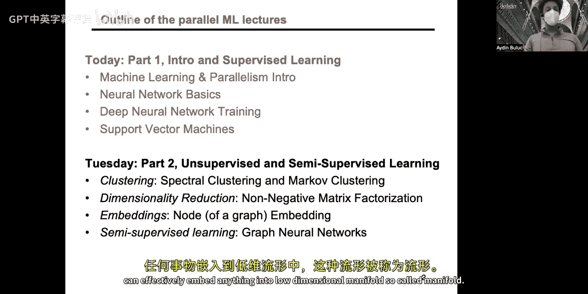

To remind ourselves， this dependency plot that I showed you last time were different machine learning tasks and methods and the reliance on linear algebra。

 either sparse or dense matrix operations here and we're going to be covering the subset of those today。

 dimensional reduction cluster and graph neural networks。

 they're all going to be covered today and you're going to see how they actually depend on these linear algebra operations that are listed at the bottom。

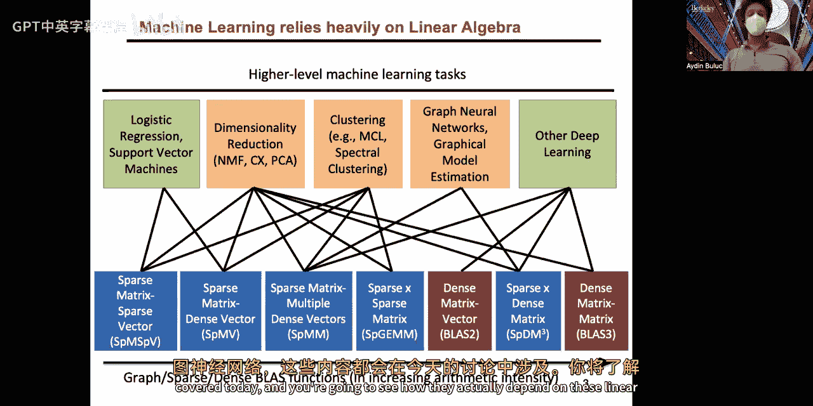

So clustering， I mean， some people in a derogatory way will say that the clustering algorithms are dimedismism。

And there are good reasons for that because the data sets some of them have real coordinates。

 some of them don't and you have to estimate them， some of them have certain structures that we want to uncover it's not you know density or centralroid based things you might sometimes want to discover long skinny objects that are tightly connected so it makes sense that there's a class of。

Clustering algorithms and some of them I have listed here， spectral ones， density based。

 central based， flow based， it' quite likely that you heard about a good subset of them already。

In some application or in some earlier class。And often the right method really depends on as I said。

 input characteristics and some domain knowledge， we'll talk about two particular ones and there are good reasons for talking about those two because they're actually going to tie to a couple of the other topics that I'm going to cover towards the end of the lecture。

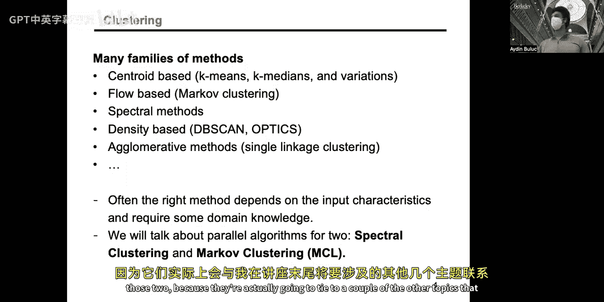

So let's start with the spectral clustering， this is really the input is similarities between data points to the clustering you at some point need to generate them if the data doesn't come by similarities now you know some fields have specific ways of defining similarity between data points。

 if you're not one of those domain sciences， there's a whole selection of commonly accepted similarity matrix like cosine similarity jaarard index pieson correlation。

 most of these makes sense when you think about the data you have or don't so take those things done don't blindly apply them。

And once you have those similarities done， you can represent the relationship between data points as a graph。

And the edges will be the similarities or the inverse similarities。

 depending on how you implemented them， the inverse similarity makes quite a bit of sense for things that you're you know trying to put them together if they're too similar。

So the distance shrinks。And you can also after you compute the similarity or during the computation。

 you can。Define the graph in slightly different ways if you don't want to get a dance graph because if you compare every point to every point。

And your similarity metric doesn't have a threshold built in。

 then you'll get a dance graph and for practical purposes it's going to be useless because it's going to be too big to store and process。

And the ways of and that's the last one actually， so it's kind of listed for completeness。

 but very few instances use a fully connected graph。

 usually it's either a k nearest neighbor graph where you just say every note will have at most k nervous。

And I say at most in general is' exactly k， but sometimes your data might be sparse enough that you don't even have K connections to begin with。

 so it most is a little bit more。I think it should say it most。

Clearly somewhere in there says at least that's the opposite of what I wanted to say and the epsilon neighborhood graph is instead of using K as the number of neighbors cut off。

 you can just say a threshold of connectivity can say that anything that's less than you know 0。

1% similarity for whatever application you have， I'm going to cut it off to zero and the edge will disappear。

😊。

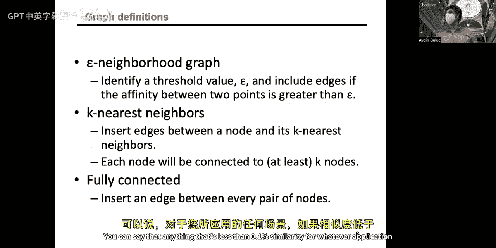

Okay， once you have that I think， what is the general idea？The whole intuition comes from。呃。

Minimum cuts of a graph， you identify a minimum cut in first of all。

 you partition your data set into two， find them based on the minimum cut concept。

 remove the edges and keep recursively doing this step。

Now that was theoretically useful to analyze these kind of problems。

 but it didn't actually lead itself to an efficient algorithm because identifying the minimum cut on that case was not an easy problem。

 so the approximations come from linear algebra and especially this nice concept I want to highlight is called the graphlpl。

You we haven't covered the graph class the apologies this used to be actually inverted first we had the graph class and now we have the。

Machine learning classes before the graph algorithms， you might have heard about the。

AJ system matrix， but let me define this without using the AJ system matrix concept you do have。

The w that's the distances are between pairs of nodes， so it's an n by n matrix。

 the w and that's really the distance matrix so I'm kind of not calling it out but it is what it is and if you define D which is a diagonal matrix of degrees like a degree of a node I will be stored in the D location in the diagonal the I location of the diagonal and you subtract D from you subtract w from D and that's what you get is the unnormalized opac and that's shown in this picture。

It's all， while the W is actually a binary version of the AJ matrix， only marks the connections。

So this is actually not all that useful for some numerical reasons。😊，嗯。There are two others of。

Laplaceian definitions， one of them is a symmetric one and the other one is this random walkways one。

And。U。The symmetric and normalized one actually so the normalized one is really the one that has the best properties in terms of being able to solve the underlying system we're just going to define now right so we're not done all we're doing is defining some sort of matrix it's called a lapplian Laplian is nice especially the normalized symmetric lapplian because it's。

I symmetric and it is actually better than even positive definite it's one of the easiest classes of matrices to solve and deal with。

And。Once you compute that you can get the K smallest eigenvectors of this。

 what that means is the K eigenvectors that correspond to the smallest eigenvalue。

So you can stack them in a column of a matrix and then do clustering on them like the standard clustering algorithms you would use byane means or anything because now those become your coordinates of the data so imagine what we ended up doing here we kind of came from a similarity matrix and went to。

A dense， somewhat tall skin matrix that looks like on the right。each column is one eigenvector。

And we choose K as such arigenvectors now。Intuitively。

 the reason this makes sense is you can think of the idealized case。

 whereas your clusters are connected components of your graph。

And if you that's the easiest kind of definition of cluster the easiest input you can get。

 and if you do that you'll see that the multiplicity of the eigenvalue is0。😊。

Will be equal to the number of clusters and the。each eigenvector will be like an indicator vector。

 there will be one for the locations where the members of the clusters are present and zeros elsewhere。

You can verify that is indeed the case， so you can imagine how easy it would be to run some sort of k means clustering on this vector data right so you have this fairly obvious it will find you the two clusters if you run the two two you know means and the real case of the messy graph is it assumed to be an approximation of this idealized case where it's not going to be perfectly 111000 but it will be something close to that and the K means will find that now what I didn't tell you is how do you find those。

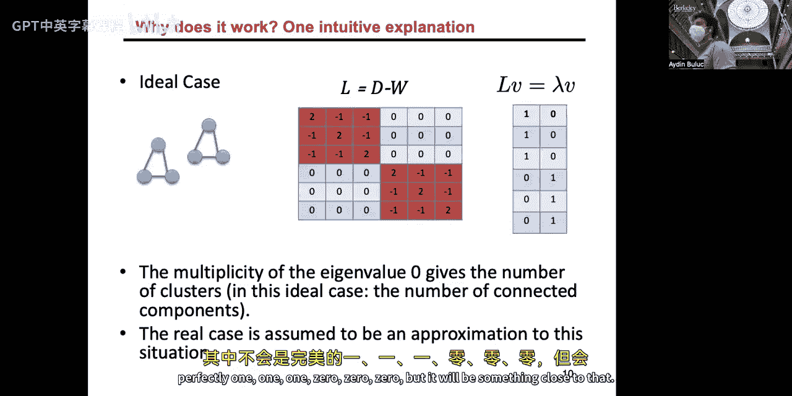

Een vis。And that's where the standard machinery or scientific computing comes into play。

And I think we also didn't cover the SPMV lecture for that。

 but the most common algorithm for that is so-called the linehe algorithm。

 it's the workers of the algorithm is parrsmetic vector multiply and you basically repeatedly do that and deflate the values until you pop as many eigen vectors as you want and the algorithm iterative algorithm。

There are alternative formulations， one of the most popular ones these days is this so called block TG locally optimized block。

Preconditioned conjugate gradient it's a mouthful without a mask it's a mouthful with a mask there you replace a spars matrix vector multiply with a sparsse matrixs what multiple vector multiply so you get a stack of vectors and you're trying to pop multiple eigenvectors all at once you're trying to extract a whole subspace that's span by those multiple vectors all at once and the reason people prefer it these days is because it actually as you might remember spars matrix vector multiply has almost no reuse。

So you kind of again， we're going to cover to that later， I guess。

 is you can't really get to the peak of the machine nowhere near there。

 whereas sparse matrixtics multiple vectors is you keep increasing number of vectors you stack。

 you're getting a higher utilization， a higher arithmetic intensity。And in the end。

 you're going to call， of course， these are just the what's happening at the bottom of the algorithm。

 whether you do matrix vector product or matrix multiple electric product。

 but what is the complicated algorithm that allow you to get the eigenvectors here。

 its you probably don't want to implement them。There are packages of those APAC and PRP used to be the most popular I don't know if that's still the case these are designed in such a way they call it the reverse communication so you implement the spars matrix spectrum multiply based on your GPU or you don't even even need the implement you can just plug it into your best implementation you know and these algorithms handle the outer iteration logic for you so they kind of call your code is needed but make sure the correctness is handled by you know the library itself。

Okay， and actually one of the only clustering spec clustering implementations I know in parallel usesRPC am I saying this correctly。

 PartC， maybe I don't know。So that's the spectral clustering it's still widely used in certain data sets it makes a lot of sense and it has connections to a lot of other spectral methods like。

Maybe the spectral partitioning ideas you might see， but I'm going to go to another。

Kind of clustering algorithm that's flow based so called flow based。

 this is actually also random based random walk based too depending on who you ask。

So what's the philosophy here。You have this graph， again。

 a fairly easy graph to define a bunch of almost clickique like structures that I lose to connected from each other。

If I started doing a random walk。From any of these points。

What would usually happen is the probability the mass。

The probability that I end up in a particular note。嗯。

Will be higher if I start from a note within that， let's say red clusters。

 the probability of being somewhere within that red cluster is higher than being somewhere else so that's the idea of random walk。

You're going to be get trapped within your own cluster。If your grass structure is well connected。

So why don't I do this from every standing vertex at the same time？

And then sum up all the probabilities of me being at a particular location in the graph。

So that's the idea， I start random walks and they will get trapped in the clusters that their belong to where they started at the Note。

And I'm going to have to do a couple of things to make sure this thing converges because if I let this run until infinity without any regularizer。

 meaning I don't cut down small probabilities， I will you know reach everywhere and that's actually not what I want it's not going to be interpretable or useful for cluster extraction I need to do some sort of specification。

At each iteration so the iterations really look like the following first I square the matrix and the matrix itself is the a matrix of my graph or a normalized version of it usually it's a normalized version to make sure that every node get the same contribution。

So I should have probably included that the kind of normalization people do is the columns and row sums are equal to one that's called doublely stochastic。

 so every vertex essentially has the same probability to mass that it can give to its neighbors at each random walkstep。

And that's enforced at every tu。So some node don't have a higher mass to distribute just because they started that way so if things are normalized at each iteration。

 I do make a squing of the matrix and that ensures that I kind of reach out to my two hub neighbors。

In my random walk， I just get the two hop neighbors and I will normalize again。

 I will do some sort of specificificationation I'm going to describe briefly。嗯。

And I'm going to do it again。And what's going to happen is that every time I'm reaching like twice as many hops。

 right， four hopps，8 hops， and I'm distributing my probability mass。

 and the normalization is making sure that the high probability masses are preserved and low ones are cut to zero。

Okay， so。嗯。Opening up the expansion I said the squares， the input is stochastic。

 I do sparse matrix sparse vector multiply， so now I'm actually diving into details of what I just said I get this a square a is the J matrix of the graph the pruning has a bunch of parameters and some of these is these are engineering solutions like the theory actually guarantees you convergence even if you don't use some of these。

there's one pruning mechanism which is take the small entries to zero， okay。

 that's the standard thresholding。The other one is selection。

 which is like really the key nearest neighbor idea， they call it selection。

 but all that's happening is each node can retain its most key neighbors。

If they have more than K connections after squaring， they kind of get dropped out。

Same idea as key nearest Ne graph construction。But you might be asking yourself。

How does these probabilities， how do these probabilities get down to zero enough to be pruning them？

And that's a。Ensureed by this inflation step。That I briefly mentioned but didn't talk about。

So what this inflation step does after expansion。Is。Each entry。Is taken to power individually。

In an element wise way。So why does this make sense remember this thing was stochastic so the sums are equal to one。

 so it's already smaller than one every entry and if I takes those entries to some power。

 let's say two the things that are really small will go down to zero if very fast like I have imagined 0。

9。And 0。1， the difference between them is a factor of nine。

 once I square both of them and renormalize。The difference inflated to a factor of 81。

So then the small entries can be pruned much more easily thanks to this inflation step。

 which is I'm not talking about this because it's almost like the easiest thing you can do in a parallel setting it's embarrassingly parallel right。

 go over all the elements and square them or take them to the power of third， whatnot。

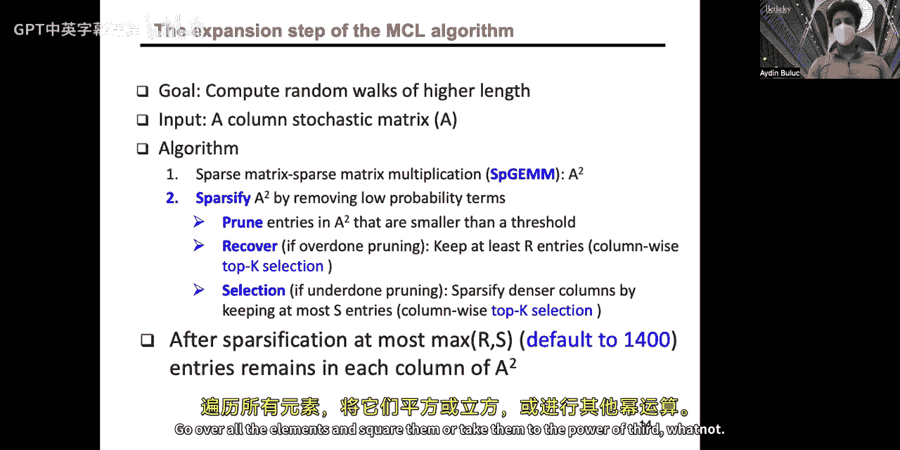

So how is this implemented？😊，I've talked about the fact that I'm squaring the matrix。

 but I didn't talk about the fact that it's often impossible to square a large ad matrix on a graph。

That I want to use macro clusterlustering on。Why we do have graph that of half a billion。

Notes and they have more than  a thousand00 connections once you square them。

 each one of these billion nodes will have more than a million connections。

Because you get your friends of France connection， if you have 1 thousand00 connections and you square them you'll likely get something like a million connections and you can do the math about a billion times a million times the size of each entry。

That's actually not going to even fit into the supercomputer we have if we had the whole access。

 so how can we go around this problem？this is actually a general class of things where the output entries。

The output matrix entries do not completely depend on each other。And here's。

I think about what I'm going to do next。 I'm going to do another column stochastic normalization。

So I need the whole column after this step。But each problem can be treated somewhat independently before I go to the next step。

Because I'm going to prune each column within itself， I'm going to say， okay。

 there is 5 million entries， I only want 1000 of them。

 so I don't really care about what the other column is doing each column is you can think of them as a note after expansion I can independently prune this neighborhood。

So what I'm going to do is I'm going to only compute one output at a time。

 one column output at a time。Well， that seems like a great idea to solve the memory issues and that's actually how the serial MCL was implemented。

But you don't get a lot of parallelism from that because you're generating one spa vector at a time。

 you can't run that thing on a huge cluster of 10，000 nodes。

 so what's the tradeoff you can say given my memory budget。

What is the biggest number of columns I can generate at once？Because that's what you want to do。

 that's the highest amount of parallelism you can extract from the problem without blowing up your memory。

And that's exactly what we do right we just form B columns at a time prune them after pruning those number of nonzes in each problem go from a million to whatever k you chose。

So it's a three orders of magnitude reduction， so you can move to the next。B columns and and so on。

 this says some trade offs that the algorithm will likely repeatedly communicate the first matrix a because even if you just form B columns of the output you do need as a first matrix all of a。

And that seems to be broadcasted repeatedly unless you can find a solution to cache it efficiently。

And we do have some solutions， but that's more like in the weeks。

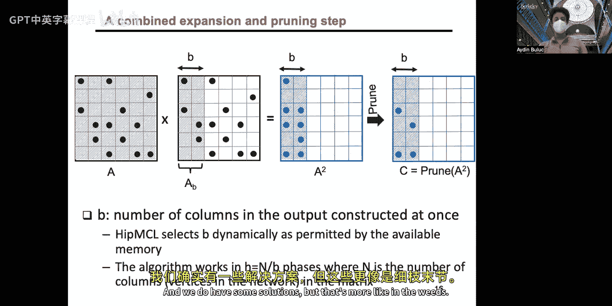

So and for the particular last question。

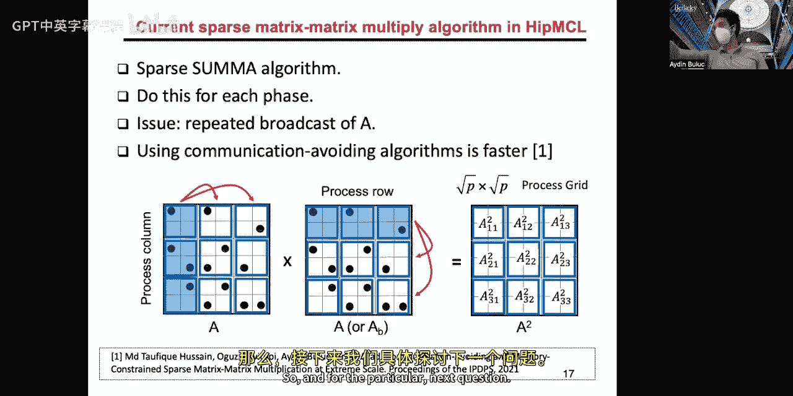

St， what are we。可以。这个卡数。そ。No， it is a regularizer。The question was don't we lose accuracy by pruning entries in each column after expansion well。

 one thing that's going to。Happen is we're trying to get clusters and if you repeatedly do this squing operation without pruning。

 all we're going to get is a fully dense matrix on the output。

 and that's effectively useless to extract clusters from and it's also impossible to store。

So this is like a regularizer it says， I want the sparse output。

So how can I ensure that I can say I'm only going to keep the strong connections and remove the weak connections to zero？

And you， the way we achieve it is really almost arbitrary。

Trill the kitchen thing like do you do threshold， do you do recovery but。

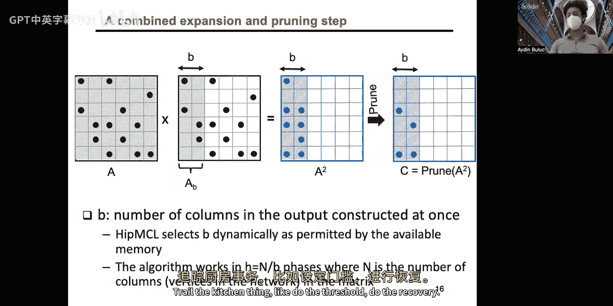

You know， if you actually talk to real domain scientists that use MCL。

 they would like those parameters to be as high as possible。

Because they do get better accuracy indeed but you know there is a budgetary issue in the other place and how do you compute these matrix multiplies it themselves even if you use restriction the good old algorithms you can use anything we used a variant of summa algorithm called it sparsuma we actually since I made the slide we moved on to something more sophisticated that's actually the citation is talking about the communication aing algorithm that's the fourth bullet point there but you can use any algorithm so that's the beauty of being able to map your problem into this matrix algebra then you can reuse the communication awaiting algorithms or distributed matrix algorithms we've covered already in the lecture。

Okay， there's other stuff， but some of them are actually interesting。

 I want to talk and give forward pointers to the rest of our class。

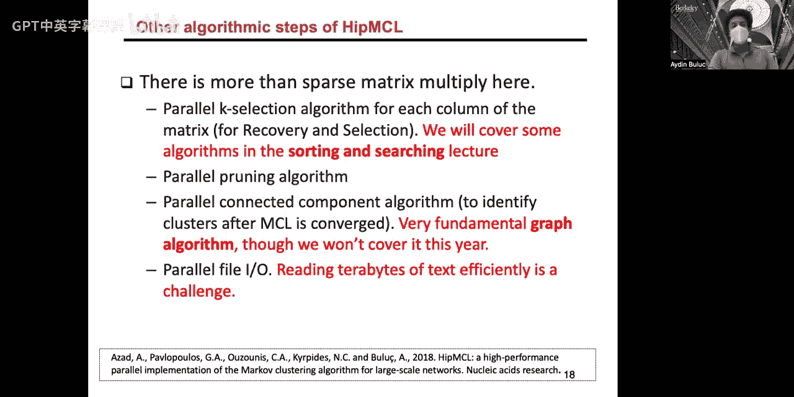

How do I choose the highest K entries on a distributed vector？Because remember。

 this vector is going to be likely distributed， and I want to get K out just entries。

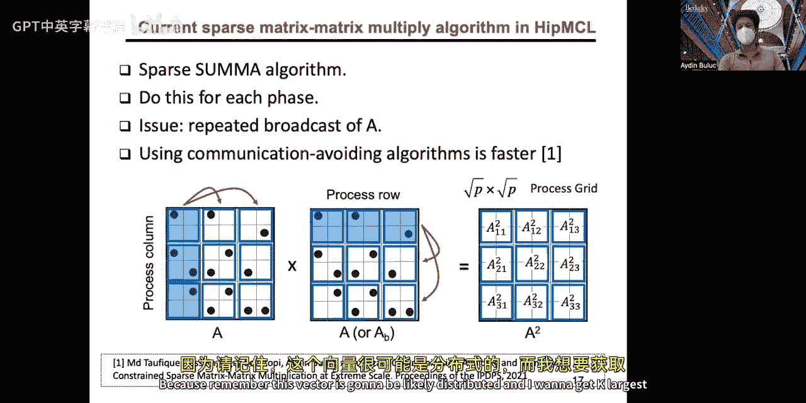

That actually is a very common problem。In searching。

 like all I need to know is the Kate largest element in a vector。 because once I know the element。

I can broadcast this value to processors and say， hey。

 everybody delete anything that's smaller than that。

And that's how I achieved only retaining K elements。

 so the whole thing reduces into finding a so called the order statistics， give me the K element。

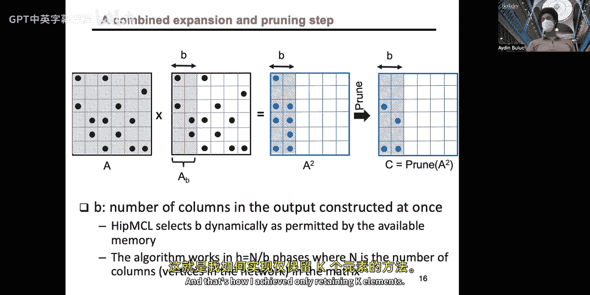

And we're going to talk about that in the sorting and searching lecture。

Where you can either select ant element or you can sort them and that is a more general solution than finding the ant element because you can always pick it from there。

嗯。After this convergence happens， we're actually not done。 right， Let's go back to the。Algorithm。

Let's say after the an iteration and this is usually like 10， it doesn't emerge in three iterations。

 10 to 20 iterations later， it will converge into stars。

Disconnected stars and those are your clusters， but you still need to kind of find them。

The data doesn't actually screenmate you hey I'm a cluster and then you use some sort of clustering algorithm to do that we're not going to cover them there but very fundamental graph algorithms。

 some of the first efficient parallel graph algorithms were designed for connected component finding。

😊。

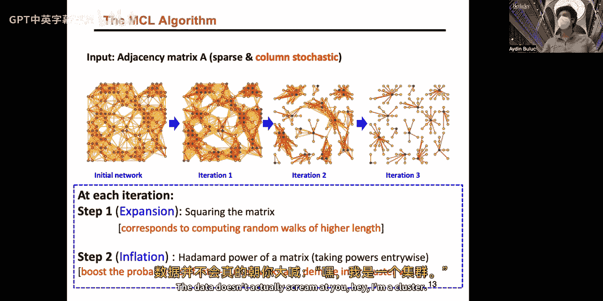

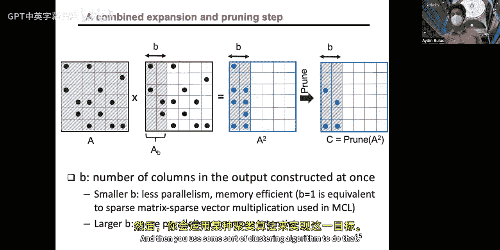

And you know， the research on that area continues surprisingly actively these days。

 and the other challenge on this kind of problem is the parallel file layer like you tossed。

Three terabytes of data as an input， and you really don't want to spend all your time reading those things。

 so how can you do this efficiently？So this is a fun problem and does it scale this is almost just like a showcase of what happened it does scale this is like you go from 256 nodes to 10000 nodes and different aspects of the competition and how much they kind of sped up now I actually。

I'm showing this pla nu as like a hey it scale well to highlight a peculiar aspect of it。

 I increase the number of nodes by a factor of four and some parts like local multiplication got4 x fast。

 okay， this is local， makes sense。😊，The broadcast of P only got3x faster。

 that also makes sense like the theory wasn't even expecting perfect scaling it's a little less than linear。

And so on。 So why did the A broadcast got more than forex faster， That's the curious part。

 But it actually goes back to almost like Jim probably showed you perfect scaling。

 strong scaling using communication waitinging algorithms。 I don't know if you showed it this year。

 One of the tricks you can have when you have more memory。😊。

Remember where in communication award algorithms you have this replication factor as you strong scale the problem。

 meaning keep the problem size constant and increase the allocation you you have more aggregate memory so you can increase the replication factors and reduce communication you would get like a perfect strong scaling if you're lucky of course I mean if you started in a good place now this is not using a communication award algorithm but it's using this strange reality that。

I choose。The number of columns I form in in bulk。Is like a parameter。 It's based on my memory。

 So if I had more memory， I would choose a bigger B size， batchching size。 So as I'm strong scaling。

 I can afford to choose a big batch size， and that reduces the number of times I need to broadcast A over and over。

😊，So there are some actually good things you can do with increase memory if your algorithm is flexible to take advantage of that fact。

😊，嗯。Okay， that's the end of class rank。Probably one of the bulkalies parts of the lecture。

 the next two ones are actually pretty light and I'm going to go back to graph neural networks as the last somewhat deeper dial just like the cluster rank。

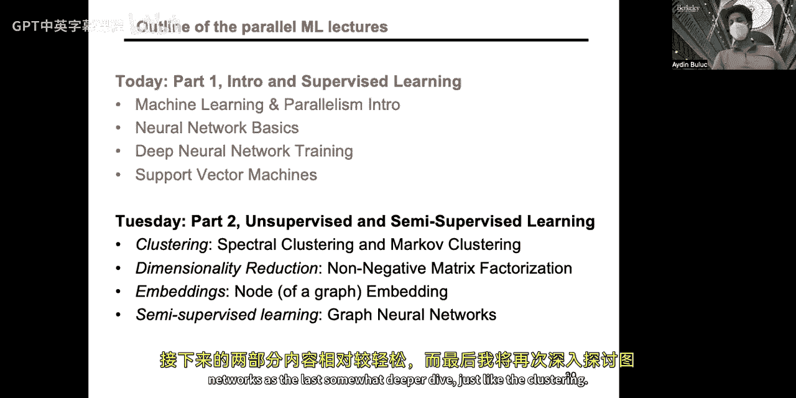

You know a dimensional reduction is the fact that you're given an input data set with of lots of features。

And you think that some of these features are not useful， they're correlated。

 and they must be actually lying in a space that is a much smaller dimension。

Often the word for that is manifold which is like a local linear。

 but you don't need to know about it for this class and there's another just that clustering there's a million different methods to do this。

The linear dimensional reduction methods kind of assume that the data。

 the manifold is linear already， and then you say like principal component analysis and NF are used。

 the nonlinear ones kind of try to convert the input into some sort of linear thing first and then do those operations later。

 we're only going to see the top ones。And if you want to know how they do， for example。Actually。

 this is not true。When we go to node the embeddings。

 we're going to actually talk about Laplace and eigenmats。

in a surprising way and the ISO app for example， achieves this non nonlinearity handling by computing shortest paths again something we're going to see in the graph class。

 it builds a key neighbor graph computes shortest paths between data points。And then in some sense。

 unrolls， if your data kind of sits in this funky Swiss roll shape。

 how can I unfold this thing and make sure that the data point here doesn't look like it's close to the data point here that would kind of be a mistake。

 but thankfully when I construct my key nearest neighbors if I'm successful I will make sure that the distance is connected。

Following this long geodesic path and then mildline transformations will be correct。

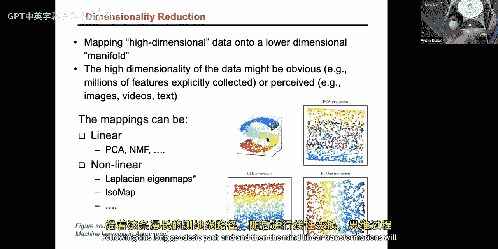

So there's all these steps， but let's get to the basics。The oldest。

 arguably the oldest dimensional reduction algorithm is principal component analysis and where you kind of choose vectors。

Such that when you project your dataset set。Onto that direction。

 the variance is maximized once you do that， then you can choose the next vector。

Subject to the constraint that it needs to stay orthoagonal to the first one。

And for those of you who know more linear algebra than I am。

 will notice that this can be computed by singular value decomposition。

Right then your less singular vectors becomes your principal components and then the scaling of singular values with right singular vectors are the rest of your thing。

 so in some sense PCA takes this three matrix thing and convertverse it into a two matrix thing。嗯。

And the algorithms for those singular value decomposition。

 distributed memory or parallelism I'm not going to talk about because I want to talk about something else as my demonstration case for dimension art reduction。

 it is non negativega factors。

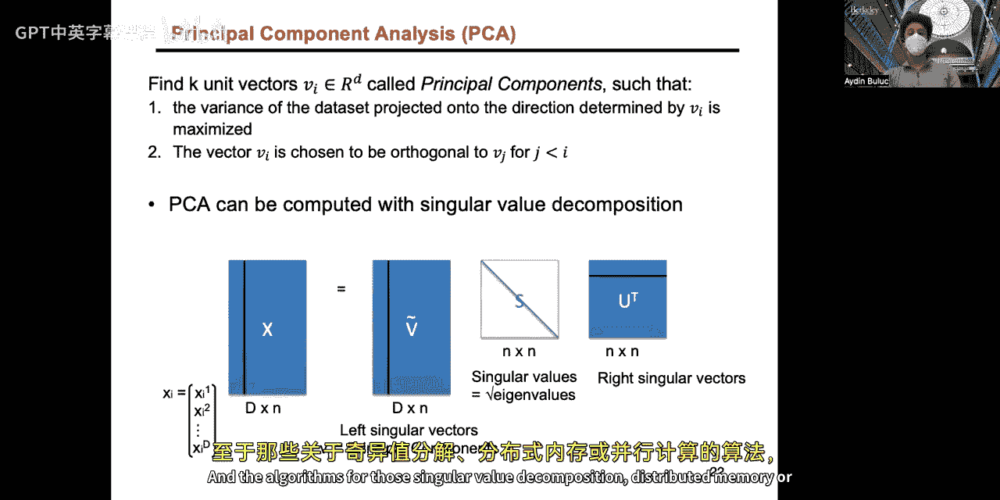

So the problem is。C factorization， but it's slightly misnomer。

Because most of the time when we say factorization， we talk about exact， LU factorization。

 QR factorization， you know， those factorizations are more or less exact。

Where you multiply A L and U and you get a subject to pivots。And some rounding maybe here。

 the goal is actually not to do anything exact。The goal is such that you want to minimize the distance between a and the product of these factors。

Into some norm forbinis norm。Subject to the constraint that。

W and H does not include negative entries， and why did this get formulated？

And became popular as people started questioning the interpretability of negative entries。

In your factors， what does it mean to have a negative entry if I'm， if all I'm doing， for example。

 is population count， What does it mean to have a negative population count when I factorize these things。

 You can argue that maybe they they should have。Try to talk about what that really meant。

But NF algorithms became very popular due to their claim for interability。So。There are many。

 many ways of solving this thing。And I want to focus on one general framework called the alternating updates framework。

If you look at the our matrices， you'll see that we have two unknowns and one input a is the input。

And both W and H are unknown， so how can I solve？A system with two unknowns at the same time well I can't direct to do that so what I can do is I can choose a good initialization I can choose a good H and this can be anything people use random more smarter people kind of run a PCA first and take the negative entries to be zero and say this is probably a good starting place but anything fix one matrix and solve for the auto matrix now you have two knowns and one unknown you can solve that。

And then fix the other one and solve the other one。

 and repeat until you get to some sort of convergence criteria。

That's the general framework and what changes within itself is how you solve it。

And there is at least three at this point， I'm sure more methods to do individual solves。

 multiplicative updates was。I think the earliest method proposed when people defined the problem。

 non negative factorization。And alternating least squares came immediately after。

And I think the state of the art become alternating non negativeative least squares。

 So these things kind of differ the way how brute force they attack the problem to exemplify。

 take alternating least squares and what it really does is，It solves the least square problem。

But because it doesn't have any constraints on it， it'll get some negative entries in the solution。

 and it will boot force those negative entries to 0 and continue。Okay。

 you might see like this is crazy。It gets you somewhere the non negative least squares solution is within it a step。

 it uses a special algorithm that makes sure that the solutions are to begin with non negative。

It uses a different algorithm for that， so it doesn't have to bru force negative entries to zero。

 so it's really about how crude they are in terms of ensuring non negativegness and obviously this is not the only way for finding an NMF you can do your standard stochastic gradient descent because remember we do have an objective function。

And we do have inputs， so you can use any optimization technique， frankly。

So let's talk about the parallelism aspect of these alternating updates。嗯。

And really the main computation becomes。Maix multiplies， not so surprisingly。 So H and W。

Is definitely dense in most applications there are some rare applications where they're sparse。

 but the sparsity is not high enough to take advantage of these are the factor matrices they're almost always dense for practical purposes a can be dense or sparse depending on the application。

So what you end up doing is there's some grand matrix computationmplication here。

Which is these kind of inner products of W and inner products of H transpose。

 if you think about it in a flipped sense。Those are usually cheaper because these are the factors and somewhat smaller。

The A is the big matrix， so most of the time will be spent in computing a times H transpose or W P times a。

So I'm just you know repeating what the issues are here and how those computations look like if you wanted to drill them this is like trying to show you the scale difference between the large a and the how small relatively speaking the factor matrices are so where you should actually focus on your performance aspects。

And then you can use the same tricks that we already been talking about， which is。

 how can I distribute my matrix multiplies？Thinking about the fact that one of my matrices is tall and skinny。

 the other one can be denser spae and much， much larger。

And then you can use the same machinery Jim has talked about in the dance Center algebra class。

 or I have talked about in various different applications， including the last lecture。

But what actually end up finding happening here is。嗯。

The conclusion is to never communicate a for this dance case。

RightBecause it's fairly obvious if you have a large dense input and small factors。

 the best algorithm is to keep that large matrix stationary and move everything else once a becomes sparse。

Then the question depends on how spae and how big is okay？

So and then you can have different algorithms for those。

I'm not going to go over them because they're almost identical to the ones that we have already studied。

Any questions？Okay， let's get to the some part that I conceptually like a little more。

 so let's talk about embeddings you might have heard about how many of you have heard the term embedding。

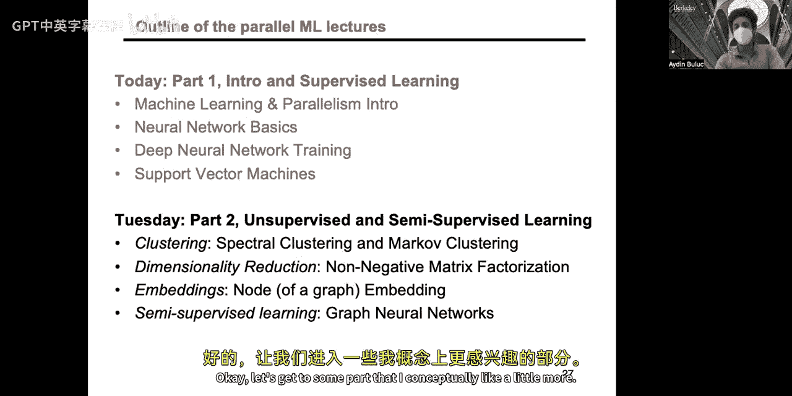

Okay， it's thrown around that makes a lot of sense。I'm going to go over from the graph analogy is。

 let's say you have a。So called graph， which is a bunch of entities that are interpreted as nodes of the graph and some sort of connection between them。

 just like how we defined spectral cluster rank。Those are not really useful entities to dump into a machine learning pipeline。

 right what does it mean to give a note？To your standard pytorrch。

 you know supervised learning pipeline or something like that， they want vectors。

 everybody wants vectors。As inputs so how do I get vectors out of this and this is really the embedding one goal of embedding you can do other things with this I want to map my entity in consideration into a。

😊，Whatever longer dimensional space I decide is appropriate， I say it's a 64 dimensional space。

 256 dimensional space because everything is the power of two。诶。Joking aside such that。

The similarity of these two notes。In the input that I am considering， like I think。

I have a notion of how similar two nodes should be in a graph based on how close they are。

 how many neighbors they share， whatever， and I want the similarity on the other space that I'm mapping them to approximate that similarity I have in my mind。

So that's the goal of embedding。And。You might have， of course。

 different problem inputs and effectively you can embed anything。If it's representable in a computer。

 there is some algorithm that's going to map it to you in a vector space and some of the famous ones is node to work is for graphs。

 word to work is force， well text。Sequence to work is for genomic sequences。

AGra to work is to convert the whole graph into a vector as opposed to。

 and that makes sense when you're dealing with。Molecule data sets。

 like last of small graph represented， right， you want each molecule to be mapped into a vector。

Graph to work， but you can actually use the note to work for this purpose too。

So how can I do that is quite a bit of different methods let's talk about what's known as a shallow embedding the reason this is called shallow is just the contrast to the deep there is no you know the deep neural network going on in this I think this is the first one is Laplaceian eigen mapps remember I said this is one non nonlinear dimensionality reduction algorithm and we're going to actually touch on that。

😊，So you can use it for embedding notes on a graph， and it's simply。呃。

The thing we described spectral clustering without the last step。

We don't do the clustering on the output。 We just compute the。

A similarity matrix computes its k eigenvectors that correspond to smaller eigenvalues。

 and that's the embedding。And you're done。嗯。What else is in there？While there's graph factorization。

 this is also if you look at this。Objective function。You'll see that this also looks like。

What we have just seen， which is nonnegative dis factorizations constraints。

 except that here you don't have a non negativeivity constraint。

 you have maybe potentially a different norm and potentially a regularizer。

 these are actually the same things that some algorithms use for NMF as well。

 some of them have regularizer as well the regularizer all it does is you know I want my solution to be as sparse as possible or have smallest norm as possible or something。

And then you can use the same techniques such as SGD or even alternating least squares frameworks that we already talked about。

So。😊，I think the point here is many of these ideas are related and the techniques we solve in other parts are applicable。

Across the boards。The problem with some of these factorization based and beddings are they're so calledled transactive。

And once you embed this tank and you get a new input。

You don't know what to do with it other than starting this whole operation from scratch。Like。

 I don't have a good way to update my factorization when I increase my matrix size a by 10 more columns and 10 more rows。

And that'ss that's the main issue the methods that are so called inductive can quickly do that and make it some sort of prediction or update on the objective value of the operation easily。

Okay， and then of course， in the engineering side， you can get these embeddings and give them as inputs to many different clustering algorithms and that should come as no surprise to you because you know we said that Laplaceian eigenmsps。

 which is this embedding plus some sort of clustering algorithm is the spectral clustering。

 so unsurprisingly you can take any other embedding and give it to your favorite clustering algorithm。

And get some sort of clustering algorithm out of that。And many people have done that。Okay， so。

Where are we here？I want to talk about some particular。Graph embedding or node embedding framework。

 not because I I think it it is possible to learn all the engineering details about it。

 but mostly because。Of how the recurring themes in this class had been taken advantage by those designers of the framework。

So。One of the ways of also doing embeddings， this is extra slide is random walk。

 you can define two nodes to be similar to each other。Its random walks。Hit them at the same time。

 they corre occur in a random walk。And you can define this loss function based on that if I hit the same vector over and over again。

 same two nodes at the same time in my random walk， they must be similar to each other。

And that's actually how Note towe uses this thing。And this is the thing that I listed but didn't talk too much about。

Now what becomes the problem here is once you write this formula about how to compute that。

 you see that you need to generate something called a negative sample and this is something you're going to read over and over again in these papers and might initially struggle it's that these。

The graph itself is just the presence of things that are in the data。

 but all the missing entries are the majority of the data right in a graph in general each graph will have like10 each node will have 100 connections out of possibly a million so it means the majority of the entries are so-called missing those are the negative samples I sometimes need to generate and feed into my algorithm for accuracy I can't just learn from positive entries alone I need to generate some sort of negative samples。

嗯。And that actually becomes a problem。 And this because if I try to kind of the way people usually do it is。

 there's。Impput note。Destination note and some value。 How can I generate a。

Negative sample is I can randomly perturb one of the input and source and destination notes and I hope that it doesn't exist in the graph。

And that's kind of my negative sample， but if you try to do it， one node at a time。

One edge at a time， sorry， one relation at a time， one edge at a time is really slow。

And so these Pyth big graph。Notice that thing。 The first way they kind of implemented this thing was that they would do that products repeatedly over and over again。

 because they were trying to do one H negative sample at a time， Comp something on it and move on。

 So they were kind of doing。呃。Effectively Blas one and Bla two operations continuously and that killed their performance。

 so the conclusion they came was to in order to make heartHp graph scalable。

Is they have to make this thing in a best way。It changes the accuracy。

 it doesn't actually does the same thing completely。

 but it's somewhat acceptable just like we've seen before right you can increase the batchge upward at a certain point and get away with it。

 we've seen this thing in mini batch STD in last lecture and it's all over the place。😊。

So what they do is like they say， I'm going to do batch negative samples and that's going to create thousand by thousand little matrices that I can do matrix multiply on。

 as you can see here， and that's going to make sure that my performance is acceptable。

So just to bring you the ideas of this class applicable to many of these systems。

 you want to increase performance。 One of the best ways to do it is find a way to increase arimetic intensity。

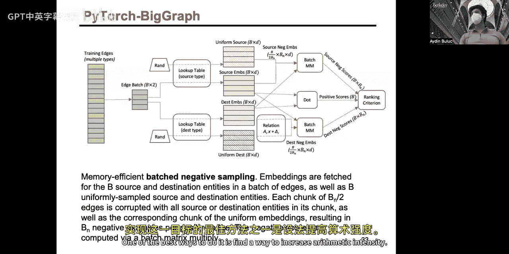

And this is I'm going to skip because this made sense when the lecture was after the graph lecture。

 and I was trying to say that the two dimensional partitioning of edges。

Actually it works here very well as well， but we haven't actually seen that because we haven't covered the graph class。

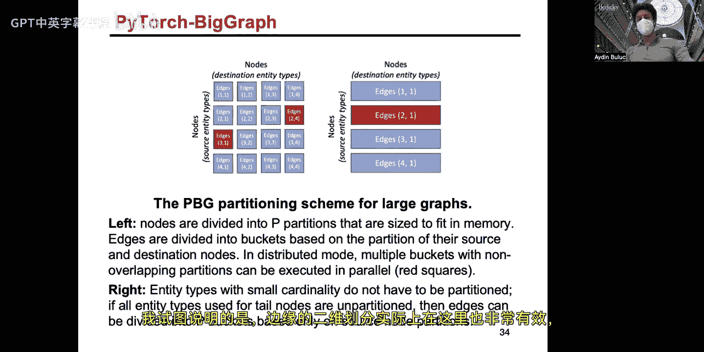

Okay， so what's the problem with graph or node embeddings？Well， it's great。

 you can convert your weirdly shape。Operation。Really shaped data like a sequence like a tree or a graph or vert into a vector。

And then do whatever else you want to do with it， but most of these operations are task independent。

 you can't back propagate the error just with these algorithms。

So how can I kind of make them become supervised learners or some supervised learners is the graph neural networks and that's what we're going to talk about。

I am in the。30 minute last mark， which is a good time。Any questions？Okay。

So last thing I want to talk about is Graph neurall networks。And the initial。

Use case for Graph neuralural networks was semi supervised learning。

 and this use case was actually around for a long time before Graph neuralural networks were invented。

It just talks to the fact that you usually have。In a network， some entries whose labels are known。

Like， you know， I don't like to give social network examples。

But some people when they join the social network， they answer a lot of questions about themselves。

 they say my political preference is this you know this is my where I'm from， this is my gender。

 all that stuff， some people don't。Of course， for advertising purposes。

 these companies want to infer the people who hasn't answered。

What those features are so that's what actually inherently generates the semi supervised learning I know some labels and I want to predict the other one。

And this is common in sciences as well， I can sequence some data all over the place and I can get some output where I know some parts of the output。

 what species it belongs to and so on because they exist in my database。Of known entities。

 and some of them are not there。So how can I infer the things that I don't know from the things that I do know and that's the semi supervised learning there are some labels as the answer。

The oldest algorithm for this is so called label propagation。

And this is really is not as complicated as this picture。It's all it really does is。

Some sort of pure pressure。If my neighbors have a label A。In majority。

 I'm going to also claim to have label a kind of method。

It's like a peer pressure kind of deciding on your labeled， that's the label propagation algorithm。

Graph neural networks kind of may distinct in a full pipeline manner where you can back propagate errors and tune your parameters and do it over and over again and that's what we're going to talk about this has applications in anything you can think of that can be represented as a graph。

Protein data， power grids， materials， transportation networks， particle physics。

 right these their people are trying to trace back the particles paths from the erroneous。

Data they get from the detector。And so on。It can also answer multiple questions。

And let's actually talk about a couple of them， one of them is it can be used for note classification。

 you can say for the examples I gave almost all of them were note classification。

 what is the political party of this person who hasn't declared it。

What species does this sequence belong to？What galaxies does this？The pixel I see up at the sky。

And how about the graph classification that kind of comes up again from the molecules。

 each molecule is a graph， and I move。Certain properties of a lot of molecules。But not all of them。

 can I say that this， the graph of Mo A looks awfully similar to the graph of molecule B。

 so it must have similar properties， now can I use it for graph classification and you can use it there because all you have to change is how you do so-called readout。

But you will just do compute some sort of embedding。

And once you make a decision about what is my loss based on the embedding I' compute it， at the end。

 you can do the readout each node vector makes a decision。

Or collectively every node vectors is combined in this graph to make a decision。

 that's a different readout。And that's what you're going about propagate a different error based on that。

And remember， in each of these cases， for some inputs you do have labels。

 so that allows you to kind of compute your favorite binary cross entropy loss or whatever。

And finally， you can do link prediction。There you can do the readout in such a way that says。

 I have two notes， each have their embeddings at this point。

Or you can design your network to have also embedding per edge。And combining those。You know。

 give me a readout of this thing。And does it fit the reality I know， because I know some edges？

And if it doesn't， you know， you back propagate there error and update。

 so you can use it for all these three use cases。Why do we actually study them in？

In parallel computing I actually haven't answered this， these I also gets really large right。

 but they're actually surprising problems beyond largeness that the whole process of training on a graph that fits in your memory might not fit in your memory anymore。

What do mind we meet that the kind of I would like get that let's let's let's skip that let's start start with the connection to。

A well known thing， which is this image convolution， right， the one on the left。

 you kind of slide this thing so called filters， convolution filters over your image and you get potentially a smaller。

You know， latent image for the next stage and so on， so called。

 we call them activations last lecture。What's how can I generalize this thing to a graph Well。

 that's a fixed size object， I always say。I want。3 by three neighborhood of fixed size。

But graphs are not like that。Some some notes have a million neighbors， some notes have 10 neighbors。

 Now I can generalize this thing to be。Whatever the size of my neighbors。

Just gather their information and aggregate in the center note。

And then you can say every node is a center node and everybody collectively does this step。

You don't need to say that， you can just say I'm going to start with a mini batch of nodes。

 so those are your selection of sample notess or you can go full SGD and say I'm going to solve this problem with one node at a time。

So the same ideas apply over and over again， so what is this slide is really saying is。

GNNs are actually to generalizations of。Covolutional neural network。

 graph neural networks are more general because they can handle arbitrary neighborhoods unlike CNNs。

And they don't actually have a neighborhood ordering because graphs are canonical。

 they treat their neighbors as a set， a set is an unordered object by definition。

 whereas in the convolution， there is actually a concept of a left and right neighbor and up and down neighbor。

But these are permutition invariants so called。

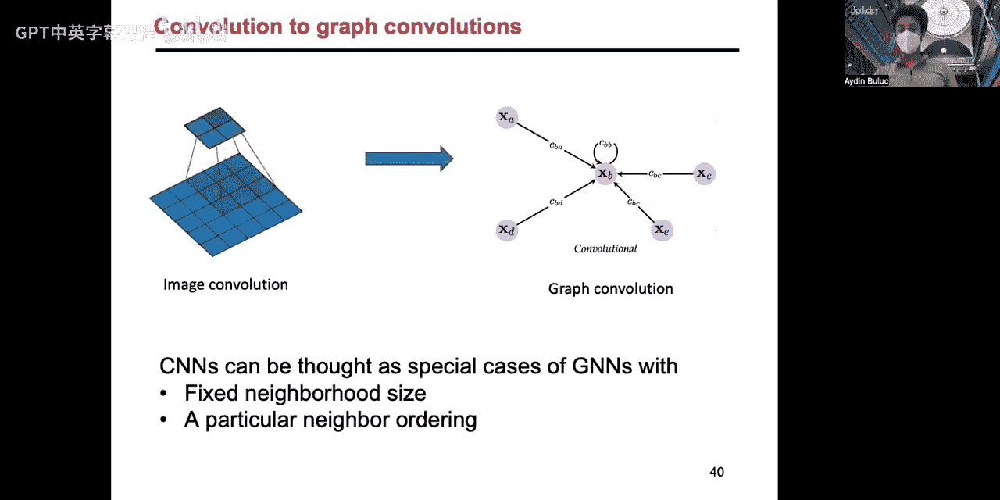

My intel computer processor is overheated。Hopefully， this is the last thing this is recorded。So。

The other thing I want to highlight。And before we talk about STD and other variants is。Can I？

Can I get the same benefits？From Min batchch SGD， as I got from CNNs like we did on Tuesday。

 the answer seems surprisingly no。At least for note classification。

And I'm going to talk about this case for when you have a large graph。

And you want to do note or link classification in a large graph。

 When you have lots of lots of little dress， I think the same ideas can be applied。

But here you have this particular problem， let's say in an image data set I was saying I only want to compute SGD on one image at a time。

 okay， maybe that didn't have enough parallelism， I'll increase it to a000 images at a time。

But there were no dependencies。I didn't need to work on all the images at once because I knew there's memory issues with that。

 there's computing the gradient issues with that。The problem when I directly applied， I think。

 to graphs is I say I'm going to start with two nodes at a time。As my you know mini batch STD。

 mini batches2， okay and I send this to a big neural network。Okay。

 how many other neighbors it depends on， well， zero and one depend on sound neighbor because this is connected。

And then they will depend on some other neighbor and if I have a network deep as like five。

 six layers in a lot of real world graph， my little mini batch will depend on any anything else on the whole network so I am。

Already touching my whole input。Even if I am only training on a small subset of the notes。

And that might not become clear from this picture， but I will just repeatedly reinforce that。

 So that kind of brings a couple of issues， even though I know this stochasticity SGD and mini batchching increases convergence。

I know if I use it a lot， then I'm going to slow down very much because。

Even just like 1% of the notes take the same time to train versus every node because I'm touching everybody anyway。

Right， so hopefully that's clear。嗯。So the people have gotten around this problem or tried to get around this problem by doing something called a grass sampling。

If you have， let's say， collectively a million neighbors。Don't。呃。

Don't try to aggregate information from all of them。

Because those million will in the next layer have a billion connections collectively。

 so how can I make sure that I am only dependent on a controllable number of neighbors and half neighbors is to do sampling。

Just say， I only want to get， you know，10% of my neighbors in it age iteration。 Now。

 you can even fix this to a constant number。 You can see the same tricks over and over again， right。

 I can say I want a constant。Value， or I can say a constant number of neighbors。

 these are the same things we've used when we are constructing spectral clustering graphs。

It allows us to control the memory and computational requirements and trading of some accuracy。

And shouldn't come as a surprise to you。闹丹。It shouldn't also come as a surprise that grasps something literature for training。

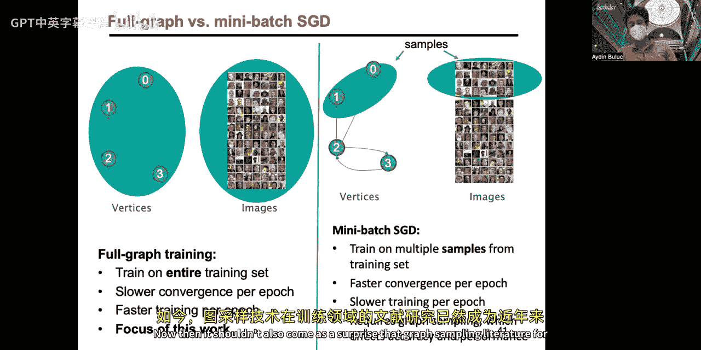

It's become a very hot field in the last years and I'm not going to talk about them until the dust clears because anything I do will be absolutesolete next year。

So therefore， we're going to actually talk about full graph training。

 where you do actual full gradient descent in all the notes at the same time。

As opposed to a mini batch of them。Because that is。

Until we find really good sampling algorithms that also scale。

In distributed memory or any parallel environment， they actually perform from an end to end solution better at the moment。

And this is actually showing you the thing that we talked about。

 let's say you choose these black node as your mini batch。And your network is three layers deep。

And you can see that。Those black notes require the whole graph。To aggregate information。

Because at each layer of the graph neural network， you're aggregating information from one hop away。

 if you have three layers， you're reaching three hops away。

And that kind of exponentially grows very quickly。Actually， this graph made by one of。Jim students。

 like Holman or someone like no， I don't know。One of the original papers， it's actually a nice graph。

It doesn't expand fast。

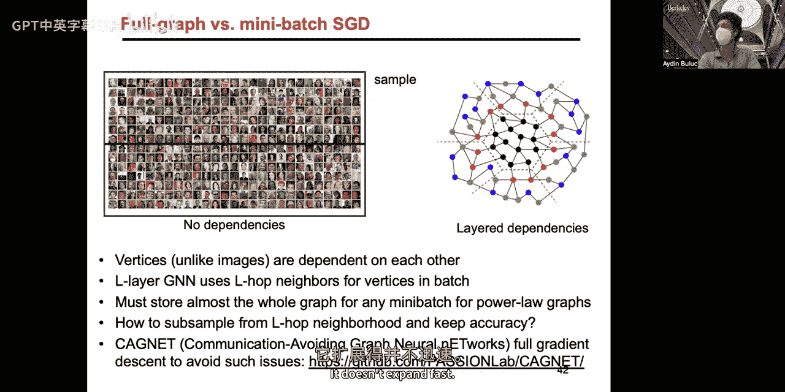

And some graphs expand much， much faster than this。

So let's get to what the graph convolution looks like， it's really， as we said。

 you're aggregating features from your neighbors。And let's look at in a matrix line， what it does。

 let's stack。Everybody's feature vectors into a tall sner matrix again。Again。

 the toski matrix keeps coming back over and over again。

 where the number of columns is the feature dimension。

And the number of rows in this case is the number of number of rows is the number of rare disease。

 but it was whatever the entities that we were training on so far。So I just stuck them down。

And what's happening from the perspective of V6？Is it's a multiplication of this sparse row， the。

 the last row of the。I just see some matrix。With this dance tos skin matrix and all it's really doing is combining。

Those three feature vectors that are neighbors of these six。

That's the computational intensive part then it's going to combine that with itself as well。

 and I'm not drawing here。And you could actually。You know。

 give different wayss for combining yourself software ver versus combining from your neighbors and that's a trainable parameter but what's really happening all is。

It's a sparse matrix， times tall。Skinny dance matrix that's used for aggregation and every node is aggregating features from their own neighbors at the same time。

 I'm just highlighting it from the perspective of V6。This is a graph convolution。

 the graphraph neural network actually is a more umbrella term that is any deep neural network that operates on graphs in some sense is a graphph neural network and there's other ones like those that do graph attention and so on。

 but let's just focus on the simplest one which is this graph convolution。

But what does it look like when you do it for many many layers。

 and this is one way to think about it。At zero layers。You have the features of the input。

But the input usually have certain features， as we said。

Whatever has been entered into the system by the。By the user to the social network is the simplest way to think about it。

 but anything is that starting inputs and then your everybody's aggregating from their neighbors at the same time and forming a different。

Lanth vector potentially， this can be the same， but often different。Now to analogy。

 go back to the CNNNs， you should think about this as。Channels， right I do start from my image。

 I do one convolutional layer， I get a different channel depth。

Initially it was maybe just RGB three dimensions and I get something different same here I might be starting with a 128 long feature vectors and i'm kind of shrinking it to something smaller to create some sort of information bottleneck maybe and I can expand it later at the output so potentially the hidden latent。

Dimenssions on the embeddings。And the intermediate layers of the network are different。

And how is this ind from a mathematical perspective？Is this formula， right。

 you have a is the sparse matrix that's representing your graph。H is the。The features。

In the input or the embeddings of the previous layer。

 that's why I'm using the superscript L minus one if I'm doing this operation in the alt layer。

I'm using the embedding to sner matrix on the L minus first layer， this is the forward propagation。

And I'm using this W。Which is this mixing matrix W is just。F by F。And or F prime by F double prime。

 it's the feature length， so if I'm going from three to2 W's dimensions is just three by two。

Mattrix this is a little shared parameter matrix。Of course， it's not that small， right。

 this in practice is know 200 by 500， something like that。诶。

But the nice thing you can see here is it's shared。

Every node doesn't have a different mixing matrix that's shared across everybody。

So that kind of makes these deep neural networks， in some sense parameter wise a little。

Frugal and nice， this w is shared by all nodes。 You don't need to kind of have a parameter matrix per node and explode your space。

Okay， and then you do this repeatedly until however many layers you have。

 and you can write down using the chain rule the formula for the backward propagation。

Not that important， all you need to all I want you to focus on is this is also。

The same kind of operation， there is a sparse matrix。And there is a tall skinny dance matrix。

 now it's not the embeddings， but it's the gradients of the embeddings。

Times the transpose of the mixing matrix that the learnable parameters。

And some linear transformation combined and so on， and then this repeats again here。

 you can reuse that product if you want。So。That kind of already tells you。

Probably where the time will be spent。When you train these things。

And it will be in the Sprse matrix time pulsekinid dance matrix。And this is。

What I just said in code form in many layers， how you compute this thing？

And it's only left here as a reference point。And if you write down what's happening in full graph training。

And try to put these dimensions into scale， that's what you get， you get a big sparse matrix。

Ts skinny dance matrix。And a relatively tiny W。So most of the time will be spent here if you're using F graph training。

 and I keep actually quantifying it repeatedly because if you're doing sampling。

 these things might change。If you do aggressive graph sampling and found a great way of doing stochastic mini batch training on GNNs。

 you will get a smaller A。After you sample， and this might be the bottleneck by that， I don't know。

It's open research。So how can I make sure that I do this big operation of sparse matrix times tosch matrix well。

 I can go back to my set of algorithms from communication over land。

 1D 2D 3D algorithms and the interpolations of the 0。

5D would be an interpolation between 1D and 2D and 0。

5 2 and a house D would be an interpolation between 2 and 3D。And。8。

And then look at which ones I can use for this particular problem。嗯。

So maybe I connect you to take a minute to talk about a couple of these things。

Because I do have that minute， so why not use it？So the 2D standard algorithm you have seen。

In the dance algebra class， as well as the distribute memory class as it divides each。

Matrix in a 2D form， and each matrix， two of the matrices move， and one of them stays stationary。

Often the output is stationary， but it doesn't have to be。You can keep a stationary if a is bigger。

 the sparse matrix， so this is actually a richer set of options you have。Because of sparsity。

 these changes the algorithm algorithmic decisions if it's sparser。

 then it makes sense to move a because it's cheap， if it's relatively denser than that it makes sense to keep a。

Constant stationer and use a different algorithm， right？But the point here is their memory optimal。

Meaning that if I run this problem in a sequential computer and it takes bh memory。

When I run a two dimensional parallel algorithm。It also takes in aggregate that much memory time some little constant for buffering。

So it's always memory optimal， it doesn't do replication。

And it usually proceeds in some like number of steps that is。

That is a function of P in standard 2D algorithms， it does at least squared of p that's often more depending on how you slice it。

Now one in a healthy algorithm， at least the way we define it here is。It cuts A。

 and this is the same kind of way people have done this NMF。Earlier in the lectures。

 they cut a into 2D， the sparse matrix， but they cut the B and C dense tall somerices in 1D。

Not entirely random 1D it's almost like a two level 1D first you cut it into in this case three pieces。

 three big chunks and then within each three big chunk you're divide it into smaller chunks so。

There is some replication that's going to happen within this algorithm。

 so why is that the case this algorithm will actually compute the output in one multiplication so what's going to do is from the perspective of the blue processor that's owning this part of a。

All it needs to do is to get the gray pieces from B。We then all gather it along the processor column。

Not that every processor will get involved and everybody else will do another all getter along their processor columns。

And at that point， it needs everything from B。To compute its local a matrix times B that needs and that can just do reduce scatter the output。

After everybody in this process we really has done that so one local matrix multiply。

Two communications along processor row and column finishes this。

And so now we can look at the benefits of this algorithm compared to 2D。It doesn't do many。

 many stages， it just does it in one stage。So it reduces the latency。

And it potentially works on bigger matrices because I'm gathering this whole piece。

 not just the blue piece that I own， but the gray pieces that I need。

 so I'm working on a scatter dance matrix， a bigger dance matrix。

 which gets higher artrimetic intensity potentially at least it gets a higher proportion of the peak。

 even if it doesn't get higher art， but we actually showed in the paper that is' expected to have。

Higher arithmetic intensity。And that's more or less the number one benefit of the algorithm。

The downside of the algorithm is。Once I do this， allll get。

Before I finish the reduction and scattering， I am replicating。Pieces of B。

Up to a factor of squared of P for example or c， let I say the second dimension is c instead of just holding what I should hold one piece of the B matrix I am holding。

One P over seat of the matrix。So that's the replication of a factor C， and that's the downside。

And you know， there's 3D algorithms you can do that also do sort some sort of similar replication。

Like 2D algorithms that are operating simultaneously in multiple layers。

 and they also do C times replication because they do need to do some sort of reduced scatter on the output before getting to the final result。

And these will take a while to wrap your mind around。

But the main point here is the same trade off of memory versus communication。And you do the analysis。

 this is kind of almost impossible to get it。Intreatively right， in the first try。

But the results are actually the more interesting ones。Let's go over them a little bit。

 so what is this？😊，We' are running on one GPU per node on summit used to be the fastest machine at some point on Earth。

 I don't know if it's now five number five or something right now。嗯。

And we are only comparing a pure 1 D algorithm width。Oh， actually。

 we're just comparing one and a healthy algorithms， we're increasing C。

 the replication factors and seeing if the runtime goes down。And unsurprisingly， it does， right。

 It actually takes a problem that was not scaling at all。

Which means like if I didn't use the replication， I had 16 here， 16 nodes。

 that was taking one and a half seconds， and I use 100 nodes as still taking that much。

So things were not working very well， but if I start using。

Replication factors this is actually zero means this didn't run， it's not a good thing。

 theres not enough memory there。But increasing C allows me to kind of get some sort of scaling on these data sets。

Similarly over there， c equals one is barely different。

But the increased memory allows me to increase the replication factor and get some sort of speed up。

What about the 2D and 3D comparison， things are a little more muddy there。

 it's hard to see the 3D benefits， except you can argue that at large scale with hundreds of nodes。

 maybe there is some difference。These inputs were a little too small maybe to showcase these benefits。

 but the algorithms are there's also the other reasons that summit is a weird machine to run these experiments。

 hopefully the differences will be more clear in larger scale and bigger inputs。

So to conclude the GNN training in parallel。This is really transforming science， I believe。

 lots of deep learning problems on graphs， we should distribute training because of large memory footprint。

And we just talked about how to do it in fully full gradient descent now actually let me go back to this figure。

And talk about something I said before， which is even if your graph fits into your memory。

 your training will not。And here you can see why。嗯。For each layer of the neural network。

 you have all the node embeddings active。Here， right， so if I have 100 million。Notes。

 I have 100 million。Times whatever the future length I have。 And it's usually couple hundred。

Does it make sense？And I have to store this thing。Because I need to do back propagation on it。

 I'll need them later， I can't discard it。So then the next layer for all vertices。

Multiplily with the feature length of that layer， I need to start assuming I'm doing no sampling。

And a full gradient descent and I do it again so what is the formula number of notes times the number of layers times the average feature dimension length。

Is my storage。And that's often much bigger than the。The graph itself。

 so that's why we often need distributed training is also expensive。 I mean。

 anyone who tried to do G training on a。On a CPU will tell that it doesn't work very well takes forever and GPUs are really small memory footprints compared to a couple terabyte machine you can get。

Today。With that， I think I'm done。Thank you， questions that haven't asked。Nothing on chat。

 beautiful about next week on Tuesday， Jan Sttoyika will talk about cloud computing。So that， I mean。

 we're all excited about it， so hopefully you' too。

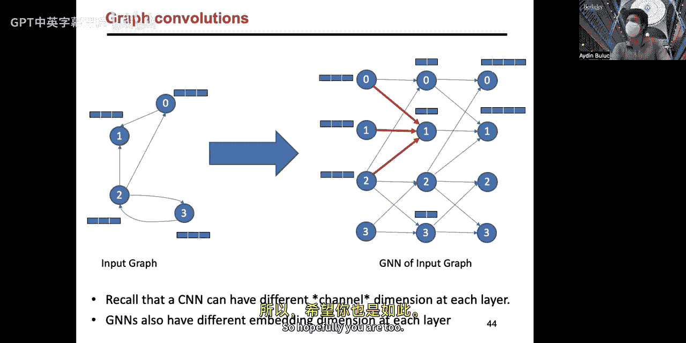

。