# 【并行计算 CS267 2022】伯克利—中英字幕 p15 CS267 (Sp22) - Lecture 17： Ray： A universal framework for distribut -BV1PS421978D_p15-

basic。对有。Thank you。Thank you， Jim。 Do you hear Miwaa。Perfect。So today， I'm going to talk about Ray。

 and many of you may have heard or maybe even have used。

 which is a framework for distributed computing。 pretty general。 We developed at Berkeley。

And let me start with， this is kind of trend， which started actually， you know。

 a little bit more than 15 years ago。And that was the trend。

 is's about democratizing access to large clusters。 So， and this was driven by。

The emergence of public clouds， in particular in 2006， AWS。

 Amazon of Services release the first services S3。simpleim story system and easy to。

 And since then it's you know， the adoption of the cloud is rapidly growing。

 and fundamentally work cloud allow you to everyone basically to get a very large clusters to run their applications。

 and this is also， I have here the picture of the cover for the book。

 which is a data center as a computer from coming from Google， I think in 2009 the first edition。

 which basically is again， push for this idea that instead of using your own laptop your computer to run the application。

 Now， you can use the data center。😊，However， the biggest problem here is that。You know。

 these clusters are very hard to manage and program。And during the years。

 I've been involved in a few projects， open source projects。

Whi tries to address some of these challenges about managing and programming this kind of clusters。

 he started with Apache Mes 2009， which was orchestrators for resources of a cluster。

 what Kubernetes is today， then Apches spark， making a simple you know distributed data processing easy。

This was a little bit later， a few months later started the project after Mes， then alu show。

 this was around 2011 and this is about developing a share storage across multiple distributed frameworks allowing distributed framework to share the data and more recently Ray which was started 2015 2016 in that winter and this will be my the focus of my talk。

And please feel free to ask any questions at any time。

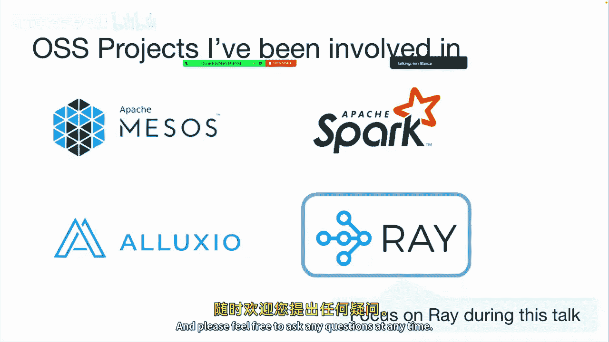

So here it's。The overview of my presentations， I'm going to start to start with a trends which basically motivates Ray some of the use cases。

 then I'm going to talk about ray， then some of the use cases we have seen ray being successful。

And lesson than 1。O。

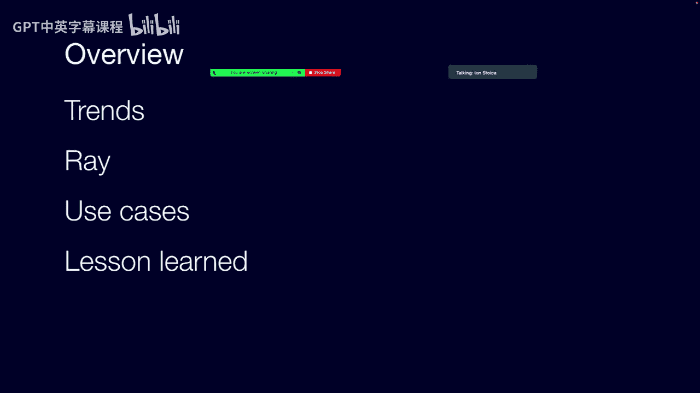

And。So trends。 So there are a few trends， secular trends we are witnessing today。

 So one of them is that applications are increasingly incorporating AI。 So AI is really disrupting。

 and we are just at the beginning， almost every industry。And。

So basically on all you see is is AI penetrating， like I said， every industry。

 everything from finance， manufacturing， hospitality industry， of course gaming。

 healthcare and many more。So that's number one。 Okay。

 so you can look at the future in which all of this a lot of。

Application industries will be AI enable or AI based， right， it's。And。

The second one is that the AI demand are exploding。

And probably all of you have seen this few years back the plot about compute demands of。

Training the state of the art， machine learning models。 This was coming from open AI。And basically。

 according to this plot， if you， you know， it's a log scale， obviously， is basically every 18 months。

 the demands in the compute you know， grows 35 times。And after that， you know。

 I had another data point here。GP T3， it was released 2020 by open AI。 and there are a few others。

 But for G3， I do have the data。 Well for the other， I don't have the data about。

How much computes is needed to train these models， right？ So the trend continue more or less。 right。

 And this is not only for esoteric applications， but for real， you know， practical application。

 like image processing， natural language processing anything like that， right， is not only， you know。

Beating the go champion or thing like that。And the important point is not only processing。

 it's also the memory， right， the size of these models here are a few data points starting in 2016。

About the number of parameters of these kind of models。And this is the latest time I have。

 which is Budao。 It's actually 1。753 on parameters 10 times more than GP 3。

 which was released in June by Beijing Academy of Science， artificialificial intelligenceence。

 sorry it's in。In China， right？So it's again， if you， if you， if you， if you try to seize that trend。

Start from 2016， this number of parameters of these models increase 40 times every 18 months。

 And if you look at the past。I don't know。40 years。Or so is 300 times。 So this sort of sort， right。

 is like huge increase。 at the same time， the end the model ended， right， is like。You know this plot。

 you've seen it。 and it used to be that obviously is a performance of increasing 18 every 18 mass。

 right， So Moore law is saying that。The number of transistors was increasing with the same area you can increase every two years。

But because the transistors are closer together， Also the performance get a boost because the latency is close。

 the latency shorter。 So that's why I actually get in terms of performance to x every 18 months instead of every two years。

😊，So now if you overlay this kind of mors law， it's like this is1 you know。

 doubling every 18 months compared with the increase in demand。 So and obviously a mores law ended。

 So this is actually the performance increase of a single core。

 but no matter how you slice and dice it。The gap is enormous and increases obviously your exponential。

 right？The main point here is that even if a Moore law wouldn't have ended。

 it wouldn't have helped to solve the problem in any meaningful way， right。And what about GP。

 of course， right？ this is Nvidia， some of the latest GPs。 and this is R TPs。 And as you can see。

 obviously， they are going to be much more powerful。 they are going to start as a higher y intercept。

 But in terms of growth， you know， they just track more or less more slow。 and they do that by。😊。

You know， innovating on the architecture， in the architecture side， right， is not like。

The morelow is holding， but every generation is there going to try new， you know。

 innovate on the architectures。 And then the performance is increasing more or less with the more law this is so far。

But it's a game， even with those。The deelta between the demands。

And capabilities of a single chip are still。You know， huge。And。It's also true， obviously。

 for the for the memory， right， for the storage。 during the same time。

 the GPSO is hover over this time interval increases 1。7 x every 18 months， something like that。😊。

And， you know。It used to be like， for instance， when4 or five years ago。

The largest model was fitting on a GPO， right， today。

 you need hundreds or thousands of GPs to fit entire an entire model。 right。

 And I think that the memory requirements are even more。So to speak stringent hard， right。

 because with a with a， with a processing， you can always try to specialize more to get more performance。

😊，Right， but what you are going to do about memory， right。

 You need really new technologies because otherwise。

 you still need at least one transistor to store one beat。So you can't do a matchio， right？Of course。

 you can。 you can be smart about lower precision and things like that。 but algorithmic innovation。嗯。

So fundamentally， this is a conclusion that at least to support this AI workloads。As we go forward。

 there is。No way but distributing these fors。Okay。The demands， again， grow much。

 much faster than capabilities of a single hd。

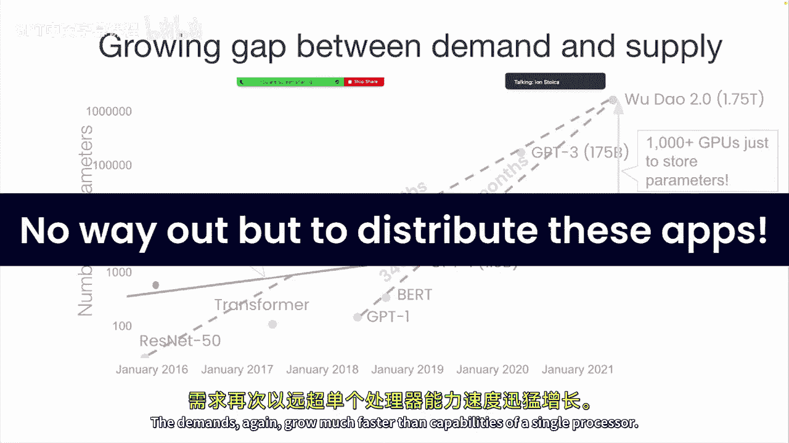

Or of a single processor。嗯。So these are the trends and these are， you know。

 we expect this problem to become bigger and big， we bigger as you know， as the time goes on on。

 at least for the next five years in the next decade。

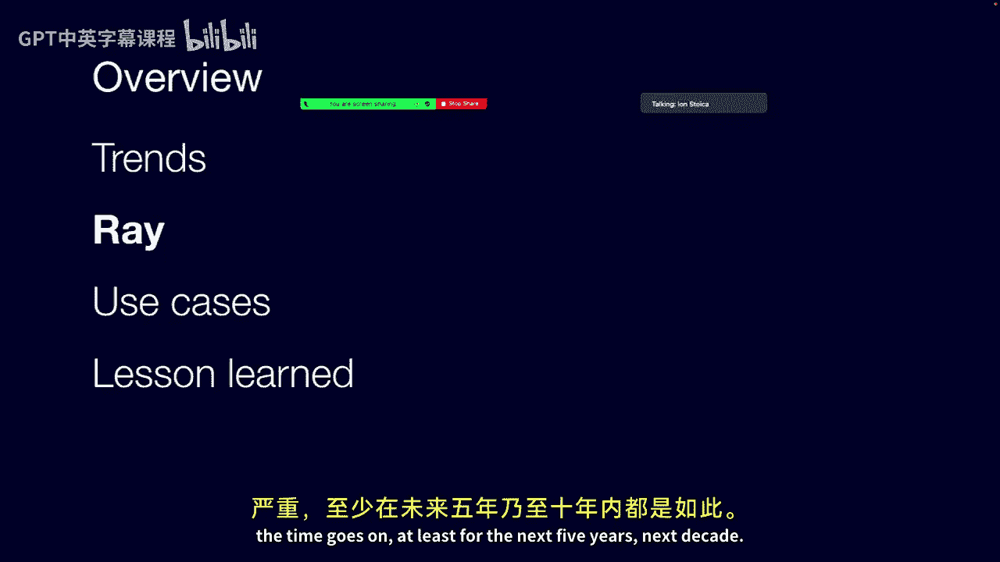

嗯。So Ray tries to address， you know， this challenge and to illustrate why this what， you know。

 in more details， what is a challenge， Let me take a simple example。

So this is an app promotion example。It's one of the largest finTtech company in the world and its a recommender service fundamentally right so basically when you log on the application。

 they want you to recommend new services， new products from their affiliates。Good bye。H。

And it is a high level。You know， the back end looks like you'd expect。You get the logs。

 There is you featureurize them。 then you use this logs to train。A model and you serve a model。

 right？ So when the new users log， you know， log in。

 you get their information and then make recommendations， right。

So one queypical question here is that actually there are two questions。

One is how fast you can update a model based on the new information It new data from the users。

The second question is， does it matter？All right。And。Intuitively， for this application。

 it does matter because if you think about when there are this， you know， like in China， like 11，11。

 right， the biggest shopping day in the world or Black Friday here。 when there are these events。

Is like you want to recommend to your users to buy the hottest product as soon as possible。

 because if you don't recommend another rival is going to recommend to them。

 And these users are going to buy the product only once。

And whether the product is hot is based on the information from other， you know， basically。

 you need to react because the product is hot if a lot of people at that time is you know。

 during a short interval are going to buy the product。So。Initially。

 they have this updating or updating model every， every day。 And that actually is pretty quick。

 even by today's standards。So now， then。They really wanted to lower the frequency or increase the frequency of updating the model。

 And they went from one day to one hour using the state of their solution。

 And I'm going to talk a little bit about that。 and what。In doing so。

 they increases a clickthrough rate5 times by 5% sorry clickthrough rate is a percentage of time you shows the ratio between the number of times the user clicks on the offering and the number over the number of time you are showing the offering to the users。

😊，Goodite。So， of course， the highers the better。 So it's a pretty good good number。

 And what are the solution， The solution is that。And then they wanted to go lower。

 but it was very hard to go lower。 So let me talk， tell you a little bit about the solution。

 So the solution was。Basically using for each of these stage best of breed frameworks right for data futurization。

 data ingestion， they use actually at that time fllink for training they used Tensorflow distributed and for serving they have a homegr solution right so any of these stages isPA is distributed in nature right。

So。Basically， the solution is to pick for each stage。You know。A state of the art framework。

 and then stitch them together。Right， so what is the problem， is that。

There are several problems or challenges。First of all。

 it's hard to build because you need to build an end to end application using different frameworks。

 Each framework will have different API。Al right。The second one is hard， you know。

 to deploy because now you need to deploy and manage different。Fraworks， distributed frameworks。

And there are more subtle things， like if you want to have an end to end to provide end to end。

 you know， clear end to end failure semantics because each of these systems has its own failure semantics。

And the final one is， which is one of the main reasons you， they couldn't do it less than one hour。

 It's about。It's high latency because to move the data from one frame or to another。

 typically you have to build to write it to a storage like fly a distributed file system and 2 it。

 serialize， deize， have all this overhead。O。And this is a very simple you it's a pretty simple application。

Obviously， you don't do only training。 You do also have parameter tuning。

 And if you think about more complicated。Application like reinforcement learning。

 you need to do simulations or you need to process in real time the information coming from devices and things like that。

 You need to do A P testing on serving many more things。Okay， it's， it's。Again。

 any questions happy to answer。So， so basically， this is the situation today， right， you know。

 you have to support this kind of machine learning applications。

 You need to support a lot of workloads， training， model serving， high parametermeter tuning。

 simulations， visualturization and things like that。 And for each of those workloads， you do have。

Good frameworks， distributed frameworks。Al right。However， it's again。

 you need to seeize them together。And this makes， like I mentioned in that example， building。

 deploying， managing。Difficult， and as well as the latency of the entire pipeline or the end end of the end to end latency of the application is pretty high。

So Ray takes you from that word to this word in which you have。You you know。

 U is a universal framework for distributed computing。 So it's very generic framework。

 And then to support the workloads， this kind of different workloads。

 instead of having different frameworks， you have only one framework， which is Ray。

 and you have different libraries now to support different different workloads。Right， so that's it。

 right， Thats idea， main idea。So Ray started again， 2016。

Earlier as a class project and the goal was to scale distributed training and reinforcement learning。

And then we released 2017 R the reinforcement Learn Library。

 Ray tune High parametermeter tuning library， 2019。

 any scale was founded which is company behind Ray and 201220 right version on0 is going was released and this year is the second version is going to be this yes。

Yeah。Yeah。Absolutely。Yeah， Philip。So Ray has a very minimalist API， in some sense。Like an MP。

 MPI is a core function。 numberumb of core function。 It's against 6， right or something like that。

 right。Also， Ray has a very minimizeized API。 This are the， you know， the entire， you know。

 the core API。 and I'm not going。 I'm going to present that for some examples。

But let me take a step back before giving an example and say you what train and actually is。

 So Ray basically takes the two， as that's why in general， in most programming languages。

 you have two constructs， computer constructs。 you have functions and classes。And。It takes them。

 and execute them。Remotely and transparently。And function， if you execute them remotely， they become。

 we call them tasks。 But these are essentially are R piecess， right， Re procedure code。

If you instant a class remotely， a class has state in it， right， So it becomes like an actor。Right。

To each are going then to submit methods， invoke methods to execute。In addition， it has。

This future or distributed future， we call them to enable parallels。 I'll give you a future。

 basically， when you call a function， a task， a remote function。

It returns immediately before the function is executive。 So you can call another function。

 remote function， another remote function。 So these remote functions are going to execute in parallel。

😊，嗯。Then it has an inmeory object store， which enables to pass the arguments。😊，To this。

The remote functions。By reference。Instead of。By， you know， by copy。Coping。

And this is an extension to existing languages rather than a new language。Right。

 is the in for pythons。 They are just a bunch of decorators。So， let me go through this。Examples。

 you know， to illustrate these concepts。Tusask actors and futures。Okay， so on the left hand side。

 you have a snippet of code illustrating functions and tasks。 So basically。

 this reads two array from two files and add them up。And this is a class which implements a single。

 simpler counter。And in order to execute this function remotely or to instantiate this class remotely as an actor。

 you as a ray remote decorator。😊，That's what you do。And in addition， this function。

 and you call them。You are the six remote， and they are going to return this。

 what we call distributed feature future。which is as synchronous。

 you don't wait for the result to be to be returned。And then you get， you know。

 you get the results at the end。So what he call this， so it's again。

 like let's see how it's working under the hood。So say。

 assume you have two nodes and each of the files， the two files you read are are on different nodes on these two nodes。

And when you execute the first， you know， read array remote for of you want to read file 1。

You are going to submit。You are going to submit this task。Right right。

And this task is going to return in the immediately， this identifier I D1。

 So this is a distributed future。 What distributed future is。It's again。

 it's a reference to the result in this case。At this point， when we submit。

This function read R A remote or this task。We don't know where is a task。Is going to get scheduled。

 We don't know where the result is going to be。Available。Right， and notice that， actually。

It's not necessary that the node on which the task was originally scheduled is going to be the task which provides a result because that node may fail and you need to。

 you know， to rescheded。The task or another note， right。

 And this is actually makes things challenging， right， because you get this identifier。

 But you don't， you don't know is's not only that result is not created。 You don't even know。

Where is going to be created。O。So again， this as synchronous returns immediately。

 Now you are going to submit the second task to read file 2。

 Then you are going to submit the third task。To。And they take the article meant。The futures。

Which are the results。From the previous two tasks。And at this point。

 you submitted the entire computation graph for this application， right。And finally， you do。

 you want to get the results you write or get on。The distributed feature or reference to the result of the a task。

And now this is blocking。Right， so you need to wait for the entire graph to get executed。

And as you can see， because there are no data dependencies between the first two tasks。

 which is51 and the file2 they can be executed in parallel。Good night。So that's basically the main。

 you know， idea in a nutshell。 what what this is about。So yeah。

 So you need to execute the entire graph， compute the sum， and then。Your return as a result。To。

To that program。Okay， any questions。嗯。There are a few other things， like， for instance。嗯。

When you are going to， you can specify as a programmer the number the resources which are required to execute by a task or an actor or a method of an actor。

好。So。You know， unlike something like Spark， Ray provides。

Is the programming support for heterogeneous resources。Okay。嗯。Which is very useful。So， next。

 let me tell you a little bit about your memory object there and enable passing arguments results by reference。

 What is a big deal about it。😊，So let say here is another very simple example。And again。

 I'm creating an array。 I am taking the inverse of the ortho matrix， inverse of matrix。

 And then I take a square of the inverse。And assume。That。

I'm going to use R PC here and the inverse of the the the function。

 which takes the inverse of the matrix is on runsson node 2。

 and the one which squares the matrix is on node 3。😊，It's again， this is a very simple example。

 maybe contrived to make the point。So with RPC， you are going to send you know to pass the arguments by value right you need to copy them right when you call inverse RPRPC X and inverse its random or now 2。

 you need to send out x a value x， right。And then you need to restore the results why。To node one。

 because node one is going to take this result and is going to pass to square。Fun。

 R PCC and the square R R PCC， because hes going to execute on no3。

 is going to pass again y to copy again y to no 3。So fundamentally here， why is transferred。

To node one， from node 2 to node one and from node one to node 3。

 But node one doesn't do anything with it。Al right。So what happens is， ray， you have an object store。

So basically， when you are going to create the object。 You have。

 you can do right output and you put in the object store。 Actually。

 this in most cases is done under the hood。 I put it this explicitly for。Illustration。

And now you get this X I D， which is a reference to。The object in the object store。

 And when you are going to call the inverse now task， which is executed or now2。

 you are only going to pass the reference。Right， now this inverse function。

 which is executed by on on now two， needs the object。 So now you are going。

 when you are going to execute inverse is you are going to copy the object X， right。

 because the R command。And you are going to create the results， why。But when you are going to return。

 it's a distributed future。 So it's， again， it's a reference。To the result， the result is on now to。

So now the square function， the square task。Pexel input， the reference to y。Okay。

 and then you call square， which is R one 3。Os。喂。So now when you execute square is going to require object Y。

 but now it's going to to transfer y directly from node to。Right right。

So what you have here is that y in this case is transferred only from node 2 to node3。

Instead of going。To note 1 and then back to note 3。 So you have only one transfer of y instead of2。来。

So， that's basically what it is。嗯。So this is a rare architecture， you know evolved。

 but this is pretty much at a high level。 So basically you have a driver which executes a program I mentioned to you and you have workers which executes these tasks and actors。

 which are instantiation of the class。 then you have the object stores， then you have scheduler。

 which is a distributed scheduler and。😊，You know， and when a driver or a worker for their matter of fact or an actor submit a new task to the scheduler。

 the scheduler can run it either locally or it can run it remotely。后来。

And then we have a global control store， which maintains the object table。

 The object table is all these references， all distributed feature features。 right。

 If I want to get an object， I go to the object table and the object table will maintain。

The location or what the object exist。Right。Okay。So a few points here。Ray is very scalable， because。

The scheduler is distributed and its again is like and this control store。

 it can be sharded because all these tables entries are pseudo random numbers these identifier。

 so can be easily sharded。And the other important point is the driver is not a bottleneck。 So in。

 in systems， like， for instance， Had do for Ma Red and Sp。

The only entity which can submit tasks is a driver。Okay。

 and it turns out that the driver becomes a bottleneck。 You know， you can submit a few 101000。

15000 task or something like that。But in this in， not only the driver。

 but the workers and actors can submit tasks。 So if you want to submit1 million of 1 million tasks per second say to speak is very easy。

 right It like you are well。You can do it by asking 100 workers or 100 actors。

 each of them to submit。10000 tasks per second。At that。So。Okay。So。

The fault tolerance is lineage based。 It's your replay。Its similar to spark。

Your log is a computation。 And once you lose a data result， you are going to replay。

The compute graph regene that data you lost in the first place。Yeah， O。

So this is at the high level what Ray is doing。 And I don't have the slide here。 I've。

 I forgot to put it。But this company， which I mentioned to you， the examples I mentioned to you。

 Remember about this kind of online learning with our promotion。Actually， they used three。

 and they went from。One hour to 5 minutes。And one of the reason。

And its was easier to implement because it's the same system that again。

 it you have the same distributed system and you have different libraries for different water flows。

And the reason is so much faster is because you pass the data between different stages。

It's in memory and by reference， because you have this in memory object store。

And for these five minutes， it's， I believe if I remember correctly。

 it's two minutes is to do update the model and three minutes of deploy。

 They do also a little bit of testing there。So ray is quite popular。

 you know this is with some other distributed framework compared with other distributed frameworks like Ds Qflow。

 Kafka Flink and Spark so it's actually its tracking even it's a little bit faster today theres a growth of spark so there pretty is Github star。

诶。It has over 600 contributors。Meaningful， very meaningful。Contributions from outside。

 I'm not going to go and edit us。So now， and I'm going to repeat that ray is very flexible。Right。

 it's simple and it's flexible。嗯。But it turns out that。嗯。You know， it's like。

 and I'll talk more about that。You know， the API is simple。

 but it's not as easy to write distributed application from scratch， right。So therefore。

 we had a lot of emphasis on。Building writing libraries for different workload。

 and enforcementment learning， high parametermeter， tuning， training and so forth。

And if you think about。Having a strong ecosystem with libraries is fundamental to such success of any kind of not only distributed frameworks but language。

 right， why it's Python or Java are so popular they are so successful it's not necessarily because they are the best languages。

 but because they have a strong ecosystem of libraries。Right， if you think about Python， yeah。

 you have pans for data processing。 You have nonpiI。 You have all the， you know。

 machine learning libraries have Python APIs and like that， right。So really。

 we wanted Ray to have this best ecosystem of distributed libraries。And Ray is coming with some。

Native libraries like RL， which is reinforcement learning library。

 Today is a most popular scale up or reinforcement learning library。And it's agnostic。

 we can use Pytor Tensorflow and to agnostic with deep learning libraries。

Is tune is high parameter tuning library and。This quote you can read it is from Max Vam Perla。

 who is。The creator hyperop， another hypermeter tuning library。

 which basically says that he believes this。Is going to dominate you。

And the reason one of the reason is says it dominate is going to integrate。

 You don't have one own library， but it's going to integrate with all the other libraries like serving and single like that。

 right。So you got a little bit of network effect between libraries is serving。And a few more。

 But also， I have a lot of third party libraries。And some of them are。

Competing but use ray as a backend to scale， like for instance parameter tuning。Or horrible。

 which is training。These are natural language processing。

 it's also used for instance by a lot of you know clouds like Amazon SageMaker， it's using RL for RL。

 Microsoft， AzureM， Model Arts actually this is from Huawei's internal machine learning platform。

And a few others。O。And it has integration with experimental tracking systems like writing biases and many others。

 Okay， so really， you know， we we， we made a lot of effort to have this kind of rich ecosystem of libraries on top and。

😊。

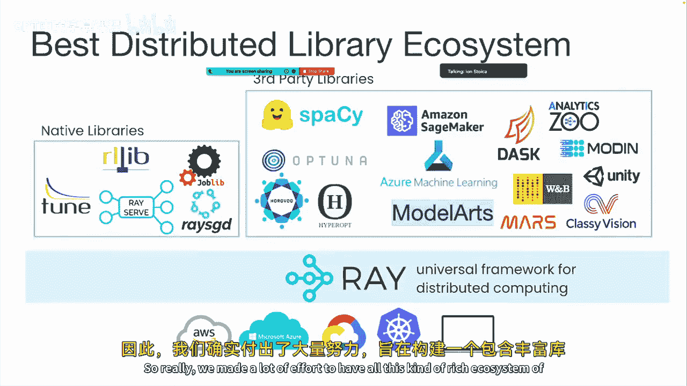

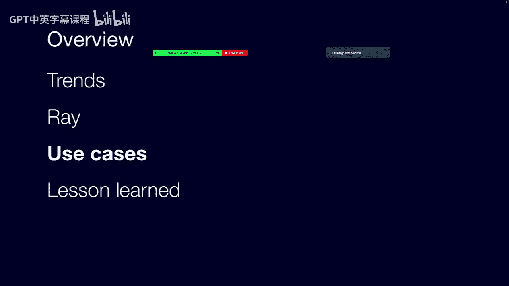

I think this is one of the main strengths of F today。

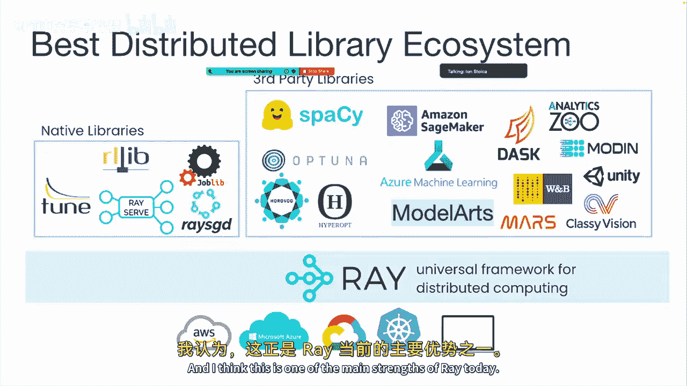

So let me give you some use cases， right。

Talk about the use cases。 So this is use case。Is basically an group。

And they build their entire you know， an entire their entire AI stack on top of ray and they call it fusion engine starting from here at the bottom。

 you have that this kind of a key workloads supported on top of ray like serving streaming semiative computation on top of that you have algorithms and on top of that you have services and applications and they have like 50。

60 internal use cases like recommendation， money laundry detections and。Things like that。

And it's what they say right， it's like they build streaming。

 serving an interactive calculation based on Ray， the solution based on Ray have been running stably in R group。

 you know， theyre actually double 11 and double 12 for the past three years and ran the last time I checked。

 I don't know， several hundred thousand of course。It's another example。 is Uber。 So。

 but you see here is I the one point to notice here iss about its unification， right。

 is's you have only one frame or only one and you you are going to build all this application on top of it。

This is Uber。 So Uber was a pioneer of Michel learning platform。 if you remember。

 they released Michelangelo a lot， you know， several years back。

 So now they are building a second generation of in machine learning platform internally called canvasva。

 and they decided to build on top of Ray。And here is one reason why we believe that ray will continue to play increasingly important role。

 but much needed common infrastructure and standardization to the production machine learning ecosystems。

 both within U and whatever industry at large。And again， this is a uni， you know。

 the the same unifying message by leveraging gray， we can combine the p preprocessing。

 distributed training and high parameter search， always in a single job running a single training script。

😊，H来。Instead of having to manage different distributed systems for for each of these workloads。

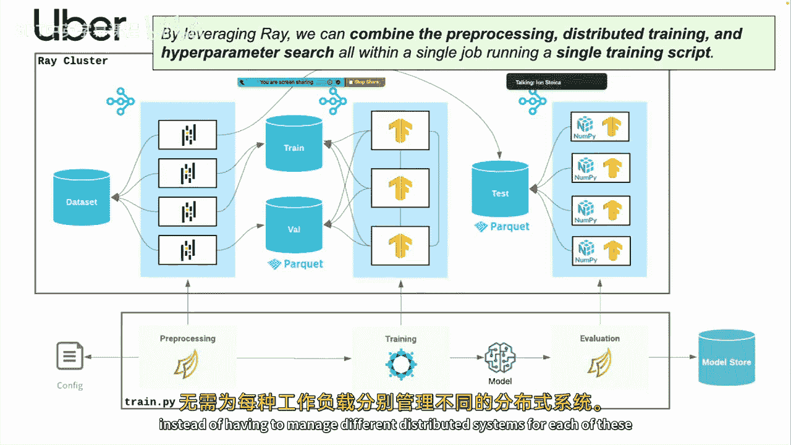

And你 is在 coolan。嗯。This is America's Cup。 Americas Cup is probably know with most prestigious sailing competition。

 It takes。It's every40 years， I believe date also from 1841。 So last year。

 the race was won by this New Zealand。啊，电。And the New Zealand team， you know， the boat was， you know。

 held and you know， this， it's quantum black， which is a division of McKinsey。

 helps them to design the boat and actually train。Is a crew。

And they are also using Ray and R R reinforcement learning to designs about and to train the crew。

So that was a pretty cool application。Okay， any questions。So now。

 let me use the rest of the time to talk a little bit about the lesson learned。 So what we learned。

And then I'll have， hopefully， around like 10 minutes or so at the end。

To answer any questions you may have。

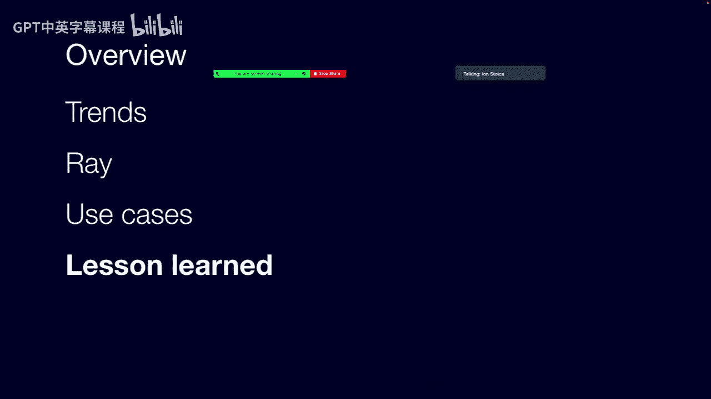

So the first lesson， one of the lesson we learn is that developers care more about functionality and performance。

😊，Then fall tolerance and debugability。Okay。So。Initially， we started with a task only abstractions。

The task are stateless。 They don't have state。So it's much easier to providevolas because the tape is outside the task。

Alright。And there are easy to debug because there are no side effects。

They is the input from some external story like the object star。

And they do the computation and the right output back。There is now side effect。

The problem we had is that。One of the first problem we had is GPS。So。If you do。嗯。Use only tasks。

 and you run on GPSUs。Then， then means that every time。You run a task on the GPS。

 You need to get the data in。And then write data， write the data out。And。As you probably know。

 moving the data from the main memory of the CPU to the GPS and back is very expensive。

The other problem on it is reinforcement learning。Is that you。

 you need to do simulations and some of the simulators。 And this is nothing fundamental about it。

 but still， it's a very， you know， practical limitations。Mostし some of the新いた isあプロ。Right。

So even if you want to， you know， you don't care about performance。You cannot get the data out。Right。

 because during reinforce learning you know you， you get an observation of the environment， which is。

You know， it was a game。 you what right。And then based on that， you are going to take an action。Okay。

Move the character left， right or whatever。But if you don't have the state。

You cannot use task because youll need， if you do use stacks for re， you need to initialize。

This game to the previous state。Which needs to make get the state out。

 but you cannot get the state out。The only thing what you see is observation is like。

 like you remember early on， either reinforcement learning， you look at the Atari games。

 you look at the screen， the pixel on the screen。😊，So， that's why we had to add。Actorors， right。

 And with as， the performance goes away because the state remains on the GPU across different steps and。

😔，You can encapsulate all this game and environment， and you simulate also within an actor。So。

 that's one。But， of course， with actors， everything becomes more complicated。

 You can have side effects and thing like that。Then it was another simplification we made initially to make it simple and more debugable。

 We said that， okay， we are going to allow actors。😊。

But we are only going to allow the creator of the actor。To invoke method on the actor。

 And why was that， Because things are easy， for instance， for fault tolerance。

 because you can serialize。 It's much easier to serialize than to track。Methodds。

 which are coming from the same actor or the same。Process。

 then if they come from different processes。However， and this is for the long discussion。

We had to give up on that。Because people started to use。

Actors to implement signal like parameter servers to keep the state。ok。

And if you want to keep the state and to share between different workers。Then multiple workers。

They are。 They should be able to execute the methods on the same actor， which has a state。

 the common state， read and write。来。So， we have to pass。Also， the actor handles。So thats was。

 you know， things make， much more complex， made the things more complex。Then initially。

 when we build， you know， when you have these actors， you want it fault or us。

Tasks are easy to provide fault tolerance are stateless。 they don't have side effects。

You do record the lineage and to do lineage by reconstruction。

With actor things are more complicated that are because you have internal state。

 So what we done that the way we did here initially。

 we we we we did transparent checkpointing periodically。

 and then we record all the tasks which are executed from the previous checkpoint。😊，Right。

 so if the check， if the。If the actor fails， we recreate the actors。

 We initialize from the previous checkpoint and reexs all the other math。

 all the methods since the checkpoint。嗯。However， we have to give up on this as as， as as well。

 for three reasons。They implicit assumption on injury playing。From the previous checkpoint is that。

You are going to run the same computation in the same order。 the computation will be deterministic。

The problem is。People started to use multi thread。And you can' do anything about。

 you cannot stop them。 You can tell them not to do it。

 but it's actually is one more difficult because they use libraries which doing multiread。

 You cannot， They cannot even control that。So， that's one。嗯。

Then there are many actors which do not are stateless。 They don't have a stateized changes。

 like if you have model serving。So for that， it's prohibitive。Right。

 because the state doesn't change much。 But the one which is more interesting。

 which actually convince us to give up is like。You can have deadlocks。

 So imagine the following thing。imagine that you have a training。AGD。Which runs on 8 GPSU。8 doctors。

Right。And I assume that one actors or no， it fails。So you now have 7。You are a deadlock。

 even if you have this transparent fault tolerance， you are a deadlock because you have only 7 GPU。

 So you cannot find another GPU to recreate the actor。Which was lost。Al。

Because HD is like you need basically gang scheduling， right？

 So all of them has to be up at the same time。 But now you have only 7， so。There is no progress。So。

 of course， the， the solution here， if you do at the application level。

 you are going to take the checkpoint and you have 7， or you are going to start only with 71。

7 GPs from the previous checkpoint。嗯。So。So basically， at the end of the day， what we do here。

 we just ensure automatic restart of the actors and let the application deal with checkpointing and recovery。

A。嗯。So this is another big problem。 Remember， I told you about this distributed future that。

Whenever you submit a task and you get a distributed feature。

 you don't know where the results will be created。And。Initially， again， we。We put say all。

 all the state is going to be in this global control store。

 So you are going to centralized everything there。Al right。

And the problem with this one is that it's a little bit hurts latency because when you create any object and you do everything。

 you are going to have to contact the global object store。

 And also this is not enough because there are things like， think about this one。 It's like。

I create an object。 I， I know， I， I submit a task and I get adisciplinary feature the is to the result。

 And I pass this result。To to。Other。Dasks。These two other tasks are going to wait for the results to be created。

But what if。The note on his original task was scheduled， fails。

You have just this to task after waiting for the result， which is not going to materialize。

So somehow on needs to do。Tり込た the object。Right， by， by rening the original task。

But who is going to run from these two tasks， Both of them， they can run to， they can do it。

 Its like， they can try to do it。 Its， it just complicated。

 It's kind of can be race condition and thing like that。拜来。嗯。So。Because of that。

 we went to this other simpler solution， which is we call it ownership。

And the ownership is that instead of having distributed this global control store。

 keeping all the information about the object which have been created。You have。An owner。

So a worker who owns the future of an object。 So if， if， if a worker。Starts a task。

And with return as a future。 Then the worker restart that task owns not all the met datata related with that future。

And its also is going to be in charge to reconstructed。If it fails。Right。

So that's basically what what what happens， okay。嗯。

And you try to enforce this invariance that an object is reachable as long as its owner is alive。

Right。You enforce the fake sharing between the owner and the object， if。诶。If。The owner is not alive。

You lost the contact with all the objects。 Objects are lost。And this is a final one。 Actually。

 I have more time for questions than I am， Im anticipated。 But it is a it's a very interesting one。😊。

嗯。About scheduling。So it turns out that obviously， if you want to support very generic applications。

Each application will have different scheduling demands。Some of them will have affinity。Like。

 for instance， if in a reinforcement learning。Algorims。

 if you are going to want the agent and the environment， the simulated environment。

 you want to be on the same note。In some cases， want anti affinity。If you want to load ballas。

They loud across multiple nodes。Then you want some cases like we discuss with HGT。

 you want gang scheduling。In other cases， you want data locality。

 you want to schedule the task where the data is and so forth。So the question is。

 how do you design a scheduler that is flexible and， Eable meaning that is going to。嗯。

You are going to be able to add new scheduling policies relatively easily。

As a demand for these new policies， emerge。So here is one of our solutions。

Which is called ephemeral resources。So basically， what we do here。Is that。We implement as a core。

Only resource contrain scheduling。 What does it mean。

This means that each and out has certain resources。

And the basic scheduler make sure that it's going to schedule a task only on the nodes which have enough available resources。

That's it。It's very basic。But in addition to the real resources。

We are what we call ephemeral resources， logic resources。

So the application has the ability to create logic resources dynamically。Right。

And the scheduler will treat these logical resources， like real resources。

So they are also going to be subject to the constraints。When youre scheduled。Right right。And we。

 we believe that actually， we can show that you can implement arbitrary scheduling policies。

 So give me， give me let me give you just one example。Say you want to implement data locality。

Soly or not do you have this。You execute this。Dusask。And it creates。

The result will be created locally。And now， when I want。To execute another task。

 which takes this X as an argument。 I want to be executed on this note。That's what I want。

So how do I do that？1 x creates1 G creates x。It also creates。

One of these ephemeral resources call it Xab bar with capacity1。What instance。And now， when I want。

I invoke。A function F。On x。I am also passing as a resource constraints。 I say this function。

 when it's going to execute remotely， it needs to execute on the node， which has a resource Xab bar。

Right。Remember that the scheduler now treats every including the logical resources。

 that are subject to the constraints。 So it' is going to execute this function on a node which has this resource X bar。

 logical resource。Right。And this will be the note。Which star x。Right。

So this is basically one way you are going to enforce that F is going to be executed on。Znaud。

Which has。Object X。Allright。And you can show that you can do， you know， even gang scheding。

 anything like that。So。There are other lessons， a few other lessons。嗯。The API， the core API。

 proved this surprisingly stable。After we added the ability to pass the handlers。

Of the actors around。There are virtually no changes to the core API for the you know， last。

3 years or so。The second thing is that。And you， you guys， you know， this maybe from API。A simple。

A PI make this delivery computing easier， but it's not easy。Right， so unlike something like Spark。

Which implements B synronous processing。Which and abstract so is a paralysis。 That's one of the main。

You know， the main advantages and reason for its popularity of spark is abstract away the paralysis。

 The user do that do not see the paralysis。Ray exposes a paralysis。Right。

And this makes it much more flexible。Right， you can do anything。

 right It's like it's RP PCC plus actors。And， you know， and share a memory。

 So you can do basically everything。But then you need to deal as a programmer is is explicit para。

Coect。And that's hard。 as you know。嗯。The other interesting lesson is that cluster management for distributed systems still a pain。

 despite Kubernetes and everything。 As a proof point is that one of the most popular features。😊。

A phrase is out of sc， which is。You know， race， you know， life cluster management。

 which provides out of scaling for race clusters。Okay。So this is basically， you know。

 wanted to say and。So in summary， you know， we believe that distributed applications， in particular。

 distributed air application are going to becomes a norm。

And building the re application is extremely hard。And the way we try to attack that problem is to have this ray。

 which is a universal distributed framework。On top of that， we are going to add a strong， you know。

 build， you know， a rich ecosystem of distributed libraries。

 and these distributed libraries are easy to use because they abstract away parallels。Right。And。

 you know， that's things this together can simplify significantly developing the developing distributed applications。

Okay， so。Have you to take any questions， Anything you can ask me about today， about Sk。

 about anything， yes。I'm wondering because you have already start a county law and they have。

Can you speak a little bit louder。I know you have found Camviva and they have reached any skill。

How do you recognize the business value of。对。哈哈哈。😊，Yeah。So， so let me tell you a little bit about。

That's a very， yes。 Oh I need to， to repeat， right？ So it's basically about it's a question。

 It's about， you know， this any scale and， you know， like we， we have gray and spark before that。

 And now this our company any scale and database。 What， how is a business a business value， right。

 for this company and so forth and。😊，Since I have time， let me， let me tell you a little bit。

 and I'll answer more than this question。 So， so first of all。嗯。You know。

 the reason these companies have been。Created is because at some point。

 if the open source becomes popular and some companies， you know。Started using the open source。

In order to commit to use it long term， they are asking about they want to have someone。

Behind this open source。Its like they because they are questions they ask， okay， this is great。

 Looks good。 But what happens when。😊，You know， like we spark Ma graduates。

 What happens when Philip and Robert graduates。Alright。So when we actually， when we。

Did data breaks before I did data breaks。We actually talk with other。 you know， it was photoonics。

Ha doop， We knew people。 And we asked them whether they want to take ownership of。Spark， right。

 because there are enough people and asking。You know， who is behind Spk。

But they didn't because they had another。Competing projects a time tests。

 which are supposed to be the next map。So that's going in some sense， you know。

 that was one of the reason we built， we created datas and similarly any scale。At right。嗯。

So now about the business and the val of force， if that's。The question is that was companies like。

 and that was actually a little bit pioneered by databs it's。Hosted service， right。

 is basically is like， provides。The easiest way to。

s it's it's manage Spk initially manage ray and provides the easiest to as a best platform to develop and deploy and manage sparkk applications array applications。

Yes。Something I was wondering about is earlier you mentioned。

That scaling is still quite challenging sometimes and faster。At， given the example。

 it seems like once you set up that cluster， it's very easy to access resources on those other devices。

😔，So what it the。Of adding devices to a cluster， and also have。How does Re manage those devices？Yeah。

 so the question is about what is difficult about the cluster management， how you is going， what。

 what is re doing about it， Because it seems like you said， like once you。

 once you set up the cluster， things are reasonably easy。I think there are many things。

So let me see where I can start。1， One is that you do want auto of scaling。Right， like， for instance。

 you do use training or use hypermeter tuning or something like that。 you do want to。

 And in many cases a user do not know exactly how many resources， how many node they use。

 So you want the ability to scale up and when the complication finishes to scale down right because this is again。

 as you now in a cloud setting you are going to pay pay as you go。

 you are going to pay only for the resources you are using。 So in that context。

 out of scaling it's important。 So there are other subtle things。 like for instance。

 how you are going to distribute a code。Right， you are going to load the code on search the driver。

 But then the worker has also as they have to call the code。

 So you have to distribute the code right， and when you update it， you need to push the updates。

 Even you have a cluster。 you know， I change the code， then the updates have to be propagated。

Then it's， it's， it's about， you know， managing and knowing， you know， for instance。

 when a node fails， right， that information has to propagate to the other node。

 So the schedule node that that node is out and shouldn't you no longer schedule on that node things like that。

Yeah。I have a question。Students in our research group who are using。A on， which is the super。

All these students use。Do you know which other platforms Ray is available on that might be unusual？

In terms of so the question is that on what other platforms are available。

In terms of the infrastructure， theyre running。 So it， it runs on。Major public clouds。

We ran on Amazon， Azure。Google。😔，And， you know， on primem because he is out of scalar。嗯。It should be。

It's， it's， it's if。But I think the super supercomputers。 I think that's a good question。

How well is running。 And yeah， we we。We didn't do much there。

Another question in one of your early slides you said that Ray could ask for two cs and GP Yes so what if those aren't still Yeah。

 so the question is that I shown that you can ask you can for for a task you can request Ts。

 GPUs and like that。 What happens if they are not available。Right now， if they are not available。

 it's going to be invisible。 You are not going to run。 But obviously。

 there are many things you can do here。 The one thing， one interesting thing here is that。

Which is pretty cool。We， we didn't do it。 But I think it's it's， it's if the programmer。You know。

 the developer can express the requirements in terms of the CPU， GPUs for different， different。

 So let me take a step back。 So how do you do today。In traditional cluster。

 In traditional distributedive frameworks， like Spk。You have an application to run。

And the person who is running that application is going to decide。What is a cluster configuration。

Right， so youize a program。 You give me a program and I will try to I Ill be the one who decide is going to run on four node。

8 node of this kind of instance and PPU or TU and so forth。Alright。But I have to know， right。

 is's like， so in some sense， you know， you give me the application。

 I'm going to set up how many nodes I need and like that。With Ray， the developer， you。

 you can say how many， how many， how many resources each task needs and what resources。

And if you run on top of the cloud。I， you know， in， in theory， as a user。

 I shouldn't be able to specify anything because of you as a developer， specify what you need。

So there is quite a bit of potential here because the programmer specified。

 you specify the requirements program as a programming time， as a development time。

To automatically cu and resize the clusters and things like that。We don't。

 We haven't done much on that side。 but I think it's a。It's a good opportunity there。Yes。

So I want to ask about what's the advantage of these native library like Ray Ser。Their party library。

That's getting getting4 to， right。Because before， they're kind of like。place。

 and have to stitch them together。 But now they're for over。Comping against the native。Competing。

 competing against。How do you see， like should we support more libraries in Ti Ray？到。Yeah。

 so basically C is about how I see the problem is about if other libraries and how they are going to compete against。

 you know， how the libraries on top of where compete against other libraries outside their ecosystem。

That's a very good question。And I'm talking about， you are talking about distributed libraries。

 right， like Tensorflow distributed， for instance， right。嗯。嗯。So one， one way to do it is like。

What people do。 So， you know， you can take actually these libraries。

And you can pretty easily run with Zan ray。 We call it shallow integration。

Because you can have a bunch of actors， which you allocate。And then you use Teser or distributed it。

 you can。Ran within this actor， which allocated by Ray。Right。So， you know， Ten of flow， you know。

 like the workers who test of flow， they can communicate with each other directly and things like that。

Now， you may ask， why would you do that？The reason you do is that。RightAnd this is， again。

 very shallow integration is because if you do that。

 you are going to have access to the other libraries in the ecosystem。Right。

 you are going to read the data from the object story。 You are going to writing the object stories。

 and you can do serving on the object story。 And in that particular case。

 Ray is becoming mostly a cluster manager for that light cluster manager for that distributed library。

Alright， so it's not。You know。Either or。Right。You can actually integrate them。

And many of these libraries I mentioned， they have this kind of shallow integration。

Deper integration is that when they communicate these different workers in a libraries。

 they communicate through right。Object star anything like that。Any other questions。Thank you。

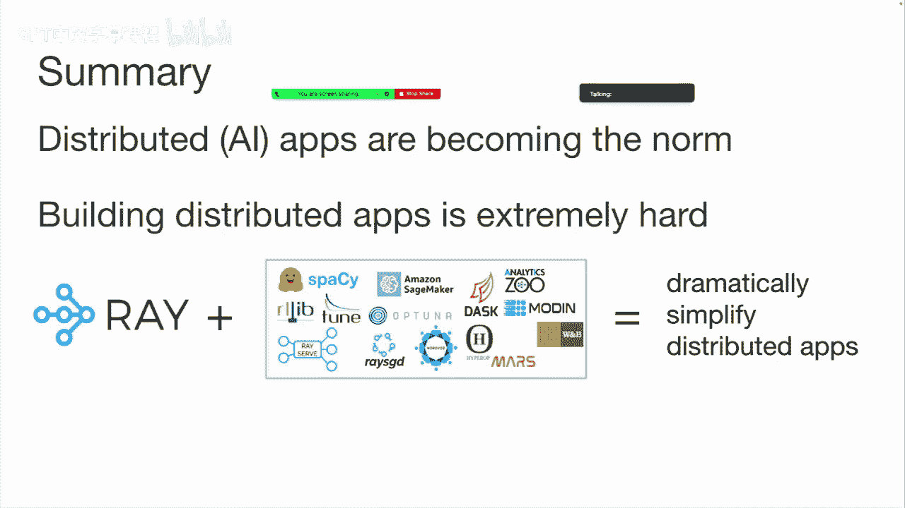

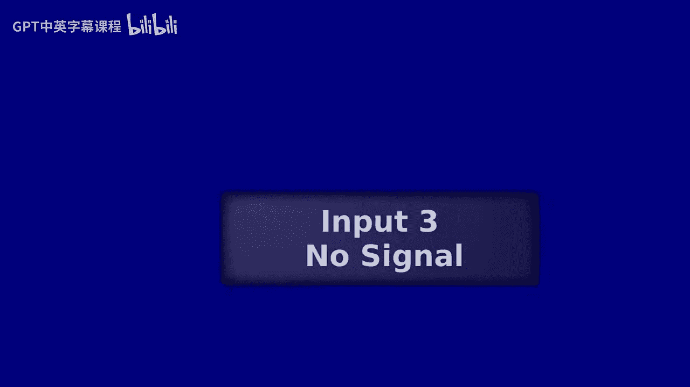