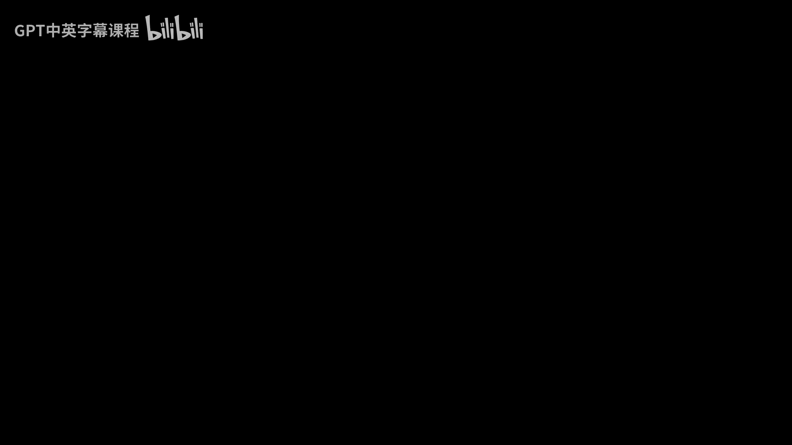
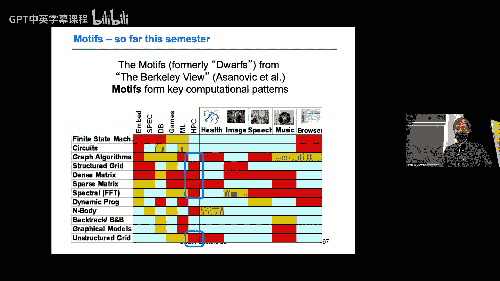

# 【并行计算 CS267 2022】伯克利—中英字幕 p16 CS267 (Sp22) - Lecture 20： Fast Fourier Transform -BV1PS421978D_p16-

真得边。

呢个。Okay。This is looking good？嗯。Okay。sry。我家系唔开。En the show。因我系 s九。不是。嗯。O。Okay。Okay。S。

Are you having projection issues because， yeah。The zoom is good。嗯。And it。How about my sound。

 does that work？ち。On the zing testing。On the zoom it's very clear。 I don't know about the classroom。

Okay。Testing， testing。Yeah。Hello， hello， now it works in here， excellent。

And presumably the batteries。Stronger。I replaced the battery， you bet got it。

And everything else is plugged in as far as I can tell， so shall we get started almost on time？

So today we're going to talk about FFTs， but I'd like to start with some very good news that I learned about yesterday。

 the co-author of LA PAC and ScalaPA， a long-term collaborator Jack Donanggarra just won the Turing Award which is the Nobel Prize of Comp science for his work on those libraries and many。

 many others the Blas and so forth， so that's all that stuff that we've talked about this semester has gotten just a lot of more recognition。

So let's continue。So today we're going to talk about FFTs and I'll tell you a little bit about the history of FFTs as well and how they came to be。

 but you can see that FFTs are obviously used in high performance computing。

 but naturally they come up in image processing and signal processing in lots of other places。

 I'm going to use the three-dimensional FFT as an example of all the different optimizations as you can perform and that particular so in other words we're not doing the FFT of just a vector but we're doing it of a whole cube of vectors and that's something that comes up in Poisson equation which we've used before as an example。

 but the optimizations apply more generally。So here's the outline， I'm going to start from scratch。

 remind you of the definitions of the FFT， give you a few applications to remind you why it's important。

 then I'll derive the sequential algorithm from scratch that's just two slides and then I will use that to talk about how to parallelze the one- dimensionional FFT and then the 3D FFT which is a surprisingly large design space of different ways to do it and based on a CS267 project from 15 years ago now。

 the world's record was set for a little while know people are keep racing in these things because there's another benchmark like the top 500 where people continually race on who can do the fastest parallel FFT。

And then not surprisingly， auto tuning is used for FFTs and so the fastest FFT that most people use comes out of a project called FFTW。

 which is short for the fastest Fourier transform in the West。

And so and there's another project called Sro， which also tries to automatically generate hardware for these things。

 and so there's lots of references for this stuff。And so let's go back to the basic definitions and start from scratch。

 so I've been very careful the letter I will never be an index in this lecture it will always be the squared root of minus1。

And all of our arrays and vectors and subscripts will always start from zero。

 that's going to make the mass simpler。And so what is the one dimensional FftT of a vector。

 it's a matrix vector multiplied times a dense matrix， but a very special dense matrix， each entry。

 the JK entry is this constant omega to the JK power where omega is called a root of unity so it's either the two pi i over m which is this particular quantity here and it's called a root of unity because if you take it to the M's power you get one and so there are some examples for m equals4。

And so that's a word d FftT what about the 2 dFftT so the easiest way to explain it is how to apply it to a matrix as opposed to a vector and so now I have an m by m matrix v and I'm going to do the FftT from the left and the right so what does that mean multiplying by F on this side does the FFT of each column and then multiplying by F on this side does the FftT of each row and of course I could do that in either order either order because matrix multiply is associative and so and the idea here is higher dimensional FftTs are analogous so I would have V would be a cube for example and I would do it on each one dimensional subset of it in each direction independently all in the x direction the y direction in the z direction。

So there's lots of motivations for doing this quickly。

And that's why we call it the fast Fourier transform and so signal processing。

 I'll show you some examples like that。So image processing that's the two-dimensional FFT for sure then solving Poisson's equation nearly optimally we can do it and if they're n unknowns。

 we can do it in n log n operations and so it's definitely competitive with multigrid which I told you about before but there are lots of other interesting applications where it comes up and so one example is an algorithm from 1971 which for many years held the world's record for the fastest way to multiply B bit integers so if you do the you know the elementary school multiplication algorithm it costs you B squared to multiply two numbers that are of length B but they using the FFT could do it in B times log b times log log B and in fact this is used in practice ones B is enormous enough if you're doing very high precision arithmetic so but they conjectured that the lower bound was B log B that you could beat this and so people have been trying to do that for a long time now of course log log B can't ever get very large is as long as。

Number of bits in your number is less than the number of atoms in the universe。 You know。

10s to the 80th， which is pretty good upper bound。 You know。

 log log B is never going to get bigger than 10 or something like that。 But in 2018。

 some folks came up with an algorithm that got rid of the log log B term。And so now it's B log B。

 which is a conjecture lower bound and it took a while to get published。

 it was actually published last year by Harvey and Vananderhon， so now B log B is the fastest but。

Son Hogetrosson is more practical， and I should say that the new one also uses EFftT。

So here's just a simple example of where it comes up in signal processing to filter out noise。

 so suppose I have this super simple signal it's a sum of two sine curves with just two frequencies I've sampled it at 128 points there it is。

If I take the Fft of it， I get the real part and the imaginary part so I'll just plot those and not surprisingly there are only sort of two components in here when you look at it。

 there's a component corresponding the frequency at 7 and the frequency at5 and so7 is bigger than5 that's only half as big and because of the mathematical properties imaginary parts I get two copies of that so now let me add noise to it so I'm going add a random number to the signal which is bounded by 0。

75 that's a lot of noise and I get this much noisier signal and when I take its FF this is what it looks like and so you can see the noise is spread out evenly pretty much everywhere but those two big signals according to the corresponding to frequencies are still quite present so a simple way to do filtering is I'll simply take this in zero out all the entries that are less than 0。

25 and magnitude I'll do it there and I'll do it there and when I do that you can see that the FF of the filtered signal looks almost the same as the original one and so does the filtered。

Value back in the time domain so this is a canonical use of FFTs for signal processing but it also comes up in image compression and in fact if you've ever looked at a JpeEG image you've used this algorithm and so here the idea is I have this image can be thought of as a matrix 200 by 320 and of course there's three channels red blue and green each of them is treated independently so a natural thing to do is to take the two-dimensional FftT of this image and just keep the largest entries the same ideas on the previous slide'll just keep the largest entries but only keep a few of them and this is sort of a toy example I only kept the largest two and a half percent of the FF components and it still sort of mostly looks like the original cloud。

Now how does JPEG do this it's a sort of a similar idea what they do is they break up the image into little8 by8 blocks they do the Fft on each2 dFftT in each block it's actually the discrete cosine transform I'll distinguish that later so it's all real arithmetic and then they take all of the resulting numbers and round them to fewer bits so they quantize it and that's what they store for the image and that is good enough know for all the purposes that people have to have reduce the number of bits it actually takes to store a really good looking image。

我。So and finally just to remind you of Poisan's equation， there's the。

 you know it's solving this equation where it's the second derivative of U is some function in the 1D case。

 derivatives with respect to X and Y and the 2D case and with respect to three derivatives there and this comes up in all sorts of science problems。

 you know heat flow， diffusion fluid flow and so forth and we want to solve this on a big domain and so this is the other use of FFTs and I'm going to show you now in just a few slides how I can actually solve this extremely quickly using the FFT。

So let me remind you of what Poisson's equation is so the one dimensional case I want to solve L1 times x equals be a linear system of equations and L1 is the simple stencil operator so it says for each point on x take two times its value and subtract is two nearest neighbors and so solving that one-disal problem is linear time if you want to do it just by Gaussian emination so the 2 d case is harder so that's the most know that's the first interesting case so what this says is that my linear equation is four times each value minus all my neighbors equals the righthand side and if I write that down it's now a much wider band matrix and it and we had a table before of how expensive this is if you use on the straightforward method multigrade could do it in linear time proportional number of unknowns and I want to show you how to solve this in almost linear time and in fact even faster on a perfect parallel machine using the FFT。

And the magical property of the FftT that's going to let us do this is the fact that that L1 matrix。

 twos and minus ones。Its eigenvectors are the FFT。So here is the magic formula that I can factor that L1 matrix as the imaginary part of the FFT so just the imaginary part times the diagonal matrix of eigenvalues times the inverse and since that matrix is orthogonal the inverse is the transpose so all I have to do is multiply by the imaginary parts of the FFT that's called a fast sine transform all the speed up tricks we'll talk about later apply to that。

And we have a closed form formula for all the eigenvalues so I know those exactly two just these formulas So now how do I use that to make solving the 2 d Poisson fast So it turns out I can write the 2 d poisson equation this way so I have a bunch of unknowns living on a grid so x is my twodisal grid of unknowns and I want to take the derivatives in the x direction in the y direction so what does it mean to take the derivatives in the y direction I'm going to apply that L1 operator to each column that takes you two times each value in the grid minus its neighbor above minus its neighbor below and multiply it on this side is like doing the x direction so each row of x。

I take two times each value minus the left neighbor minus the right neighbor。

 so this is the Poisson equation just written down that way。So here is the trick。

 I'm going to substitute in L is its eigen decomposition into this formula。

And then I do a little bit of algebra and I can get rid and I can make these two matrices diagonal。

 so I get a diagonal system of equations to solve， which is very。

 very fast and so what I need to do to do that is I need to take the right hand side and do a twodisional FFT of that。

and I've done the algebra here and all the Fourier transforms cancel。

 and I'm left with a diagonal system of equations for a new right hand side and that this is trivial to solved because it's diagonal。

 and then I just have to do the inverse FFT of this easy solution to get the original answer。

So what's the cost， I do one2 dFftT on the input matrix B， and then I do n squared add and divisions。

 solves diagonal system of equations， and then I do an inverse 2DFFT to get the final solution X。

And all of that runs super fast。And 3D Poson is completely analogous。

 but I won't write down the algebra。And so that gives us this row in the table which you've seen before where know these are all the different algorithms that we've talked about to solve the Poisson equation and the FFT is right here and it's doing it in n log n time if you have n unknowns。

 and so that looks worse than multi-grid， but in fact。

 if you had this magic parallel machine with as many parallel processor as you wanted。

 it would actually hit the lower bound， it would run in log n steps。

Once we show you the algorithm of course you know because you know I haven't told you how the FFT works yet so that's all I wanted to say about Poson and so now I want to go on to how we make the FFT go really fast。

So are there any questions here？So as I said， the FFT is not the only operation that we do there's you know the real parts。

 the imaginary parts and all of these you know are going to have similar transformations I'm just going to do one of them the one where the algebra is simplest and so most of the applications I've talked about involve multiplying by both F and F inverse where F is there's the FFT matrix and it turns out that f inverse in is almost the same as f it's just basically the complex conjugate with some scaling and that's because all the columns are orthogonal to one another so you know if I have a fast algorithm to multiply by f I obviously have a fast algorithm to multiply by its complex conjugate that's sort of trivial。

And the other thing is that sometimes I only need to multiply by the imaginary part。

 that's what I did for signal processing and sometimes I need to multiply by the real part。

 that's what I did for the image compression and those are called fast sine transforms and fast cosine transforms and all the same algebra tricks will work but so we're just going to focus on the complex case because that's the easiest to write down。

So now let me derive the algorithm in a couple of slides。And so here。

 so what I want to do is show you that the FFT is really just polynomial evaluation。

And then I will show you how to do divide and conquer to evaluate that polynomial。

So this is the J entry of F times v the 4 a transform， so that's know the dot product。

 the J throw with the column vector V and there I'm just plugging in what is f's of JK it's the root of unity to the JK's power and if I just put some parentheses there。

 I see this is evaluating a polynomial where the coefficients of the polynomial are the entries of the vector and the point at which I'm evaluating the polynomial is the root of unity to the J power so each entry of the FFT is the same polynomial evaluating at a different root of unity。

And so what i'm doing is evaluating a polynomial with m coefficients at M different points。

 so that's my problem that I want to do divide and conquer on so I want to somehow figure out how to change evaluating a polynomial of degree。

M minus1 at M different points to two problems of half the size that will let me do divide and conquer。

And so here's how I divide up my polynomial into two problems of half the size。

 I'm just going to take the even numbered coefficients you know v0 v2 v4 and the odd coefficient so just every other coefficient and so this is one polynomial and you can see that it's a polynomial in x squared。

You x squared x to the fourth， x to the six， so it's really a polynomial of half the degree。

Just evaluated at the squares of all the roots of unity and if I factor out an x out of this one so it's v1 times x you know v3 times x cubed。

 et cetera， I'll factor out an x and I have the same property that I'm evaluating this polynomial with half as many coefficients at x square。

So if V has degree m minus1， these two polynomials have basically half the degree。

 m over  two minus1。So but to do divide and conquer I need to evaluate them at fewer points as well the problem you know I need to make the problem half as big and so it looks like I'm evaluating these two polynomials at M points I want to evaluate them at M over two points but the fact that I'm sweararing them fixes the problem this really is just M over two different points because when I square them it turns out all of these roots of unity coming plus minus pairs so when I square them half of them go away know half of them mapped to the same thing and so so here's the algebra。

You know if I take this root of unity and square it。

Then I get the same as squaring this root of unity because know this difference in the exponent just turns into omega to the M。

 which is one。So now that means that doing the FFT on M points is reduced to two FFs and M over two points。

And so now I'm just going to write a simple recursive algorithm on one slide that solves our problem。

So here it is on one side。So I'm going to assume m is a power of two and that's certainly what most people try to do。

 so it's easy to keep dividing by two it every step and so I'm going to pass in the coefficients。

 the root of unity and the size and the base case it's degree one I'll just return v0 nothing much to do otherwise I call the FFT recursively on the polynomial with just the even numbered coefficients。

024 etc cetera， and the odd coefficients。So the degree is half and i'm evaluating it at the squares the powers of the squares so that's what I pass in so I get back these two polynomials at V even in V odd and now I have to combine them I have to evaluate this formula here for all the different values of x。

And so now I have you know this is now I'm actually going to do some arithmetic。

 I'm going to take all the values of the odd， multiply them by x。

 and add it to the evens and then I will take that same vector and subtracted so in other words these multiplies only have to be done once because these x's appear in plus minus pairs so I don't need to you know I can take advantage of that。

And so what is the cost of doing this if I just write a simple cost model。

 if I just count the number of multiplies and ads， so the time to run this algorithm on a problem of size M is two calls to a problem of half the size。

 a2 of m over two plus M multiplies an M add so big O of M and if you solve the simple recurrence you get M log n。

And so that is how the algorithm works。So I want to tell a story about how this algorithm came to be。

 there was a meeting in the early 1960s at the Defense Science Board in Washington with a whole bunch of people from around the country and one of them was the person in charge of IBM Yorktown Heights。

 Richard Garwin and he said he was complaining that IBM was spending all its time doing this very special matrix vector to multipied and there was a bottleneck and everything they were doing and did anybody have a better idea。

There was another person at the meeting， John Tki， who was a math professor at Princeton who said。

 oh， this is triviala， I taught it for years and he wrote this algorithm down the back of an envelope and gave it to Garwin who took it back to IBM Yorktown Heights and found a programmer to program it up named James Cooley。

 and then they realized it was going to change the world。

AndBut then they were worried because Garwin knew that Tki was a consultant for Bell Labs and he was worried that AT&T might patent this so he had coolly write up a paper and send it to Tki and say can we publish this you put it in public domain then we don't have to worry about that and Tki's response says well this is trivial it was in Gaus's notebooks he didn't bother publishing it well okay it's fine with me so that's how it got published then。

So and became very famous and so forth， but actually I was telling this story to Vladimir Rocklin who's the co-inventor of the fast multipole method which we'll talk about next week。

 and he grew up in the Soviet Union and he said he learned about the algorithm and his undergraduate Russian math textbook that was written in 1948 so this idea。

been out there you know and but now it's finally very public so anyway so that's all I wanted to say about that so I actually met Garwin at a meeting in the National academies in Washington a few years ago and I thanked him for this and but there was one other thing he had accomplished that I chose not to thank him for when he was a postdoc。

He invented he built the worst first working hydrogen bomb。

And so his postdoc advisor was the founder of Lawrence Livermore National Labs。

 and if you're in the physics department， you probably know who that is Edward Telleller。

And if you come to Berkeley campus and you commute down。

I guess it's Euclid you might go past his house he lived on Hawthorne because he was at Berkeley for a while too so anyway all this is local history so it's not just the nuclear bomb。

 the atom bomb it's the hydrogen bomb it's sort of a local activity。Okay。

 so let us now go back to the algorithm and try to describe how I'm going to map this to do it quickly。

And so here's the FFT on 16 points。 And since a power of two。

 I'm going to keep everything to a power of two。 And since it's。A number that goes from zero to 15。

 I can represent in binary by four bits。So the question now is how do I run the algorithm where I divide the problem into the even parts and the odd parts？

And so if I have this number， it's very easy to tell what the even parts are I just set the last bit to zero and so they're the coefficients that you know for the first recursive call for V even and there's V odd now what do I do for the second recursive call。

 I need to take the even subset of this so how do I decide whether this number new number is even or not I look at the next bit。

And if it's zero， that corresponds to the even subset of these and if it's a one。

 it corresponds to the odd subset of those。 so at each step of this algorithm'm just basically setting the next bit going from left to right。

Excuse me from right to left you know to choose which bits I'm looking at and finally when I get down to the scalar case。

I'm doing you know the FftT of these scrs and that's where I know finally do some work and then it starts going past back up in the recursive tree。

Now so how can we execute this algorithm there various the natural way to do it is you loop over all the leaves and then you could loop over all of these and so forth working your way up layer by layer。

 it turns out that when we try to avoid communication which we will this is what people want to do。

 we're going to do this recursively so we're going to you know operate on subrees。

 but basically you just have to respect the dependencies in this graph to get it to work。

Now one thing to notice from this is that the answer is going to come out in a different order than the input。

 so the input， all the coefficients are numbered from  zero to 15。

 but on the output they're going to be numbered 0，8，4， 12 and so forth。And if you look at this。

 this is bit reversed order。So this you know if you take the bits all zeros， it stay zero。

 if you take one and reverse the bits， it turns into an eight。

 if you take two and reverse the bits it turns into a four。

 you know three turns into 12 and so forth， so that's the order in which the answer comes out。

So this seems like you know it could be a problem and here's just a picture of what the bit reversed order is now if all you want to do is one FFT then you may need to take the answer and sort it。

 but the good news is that most algorithms like certainly all the ones I've showed you so far do two FFTs。

They do an FFT， they do some processing on it and then they do an inverse FFT。

 and so if you reverse the order twice， you get the answer back in the order you started with。

And so that's why it's quite efficient and people are happy to have the bit reversed answer come out at the bottom。

Okay， so now let us look at the data dependencies in more detail and so we can figure out how we're going to map this to be parallel。

And so what I've done here is written basically a picture of every arithmetic operation in the entire algorithm for the 6 case 16 points so here I've numbered all of the entries from0000 to 1111 and what I've drawn are all the dependencies so each of these line says that computing this number so this is these are the leaves of the tree this is one level up two levels up and the answer finally appears here。

 so I'm going to process all of this from left to right and so what this says is to get that number I need to take some linear combination of that and that so each line is a dependence。

And know， so this is adding， you know， this time some sine or cosine and this time some sine or cosine。

And so this is called a butterfly for obvious reasons， because all of these。

 you know numbers are combined in pairs so this heavy black line here that looks like a butterfly says to get the next level of x0 and x8。

 I combine x0 and x8 from the previous level。And so if I had a magic parallel machine。

You know with as many processors as I liked and communication were free。

 this would I could obviously do every one of these you know points in a column in one step and so the time would only be the number of columns which is log in so that would be the perfect car machine but we you know have a real one that we have to worry about so let me go on。

And talk about how I'm going to consider two different ways of taking all of this work。

And assigning it different processes。Now analogously to what we did for a linear algebra。

 there are two obvious ways to do it， I can just block it so if I have four processors。

I could just give the first four rows of this dag， you know to the first processoror。

 the next four to the next， but there's another thing that we tried that'll be in the next slide that'scyclic where where I deal out all of these rows like a deck of cards so Proor zero will be responsible for all those。

All those， all those and all those。So we'll draw that on the next slide so what i've done here is said let's suppose I do the simple blockcase four processors each processor is responsible for four contiguous rows of this。

chartt and I've color coded it to indicate if I have to communicate or not。

 so this point here depends on two points that are already owned by the green processor so no communication is necessary so this is all local that's great。

This point here requires data from the green processor and from the pink processor so that's a black line and that means I have to do communication and so the pattern is very simple。

 if I have P processors and I have M points here and I do this block layout I'm going to have communication required and the first log P steps。

And then once I get to the last log M over repeat steps， know。

 because there's a total of log M steps here， then there's no communication， it's all local。

And so this is all embarrassingly parallel and this is going to be expensive。

 so the question is what if I instead do this cyclical layout？

So now it all reverses itself so now processor zero owns you know every fourth starting from zero the blue processor owns every fourth starting from one and so on and now you can see that all the starting points require no communication so this requires data from the green processor and this data down here you know zero and eight they're both owned by the green processor and this one which combines one and nine they're both owned by the blue processor so no communication for the first log M over P steps but at the end I have to communicate a lot so the question is can I have the best of both worlds right so this communicates this is embarrassingly parallel at the beginning this is embarrassingly parallel at the end how do I get the best of both worlds Yes question。

That's the next slide。Yes， yes。Let's yeah， thank you。Okay。

 so here is the complexity and it turns out they're the same。

YeahSo I'm going to I'm not done yet I'm not going to use one of these I'm going to combine them so let's let envy the vector size p the number of processors and I'll do my usual model where I just count the flops count the number of messages and count the number of words that are sent and so the arithmetic is all embarrassingly parallel so i'm doing two m log m arithmetic operations and every processor does one p of it that's fine there's going to be one communication for you know along every one of those black lines there's and I said there were log p stages where I had to communicate so log p messages latency and then how big is each message it's M over p because each processor has to share all its data with somebody else。

And so that's M over P times the number of stages and that's what it is and both of them are the same。

 they just you know either get the cost at the beginning or get the cost at the end。

So what I'd like to do is be embarrassingly parallel both at the beginning and both at the end。

And so what I'm going to do is change the data structure。

 change the data layout in the middle of the algorithm。And so at the beginning。

 if I start with a cyclic layout， it's all going to be embarrassingly parallel。

 and then I'm going to swap the orderings and go to the block layout。

 and then it's all embarrassing parallel again。And I'm going to call this change of data structure of data layout from here to here at transpose。

And it turns out it is exactly a matrix transpose is what I'm doing here I'll show you that picture on the next slide。

 so the idea is I start with a cyclic layout， do all these steps。

Do the transpose and then continue with the embarrassingly parallel algorithm。

 So this is a very simple picture。 I chose it for that reason。

 So in this case m is 16 p is 4 So there's there is an equal number of steps at the beginning in the end And if I had too many processors I would actually have to have more phases than just these two So i'm going to make an assumption which is typical in practice that。

I don't have a ridiculous number of processors， number of processors is less than the square root of the size of the FFT and then I only have to this change here once so but if you know anyway just so you know there's an assumption here going forward。

Okay， why is this called a transpose so what do I what does processor。0 own here。 It owns 0，1，2，3，40。

1，2，3， and then 5，6，7，8。 And I've drawn that here，0，1，2，3，4，5，6，7 and so forth。

 So this is the layout at the end， the block layout and what is the layout here its 04，8。

And then one。5， nine， and so here is the layout，  zero，4，8159。

 and these are exactly transposes of one another as matrices。

And so this is why we call it the transpose operation。So let me。

Tell you what the communication complexity is here and the answer is some good news and some bad news。

 so we still have more optimizations to do haven't changed the arithmetic it's all the same embarrassingly parallel each processor does one piece of the work。

The number of messages has gone up， it's not log P anymore。

 it's now proportional to P to get that transpo done。

 but the number of words has gone down a little bit， I've gotten rid of that log P factor。

And so this is a problem and we're going to have to fix it and the trick that we're going to use and we're going to have a lot to say about this is we're going to pipeline the communication。

 so we're going to overlap the communication， the computation and this P factor is going to potentially go away completely if I manage to overlap the communication computation enough and so I can get this down to something much closer to just alpha。

And there's a lower bound in a paper which you know you can look up here， which is close to optimal。

 so you know I'm not going to be able to improve this term or you know a single communication。

 you know a constantine self。And so there's going to be a lot of engineering to get here。

 but this is sort of the goal that we have for ourselves。

So how do I do the sequential FFT just and again， this is sort of a theoretical kind of thing to say that yes。

 we're going to hit a lower bound。And it turns out there is a communication lower bound for the FFT and it's similar in spirit to the one for matrix multiply that we've done already。

 In fact， it was published in the same paper by Hong and So this had the original matrix multiply lower bound for communication and it had the FFT lower bound So what is it suppose I have my data fits in fast memory my data does not fit in fast memory。

 it fits in DRA and then I have a small cache of size capital M。

 How much data do I have to move between DRAM and cache and the answer is the number of floating point operations M log M divided by a function of the cache size and the function is log of the cache size so that that's not very good So for matrix multiply it was m to the one half you may remember So log M is a lot smaller than that So this is just because there's not much data reuse in an FFT。

But this is our goal， nonetheless， to communicate this little。

And this is actually attained by that transpose algorithm that I showed you now that transpose algorithm was meant for a parallel computer。

 and so the way the sequential algorithm works it sort of simulates the parallel computer one processor at a time。

And so the idea is that pretend I have this many processors， M divided by the cache size。

 and so each processor is going to work on the cache size amount of stuff。

 and it's going to emulate what each processor would do one at a time。

And every time there's a communication between processors in the parallel algorithm。

 that corresponds to the and the transpose， that corresponds to the emptying out your cache and getting the next data from memory。

And so it's exactly the same accounting algorithm and it's actually attained if you just run in the cache oblivious recursive version of the FFT。

 so you don't have to know the cache size or any of that stuff。

 you just call the routine recursively and so the simple algorithm I showed you many slides ago and it will actually attain this just as we did divide and conquer matrix multiply divide and conquer works for the FFT and this package uses that trick。

 it uses this you recursive cache oblivious algorithm to go as fast as possible。

So what about in the parallel case， what's the lower bound and here's a much later paper from 1990。

 but it's a very similar result， so the lower bound is still the number of flops per processor。

 which is M log M divided by P so each processor is doing that many flops。

And the denominator is still the log of the local memory on that processor。

 what's the local memory in the processor it's one piece of all the data。

 so this is the log capital M corresponding to the sequential case and there's some assumptions no recomputation and we can't do the tricks that we did with matrix multiply which is replicate the data that doesn't help so this is the best you can do。

And so does the transpose FftT that I showed you attain this lower bound？And it turns out。

 given my assumption that M is much bigger than is at least as big as p squared。

 it turns out that this ratio here， log m divided by log m over P。So yeah。We can get this right here。

It is always you know between one and two and so it hits M over P。

 so the number of words moved is M over P and that is attained by the transpose algorithm。

So it does hit the lower bound， you know， assuming know what I did before that you know M is bigger than p squared。

But they're still going to be so this is all kind of theory。

 but there's been an enormous amount of engineering into trying to make this run faster and I'm going to spend a fair amount of time on that。

So as I said this leads to data in bit reversed order， but if you do it twice。

 it reverses it twice so everything is fine， and I just want to mention that people have thought about completely different algorithms for doing the FFT and Alan Adelman at MIT came up with a way to do it that looks like the fast multiple algorithm that actually communicates even less but it's basically a theoretical result people don't use it and it only gives you an approximate FFT you know but in principle you could go faster if you're willing to settle for an approximation so I just wanted to mention that if you're interested in pursuing that theory。

Okay so now all of the you interesting optimizations that people have explored have been for higher dimensional FFTs and they can be applied to the 1D FftT2 which we were just talking about but it's easier to explain when I think about higher dimensional FFTs so let's do 2D and then I'll tell you more about 3D so remember what is the 2D Fft I have a matrix and I'm going to do the FFTs of all the columns and then all the roads。

And so what are the sort of three obvious ways we could do that Well I could do a 2D block layout right I could take break up my matrix into little squares you know if I have 16 processors I break it up into the little n over four by n over four squares and then I could do parallel FftTs of each row you know using four processors and parallel FftTs of each column that's the first way another way to do it is I could just block it by rows so each processor gets n over four rows n over p rows and then they can do all of the row FftTs locally no communication at all then they transpose the matrix then each processor owns a whole bunch of columns and then it's all local FftTs again。

And then a third one， just you know to mention it， I could start by having row blocking and everybody does row embarrasingly parallel row FFTs。

 and then I do parallel FFTs in the column direction。And it turns out that。

Doing this transpose is going to be the fastest thing if I manage to overlap the communication in the computation so what I want to do is start sending messages while I'm still finishing all the local FFTs and get that to overlap and and it's possible to get significant speedups and all the fastest algorithms use this idea right now。

And for 3D and I'll show you some pictures there， it's a sort of a similar option。

 I'll do a bunch of serial phases and then I need to do a transpose and so that I can do the final direction that's all locally。

Okay so why is this overlapping of communication and computation particularly interesting it's because transposing really stresses a network it's sort of like everybody has to talk to everybody and so you really come up against the bisection bandwidth of your hardware and so people don't connect every processor to every other processor that's P squared wires that's not going to happen and so a lot of the work in this area has involved organizing it so that I can send a message and then keep doing another FFT。

And so you can get， you know constant factors of speed up that way。

 but people really care about constant factors of speed up in this business。

So here is the model just to let you know。You know the sort of theoretical model that people have used to sort of say what's the best way to overlap communication and computation and this is called the log GP model and this you know so this is sort of an alternative to the alpha beta just count messages count words and so here is kind of a timeline to understand what processor zero is doing when it sends a message to processor one so this vertical vertical axis is time and you know as time increases going down and so this is what processor zero is doing and this is what processor one is doing。

And so what is the actual work done when you send a message。

 Proor zero there's some overhead to send it to the network to get it into the network so that's oend the overhead of sending and then Proor zero is free to do whatever it wants you know do some computation there then there's a time of latency and that is where it's going over the network and then Proor one is going to be busy there's some overhead for receiving the data so that's over received and then where it has to get the message out of the network into its local memory。

And so what is the opportunity for overlap if Proor zero is sending lots of messages， you know。

 it's basically L plus O receive， all of this time here can be spent doing useful arithmetic and it's the ON where it's busy。

So that's if I send one message， what if I send a lot of messages then？

The question I need one more hardware like parameter which is how long do I have to wait before I can push another message into the network and that's called the gap and so here's the sending overhead which you know is to get it into the network interface card or whatever is necessary and then this is the time that network interface card is busy I can do useful computation there and then I can start over and push something else in and so to maximize the bandwidth I want to make sure that I I'm ready to put the next message into the network as soon as the gap is over。

And so the opportunity for overlap is from there to there。

So this is going to be a little bit funny we're going to want to send a lot of data and maximize overlap and so what we're going to do is to send a bunch of data。

 we're going to break it up into small chunks and send it in a bunch of small chunks。

And the chunk size is a tuning parameter and that's kind of the opposite of some of the what our intuition so far where we want to send as few large messages as possible because you get the best bandwidth for those and it turns out that depending on the details of your underlying message system。

 how they implemented MPI or how they implemented gasnet。

You can still get good bandwidth for smaller messages。

 and that's going to be the determining factor of what how we break up messages into small pieces。

So here's just some data to show you how much overlap how much opportunity there is for overlapping communication and computation this is old data but it shows you the time to send a message so these plots in microseconds show you the times that I actually had here so there's the overhead for sending the latency and the overhead for receiving and that's all shown here by color so there's the latency that's in green there's the send overhead and there's the receive overhead。

So the opportunity for overlap is the receive overhead is yellow plus green， so yes。

 yellow plus green is the opportunity for doing overlap。

And so you can see depending on so this is each of these groups is a single piece of hardware this is a C T3E an IBM parallel platform of the day and then they're all running different message passing systems underneath So here it's running MPI here it's running Schmm which is sort of a shared memorylike interface and so you can see it's all very different opportunities and all of these different things Now what does this hashline mean that means that the send overhead and the receive overhead are overlapping that means this is overlapping with this how could that be that's because for that particular。

😊，Communication system there was some handhaking processor zero and Proor one sent messages back and forth to one another to make sure there was enough memory on Proor one to receive the message so there was you know so that was you know a bunch of extra overhead。

 but that was why it happened on this particular processor that's what NP was doing it was being paranoid。

Okay。So this overlap means what I want to do is do computing and communicating at the same time。

And so the question is， you know， what is going to tell me whether I'm in a situation like this or a situation like this and how much you know。

 green plus yellow opportunities I have for doing that kind of overlapping。

And it's going to depend a lot， as I said， on the underlying message passing system。

 it'll depend on the hardware， whether you have a network interface card which handles a lot of that overhead for you automatically。

 and whether it supports direct memory access， so whether it's whether the network is handling some of that overhead or whether the CPU is handling some of that overhead and so there's all these different benchmarks and it also depends on so these are hardware issues。

 but also depends on whether you're running MPI， which may be a generic thing not optimized for your processor or gasnet which I think you used in a homework assignments which is sort of a very fast communication network developed locally。

And so this is going to so Ganet I'm going to show you is going to beat MPI and give you much more opportunity for overlapping communication and computation。

And so here is a performance plot where I'm going to measure the bandwidth to send an enormous amount of data。

 eight megabytes from one processor to another。Using either MPI or using Ganet and the opportunity I have is do I send it in one enormous message of size8 megabytes or do I break it up into many smaller messages and the horizontal axis is the size of the smaller messages into which I'm breaking it up。

The verticaltical axis is the overall bandwidth of getting every all the8 megabyte sent over and so you can see that once you get to a large message。

 they're about the same， we're hitting sort of the hardware limit。

 but because of a software overhead，Gasnet gets there much sooner。

 you know it gets close to the peak speed of the machine for much smaller messages。

 this is a log scale。And so here can I'm sending so for at this point I have about twice the bandwidth of MPI and for very tiny messages so I can send lots of tiny messages here and get you know close to the peak bandwidth of the machine。

 but I can have a lot more opportunity for overlap and so here's a plot of the ratio of red of blue to red and it's a factor of 2。

2 gap for these small messages。And so the question is how do I take advantage of this to break up my big messages into many small messages how do I reorganize an FFT for that and here's another plot of the same kind of data the bandwidth you can get from gasnet versus MPI know for different kinds of processors and this one goes off the scale 13。

000 that's because this was a shared memory machine and gasnet could take advantage of that whereas MPI was kind of dumb and didn't know it was a shared memory machine so that's a little bit of an outlier。

Okay， so all of the performance data I'm going to show you is based on a standard benchmark。

 just like there's a top 500 benchmark， there's another benchmark for FftTs。

And so people compete on this， it's not quite as well known as the NAS Per benchmark。And。So。

So what I'm going to do is so it turns out that 30 to 40% of the total runtime of these FFTs is spent in computing so that's the benefit that we can hope to get and so what we're going to do for this benchmark it's a 3D FFT and we're going to assume it's an end by end by end grid and we're going to assume at most end processor which is a perfectly reasonable thing to do and so the question is what's the design space for optimizing a 3D FFT。

And so here is a picture of what the design space looks like。

 so here is my three dimensionmenal grid it's actually you know not necessarily a perfect cube Nx byny by Nz and if I have four processors I can break it up this way so each processor is going to get a slab if you like of size N by Nx by Nz over P so what this means is that all the FFTs in this direction can be done locally all the FFTs in that direction can be done locally and then the communication is required to do all the FFTs know in the z direction。

So that is where I need to do some communication。And so let's talk about the different ways I could possibly do that。

So yeah， so I'm just repeating myself so first I'll do all the FFTs locally in that direction。

 then I'll do them all locally in that direction， and then I have to do some communication to do them all in that direction。

And so what I need to do is again this kind of transpose operation and so if I look at what the green processor has to do。

 it wants to do all the FFTs of this subset of the data， it already owns that so it'll keep it。

 but this the orange processoror needs to do the FFTs of all this data so that the green processor needs to pack up and send in some way this this subset of the green data and send that to the orange。

 this subset of the green data and send it to the yellow and that subset of the green data and send it to the dark blue so the question is how am I going to organize that？

One way I could do it is you know finish all the FFTs in this direction that direction pack this up into one message and so each processor would just send you know three messages to all the other processor that's the simplest thing you could imagine。

 but that's not going to be optimal。Yeah， and that's what I just said。

 so each processor could potentially take all of its。

 you know break up all of its data into P pieces and the parts that somebody else owns。

 it'll just send one enormous message。Here are the three different ways to break up all those messages into smaller chunks。

So I could do what I just described， take that whole thing and send it once。

 so there's just one communication between each pair of processors。Or I could take each of these。

Tunks and break it up into slabs。 so in other words。

 I'll break it up into two dimensional slices and I can send those two dimensional slices one at a time。

And while I'm doing that， do FftTs in the next two dimensional slice。

 or I could break it up into pencils， so a pencil。Is just one FFT on a one dimensional slice。

 and as soon as that's done， I can start sending it while I do the next pencil。

And so as I move from PAC slabs to slabs to pencils， you know。

 from sending a few large messages to a large number of small messages。

 we're talking about orders of magnitude。Increase in the number of messages and decrease in the size of each message and so。

If that's a good idea， if I can still get good bandwidth by sending many small messages because I have all this opportunity for overlap。

And so let me just illustrate the algorithm and how that would work。

 so again let me suppose's I have a 16 by 16 by 16 grid on four processors and so one of my processors owns these four you know four two dimensional slices through the data。

And so the first thing we're going to do is do all the FFTs in the X and Y directions because that's what I own。

Then I need to decide who owns， you know who deserves to have all the other data。

 so I'll decide who which subset of the data goes to orange， yellow and blue。

I will move it all around locally so that all of the data that goes to the orange processorer is contiguous。

 all the data that goes to the yellow proor is contiguous blue and of course I keep this that doesn't require any communication and then I can you know do the sends。

To you know put them where they belong and so this one is local and all of these require one large message so that's the most straightforward way to do it。

 And if this were a 512 by 512 by 512 grid I'd be sending on 64 processors I'd be sending 63 messages of this maximal size。

So the trouble is that this could overwhelm the network right everybody's talking to everybody at the same time and I'll get a lot of contention and so I will not get good bandwidth and the question is can I do this in a better way。

And so here is what the pattern would look like if I want to break it up into slabs。

And so what I'm going to do is do all of the column FFTs locally and then I'm going to start doing the FFTs in the row directions。

 so the first thing I'll do is do all of these this whole chunk and then you know put that word and keep that locally then I will do all of these and send that to processor one and while that's going on I will overlap the computation of all the next group of FFTs with that send。

And then I will overlap the FFTs of all those with that sent。And then I'll do it in the next plane。

 so I'll have in total you know like 15 overlaps of communication and computation。

 so each one of these arrows for each of these planes I'll be overlapping communication and computation。

And whether that's a good idea or not， will depend on the bandwidth that I get by doing this。

And again， so now if I have the same size grid as I had before。

 I'll be sending 512 messages a lot more， but they're going to be much smaller。And so finally。

 here's sort of the most extreme case， so again， I'm going to do all of the vertical FFTs。

Then I'm going to start doing the rows。And so first I'll do that one and that kept locally。

 then I'll go down there and do that one。And start sending it and then while that sending is going on。

 I'll do the first FFT there， and then I'll just keep you know going around in circles。

And I'll always be overlapping one message with one FftT。

And that sort of maximizes the amount of potential overlap， and then I move on to the next plane。

So those are the sort of three ways I can imagine overlapping computation and communication and whether it's a good idea or not。

 as I said， depends on the hardware and the software that are underneath you。

And so this is sort of a tuning problem。And now I'm sending 4，000 messages and they're much smaller。

 8 kilobytes each。Okay， so let's look at， you know whether。

This is a good idea by looking at this benchmark that I did before。

 so this was the simple benchmark I had which whereas i'm sending a large amount of data and I could break it up into small chunks of different sizes and then send it so the question is what is the most likely best chunk to send to do it and it's where the chunks are as small as possible but I get close to the peak bandwidth。

So when I'm doing so let's suppose I do the PA slabs that's where the messages are as big as possible and as few as possible。

 so in this case you know i'm getting the full speed of the machine you know bandwidth whether I'm using gasnet or MPI you know but there's the lease opportunity for overlap。

If I go to slabs， then I'm still getting near the peak bandwidth so that's good and it's a little bit faster than MPI but now I have more opportunity for overlap。

And if I'm doing pencils and I'm using gas net， I'm still getting near the peak speed of the machine much better than MPI and that sort of maximizes my opportunity for overlap so here I'm not sacrificing much bandwidth at all。

 I mean this blue dot is not much lower than that blue dot but you know I'm giving myself the best opportunity to overlap communication and computation。

And so let me show you some data and this is just all computers that it was on。

 this is for reproducibility， of course all these machines are don't exist anymore。

 but this is where we did the experiment。And so here are the comparisons of all these different algorithms。

 how much faster they go on this you know 3D NAS parallel benchmark NAS stands for you NASA Advance Scientific computing divisions。

 this is a benchmark that's maintained by NASA， I should say。

And so here's a whole bunch of different processors what and the vertical is the speed up compared to the vanilla code that you download from the website。

 so they have a vanilla parallel4 trans+ MPI code， it runs at speed one。

And so if you use packed slabs， the fewest large messages， you get speed ups of 25% to 1。5。

If you go to slabs。You get speedups of you know close to two and then pencils are the best so you get the most speed up there so the maximum speed up if we were to perfectly overlap communication and computation is a factor of two that's sort of completely hiding the communication and so the two is an upper bound and you can see you know it's getting a decent fraction of that you know up to about 1。

9 out of the maximum possible two and it's always better to send more you know to do the pencils which is the most number of messages as small as possible。

On a variety of different machines。And so it's interesting because。

If you just measure the time spent communicating， it turns out that the time spent communicating for pencils is sometimes larger than for slabs。

But because it lets you overlap more， the total runtime is less。

 so this is you know an interesting thing the communication overlap improves enough that it's worth communicating a little bit more in in order to get the answer and you can see that when the blue exceeds the green and so here it exceeds it by quite a bit but since the overlap is so much better。

 the total runtime is better。And here are just some more data showing the same thing going from the benchmark code that you download to the best MPI code to the best UPC code and UPC because it's optimizing communication always does better and it always takes advantages of pencils and slabs is the best for MPI。

 but it's not as good。Okay。Yes谢。So， that。OK嗯。One one more slide on this topic and so this is some more data on the predecessor of Cory called Franklin and it's pretty much the same story when the problem is large enough but when the problem gets smaller。

 actually MPI is winning and they did some investigation as to why that was why did MPI win for smaller problems and it turns out the vendor had spent all of their engineering effort optimizing MPI for small messages。

And so you know， so that means one size does not always fit all and so if you're only sending small messages and MPI might win。

Okay， so that is the end of optimizing the 3DFftT and as I said。

 based on a CS267 class project about 15 years ago。

 a team here in at LBL held the world's record briefly for this particular benchmark you know using some of these ideas。

So that's all I wanted to say about optimizing the 3D FFT and now I want to move on to auto tuning。

 which is what most people use in this business you download FFTW and know you use it and I will tell you a funny story about why math works you know developers in MatLb adopted it and then the users complained and I'll explain that and then they got rid of it but it's still a good idea that you use。

So what FftTW does it does auto tuning and it'll produce a customized version of the FFT for your particular problem you get to say am I doing it complex is it real know cosine transform it will give you a different algorithm for every end it doesn't just do powers of two you could have primes and it'll give you an optimized algorithm for it it'll optimize it for your architecture and as I said know I'll show you a bunch of data。

 it does set a world the record it often beats the bender and the slides are going to come from the FFTW organization so you can treat them with that in mind so it's similar in spirit to the kind of tuning we've done we've talked about already so you collect some data some benchmark data and you have a whole bunch of tuning parameters and at won the top prize in the scientific software world a long time ago it' still widely used and updated the last update was last September so they keep it running。

And they have versions now for parallel， no surprise， and new architectures and so forth。

And so here are the slides from FFTW， it's written in C。And that's where you can， it's all freeware。

 you can download it there， and it optimizes。So here's some performance data before I explain how it works。

 so it turns out there's about 29 different curves here because that's how many different implementations the FFT they found to do these comparison because you know there's just lots of people worry about the FFT。

🤧The blue and they have two curves and so the horizontal axis is the dimension and these are all powers of two so these are sort of you know the classical FFT the vertical axis is speed so up is good dark blue is their code but it's what's called out of place that means the result of the FFT is written into a different vector than the input and it turns out you can run the FFT both in place where the output overwrites the input and out of place and they have different optimizations and so the dark blue line is their curve and it's mostly on the top the dashed blue line is in place you know and sometimes it's faster sometimes it's slower。

😊，And the black is the vendor optimized code for this particular platform。

which was a deck alpha and so you can see it's mostly faster and you know so in the same story it mostly beats the vendor you know in most of these different cases and this is for powers of two sizes and for double precision know it'll do other precisions as well。

So it also works on nonpowers of two and it often beats the vendor significantly because the vendor only worries about powers of two and so here you know the size is 6。

9， 12 1518 so you can there's still lots of factors but they're not powers of two anymore and so these numbers aren't nearly as high as it was before so it goes up to about 2500。

And where was the Opron and you know here it's closer to know 3000。

 but it's still getting a decent fraction and so whereas the vendor is doing much worse。So。

The other thing that they do is that they can generate SMD operations automatically know because they can do this for each specific architecture and so they take advantage of that。

And so the idea is that they have what's called a planner。

 you have to call the auto tuner every time you know before you want to use a new FFT。

 so that's going to depend on the dimension， the machine you're running on and so forth。

 whether you want it to be in place or out of place single precision or double precision whatever。

 and so you have to call that and it will build what's called a plan。

ThatSo that the next time you do the FFT， it will do you know。

 call this optimized version that you've done。And so it's pre-built a bunch of little codelets。

 you unroll loops for the base of the recursion， but otherwise it executes that divide and concrete tree for the FFT in a cache oblivious way。

 just calls it recursively so it doesn't need to know the sizes of the cache in order to get the optimal behavior。

And so here's what it looks like to call the code， you know you declare you know X。

 which is where we're going to want both the input and the output。

 so this is in place because the planner knows that you want the output to it be in the same place as the input。

 you want it to be of size n， you want it to do a forward FFT as opposed to the inverse。

And you wanted to go ahead and do the measurements to actually run the code and measure the time。

And then this takes a long time but it gives you a plan and then you can execute it whenever you have the data you know for different values of x and so this will now go as fast as possible and so what was the problem with the mathworks implementation of this because they thought it was a great idea is that there were a bunch of users who were upset the first time they called an FFT it was slow。

And they just didn't understand that this was going on in the background， you know。

 but if they kept doing the same size over and over again they'd get a big win。

 so it's sort of you know it's what you expose to the user。And what their expectations are。

 and then when you're done， you can delocate it。Yes。

 so this is only a good idea when many transforms of the same size， you know， et cetera are required。

So as I said it's all recursive and so the so here is the way it works if I have a size8 FFT and it's a you know。

Power of two then what I'm going what it's going to the naive algorithm。

 you do the base of the you know the leaves of the tree。

 then you would do the next layer and then you do the next layer and that would require log n passes over the whole array and you would not hit the lower bound right you communicate much more than necessary。

And so what it'll do is a recursive call。And it doesn't need to know what the cache size is because it's going to do it recursively。

 so it'll call the FFT on that， that will then call the FFT on that subpro and that will then call the FFT on that subpro and using the same kind of analysis we did for the recursive matrix multiply。

 you get that this minimizes the amount of data movement。And hits the lower bound。Yeah。

 so this is just repeating the fact that these cache oblivious algorithms can hit the lower bound without knowing the hardware parameters。

Okay。So that's all I wanted to say about FFTW， there's another project from Carnegie Mellon called spiralal which has been around for a long time and their ambition is not just the FFT but more generally DSP algorithms and where you can also try to generate hardware you know do auto tuning not just for the FFT but for hardware and I'm not going to say too much more about that there are lots of details on their web page。

And so finally， let me just close， I think this is my last slide， guess。Which is we've done the here。

All of these different motifs formerly called dwarfs that appear in high performance computing。

 so we just finished the FFT and next time we're going to talk about， well next week。

 not next time the next time we have a guest lecture， Julian Burrell from LBL。

Who will talk about astrophysics and parallel computing there。

 but next Thursday we will do our last motif， which is the embody problem。Okay。

 so that is a slightly early end to today's lecture， are there any questions？

Did you answer the why FTW calls himself in the West？There was one question Fourier transform。

 why is it the fastest Fourier transform in the West？There's an old Western。Where the talk movie。

 where the talk was the fastest gun in the West。And so it's a punt on that you know old Hollywood phrasing。

 why they chose it， you have to ask a Ma so。Any other good questions from？Yes。

 and I guess yeah the last thing I want to do is just say that'm yeah remind you all that Jack Donangguera my collaborator won the Turing Award for his work in Den linear algebrabra。

 this was announced a couple of days ago you know so he wanted it for work on LAPAC and Scala pack and lots of other things the Blas and so it's nice to have such broad recognition for a lot of that work。

So anyway， that's a good place to end。

Yeah。Yeah。