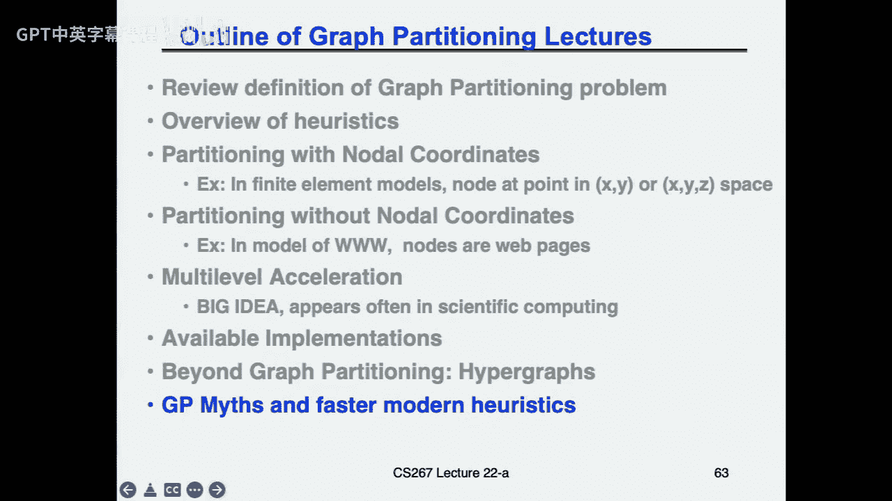
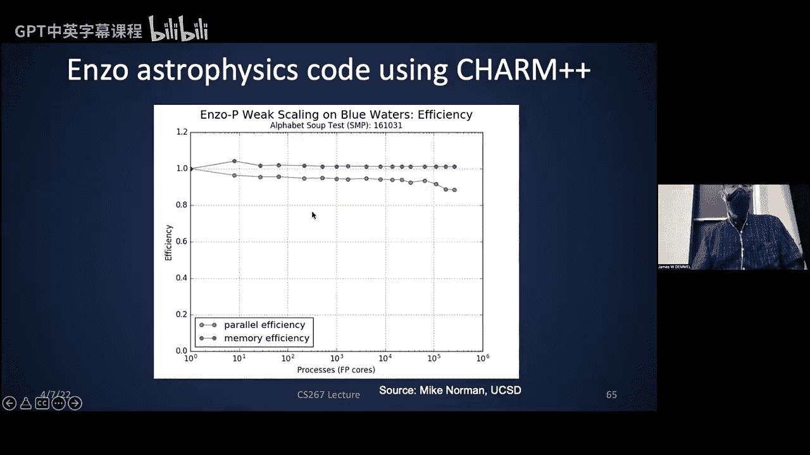

# 【并行计算 CS267 2022】伯克利—中英字幕 p17 CS267 (Sp22) - Lecture 22： Graph Partitioning and Dynamic Load Bala -BV1PS421978D_p17-

Okay， so sorry about the delay there that it took so long。 I thank you for。呃。

I think we're back in working order。 Thank you very much。

 And so sorry for wasting 10 minutes of your time to get started on this graph on this load balancing lecture。

 And so let me say that there's two load balancing issues in this lecture。

 One is I have to talk about graph partitioning， which is static load balancing。

 where you know all the information ahead of time And the other topic is dynamic load balancing where you don't know。

 and you have to do it on the fly。 And so those are the two load balancing problems I have to talk about。

 And the question now that I have 10 fewer minutes is how do I balance the lecture load time between these two topics。

 So we'll see how that goes。So， let me。Okay， so here's what we're going to do for graph partitioning。

 I'm going to redefine tell you what the problem is。 give you a bunch of heuristics that people use。

 because the actual problem is NP hard， like most interesting problem to get the exact best answer。

 And then there's sort of two approaches， one where we have the graph。 and we have X， Y or X， Y。

 Z coordinates for each of the nodes， this might come from a physical problem like。

 find an element problem。 we don't worry about the edges。 We just worry that think that， oh。

 if if two points are close to one another， they're probably connected by an edge。

 And so we only pay attention to X， Y and Z。And the other approach is where we do pay very close attention to the edge is it's just a general graph。

 It could be， you know， the， the， you know， the web and the nodes are web pages， the edges or links。

 There， you know， we have to pay exact attention to where all the edges are。And。

 and so the idea is we want to do this to load balance。

 We want to assign nodes to individual processors that represent to balance the work。

 And we want to minimize the number of edges that go from one processor to another to minimize the communication。

Now， we'll give you some of those heuristics。 But the big thing that makes it all run reasonably fast is something called multilevel acceleration。

 And the idea there is that if the graph is enormous， like the World wide Web。

 it's too big to do that。 So what we're gonna do is approximate it by a smaller graph。

 like take every other mesh point and， and sort of put in put some edges in that approximate the original one。

 then well partition that smaller graph and use that as a starting guess for the bigger one。 Now。

 if I take the world wide Web and take every other web page， It's still enormous。

 I'll use the same idea recursively。😊，And keep dividing it in half。

 roughly use that as a starting guess for the first one。

 And that's an idea that appears throughout computer science and mathematics， You know。

 divide and conquer。And so there's lots and lots of software that's available。

 And I'll give you some pointers to that。 And then there's another model that people use that to represent the problem。

 which isn't a graph， but it's called a hypergraph。

 And that gives a much more accurate measure of the communication， but it's more expensive。

 But nonetheless， it， it's useful in some situations。So here is the definition of graph partitioning。

So here I have a graph， and I've labeled all the vertices by different numbers。1 through 7。

 And in parentheses next to each one， there's its weight。

 How much work is involved in performing that particular vertex。

And then I have all these edges that are labeled by how much information travels over each edge。

 You know， So this says that node 4 and node 6 need to communicate two units of something in order to do their jobs。

And so my job is to take all of these tasks and break them up into P pieces where P is the number of processors so that the node weights。

Is about the same。 So each pro， each processor gets about the same amount of work to do。

 And some of the edge weights is as small as possible。

 And that because that represents the communication。That people need to perform。 And so this is。

 we're going to spend most of our time on the special case of graph bisection where I just break the problem the graph into two pieces。

 And I'll just use， you know， you know， use that recursively to keep breaking it into smaller and smaller pieces。

 depending on how many processors I have。So for this particular example。

 there is a potential partition into four colored boxes， which represent four processors。

 And so here， the workload is  one plus 3 or 4，1 plus3 or 4， It's somewhat load balanced。 And here。

 the communication cost between the green and the red is  one plus 2 is 3 and so forth。

 And so the question is， you know， is that a good one or not。 So this。

 but that's an example of what a partition means。So what are some of the applications where this comes up。

 Who is invented by the same person who invented Hello world， actually。

 at Bell Labs and Brian Knahan， And he also is the K and O。 he invented the name Unix。

 sort sort of a pioneer in this business。 And this was for the original telephone network design。

 And it turns out that that his building block is still important know today as a subroutine。

 So I'll tell you about that。 load balancing while minimizing communication。

 That's the high level thing that we're doing here。

 And one concrete example I'll use several times is sparse matrix vector multiply。

 How do I divide up the sparse matrix rows across processors so they can all run in parallel do about the same amount of work。

 but minimize how much data has to be sent back and forth。

Our double E colleagues use it for VL I layout。 In that case， you know， the the。

The nodes of the units on the chip and the edges of the wires。It's going back to matrices。

 sparse Gaussian elimination that's used to minimize the fill in。

 And there's lots and lots of other applications。 But let me use sparse matrix vector multiply as the running example。

 And so here is a symmetric sparse matrix，8 by 8， very small。

 And I'm going divide it into four processors， you know， which are indicated by colors。

 And so how does this represent communication。 So processor。

 the blue processor is gonna be responsible for taking the dot product of， of the first two rows。

 the blue rows of a with the vector X。And so what processor。The blue processor owns。

 it owns X 1 and X2。 But you can see it also needs to do X 3 to compute that number。

 X 4 to compute that number and X 5 to compute that number。

 And so that's why there are edges between the blue， you know， between two to the。

To the processor who owns vertex 5 and the processor who owns ver vertices 3 and 4。

So the question is， yeah， how do we know if this is a good one or not。

So let's suppose I just want to do brute force。 Think of all possible ways of dividing it up。

 And let's do it， make it really easy。 I'm just going to divide it into two parts。 So I just want to。

 you know， take all possible subsets of size n over2， divideiv it up evenly。

 And how many of them are there。 There's about order 2 to the n different combinations I'd have to look at。

And， in fact， nobody knows a better way to do it。 And that's why this problem is N P complete。

And so here's just two simple examples。 I have 8 processors。Excuse me， I have 8 nodes，4 processors。

 and they're connected by these edges。 This particular set of assignments know。

 gives an equal amount of nodes to each processor。 So it looks load balance， and it cuts 1，2，3，4，5。

6 edges。 whereas this one cuts 10。 And so obviously，6 is better than 10。 I'd like to choose that one。

 And so I'm going do that with some heuristics。😊，So that's the statement of the problem。

 And so what are the heuristics。So the first one， as I said， is that eventually， we want to。

 you know， divide it up into P pieces。 But all of our algorithms are going divide it up into two。

 And so and then we'll take those two and divide each one。 We'll get 4，8 and so forth。 So this is。

 you know， if this is what our graph looks like， we would want to compute this subset of red edges and remove those and divide it into the black half in the blue half。

 And then we would continue recursively on the black part in the blue part。

So the other thing that some of the algorithms do just to distinguish them is some of them look for。

 to divide the graph in2 by looking for edges to remove。

 and some of them look for vertices to remove。 So in this particular。

 really simple example This 2 D mesh。 I could remove all of the green edges that would divide it in roughly even to parts。

 I could remove all the blue edges。 Those are edge separators。

 Or I could remove all of the red nodes and all of the edges that touch them。

 And that would divide it you know， much more evenly。

And so some of our algorithms are going to look for。Edge separators。

 and some of them are going to look for vertex separators。 And if you have one。

 you can always get the other one， depending on which one you want， right， If I remove the vertices。

 then the edge separator is just all the edges they touch and so forth。

So let's do the first heuristic。 I won't spend too much time on it。

 which ignores the edges and only looks at the vertices。So I'm going to assume that I have an X。

 Y or an X， Y， Z coordinate for every vertex。And I'm going to assume that the edges are only to like near neighbors in this space。

And so in this particular example， here's an example of such a thing。

 You're only connected to your nearest neighbors。 And the obvious intuition is you divide it down the middle。

 So the question is， how do you expand that intuition to more general graphs than an obvious two dimensional mesh or a three dimensional mesh。

And so there's a famous theorem that says this idea works for any planar graph。

 So if you can draw your graph on a piece of paper so that no edges cross one another。

 That's what a planar graph is。 you can always do it just about as well as that perfectly regular2 d mesh。

 And so if your graph is planar， you can break it up into the parts on the left。

 the parts on the right and the separator。 And it's the square root of the number of nodes you take it out。

 That's like So that's exactly the square root of the number of nodes here。

 And you never have to get bigger than square root of eight times number of nodes。

 And you can't break it up perfectly。 But you can break it up at worse one third， two thirdhirds。

And that's true for any planar graph。 And this theorem。

 we're not gonna to prove it just motivates lots of intuition。

 intuition for lots of different algorithms。 And so the basic idea of all these algorithms is that they somehow find the center of all of the graph of all of the vertices。

 And there are lots of different different definitions of center。

 And then they pick a dividing plane or something like that through the center of the nodes。

And sometimes they do that in Euclidean space。 Sometimes they project it onto the surface of the sphere。

 There's lots of different intuitions there。 But then they just keep， you know。

 doing that kind of division。And， and this， so this ignores the edges。

 And so maybe that's not a good idea。 So here's an example of a 2D mesh。

 but the edges are not all of the edges in the 2D mesh。 right， It's just this linear chain。

 which I've happened to wrap around here。 So if you use this algorithm and， you know。

 and removed you know， all of these vertices that would be enormously more than removing that one。

 which is what you'd all you'd have to do to really bisect this graph。 So，Depending on your problem。

 you know， if you have a physical problem where the X， Y coordinates you know， mean something。

 then it's okay to use these。 But we're going to spend the rest of the lecture on algorithms that actually pay attention to where the edges are。

So that's all I wanted to say about the nodal coordinates。

So now let's go on to the cases where the edges matter。And the first algorithm I'm gonna to mention。

 as I mentioned， is by Brian Kernnahan and his collaborator， Lyn。

Which they invented a long time ago in 1970。 And it was very expensive。

 They were only doing very small things。 You know， the telephone network。

 And so they they had an in cubebed algorithm， number of nodes cubed。

 And then somebody figured out how to do it really fast in order just the number of edges。 So that's。

 that's a good algorithm。 And so here's the idea。 Its sort of greedy。

 And so you start with a partition And we're gonna to iteratively improve it。

 So suppose I've divided my nodes into two equal parts。

 And so what I'm going ask is which vertex in this subset should I swap with which vertex in that subset to make it better。

 And I'll consider all these pairs of vertices and keep trying to swap them and see which one improves。

And so what I'm going to do is somehow find a subset of， of， you know， vertices of A。

 a subset of vertices of B of equal cardinality and swap them。

 And I will do that if that improves the overall cost， right， I'm trying to minimize the。

 the sum of the weights crossing。And so the question is， how do I do that in an efficientffient way。

So let me tell you how it works at a very high level。And there's code in backup slides。

 which I won't go through。 So while there are some unmarked nodes。

 So some some parent A and parent B that you haven't marked， and that's going be in over two steps。

I will look at all of the unmarked nodes in A and all of the unknown unmarked nodes in B。

 And there's in order n squared pairs of those。 And I'll say， is it a good idea to swap them。

 And I'll choose the best pair to swap。Of those， you know， which one gives the best improvement。

 They may not improve it at all。 I mean， I could actually make it worse。

 but I'm going keep going anyway。And then I'll mark them， and I'll keep on going。

 So I'm going to have this set of possibilities to choose from swapping。You know， one from each。

 swapping two from each， swapping three from each。 I've computed all these possibilities。

 and I'll pick the best one of all those possibilities。

 So I'll have n over two different sets of swaps I can do。 And I'll just pick the best one。

 So why is it a good idea to do it this way。 It's kind of a simple greedy algorithm。

 I might get stuck in a local opt a local minimum。 But you know， if I just keep on going this way。

 I can get out of it and do some better swaps later。 So the cost of this is order in cubed。

 that's not so good。 And so what I'm gonna to do is walk you through the algorithm on a very tiny little graph and show you how to do it in the cost or just order the number of edges。

So here's， here's a really simple graph。 I'm going walk through it。 And what I've。

 And so I have red nodes and black nodes。 Those are my two partitions。 And there know。

 so8 vertices divided into two sets of four each。 And what I've done is I've labeled each vertex by how much better the partition would be if I changed its color。

😊，So if I changed G vertex G from red to to black， what would happen。

 All the neighbors of the G are black。 So if I changed it to black， the cost would go down by 3。

 So I'd get a benefit of 3。 So I've marked it there。If I change C from black to red。

 it would get worse by -1。 So I I've just labeled all that。

 And computing all this is just a matter of looking at your neighbors。

 The cost is proportional in the number of edges。 So3。

 So the best thing I can possibly do is to tently change G from red to black。

 So I've marked it as changing it from red to black。 And I I emptied it。 That means I've marked it。

 So I'm not going to consider it again。 So now having changed that to black。

 I look at all of the black nodes。 And I ask， which is the best one to swap。

 And I'm recording this down here。 And the next best possibility is D。

 And if I change that from black to red。I get， a big benefit。 And now having swapped those two。

 the cost of this graph partition has gone down is improved from 8 to 4。So that's a good thing to do。

 So now I just keep asking， okay， so now I look at the next red node and ask。

 who's the best one to swap。And its F doesn't make any changes。

 So I change F tentatively from red to black。 And now I look at the unmarked red nodes and I say。

 what's the best thing I can do。And it's。C， yes， So I'm going change this from， excuse me。

 black to red。 It's negative。 That means it's not a good idea to do it。

 but it's the best of all the options。 So I'll change that。And then I just keep on updating。

 and you can walk through this。And finally， Ive swapped them all。And who's the best one。

 It's just doing the first two swaps。 I swap G And D。 So of all those possibilities。

 I'll pick that one。 And this is my final partition。

And then I can just repeat that and do it over again， you know， until it stops improving。

 So it's a very simple algorithm。Yes。So the question is， how many times do I need to repeat this。

In order for it to converge。 So when Colel Hen and Ly invented it。

 they were working on really small graphs，360 nodes。 And it converged after two or four sweeps。

But for random graphs， people did some theory on this。 I mean。

 we're not interested in random graphs so much， but the probability of stopping in one step is very small。

So it seems like it takes a long time。 So we're not going to use Knahan Lyn on the original graph by itself。

 but we're going to use it as a building block when we do this recursive divide in conquer。

 So we're just going to apply it on smaller graphs。Okay， so that's one building block， Carnahan Lyn。

Here's the other one， which has a completely different kind of intuition。

 And it has this sort of a physical motivation， which is by analogy to a vibrating string。So。

 and I'll show you a picture on the next slide of， of why you can imagine。

 imagine your graph represents。Let's say a string if it's one dimensional or a drum head of it's two dimensional planar。

 And you hit it， and it starts vibrating。 And it has certain frequencies of vibration。

 And those are going to tell us how to divide it up。 And I'll show you a picture。So the question is。

 how do I， So what I need to do is compute its， its mode， You know。

 it's the the mode at which it'd like to vibrate。 And that is an algorithm for finding eigenvectors。

 because the eigenvectors tell us how it vibrates。 And there's a wellknow algorithm for doing that。

 It's called landos。 And what we need to do is run the landos algorithm。 so。

So suppose our original goal is to divide up a sparse matrix。And。

 so that's our graph partitioning goal to make that run faster。 So to do that。

 we need to find the eigenvector of a matrix I'll show you on the next slide。

 And what does land shows do， It does sparse matrix vector multiply。

So in order to optimize this problem， we need to， you know， execute the problem。

 So it looks like there's kind of a。A loop here。And the question is， why did would we ever do this？

 And the answer is， if you're if the problem you want to do， you're going do it many， many times。

 know， not just one sparse matrix vector multiply， but many。

 then it's worth spending this up front to make all the later ones cheap。

 So you have this is only worth doing this overhead of doing lots of sparse matrix vector multiplies if you're going。

 if the problem you're going to do later is repeated many， many times。

So let me give you some motivation for this vibrating string。

 And so let's suppose it really is a string。 So it's a one dimensional graph。

 You're only connected to your left and right neighbors。 and I pluck it。 How does it like to vibrate。

Well， it has different frequencies， you know， different harmonics。 and it' lowest frequency。

 when it vibrates， it looks just like this， right， It just vibrates up and down in the middle。

 That's， you know， intuitively the lowest frequency。 What's the second lowest frequency。

 It looks like this。Half goes up。 Half goes down and the middle doesn't change。

 So it just keeps vibrating up and down。 And so this is how we're going to partition it。

 All the ones that go up are going to go into one partition。

 All the ones that go down go into the next partition。 And you can， you know。

 and there are other higher frequencies， too。 But this is the one we're going to use。

So this is sort of intuitive when you have a one dimensional graph。

 So what if you have a planar graph or a mesh， Let's say a 2 D mesh。 Well。

 think of it as a drum head。And so you hit the drum head。 And what's it going to do。

 It lowest frequency is the middle of the drum head is going to go up and down。

 And the second highest frequency is half of it will go up and half of it will go down。

 And this actually applies。 I'll tell you what the theorems say。 this works for any graph。You know。

 it doesn't， this physical intuition isn't necessary for it to work。

So let me tell you what the matrix is， whose frequencies tell you how it vibrates。

 It's a matrix called the Laplaceian matrix。And all it does is record who's connected to whom。It's。

 it's a matrix with one row and one column for each node。 The diagonal tells you how many。

 what's the degree of the node， how many edges touch each node。 And then there's a negative one。

E wherever there's an edge。 So if node 1 and node 2 are connected by an edge。The， the 1。

2 entry of that matrix is -1， and the 2，1 entry is also -1。 This is a symmetric matrix。

 So it simply records where all the non zeros are。And so here's just some really simple examples。

 So if my graph is I'm just connected to my nearest neighbors， then those 2，3 and 4 have degrees 2。

 So you see those。 And 1 and 5 just have degree 1。 And everybodys just connected to their nearest neighbors。

 So you get negative ones there。And for the two dimensional case。

 then I have I'm connected to my neighbors to my left and right。

 and to my neighbors above me and below me。 And so that's what all those minus ones mean。

 And so if you remember a lecture we gave earlier。Called Pu on solving Poisson's equation。

 These are basically the same matrices that came up in Poisson's equation。

 So there's a lot of overlap in all the ideas that happen here。Okay。

 so what are the properties of this Laplaceian matrix。So for one thing， it's symmetric。

 So all its eigenvalues are real。 And in fact， they're all positive。The second。

 really cute property is that it tells you exactly how many the eigenvalues tell you how many connected components there are in the graph。

There is one0 eigenvalue for every connected component。So there's always at least one0 eigenvalue。

 In fact， the， you， the row sums of all these matrices are 0。 So you just multiply by the vector 1，1。

1，1， and you get 0。 So 0 is always an eigenvector。But if it has 3，0 eigenvalues。

 then it has three connected components。 So this is。

 it's really measuring how connected your graph is。But what we're going look at。

 So what we're gonna to look at is the second largest eigenvalue。If it's 0。

 that means your graph is disconnected。 So it's easy to partition， right， there are two components。

 But if it's positive， it's still going to measure how connected your graph is。In。

 in a very interesting way。So what is the algorithm then just to repeat。

 I'm going to take that Laplaceian， take my graph， form the Laplian and get the second smallest eigenvalue。

 and then get its eigenvector。 And， you know， that's going be， you know， either plus or minus。

 And I'll put the negative vertices in one subset and the positive vertices in the other subset。

So that was like the， So that corresponds exactly to this picture here。So this would be the。

 the vector。 And I put the positives in one subset and the negatives in the other subset。So。

 so there are these beautiful theorems， which I won't prove。 if we do this。

 and I divide into two pieces， then under most circumstances。

 those two pieces are actually connected。 I'm not going break it up into multiple pieces。

 I'm gonna have two connected components， which is what I want。😊，You， and so that's you know。

 a connection between linear algebra and graph theory。 that's kind of interesting。

And the other fact is that this second eigenvalue， Lambda 2 is a monotonic function of how connected the graph is。

 So in other words， if I take my graph and I take out an edge， Lambda 2 goes down。

 If I take out another edge， Lambda 2 goes down。 So it's a monotonic function of how connected the graph is。

😊，And so there's a lot。 know， So this is the intuition for why， you know。

 this second eigenvalue and its eigenvector is a really good way to divide up your graph。

So to summarize， the Laplian matrix represents， you know。

 everything you need to know about the graph。 its second eigenvector gives tells you how to bisect it。

And we're going to implement it via this algorithm， called Lanos。

And which I'll tell you more about later。 But it's the inner loop of Laos is a sparse matrix vector multiply by the Laplian。

 And so， as I said， we're going have to， you know， do sparse matrix vector multiply a bunch of times in order to do the partitioning。

 And that's only a good idea if， you know。You're， you， you're going to operate on that graph many。

 many times。Okay， so now the next idea is to do this recursively， to take my original enormous graph。

 replace it by one that's about half as large。 Use that partition that as a starting guest for the big one。

😊，And then use that same idea recursively。Okay， and I think I've said that here。

 So here's the notation。 So I start with my enormous graph with nodes and edges。

 I'm gonna approximate it by something smaller。 I'm going call that a coarse approximation。

 So N sub C is a subset of the original set of vertices。

 and E sub C C for course is a subset of the original set of edges。 And I'll partition that。😊。

And so here is the code on one slide。And a picture of how it works。

 So this is the recursive partitioning。 I'm going start with this really， really big graph。😊。

And if it's small enough， then I'll just partition it directly using， you know， either you know。

 Knahan Lyn or。spectralral partitioning， but it's too big。 So what do I do， I'm gonna to con it。

 So in line 2， I con it， and I form this smaller one。And if that's still too big。

 I'll courseen it again。 coen it again。 until I get to the bottom of the tree。 In that case。

 it's small enough。 and I partition it directly。 So now I have to go back up the tree。 So I return。

 And what I'm going to do is take this partition here。

 this little black partition and expand it into a partition of the bigger graph。

But then I'm gonna have to improve it a little bit。

 So maybe I'll run Knahan Lyin to change to improve this black partition into this green partition。

Then Ill move up to the next。Finr mesh。 I'll use that green partition is my first guess。

 Imve it and use that as my first guess as a partition to the original graph and improve that。

 So that's going to be the the way it works。 So the question is， how。

 what how do I actually implement。😊，Coursing， you know。

 finding a smaller graph that approximates my original one。

 How do I go the other direction And what do I do for the iterative improvement。

 which I've already suggested is either Knahan Ly or the spectral bisection  one。

So here's the way we do it with Kern Helin in how couring and expanding works。

 I'm going to use an idea， a basic graph theory algorithm called maximal matching。

And that's going give me a problem of about half the size。

 And then I'll improve the partition using Knahanlin。So what's the maximumimal matching。

 It's a subset of the edges of the original graph。That don't ever share an endpoint。

 So it's a bunch of edges that never touch one another。

 And it's maximal because I can't add a new edge and， and have it not touch one。

And a simple greedy algorithm will work on this。 I'm just going walk through all the vertices。

 the nodes in any order I like and ask， have you been touched already。

 And if you haven't been touched， then one of your edges。

 it touches you is a candidate for the next one to add to the set。

 And so if I can go from one untouched vertex， unmatched vertex to another， then I add it。

So here's a picture of what it looks like。 The red edges are my， is my maximal matching。

 I've chosen these by， you know， walking through all the vertices。

 And you can see that if I were to try to add any black edge， it would have to test a red one。

 So I can't add any more edges to this。And， and there， there's some， you know， some orphans。

 if you like， like vertex A isn't touching any edge， but that's fine。So。

 so this is going to be my maximal matching。 So the question is。

 how do I use this to find a coarser graph， And the simple idea is I'm going to replace each of these edges。

 each of these pairs by a single node in the coarser graph。So in other words。

 I'm going to take these two vertices and pretend they're a single vertex。

 And I'll take those two vertices that are connected。 and make that a single vertex。

And so this is my problem of about half the size。And if I have these。

 these two edges that go from that。Cluster to that cluster will be replaced with one edge whose edge weights are the sum。

 So one plus2 equals 3。 So this is my course approximation。 It's， it's a very simple。

 linear thing to do。And then I'll just， you know， So then I will。嗯。D a partition this one。

And so here are the details of the code。 But I mean， that's just basically what you do。So now。

 how do I， So suppose I've now partitioned this coursesar graph。

 How do I partition the original fine graph， And it's pretty easy to see how。

 because this partitioning automatically gives you a partitioning of the original finer graph。

 So I just take this dividing line between these two partitions。

 and it's a dividing line for this one， too。 So it's very straightforward。So that's one way to do it。

And the other one uses the spectral bisection approach。 And now， instead of having。Maximal matchings。

 I'm gonna have something called maximal independent sets。Which is another basic graph theory thing。

 And I'm going to improve the partition。By taking my starting guess at an eigenvector and improve it by a linear algebra algorithm called Raley quotient iteration。

So here's what a maxal independent set is。 So I， I have a graph。 And what is an independent set。

 It's a subset of the vertices， none of which are directly connected to one another。

 So there are no nearest neighbors。And a maximal independent set is one where I can't add a new vertex without it being a neighbor of something I've already chosen。

 And so here's， and a simple greedy algorithm works。

And so I just keep walking through all the vertices and ask。

 are you a neighbor of somebody I've seen already， If not， I'll add you to my set。And so。

 for example， if I do this particular example here and I see the colors are not showing up。 sorry。

 So these are blue。Every other one is blue。And these are black。 And so if I choose this one first。

 then I will throw out its neighbor because it's， you know， directly connected。

 Then I'll pick up that one as part of my independent set。 and I'll pick up that one。

 I'll pick up that one。 So I'll get every other vertex。 And that will be my coarsening， my perfectly。

 you know， intuitive coening of this， of this1 D mesh。And so here's my mesh。

 and I'll replace it by a new graph where there's one vertex for every， you know。

Vertex in the independent set in all its nearest neighbors。

And then there's going be edges connecting these new course nodes corresponding to the edges。

 you know， that in the original graph。 And so this will give me this coarser graph that I then partition using spectral bisection。

So now suppose I get an eigenvector of this coarser graph， which has half as many points。

 How do I get an approximate eigenvector for the original graph。

And the simple answer is in linear interpolation。 So for this vertex here， which is not in the graph。

 It's the neighbor of these two。Which is not in the coarser graph。 It's the neighbor of these two。

 So I'll simply average their eigenvector components to get this eigenvector component。

 So I'm just going to sort of you do the simplest linear interpolation from one vector to get the other one。

And that's going to be my initial guess。Then， but that's my first guess for an eigenvector。

 I need to improve it。And the algorithm for doing that is something called ray quotient iteration。

 And I'm not going go into the details here， except to say it involves a matrix vector multiply to give you a better guess for the second eigenvalue。

 It involves solving a system of linear equations。With that。Using that matrix that。Gausian。

 that Laplaceian matrix with a shift。And then doing some normalization。 So this is really， you know。

 seems kind of crazy。 I'm trying to solve a system of linear equations with that matrix。

 How do we do it， It all turns into sparse matrix vector multiplies again， you know。

 that we do a few times。😊，So， again， you know， we have to do the sparse major vector multiply some number of times in order to optimize the eventual dividing problem。

 So no free lunch again。So there's a lot of code for all of this。

 You don't have to invent it yourself。 I'm just going to give you a list of all the different possibilities。

And so Knahan Lyn multi levell， Theyre both sequential versions， Medi and Parmeds， and more recently。

 Scotch and P T Scotch。There's a Matlab toolbox for all of this that you can play with， if you like。

 and multilevel spectral bisection， you know， won a test of time awards。 This has been， you know。

 highly cited over the years。 And there's lots of， you， hybridizing ways of doing it。

 And then there's packages which， you know， have all of these things built into them that you can call。

😊，O。So now I want to say， what do people do that's even more accurate than than spectral than graph partitioning。

And that is to represent a sparse matrix is not as a graph， but is what's called a hypergraph。

So heres the simplest way to look at it。 Here's my sparse matrix。

 There's going be one vertex for every row， row 1 through0，4 and one vertex for every column。

 column 1 through column 4。 And so， and then there's going to be an edge or a hyper edge whenever there's a non0 in。

 you know， row I and column J。So the reason this is a good idea is it does a much better job of counting how much information has to be sent from one processor to another。

So let me just give you an example here。 So， so suppose I have this sparse matrix。 It'ssymmetric。

 And I want to assign it to two processors。 So processor 1 is going to be responsible for all of these rows and processor 2 is going to be responsible for all of those rows。

 And the question is， how much and so and processor1 owns x 1 through x 5 and processor 2 owns x 6 through x 10。

 And the question is how much information to processors 1 and 2 have to send to one another so they can do all of their know dot products。

And the thing to notice is that Proor 1 needs x 7 because there's an x there to compute， you know。

 Y 4。 It needs x 7 and to compute y 5。 It also needs x 7。 So it needs it twice。

The old model would have counted that。With these two edges。

But I only have to send it once because it's going use it twice。 So the right thing to do is to。

 you know， is to have a different graph model， which doesn't have two edges to represent that one number that I need to send。

 but only represent by a single edge。 And that's what a hypergraph will do。

And so here is the same matrix in the hypergraph model。 And now I have one vertex for every row。

 And one of these hyper one of these， they're called nets， if you like， for each column。

 And so net 6 refers to column 6。 And it's connected to vertex 1，6，7， and 9。

 And so their edges there， connecting it to to those vertices。

 depending on whether it's in the left or the right。😊。

And so these edges here tell you that there's going to be one piece of information that needs to be communicated between these two processors。

 So there's going to be one exactly one communication for each of these nodes。

 It's not going to overcount how much has to be sent。 It's only going to be sent once。And so。

 and then so the question is， how do you redefine the notion of optimal you can。 And there's you。

 new packages that deal with this kind of decomposition。 So the question is， when can this do better。

 obviously， if you have lots and lots of non zeros in one column。

 You'll only count it this will only count it once instead of many times。

 But let me just show you a surprising example， to say。

 could it possibly do better on an example that we've looked at many times。

 and it that should be easy， right， a2 d mesh。 Everybody's connected to their left right up down neighbors。

 And so I want to take this and divide it into four pieces。

 And what we've been doing so far is kind of the obvious， divided into four squares。 right。

 And so that case， I'm going have communication between different colors right。

 So left and right across that boundary and up and down over that boundary。

 could I possibly do better by using hypergraphs。 And there is a better partition surprisingly。

 you can actually beat the intuitively obvious way to do it。 with this particular subset。

 and it doesn't go down very much。 but it does go down。And if you're made， but， you know。

 for other kinds of grass， it can go down significantly， significantly more。

And so when is this a good idea。When the matrix is non symmetric and the graph partitioning basically treats your matrix as symmetric。

 it sort of gives you the same answer。 if you work on a plus a transpose。

 So it loses a lot of information。 And even when the matrix is symmetric。

 like the last example in it's not going to give you the best answer。

 And so the hypergraph partitioning is just a more accurate model of communication。

 And there's lots of and there are various packages to do it。 But it's much more expensive。 know。

 to do this kind of updating。 But that's what I wanted to。

 all I wanted to say about graph partitioning。And there's some more slides which I won't go into。

 because I don't have time， which are， you know， some more modern heuristics that are even less。

 much less accurate than what I've just shown you that people try on much larger graphs。

So are there any questions before I can hopefully shift without glitches to my next presentation。

O。So we have full screen。Yeahay， okay， so dynamic load balancing and so why do we have this funny picture here on the first slide。

 it's because one of the ideas behind this is randomly throwing balls into bins。

And there's some theory about how well that load balances， the balls。

 the jobs that are thrown into the bins， the processes。And so why so how do we find？

Load balance how do we measure it I want to say a little bit about measurement first so one thing that could go wrong in your program is that you can have very expensive barriers or locks and so if you just measure the runtime from the beginning to the end you're not going to know if that's because you have some of these tasks so time is in the vertical axis going down these are separate parallel tasks the orange box is a barrier and these are more tasks and so if I just measure the time from the beginning to the end I can't tell if if i'm stuck because of load imbalance or because I have a very expensive barrier。

And so what I need to do is measure it differently so here's what I'd like to actually measure so here's a situation where I have many jobs to take about the same time but I have some slow ones so that's load imbalance and here's kind of the worst case where I have kind of a sequential bottleneck where most of the parallel jobs finishing about the same time but there's one pro that's going much much more slowly and so what I need to do is measure things carefully enough to just be able to distinguish these different situations。

And so for example， what you need to do is measure the time of each run and maybe do a histogram of it all。

Or you could just take the maximum time and compare it to the average time and so those are all the different things you know that imply load imbalance so this is a lot of data to collect and the good news is that there are a bunch of tools that people have already built so you can collect this data automatically so on Cray the HPC toolkit Tu there's a lot of them that are already installed at NRSC and so these are all available for you to measure your load imbalance to see if it's a problem that you need to apply one of these algorithms to。

And the other thing is what we call Heisenbergs， which is a deliberate pun。

 and the fact is that it's often the case that measuring your performance will change it。

That's you what Heisenberg uncertainty is about and so that's something is you also have to be concerned about that when you put in some measurements。

 you know some print statements， for example， it could change the problem completely。

Okay so where can one of the sources of load imbalance it's the tasks can all be variable。

 the number of tasks can be variable and their structure。

 know there dependencies you know can cause bottleneck so for example if you have a dependency tree depending on how you execute where you have to do one task before another in that tree depending on the shape of the tree you may get a bottleneck of some kind and if it's not a tree if it's a more complicated directed acyclic graph it can be very complicated but I just want to point out there's one other thing that can go wrong and that your machines can cause load imbalance。

 the hard can cause load imbalance so here two plots。

 the first one is from a prize-winning paper from a long time ago the horizontal axis are they each thread that was running or each processor 1 thousand24 processor the vertical axis is time and you can see that every 32 processor something strange was going on and so with the team who wrote this paper tried to figure out was what was going wrong with every。

You second processor and the answer was there was an operating system demon that was running on every 3second processor that was doing something expensive and it slowed it down and so that's something that you have to be aware of that could possibly happen and here's another example two examples in red and blue horizontal axises again process by process the vertical axis is time and you can see there are a few processes here that were much much slower and in fact the team recognized that this process numberingwise was actually the same as one of the blue ones and it turned out that this was because if error correcting codes in the hardware and the DRAM the DrRAM was wearing out and it was still operating correctly but it was but whenever the hardware detected that something was wrong with the DRA it ran this expensive thing called an error correcting code to make sure that the right data came out of the DRAM and that was only happening on a few so they had to go repair the hardware and then the problem went away so all of these things are potential hazards。

But there's even a bigger hazard because everybody's computing in the cloud these days and those are you know have not just the problems that I was talking about but you know they're shared resources by many。

 many people and so here is an example of some measuring some round trip messages between pairs of processors and this is the。

sortrt of the probability function of you know what is you know what fraction of the round trip times were less than a certain number of seconds and so this number here at 99% says it 99% of the messages were less than three milliseconds the median was 0。

6 milliseconds but there was this nasty tail where there were even some that took 300 milliseconds and if that's the bottleneck in your code then you know that's a problem and this is just a feature of the cloud unfortunately。

So what are the approaches we're going to take to fix this there's static load balancing which you've already talked about and there's dynamic load balancing and there's going to be some tradeoffs here when we do it dynamically and the tradeoff is going to be between you how much time you spend load balancing and how well you load balance theres there's no you know free lunch。

So the simplest case is when you have a bunch of independent tasks， say loop。

And the though I have a loop zero to from zero to n。

 and so what the easy case is when every inner loop takes the same amount of time。

 that's the simple thing to load balance， they could be known ahead of time like sparse matrix vector multiply and I can do that problem statically and the hard case that we care about is where you don't know until you run the code how long is that loop going to take because there could be conditionals you all sorts of other things that go on that you don't know until the code is finished running how long that particular loop iteration is going to take。

And so these pictures， this is just some examples， you know。

 so when everything is the same that's like dense matrix operations。Spare matrix sector multiply。

 that's when they're different， but you know them ahead of time。

When do you not know them ahead of time it's like you could have tree you know doing you know physics on different parts of the problem and know you don't know how long it's going to take for this part of the physics to converge versus other parts of the physics and so forth。

 so there's lots of examples。So let's suppose that we did know the problem sizes and we just wanted to put them onto P processors and balance it as much as possible。

 so this is a classic problem called the bin packing problem， so bunch I have a bunch of numbers。

 a bunch of costs and I want to put them onto P processors so that everybody is doing about the same amount of time。

That's NP hard it turns out to actually do that in the best possible way and so what are some of the heuristics that people use there's some easy cases。

 for example， if you know all the data sorted ahead of time you can put that on one。

 that on processor  two that on processor  three and if you only have three processor and you go backwards that's processor 3。

 processor two， processor one you just sort of zigzag back and forth and that does a you know an okay job of load balancing if you know everything ahead of time。

 but if you don't know them ahead of time then you know that's the dynamic case。

So what do people do there， one example is called self-scheduling。

 so what we're going to have and this is in shared memory world we're going to have a task queue and a bunch of processors in this case six and this centralized queue is simply going to keep a list of all the work very straightforward and whenever whenever a processor or worker wants a new job。

 they just go to the centralized task queue and get the next one。

And that will and that's the most straightforward thing you can do and that way everybody will always you know have something to do as long as there's some job left。

But you can imagine that this is going to be a bottleneck you know for several reasons certainly on this makes sense on a shared memory machine if you're on a distributed memory machine it's a problem and if these tasks are very very small grabbing one may cost more than doing the task in the first place so the question is how do we deal with these problems？

So the first thing is that instead of just grabbing one task。

 you're going to grab a bunch of tasks right that's certainly that's going to make maybe the load balancing a little bit worse。

 but it'll reduce the overhead of going to this this because this is the sequential bottleneck right people have to stand in line to get stuff off the Q and so you can there's going to be some task size of chunk size of size K and whenever you go get a job you're going to get K of them instead of one。

So the question is， how do you choose K？And you know what are the trade offs of k is too big or too small。

 if you pick k large you'll get a lot of work to do and that'll remove you know the the contention at the at the。

At the task queue， you're not going to be accessing the task queue very often。

 but you're going to get possibly worse load balance and small chunks。

 though the load balance will be better， but you'll have more contention at the queue。

And so here is the trick that people often use for this， to decide how many jobs to get。

 you take the total number of jobs left， divide by the number of processors and take that many。

So if there are four processors， you'll always take one quarter of the remaining work。

And as the remaining work decreases， you'll get less and less。

 but overall it'll load balance on average。对吧。So what if you're on a distributedbutive memory machine now it gets a little bit more interesting。

 so now the idea is that each processor is going to have its own local task queues。

 so that's all shared memory。And so everybody's going to keep track of the amount of work that they do locally and as long as there's local work。

 you don't talk to anybody else。So what if your local queue is empty。

 then what you have to do is go steal some work from somebody else。

And so you go to you pick some other process perhaps randomly we'll get to that and you grab some work from there so the question is how many tasks do you steal well we could do that same trick of you know divide by the remaining work by the number of processors but you know we have this whole list here in some order so the question is which one do I steal there's a list。

And so when I take it from my own， if I'm just grabbing my own stuff， I'm going to do it last in。

 first out。Why do I do it that way because the last one that I put in is probably affiliated and shares memory with the one that I just finished so it's better for locality if I grab the most recent one that's closely related that's for my local if I'm taking from my local cu。

But if I'm taking it from somebody else far away， I'm going to treat it as first in first out。

 so that means the first one I put in is going to be the on this other two is going to be the oldest one and I'm going to grab it and that's because it's probably the if it's older its know like it's at the root of the tree it probably represents more work so that means I'm going to be sending more work over which is what I want to do。

是。And then I have to decide who am I going to steal from。

 am I going to get my talk to my nearest neighbors or am I going to go far away？

And here the tradeoff is that if I go to my nearest neighbors， that's good for locality。

 makes sure that people are not clogging up the network， but if it's far away。

 it's better for load balance because if I only talk to my nearest neighbors and all my nearest neighbors are empty。

 then I'm going to be out of luck， but if I pick some random processor that's far away。

 the chances are it'll be better load balanced。So what is known theoretically about all of these different algorithms。

 so the model that people used for this is you have a bunch of balls。😊。

Tasks and you throw them at random into different bins in order to do the load balancing and so the question is if I have n jobs and I throw them into P bins。

 what's the distribution of the heaviest one you know who's you know the bottleneck。

And it turns out that with high probability doing this random stuff works very well。

 so if the number of tasks that I randomly throw at P processors is at least P log P。

 then with high probability， I'm going to get a perfect load balance and over P plus a little bit more。

 which is the square root of this。So this tells me that this load balancing works very well。

 but if I have n equals p， it's not quite perfect， I mean in that case everybody should get one。

 but it's actually log n over log log n。And so it's not bad， you it grows logarithmically。

There's a way to even make this better， which is that when I go to throw a bin。

 a new job to a new bin， I don't look at just one pick it randomly and put it there。

 I look at maybe two or maybe three and I pick the one that has the least work to do and I put it there。

In that case， I can make this log in in the numerator， this whole fraction just go like log log in。

 so it's exponentially better， and it's very well load balanced。

So people have been thinking about this stuff for years and here's kind of a picture of a bunch of papers which we've tried to summarize。

 but you very superficially going back to the '60s and this list stops in 2008。

 so there's lots and lots of algorithms。So now let's go on to the case with dependencies and ask what do people do in this case so now I have to do these in a particular order and that's going to make the load balancing more challenging and so you know the easy case which we've been talking about so far is no dependencies but I could have you know chains that's a pretty common dependency I have to do this task than that one than that one they could be trees that come up in tree search or they could be general graphs。

And I want to distinguish the cases when I know this dag ahead of time， and so for example。

 if I'm doing， if I'm trying to paralyze a linear algebra task。

 I know exactly what the graph looks like， but if I'm trying to do random research if I'm trying to play chess。

 I don't know know where I'm going to be in that tree at any particular time。

 and so that's the hard case。And so what are the hard examples like chess or N queens where you're trying to put N queens onto an end by N chess board so that they don't attack one another VLSI layout。

 robot motion planning， there's just lots and lots of different examples。

So let's just try some simple cases and see what can happen so so this is gamere search so this is the original let's say position on a chessboard and then these are the different moves after moves have been made and what we'd like to do is eventually find where the places where I win the orange ones and and then the ones in the middle nobody's won yet and the blue ones are where I've lost so I'd like to somehow search this tree as efficiently as possible and find an orange note。

😊，And so just to remind you how do we search trees there's sort of two basic ways depth first search and breadth first search depth first search is where I start the root and just keep going down until I hit a leaf and then I back up until I can know keep going forward that's pretty much inherently sequential and then there's bread first search which is much more parallel and that case I started the root I grab all the children of the root。

 put them in a list and I grab all the grandchildren and put them in a list and then so'm so that's sort of going through layers and since there's know the number of children grandchildren。

 great grandchildren is going to grow perhaps exponentially then that gives me a lot more parallel work to do。

And so this is a picture of atico board so how am I going to apply those two kinds of tree searches so the simplest one is just you go to the bottom and back up you know that's the depth first search approach or I could do branch and bound that is where I keep track of the best solution so far and I know and it may be that in my tree I can say oh I know if I go down this particular branch I can't do as well for sure then if I this other branch that I've already searched and so you can just eliminate that immediately and then there's something that's called iterative deepening which is in between depth first breadth first search where I might do depth first search down three levels then but do everything down to three levels and then I can do breadth first search down to six levels do everything down to six and so I can sort of trade off you know the benefits of doing both of those。

So let me look at the time here。So how am I going to allocate work in these kinds of tree searches here is sort of a naive not so good idea if I have two processors i'll just say one processor starts at the root if they're two children。

 one child gets that subree and the other child gets that subtree and clearly if the tree is not regular。

 one processor could have a lot less work to do than the other and here is the case where I have four processors and I again know go down to these two children and then these four children and each。

Process gets each different colored process gets a subt and it could be very。

 very unbalanced so the question is what do I do instead can I use that same randomization trick that I use for balls and bins？

And the answer is yes， and this was a theorem by our own colleague Kp a long time ago。

 so suppose I have this tree that I'm searching and I come down and I get here。

 what I will do is randomly assign this subtree to another processor and I'm just going to keep using that trick going down and they can prove that no matter the shape of this tree that also with high probability make sure everything is load balanced。

So it doesn't maintain locality， obviously， but it does maintain load balance。

And so some other theoretical results in this area。

 so so this was actually in a commercial product called silk that was acquired by Intel so and this is work at MIT bloom off and lyocin so they consider a task tree where they variable costs and what they do is they say I'm going to keep you know actually you know going down part of the tree but if a processor ever becomes idle it steals work from another one it goes off and goes to another processor and takes that's chosen randomly and grabs work from it and they have you know。

😊，So this is good for Lo， yes， so it only goes another processor when it's idle。

 that means it's good for locality， but it tends to balance the load slowly。

And then there was another approach that was done here by a graduate student about the same time and he is the idea of pushing。

 so instead of stealing work when you run out of something to do。

 you pick a random processor and throw your extra work at that other processor and that load balances load work the workload much more quickly。

 but you know it's not good for locality as you can imagine。

 so there' are these different approaches。And here's some performance data。

So now I just want to say a little bit about DAg scheduling when you have a completely irregular graph and so I've shown here some sample graphs that come from linear algebra where I'm trying to invert a matrix a symmetric positive definite matrix。

 so there's three phases shown here。First I do a matrix decomposition called Kleski and so here's what the graph for that looks like I'm going to operate on the leading in this case n over4 by n over 4 sub matrixtri then there are three other submatrices I can work on and once I finish those these edges tell me I can work on other submatrices and finally I get you know the final answer there。

Once I've done that I invert that matrix L that's the output of Kleski and there's the graph for that and then finally I multiply。

 I have to take the product of L inverse transpose times L inverse so this is a special matrix multiply and that's what the graph looks like there。

And so what this graph tells you is that everybody has to be， you know。

 has to wait until so all the edges above them are done。

 so this is the dag that comes out of this scheduling。

And these are the if I do these three subroutines one after the other and wait until I'm done。

 it's going to take， I think， 25 steps to finish but if I merge all of these dags together。

 I get this whole conglomeration and I can keep all the pro much more busy in other words part of this subrtine can begin before that subrtine ends。

And so that's what the entire graph looks like， and people have built tools that automatically take take your code and build these graphs。

And there's a lot of different tools that do this， they've been invented many， many times。

 it's finally found its way both into Open MP， the last version of Open MP and into GCC。

Because this is how you know how popular it is， so it lets you what you have to do is annotate your code to say here's a subrtine that I want you to treat as a unit you know is that to be assigned and then all of these different packages will automatically do that kind of scheduling that I showed you on the last page。

So how do these how well do these work you have to pick the sizes of your task to be a reasonable size otherwise you know you if you have you know millions of tasks to schedule that's going to be a bottleneck so for example if i'm doing dense linear algebra on an n by N matrix and I break up my matrix into B by B blocks。

😡，Then that means I'm going to have N over B cubed tasks to work on。And so if I have a 10。

000 by 10000 matrix and I break it up into 100 by100 blocks then I'm going have a million tasks and so that's a problem but I mean people still want to do it so what do they do when people started in this world they built the entire dag ahead of time and schedule it but that doesn't scale the other thing you can do is just build the frontier of the graph so you just in other words if I go back to this picture I do the first one and then I can I know the next three that I need to do and then I just sort of build these the rest of the task graph layer by layer and schedule that and so that is this dynamic scheduling of the frontier and all these are just names of different packages that people have built over time。

Okay， let's see， I think I have。Time to talk about one last topic because there's one more important package that people use which is tasked with communication。

 so now I have not just the load balancing to worry about。

 but the fact that these different tasks talk to one another and this package is widely used was built at Illinois。

By Sanjay Colley in a group and their original target was molecular dynamics and so this is widely used in a whole bunch of different molecular dynamics codes and what they do is you know they let you break up your data into into tasks and they call them chars。

And all of these cha what they have in common is that they have to communicate with one another and what the system does is that it measures this over time and gradually load balances and so its assumption is that you're doing something iteratively and so you're doing the same task over and over again they don't change very much and so the second time you execute it in the third time and the fourth time it's probably talking to the same task it did before and it's probably taking about the same amount of time and so that means it doesn't the first time it does the load balancing it can work very hard and then later it can just sort of tweak the load balancing slowly as the workload changes。

And so here's kind of a picture of what that looks like， you run the code for a while。

 take regular time steps， then it can insert automatically some instrumentation to say how long each task runs。

Then it does a lot of hard work and reassigns tasks the processors you own and optimizes the communication。

 measures it again， and then it just lets it run freely for a while and it maybe just moves things slightly around right because it doesn't have to change things very much and so the hope is that by doing this slow changing and doing a lot of hard work once you can get a good benefit。

So just one slide on kind of the intuition， so if you if your task graph is a tree in a lot of cases it is。

 then the idea it exploits is that。The root doesn't have to know everything。

What you do is you delegate it to the children so each child is responsible for load balancing its children's graphs and if that's too much work the grandchildren are responsible so what if these two grandchildren you know can't balance their local work this one is a lot more work to do than that one then they ask the parent can you help and then it the parent' responsibility to you know load balance between its children and if that parent if these two parents you know siblings can't help then they go and ask the grandparent you know to move data between different subtes？

So this has gotten lots of good speedups over time。

So this is a code from an astrophysics at San Diego that was done by a different team。

 and they get nearly perfect scaling up to 10 to the fifth processors on their astrophysics code by doing this。

Okay， so last slide。Despite all the delays we made it。

 there's often a trade off between locality and load balance and so depending on which is more important for your problem。

 you can choose one or the other， there's I've given a very high level overview over many decades of work there are a lot of algorithms。

 paper and software fortunately for this so you don't have to reinvent it yourself。

And what you need to do to decide which of one of these is the best is know whether you're worried about you shared memory versus distributed memory machines。

 obviously， you do you know about the dependencies in your tasks， do you know their task costs。

 you know how much the communication costs and you can also decide whether you want to be locality oblivious versus locality encouraged versus you you have to optimize for locality depending on the relative cost of communication and computation。

So anyway， these are the choices you have to make and the other question is。

 will future architectures make all of this even more necessary than it is today。

 if we're all computing on the cloud where anybody can share with your machine and you don't know which machine you get。

 then it may be that this dynamic load balancing is the only option to use those resources effectively。

So that's it， I will stop there。Are there any questions？

