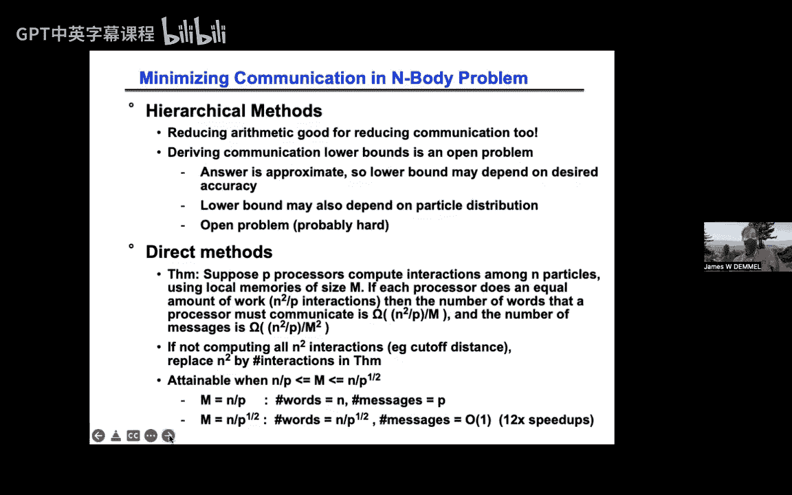

# 【并行计算 CS267 2022】伯克利—中英字幕 p18 CS267 (Sp22) - Lecture 23： Hierarchical Methods for the N-Body Prob -BV1PS421978D_p18-

So let's get started。Is this too loud？I put it a new battery， maybe that's why it's so left。这个这个。

How about this？Is this better， okay， very good。So today we're going to talk about hierarchical methods for the em body problem。

And so here's the big idea that we're going to use。

 so for several problems that we've seen this semester and this will be the third time the answer at each point in your problem depends on all the data at all the other points and the most obvious example of that is gravity。

 the gravitational force in every particle depends on every other particle。

 but it was also true for multi-grid you had to know the solution at every point depend on every other point and was also true for graph partitioning whether you wanted to you know keep an edge or not you had to look at all the edges so all of these problems seemed to require order in squared work and communication。

And so what they all have in common though is that the information that's far away can be compressed somehow because it somehow gets smaller or smoother or simpler and the example that I think we've used for gravity before is you look up at the sky and you want to compute the gravitational force in the earth you see all those little white dots you figure you have one term in your sum for each of those and then you realize one of those little white dots is the Andromeda galaxy which has another billion white dots in it。

 but your first impression was right， it's perfectly fine to replace the Andromeda galaxy by a little white dot at its center of mass and with its total mass and that will give you all the decimal digits you need and so that is you know the idea we're going to apply recursively today but it's much much more general than that and so by doing that we're going to lower the cost for all of these problems from order n squared to order n log n or even order n so these are going to be optimal algorithms in a certain sense。

And so today know we've seen that before for multigrid。

 we've seen it before for a multilevel graph partitioning in the last lecture。

 and today we're going to cover two algorithms called Barnes hut。

 which was the first one invented for this stuff and then also the fast multicol method。

Which is much more accurate， and so whenever you see the same idea used three times。

 you should consider the standard technique。So so as I said。

 I'm going to go through some motivation motivational examples where do people do this thing it's not just gravity。

 I'm going to use that as a running example， but it's used very broadly and then I'll sort of give you the general idea about how we decide it's okay to treat a little white dot by its mass and center of mass and there's going to be a tradeoff there when we do that we're going to sacrifice some accuracy so there's going to be some tuning parameters in the algorithms do we want two decimal digits do we want 16 decimal digits which is all you can get in double precision anyway and so I'll just give you the high level picture of how that works and I'll tell you the basic data structures which are in two dimensions quad trees which we've seen before for laying out matrices and then also och trees。

In the three dimensional case and to keep the presentation simple and the math simple。

 I'm just going to concentrate on the 2D case。Then I will do Barns h which is N log n and it was invented back in 86 and it's good only for a couple of decimal digits and then a year later the fast multipole method appeared and it can give you as many digits as you want and it can go up to order in so I'll probably spend half the lecture on sort of the background the structure of the algorithms and then the second half of the lecture on how they're paralyzed and what are all the different techniques for paralyzing it。

So here is a high levelve particle simulation reminding you of some old homework so I'm going to be doing some time steppingping and moving some particles so I'm going to start at time t equals0 I want to go up to time t final and most of the work is done here I'm going to loop over all my n particles and compute the force on each particle that's where the lions share the work is and then given the force I'll move it and that's you know using f equals MA some simple rule to update the acceleration update the velocity and I'll move it a little bit and then compute some interesting property of the new distribution of particles say their total energies and update the time so all the work is on computing the force and as I think I mentioned in the sources of per as a lecture there are three different kinds of forces and three different ways to parallelize it。

So the external force is the easiest thing to paralyze。 And that is when you just have some。

 you know。For on you that depends only on your position and so for example。

 in the sharks and fish example， if you know where you are in the ocean and you know the ocean current。

 there's a formula， you just evaluate that， it's embarrassingly parallel， it's order n。

The next example from homework actually is the nearest neighbor force where you only depend on the particles that are really close to you to decide what to do。

 and so that could be bouncing balls as an example only when you're really closed it did matter。

 but there is also Van dew's force where the force falls off very rapidly and that's also an order end problem and the expensive one we're going to talk about today is end body。

And that's where everybody depends on everybody so how do I compute the force on particle I。

 I'll loop over some over all the other particles， K does not equal I and add up the force on me particle I depending on particle K。

And the running example I'll use just to keep the mass simple is an inverse square law。

 So in three dimensions it'll so what is the force it's going to be the vector pointing from particle K to me divided by its length cubed。

 So the total length of this vector is one over the length squared。That's in three dimensions。

 in two dimensions， it's going to be almost the same formula except now in the denominator。

 it's the length of the vector squared instead of cubed。

And so that is what I'm going to want to accelerate。

And so this is where it fits in our table of the 13 motifs of parallel computing。

 it's this row here that Ive outlined， it certainly appears in high performance computing but it also appears in a lot of other things and I'll show you some examples now。

So let me give you a few examples of applications where people have used this。And the first one。

Which won the Gordon Bell Prize at supercomputing， which is the best paper prize for the most impressive speedup of an algorithm that a lot of people care about was a long time ago。

 so I'll give you some history here， 1992， it was on an Intel supercomputer and Intel delta。

 which had 512 processors on it and they took 170 million particles and they simulated them for 600 times steps so not all that many and it took 24 hours of total compute time on the supercomputer and they sustained a whopping 5。

2 gigaps， which might be sitting under your lap right now so but that was very fast back then and they only got1 1% accuracy I'll define accuracy later。

 but what that means is that each whenever they computed the force， it was good to two digits。

So that means after many， many simulation steps， your particles probably weren't in the same place they would have been otherwise because there's a lot of chaos as to where they go。

 but it's good enough for simulations so what's impressive is how much faster this was than the obvious n squared algorithm it was 6570 times faster than it would have gone using the standard n squared algorithm and that would have taken 18 years to run。

Okay， so that's the first prize， let me fast forward a few years。

 17 years to 2009 it won a different Gordon Bell Pri and so now this was on a more modern machine。

 256 GPUs。And about the same number of particles， 17 million particles。

 but which prizes they win then for the cheapest simulation， the cheapest dollars per gigaploop。

 so 8 bucks per gigaplaop is what it costs to run the simulation。And they ran at 20 ter flights。

So let me just give you some other examples where this is used in practice。So molecular dynamics。

 so this comes up in chemistry， biology， in all sorts of other areas， you're simulating molecules。

 and so you want to compute the forces in all of them。

Plasma simulation if you're trying to design a tokaac so you can have a fusion reactor。

 you know we understanding how the universe evolves so that's the plasma with lots of electrostatic forces in it。

Some colleagues over in Cory used to be interested in using electron beam lithography as a replacement for making being able to fabricate chips that were ever ever smaller and this was important for them and finally here's one application you may not have thought of before。

 which is hair。So this is Princess Meredda from Brave。

 which is a Pixar movie from some years ago and if you've seen that movie or its follow ons。

 you know that these animated characters， whenever they move around and shake their heads。

 their hair bounces around in a very natural looking way so the question is how do they do that simulation they take each hair and put a few hundred charged particles along it in the simulation and then they do an embodied problem in order to compute the repulsive force because they're all positively charged and that's what makes the hair bounce around so we learned about this because a former Berkeley graduate student。

 Michael Driscoll who is also a former CS267 GSI was a summer intern and built the code when he was a Pixar one summer？

And so they've been using it ever since to do these kinds of simulations and one thing he learned from his experience as a Pixar is if you only work for three months。

 you do not get screen credit。Unfortunately， but nonetheless he gets credit in a lot of senses for you know having produce this kind of stuff。

 it's not using this is a small enough problem they can use a direct method， but nonetheless。

 you know maybe when the hair gets larger they'll switch to the fast multiple method。Okay。

 so what is the- let me move this。So what is the trick for reducing the number of particles in the forest sum。

 we need some sort of mathematical criterion to decide when a little white dot is a little white dot and so。

What we're going to do is。Divide apart space。Into lots of little boxes。

 and I'll describe that data structure later， they're called quad trees and op trees。

And so what we're going to do is ask if I want to compute the particle force on this particle over here outside the box。

 what do I need to know， I need to know the size of the box。

 in this case it's capital D by capital D， and I need to know the distance to its center of mass。

 and it's okay to underestimate it just by saying the distance to the nearest point in that box。

And then what I will do is ask is d divided by R small enough。

 is the size of the box small enough compared to my distance to it。

 there'll be some threshold that you can set， and that'll be my criterion for deciding to replace this by its mass and center of mass。

And so what I'm going to do is build a data structure with all these divide all the particles into these boxes and recursively walk through the data structure and ask this question。

 is this box far enough away to compute the force on it or do I have to break this up into four smaller boxes and ask the same question？

So I will write the code for that but that's the idea and of course this idea is not new replacing a bunch of particles by their center of mass。

 you know when Newton you know wrote down the theory of gravity you know with a falling apple to the earth he replaced both of them by their mass and center of mass so this is you know an idea that goes back a few centuries but there is more to it than this。

And that is the idea that we can use it recursively。And so from the Andromeda's point of view。

 the Milky Way is also a point mass so obviously that works you know that way。

 but now let's suppose I'm inside the Andromeda galaxy and there is a planet Bacan and then there's some other solar system that some distance away from Boan and what I'd like to know is can I replace that solar system by its mass in center of mass to compute the force on Bocan and it's the same algorithm I'll compute the size of that box。

 D1 by D1， the distance to Vulcan R1 and ask if d1 over R1 is small enough。

And so that's you know and this is inside of Andromeda。

 so this is going to be the recursive application of this， you know as I build my tree。

 I'm going to build all these boxes and that's what's going to get the complexity down from n squared to order n or n log n。

So now I have to tell you what the data structures are。

 they're going to do all this for us and they're going to be quad trees in two dimensions and ox trees in three dimensions and I'm going to spend most of my time in the 2D case just because the pictures are easier to draw and so let's suppose if all the particles start in this black box that's going to be represented by the black root of the tree and it's going to have four children which have these dark blue boundaries so you know this corner in that corner that corner in that corner and those are those four children。

 those four dark blue dots each of those has four red children with those boundaries and each of those has four light blue children with those boundaries and so this is a complete quad tree because each non-leaf node has four children and of course in most interesting simulations the particles are not going to be distributed uniformly they're going to be clustered and so we only want to build the subset of this tree which is actually going to have any stuff in it。

And oh and so what so what is the most obvious operation I'll do this in more detail later what I want to know is the mass and center of mass of every one of these boxes so what's the obvious way to do it I'll compute the mass and center of mass of all the leaves all these four then how do I get the mass and center of mass of the parent just add up the masses that's obvious and take the appropriate weighted sum of the centers of mass and I'll get the center of mass of the parent and I'll just work my way up the tree doing it that way so that's very cheap。

对。So and yeah， so this is what an a tree would look like。

 but I'm just going to keep it all in two dimensions to keep the pictures easier。

So the question is how do I adaptively build these trees so that I only have boxes that are have something in them。

 I don't want to have any empty boxes that I waste memory and time on and so this is going to be called an adaptive tree。

And so here's a picture of what one would look like。And so again I have the root is black。

 it's four children are dark blue and so forth， and so when I do the first division into four dark blue boxes。

 each one of them has something inside and so I have these so so it does have four children。

 but these are not worth dividing anymore because if they only have one particle inside so I'm done so these two here。

 I don't divide anymore。These two I continue dividing each one of them has red children with red boundaries。

 but it only has three are that are occupied so each one has three children and then these two stop and so these have no more children and then this only has two nonemp children and only this one and has three brown。

Children， so this is what the tree looks like。 So there's a specific order here that's important for the data structure。

 You know how did I decide to go from left to right。

 How does that correspond to this particular picture And what this is is。

What's called Mortton ordering it's a space fillinging curve and it's called backward C so that means I go start here then there then there and then there I sort of go around in a backward C so that's why for example so these three box these three red nodes correspond to those in that order and these three correspond to theses in that order so it's skipping that one。

So and of course there's some hidden indices that I'm not telling you about that are details in the data structure so you know which of these four corners you are now in practice we are not going to go all the way down to having one child per nodeode per leaf we' go we're going to have a tuning parameter there's going to be some magic number Q and we're going to stop when the population of a box gets down to that magic parameter cube and so what happens when we have multiple particles in the leaf。

 we're going to use the direct method we're going to use you know the usual formula which is order2 squared。

So that means we're going to do more work at the leaves， but if you're running on a GPU。

 you might want to pick Q pretty large because it's going to go really， really fast on the leaves。

And I'm going to show you some results later where people actually use that tuning parameter to make their code as fast as possible。

 how big should the leaves be？Okay so in the last time I gave this lecture somebody asked why not use Kd trees。

 which is a different way to organize space and let me sort of anticipate that question now and say why we're not using that particular kind of tree so what that kind of tree would have done it would have chosen this blue boundary so that half are on the right and half are on the left and then it would have chosen this boundary so that half or above and half or below but what I want to be able to do is know just depending on your location in the tree how big are you and how far away are you from me and so we want to have this regular division so that it's easy to compute the geometry of all of these boxes just by knowing where they are in the tree just in case you were wondering。

Yes， so as I said， the number of particles in the leaf is going to be a tuning parameter。

And I should say when I've given this lecture in the past， it's been I've used more than one lecture。

 we're not doing that anymore， and so there are a lot of hidden slides with code details and so you look when you download the PowerPoint you're welcome to read all the code on the hidden slides if you want to。

Okay， so how much does it cost to build that quad tree so let's just ask ourselves what it costs to make sure that we're still you know in line with our goal of being linear time or en log in and so what we're going to do is build a tree toppped down every time there's a new particle I'm going to say insert it。

And so then depending on which subblock you're in， whether you're in the northeast or the southwest。

 you will take that path down to the bottom and do an insert there and finally when you discover you know your particular home。

 where do you belong in the tree， you will insert that particle。

And so the cost of doing that for n particles is n times the maximum cost of inserting and what's the cost of inserting。

 it's the depth， how many steps do you have to go down in that tree？You keep going down， down， down。

 down until you do some constant amount of work at the leaf to insert yourself。

And so the cost is n times the maximum depth of that tree。 So how deep is that tree in practice。

 Well， the simplest case to understand is if the particles were uniformly distributed。

 if every box had an equal number in them， it would just be log in。

That would be the depth of the tree so it would be an N log n algorithm。

 but if you have an arbitrary distribution of particles if they're all clustered together then it's going to be different but there's still a bound and so here's a very pessimistic worst case bound every time you take a coordinate and say you know am I on the which which box am I in？

So am I in which of these four boxes am I in what you're basically doing is you're taking the x coordinate and the Y coordinate and you're looking at one more bit am I you know is it one or is it a zero。

 tells me am I on the left。Or I am I on the right， Am I above， or am I below。

And so the maximum number of steps you can take is it's just the number of bits in the particle coordinates。

And that is a finite number， and so if that's B， then total the maximum cost is linear b times n。

 so this is very pessimistic， but it's always either a log n or a constant times n algorithm over them。

Okay， so with that data structure in mind， let's go to the first algorithm， which is Barnes hut。

Which is N log n。And this was as I said published in 86 many later papers and this is good for about a 1% error。

 so how am I measuring the error I'm taking what I'm doing is I'm averaging the error in the relative error in the force at every point so that I take the approximate force minus the true force divided by the true force and average them and that should be about 1%。

And so here is a high level description of how the algorithm works。

I'm going to build a quad tree as I described， I'm just going to insert all the particles in the tree。

Then I'm going to do a post order traversal of the tree I'm going to what that means is I visit recursively all the nodes in the tree and I process the children and then the parent。

And so for the children I'll compute the mass， the center of mass and the total mass of each child。

 and then once I know those you know four plus one numbers I can easily compute the mass and center of mass of the parent just add up the masses and take the weighted sum of the centers of mass to get the center of mass of the parent that step two and three is the interesting part I'm now going to traverse that tree。

on part of it and for each particle I'm going to compute the force on whatever particle I want based on all the other particles。

 and I'm only going to look at a small subset of that tree because I'm going to use the center of mass and total mass vert of a node to avoid looking at any of its descendants。

And so this is the formula that I talked about before， so for each node in the tree。

 which is a square， a little square in space， I can approximate the foresign particles outside the node due to particles inside it using the mass and center of mass。

And so the question is， how do I know if I'm far enough away from this square box in order to use it and not have to look inside？

And so this is going to， as I said， there's going to be a user supply tuning prem depending on how much accuracy you want。

 and so for each box in that tree you it's implicitly a square of some side and I know exactly how big it is depending on how many layers down the tree it is。

And I know how far I am away from its center of mass or a lower bound from the box itself。

 and I will just ask if D divided by R， the distance is small enough。

 and then I'll just use the mass in center of mass and stop computing。

So here is the code and so let me just walk through it very simply。

 so what I'm going to do is loop over all the particles that I want to compute the force on and call tree force。

So what does tree force do it computes the force on particle K due to all the particles inside the root of the tree。

So the recursion is going to be which subt I'm looking at。So here。

 let's look at that tree force routine， so the input is the particle。

On which I want to compute the force。 And this is the node。

 and what I want is the force on this particle to do all the particles inside that node。

So the base root so I I start with four ss0 I'm going to add a bunch of terms。

And the base case is if I'm down to one particle， there's only one particle in that box。

 and maybe I'll stop with Q particles， but let's say one particle。

 then I just use the forest using the direct formula， so it's a constant amount of work。

Otherwise I have a bunch of particles in there and I have to decide is it far enough away so I'll compute the distance between k and the node。

 the size of the node， ask if it's small enough， you know distance divided by the size of the box decided by the distance as small enough and then I'll just use the mass and center of mass otherwise I need to look inside of the node。

 and so I'm just going to call tree force recursively on all four children。

Or four children in 2D and eight children in 3D so this I just take the forest and I add the forest from all the child nodes and there were calls this recursive。

So it's a very simple algorithm。And so the question is， how long does it take？

And there's some analysis of this on a hidden slide， but so I'm not going to try to do it here。

 but it's basically n or n log n depending on how much accuracy you want and and if you make theta really really tiny because you want 16 digits。

 you're probably going to end up looking at you know doing recursion all the way down to the bottom of the tree and so it's probably not a very good algorithm if you want a lot of high accuracy。

So now let me go on to the fast multiple method。So this one is going to be order in。

 it's still going to use the same tree， but instead of using the mass in center of mass。

 it's going to use a more complicated expansion。It turns out。

That if you write down a tail expansion for the forest and look at the first two terms for the tail expansion。

 it sits the mass and center of mass。So all you need to do is take more terms in a tailor expansion and you can get as much accuracy as you like。

So the trade off is going to be， we can get more accurate。

 but we're going to have more computing for each particle。So this appeared a year after。

 this appeared in '87， a year after Barnes Hu， and the two authors have won many awards for this work。

And so here's the differences from barn types。We're not going to compute forces。

 We're going to compute potentials。 And I'm going to remind you what a potential is。 And in fact。

 we're going to compute a formula for the potential， the Smith。

 And once you have a formula for the potential， I'll remind you on the next slide。

 you can just differentiate it to get the force。 So that's going to be the trick that they use there。

And then as I said， we're not just going to have the center of mass and the total of mass。

 We're going to have a lot more information and how much， how many and as I said。

 these are the first two terms of a tail expansion。 So you can the user can say。

 I want this many terms depending on how much accuracy you want。

 so you can get full machine precision， if you like。

So that's going to so that's going to be more complicated。

 but its also it's going to be simpler in the following sense that the fast multiple method is just going to access a fixed set of boxes at each level。

 it's not going to depend on that ratio anymore， you know exactly which boxes you need just by you know your relation in the tree。

 you know are you first cousins in the tree or something like that。And so， as I said。

Where the barn thought uses this fixed amount of information。

 and the fast multiplepole method used a fixed number of boxes。

 but the information per box will increase。Now。I have to do some math now and the fast multiple method has two kinds of expansions。

 The first one is completely analogous to what we just saw。

 it's the mass and center of mass plus more terms in an expansion and tailor expansion and that tells us how the force of the particles inside a box affect everybody that's far enough away。

But what I want to do is I want to have an expansion that tells me if I'm inside this box。

 what's the force on me do to everybody outside？That's sort of the answer that I want。

 What's the force on each particle。From everybody who's far enough away and that's an inner expansion and that's going to be the final output of the algorithm。

 so there are two different kinds of expansions。So I'm going to review a little bit about potentials and simplify it down to the 2D case and then return to the fast multiple method。

So as I said， we're going to compute a compact expression for the potential which you can then differentiate to get the force。

 so let me just remind you what this means in 3D， what's the potential if you have a particle at a distance R from the origin at position X Yz。

 what's its potential at the origin and it's just minus1 over the distance。

 so minus1 over the root sum squares。So the question is what is the force now do to that particle at a distance R from the origin？

On a particle at the origin， all you have to do is take the great negative gradient of the potential。

 differentiate all these terms， and you get the usual formula for a force。

 It's the vector from from the particle towards the origin divided by the length of the vector cubed。

 So the whole length of this vector is one over the vector squared。 So that's inverse squared law。

In 2D， which is what I'm going to limit myself to to keep the mass simple。

 the potential is now no longer minus1 over R， itss log R。

And so that's the object that I need to differentiate。 And when I take its gradient， I get。

Exactly the same expression， except now， instead of an inverse square law。

 it's an inverse first power law。 So the length of this vector is one over R。😊。

And that's how it works in 2D。Now， in order to make the math simple。

 I'm going to use the fact that I can think of a position in two dimensional space。

 Xy is a single complex number Z。So you know if I know the x and the y coordinates in x plus I squared to minus1 times y is the position of that particle。

 and that's going to let me simplify the algebra down to one variable。

 which is why I'm going to do it that way and so what's the potential of a particle at that location it's the log of the distance and the distance is the absolute value of that complex number and it turns out that is just the real part of the logarithm。

And just to remind you of polar coordinates。I can always write a complex number as its magnitude times some E the I theta。

 And so when I take the log of that， I get the log of the real part plus I theta。

 So if I just throw away the imaginary part， I get what I want。😊，And so when I do the algebra later。

 I'm just going to do the algebra in terms of Z and drop the word real。

 it's just going to keep the slide simpler。And again。

 when I compute the force and I compute the gradient it's just minus z。

 you know the vector from the particle back to the origin divided by the length squared Now all of this is very specific for gravity and electrostatics。

 but it turns out all of this generalizes to arbitrary forces and arbitrary potentials。

And that's called the kernel independent fast multiple method。

 and so you can have an arbitrary function you know that comes from any kind of physics you want doesn't have to be inverse square laws and all of these ideas apply and I'll show you some know impressive speed up numbers where people have paralyzed this later。

 but I'm just going to do it all in the simplest case， gravity and2D。

So here is the expansion that we're going to use that I need to tell you about。

 so this is how I'm going to generalize mass in center of mass to a bigger expansion。

So suppose now I have a bunch of particles numbered one through n at Dk and they're all close to the origin and what I want to do is compute their potential at some distance it's far away so Z is far away and all of these are you know far away from the origin these are all close to the origin then that formula that I just had says I'm going to take this each of the potentials and wait them by the mass so that's what it is when you do it。

And as I did the algebra on the previous slide， that's just the real part。

 And so now I'm going to drop the word real from this。

 So this is my expression I'm going to keep using from now on。And so， you know。

 don't worry that Zs are complex numbers is to all the usual kind of algebra。

 And so how do I simplify this expression and do an expansion of it log of Z minus Z K。

 So let me factor Z out。 I'm going to rewrite Z minus Z K as Z times。Prenheses1 minus Zk over z。

 so this expression here is just this log here because that's how algorithms work。

So now I have two different sums and they're really easy to sum up。So this log Z I can factor out。

 then I have the sum of all the masses and that's the total mass。

So this corresponds to the total master。And then I have this expression where I now have log of one minus a tiny number。

 and I can do a tail expansion of of the log of one minus a tiny number。So just to remind you。

 what's the Taylor expansion of that？Of one minus a tiny number。

 it's the tiny number plus the tiny number squared over2 plus the tiny number squared over  three。

 So that it's a very simple tailor expansion。 And I'm going to chop that off at some point。

 depending on how many digits I want。Okay。And so now let me swap the order of summation。

 So I'm going to have a， you know a z to the 1 Z to the 2 Z to the 3 times sum sum that depends on all the masses and the positions。

 And this is what I'm going to。Store， thats can be my coefficient。

 so this term here I'm going to call alpha E， and this is called a multiple expansion。

And so this term corresponds to the center of mass。And well， actually， this is M is the total mass。

And what is alpha1， it's the weighted sum of all the locations。

 So if I took alpha1 and divided by M I would have the center of mass。

 So the first two terms of this expansion are just exactly what Barn h were using。

 but now I have all these other terms too， and I can make this as accurate as I want by keeping as many terms as I want。

Now this gets more complicated in 3D。 you can imagine you get something called spherical harmonics。

 It all works， but I'm not going to go there。 I'm just I'm just going to keep it here in two dimensions。

Yeah。So here is that expansion again I have the total mass。

 and so now instead of expanding around the origin。

 I need to expand it around center of an arbitrary box， so ZN is the center of my arbitrary box。😡。

So I'll have this term log I give the distance from Z to the center and then I'll have this you know Taylor expansion in Z minus Zn now so it's expanded around any point I want and so what do I store I store the first coefficients。

 I store as many of these terms as I want and I store the center。

So my data structure is for each box in my tree， I'll store this vector of r plus two numbers。

 and that is going to give me a formula for evaluating the force if I'm far enough away from this box due to all of the particles inside the box。

So the question is where can I use it？So let's suppose this is a D by D box。

So are this is due to all the particles inside this D by D box。

 and let me suppose I'm at least one box away。So I'm outside the dotted line。

Then how so then the question is， how fast does this converge？It。

Each of these terms is going to go down by a factor of one at least one/ half at every iteration。

 so if I take our terms， the error is going to be bounded by1 over2 to the R。

If I only ever evaluate this formula， if I'm outside this larger box。And so that tells me that。

 you know， I can have as many bits as I want。 that's just， just。

 that's how many terms I keep in in the expression。

 And so I'm only going to evaluate this formula if I'm outside the dotted line here。

 and that doesn't matter how big the box is as long as I pick the dotted box proportionally。

And so this is analogous to the data structure where I kept the total mass and center of mass and barns hut and now I'm just going to keep this vector in。

But it's the same data structure。So that is going to be the first part of the algorithm computing that for all parts of the tree。

 you know， do the children combine them to get the parent。

 but what I really want is a different formula， what I really want is a formula gives me the forces inside this box due to everybody outside。

So what I want is a formula that will give me the force or the potential， I should say。

 at any particle point Z inside this little D by D box due to all the particles outside this larger one。

And that's going to be called an inner expansion， it's only going to be valid inside the one on the last slide was called an outer expansion because it was only useful outside the dotted box。

And so now since I only want to evaluate it inside this box， it's going to be a polynomial。

 it's only going to be true you know， when Z is close to the center of the box， which is ZN。

And so now it's going to be a similar data structure， but it's only going to be valid inside here。

So I'm going to do two traversals to the tree， one to compute all these outer expansions。

That are valid outside the box。And then another traveral to do all the inner expansions that are going to be true inside the box。

 and that's what I want to finally differentiate。Yes。Okay。

 so let me show you what the code looks like at a very high level。

And so there are going to be three traversals of the tree。

 so we build a quad tree first yes question last slide please。Just。他到。

The solid box so the inner expansion is going to give the accurate inside the solid box。

And what it's going to represent is the potential inside here to do everybody outside the doted box。

So inside this you know， in this annulus， if you like， we're going to do divideide and conquer。

And finally， when we get down to the leaves and we can't and we stop doing recursion。

 we're just going to use the direct order n squared method because there are not very many particles left at the leaves。

By design， yes， good question。Okay， so the first traversal is you build those outer expansions and this is very much like。

Barns hot， we'll start at the leaves， do the expansions of the leaves where there're just a few particles。

 and then combine the expansions of the children to get the expansions of the parent。

And then I'll talk about these other traversals later and so let's talk about how do you do the outer expansion。

 so suppose I have the expansion for these four children for these four blue boxes。

So that means I have an expansion that's you know true you know's that's good far away from this this box。

 but it's centered around here， so it it's a polynomial in one over z minus。C3。

 which is centered there。I also have another one which is centered at C4。

 centered at C1 and centered at C2， so I need to add these four up。

 but I can't just add them directly because they're all polynomials expanded around different points。

And so what I need to do is take each of these expansions and reex it around the center。

And then I can add them up。 So this is some algebra where I take， you know， you know。

 a polynomial centered around one point and it changed it so it's centered around another point。

And this is just taking a bunch of linear combinations of the coefficients。

 it all turns into a matrix vector multipier。Because you know to combine all the coefficients and so I will so what I'm going to do is I'll build the outer so this is a recursive call so if I'm at the leaf I just do it directly using the formula I showed you and otherwise I build the outer expansions of all my children so it's a post order traversal and then I take that expansion here。

 recentcenter it and add it up。And the total cost is just a constant amount of work per node in the tree。

 and so it's same as for barn type。Okay， so now let's get to the inner expansion。

Where I'm going to traverse the tree again， but now from top to bottom。

 and I'm going to convert outer expansions to inner expansion。

So this one is going to we're going to need a new idea， so what I want is to compute。

A formula for the force inside this node here， so that's the dimension of the node due to everybody who's at least one box away。

So that means all these pink nodes and all these light blue nodes。So what do I， how do I do that？

Well， this node here is a child of the parent， there's a parent node。

So I already have an expression for the parent node， so what does a parent nodes inner expansion do。

 it says it gives you the force inside the parent do to everybody who's at least one box away and one box away I've colored in red。

So the parent already has a formula for the forest inside。

 the parent do to everybody in these red nets。So now I go down to the child and I want the forest on the child。

 and I already have the parents formula so I can just use that。

But now I need to get everybody who's at least one box away from the child。

 So one layer down the tree， and I've colored them all blue。

So these are what are called the interaction sets and how many are there。

 it's six times6 minus3 by times3， or there are 27 of these interaction sets。So for each of these。

 I'm going to take the formula for the outer expansion here and change it into a polynomial it's valid inside there。

So I'm going to loop over all of these 27 boxes and convert them to a formula that's valid inside here。

And so what I need to do。Is take the。I'm going to do this recursively and so the first thing I' can to do is going to take my parents' outer expansion and recentcenter it around the child。

 so I'm going to take my parent the inner expansion my parent。

 I will reexand it around the center of the child children herself self centered there's no surprise that you need to call this a routine many times。

And then the inner shift just changes the polynomial expansion to be instead of expanded around the parent center to be expanded around the child center。

And then what I need to do is take the outer expansions of all of these So what's the outer expansion of this box say it says if you're far enough away if you're an N。

 then I have a formula which says what's the force on any particle inside n due to I and so I'm going to take that and convert an outer to inner so this is also so this is another does a bunch of algebra converting one expansion to another it's basically a matrix vectoror multiply and it's going to change it from being an outer expansion centered there to an inner expansion centered there。

And there's a lot of details， the algebra I'm leaving out， and they're all on hidden slides。对。

And so here is the code and it's just a which I've only written in enough detail so that we can see what the cost is so I'm going to this is a build in expansion。

I'm going to it's going to be called at the parent originally。And so。

 so I'm so my original call of this will be on the route， but you know。

 the parent doesn't have the the root of the tree doesn't have a parent So that's empty。

 So there's no work to do there。 But if I'm somewhere in the middle of the tree， I will take the。

My know the parent， it's in their expansion shifted to my center is that I did before。

 then I'll loop over all those 27 interaction sets and recententer their outer expansion to be at the center of the child and add them up。

And then this is going to be done for you know， all children of the tree。

So in the cost is going to be order of the number of nodes in the tree， which is order n。

What are the number of particles？Okay， and finally。

 I have to worry about the fact that my nearest neighbors there are too close to expand so if I'm a leaf either look at my immediate neighbors and if there's anybody in there I use the direct formula。

 the direct order n squared formula。And so that will finally give me the potential for everybody。

So that was a very high level description and the question and I haven't done tried to do all the algebra and so what I'd like to do now is talk about how to paralyze it。

 but I think I hope I've described it you know at enough of the level that you can understand what the parallelization issues are involved。

ok。So here is the overall trick for making these all run in parallel。

 it turns out both Barness height and the fast multiple method have the same computational structures and there's sort of one way to parallellyze all of them and in fact this was studied by a graduate student here David Blackton。

 he wrote a PhD thesis on it to sort of describe all of this and how it works and it includes an autotr because there's a lot of parameters to choose to make it run as fast as possible。

So what are the fourth phases that all these algorithms have。

 you have to build a quad tree in the first place。And that includes doing load balancing so how do you build that tree so that every processor has about the same amount of work to do and also to respect locality because you want to minimize communication so how do we build the quad tree with all those things in mind then we have to traverse the quad tree from the leaves to the root and build the outer expansions and we just talked about that and that's just mass and center of master Barness height。

Then we have to， if you're doing the fast multipo， I have to traverse the quad tree again from the roots of the leaves to build the inner expansions。

And then finally， my tree is ready， I can traverse it as often as I like to compute the forces in any particle I want。

And that can be done in parallel for clusters of particles。

And so here is going to be the approach what we first have to do is decide how are we going to assign regions of space to each processor so we're not going to assign particles to processors directly。

 we're going to break up space in a certain way that assign and assign those parts of space to processors and so all these regions that we assign may have different shapes。

In order to get a load balance because you want every processor to have about N overP particles。

 but we want them to be contiguous as much as possible for all of the usual communication avoiding reasons。

So the next optimization is that the processor is going to store not just the leaves of the tree，ops。

Why am I starting Excel？嗯。Sorry。All right， let's keep going。

So it's going to store not just the leaves of the tree。

 it's going to store all the ancestors in the tree。And why do we want to do that。

 It's because when you traverse a tree， you always start at the root。

 so suppose the root were only on one processor that would be a sequential bottleneck。

And so what we're going to do is replicate the root of the tree everywhere and we're also going to replicate you know some the some you know of its children as well。

 and so in fact what we're going to do is for every set of particles of leaves assigned to one processor。

 we're going to have a copy of all the ancestors of those leaves going up to the root。And that way。

 particle every processor can run completely independently in parallel by replicating the data。

So yeah， so that's what I'm saying here。So in addition to that。

 you need to have your nearest neighbor so you can do the direct and body code for those and so each processor will also store the adjoining parts of the quad tree。

And so that total subset of a quad tree that each processor gets， which is replicated。

 is called the locally essential tree， so somehow we need to figure out what is the locally essential tree so that every processor gets a copy of it and after that they can run it completely embarrassingly parallel so there's not going to be any communication at all after that。

Yeah。Let can get rid of this。Okay， here we go， good。Okay。

 so here is the first load balancing scheme that people propose， which seems very natural。

 but it worked fine in 2D but it didn't work very well in higher dimensions。

 but let me just do it for historical reasons so it's just it's called orthogonal recursive bisection and the idea is simply to divide at each level in the tree so that half on one side and half are on the other side so the first dividing lines is blue line and you move it sideways until half the particles are on the left half on the right。

Then you look at this side and you divide it horizontally and you move this red line up or down until half or above half or below。

 and that could be in a completely different location than on this side and you just keep doing that recursive bisection so this is what it may look like for 16 processors。

And you end up with and over 16 particles in each box here at the leaves。

So that didn't work so well and so here's what people do instead that works in three dimensions and they were invented twice and they're called cost zones or hashed O tree and we'll use the name cost zones for both。

And so what we're going to do is we're going to partition the quad tree in space。

And so suppose this is the tree that I have built and let's pretend it is a complete tree just in a moment。

 so all the leaves so now it's starting upward。啊。See why this is。And so what I'm going to do。

 So here is the tree。 And what I'm going to do is look at these leaves。

 and I'll tell you what order they're in from left to right。

 and I'll start marching sideways until I get， in this case， n over four particles in those leaves。

 and I'll assign all of these。Leavs to the first processor， the pink processor。

 then I'll keep then I'll start counting again until until I get to the next N over four particles。

 I'll assign them to the green， the next N over four to the brown and the next N over four to the pink。

So the question is， how do I order these from left to right？

And the answer is I want to use a space so curve so that I have a contiguity here so in this particular case I'm using what's called the backward C ordering。

 so I'm doing that subblock， then that one， then that one。

 then that one recursively and so that means first I do that entire block then I start in this one and I'm going to go in that order and then that means I'm going to start in this one go in that order and so finally I stop because I've hit in over forward。

Then I start with a green one and I do get the rest of those， then I start there and I get those two。

 the brown one gets those and the pink one gets those。

And so the beauty of this the advantage of this particular way of assigning it is noticeicing that all of the pink nodes are pretty contiguous in memory。

And you know the brown nodes are not exactly contiguous， but you know they're close。

 so this is going to you know maintain locality and memory。

 you know and make sure that when I need to talk to my nearest neighbors， they're there。

And this works quite well in three dimensions too。So how do I compute all these cost zones in parallel So the picture that I just drew assumed that I had already built a quad tree and that I could then you know process the leaves from left to right。

 but that's too expensive I don't want to build a quad tree and then build it again in a load balanced way' that's a waste of resources So here's the trick what I'm going to do is have each processor do a small random sample of all its particles。

And hopefully part that random sampling will represent all this space in a reasonable way that of what it owns。

 and that'll send it to processor one， then processor one will build this just with that small subset of all the particles。

And then it'll know how to assign different， you know pink subsets， green subsets and brown subsets。

 It'll then broadcast this assignment to all the processors。

And then each processor will know exactly what it's responsible for。

 and so if if the pink processor happens to own a green particle。

 it'll send that green particle to that processor processor two。

 and so there'll be a minimum amount of communication。

 every particle will get to its final destination in one step。By this random sampling。

And also at the end of this everybody knows what the structure is。

 so everybody knows the entire structure of this quad tree and they need to know that because they need to know do this traversal of the tree。

 they need to start the root， go to the children and so everybody needs to know the whole structure of the tree。

 and that'll be true after we the root broadcast that。Okay， now， of course。

 particles move when you simulate them， and so we may need to update that tree occasionally。

 but hopefully you know not very often， and the random sampling should you know make that a cheap thing to do。

Okay， so now the question is， how do I decide which subset of that tree each processor needs to own？

So it can do all its local computations in an embarrassly parallel way。

 so there were two ways people have tried this one when they were running back on shared memory machines before they stopped scaling and then distributed memory and in shared memory they just trusted the cache you know they just touched all the data and they assumed the cache would keep it local so they didn't have to touch it again but that didn't scale very well because the amount of cash seemed to grow proportionly to the number of processes。

And so that， you know， in other words， the cash stored too much stuff。 It didn't really need at all。

 And so it stopped scaling。 And， of course， people stopped building large shared memory parallel machines。

 It all went to distributed memory。And so in that case， instead of relying on the cash。

 which was called a receiver driven protocol， it was a sender driven protocol。

 So each processor was responsible for saying which other processor needs part of its local subset of the quad tree because everybody you know has this entire structure So pink would know in principle which subset that it owns it would have to send to green and so。

And then it does it， it sends it over， so you have to loop through all the other you know nearby processors and say。

 what do I need to send to you？Okay。So what are the you how does one processor decide if another processor needs some of its information？

s there's two different ways of doing it， depending on whether it's barn h or fast multipole and barnness h is more complicated。

 surprisingly， so let's suppose there are two processors J and K and N is a node in the tree and processor J And what processor J needs to do is should I send it to K or not processor K need this particular node in the tree。

And so what you need to do is ask yourself where is it in the you know where is this node in the tree。

 is it small enough to be approximated by the mass and center of mass or not。

 So what you do is you look at the size of that node is D by D。

 you look at how far away it is from anything the processor ks。And then you ask。

 is it small enough so the cross k can just use the mass and center of mass of my node。

 and that case， it would want it。But I it only wants it。 if it's just barely small enough。

 we don't want to send small， you know， ones that are too small。 So I want the very first。

I want to send it if it's the very first node that's small enough to use the mass and center of massst。

 but none of its ancestors are small enough。So you start traversing down the tree and as soon as it's small enough。

 then you send everything from the root to that one node that you found that's good enough。

Or to use the mass and center of mass。Now the fast multiplepo method is simpler。

 you just basically send the interaction sets。So you just sort of look and see who's your first cousin once removed on the tree。

 you had that picture before and so you don't need to do any math to figure out what it is it just depends on you know。

Your relationship in the tree。So finally， let's get to some performance data。

And so I'm going to show you some old data and some new data and so this is the one from a long time ago 1992 the Gordon Bell Prize and so the question is how well did it scale so the actual runtime is not all that interesting and so this was 8。

8 million particles uniformly distributed and we're going to have different stories depending on whether it's uniformly distributed or clustered and the entire thing ran in 114 seconds and here's a breakdown of all the time。

So the first one。Is decomposing the domain， and so that was building the original quad tree where everybody has to share。

嗯呃。So this is where everybody sends their samples to the root to the Pro one。

 and the Proor one builds the quad tree based on that。

Then it took another seven seconds to actually build the final a tree based on that shared sampled one。

Then the tree has to be traversed to do all the masses and centers of mass。

 So this is where some real arithmetic is being done。 And of that 33 seconds。

 there are six seconds of data movement。And so all of this is just getting the trees set up and finally the biggest time there。

 54 seconds is actually evaluating the forces。Where everybody is computing it and of that。

 there was a load imbalance， one processoror ended seven seconds later than everybody else。

So the question is， you know， is this a good algorithm or not。

 and one way you could say it is if let's suppose that。Doing all this overhead， building the trees。

 you know， and all of that， distributing the data were free。 So let's throw that away。

 And let's suppose we're perfectly load balanced。 So all I'm doing is evaluating forces。

 So I'll take 54-7，47 seconds。 That's kind of a lower bound。😊。

And so how fast is 47 seconds compared to 114， Well， I could go two and a half times faster。

To get down to 47 so I'm within a factor of two and a half of sort of the peak speed of the machine and that's not too bad So that's that's one way of thinking about it。

 And you can think of this as analysis as an example of what you might do on your class projects too to ask yourself how close am I to some peak。

And this was for a uniform distribution， but if you have a non uniform distribution。

 like all the particles are distributed over。The surface of the steer or something like that。

 It rises to 160 seconds because of load imbalance。So here's another example， again。

 this is a long time ago， and this is on a shared memory machine。

And up to 32 processors and it was up to 80% efficient on 32 processors。

 but what's interesting is super linear speed up。And so I just want to show you two examples so there were two simulations here。

 one where everything is uniformly distributed and one where all the particles are I think they were on the surface of an ellipsoid so not uniformly distributed and here's the time on one processor and four processors so in this case the size of the tree was is would be bounded by。

At each level of the tree， you have eight， you know it's an ox tree and there are four levels so that's 48 and that's 4000 so but of that 4000 potential vertices in the tree there were only 2700 that were occupied so it's most of it but not quite all and the timing went from 172 seconds to 39 seconds which is the speed up of 4。

4 on four processors。So how do you get a super linear speed up and the answer is you also have four times as much cash when you have four times as many processes and so you have more fast memory and so that's why it's going faster and of course there is a big speed up compared to n squared。

Now surprisingly there was an even more enormous speed up for the non-uniform case and so now the depth of the tree was 10 and that would have been。

 you know if it were a complete tree that would have been a billion leaves or something but there were only 5700 vertices in it and many of them it turns out there were nearly empty and so that's why we believe that the speedup was 6。

1 on that many processors because there was a lot of work that could be completely avoided and the speedup was much。

 much larger compared to the n squared code。So the last thing I want to do now I'm fast forwarding to 2010 is a somewhat more modern analysis of all this。

Where people did some auto tuning， where they tried to take a much more modern and general version of this code and ask how to accelerate it on a mixture of multico and GPUs？

And so these slides are from a former Berkeley graduate student who's now faculty at Georgia Tech and a former CS267 GSI。

 Rich Mudock。And this was also joint work with folks at LBL。

And I should also say this is not just the fast multiple method I told you about。

 this is the kernel independent fast multiple method。

 so this works for arbitrary functions that get smoother as you get farther away。

And so what were the different optimizations they tried， Well。

 it turns out there's a lot of different data structures to store all those things in the tree。

 there is an array of structures there a structure of arrays they tried both of those。

There's a bunch of different SMD instructions in particular。

 you need to compute one over the distance a lot， and so that's one over the square root of some sums of squares。

 And it turns out that the Intel platforms have special instructions for doing that。

 one over the square root of R。And one interesting feature of that expression is that it's only good to half precision。

It's only good gives you 12 bits of precision to compute one over the square of R。

 and so you need to do one step of Newton to get your 24 bits to get your single precision and so that's but that's just four more you multiplies and adsbs and so it turned out that gave them the significant speed up。

Instead of computing a real square root in a division。

Then there's different kinds of multi threadreading。 And so on the haum。

 there were 16 real threads they could paralyze up to on an AMD processor of the day。

 there were up to eight threads。 And this is an interesting processor it's called hyper threadreading。

 And so it appears to have 128 threads but there were really only 16 threads it could run at the same time。

 So what did this processor do whenever one of your it could have 128 threads ready to run。

 And if one thread were running on a core。 and it issued a memory fetch， right， a readed。

 it would take a long time。 So it would be immediately swapped out in the next thread would be run。

So that and then that old thread would come back whenever its memory fetch completed。

And so on this machine， you can basically hide a lot of the memory latency。

And so I'm not sure they build them anymore， but that was an interesting thing that sundd at the time。

And so and they also did it on the GPU and it turned out that the multicore platform was， you know。

 not too far away from the GPU at this time to get it all to run because there was enough irregular work that needed to be done that you had to do that on the CPUU and the GPU was really only good for doing the veryregular stuff once you had all the formulas built。

Okay as I mentioned， this is not just fast multiple pole it's a kernel independent fast multiplepo so how does that change it's not just gravitying electrostatics so here's the trick suppose you have a square box with a bunch of particles inside how do you and you have some subrtine black box subrtine that computes potentials How am I going to approximate all those particles inside that box arbitrarily many so what what they do is that they take that square box and they put a circle around it that touches all four corners。

And then they put a bunch of particles with weights to be determined the circumference on that circle。

And then they assign the weights so that if you're far enough away from the box。

That approximates all the particles inside the box。So instead of this mass and center of mass。

 you have a bunch of equally spaced points around the box to do the approximation。

And there's some math and FFTs and things to do in order to get that to work。

 but that works for many different kinds of potentials。

And so you can tell the FFT is also going to be part of this since that's another tuning target。

 and they used FFTW。So as I mentioned there's a bunch of stuff that they did writing manual code and doing tuning。

 so SID vectorization that was the one over the square- so this is the one over the square root reciprocal square root function。

 and then a few steps of Newton， which is three multiplies in an ad in order to make it go from 12 bits to 24 bits。

And then the structure reorganization， they use a structure of arrays or an array of structures so as I mentioned。

 when you need to convert inner to outer and do all these things。

 it turns into matrix vector multiplies taking lots of linear combinations of the old coefficients to get the new ones and there are two ways you can imagine doing that one is where you precompute all the matrices and just really do a matrix vector multiply and the other one is where you recompute the entries of the matrix on the fly so you do some extra math to compute those entries but there's no memory access。

And that's called matrixtri free， where you recompute the matrix entries on the fly。

 and that turned out to be the faster way to do it。And then they also used FFTW。

 which I mentioned in an earlier lecture。They did the openmp parallelization and then as I mentioned this tuning parameter before。

 how many particles should be in each leaf of the tree。

 and so Q was this tuning parameter and you'll see it was surprisingly large。

So here are sort of a lot of details about one particular analysis so what so the horizontal axis are all the different phases of the algorithm and so there's building the tree there is traversing it in upward direction and then there's lots of other traversals and so not just one downward traversal there's several of them because it's a more complicated algorithm I'm not going to go into the details and so all of these are different tree traversals so 0% means that's the baseline speed so without optimization100% speed up means twice as fast。

 200% speed up means three times as fast and so forth。

And it's color coded by how much speed up they got from adding each level of optimization。

So the first thing was doing symtheization， you know and that got you you know up to know 80% faster then there was doing the Newton Raften。

 so that meant in particular using the reciprocal square root and then doing a few steps of Newton and you can see since you need to compute one over the distance so many times that gave a big speed up in lots of places。

Here's where they switched to structures of arrays instead of array of structures。And finally。

 this was where you recomputed the matrix entriesries on the fly instead of storing them and reading them from memory to do all the matrix that multiplies and that got some phases with up to a 5x speed up and finally this is where they had to do the FFT and when they used FFTW that was an important speed up there too。

Yeah。So here is what happens when they tuned the number of particles per box。

And if they took the reference serial code before they did any optimization。

 it turned out that 100 particles in each of the leaves of the tree was the right number to use because that there was enough overhead that doing the direct n squared code on 100 particles was the right thing to do now when they optimized the serial code then it went down to 100 was still best got a lot faster and when they paralyzed it。

 it turned out 250 was the right number of particles in the box and that got the time down to 10。4。

And so， know， you shouldn't be surprised that you want to do a lot of direct algorithms at the bottom。

 especially say if you're using a GPU。And so here finally is the crosspl summary of all of these different platforms。

 the Intel and the Haum， AMD Barcelona， the Sun， Victoria Falls， and then one GPU。

 which was some NviIDdia GPU and then two GPUs。And this is all。

 these are speed ups for the uniform distribution of particles and then where they're all distributed over the surface of an ellipsoid。

 so non uniform。And it's all measured with respect to the reference code。

 so one is the reference speed for everybody， and that is the the haum without any of the optimizations。

And so by the time you do the optimizations， do the parallelization。

 you get up to you know 20 times faster on the haum and what does tree construction amortize mean。

 that means you only count the force evaluation， don't count all the overhead of building the tree you know and building all the expansions just pretend you're evaluating the forces over and over again。

 and that was up to a 55 x speed up。And so Virginia。

 the Sun Victoria Falls started off much slower 10 times slower。

 but it eventually got up to three times faster than the Nehalum， and it turns out for the GPU。

 the only thing that the GPU is good for is doing the force evaluations。

 not doing any of the irregular work to build the trees or anything like that and that and so that's why it's only green。

 it doesn't count any of that that has to be done in the GPU and is still not even two GPUs were not a whole lot faster than Nehalum。

So I think that is all I wanted to say about。The fast multiplepo method。

 but I wanted to close with one slide。On minimizing communication so what is known in this world about minimizing communication so I'm going to divide it up into the methods I've just talked about fast multiplepo and so forth。

 I'll call them hierarchical and compare it to direct methods where we know a lot more。

So the hierarchical methods were all organized around reducing arithmetic。And that's， of course。

 good for reducing communication too， but there are no lower bounds that are known。

 Now you could say the lower bound is zero because if all you're interested is computing the force over and over again。

 the fact that we build this locally essentially locally essential tree means that there's no communication required after we build that locally essential tree。

 you can evaluate the force as often as you like。And and every processor has， you know。

 its subset of the tree that is needed to work completely independently。 But， you know。

 to build that tree， how much communication does that take， That's an open problem。

 Probably pretty hard。In contrast， direct methods， that's basically two nested loops。

And we studied matrix multiply， which is three nasty loops， and we understand that。

 so no surprise we have lower bounds and optimal algorithms。

For the two nested loop version of computing forces。 And And I'm not going to prove it。

 but I'm just going to tell you what the results are， which have gotten very large speed ups。

 So suppose I have P processors to compute the interactions around n particles。

 So they're going to do the n squared algorithms。 And they have local memories of size M。

So if I assume it's load balance， every processor is going to do n squared over P interactions。

 then the lower bound on how much data has to move is the amount of work n squared over p divided by the local memory to the first power。

This is a lot better than matrix multiply because matrix multiply， the numerator was again。

 the amount of work。 But the denominator was M to the one half。😊。

And M is a lot bigger than m to1 half， there's a lot less communication here。

And the number of messagess is smaller also by factor event。

And if you're doing not all particle particle interactions or you're not doing all n squared。

 you're just doing a subset of them with some cutoff distance， for example。

 then all I need to do is replace n squared by the actual number of interactions you do。

 so it applies to that more general case。And this is attainable。

 just as a matrix multiply when I have more memory than I need to store all the data。

So I need at least this much memory。 I need at least N over P words of memory pre processoror to store all N particles。

And if I have that much memory， then the lower bound is the number of words moved is just the number of particles。

 and the number of messages is P。 And that's just very straightforwardly attained by sort of an algorithm we showed earlier in an earlier lecture。

 everybody just forwards their particles to their nearest neighbors， you know， in a ring。😊。

But you can this is attainable， if you have more memory。

 you can have up to square root of P copies of all the data。And in that case， the algorithm。

 the lower bound is attainable， the number of words moved goes down by a factor of the square root P as expected。

 and the number of messages goes down to actually log P and log p' is the lower bound。

And by using this， we got 12 x speedups over the straightforward algorithm。

 and let me say that it's also it's useful not just for you know particle particle interactions where pairs of particles because it turns out in certain physics and chemistry problems。

 you need to know all triples of particles and compute all triple interactions and the same theory generalizes to that。

So that is the end of the lecture on the end body comp。And are there any questions？Okay。

