# 【并行计算 CS267 2022】伯克利—中英字幕 p19 CS267 (Sp22) - Lecture 24： Searching and Sorting -BV1PS421978D_p19-

Okay， yeah。So we are ready。Welcome to CS 267 lecture 24 so we have one more week after this and I'm going to be the lecturer for the rest of the semester but。

Today we're going to talk about shift from actually it's not a big shift。

 we're going to go to some more discrete algorithms。

 but arguably some some methods you've seen about you know hierarchical em body included a lot of discrete algorithms so this is going to be on searching and sorting and I'm going to define what that exactly means if you're a computer science major I'm sure you heard about sorting algorithms all lower and I'm sure you actually search for some items in some collection and we're going to see how we can do this in parallel fast。

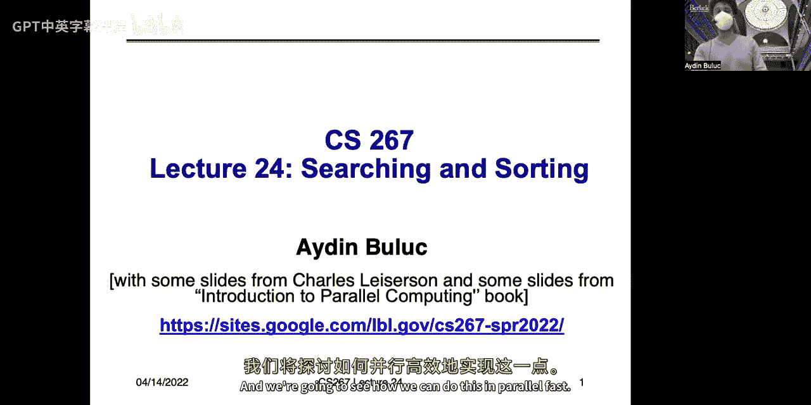

So we're going to start with recapping a method for solvent recurrences because a lot of the first half of the lecture will involve actually all of the lectures will involve solving some sort of recurrence。

And you don't really need to fully understand why the master method works。

 but intuitive leads actually fairly simple once you get it and you can find a proof of that in your standard algorithm books by Corman L and Ritenstein。

 then we're going to go into how to find the Kate smallest element that's called the order statistics or selection problem and。

And then we're going to warm up with a serial algorithm。

 describe the parallel algorithm that of many different algorithms you can use。

 I we're just going to highlight at least one particular practical algorithm。

 and we're going to move into sorting first with the shared memory algorithm based on merge sort。

 and then we're going to go into a distributed memory algorithm which is based on sampling。

 which almost all fast distributed memory sorting algorithms that based on the ideas of。

They're picking samples and split findings splitters。

 which is you can think of as a generalization of quickword if you know that。

 otherwise I'll describe it。

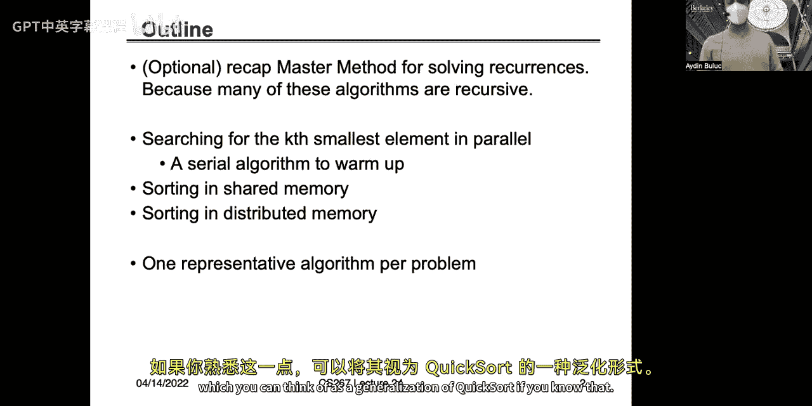

So here's one way to solve a recurrence of the following form， if you've taken discrete math。

 you probably have seen many， many different ways of solving recurrences and this applies to a particular form of recurrence。

 which is off the form that TN is equal to a small subset of T。

 which is Tn over B times a so you create A sub problems each one of the most size n over B。

 and then theres a cost of this partitioning or solving that layer， and your recurse continues。

So this is a general form。 This is different than some other forms which kind of look like editors。

 which is T and over B plus T and over C for some B and C。 That's a different kind of occurrence。

 we're going to see only this one， and this is going to apply to 93% of all the cases that we're going to cover today except for one。

 which we're going solve in induction。So the main idea is really to compare these two values。

 One is the the cost of。The work you do at each level and the recursion which is FM and compare that with the and to the log DNA so intuitively this is really a measure of how much work you do in the recursion。

 this is a measure of how much work you do for the actual splitting and combination。

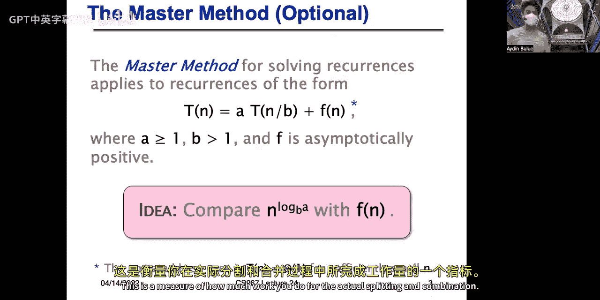

And then based on that answer， you can actually get to these following solutions if the anti log B is asymptotically larger than FN。

And that's really， like。It's only on some epsilon， then you can solve this by saying that the recursion is going to solve into whatever that form is and to the log B。

And then。If they're equivalent， that's actually somewhat the exciting case。

 meaning the cost of combining and splitting the data versus the overall cost ofcur recursion is equivalent up to a logarithmic factors again this is the important part meaning there is some log to K power of log n for some K it can be zero。

 that log might not be there up to polylogarithmic constant is polylogarithmic factor is the correct word for there now this falls into an extra logarithmic。

Factive， so you just get one more login。So if it's locked to the K。

 then you get locked to the K plus1。That's the kind of the exciting case。

 just to look at the example， if A and B were the same basically you're creating two subprobles of N over2。

 that would basically result into both of these being of the same size， FN and F log B。

 which means you're going to get the extra log n factors， and that's N log N。

 which this recursion is what you get if you have a perfectly balanced splitting， for example。

 in sorting with the perfect splitter for Quicksword， which is not exactly quicksword。But。

You get the idea and the last case is fairly simple and symmetric to the first case。

 where the the cost of splitting and combining F of M is asytotically larger than the cost of recursion and to the log B A in which case。

And there's a formal definition， but the solution is FM it's not surprising right so if they're equivalent you get the log factor。

 one more log factor， if they're equivalent up to the polylogrammic factors there you get the log n extra and otherwise you get whichever one is larger and that's the summary。

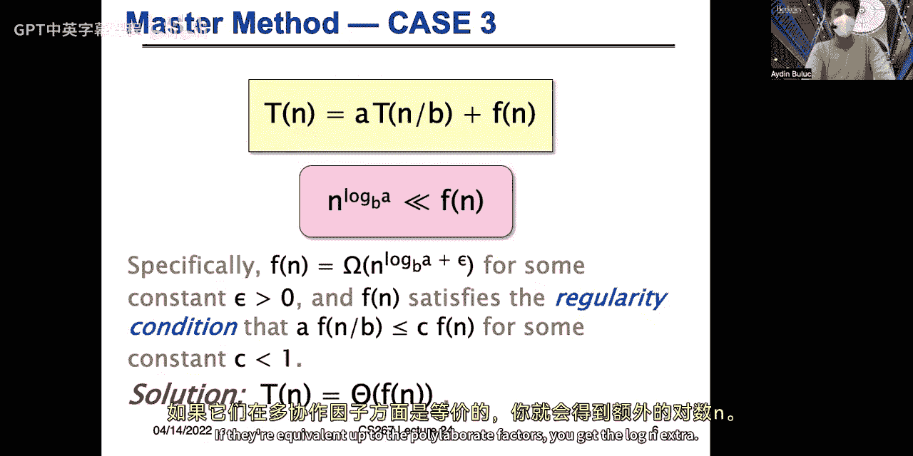

So again， if you're interested why this is the case。

 there's a proof in the Cor  license and real Steinbook。

 I'm sure you can find a PDF of an early immersion of it because this proof has been there since at least versionion  two。

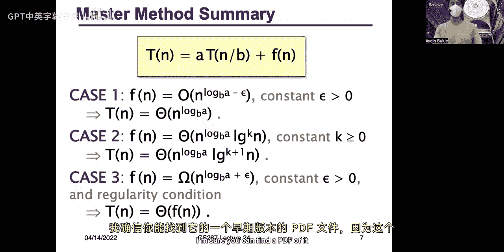

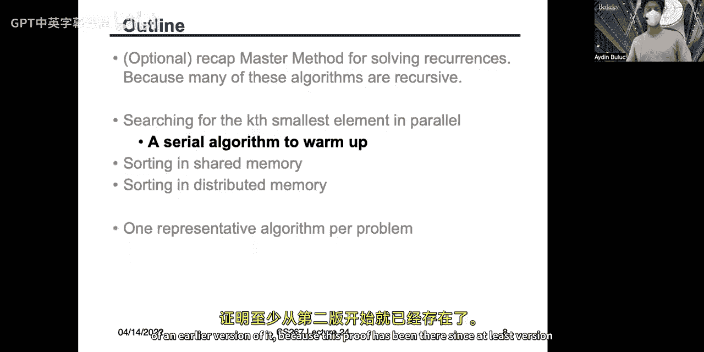

Let's start with the selection problem， which is really you have a list of length and。

When you're trying to find the kid's smallest element。The assumption is the list is not sorted。

 otherwise you would just go to the Kate location just to make sure we are the same page。

 the common case of this is finding the median or some corridor like you know what is the first corridor element and so on but you can use this as a top case selection right once you found the CA element you can then just go over in linear time on the array and find all the list of entries that are in the top case so it's just by finding one element you're actually solving several other problems。

And fundamental building block for many algorithms it's used in these days specified gradients in deep neural network we have used in the clustering algorithm we described in the unsupervised learning。

 and we might actually cover it a little bit again in the computational biology class next week。

The NCL clustering， but many， many other applications exist。And。The main idea。

 the initial idea was so something called a cook salad based on horse and it's just likequi sort。

 how many of you know cook salt？Okay， first a question， the idea of the quick shot is。

Essentialially with the pure quick sort， you pick random element。

And hope that it's somewhere in the middle， it doesn't have to be。

And then split your data into two sets， the elements that are larger， the elements that are smaller。

 and wecurs call Quickel that's that simple， but Quickse is just the same idea。

 except you only recur in one direction because you don't need to sort。

 you just need to find the element so you only look at the subset the one half which you think has the elements。

And the average time is log N first case， just like Quickword。

 it's N square because there's no guarantee that you're going to pick a good element with your random selection。

 So we're going to talk about。This median of the medians algorithm first is a serial algorithm because the parallel algorithm is really based on this。

 which will guarantee linear time。And it's the whole idea is， how can I？

Find a good pivot without spending too much time， because if I don't find a good pivot。

 the worst case becomes Z squared， if I spend too much time finding a pivot。

 then I can't guarantee the order and。 So that's the balancing act。And here's a trivia question。

 this paper very short paper has been written by five authors。嗯。

How many of these authors do you think has a true over？对。嗯。😊，How many of the flow definitely has。

 So we got one。12。I'm going to guess four。Okay， I heard from the phone that someone said for。

And Jimmy so everything is that。was and was in the buzz and still is in the faculty of。

Hes in Berkeley as it came back， actually' four for his current cancer。

Runners got it for the RSA as far as I know， and both Tn。Got it for his algebra work in 1980。

 something， '84， '83， something like that。We actually got it together with H craft。

So it's quite a distinguished group of folks。

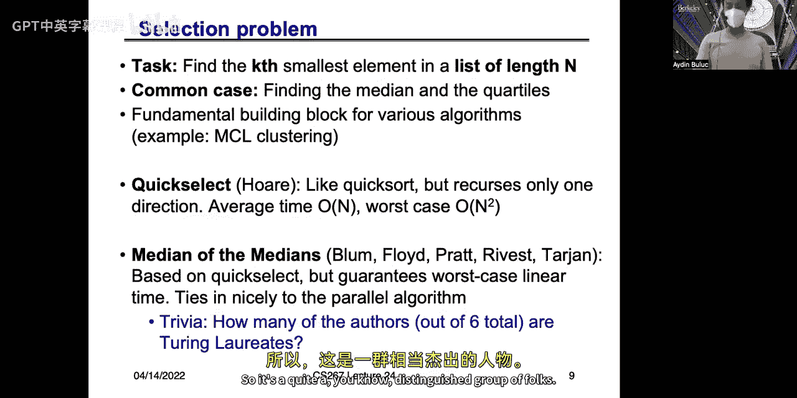

So what's the idea for this algorithm， it's you divide your input order and input into。

ASub list of size five elements only。So you get in over five sublists and you might be wondering what's so special about five and we'll get to that and then I'm going to sort each sublist which is constant time right I'm just sorting elements of five entries so we're going to assume that's constant time which it is actually and I'm going to find the median of their media I'm going to find their median sorry。

And find a medium of the whole group， so meaning these entries。

Now I don't I'm not sorting a list of n over five this is important all I'm doing is for the mediumns of each list of five elements I'm only。

This is kind of temping me I think that's why it's not booming， Okay。

 that is I'm only actually finding the medium。So really， that's what I'm trying to do。

So let's assume for the pictures， the green list halt is the list that includes the median of the media。

 so I'm going to call it Emma。嗯。And the pictorial definition of the algorithm is actually making it very simple。

This this box on the top left that I put I call it a prime everything in that set is smaller than the median of mediums。

 but that seems very easy to understand from the picture because this is the median on that list。

And naturally， its elements are smaller。 And by definition。

 this M is larger than anybody on his left。I mean， I'm pictorly sorting them。

 but these are not sort of again， all I'm saying is this list。

The meetings of these lists are smaller than Emma。These are not necessarily in order。

 but all of them are smaller than Emma， so everybody in this set is by definition a smaller than Emmama。

And everybody on this C prime set is larger than Emma or e calledta。

The size of each one of these sets are at least three and over 1。Because each set is of length five。

And yeah， so again， very simple from the definition of medium。嗯。

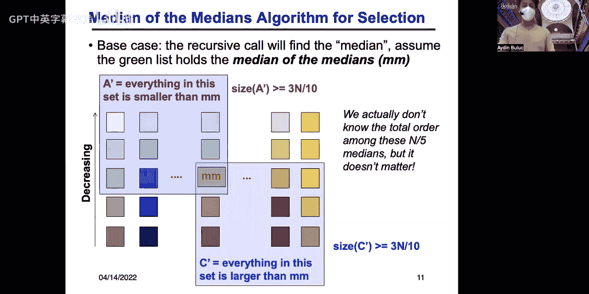

And I'm just， you know， the text of just saying what I've been saying。

 the lists themselves are not particularly old。So I'm going to partition my whole input into three distinct sets。

Which is a is the set of elements that are strictly smaller than Ne。

And recall that the picture I showed a prime is a subset of it because there can be entries that are smaller than M map。

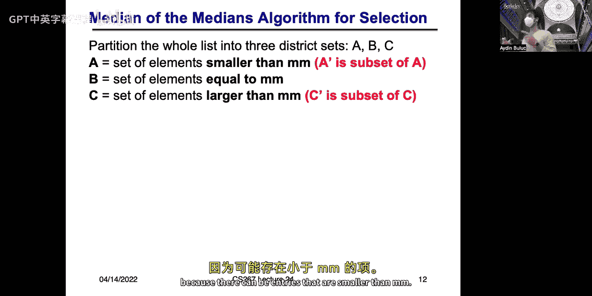

All I know is everybody in that a prime is definitely smaller than MM。

 but somebody here might be smaller than MM2， so the set A is potentially a bigger set than a prime。

 but it's okay， I don't mean that to prove the balance。

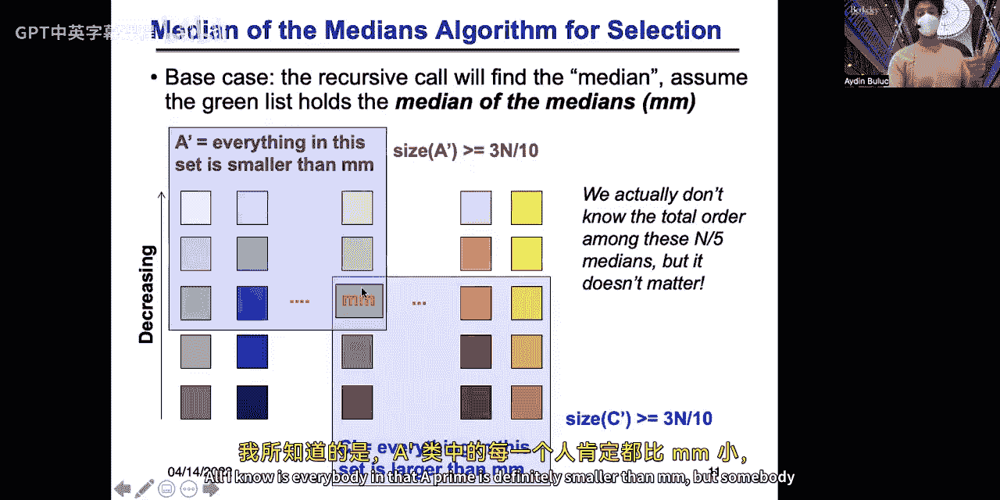

So okay， what am I doing？I am dividing it into lists of length files。

 soen each link list of length files in this Dal sort function。

I'm calling this select recursively on the medians on a list of N over five。

And I'm going to let the recursion handle that。And then I'm going to partition based on what I just said。

But based on median of medians， I'm going to partition my whole set into three classes。

And I'm only going to recursse on one of these groups。

If if I found what I'm looking for already I'm just going to return。

 otherwise I'm just going to recur on one set， either a or C because I'm looking at the K element right。

And the annotations are important。The getting the list of meetings and sorting is linear time because there is a partitioning and each sort is constant time or because it's of length five。

 recursion is N over five because median of medias list is rank n over five。

 partition is again linear time and recursion is seven and over 1 in the first case。

So this is the recursion。

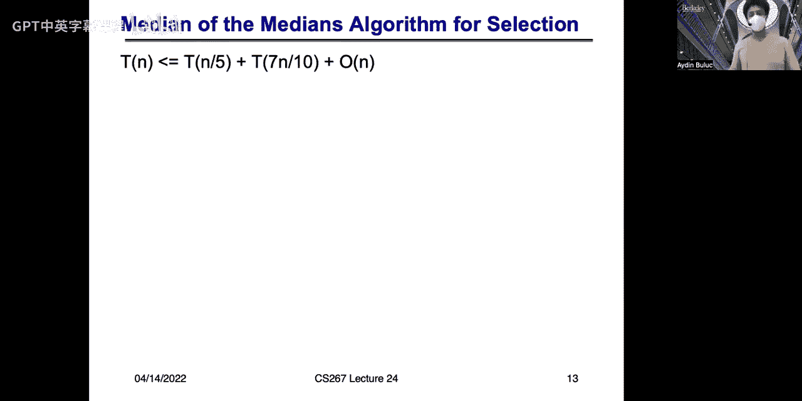

And it nicely。I mean， this is actually almost not necessary to say why it's  seven and over1 because。

One of them excludes the three on over 10 size。

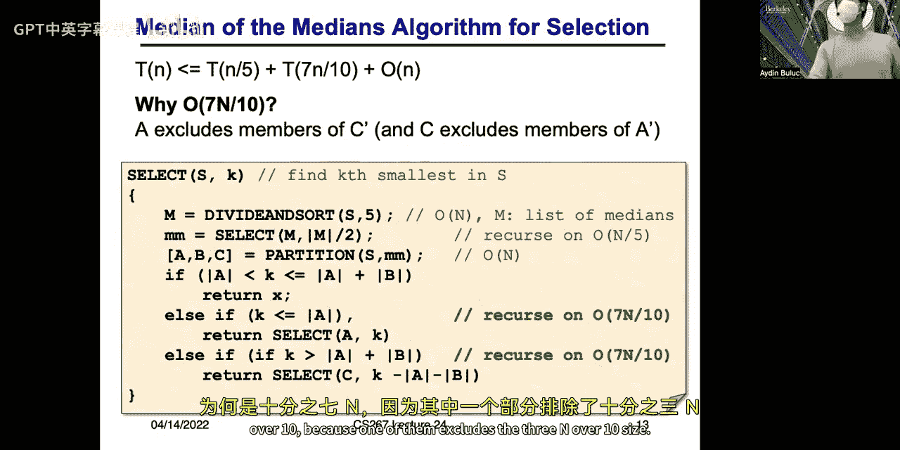

One of these boxes are excluded。So now this comes to something nice， which is nine and over 10。Magic。

If I chose n to be something smaller， this would actually not come to aymptotically larger than n and my ability to come to a linear time solution would not right so that's why it's fine。

It could have been probably since， but I don't think it can be smaller than five。

 somebody needs to play with different numbers and see what's the little tight range of list sizes that would work with this。

And I'm going to use my master method， which will tell me that asymptically anti the log VA is smaller than FM。

 so I'm going to solid order M because the cost of combination and all the extra work I do at each recursion is OM。

 so that' still is。This was not a parallel algorithm。

 but the same ideas will apply to the parallel algorithm in a minute。

And this time I'm going to fix this for good。Yes。就。I can't。I should probably titleistic。哦对。Yeah。嗯。まか。

That's actually a very good idea。Is our people comfortable if I do this that niceless？

Is everyone in the classroom comfortable just okay， whatever。Okay。

 this is the first lecture I'm giving without a mask in since 2001。What is it 20？Okay。

 they're beautiful question。Thank you。

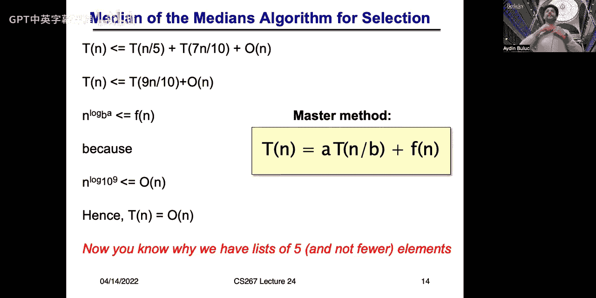

Yeah， the question is to go back to the previous slide。Just told what is x。What is S Sx？Oh， I mean。

Yeah， this is I I wrote the pseudo code somewhere in there。 This is basically the the initial case。

 the Kate element you're looking for is somewhere in there and then you're supposed to。Basically。

Find something from B， I think it's just like x x is definitely there somewhere in the B list。

You know， find it then return it， I think I know every single one of them is fine because if there is a bee。

It's every single one of these entries are the one that I'm looking for right because B is the set of。

It'sThings that are equal to the media itself。But I'll double check before I re upload this stick again these are pseudo codes thanks for finding a bug。

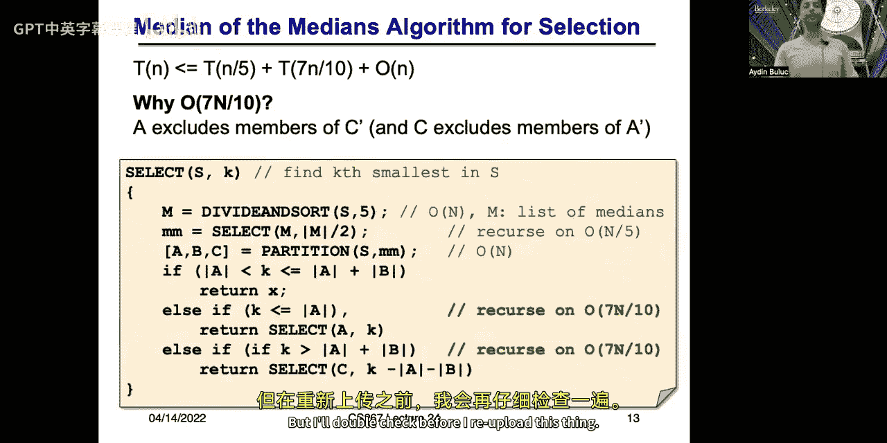

There potentially another question。这法院。来。Size of the list is five。嗯。Because if I do it differently。

 then I don't。Let's say if I did four。I would get the T to the N over four here。First of all。

And then I don't know actually what would happen to the size of the list that I'm going to be excluding。

I haven't actually run the numbers with four， but you should write with four and six and see which ones are starting to fail at some point the sum of these things。

Stop being asymptoticically smaller than Tn。 at which point you lose the ability to solve it to linear time。

 If this was equaling to T to the。You know nine times now its nine and over 10 if it was n。

 then you would get an analog log n recursion so it's like barely cutting it you see what I'm saying and if you're not discarding enough stuff or your combination cost is not that small and sorry is your recursion on the median of medians list is not small enough then you wouldn't get this pound I haven't tried four and6 but somewhere is's going to fail it's either too small or too large。

And these。I mean this is its actually a good question。

 it might come like a magic for someone who's reading the paper that somebody kind of miraculously came up with this number no it's retrospectively chosen。

 somebody's trying to solve this recursion and then you notice that only if you choose this parameter this way you get what you want。

😊，So that's not listed in the proof that the struggle that came to there。

 but that's 90% how it works。Yes。

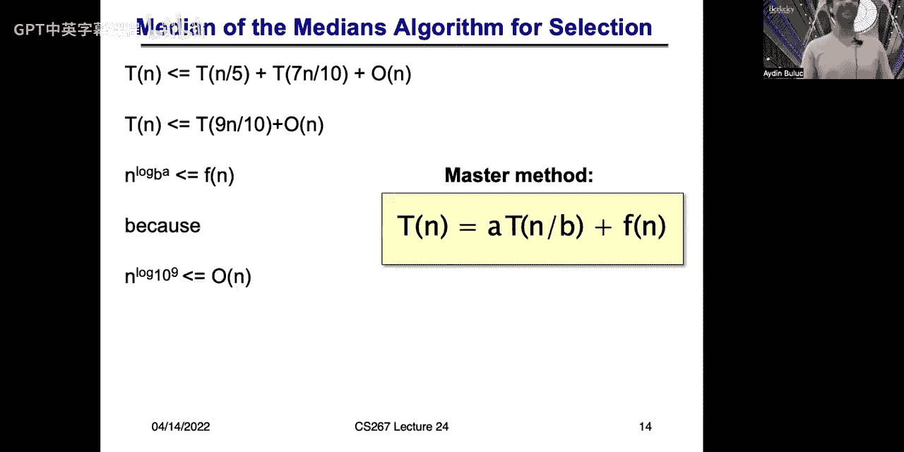

Okay， now in parallel so let's start with a very simple algorithm and a simple idea。

 let each processor compute this local media。Wow， I'm pretty close。

 but I think I should do it in the right side。Because I' this was a trick。

Because you're kind of talking to the sideway。Okay。

 I don't think it mattered let each process a computers medium and then find a global of mediumn of mediumns by doing some gather the data。

 find the median this is the first idea you can that can come to anybody's mind。

And discard the elements and returnscur。Now， why would this idea fail is load imbalance will surface as the algorithm proceeds？

Because I don't know how the inputs are distributed initially。

 and it can be the case that the mediumn I'm looking for is in the first processor。

And it can be a completely sortded input or it can be a completely shuffled input or the K element I'm looking for might be all clustered in one processor so it requires some data redistribution which will cause extra communication it works when you find a bounce but it's an extra programming hassle so you can read about these algorithms that do this data disreistribution occasionally to make sure that things stay balanced at every level of the algorithm instead i'm going to actually talk about an algorithm that's different that tries not to。

UTo load balance explicitly， but tries to kind of mitigate the impact of the loading balance。

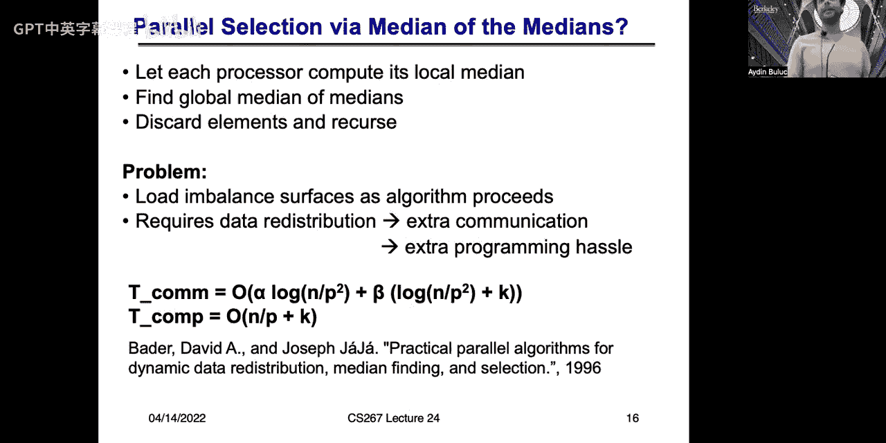

And。The idea here is extending the definition of。Median of medians to something called thevaded median of medians。

So what does that mean if you think about？TheThat original medium definition is you have some sort of sortded atlists。

 you don't have them sorted， but you know for the purposes of conceptual thinking about them。

 think them as sorted。And everybody has a weight of how many entries are the P1 over P weight。

 so you' just basically summing up entries until it hits P over2 and that's the entry that's your medium right this is one way to think about medium everybody has some sort of weight of equal size and if they were sorted which entry would make it go above the P over two threshold。

Now that once you get that definition that way it's easy to extend it to a weighted case。

 which is now everybody has different weights， everybody has some weight that sums up to one。

 and you just keep summing the weights until it exceeds one over two。And at which point you say。

 okay， this is my weighted medium。So I think I should another way I could have said it。

 everybody has weights one over P and sorry the same thing one over two it's not P over two once once we hit one over two then that' your median and the weighted case is the same except that everybody doesn't have one over P weights。

 everybody has a different weight that sums up to one Okay。

 so with that definition now I can come up with my algorithm。

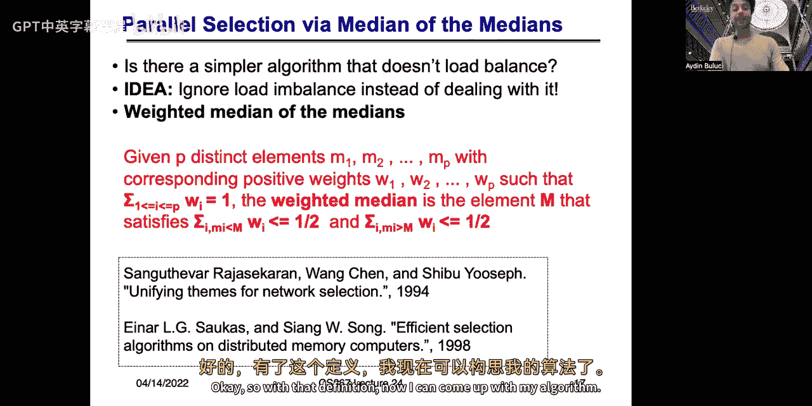

So this is the parallel selection first everybody finds their local media。

And then the data is gathered to either one process or all the processes。

 it really doesn't matter asymptotically it's not going to change anything because if one process is gathering and computing the weighted median。

 then they need to broadcast them and if you remember the communication balance。

 it's the same to do gather and all gather， at least asymptotically so。

And then I'm going to partition my list。Based on this to three sets， again， those that are less than。

 those that are equal to， and I can actually come up with a list that is those that are greater than。

 but you don't actually need to find that list。It's implicitly given once you have the other two lists。

 you know the size of the third one。So。TheLooking at the original one， again。

I think this answers your earlier question， by the way。

I think the x is the median of medians that needs to be returned。In the previous algorithm。

 you were looking what the x is MM。Because if that's what you're looking for median of the medians was the entry you were looking for and here the weighted median of the is the entry you're looking for so either you found it or you're going to recurse on the subset that you are not able to discard。

And the claim is the subset I'm recursing is at most three quarters。So where does that come from。

 it looks magical right and it's a little harder to visualize the weighted median of mediumn concept。

 so I'm going to have to use some algebra so by definition of the weighted median right the sum of those entries are penal this median capital one is one over two。

Right and I'm going to replace the weights with the number of elements in each list。

 so the idea the weights are coming from the elements in each list。

 each processor gets a certain size sublist， initially all of them are balanced。

 but due to the recursion these different lists will have different sizes。Okay。

 so I am discarding some elements that each level of the recursion， but I have no guarantee that。

Each processor will discard an equal number elements because I have no control over the initial distribution so the weighted median of medians is that's what I'm using for so at each level of the recursion I'm waiting each list with how many elements is left in it how many elements are not discarded and that's going to allow me to discard a quarter of the elements the list and。

And by definition， again， I know at processor I， the number of elements that are less than its medium is at least half of the size of the list。

 again， this is the definition of a local medium and across all processors。

 if I look at all the elements that are smaller than what I described as the weighted mediumn half of these elements。

That are smaller than their list， let me show you with the picture。

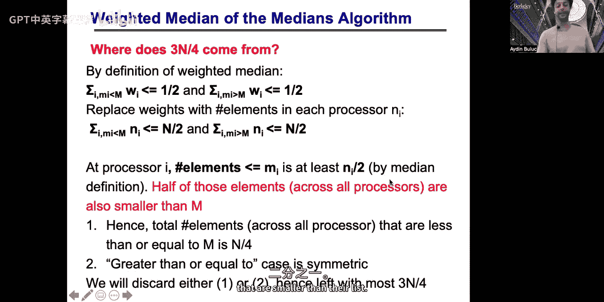

で。Across all the lists， think of their local mediums says M1， M2， M3 M4 right and within each list。

 at least half of them。about half of them are smaller than their local median and what I'm saying is half of these lists will have an entry。

 half of these elements across all processors that are smaller than respective medians will also be smaller than the weighted median。

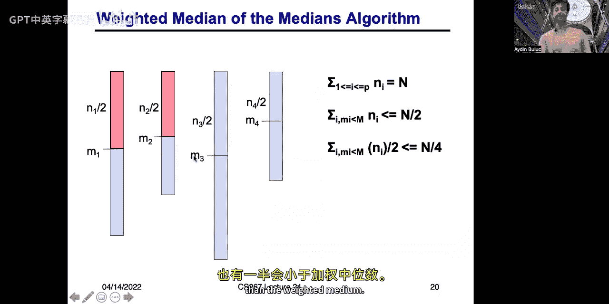

And this might come a little bit of like why， but it's really coming from the definition itself。

 so the total number of elements that are less than or equal to capital M is going to be n over4。

Mytes， right a little bit。Any questions？Looks either too trivial or too complex。

 but it actually is really coming from the definition of the weighted medium。

And combining it with what the local medium means， so I'm either going to discard one set。

Or the other， so that kind of leaves me with three over four。

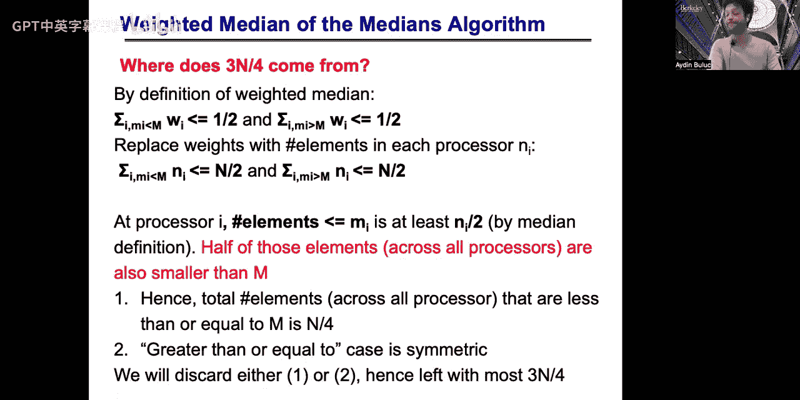

Now let's come to the how to solve this recursion then。Then I'm left with this following case。

 the communication cost， let's look at the communication cost first and not the computation。

I started with an M problem and I have a three and over four problem plus the cost of combining and what's the cost of combining comes from。

The latency factor of lock P comes from the Gm reductions and the bandwidth also comes from better times p。

Is that correct， yes？Because I'm only getting。One mediumn from each processor。

 so I have only P entries together and reduce okay。So how can I solve this。

 I know I can solve this exactly with the same way that i'm solving the the masters theorem so this is。

This is asympically smaller， so I'm going to get a log n factor here。

So this logans will show up here in the latency and as well as in the bandwidth。

Now what I can do is I can actually a course in the base case。And at some point in the recursion。

 instead of going all the way to the end where there is one element per list。

 I can say when the number of elements total aggregate is NOP。

I can just gather them in one processor and solve it locally and what this is going to say is instead of a log n because the tree of the recursion will go down from log n to log N over P then I have a log square P as opposed to log P log n which is actually somewhat nicer because it doesn't depend on the input size there。

 it depends on the number of processors， so these log ns become log P if I locally gather。

 but of course I got a NOp bandwidth term because I have to gather this now。

So somewhere in there you have to lose， but this is in practice a better b。

And the computation cost is simpler to bound， it comes from the either log n or logP levels of recursion。

 I wrote the uncoed case probably but you can write the NPP case and N overP comes from the fact that I cannot guarantee the reduction in size in localistss。

I think that's the kind of the important point there。

I what I'm kind of guaranteeing with this algorithm at each level is the communication cost stays low。

 but what I can't guarantee that this list。

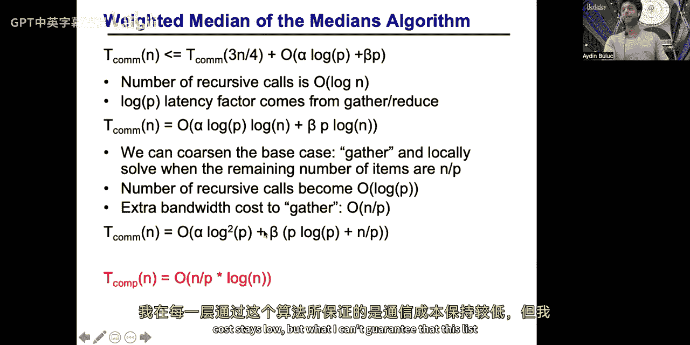

Will stay long。 Maybe I have no guarantee that I'm going to be able to discard a certain proportion of the elements in any list。

 so it can be the case that this array might stay N over P asymptotically all the way to the end of the recursion until I find the entry I'm looking for。

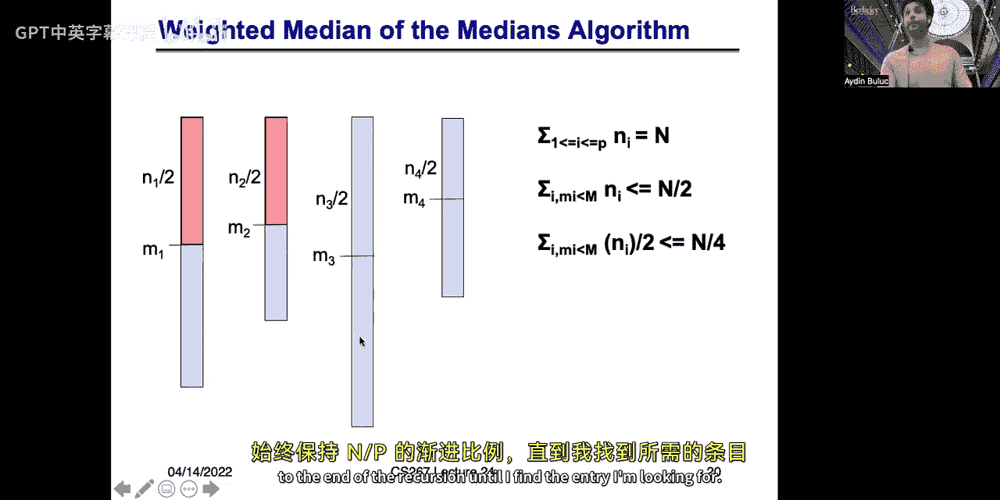

And at which point the computation cost can be still NOP times a logarum， whether I bound it or not。

嗯。So okay， exactly what I said in text。

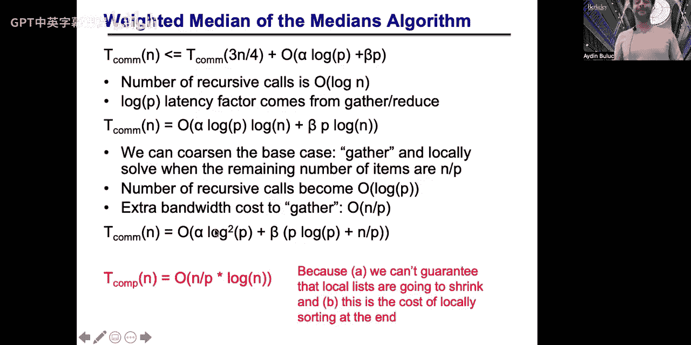

And there are generally faster randomized algorithms which are even more complicated to describe in a lecture。

 so I'm going to leave them as citations here， you can find them from late 90s， early 2000s。

When this lecture was given initially， it was earlier in the schedule so people could have picked their projects based on these things that I'm talking about at this point it's too late。

But if anyone is listening to the recorded lecture for next year。

 they can use these as course projects。

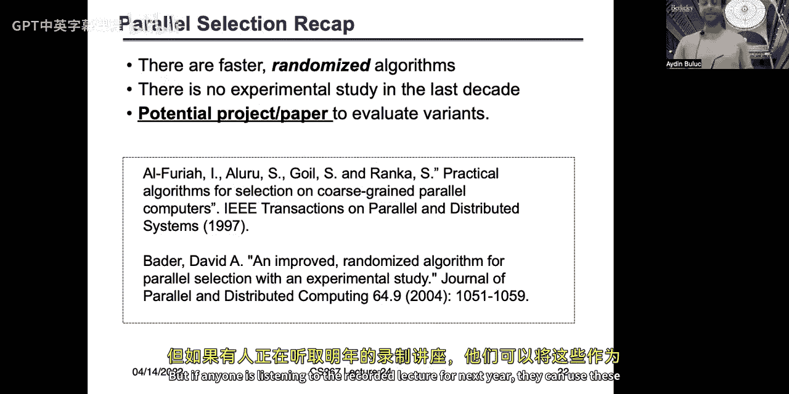

对。看到可以。

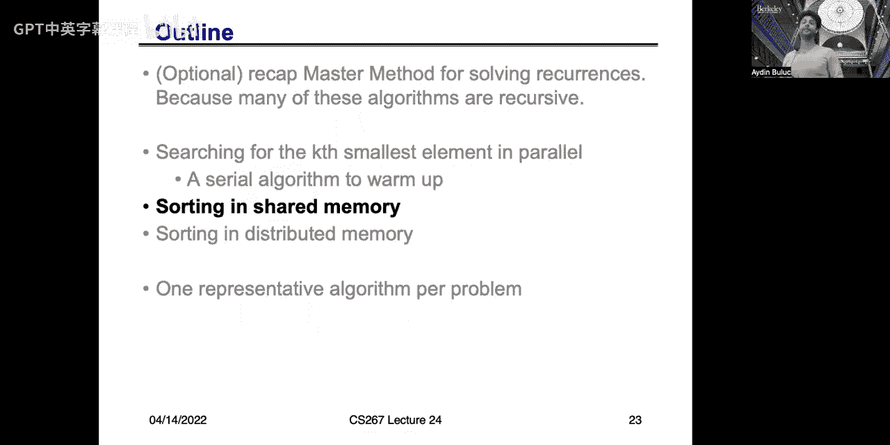

百度稍。It's not solving the load imbalance problem in some sense， the load imbalance is there。

 that's why I am unable to for example， reduce the cost of locally finding medians at Titeration。

 so I'm still doing N times however many times I recur。

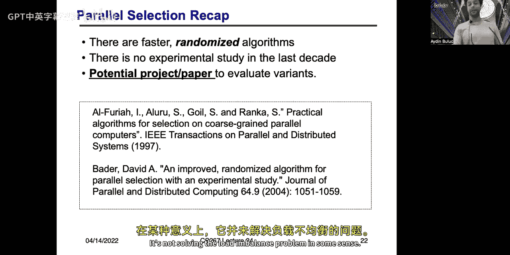

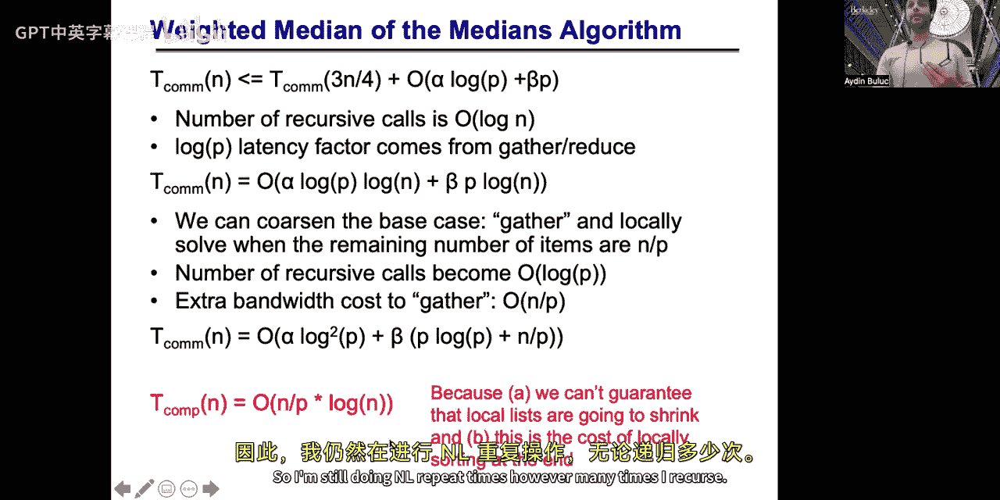

But what I'm kind of。Doing this。This is allowing me to still make progress in some sense in the algorithm。

 because I am still able to guarantee discarding a quarter of the total elements in the input。

That's what's。大会就是。No without signing because then I don't know which list I should discard more。

 this is basically adaptingly allowing me to say that whomever list has more entries left。

 it's going to have a higher weight when I'm choosing the mediumn so it's shifting the mediumn of the location i'm choosing the median if you have a long list like well thousand processes the weighted median of medians will is something in the middle right if everybody is sorted then based on how how these things are chosen is's going to get shifted to one way or another。

The present。就是他们要不都。No， it's just the list size， that's what's left right so the weights are really the number of elements left in each process。

😊，Exactly， I mean again， these are not staying constant right because if each iteration my local mediumn might shift and therefore where I am in the process order will completely shift potential。

So。でか。没因没什关。还是去把点判决。把那个。Yeah。在微上说。The source of the。でそ。别都问现。对。Yes。

 you don't actually need to have an order。 all you want to say is there is a。

It's just that the same one is in the serial case， you're not explicitly ordering thanks all you're saying is everybody。

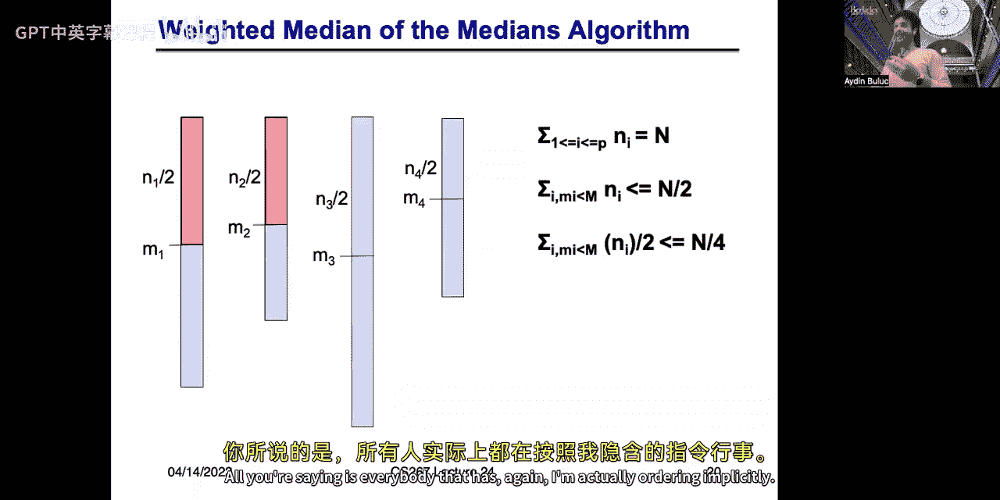

That again， I'm actually ordering implicitly， the definition of weighted medianess is if you have MIs。

Ins sorted orders。Now this kind of comes as a brain tea and I'm summing up the corresponding weights until I hit the one over two mark。

And now things are not ordered， right， but I can still do this。

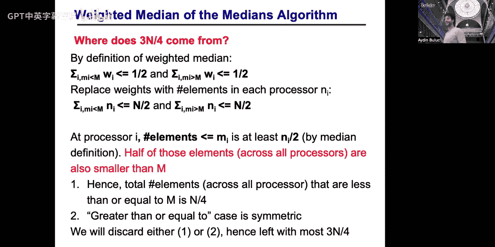

嗯。Okay。

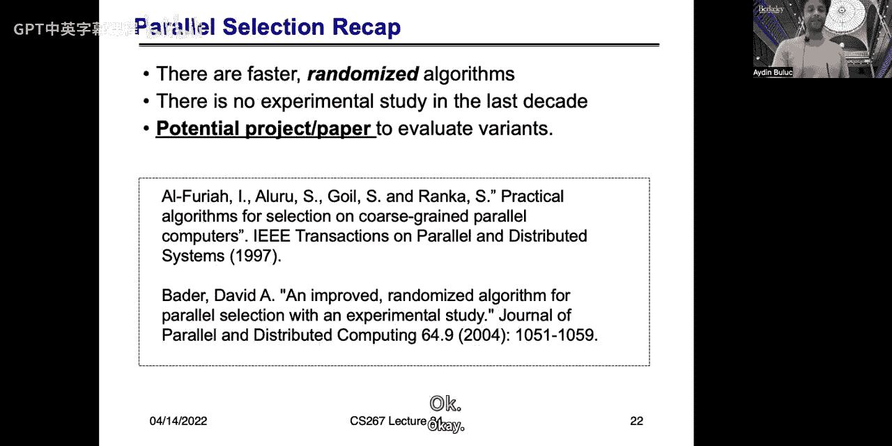

Merch sort I have two distinct algorithms to cover in the sorting section and I'm pretty good I think right on the place that I want to be I'm going to start with a shared memory algorithm which is much simpler to analyze the distributed memory algorithm is I mean I'm actually choosing algorithms that are very easy to implement and hard to analyze so if they kind of come as a little bit of an intuitivetuitive first that's normal it came on intuitivetu2 to me too so the merge sort by contrast is both intuitivetuitive and easy so this one is going to be a relaxed part of it if you have known what merge sort is it's a divide and conquer algorithm and we're going to go over it just for completeness it's an analog and algorithm one of the good algorithms out there one of the reasons it's not used in practice a lot is because it's not in place it requires an extra array and it requires a bunch of copies between them。

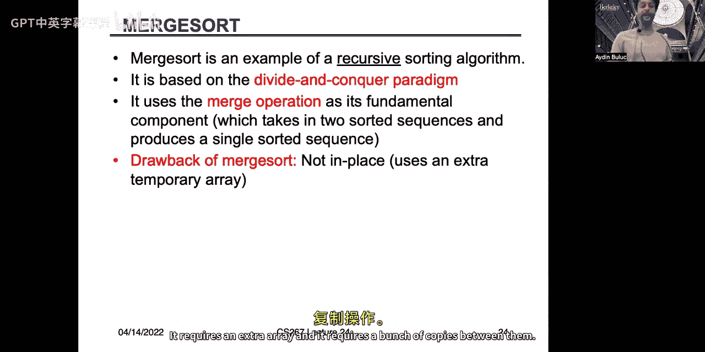

But you know it it's a solid algorithm， it has no worst case bound。

 you don't need to be careful choosing the pivot and so on。So let's cover what it looks like。

 this is a pseudocode which has arrays A and B sorted to an array of name C。

 and NA and M are the sizes of the input arrays respectively。

And all he's doing is picking one element， I don't even know why I'm simulating this。

You just basically follow pointers in two sorted areass and merging them。

 So this is a merge of two sorted lists。

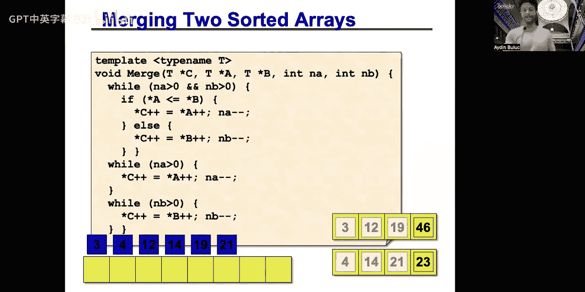

The simple thing that everybody will write and it will take order and just to warm up and and the parallel merge sort actually the merge short will go by。

嗯。Calling mech sortt recursively。

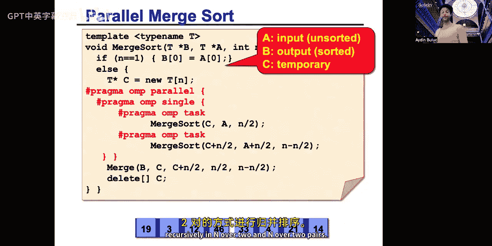

In an over two and in over two pairs and that will naturally divide the input all the way to singletans right and then the merge call here。

We'll start collecting as the recursion ants， right， and then we'll just pairwise merge these things。

So the serial algorithm really executes like that parallel algorithm。

 all you have to do is to call the first attempt at least is to put some annotation in openM if you remember this thing is just basically saying do this different distinct merge sort calls。

 the recursive calls separately。It doesn't say anything about mech， merge is still sequential。

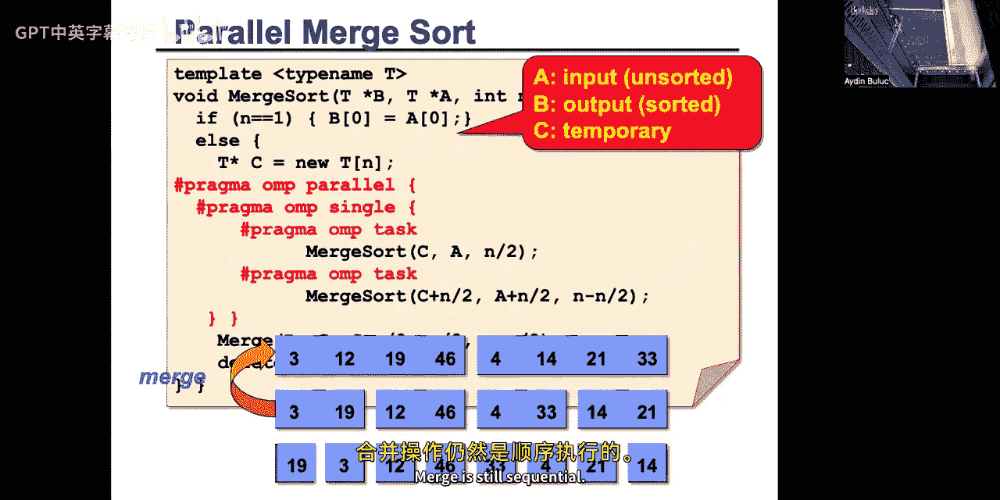

Each merge is sequential。 Now， this is the initial attempt， Is this going to work out。

 Let's figure out。嗯。The substitution would work， you don't really need the master theorem but let's use it。

 this is the example case of the master theorem right the two subproblems of half the size plus the cost of merging them back it's going to solve a analog log n so the work is easy。

Now， have we talked about the concept of spend？San depth of an algorithm is and assured memory。

 it's actually a good way to analyze algorithms is if I had infinite number of processes。

How many steps it would take me to solve this problem？So it's the critical path in the algorithm。

There is no amount of thing more resources is going to lower the time to solution in that critical pack。

Fairly simple to understand and of course this analysis will ignore communication cost because it's a little bit of shared memory use still important communication costs。

 but I'm going to ignore it for this algorithm。The span is I have a problem of size n。

 I am creating two sub problems， but since I'm。Calling them in parallel。

 only one of them will be part of the critical pack， so the recursion doesn't have a two here。

Plus order end because the merge is still serial。This is the critical path analysis。

And what is this going to solve into is O because the。

The end to the log B is going to solve to one constant and then order n will be the dominant factor so you're going to get order n solution now what's the problem with this algorithm is if you look at how much parallelism in there the amount of parallelism in a problem at this using work span definition is how much work divided by how much spanm you have meaning you know what's the maximum amount of speed up I should expect。

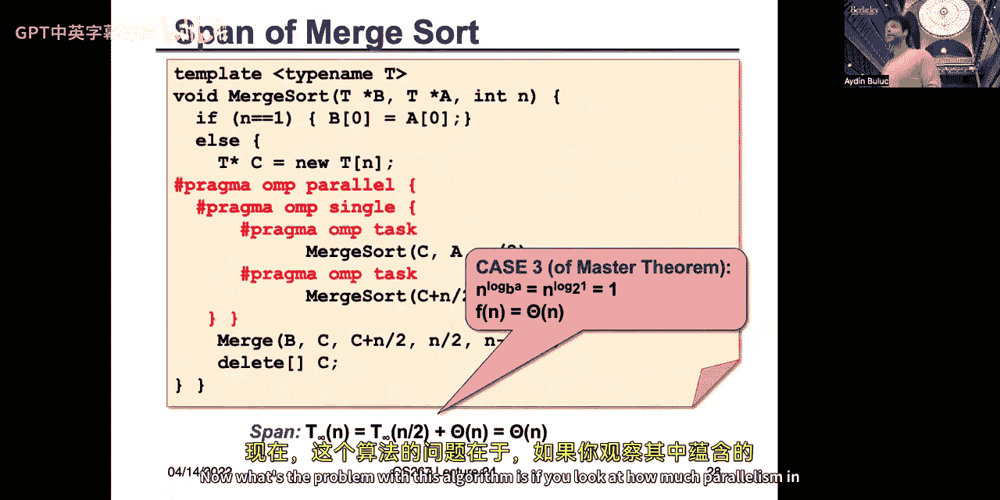

And that's only low ga， which is really small。Right for a problem。

 a logan grows very small and I need to kind of increase the amount of parallelism this problem has。

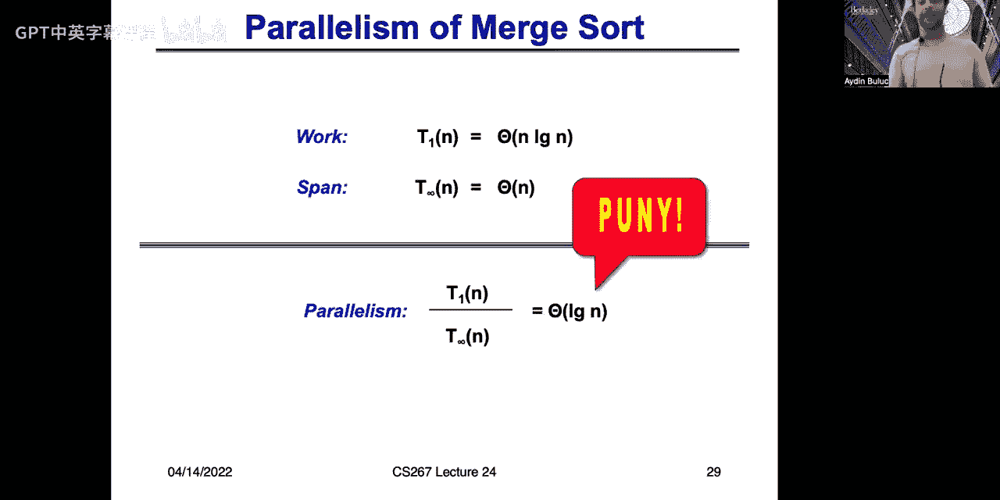

So how can I do that while I can parallelze the mergerch step？Sorry for all these animations。

Some point I have to delete these animations so I have to parallelize the mergerch step and that's like to the interesting part what can I do I have two lists at any point initially these two lists are the same size。

 but somewhere in there I might not have the guarantee list lists fall for the general case where the lists are not necessarily of the same size。

😊，And so I'm going to choose the elements。In the middle which is again the medium of the larger list。

 let's assume without that loss of generality， the a is the larger list and I'm picking the medium now if I find exactly where this would fall into the shorter list with binary search。

It will cost me， you know， log off， whatever the NB is the length of the other one。

And now the claim is。Of course， by definition。Everybody here is smaller than the median I chose for the A and by definition。

 everybody on the left of this area is also smaller， so I created two sub problems。

Meaning I have to merge these two pieces， and I have to merge these two pieces。系 number done okay。诶。

The total number of elements to be merge in the list is an A plus andb。

And what is the total number of elements in the larger of these calls？And the claim is。

 I am thing away at least an over four。I keep throwing away a quarter right in many of these algorithms unsurprisingly。

 and that's not surprising because this is the larger of the list， at least it's equal or larger。

 so by definition the no matter where the binary search leads to I'm throwing away an over fork of the total size and an a plus M。

So with that， I'm only recursing on a subset of atmost size3 over4 m。

This is not exactly solving my issues completely because I have to steal recurse on the other side。

This is not selection， this is sorting so I have to basically sort the whole input。

 so I'm not only recursing on the three quarters side I'm also recursing on the potentially the remaining side。

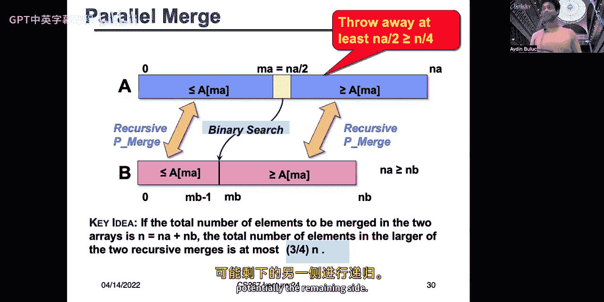

So the equationcosion will be slightly trickier。So let's now。Replace。

A serial mergech function with something I call a P mergech。

 and it's just going to do what I just said， find the meetingn on the loud list。

Do a binary search on the other array。And then recursively do P merges on the sub arrays。

And then then you're done， and we're going to course in the base case for efficiency if you let this run all the way to the end。

 it's probably going to be slow。And coursing to do base case means at some point you say the problems are small enough that it's more efficient for me to solve them serially and that's a good algorithmic engineering for parallel computing so what's the spend now。

The span is， as I said， I am getting。Remember， Sp was。

I don't need to care about the other recursion because these tasks are spawn in parallel and span is the critical path。

 so I have enough parallelism。So there is no constant in front of this key to the infinity3 and over four plus the log n for the binary search right and what is this going to solve into？

This is going to solve into the beautiful case where actually they are to the polylo factor equivalent y。

 because n to the log BA is constant。The cost of doing the splitting with binary research is log n。

 so they're up to polylogarithmic factors equivalent。

 so what I'm getting at is an extra log n factor， so the span will be logx score n。走。

What about the work？The work recursion is a little hairy because I don't know exactly what's going to happen there is a at most three and a three quarters half and there is whatever is remaining。

 but I don't know exactly what the three quarters half is。😊。

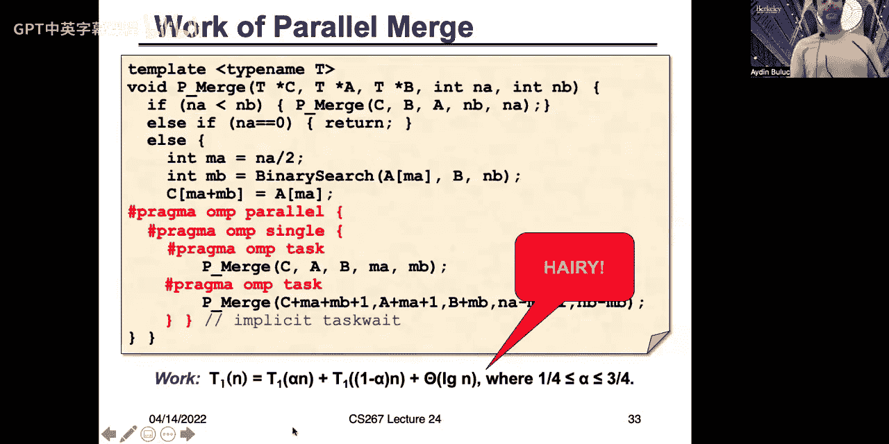

Plus us， again， the binary research cost。So this gets a little hairy， and。嗯。

I'm not going to go completely into details of this thing。

 but you can solve it by the substitution method the hypothesis here is this is going to solve into some。

Constant type k minus some logarithm again where did these things come from and that's the magic of induction right you don't know you just hope that it's going to work out。

That's the proof by induction you have to have a good hypothesis to suggest and now you're going to prove the relation will halt。

And by substitution， and this is really the algebra for you to play with， there's no way that。

It's going to make sense in real time， I think。And it's just a bunch of algebra then you see that this is actually going to hold if you choose the certain the constants large enough so for this one you have to choose the C2 large enough for this recursion substitution to hold and then for the base case you're going to choose C1 large enough so there is some C1 and C2 constants that's going to solve this thing so where is this thing。

In linear time， C1 times k minus C2 times log K will solve into linear time。

Intutu is actually simple why this is going to fall into linear time by looking at this。

 but proving it is a little hairy。So what we get， we get work of linear time and we get span of。

Loox square good， but we haven't solved the mech sort problem。

 we only solved the merging problem now let's get back to the mech sort problem。

We have some parallelism in parallel me that's not bad at all。

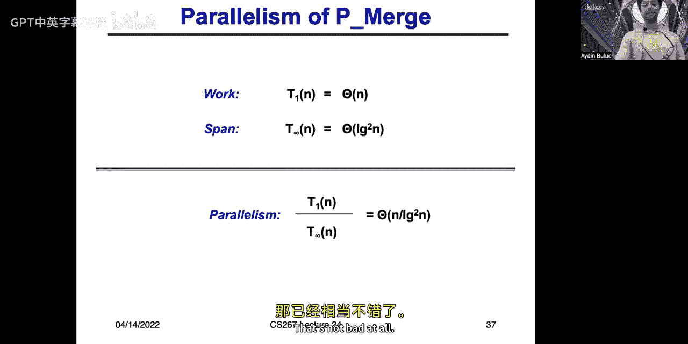

Let's get the merge sort now not only we have recursive calls for the merge sort。We also to have。

PP mergech which itself is a recursive merging function right so I parallelize the mech i'm going to use the subrine now what do what do I get which work the same bounds nothing has changed I already proved that P mergech is linear time so it doesn't change my work bound I still have an analog n work algorithm by the way if you haven't heard the term work efficient this is really what it means。

So the algorithm is it does the same amount of work as the best serial algorithm。

 so it's a work efficient algorithm。And that's really asymptotic it can be doing。You know。

 a couple constants more， but that's okay。And so。嗯。

I think we saw this now the span is the interesting part。This time I'm kind of again。

 creating two sub problemsms just like the previous solution， except now the span of the P mergech。

 as I proved， is log square m as opposed to linear time。

And this is surprisingly going not so surprisingly going to lead to another loggan factor because the。

The log to to do log B is going to solve a constant and log score n is up to polyloggrimic constant is polyloggrimic factor equivalent。

 so you get another log n factor so log Q n。

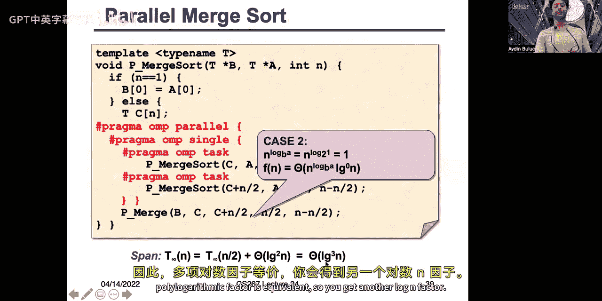

But the parallelism will stay the same because this is already a N loggan algorithm。

 span is increased by loggan compared to merch， work is increased by loggan compared to merch。

 the parallelism in parallel merge short is NO lo Korean and that's a lot of parallelism。

 it might look like a little crowded， but think about sorting a billion entries。

 you have a billion in the nominator here。And the denominator will be what。

 let's think in computer science terms， billion is 30， I suppose。Is it。No。2 to the1t and yeah。

 building is started。So 30 square。Is 900， so it's a billion divided by 900 lots of parallelism in this problem。

 you control a lot of things if you actually cure。Questions。Yeah。Okay。

 let's get to the heiest part of the lecture。So this is。This is going to be a little complicated。

Hopefully not， I mean I haven't done a good job last time on this let's start with a warm up。

 let's say I don't have a shared memory processor I have my input distributed。And list。

Think about a simpler algorithm， a bucket sort。If you have heard about the bucket sort。

 it really works very well on inputs that have limited range and well balanced。

 like uniform distribution and so on。And what you would do basically you can define buckets of certain upper and lower bounds if you're sorting entries from zero to a million。

 they are uniformly distributed， you can say the first bucket is thousand。

 the second bucket is another thousand and then throw the items you see into buckets。

And that's really the idea。If the numbers are uniformly distributed。

 they will have roughly the same number of elements and this is going to work just fine。

And if the elements are not balanced， then you have a problem。

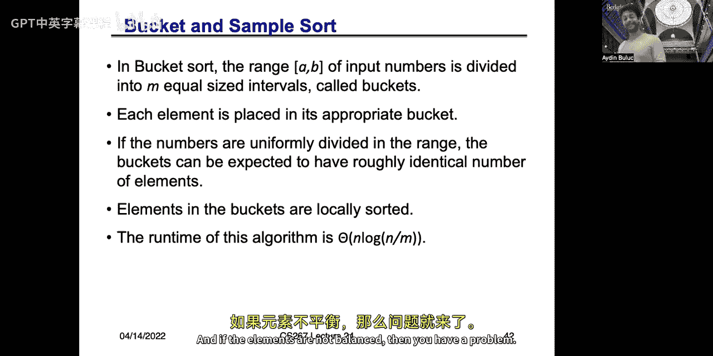

So why am I talking about this thing is if this is the case。

 parallel sorting is very easy if things are uniform and bound range。

 you would just say each processor will have its own bucket， you will just。

Do one single all to all to send each element to the corresponding processors。

 they will locally sort it， you're done。Okay， the problem with this is not the input being uniformly distributed is not a good assumption they're being bounded is with some integer is also not always the case。

 so for realistic inputs I have to figure out how to get around the limitations of what buckets serve does How can I get。

Good buckets， in some sense。Without making an assumption about uniform distribution。

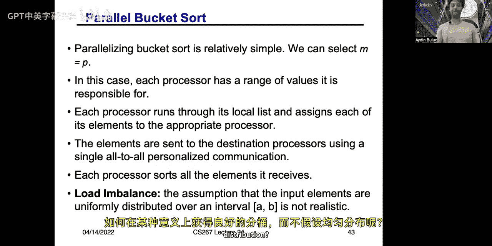

But there comes the general idea that almost every efficient distributed memory sorting algorithm does。

 which is do some sort of sampling。And try to figure out where entries are， clustered。

 and this way split them in a more intelligent way instead of assuming a good distribution。

Now things have improved over the decades and people actually do local histograms imagine you can do a histogram of your local array and then do a reduction to get a global histogram that's kind of telling you where the entries are clustered in your distribution of like if the smallest entries is a largest entries B the histogram basically tells you where the actual you know Brous where the items are clustered and then you can choose your splitters accordingly a lot of fancy algorithms do that and they work very well I'm going to talk about it。

Much lighter weight algorithm， I find the algorithm somewhat magical because it's not very intelligent。

But it somehow achieves a really good balance and the balances actually work。

 so this isn't even doesn't do any histogrammic。And all the sampling is regular so you might have heard about the term sampling in many cases。

 this is really people talk about random sampling here we're going to do what's called a regular sampling。

 which is just taking every ant element is's a regular sample， every whatever an。

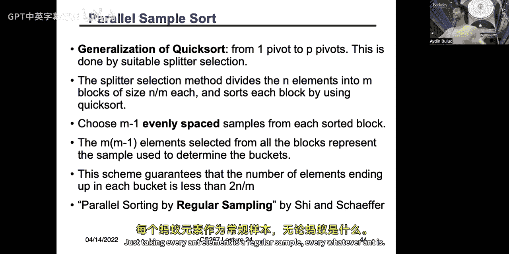

So。So let's think about this algorithm from a picture because the text doesn't make sense。

The input is distributed even initially to key processes。In fact。

 I'm going to generalize this and talk about M。As the number of elements in P at some point I have to make them P。

 but this is kind of follows the definition a little better。 so each subset is n over m again I have。

M processors， because I'm following the bucket list distribution。Now， what I'm going to do is。

Each processor will choose M minus one samples。Equally spaced。

So the spacing between them is n over m square right that's normal because each sub array is n over m and if I'm choosing m minus one samples。

 this is n over m squares gap between each each each sample。

 so they're going to sort them locally first their array and regularly sample。Every amt element。

Sorry， every NM squared element。So how many samples this will generate is m times m minus1。

Or if you want to replace m with p p times p minus1 samples。

 you have total I'm kind of describing this irrespective of the processors。

And then I'm going to choose global splitters with some algorithm I'm going to describe in the next thing。

 and there'll be a big reshuffling。And then elements will go into right places。Now I'm going to。

Describe the somewhat more detail， these are the elements， the x's are the inputs。

I have sorted each one of them locally。And I put numbers on them indices， right？

So I'm picking a minus one regular samples， space samples from each block。

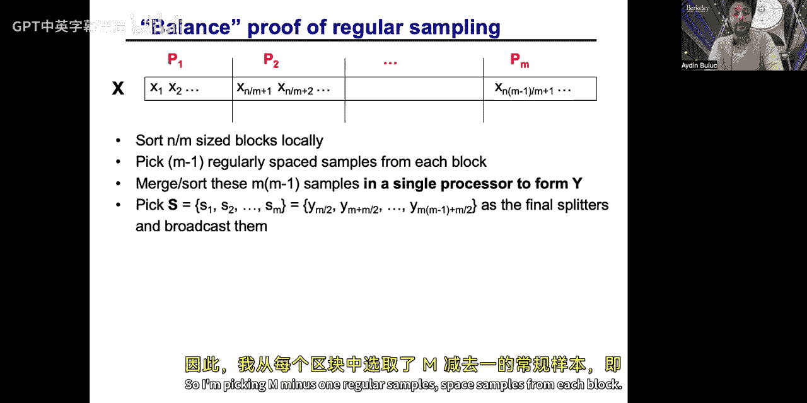

And I'm going to this step is going to get m times m minus1 samples to one processor。

They're going to merge them， they don't need to sort them， but it's the same bound。If you care。

Now I'm going to go and again choose。Space， every amped element。From this。

Combined list so the indices here kind of matter right i'm choosing once I combine these splitters can splitters。

 I'm going to choose my first splitter as the M over second element and the second one is m plus m over second element。

And then the last one is， of course n times m minus1 plus m over second one。

 there's a gap of length m minus1 there as well， just the same。Every am element I'm picking。

 so I haven't done anything too much magical。Just regularly sampled them， sorted the samples。

And chose every end element from that。So why does this actually？Work。So now I'm going to use this S1。

So each SSI corresponds to one entry from the splitter candidate list。

 so S1 means y M equals 2 S2 means y m plus M over2 and so on So why does these splitters actually work。

So each processor will get entries that are less than or equal to their splitters and larger to the previous splitter。

 except the P1 andM， and I'm not going to describe the solution for those corner cases because they're actually easier to prove the harder one is the middle ones。

Which is almost all processes。So。By definition， the。S I minus1。

Is larger than or equal to this many elements of y。And again。

 I'm not doing anything magical here if you look at what S2 is。H2 is m plus m over2。

So it is indeed larger than this many elements of the Y array， this Y is the Can splitters array。

So if find nothing interesting， it's just by indexing。This is slightly more interesting。

The I splitter is smaller than。This many entries of why。

And this is this bound comes from counting from backwards， counting from the end。

 I have a total of M times M -1 elements in the candidate splitters array。

And SI element has index i minus1 m plus m squared within y。

 this is really just corresponds to that index。So then how many elements that I am smaller than is just subtract the list size from its index is how many elements I' larger smaller than。

So that's the two bumps。And if you subtract them， you get this claim bound。All right。

 so this is so far going well。I need a second page。Now this is the crux。

 each sample is larger than at least N overM square elements of y。Sorry， X。

And that is following from this definition， I chose the candidates to be in the wireless。

By having this jumping over every mt element right sorry anyway m squared element， so each YI。

It by definition is at least larger than in over m squared。It's not a strong claim。

The first one is definitely larger than that mini。Because this is a sortded array。

 and I'm being very loose on the bond， some of them are significantly。

 some of them discarding significantly more entries than N over M square。

 but at least every single Yi is larger than some N over M square elements。Super。Super loose bound。

 but it's going to come out fine for some magical reason。Um。

So that's all I'm saying each sample is larger than an over m square element surface so now。

I know SI was larger than。This many elements of y， but since each Yi is larger than an OM square。

 I can multiply this bound with the number of elements that are each one of them is larger than in an x and I get the number of elements that I am。

You know， larger than in the splitish。And now I do it for the SI。

The bound I got about S was such that it was smaller than m minus i times m minus m square elements of y。

 and each element in y is discarding n over m square elements， and actually it's both sides。

 it goes both ways。hyWhy does it？It goes both ways。

 it's also smaller than n over square elements here， right？I didn't say that。

 but it's not only larger than anywhere m square elements。

 each Yi is also smaller than anywhere m square elements。

You get these two bounds of each splitter is larger than this many elements of x and each is smaller than this many elements of x。

 so how many elements are left？Like because each processor is getting。

Items that are larger than S -1 and smaller than S。

 So I'm subtracting the lower band plus upper bound from the total length of A N and do some algebra。

Here's。And what I get is to NOM。So what I'm saying is after finding these splitters this way。

Each processor will get at most to and over m elements， the perfect balance would be。And over Anne。

So this is only a factor of too bad， not too bad at all。And we used some really loose bound。

 all I said was every YI is larger than some N over m square super loose bound works in practice it's much。

 much better than that。And it's easier to implement because you know。

 there's no randomness in this thing， you just go to I element in the array， put them in a bucket。

 ship it up。啊。Questions。Yeah。Good。Okay， so。There are some issues that can go wrong。

And I have actually written some code that。I was using an algorithm similar to this。

 and it was crashing when I hit 100，000 processes。Now I thought like wise。

Why is this happening so one issue you have is。The array was。

The the candidate splitters each coming from each processor is a length p times p minus1 again Ms were p next year I'm going to make them all p so there's no conversation like this so M times this is P square。

And if you have， let's look at some numbers。I actually didn't even choose 100。

000 which 2000 core if you have one process per core back in the day we used to implement things like that。

 I guess today is not a big problem everybody uses openmp right you just do some numbers each splitter candidate is at least 12 bytes you need the value of it and you need the global index of it which is for global indices you need eight byte integers so you have 12 bytes。

And p -1 samplers， the candidate splitters is going to be 5 gig per core。 that's a lot of memory。

So that's why things were crashing in 10，000， there's not enough memory per core。

And this may or may not be a problem in the future with more open MP。 But if it is a problem。

 a quick hack is。You know， immediate media algorithm。You can choose the median。

With the median algorithm we described if you have a good implementation。Now， what you're getting is。

的。You're having the process account。If you have the process account。

 you're dividing the size of this array by a factor of four。

And it's quickly going to go down if you just find median recursively twice in sublists。

You're going to divide your problem size by a factor of 16 very quickly。

 and then you can call the sort algorithm。So there's quick hacks there。

 there is other alternatives and then you can come up with a potentially novel solutions like how can I paralyze the merging of why the maintenance of this global split is y as opposed to gathering in a single processor。

 I think it' totally possible， you can just keep why in some sort of UPC plus plus style global distributed array and try to find your final splitters from that distributed array。

And that will eliminate some of those scalability issues。

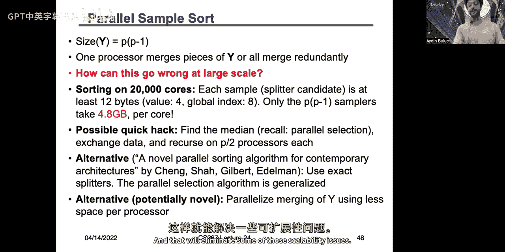

To let's analyze the complexity， now finally I can replace M with P think God it's been a pain to use that m choice。

 I don't know why I did that。Now internal sort of NOP elements is really NOP times log NOP。

And the selection of the samples is just。You know。Linear time on the number of elements I have sample。

 it's not linear time on the list size because I can just jump forward。That's the local cost。

The all to all is P square。For this size array， because that's the total number of elements that needs to get exchanged the time to inter。

This is actually not。I'm not doing all to all broadcast。

 This is really a gatherter I have to replace that because at that point I'm not doing an all to all broadcast this I'm doing a gatherter。

I'll replace that and internally sorting the samples will take time again the sorting cost p square log p。

 you might say p square log p square， but you know log p square is log p is's all the same and selecting p minus one splitters will take linear time again on the number of splitters I chose。

So the last thing is how can I insert the splitters in the local array so did I actually。

Explain that。After people after we broadcast the splitters， then there is an old to right here。

 so let's go back here。

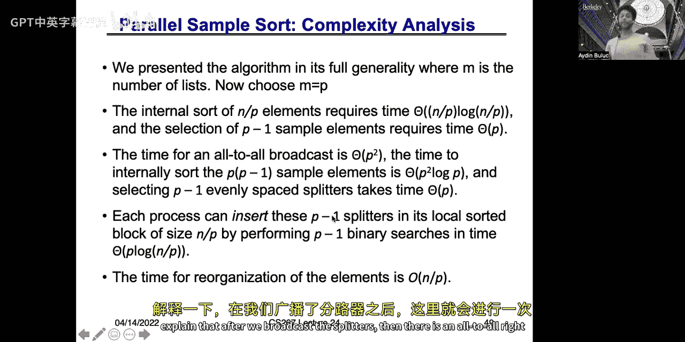

I have globally broadcasted the splitters， now there needs to be an all to all here。

And every processor will get entries that are larger than S minus1， smaller than S。So。

So every processor locally should be able to find where within their local array these global splitters will go so there's a bunch of binary searches going on here。

 you can do it in a different way but binary search works。

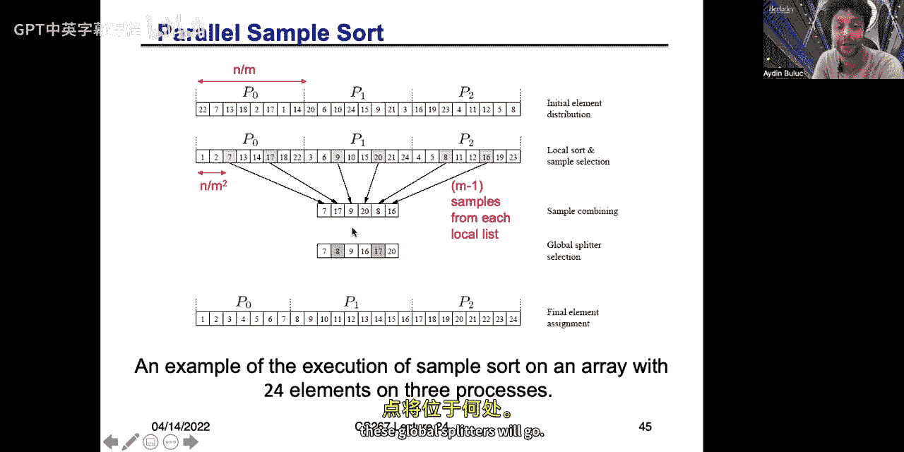

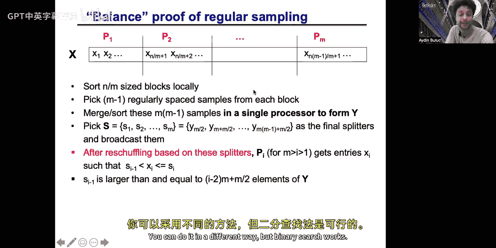

So let's go further。Come on。And that's going to do p minus1 binary nerve searches。

And this is going to be P times the cost of binary research in the local length。

 local length is N OP。So those are the bounds and final reorganization of the data is going to be NOP because at most anybody is receiving two NOP。

 so asymptically it's NOP and that's just the cost of actual all to all this is what's happening here is Ga。

 this is really the all to all。

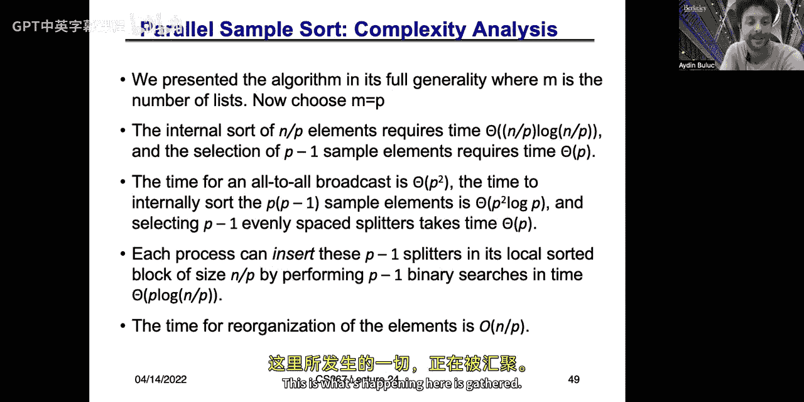

And you sum them up， so actually this bound doesn't include the alpha beta constant it should include。

There's a betterta here。Because this is a figure I haven't。

Updated this out of laziness and before I upload it re upload them。

 I'm going to make sure I put the correct alpha and better terms here if I have space for that now。

And I think that ends the。The lectures。Somewhat earlier than I have thought， but it's all good。

Once again， lots of advances happen on this topic。Every year sorting is not dead。

 just like matrix multiplication is not dead。Question。I've noticed that the bucket were。就看见合发样。第该有问。

So is it true that working with distributed program。有看的还子。即条加。就 over else。た。Well， I mean。

 the Ba story we kind of dismissed and didn't explain because of that assumption。

And we describe something that will do well no matter what the input is distributed like， right？

Bucket sort has these issues。Even in the serial case， you'll choose your buckets。

 some buckets will be too large and you're not going to get the right bounds because the bucket sort。

 even in local one， requires you to quickly be able to sort each bucket。

 But if one bucket has half of the elements。You're no longer able to quickly sort it。期改的就问。还有。我是。Yes。

 yes。That is true， I mean load balance is always a problem in computing but it's more of a problem in distributed memory because in many cases you can I mean it affects your bounce in both cases but load balancing on the fly is much easier if you don't have a distributed memory case like you can just say okay this bucket is big。

 let me keep splitting it further and distributed memory keep splitting that further is a lot of code and may or may not work。

Just comment that you have another former yes。It's actually， I was going to mention that。

 so I was just， I don't know if。😊，I was discussing sorting with one of the students in the office hours and I don't know if he's here。

 yeah， hi。And you had this open， right？But when I Googled。

 tried to find this Edgar was Jim's student and former GSI for the class， former PhD student。

Faculty at UIU， but instead of finding this paper when I wrote his name and soing。

 I found another paper that just came to archive four days ago。

So that's what I'm saying like this is a you know field is well and alive and it's a completely theoretical paper。

 which is no zero performance plots， all is talking about the optimal bounds on choosing sampler samples for sample sort。

😊，And the level of optimality is so tight at this point。

 we're talking about whether we're choosing log log P samples or log log star P samples kind of level right so that's why it's a theoretical paper because at that point you can't show performance benefits。

Thank you so much， see you next week。

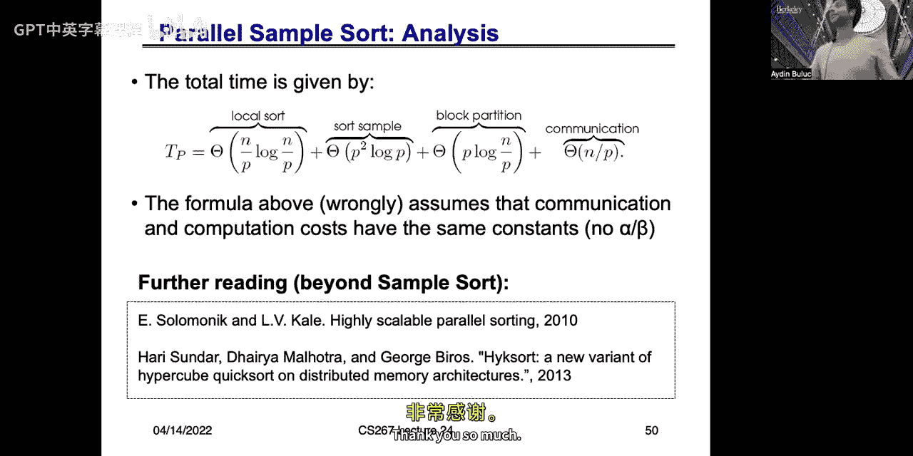

对。