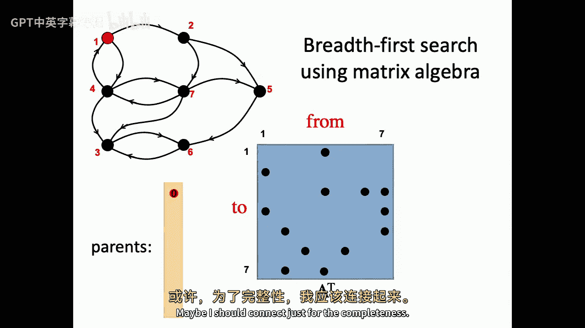
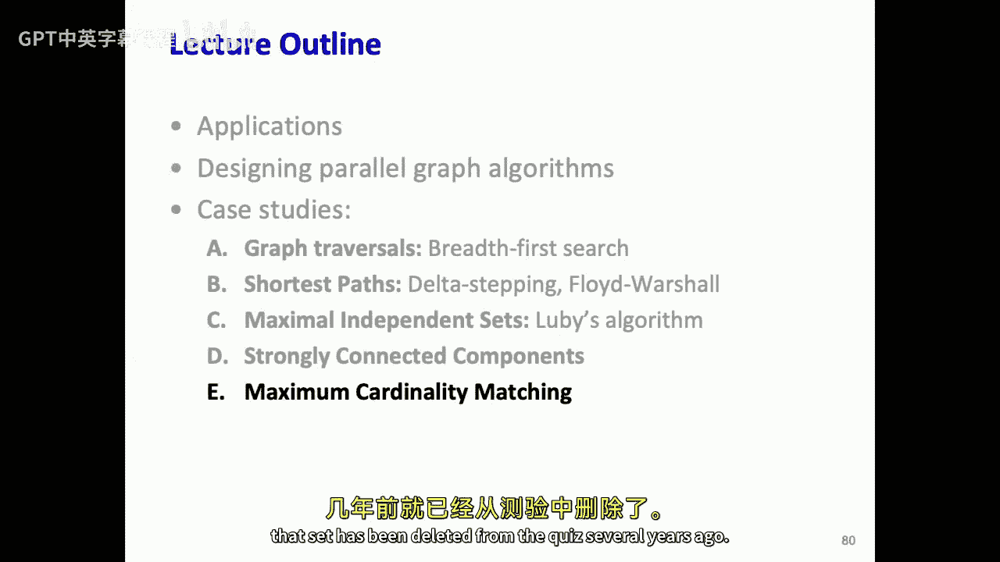

# 【并行计算 CS267 2022】伯克利—中英字幕 p20 CS267 (Sp22) - Lecture 25： Parallel Graph Algorithms -BV1PS421978D_p20-

Well， welcome to the last week of lectures for C S 2，67。

 I assume everyone received a project posters presentation。email about how that's gonna go。

That're right。O。Did anyone， I mean， not individual message about like a piazza post maybe B courses。

 I forgot exactly which research So it's gonna be run during the lecture hours。

 So there should be ideally no conflicts。And we're gonna have to do it online because some of the students are actually not in the Bay Area to bring equity to the system。

 And， you know， there are gonna be parallel sessions， as you might have seen。嗯。

And in case you're wondering your project。Obviously， it won't be complete at that point。

 but you have your final project report due date。 That's the actual date that matters。

 This one is to show you what the problem is， What's your approach and what's your preliminary data。

So that's really all all you have to do for and and answer questions and potentially get feedback if you still have the ability to。

 you know， fine tune around the edges about the final project and the remaining part of the execution。

Now， there was another question on Piazza， I think today。 what the curve will look like。

 I don't know why you got the curve from previous years。

 I think there's some sort of commonly utilized resource among the students。 It should be similar。

 assuming that was correct。 The number of students won't change that。 We。

 we curve the class very generously。 meaning the average student， the median student gets。

Somewhere between A And A minus， like， this is a pretty generous class， right， So。

 and you have to be skipping homeworks sub， you know， consecutive homeworks。

To actually get something under。Be minus。 So anyone that' followed the class did the homework should get B plus or something or above。

 If you skip homework， then that's a little different story。 If you didn't do the project。

 that's a big problem。 But if you done everything， even if you didn't do it at the top， you know。

 you'll be， this is a graduate class。 so to speak。I think that's enough。To say， if you have concerns。

 you can always， of course， email us。And you know， don't， don't assume it communicate。

And today is actually slightly special lecture for me。

 This is the first lecture I've given for C H 2，67， about seven years before I average。

 maybe six years before I average signed up to be one of the instructors。😊。

And this was a guest lecture back at the day。 I think it was 2011 or 12 for one of those years， so。

the lecture didn't change drastically。 So it owes a lot of people in the previous slide。

 You can see a lot of people have help on these slides。 So this used to be earlier in the class。

 but I'm going describe the preliminaryminaries are。 A graph is really an abstract data type。

 You can think of it to represent entities that are connected in nature。

 And I'm gonna go over what those entities could be in the motivation section。

 But mathematically speaking is just made of two sets。 One is the set of vertices。

 Some people call it the nodes。 We just don't like to call nodes because you know。

 imp parallel computing， we usually call the nodes of compute nodes。And the edges between them。

 and some literature will call them arcs。And edges basically arch connecting pairs of word disease for the simple graph definition。

 And there is generalizations of graphs that because you might you've seen the graph partitioning lecture before the graph algorithms lecture。

 So you probably are familiar already， you can actually define something called a hypergraph where the edges connect more than a pair of word disease。

 So it's like3 for any arbitrary subset of the word disease can be connected by what's known as an H。

 but that's not gonna be focused today。 We're gonna go through the simple graph here。

 an important metric on analyzing graph algorithms is diameter。

 which is maximum number of hops between any two pairs of word disease。 What is the farest distance。

 if distance was measured in terms of the number of hops you have to take。Right。

 so that's a diameter。 And some parallel graph algorithms run time will be dependent on that。嗯。

And if you have a sequence of edges that are weighted， meaning your graph has weights on the edges。

 the length of that path will be simply the sum of those edges。Okay， so this is the lecture。

 I'm going start with some motivating applications。

 Then I'm gonna to go very briefly on some historical note on designing graph algorithms。

 Then we're gonna go over several different case studies。

 The last one of which I wasn't able to get in the last two years。 So we'll see today。

 It does not mandatory。 The focus of these are actually to highlight certain aspects of algorithm design。

 parallel algorithm design。 These are not arbitrary selection of graph algorithms。

 just put things in perspective。 For example， shortest paths is graph traverseals are there。

 because that is the building block of any almost any other graph algorithm。

 So you have to kind of be able to traverse the graph to be able to design higher level algorithms。

 So that has to go there。 Shortest paths tells you how to make compromises when you're designing graph algorithms where you have one very parallel。

 but asymptically unfavorable algorithm， and there is another。😊。

ly efficient algorithm that is inherently sequential。 How can I relax。

That algorithm to look like the other one without completely losing the benefits of the asymptotic complexity。

😔，Maximmal independence that I'm gonna to describe because it's a wonderful use case of a randomized algorithm that helps you。

 you know。😊，Get parallelism to randomization and strongly connected components is a great example of a divide and conquer based algorithm。

Design for extracting parallels。 So if you ever used Google Maps。

 you're clearly using some sort of graph algorithm underneath the covers。

 It's probably not one of those I'm going describe。

 I used to describe the kind of algorithm that the map people uses。

 but it's so restricted to road networks that I stop talking about it。

 there is a particular reality in road networks， which is they're almost plainar。

 But if you ignore the， you know。The crossings that kind of go over you in San Francisco or the tunnels。

 Everything else in a road network is plainer。 So the special algorithms actually are developed for these kind of networks that build shortcuts and answer queries in really fast time。

😊，Most of those algorithms do not do not apply to general graphs that doesn't have that property。

 Internet， of course， the packets are routed by again， certain graph algorithms。

 generally Belmon Fort like short Sp algorithm。 be able to traverse the whole web。

 the crawling is some sort of traversal in an abstract sense。

 page rank who is used by Google at least used to be used by Google gut knows what you Google is using today。

 The original algorithm is considered a graph algorithm linear algebra community will call it an eigenvector competition。

 but' true both ways。And many， many other applications there。 So it's one of my favorite ones。

 We don't have a sparse matrix lecture for direct direct methods。

 We do have we some iterative methods。 but there's another way of solving a sparse linear system。

 which is to do Gaussian elimination， for example， and Jim has worked on this a couple decades ago。

 It becomes really expensive to。😊，To do pivoting in runtime in distributed memory。

 meaning you have to kind of swap rows when you're solving a sparse linear system and the unpredictable nature and the dependencies it creates when you do these swaps in real time in distributed memory forces you to do some other method。

 which is called the static pivoting。 you permit your matrix so that the the diagonal is as high as possible。

 And of obviously needs to be all non zeros。 Otherwise， you're gonna fail。

 But even within all possible full diagonal ones。 you want one with the highest。

Some of the entries or multiplication depends on none of those are actually ex exact。

 And the way you achieve that is through a certain graph algorithm。

 which is matching in bipartite graphs。 Bipartite graph is a graph where the vertices can be separated into two sets and the edges only cross between those sets and not within within any of those two sets。

Graph partitioning， again， we've seen the complete half lecture on this。

 the application to use for load balancing and minimizing communication。

 so that problem sets for graphs can be pretty large because the things that we need to do graph partitioning are by definition。

 large enough to require graph partitioning。 So they already require distributed memory computing。

 Otherwise we wouldn't be partitioning them。So that's one of the reasons we're talking about parallelgraph algorithms today。

 and a couple of other applications， astrophysics， you can think of these galaxies and all that stuff as graphs。

 bioinformatics is something that I'm going to actually describe in more detail on Thursday almost a third of the algorithms that I'm going to describe in bioinformatics lecture or computational biology lectures is is going to be a graph algorithms and social networks obviously arch modeled most natural is a graph where any of those entities is a node and the connections are edges and we can keep going and going and in fact。

 I'm not even talking about the graph based learning things。

 Many other machine learning algorithms use graph computing as subroutines to itself。

 This is just one example if you want to do learning like a PC like think except a nonlinear based nonlinear version of that how do you。

ize this problem first is to compute a graph of the key nearest neighbors and compute distances。

 all short path distances and then run your favorite PC A like algorithm。

Or or some other linear dimensionality reduction。 So I， I don't want to go any further。

 Then I'm just gonna talk about the actual specifics of graph algorithms in the interest of time and to avoid duplication。

The original graph algorithm research for parallel computing。

I think there's a lot of things algorithmgos have been developed in 1980s。

And almost exclusively in this model called the PRM model。

 we've briefly mentioned what PRM model is in many， many lectures。

 Maybe we didn't have a specific lecture just to cover that。

 This is the generalization of the Ram model where we were counting the operations except with the understanding that there can be P different processors。

 and they could access the memory simultaneously without doing well not necessarily simultaneously。

 So there's four levels of PRm。 Some of them could be exclusively accessing reads or concurrently access reads。

 but there were no communication costs involved。 So that was kind of ignored in the analysis。

And it was it seemed to be a shared memory system idealized， no synchronization cost。

 no communication cost and no parallel overheads。 But it allowed people to design a lot of cool algorithms。

 It kind of allowed them to work on this nice space of P where there was this hierarchy of different restrictions。

 exclusive read， exclusive right， concurrent exclusive right。

 And you can imagine there was four different possibilities。

 if you feel that matrix of what kind of read and what kind of right you can have。Now， pros and cons。

 most of those are known， simple， elegant， and it's independent of the network topology。

 not realistic。 big notation is misleading communication cost studies nor is the biggest issue。

 So nowadays， we are in a phase where we care more about the actual performance of these graph algorithms。

 And some of it has to do with the realities back in 80s。

 neither the parallel computers nor the problems， graph problems were big enough to matter for these things。

 right， There were no big graphs that anyone wanted to run parallel computing on。

 So all of that stuff was in theory。So it made sense。

 Now we are at an age where we can talk about graphs with billions。

 tens of billions of vertices and even close to a trillion edges。 Okay， so when you have that land。

 you actually no longer answer theoretical questions。 You can actually see what's the performance。

 How can I improve that。 So that's one of the reasons we actually care about real performance these days more。

So how do we represent a graph。Surprisingly， the best way to represent a static graph。

 which is pretty much all the graphs I'm going to talk today。

 And a dynamic graph is a graph where the edges and vertices can be inserted or deleted during the algorithm execution is something that I'm not going cover today。

 just static graphs。 The best way to represent a static graph is。I think this is not controversial。

 Is this compressed spae rows you've seen in sparse matrixs lecture。Why， because really。

 for functionality wise， this is the same thing as the adjacent syllus that you'll see in every single。

Algorithms， textbook or data structures textbook。 The difference。Actually。

 what you've seen is adjacent service。 This is the compress part for us。

And you'll see that these are semantically equivalent。

 except that the adjacency list is a bunch of pointers here and there。

 And this one kind of removed all the pointers and stacked together all the adjacency list together in a single long array。

 why， what's the benefit。 Well， if you follow pointers， you do a cache miss。

 not to mention the extra cost of storing the pointers。 And this one。

 if you're just streaming through all the adjacencies of any vertex。

You're just basically streaming through the memory without a cache miss， except for， you know。

 you have to do something every8 entries or something。 but no such thing as chasing pointers。

 So that kind of makes it the most efficient data structure for storing static graphs。 Obviously。

 if you wantan to insert something to the data structures。In an eager way。

 meaning you want to insert it in real time without waiting for the insertions to accumulate。

 It's catastrophic。 It's cost linear time to rearrange anything there。

 whereas you can probably insert things here in time logarithmic to the length of each edge list for the vertex。

 so。Theres a pro There is a con。 But for， again， study graphs， that's， that's good。

And that was all about how to store it in a single。Note， how about I want to distribute my graph。

The most natural thing you can， I mean， depends on the application， right？

 So the graph algorithms are so large in terms of the complexity space they cover that some of them that we're gonna see today are linear time。

 B search going over to all the vertices on a graph and a particular order。

 If you have a linear time algorithm。Then the chances are。

 and you want parallelization and distribute memory。 The chances are your input is really large。

Right， otherwise， if you have a small input， it's linear time。 you would not need parallelization。

So for those things， you need to distribute the graph。

 But what if you had the famous problem called traveling salesmanap problem。

 You probably heard about that。how many of you have heard tellolessness my problem。 Okay。

 almost a lot of people。 So it's like a MP hard， one of the most famous MP hard problems。

 right out there， which is to visit all the notes with the minimum cost。 That's all。

 A Hamilton impact of the least cost。 many， many people have been working on this for half a century plus。

And it's so expensive to find good solutions。 The chances are your graph is really small。

 The The largest graph you can solve a traveling salesman problem is not on the order of billions clearly。

 So you can replicate that in each node and distribute the work among processors。

 So the input can be replicated。But in what is going on， that's not good。I lost Internet。Oh boy。

 Okay， we have some recording somewhere。I guess there's no point in me waiting for this to recover。

If it's gonna recover， it's gonna do it itself。I was， but nobody's recording sadly， I think。Well。

 I might still be recording myself， by the way。Yeah， it is local， okay。Beautiful， okay。呃。Well。

 good news is this lecture has been going on for the last five years。

 There's some recording somewhere。😊，Okay， so， okay， so if your， if your problem is really expensive。

 your graph is small， like Charlie says is my problem。

 you can replicate it in replicate the input image each processors and deal with how to distribute the work。

😊，But in many cases， which is all the cases I'm going to cover， you have to distribute your graph。

 And the most natural way of thinking about it is， well， I have a bunch of vertices。

 Why don't I give each processor a subset of the vertices。Good， that's if you。

 recall this either vertex partitioning or 1 D partitioning。

 And it's gonna be fairly clear when I show the adjacency matrix。Of this graph， what one D means。

 And how do you do that partitioning meaning， How do you give P processors that。

 I have so many errors coming up here。Okay。Interesting， my recording actually stopped。

Because of this， for some reason。It's converting the meeting。

 So we're all at the mercy of that and the last year's lecture。So。So this is an alternative。

 instead of partitioning vertices， you can partition edges in a in a structure。

 We call a edge partition in。 I call it a 2D partition in。 And heres why it's 2D。

 This is an adjacentdja matrix of this9 vertex graph。Meaning rows represent vertic。

 columns also represent vertic。 And if there is an edge between row I to row J。

 there is an x there and x。 It doesn't need to be binary。 It can be the weight of that edge。

All right。And each color represents a different processor。

 So what you're seeing here is ages are distributed to 9 processors logically organized in a three by three process grid。

Because that's a two dimensional partitioning。 Now， now， if this was vertex partitioning。

 you would have either rows of this thing gone to processors or columns of this thing going into processors。

 So that's why it's one dimensional partitioning。 It's just one dimensional。

 If you look at it from the adjacentsymmetric matrix of the graph。Okay， and。

And don't let the some textbooks fool you that adjacentja and matrices are only suitable for dense graphs。

You don't have to store these empty things。 We already know what sparse matrix is。

 and you can store this matrix in the sparse format matching the same storage bound as adjacent so。

 right， just because I'm showing it as a two dimensional large thing doesn't mean the storage cost is n square。

 If you represent this with a sparse data structure is still the number of edges in there。I don't。

 I don't think this network is coming back。Let's start with traversing thing。 Okay。

 so we now know how to store a graph in static graph in local memory and how to potentially distribute it。

 There's many， many other ways of distributing it。I just described one D and 2D。

 And I didn't even tell you how to find those mappings。 But。

 graph partitioning is one way to find those mappings of vertices to to processors。

 You can use these structured mappings of， I'm just gonna use this checkerboard style。

 This is nice because。You can know exactly who owns what。

Without keeping a data structures of those vertex to processor mappings。

 this is basically saying if a vertex I D is when you divide it by3 falls into this bucket。

 It's owned by this processor。 You can just statically compute that thing。 in some sense。

 You don't need a hash table or any mapping there。Now we can come to the most building block of our graph algorithms。

 which is breakfast。 Well， actually， I'm gonna to talk about search。 How to traverse a graph。

There is two fundamental ways of traversing a graph。 The first one is depth first search。

And the name is actually very nice and descriptive of what we're doing。It's。

 and the pseudo code is the simplest thing you can find。

 You just basically going to one of your neighbors。And handing over the control to that neighbor。

 And that neighbor will find another neighbor。And this way， it's gonna go。

 the graph will be traversed depth first。 So before you traversed a second neighbor of yours。

 the first neighbor you visited will start traversing its neighbor。 So that way。

 that path of the graph will continue exploring。 Let's look at what's going on。 So first。

 I'm exploring one of my first neighbor。 number two。 And I market with the number that I visited。

 The visiting order。And since before I can traverse any of my other neighbors， which are 7 and 5。

 since I gave the control to my neighbor， too， it's gonna visit its own neighbors。

 Same thing will happen。And now the control will be a process note vertex 3。

 and it's going be exploring its neighbors。 And you can see that。

The deep path has been explored first， before。Parallel paths have been explored。

 So that's why it's called depth for search。And this simple recursive code will implement this。

 But please don't implement it this way。 It's a textbook example of not to do for that first search for a large graph。

 because this is recursively calling the same function。 It's gonna blow up， blow up your stack。

 Your program will likely crash for a large And there is a way to unroll this thing and write it in four loops。

Do it that way。Might be probably a coding interview with someplace。

 but it's much easier to describe in intuitivetu this way。 So okay。

 what's the problem with this algorithm。Well， first of all， what is good about this algorithm。

 This algorithm has a particular backtracking order that you can predict。And the way you， you know。

 you know exactly how this is going to unfold when the recursive call finishes。

 You know what order is going go， what order is gonna to matter。 And a lot of clever people。

E exploited this property to design ingenious algorithms that run in linear time for more complex problems。

 connected components， biconed components， strongly connected components and， and so on and so forth。

And these are all happened in the 70s。And so。Okay。But， but what is the problem， The problem is。

There is a particular We talked briefly last lecture about critical path and span。When。

 when I was talking about the sorting algorithms， you will remember， which is。

 if I give you infinite number of processor， how fast this thing is gonna run is the span of the computation。

 In other ways， what's the critical path of dependencies。

 And the critical path of dependencies here is order N。

So you're not gonna get much parallelism beyond。The， the average degree。

 the number of edges is the cost of this operation。

 The number of vertices is the span of this computation。

 So the the highest amount of parallelism is whatever your average degree is。So， and that's。

 that's the basically the limiting factors。There's some pseudo convincing papers about why depth research is inherently sequential。

Because it's really hard to argue。For that。 And there are people that kind of， you know。

 modify that first search to no longer look like that first search to make it parallel。

 But then it's no longer their first search。 So you can't use this property。

 That is a particular order of visiting。 So for that reason。

 almost every parallel graph algorithm that has to traverse a graph follows this。

Breread first search order， which， again， just for the name is very intuitivetuitive as well。

 you explore all your neighbors before starting exploring your two hub neighbors。他说。Right。

 so you have to finish exploring all your I neighbors before you can explore your I plus one neighbor。

That's the breakfast search。 And then these numbers I'm putting here is。

Is what level it is in the breakfast roast tree。So first timem visiting 5，7 and 2， and breakfast。

 which doesn't care which order I was that。Legally， it's， it's all the same correct ordering。

 And then 8 and 3 are visited later。 and4 and 6 are visited。Third and finally， one in 9。

So how do you implement that in serial or insured memory。

 We know that the C S I will give us a good representation M plus N apologies if I didn't mention those M is usually a shorthand for the number of edges in the graph。

 And N is a shorthand for the number of veres。 Maybe I showed it in the second slide。

 But I will go back and make sure it's there。 If it's not。

 You have to keep track of which ones are visited at any given time。

And that's usually an order and data structure。 You can represent this as a vector。

 You can represent this as a stack。You， your doesn't really matter。

 and you have to keep a vector of distances。Meaning how many hops it takes to visit every vertex。

 So the auxiliary data structures are order n。 The input is n plus n。

 So it's a nice algorithm and used for a building blocks for a lot of things。

 matching connected components between a centrality。 flow problems。

 If youve ever came across these This is not a graph algorithms。Cl。

 so some of those you'll never hear。And there are two ways to parallelize。B F S that I know of。

The second one of which I have never seen anyone implement。

 I always tried to convince people to do a class project。 Nobody picked it up。

 which the lecture being in the last week never gonna get picked up by this， but。

I'm almost about to find one student， maybe for a summer project for that。

 The top one is the commonly used one level synchronous。 So you let all your processors。

Explorore level I of vertices。And then all your processors will now start exploring I plus1。

 If your diameter is short。Which is true for a lot of social networks。

 networks with parallel law degrees。 You might have heard this term， 6 degrees of separation。

 And that's if， if your diameter is 6。Taking six parallel steps is nothing， right， It's great。

 It says very small span， lots of parallelism。 But if you have a road network。

That's not a great idea。 You have to take a lot of hops。 It's almost plainish。

 And if you have even verse， like some structures where it's like a gridit。You have。

And points in a 2D grid square root of n distance。 right， So that's a lot of steps you have to take。

 And level synchronous is not gonna work very well。 But whether you have those。

 look at your input first， right， So that's the answer。 And if， if it looks like a， you know。

 low diameter graph， level synchronous is a beautiful approach。 If not。

 there is an alternative approach described in this paper by oman and Yna cars。

 which kind of chooses。Super vertices， and does。Pat limited searches。

 So it just kind of searches around the neighborhood of these super vertices。

 and their will be overlapping and thenes stitches together the distances between them。

And that's probably a little too。 And actually a randomized algorithm。Sute one。

 but clearly didn't get the interest from the actual implementers。

So let me describe you what B first search works in level synchronous approach using。

Familiar data structures you see， sparse matrices and vectors。嗯。The Internet is back or something。

Okay， maybe I should connect just for the completeness。

I see your iPhone。He it。As a connectible place。Sorry， folks， now I have to figure out the link again。

And I don't expect people to be waiting for us。 So we'll see。Any questions so far？

 this is a beautiful moment，嗯。Wow， people are。Thank you for waiting。 We had a crash of the campus。

 Wiifi。嗯。Apologies， and we're gonna continue where we left off。Well。

 not really where the actual in person class is left off， but I。

 I'm optimistic that the recording of the room is O。 If not。

 we're gonna use last year's recording all of this。Actuallyary to stop recording。

I'm not clear why I'm doing this。Hope Springs eternals。

Alright， we're back。 So let's do breakfast search using matrix algebra。

 So what am I here here seeing here， I have a graph。With the famous7 vertex graph。

 I say it famous because I've seen it so many times in my career。 Probably not famous for you。

But if if you go to graph clause dot org， this is the same similar vertex graph there。嗯。

YeahI'm gonna start exploring it from vertex 1， and I have the a matrix of this graph。

 which I'm going actually use it as the transpose。 So two。

 like the destination verticies are in the rows and source vertices are in the columns only because that way I can show the matrix vector multiply in the column notation。

 which everyone likes over the robot notation。Everyone。So how am I going to start this。

 I'm going start with my first frontier， which is my first vertex， so。I'm just starting with。

A sparse vector， with one entry。Which is where I'm starting。

 And if I multiply this with the sparse matrix。And the sparse matrix for these purposes。

 is just going be boolean。Like just0 or nonze。 So I'm only storing the entries that are present。

 And every time I'm doing a multiplication， all I'm doing is propagating the。

The value in the vectors back to the output vectors， taking the input vector to the output vector。

 So it's， I call it select select second。 It's really returning the second opera。

 which is the value coming from the vector。And the， the values on the matrix doesn't matter。Okay。

 so what did I discover， I discovered that in the second and the fourth location of the output。

I do have two non zeros。 That basically tells me the the next frontier will be composed of those entries。

Okay， and the value is there 1，1。 It tells me the parents。Of those entries are the vertex number one。

 which is correct， right， The parent tells where did I come from。So who discovered 2，1 discovered 2。

 Who discovered four again， one discovered4。 So that's really encoded in the vector over there。

 So now I can add that output to the parent array。Which is this whole information about which vertex was discovered by whom information。

And that's usually the output of breakfast search。 In addition to the level information。

 we can keep track of that， too。 But for now， I'm just gonna keep track of who discovered who information in the parents array。

 So now I'm gonna get this parents array。 Sorry， the， the output array into my input。

 and I'm gonna rela the。Values is the indices。 So2 and 4。

 So because that's the non0 in the second entry and the non0 in the fourth entry。

 if I do another matrix vector multiply， what I'm discovering is my， you know， second half neighbors。

5，7 and 3。 And there's a couple of interesting things are happening。 you might notice。 One is this。嗯。

Checkerboard style， thing。 What do you call this， I call it a little sucker ball over here。

 which is an entry that I have already discovered beforehand。And I'm trying to rediscover again。

Why am I， Why do how do I know that， Because the parents array tell me that the zero entry is already the discovered beforehand。

 In fact， it's where I started with。Right， so I don't need to discover it again。

 And I'm not gonna put it in the output。 How do I do that， There's many， many ways of doing this。

 I can look at the parents array while I'm doing the matrix vector product to see which entries don't need to be on the output。

 Or after I generate it， I can manually go and do an elementwise operation with my temporary output and the parents array。

 I'm not gonna to borrow with you the data structure details of that。

 but we call it the mask matrix vector product。 The mask is the things that youve found in the past。

But for the purposes of breakfast search， you can assume that I have access to the parents array。

 and I don't need to rediscover things that Ive found。

 The next interesting thing that happens is both2 and 4。Can access 7， right。

 Because if I do just this matrix vector product， I need to somehow figure out how to add entries to and4。

And the way I'm gonna do it is I'm gonna to choose the minimum。

 So I'm overloading the addition operation with the minimum just as just like I overloaded the multiplication with the selection of the vectors。

 So that way I decided to use min， I can use any because breakfast search is correct。

 It doesn't even need to be deterministic。 But because I want some deterministic answer。 I I said。

 if two vertices can reach another vertex at the same time。

 I'm gonna let the one with the minimum I D succeed。 So that way， two is the parent of。7， and I。

 I'll continue until no more vertices are left。 So this is a level synchronous breakfast search implemented。

In matrix form， But you don't even need to do it in matrix form。

 It's the same kind of data access pattern。 It touches every single edge once。

So itss runtime is number of edges， generally。And it's almost always larger than the number of vertices。

 I'm not mentioning the vertex cost。And how many steps it takes。

 it takes as many steps as the diameter of the graph。 So that's the。Okay。

 and then if you wanted to do it in what I call is graphpl and you can go graphpl dot org or just Google this thing。

 you would be able to implement this thing in。In okay， a lot of boilerplate。

 which sets up data structures。 and not because of graphappwa。

 It's because its's C language doesn't isn't the most familiar thing。To many people。

 you can't just kind of have constructors。 You have to declare them and set them and so on。

 But the bulk of the competition is happening here。

 where all I'm doing is a matrix vector product and a app that kind of adds these entries to the parents。

 just like how I showed in the picture。Now， let's get to the actual。Paralls in part。

 So why did I go to the pain of describing this algorithm in matrix notation is this way I can。

This way， I can directly explain the parallel algorithm very easily。

 So now I have a one dimensional partition input。 So you can see this is vertices。

Are assigned to processors and all the outgoing edges are assigned with them。

 The first way I described one dimensional partitioning。

 The reason it looks like columns is because I have do a transpose normally， it's by rows。

 If it was the， the normal adjacent matrix。And the， the colors。

 each one of them are describing a different processor。 So if I need to。

Do this multiplication in parallel。 What do I need to do。I can locally discover。The。

 the vertices each vertex needs to find here， right， So this local matrix multiplication of。

 of this tosickiny matrix with this tiny piece of vector can be done without communication。

 But once I do that， I somehow need to reduce these entries together。

 and it requires an all to all communication。And once the alol communication is done。

 the recipients will update their distances locally。

 So there's one step of communication that happens in the middle with an alol。By contrast。

 I can do a two two dimensional algorithm where I take the G matrix like I showed before and divide it is a checker boat。

 So what what's happening here。 It's a little harder to understand what's happening in the matrix So in the graph land in the matrix land is pretty obvious。

 right， You just divide it into some sort of checker boat fashion in the graph land。

 what's happening is。嗯。的。What's the best way to describe this？The， especially the。

The vertex assignments is a little complicated。嗯。I do get， for example， let's look at the。Blue。

The red the red processor， the red processor owns some parts of the。Ege list。

 which are all the things that go from the top left。

 the first half of the ver vertex set to the first half the vertex set。

 And it also owns some of the vertices。 And that can be actually changed differently。

 but it's actually much more structured than you would think。

 It's not like an arbitrary subset of edges。It is a。

 It is a subset of edges that's exactly described like that。 The first half to the first half。

 So I know which processor owns what part of the edges this way。

You could divide this thing up completely arbitrarily。

 And then you would have to manage who owns what problem。 Here is actually what's more structured。

 How do I do this matrix vector product， I have to I look at my red processor。

 do I have everything I need to multiply my matrix。With the vector， the answer is no。

 I need to get some entries from the blue processor。 I need this， this nonzero。 And similarly。

 everybody needs to actually do some amount of communication along the processor column。

 meaning they need to exchange entries along the column dimension。

 So the blue and red needs to synchronize and exchange data and green and the and the black needs to exchange data。

 So that's the vectors that need to， they need to receive。

 that way they have all the pieces that they need to locally do matrix vector product。

 And once they do that， now they have to exchange data in the row dimension。To， to write the output。

 they have a reduction they need to do。 So now I increase the number of communication steps。 Why。

 why would I do that。It seems like a silly idea， but it's not。 Now， imagine I have 10000 processors。

Which is not that unusual。If you have 10000 processors。Very strange things are continuing to happen。

Internet is down again。But the funny thing is， first， my。

 my video stopped before the Internet stopped。Okay。So why am I doing this thing。

 If you have 10000 processor I'm doing all to all， that's really expensive because everyone is trying to communicate to everyone。

 It affects the network severely。And if， if I do divide this thing in two dimensional ways。

 I have hundred groups。 Each one of them is  hundred0 entries。Now。

 it's much easier to manage individual groups of  hundred entries than 10000 entries in terms of communication scaling。

 So that's what we're trying to benefit。 The second benefit is， if I have a ske degree graph。

 which is mini graphs in real life。 Imagine some columns here have。Almost dance。Entries。

 and that happens。 Imagine a2meter graph。 Everybody follows the you know， famous people。

Lots of lots of edges that are originating from them。 And in real life。

 we call kind of these things exist is called power degree distribution。

 meaning a lot of people have very low degree and， and very few people have really high degree。

 So distributing them in one D is almost impossible。

Because if the number of those people are lower than the number of processors。

 there is a pigeonhole principle problem。You can't just distribute in a 1000 high degree people to 10000 processor evenly。

 You just don't have enough slack there。 But if you do it in two dimensional ways。

 it usually works okay， because you divide that really dense column into 100 processor。

 and with sufficient shuffle link， you'll get good balance in very bad input。

 So you can actually prove some balance that the worst thing that's gonna happen is some logarithmic thing on average。

 But in reality is even better。 The load balance Ive seen with a perm to two dimensional cases is 5%。

 meaning some processor had 5% more data than the average， which is not bad at all。

So there are two benefits， right。Okay， then there is the third thing that I wanted to describe。

 And hopefully， I'm not spending too much time on breakfast search。

Maybe I'm spending too much time on breakfast search。 Actually， Let me， let me do a little bit of。嗯。

嗯。No， I should describe this thing。 This is a nice one。 And it's actually a colleague of yours。

 Scott Beaer was a Ph T student here， student of Christtasovic and David Dave Patterson。

 who was an architecture student。 And but he somehow wanted， started this。

Interesting graphs to do a graph architecture， like a particular computer architecture that processes graphs well。

 And he started looking at this benchmark called Gra5 funded。

 which is really about doing better for search。And he noticed that。Something was kind of odd to him。

 like the way everybody did breakfast search， which is， you know， start from a source vertex。

 go to the neighbors， go to the next neighbors。And he said， well， let me look at what happens。

 All these edge examinations。But he， let say， this is your starting vertex 0。

 and you find the its neighbors once， right， And then once from once， you go to two。

 So let's look at the number of edges that are examined。At this point。

Both this one and the other one are trying to examine and trying to grab that as a， as a child。 like。

 you know， just the symmetry of the parent concept。

 Let's call the things that we're discovering as our children。 Okay。

 And so these are one of them will fail。 And there's all these side edges that will fail。

 because these back edges that will fail。 A lot of edges that I traverse are not doing useful work。

So he characterized this thing is like this nice pmid。 This is a very， very low diameter graph。

And the only useful part was this dark blue。 The light blue was pierce， meaning。

The edges within the frontiers。 So all the edge， all the vertices within a levels。

 we usually call it a frontiers。 and the side edges were a huge majority。And a failed edges。

 which I like， if multiple vertices are trying to claim the same vertex for the next layer。

 that's a failed。Faaied child。 That's also a failure。 And the backs he didn't even impose。

 But there's another class that's wasted。 right， So he kind of noticed that there's a lot of wasted。

Efforts going on。 So he said， can I change the order。Of my traversal。

Instead of going so calledled top down in computer science， we're weird。

 we draw our trees upside down， right， The roots are on the top。 The tree goes down。

 So that's what it means top down。 You start with the root and go down。 But the bottom up means。

The unexplored vertices start looking for their parents， as opposed to the。

Previously discovered vertices trying to find children。 So Hche has turned the algorithm upside down。

And at， at some point， for example， at this point。The algorithm， instead of the。

The yellow vertices looking for children。 The white vertices start looking for back connections to the frontier。

 to the yellow vertices。And what are the benefits。Well。The number one benefit is。

You need to explore all yours。Children， if you go top down。

 because you're unaware of the other vertices。 I need to explore this edge。

Because I don't know the other what the other vertex is doing。And I need to explore the side edge。

 too， because I don't even know where it's going。I don't have global information。

 whereasas if I do bottom up at this point， if I find one connection to the printer。 I'm done。

 I can exit。 I don't need to explore this edge again。

 So it kind of cuts down the edge examinations potentially from all the way to the number of edges in the graph to the number of vertices in the best case。

 That's never gonna happen。 But you can create a graph。

 that's it's gonna happen like a best case graph。 But in reality， you can see the potential gain。嗯。

And there's other benefits to this approach， because at some point， the frontiers expand so much。

That。The number of undiscovered vertices become smaller than the number of elements in your frontier。

So the， the working set shrinks if you switch at the right time。

 But if you use button up search from the beginning， you'll be， you'll be in trouble。

 I think So if you w to research on this area。Some other ways people call this as push。

 The top down is push。Pushing information。 and bottom up is pull。

So push and pull in graph processing is going give you a bunch of papers to look for。

And that kind of worked very well。 This papers he wrote in 2012。

 I think has over 700 citations by enough。 You know。

 he became famous for a non architectural invention。So。EAnd， you know， we， we teamed up and wed said。

 okay。I， I've been tracking the graph I find list for a while。

 It's a little dormant nowadays because it's saturated。 not that interesting。

 But the biggest jump happened first is adoption of 2D algorithms。

 Almost everyone adopted 2D algorithms over 1D algorithms。 And a year later。

 Scott's approach got his iPad。Higher than some of the supercomputers in that list。

 because it was doing so much fever work。Like an order of magnitude fever work。 Then after that。

 people figured out how to implement the bottom up approach in distributed memory。

 So we wrote a paper that combines those two。The， the challenge there is， how do you。

 you don't now have a good view of。All the vertices， all the， all these edges you wan to explore。

 right， So this list， I wan to explore all my incoming with my mouth。

 I want to explore all my incoming edges。And， but then。

How am I going to achieve that if I have only a subset of my of those vertices available to me。

 So I don't own all of these entries in the frontier。 I only own a square root of P of them。

1 over squared of P of。 So how can I check presence of those edges And the way we saw this was a kind of a time time division。

 At first， I am seeing if I have an incoming edge to， you know， one over P of。The subset of vertices。

 And then I shift this thing cyclically along the rows。 Now， I try to see this。

Whether I have an incoming gauge on the next level and I， I haven't drawn the whole thing。

 Then it's gonna shift again and shift again after squared of P steps。

 I'm basically checking all the incoming engagements。So that's how we temporarily divided the work。

 We some people call this a systolic rotation。 I think it's the name from early 80s。

And when you look at this， clearly， this so called direction optimizing approach。

 which switches from the top down to bottom up at the right time is。

Is an almost an order of magnitude faster at any scale。

 So you're looking at really large scale runs here at the time。 This was almost a decade ago。

 And we were running on 50000 processors a decade ago。

 I haven't touched these kind of codes for a while。 But I think nowadays in graph 500。

 people are running another order of magnitude more coar。Okay。

 I'm gonna skip this de graph traversal， which is a different way kind of graph because it's covered in the biology lecture。

 So there's a spatial kind of graphs that are happen in genome assembly。😊。

And the way you want to traverse them is fundamentally different than than the kind of grass we talked about。

不得不不不。各的。Shortest paths。Finally， and50 minutes into the lecture。 were in the shortest path。

 But don't worry， that what ends up happening in this lecture is these things are actually the crackux of these algorithms are so simple。

 Each one of these can be described in 10 minutes。😊，Magically。嗯。So yeah。

 the shortest path you might have heard about this thing， famous algorithms。

 Belmon Fort and Diextra are the two famous algorithms。And I don't think this di spelling is correct。

Maybe Jay and I， we'll see。You probably know Esco Diextra， very famous person。

 There is historical notes released from U T， Texas。 And if you follow the Twitterwi account。

 known to be。A personality。 I have not， of course， been alive at those times。

 Those algorithms are too different in two ways。One is that diextra is a label setting algorithm。

 which means once you set the distance of a vertex and diextra， you're done。

 That vertex distance will not change。 So that's why the name label setting control。

 label correcting is an iterative algorithm is is a jargon to describe an iterative algorithm that will update the weights of vertticeses almost continuously。

So when， when I update the distance of a vertex， it's not done。

And there is another difference between those， which is the extra only worked in。

When the edge weights are non negative and balance and For will work everywhere。So， let's see。

We're gonna actually cover this thing called the Delta stepping， which is。

Covers the spectrum between those two。 It's a label correcting algorithm because， you know。

 it's not gonna set the vertex just by touching it once。EIt is。

 it is kind of a bucketed implementation of di extratra。 is is a nice way to say it。

 So I'm reading these。And the way you do it is you order your vertices。

In buckets from distance by distance from the source vertex。And you， you set this parameters。

And analysis is， of course， based on some uniform length distribution kind of stuff。 But in reality。

 it works nicely。 If you tune this well。All shortestpat algorithms has one。

Basic command that people who write this as relax。Relaxing a distance。

 meaning I know the distance to to vertex V。And I'm trying to go through。You。

 and I know the distance to you。Now， distance to U plus the weight of the edge from U to V。

 If this gives me something smaller than the distance I already know for me。

 then it means I'm relaxing it。 And the distance to we will go down， right。

 So you just repeatedly apply this thing。That is the whole crux of all the algorithms。

 How you apply it makes an algorithm like byextra or Belmon Fort。

 The order of you the order you apply this relaxed operation is the key。And in。EIn Delta stepping。

 if I choose Delta smaller than the weight of any age in the input。

Then I actually get diextra as algorithmto。So it nicely degenerates into a known algorithm。

 And if I set my delta， this bucket length to be larger than any of the weights in the input。

 I get the bound forward。 So it'， you know， it's clear that it's a nice interpolation。

 Why am I doing this thing， Because the extra algorithm uses a priority queue。 So at any point。

 it needs to access the shortest distance of the neighbors it has。

 And a priority queue is by definition， a sequential data structure。

There is just no way to extract the min from a data structure in parallel。

 because there's only one of them， right。People relax that definition and say， give me the smallest。

1000 entries。 But then you don't have that extra algorithm property anymore。

So the real priority queue is not parallel。 So that's why were kind of trying to fix this problem of getting the good asympotic complexity as much as possible。

 but also getting some parallelism out of it。So let's just look at the execution of Delta stepping。

 That's gonna to help us very well。And。So I'm starting with 0。 and let me， let me set my delta to 0。

1。 Currently， every vertex is， is of infinite distance。 Of course， my source is0 distance now。

 So I'm gonna inspect light edges。 What I those mean。

 those are the edges that can fall into the first bucket。Because， you know。

 anything that's longer than 0。1 will naturally fall into a separate bucket。

 That's not the first one。 because each bucket is holding entries within a Delta threshold。

 So the first bucket is within Delta。 second bucket is within two Delta and so on。Okay。

 so now what do I add add it。 I added it to。 So I'm not gonna be done。 The。

 the loop is gonna go over until I finish inspecting all the light edges。

 and I can keep adding light edges to this thing。As long as the distance from the source is still within Delta。

 So the whole， even the processing of one bucket can be iterative。 I guess that's important。

 So let me see the first request is to vertex 2。And。And instead of distance 0。01。

And I will remember what I deleted， which is true。And I'm gonna relax now。

 go to2 and look at its own edges。 And I'm gonna look at all the light edges from2， which are 0。

05 and 0。02。 That will add 1 and3 to my request list。And the。

 the relaxation algorithm will take care of setting their distances， not setting。

 correcting their distances to 0。03，0。06。And now， I have。What do I have now I have in my zero pocket。

1 and 3。Because， again， I mean， I call this zero bucket because computer science indice indexes everything with 0。

 This is kind of the first bucket。At that point， the thing is from one and 3。

 I don't have any light edges。Because three outgoing gauges are heavy。

And one doesn't have an outgoing edge。 So I'm done with this initial bucket this empty loop。Now。

 I'm gonna go and relax the heavy requests， which are the things that I deleted during this process。

So what did I delete， I deleted 0， and I deleted two。

 So now I'm going to go and relax all those heavy requests， and they do have these edges， right，0。

150。31。 and2 doesn't have any edges left。啊。And I'm gonna put them in their appropriate buckets。

 So what are those appropriate buckets。 It really depends on the distance。Right。

 so4 is of expected distance。Point 16。 So it goes to the second bucket。 I mean， first bucket。 you。

 you get it。5 goes to the next bucket and 6 goes all the way to the seventh bucket。

 I should number these things from one。 Maybe it's gonna make speaking about the much easier。And。

 and this is one parallel phase。 So one parallel phase is potentially iterative。

 but can be done in parallel。 So this doesn't need to be actually all that sequential。

 Different processors can do this parallel。 Now I'm done with my one parallel phase。

 Now I'm gonna go to the first bucket。And then do this thing again。Now。

 it looks like there is not much parallelism， but because this graph is what。7 vertices。

 different7 ver graph。 But this actually has a lot of parallelism in a large graph。

 lot of things fall into these buckets。 And I kind of chosen my delta to be pretty small。

And you can kind of decide on that， right。Right level of those things。

So how many phases this algorithm gets depends on the diameter。This is a log plot on the Y axis。

 So if something looks just a little higher， it means it's an order of magnitude higher。

 So there's a huge difference in the y axis。 And if you have a low diameter graph。

 this algorithm proceeds and finishes in in few phases，0 phases， not much。Remember。

 shortest path is not actually a linear time。 There's an extra logarithum there。

 So there's more parallelism you can get from this problem。 But if you have a high diameter graph。

 then there's a little bit of a problem， even with this approach。

 and you might want to expand your deelta parameters more。To get extract more perils。And， you know。

 there's a。Indeed， in 10 minutes， I have covered this。And this is the complexity for。

Edge weights that are uniformly distributed。Good luck finding those weights。So。

There is another problem that I'm actually gonna award talking about for this lecture， which is。

 well， maybe I， I'll see what we can do。嗯。Shortest paths， all pairs， shortest paths。

 This is a different problem。 The previous one we discussed is you have a source vertex。

 and you're trying to find the shortest path to every other vertex。

 It's called single source shortest path。 but it's not really like distance between two pairs。

 It's from one to all。 And the other one is commonly studied。 These all pairs。

 Find me the distances from every vertex to every vertex。

And the most commonly used algorithm for this is called the forward virtual algorithm。 Its。

 is a nice induction。 If you follow this induction step and the proof of this algorithm is beautiful in general。

That you， you go， you， you need to maintain that outer loop。K equals 1 over n。

 And all you're actually doing is some sort of outer product。

 You're doing an outer product of the first column and first row and updating the whole matrix。

 And then you're gonna move to the second column and second row and update the whole matrix except that you're not using the regular algebra。

 you'll do the minimum and add， because when you find shortest paths。

 your operations are stitching together edges is just adding the distances and finding the the minimum between two parallel paths is where you do the actual arithmetic edition。

 Right so anyway， yeah。We gotten it for， I'll actually probably not spend time on that。So。But the。

 the crux of this I'm trying to get is you can rewrite this algorithm。

 The problem with the Floyd version's original statement is it does other products。

Like the way this is written is。Is not good for data reuse。One column， one row。

 update the whole matrix，1 column，1 row， update the whole matrix。

 So you're updating an n square matrix。And times。And the data reuse is really low。 So。

 but you can reorganize some computation。And rewrite this in this nice recursor formula。

 which actually， the first time I saw this was an really old book by Aho Hobcraftft and Umans。

 algorithmth's book from 1960s or something like that。 All three guys won Tringo awards。😊。

And this is the one way to look at this thing。 First。

 you compute the shortest paths within one quadrant of the A J matrix meaning。

 you compute the shortest paths within the first half of the vertices。

And then update the distances across them from， you know， find the distances B and C。

 and then compute things within D。 And， and if you basically。Start looking at case by case。

 It's easy to convince yourself that this is correct。

The way I convinced myself was to look at every different case and see。But the point was。

 this way you're doing matrix multiplies。 So what did I do， I have a recursive call here。

 recursive call here。 Everything else is a matrix multiply， except it's not multiplying。

In the regular arithmetic field， it's multiplying things in the so-called tropical semiir ring where the additions become minimum operations and multiplications become addition operators。

 And a lot of people actually started realizing this thing。

 One of the last year's Gordon Bell finalist， which is one of the big awards that's given to the big parallel computing achievement in a see every year with a $10000 award was it didn't win。

 But being a nominee is actually a very respectful thing。

 was basically doing huge all pair shortest paths in semiir rings。 One of Jim's X students did that。

 which would it was in the team。But we've done it before them。

This is basically my explanation of why is correct。 You can go over that。 The， the reality was。嗯。

Because we use matrix multiplies here， you could be up to 500 times faster than doing the naive F W on the GPs back in the day。

 This is a really old result。 So nowadays， nobody would do F Wlf on a GPU。

 So grain it use it with a grain of salt。But then I was describing this kind of idea to。

 in one of Jim's Bbop meetings。And a student of his at the time， Edgar Solomononic said， well。

 you can， we can use our communication awarding ideas to this problem。 No， sure。 And。

 and we came up with this algorithm where it kind of does this recursive algorithm。

 but it matches some lower bound that we could prove。 And the crackux of the idea was。

When you're doing this recursive calls。Whether you're gonna recurse on the data and processors or just on the data。

 What does it mean if I'm only recursing on the data the in the recursive call。

 the input shrinks by a factor of four。 The number of processor stays constant。Looks great。

 except that at some point， it starts hitting a latency lower belt。

 And you kind of have no not enough work for processes。

 If I'm recursing with all the processors active and that subquadrant in the green one。😊，Then I。

 then I possibly have a problem with latency。 So the idea was to switch from that to a so-called blockstep where only a subset of the processors were working on a subset of the problem。

 And if you switch at the right time， you hit the lower bound。

 and you can make this problem scale to much higher number of nodes， then it was designed to。

 in some sense。😊，O。All the heart algorithms are gone。 So now we are in the land of simple ones。

 Lubi's algorithm。You might clearly see that I have a Berkeley bias。 Michael Loby。

 Jim tells me what is。Was it your office mate。In grad school。So， yeah。

 Michael Loby is famous for other things。 But he， in my field， he's famous for this algorithm。

Which is a maximal independence set。 So this is a subset of vertices， such that。

None of the my neighbors of each other。They're independent for each other。 That's all。 right。

 So that's the definition。 finding a maximum subset。 This is very commonly using computer science。

 If someone says maximum。 that means among all possible choices I can have。 What is the。

 the optimal one。And that's usually empty heart。 Same here。 We're not gonna look at it。

 We're gonna look at maxim of， which means I give you a subset of emergeticies as an independent set。

 Can you improve this。Meaning， can you add another vertex if you can't， then it's maximal。

 It's a local optima。 So， but that's usually nice enough。 So can I find a maximal independence set。

 Well， that's not MP hard。 Let's try The algorithm is very simple。 I start for a vertex。

I delete its neighbors and itself， from the Can set。And then I。

 I basically just iterate over all the vertices and keep adding things as long as。It's it。

 and its neighbors are not intersecting with the things that I already added。

So super simple algorithm， linear time， except that it's sequential， right。

 I iterate overall vertices。 So Michael Luby had to parallelize this for some reason。

 I don't know what his motivation was。And it came up with this nice idea。 Everybody tosses a coin。

Sorry， everybody tellssses a random number from 0 to 1 or from any range you to choose。 and then。

Then collectively， they look at their neighbors numbers。

If they are smaller than their neighbors numbers， they add themselves to the independent set。Well。

 because it's a symmetric exchange。We can't create conflicts， right。

 either I am smaller or you're smaller for neighbors， right。

 We're gonna decide which one of us are gonna win。 Therell be no no conflicts， so。So。

 let's look at this。Everybody tosses a number。 They look at their neighbors。

 If they're the smallest among their neighbors， they add themselves。

And then they removed themselves as well as their neighbors from the candidateid set。Now， the。

 the set of vertices that are caught tossing random numbers。

 generating random numbers have shrank from everybody to these only two guys， which is 6 and 8。

 They toss random numbers。And one of them will win and add itself to maximum independence set。

 That's it。 The algorithm is super simple。 It usually converges within 10 steps。

And it has a downside。 Its work has increased because you can't really prove that it's going to finish in constant step。

 You can say with very high probability。 It's going finish in logithmic steps。 In reality。

 it actually finishes really a handful of steps。And so it's not work efficient， so to speak。You know。

 it's not matching the linear time， but it's so close。 In reality， It's very practical。

 The span is also， however， many number of rounds。 And this should be your first go to implementation of any maximumimal independence algorithm。

 And if you want to implement it in graphpl， really， it's matrix vector product twice。 why。

 Because want to find your neighbors。gather their inputs and want to delete your neighbors from the set。

 So you need to communicate twice with your neighbors。

 Want to wants to learn everybody else's random numbers。

And wants to tell them to delete themselves from the set。

If you decided to become one of the in maximumimal independent said， you're telling your neighbors。

 please delete yourself from the set。 And both of these are done with can be done with me products in reality。

See， this was four minutes。I mean， it's it's nice pretty clear， right， this algorithm is。I mean。

 the analysis is long， long， but the description is pretty easy。

This come to a last algorithm clearly I'm gonna have strongly connected components。

 This only matters for。A directed graphs， meaning there are directions on the edges。A from A to B。

 as opposed to an uned edge。And a strongly connected graph means。

Every vertex can follow a directed path。To every other verdicttex。So so in this graph。

 we have three strongly connected。componentson。1 is the one with the bigger one is 1，2，4，7。

 Everybody can go to everybody else， from direct parts。3 and 6 is another one。

 And then there is a single one， because。Hes himself， and the。Connected components。As I said。

 if you use that first search。You can do it in linear time。

 but we know that research search is not parallel。 So how can we get around that issue。So。

And there's applications of this， blah， blah。So the good algorithm that I'm going to describe。

 the basic idea is due to Facier， Hendrickxson and Panash from at this point over two decades ago。

 now I feel old。And， it was very fresh when I first learned this， not really that much， but。嗯。

So the idea is from the basic observation。Let's choose a pivot， like in quick sort。

 like you choose a entry as a pivot， an index。 Let's choose a vertex as a pivot and look around it。

 So do bread first search from that vertex to as much as you can go。 Direct bread first search。

And just reverse the edges and do a backwards breakfast search， like for each incoming edge。

 only following incoming edges， do another breakfast search。

 So you're doing two breakfast searches from from a pivot you chose。And then here is thelemma。

 That's basically the whole idea of the algorithm。First of all， the intersection set of yours。

Forward bread first search And backwards。 So these sets are all the vertices that are reachable with a forward bread for search from you is F W U。

 All the vertices that are reachable from a backward bread first search is B， W U。

The intersection is a connected component， Str connected component， why。It's saying that。

Any vertex there can reach to the pivot。And from the pivot， you can reach any vertex。

So that's clearly a stronger connected component definition。 You can go anywhere to anywhere。

So now you found one strong inter component。Now， what else to do。

 What else you can find with this thing。If there is another。Definitely。

 there is another strongly connected component。 If take one strongly connected component。

 That is not this one that I just discovered， not the one in the intersection。 It has to be。

Within one of the three sets and not at the intersection of any。 So it cannot， sorry。

 It cannot touch multiple substance。 So it's either completely contained in this set， which is。

The forward set of U minus the backward set。 So this， this area that is lightly shaded。Or。

 it's completely contained in the backward set。 line the forward set。

Or it's completely contained in a set that's completely unreachable。

 either backwards or forwards from the pivot。Okay， the proof is by contradiction。

 Imagine you have a strongly connected component that there is part of multiple subsets of these。

 Like the claim is， it's either within A， B or C。Claim is it part of A And B at the same time。

 And for each case， you can disprove it fairly easily because this says， well。

 if a strong component encompasses in both areas， that means it's forward reachable here means within itself。

 you can go。But then how can it be a strongly connected component if I。

 if a search from you cannot go there。It can go to a subset of vertices。

 but it cannot go to the rest of it。 That doesn't make sense。 You would be able to continue。 Well。

 So for each case， you can disprove that。It's clearly contained in one of these three sets。

And from that， you can base， you've got a recursive algorithm。

 So now all you have to do is to recursively call your function into into set A set B set C。

 because any strongly connected component you're gonna find is completely contained in any of these three sets。

 one of these three sets。So， okay， this algorithm looks nice， parallel。

 But the first time they tried， they didn't get good speedups。Now。

 they needed some engineering effort。And the engineering efforts were basically due to the following。

Well， the graphs are nicely connected these days。 The giant connected component is often huge。

So they were choosing a pivot。And they were basically doing this backward and forward searches。And。

 essentially。Paching everybody。And that was killing the performance。

So they were not using parallel breath search there。

 thinking that there would be so many strong connected components。

 The parallelism would emerge quickly from the recursion。 It didn't。

 So you have to actually parallelize the this forward search and backward search。

 But the good thing is we spend the first 40 minutes of this lecture learning about that。

 So you can do this really fast。The second issue was the remaining strongly connected components was really small。

 like single vertex， whatnot。And so that was kind of killing the span of the thing。

 And they were basically finding。Weekly connected components and process all of them in bunch in parallel。

 You should read the papers。 It's mostly an engineering effort over the original algorithm。

 but it's definitely necessary because， you know， there was a really nice theoretical work。

 but not working out in practice。 Someone needed to make it work in practice。

 And this team from the Stanford did a good job on that。With that， I am two minutes early。

 not two minutes early。 I have skipped the card out to matching， as always。But good news is。

 because it's been happening for so many years， those questions from that set has been deleted from the quiz several years ago。

😊。

See on Thursday。