# 【并行计算 CS267 2022】伯克利—中英字幕 p21 CS267 (Sp22) - Lecture 26： Computational Biology -BV1PS421978D_p21-

。right， I think it's 1110。Welcome everybody， hopefully you are either at home or sheltering in place somewhere else。

This is the last lecture of CS267。诶。I have just seen in my emails someone responding to the Piazza post。

 where is the Zoom link， it's from the website， I assume I shouldn't say it here because。

 but I can't just exit here and respond to it if someone has the bandwidth to go to Piazza and put the link or just put the class website which has the link at the top it would be appreciated。

Com。It's also better not to ask this at the last lecture， but here we are。嗯。

So this is going to be an application lecture， think of it like the computational cosmology lecture that you have。

gottenten from Julian Burrell。Except that I'm not as much of an expert in the field as he is decorated。

Astrophysicist。So computational biology is an interesting field in the sense that some of the people who are working on this area will even concede that it's not a coherent field。

 it's just all sorts of problems that happen in different parts of biology that can be solved with computing。

And the footprint of computational biology has been increasing。

Ats seemingly an unbounded rate because more and more problems that are in biology are understood to be solvable with computing that wasn't the case maybe a decade。

 a couple decades ago and so on。And we're going to mostly focus on things that I consider as omics problems。

 there are obviously simulation aspects of those a lot of the things that you've seen in the lectures of locality  and perilism in simulations can be applied to the simulation parts of the biology where you can see how for example。

 the T cells are eating cancer cells and so on you can do all sorts of those things that you've learned apply all those things that you learned earlier in the class。

 but today we're going to focus on the data analytics aspects and most of those things are in an umbrella sense covered with what people usually call it omics problems and genomics pros transcriptpomics and so on。

And。We probably have more stuff than we can cover， but I have a tendency to keep the slides as opposed to deleting them because it's hard to find them later if we get we don't get to a particular topic obviously we go back and delete the quiz questions regarding those areas。

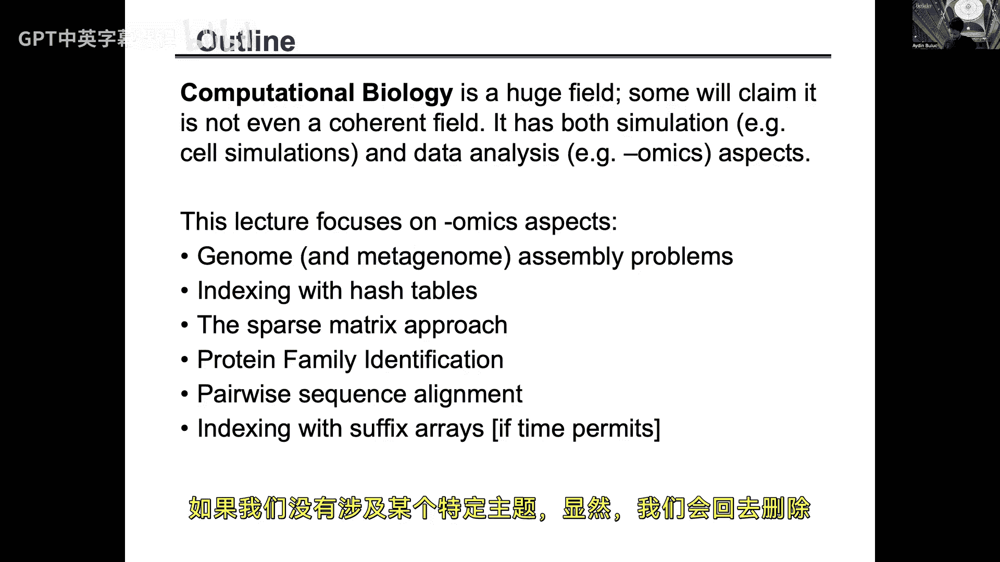

So we have led by one of our co instructors from the last several years， Kayellic。

 we wrote a paper about peism motif of genomic data analysis and we kind of。

Generalize the name instead of calling Aromics， we call it genomics。

 but literally it's all sorts of onomics problems。Where we kind of looked at the different kind of problems that we know of and so what kind of mappings that happen to the computational motifs that we know of again this goes back to the recurring theme of this class that there is a certain set of reusable computational motifs but that study that Jim and I have shown repeatedly in the earlier lectures of the class has not been done for biology back in the day。

 so we kind of did a redo of that and we found this set of problems that recur all over the place sorting graphs。

 alignment， generalizing body sparse matrices， dance matrices and hash tables。

And these are kind of the set of examples where these kind of motifs come up。

 most of these probably the pictures don't make sense yet。

 but I'll dive into quite a bit of them today。So let's start with the genome assembly problem which is actually what partially what you have done in homework three and i'm going to try to give a deeper dial on what's actually going on you've only looked at one particular small piece of that puzzle and it's nice to call this a puzzle because the obvious analogy is is a puzzle but we're going to use a。

A book analogy first， but really the genome problem can be think of as you have a particular book that is somehow shredded into little pieces。

And。And you have multiple copies of the same book， so that's a good important aspect because if someone gave you a single book。

And shredded it into pieces， unless you know the book by heart。

 there is no way to reconstruct it with one copy only。

What allows you to copy something that you don't know？

Reassemble it is the ability to find overlaps and you know。

And covers the stitching points with the other copy that hopefully didn't cut at the same location。

So that kind of redundancy is necessary unless you know the book by heart。

And then your job is to put these things together， really。

 using the redundancy that you have multiple copies。

And the analogy works very well with you have the same DNA as been sequenced redundantly。

And that's usually the word for it that you don't need to actually have three copies of same DNA。

 you just need to reread it from， reread from it many times。

 but it's just easier to illustrate it this way。Slight different differences。

 there are sometimes errors in the way we read the DNA。

These errors might have been more prevalent back in the day where the publishing industry made a lot of typos。

 but nowadays they don't do much of them， but DNA sequencing still has some errors in it。

But in the end everything else is the same you have sub sequenceequences that you have to put together now it's actually a harder problem than putting the book together because。

There is really no grammar to go with it， right the book you have some sort of sense of how the sentence should flow。

And because of our knowledge of natural language， that's not the case with a DNA。

 you have no idea how the the sequence should continue。Or you don't have any intuition behind it。

And the alphabet is actually lower complexity， which is only。For letters。

 it actually makes life harder。But otherwise， this is what the problem is。

And most of these things I have said in written form is there is no reference。

 meaning that we don't know the book we're assembling， we don't know the DNA we're ass。Now。

 you can say that there are some applications of sequencing where you know the genome you're assembling。

For those of you who have never heard the term genome。

And when I actually for the first time I heard it， it's like what is a genome？

And the genome is just the totality of the genetic material of an organism， that's all。And。

Nothing more， nothing less。You sometimes know a reference。

 let's say for humans we have a lot of references we used to have one particular person who is。

Genome was sequenced a quarter century ago， with the first time that the human genome was sequenced。

And I think it was Bill Clinton times when he was president。

 and I'm hopefully remembering it correctly， but there was only one。

And there's a lot of variation in humans across humans。

I believe several million distinct locations are different across individuals。From due to mutations。

It was kind of easy to miss variations because you're trying to fit everybody to that one reference that you had。

So that's sometimes why we do so called denovavo genome assembly。

 which is to ignore the reference and try to put together pieces from scratch this way we're not biased towards the reference we have。

This kind of issue is。Possibly going away with the new discoveries。

 which actually within the last 12 months。Finally， the genome。

 there are two big things that happened。One is that the reference genome is now much more complete。

Back in the day people used to call that you know we assembled the human genome and it's all done but that's actually wasn't true there was a lot of gaps。

 but they just called it done for because their definition of being done was a loser thing there were lots of parts of the genome that are harder to sequence and they were just known to have gaps there that's actually now end to end assembled to the point that there are no gaps in the genome and this happened within the last year so it's still an active area of research the second thing that happened is instead of relying on a single organism as the reference now the scientists does are building what's known as a1 genome。

Which is a collection of all genetic variations across lots of different individuals。

And this is represented instead of a linear genome， linear DNA。Graph。

 whereas every time there is a section of the human genome that is variable across organisms that is represented as branching points。

with frequencies and probabilities of how many of those have an A， how many of those have a B。

 that's called a pengenina， and none of these are in the slides because that's not the point that I want to come across。

 but just to know that this is a hot area and lots of major advances have been happening as recently as the last 12 months。

In terms of going away from a draft single reference to a complete single reference plus a pangenome of many。

 many different variations all encoded。But the main problem applies to organisms that are beyond humans right。

 what if I want to learn the genome of an organism that's important for cultivation purposes for example。

 I want to improve the yield of a certain agriculturally important plant。

 and I will have to do this problem again and again， so this is not really restricted to humans。

The reads are short， meaning these subequences that are coming out of the assembler are so much shorter than the whole genome。

 that's the hardest part of putting this together。And there are sometimes errors and repetitive regions are probably the biggest determinant factor in terms of how hard it is to assemble a genome denovo。

 and repetition means the same part of the genome sequence appears in many different places across the genome up to certain changes because these repetitions are result of duplications that happened in n years ago and we don't know N if the duplication happened in the genome very recently。

 they will look almost identical。But if the duplication have happened you know millions of years ago。

 then they don't look exactly different because these different duplicates。

Started accumulating distinct mutations over those million years。

 so the whole definition of repetition is also a little bit ambiguous at what point it stops being called the duplicate repetitive region。

Anyway， something that usually surprises people。When they foresee see it is that the human genome is not the biggest genome。

 it's not the it's not the size of the genome that determines the complexity of the organism。

 the salamanders you will see on various different creeks in California actually have much bigger genomes than what depends on the exact salamander type。

Almost all of them are an order of magnitude larger than the human genome in size。Certain pines。

 love Loly pine is a huge genome， lots of plants are actually large wheat that the particular wheat we use to make bread is about six times bigger than the human genome。

And substantially more repetitive。But those are interests for。Biologists。

 let's get to the computing aspects of this problem。

So I'm going to describe a genome assembly pipeline of an asssembblage we have built over the last decade。

 it's called Hpmer， it's based on another asmbler that came before it called Miraculous。

And this kind of pattern of generating the genome from reads alone。

 sequencing beta alone is pretty typical， but obviously different asssembbllerers will follow slightly different mechanisms。

So。First， the reads in case I haven't described by the read this is just what is coming out of the sequencers is a continuous segment of the DNA that's considered a read。

And the length of that might be as small as 100， depending on the technology as large as tens of thousands。

But for this pipeline， this pipeline is mostly optimized for the short read stuff。

 which has been prevalent a decade ago and is much cheaper than the longer reads。

So the first thing we kind of do in this assembly paradigm is to chop this rigs into even smaller pieces called Cams and the K is a parameter that we choose。

The name comes from Greek。嗯。And and then using those games。

 we try to stitch these things together into unambiguous。呃。

Subsequences called contexttex now that the definition of contact in the Hitlermer land is。

Some part of the DNA you can unambiguously assemble from this input。So there is no branches。

 there is no dead endts， you're pretty much sure that this green piece is from the genome and it's of this maximal length。

 you can't add more stuff to it that without creating ambiguity。

And then you can put together these context and orient their places with respect to each other that's what we call the scaffolding to do the scaffolding we take the context that we assemble that we' are highly confident of and map them back to the res and I'm going to describe how that mapping happens algorithmically and in parallel。

So these actually stress very different parts of the genome pipeline sorry compute pipeline the first part that uses input reads and creates ks and not only creates ks。

 they also count the ks figure out which ones should be correct and should be included in subsequent analysis and which ones are potentially arounds and should be discarded。

 that is what we call k analysis， this is obviously IO intensive because we start with terabytes of data。

And it's significantly bandwidth intensive because a lot of discounting and analysis involves all to all communication i'm going to describe and lastly it's very memory intensive because。

The way the cameramer is defined is it's a sliding window of rank K。So you do have a read of her。

100 and your ker lengthlesss say is 30。Then you actually bloated your input by a factor of 30 because every single character actually 29 minus1 every single character appears in k minus one distinct games。

 so you kind of created duplication of your input in this intermediate step that's what makes it memory intensive。

The contact generation， which is。The homework you essentially have done for homework3 with UPC++ is a latetnt bound phase of this computation。

 lots of irregular memory accesses across distributed memory。嗯。And finally。

 the scaffolding is both compute and IO intensive because you have to now go back to the RETs。

 which are the largest pieces of data you have at that point。

 so it creates this IO problem again and it' computer intensive because every single one of these alignments can become expensive pairwise alignments and an algorithm for pairwise alignment I will describe towards the end of the class again。

So let's look at the camera analysis part， you have reads and we want to do it in parallel。

 so from here we can start talking about parallel computing。

This is actually easy to read these things in parallel all you have to do is to say I have a data of a couple terabytes and I'm going to look at the file size and divide the file pointers to you know every one p of the data I'm going to set the file pointer right the zero processor gets the zero location first processor gets terabyte divided by P and so on。

Of course this won't necessarily jump into the middle of in the beginning of a line。

 meaning in the beginning of a read， so if that happens you just fast forward and let the previous processor finish that read so you can handle that even with text data and sometimes the input is in binary。

 have ways to kind of read this thing in parallel， suffice it to say， but once that happens。

 now the processors have these reads loaded into their memory and it doesn't have to fit completely into the memory of each processor in fact you can stream through this text。

Meaning if my processor's memory。The P0's memory is smaller than the total size of the reads。

 I can still do this phase by just reading let's say one tenthth of it first。

 keep counting and read the next one tenthth。This is actually a potentially streaming kind of analysis。

 of course we do parsing， this is embarrassing the parallel， everybody's parsing their own piece。

Now the first thing we actually do and this is going to be a little， I'm describing this thing。

Pipline after we have solved all these issues， so it kind of。

First sounds a little bit why would you do this step but it's going to become apparent in a couple of slides first what we do is we estimate cardinality of each gamer。

 but we want to do it globally because I want to know which cames occur a lot。And which cameras？

Basically， I want to actually define which cameras occur a lot because those need to be counted a little differently to think of it as。

Finding highly occurring beyond what should be expected data inputs and that can be done with a certain kind of data structure called hyper log log this is。

I think a valuable data structure for a lot of people to learn beyond computational biology。

 this isn't even developed for competition biology， so I kind of recommend this thing。

But then the the other thing that this cardinality estimation does beyond just finding the。

Actually I misspoke what the Carinality estimation really does is to give you an estimate of how many distinct cameras are in the data set。

Doesn't tell you which ones are most prevalent that's a different method that i'm going to describe this only gives you the cardioinity and why would you use this thing so think about a case beyond computational biology you have many many visitors to your website。

And you don't have memory to keep track of every distinct IP。

you don't want to keep a database of everybody， so how can you get a good estimate of the distinct visitors to your website with very little memory。

You know， unless there're couples。10 kilobytes something as small as that can you estimate the number of distinct visitors well apparently you can and these are the kind of the algorithms that allow you to do that cardinality algorithms and the nice thing about these estimation algorithms are they're very mergergable so-called meaning if processor one keeps cardinality estimation of its own piece and every other processor does the same with a single reduction of the data structure which is again。

 as I said 10000 bytes or something really small， with a single reduction of these data structures you can get the global cardinal estimation so it's mergergable trivially。

And so why did we do this cardinized estimation？Because everything we're trying to count here is based on the number of distinct cameras。

 not the total data。We just want to get account for。

 let's say all the cameras that happen if there's a camerar that occurs100 times the data structure will say the camerar's name and the number of times it occurs that's the kind of information we're trying to assemble from this process。

And we want to be able to set up our data structures beforehand。

More or less about knowing the size of the final final hash table and all the other data structures。

Instead of dynamically creating them or reallocating them， that takes a lot of time。

 so we want to get the cardinality estimation fast。So once we got that。

 we can then set up our data structures for the actual counting。

We can also identify high frequency cameras at the step using a slightly different algorithm that hyperlogwa won't do that。

 but you can also do that in a streaming way while the data is moving。

 this is called a heavy heaters problem， to be able to find items that occur really high frequency。嗯。

But we'll come probably back to that let's let's actually get to the。What happens after this。

 we go back to the reads and reread them this time。Now what happens in this step？

Is the same until tilt。We actually start。Start counting the real cameras。Now。

This is no longer an approximate algorithm now I want to actually。

Count each gamer how can I do this the naive way of thinking about it is well everybody can count locally and then we can merge。

Unfortunately that will not work and one of the reasons it won't work is we have no idea how big that I mean we have an upper bound right if we have if our camera size is large let's say 60。

Each nucleotide can and this is actually a commonly used number for this kind of assemler。嗯。

Each nuclearide can afford four locations it's  four to the 60 so it's2 to do 120 different distinct tank。

 so it's probably not going to happen， but the local hash tables will be huge and will run out of memory before we can actually merge things not to mention that the the merging will take a lot of communication even if。

We had all the memory。So local accounting and merging everything is not feasible。

 so what we can do is we can say each camerar will be counted by only one processor so the owner of that CAmer will count it。

And that's a fairly obvious methodology for that we hash our cameras since every processor is using the same hash function。

 they will determine that the same cameramer will go to the same processor。

 so all that needs to happen is we have to do an alt all to send the cameras to the processor that's responsible for count。

And the recipient will do this balloon filtering process。

 which I'm going to describe why we're doing this thing。

In the next slide and create a local set of the data structure that's going to do the count okay now a lot of big data problems have been solved in this pipeline and now let me describe why we are using this filter thing as opposed to inserting all the camera directly into dash table we want to count。

And that really comes from the fact that the input。

If you plot the frequency of ks versus how many times each one of them occurs。

 youll get a plot like this for a single genome for this kind of data。

And what is this really saying is this is usually this basically says the genome is sequenced about 40 something times because that's where the peak is。

Majority of the ks occur cure 40 times， so that's the thing that you expect and normal distribution around that。

Now what about this huge distribution on the left that I clipped？

Because if I just plotted this whole thing to scale that this peak would almost disappear because this is actually a huge region。

 why is this happening， because even though the errors are rare。

 a single error in sequencing affects k minus one ks。

Right because we're creating keys and sliding windows， just one error is amplified by a factor of k。

And so then you see a lot of singles a camerar that only occurs once in the data set if we could avoid creating memory for them and counting them we would actually have a lot of savings in terms of our memory footprint and that will translate into runtime savings as well so how can we do this quickly and there is a data structure for that this is also very important data structure to learn for things very beyond biology in fact this has been created for I think again for network packets。

Call the balloon filters。It's actually I should capitalize the blue filter every time it occurs I sometimes I did。

 sometimes I didn't because Bloom is the name of the inventor。嗯。

So the data structure is has one sided earth。If when I ask a balloon filter。

Is this entry in your set it says approximate set membership data structure is this entry in your set if it says no。

Then it's certainly a no， so I can trust that。If it says yes， I have seen this before。

 it's in my set， then there is a risk that the data structure is wrong。

 and I can tune the false positive rate。By making the size larger and so on。

 but usually I can tolerate a certain percentage of error for this application because I just don't want to miss entries。

 I can accidentally count some cameras that occur only once and then delete them later if I just increase if I eliminate 95% of the ss then I'm good。

 5% of them coming into my hash table is not a big deal I can just delete them later。

So the perfect belief is a perfect data structure for this use case。

 and no wonder a lot of assers actually use this thing in the Kmer analysis space。是。

And the reason why this works with one sided error。

 you probably have to read the B filter data structure。

But we're not actually talking about parallelils and aspects of it。

 it's the subject of a different class。So。And then finally， once I set all my local a tables。

 then I can do the same phase again。And not only just count the occurrences now。

 avoiding anything that doesnt didn't pass the bloom filter last time。

 remember the balloon filter allowed me to create a hash table。

 so now I can just say if it's not in the hash table I'm not counting it。

 I don't need the balloon filter anymore， I just basically say my hash table is fixed I'm not adding items to it and if you don't exist in my hash table I'm not counting you and that would be correct。

 beyond the singles。So not only I do count occurrences of cameras。

And retain the ones that I consider as correct， I also count the extensions。

How many times this gamemer is preceded with an A， C， T or G。

 and how many times it is followed by any of those things and based on that analysis， sorry。

I can determine whether this gamemer is in the middle of a sequence。

 meaning it has a unique extension on the left and on the right or it's。It's part of a branch。

 meaning。On the left it is unambiguously preceded by C but on the right there is an ambguuous fork so two different extensions are possible and almost equally likely or sometimes an X meaning it's a dead end I don't have actually a valid extension and these these cutoffs are determined by the look and at this plot that I probably won't go back maybe I can if I can quickly get to my mouse down there I can look at here and say。

U。If the occurrences of the extensions are within within a range that I expect then it's unique if two things are within a range then it's a fork if none of them are within the range I expect probabilistically then it's a data end okay so that actually concludes my face and。

And I'm going to actually skip the next one。Maybe I won't skip to this on this I already describe this thing one of the first things that we discovered once we did this pipeline is it works very well for human and skilled almost perfectly。

😊，However， if you go to a more repetitive genome， meaning a genome that has more duplications occurred over the evolution。

 like the bread wheathe， we actually significantly diverged from the ideal scaling。

 which is this light blue line。And when we investigated that。

 we noticed that some cameras occurred in way high frequency than would be expected， for example。

 some cameras in this data set occurred half a billion times。And remember our pipeline。

 our pipeline was such that。We。Always had each gamer counted by one processor。

That unfortunate processor who has to count this half a billion repetitions of the same kr is overwhelmed。

Of course， it creates load imbalance， not only it creates load imbalance。

 it creates actually network bottlenecks because everybody's sending those cameras to that particular processor。

So it creates loading balance and accounting， load im balance in the communication。

Because there isn't enough of such high frequency cameras and when the number of high frequency items are smaller than the number of processor accounts you have。

 there is no way to load balance it， no randomization is going to solve that problem。

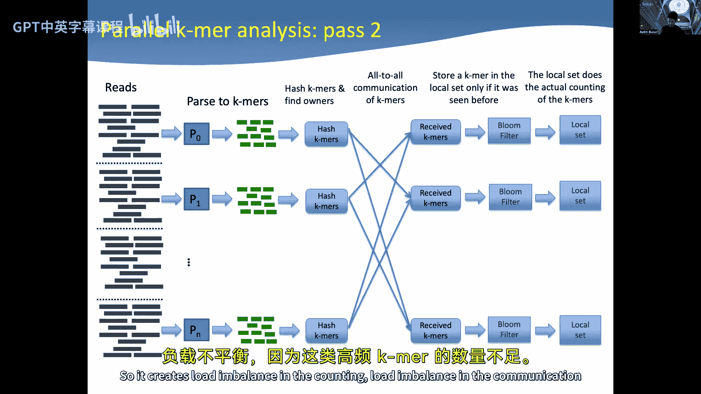

So that's why back when we're discovering the cardality of data。

 we also use another streaming algorithm called heavy heater detection。

 it basically finds items that occur with high frequency it does have a lot of false positives it will find a lot of entries that are not that high frequency but it won't miss items that are high frequency so we can just create a budget and say I want to count。

couple of thousands of items that I think are high frequency differently。

Instead of having an owner compute， I'm going to say everyone computes these items like this 500 million 451 million Kmer。

 that one will be counted individually by each processor and I'm going to do a merge of count。

 so I'm kind of treating high degree items and low degree items separate。To get scalable。All right。

As always， these things actually take much longer than I anticipate。

 let's get to the graph construction phase once I know the cameras now I can start constructing the graph。

This is a particular graph， this is different than the graphs that we talked about on Tuesday's lecture。

 and I skipped that face and I said that the computational biology class will cover it and here we are。

The debriing graph is。Is a particular data structure where cameras are nodes。I mean。

 the debris graph in mathematics is a more general data structure， but for genomics。

 it's such that cameras are nodes in the graph。And there is an edge between two nodes if the k minus one prefix of a kmer matches the k minus one six of another kmer。

So the overlap is k minus1 exact and it has to be on the end points。Okay。

 hopefully I have a picture there。Let me get the picture yes， so all this is saying is。嗯。The GAT。Is。

对吧。has a edge between ATC because the K minus1 length suffix of GAT。

 which is atT is the same as the K minus1 prefix of the next one and so on。

So this graph is constructed using a hash table and the reason we want to use a hash table is。

It's actually。Much more meaningful to represent this graph as a hash table。

 simply because the number of expected。Edges are very small， you do expect like 1。

2 on average degree on a graph， so there is no point in retaining an adjac list or anything like that。

In many cases， the number of extensions will be one。So you can just query the hash table。

 figure out what the next extension will be。And in fact。

 since we only represent things that are unambiguous sequences， if there is more than a degree one。

 we actually don't represent it in the graph， we just call it's a fork。

 we'll deal with it later in scaffolding。So how do we build this thing it's really a construction of a hash table problem every processor now has these cameras from the camera analysis phase and has the left and the right extensions either uniquely or as a fork represented。

And that's simply pushed into a hash table now the crackux of this thing is that I am not going to query the hash table。

 I'm not going to make reads on the hash table。Until I fully constructed it。

 so this is a right on your face。Of the algorithm。And that's really。

What's going to allow me to not do this fine grain communication。

 The first idea is obviously for each insertion into the hash table I'm going to。

Lock that bucket in the hash table， insert it or update it， and unlock it。

But this creates latency bound computation for each entry in my input。

 I have to do a remote lock unlock， even if it's atomic， it's actually highly latency bound。Now。嗯。

What I can do instead， let me actually go to the main point is since I don't need consistency until this whole hash table construction is finished。

 I can buffer my update to it。Instead of going to a remote location。

 remember this state this hash table is distributed。

In a global address space such as the one used in UPC so the chances are the part that I'm trying to update is not owned by me the part that I'm trying to update is of the hash table is sitting on a different processor's memory。

So what I'm trying to avoid by this so called aggregating stores。Optimization is to the round trip。

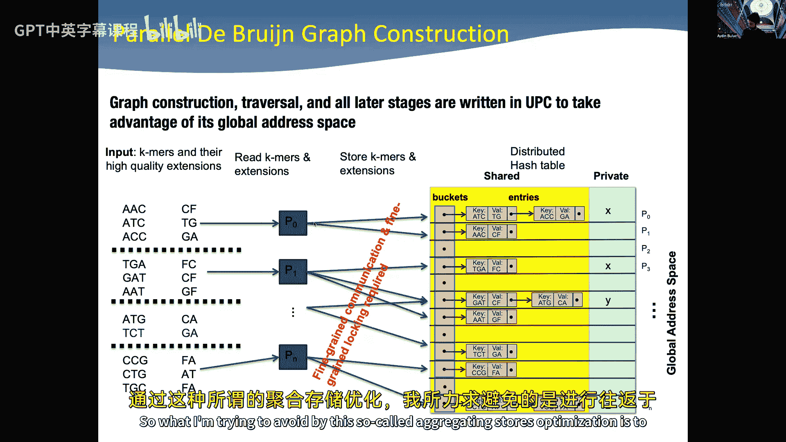

To some other processes memory so how can I do that as I said I don't need to read this hash table until I finish constructing it so i'm going to buffer all my updates to the distributed hash table into a local buffer and when the local buffer is full i'm going to update the distributed hash table in one attempt so one one trip to the remote processes each one of them of course not just one。

And I'm going to not use locks， I'm going to use remote atomics and that is allowed by almost all high performance network interface cards there。

 since these are integer operations， I'm basically atomically incrementing the counts of something the network interface cards are able to provide atomic instructions for me。

And UPC UPC++ and various other libraries allow me to do that， in fact。

 even MPI allows me to do that with MPI3s atomics。And I'm just going to be atomicicallycrementing this the chances are some other processor is doing the same thing at the same time。

 but that's not a big deal。Because these are atomic， so both of our updates will be preserved。

So that's the whole crackux we have now constructed our hash table。Since we constructed it。

 the next step is to traverse it。This is the input at the bottom。

And this is the whole what the computer sees conceptually it's really equivalent to these pieces of disconnected subgraphs of chains and these are the context。

 but all I have to do is simply walk through them。And concatenate the entries to get my contact。

It seems like a very trivial problem but I don't know where to start and these are not localized meaning GATT is probably sitting in the memory of Pro one ATC is sitting in Pro five and I have no idea about this until I start walking so how can I walk this graph in parallel efficiently and that's the graph traversal problem I basically start with a random entry in my distributed hash table。

As a processor of zero， I just say I'm going to start with the first entry I have processor and。

 sorry。And then。Then that's going to tell me where to go because CTG when I look at the hash table。

 I'll see that the right extension is a， so I'm going to say， okay。

 what is the next camerar then I should be looking at the hash table which is TG and add that extension TGA so I'm going to query the hash table。

啊。For TGA and almost all of the time with probably the p minus1 divided by P。

If this was uniformly distributed， I will find it in a different process' memory， but that's okay。

 I'm going to use the fact that this whole cache table is in a global address space。

And just remotely get that and I keep doing this thing until I hit a fork。In that end or an x。

 which is the dead end。At which point I'm going to start backtracking and start exploring the incoming extension。

Go back to CTG and now now I'm adding the right extension and then querying TCT and I'm going to find something else and do this until I hit that end again so you can see that I can construct。

The actual sequence of the contact this way。What can go wrong？Well。

 I made this picture in such a way that actually evangelists have done this picture in such a way that every processor is lucky and gets a distinct contact。

Well， it's not going to work like that all the time， right there's no。

So the same picture is there's nothing interesting in this slide， the same thing is happening about。

But the reality， here's how this thing can go wrong。

 because I'm randomly picking ks from a distributed has table。

 different processors can grab ks from the same context。And there will be collusions。

 processor I will try to be will start extending from this k。

And processor with J will be extend from this part and T will be extending from the other part。

 and they will find themselves trying to grab the same part of the graph， so to speak。

So there is a mechanism that allows these processors to not discard the work they have done so far。

 once they detect the collusion， then they can just give up all the context that they have assembled to one of these processes one of them will give up work and go get the different context and the other one will claim the subcon that's been generated by the other processor that they give up and there's a whole synchronization protocol Evanvangelos came up with this thing and it works beautifully。

 but overall that's the main idea。

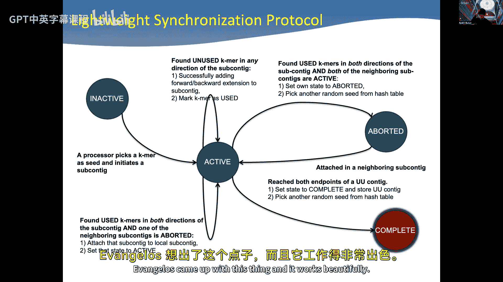

Okay， any questions so far？Thank you to the person who thank you。

William for posting the link for the class to Piazza and you continue with a slightly more complicated problem and I'm only going to describe this problem because the solutions are similar。

Computetitional wise， their algorithms are way more complicated。Unfortunately。

 because the problem is more complicated。The data that I'm trying to assemble includes more than one genome。

So far I have had， I want to assemble a pine， and I want to assemble a salamander and you get the data from the salamander and there's only salamander genome there。

You方ペです。What if I have an environmental sample， that's the definition of metagenome。

 which is the totality of the genetic material from an environmental sample that you haven't been able to isolate the genome for。

And that can be getting a sample from a like that can be getting a sample of somebody's poop。

That can be an ocean sample and so on。 So there's a lot of organisms that。

We don't know when we try to sample rocks， oceans and mudlands and we're trying to discover new life forms and maybe discover how the balance of an environment is changing over years。

 so this is a very active area of research metagenomics， but the challenge here is。

Is verse than the genome assembly instead of having a single puzzle that you're trying to assemble。

 you have multiple puzzles， if you have jets， this is actually a regular problem。

They will mix up the puzzles and it will make the whole puzzle exponentially harder I mean luckily for us the most puzzle inventors have discovered this reality and they mark different puzzles with a number on the back if the package comes with four different things every one of them will have a number okay this belongs to the first puzzle this belongs to the second puzzle。

😊，Unfortunately， for metagenomics， there is no such thing。😊。

So you get all these pieces of DNA that are not only shredded。

 but they can be belonging to different organisms。What makes things even worse is not necessarily the same frequency and some elements on this。

 let me actually illustrate some organisms will occur a lot more than some other organisms。

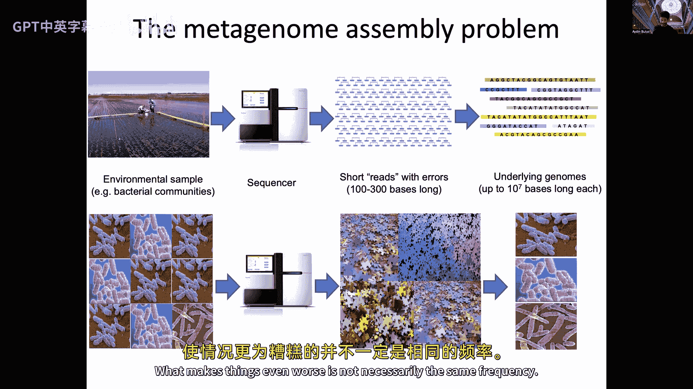

And so some puzzles have 100 pieces，100 copies， some puzzles have only two copies。

And since this is an environmental sample。A lot of these things will be bacteria and small things。

 organisms that are closely related to each other， they can be different strains of the E coli。

If you know this famous bacteria that's E coli。Some of those strains。

 some of these variants of this genome。Is mostly be， some of them will make you really sick。

But they are 90 something percent identical， so how can you tease them apart。

 that's the repetition across genomes。嗯。And。

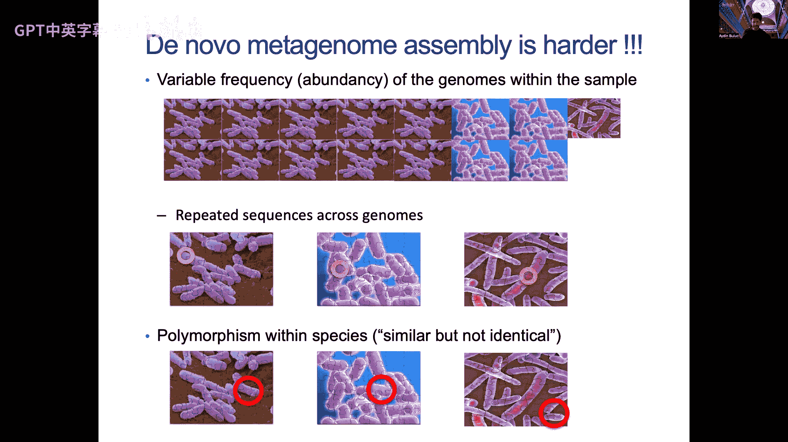

Do I have to think， yes， so because the frequency is different across genomes。

 the error in a low frequency organism。Sorry， an error in a high frequency organism looks almost indistinguishable from the real genome on a low frequency algorithm。

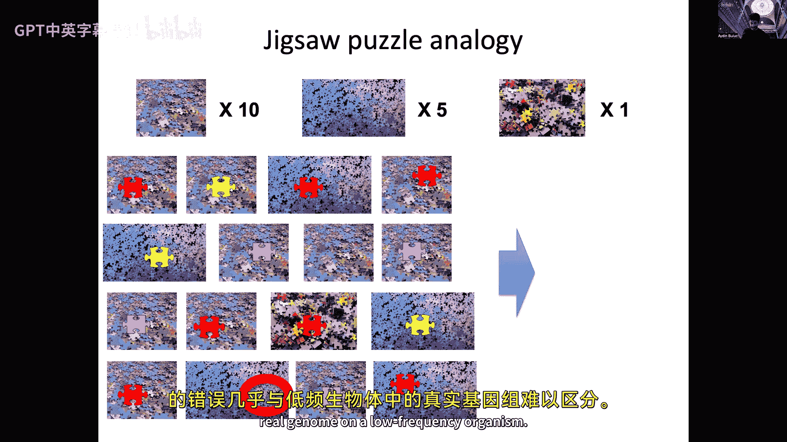

So I think at this point， Ive successfully convinced you that this is a really hard problem。

And no asmbler will fully solve this problem， we're mostly making best attempts on extracting genomes from this puzzle mess。

But it's very important and these are considered metagenome assembled genomes。

Genomes that are being put together from in to samples directly。

And the scheme really remember is you'll see similarities of this pipeline of contact generation with what we have seen before for single genomes。

 we still start from reads， we still count and characterize ch ofs。

 we still build a debrisbriron graph like this distribution has tables， we still traverse this graph。

And a lot of other steps of read the contact alignment that I haven't so far talked about。

All these steps are almost identical to single genome assembly， except。There is an iterative stuff。

Meaning once we complete this pipeline， we go back and do it again with a different camera account。

And this allows us to tease different organisms。Out from this data。

Because there is a perfect chemer size for each organism， but we don't know this beforehand。

 so with this iteration process， we're able to tease out different organisms from this soup of different organisms。

And that's the main idea。And there's another complicated scaffolding step that i'm not going to describe the whole point I want to emphasize with this step is the parallellyzization strategy is is quite the same。

 so we we do p gas based distributed ah tables and we still。

Built these hash tables and that's the main data structure that we're going to use。And in the end。

 we'll get pretty good scaling and almost close to perfect scaling with over 61% efficiency increasing the number of course by a factor of 32。

And solve some of the largest problems that have been out there， why is this important。

 why are we attacking this problem with a distributed memory processing is for example。

 before metahiipmer attack this problem， the only way the scientists were able to assemble something out of this thing was to subsampble it。

But once you subsampble a genome， then you are actually removing a lot of the overlaps that occur between reads and your ability to assemble genomes have been drastically compromised if you could use the whole coverage of the data。

 the whole 2。6 terabytes， then you're going to be able to extract a lot more genomes out of this thing and that's what exactly happened。

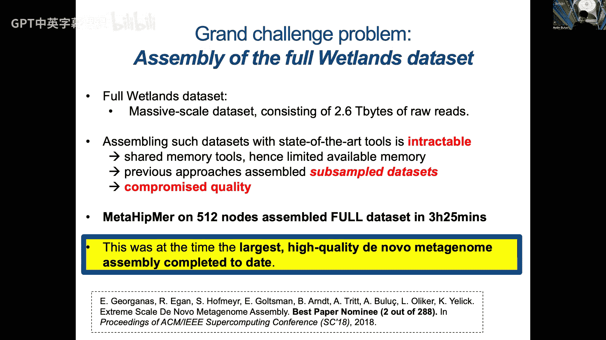

So this is a nice。A description of the whole pipeline you go from REs to Cams that we described iterate overhead it you build the context we described this already now i'm going to actually talk about how to do the read the contact alignment and then。

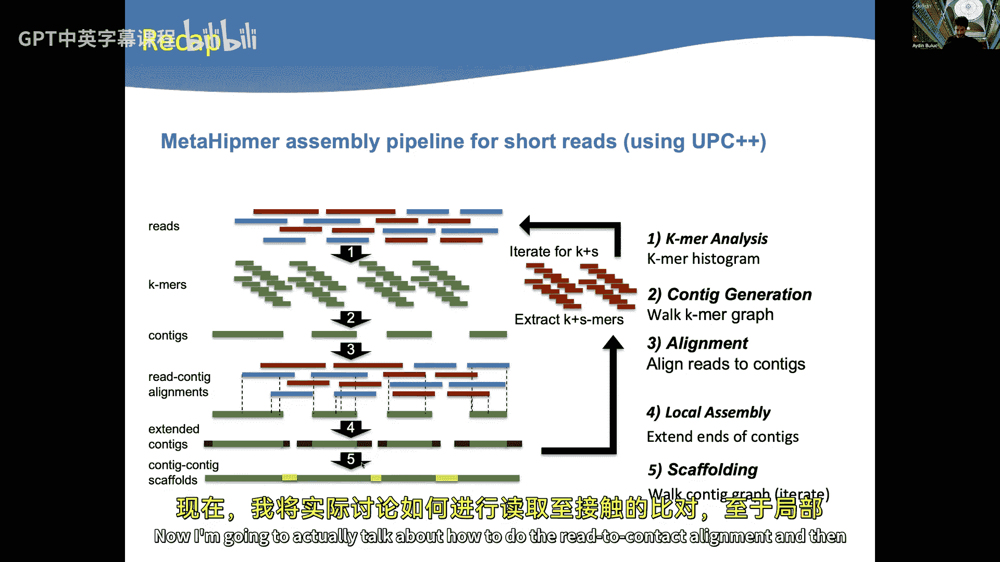

The local assembly structure I'm not going to describe。

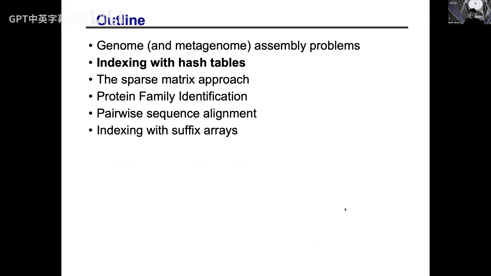

So how can I？Map the context I have generated back to the reads。

And this is an abstraction that will occur repeatedly。

 so this is not limited to be a pipeline within a genome asmbler。

 this is used in various different analysis in the genomic space。So the main idea is。

I have so called queries and I have something called targets。In this special case。

 my queries are readTs， my targets are context， but you don't need to actually think about them as context or readTs。

 you should only think about them as I have a bunch of sequences。

That I want to align to a bunch of targets so many too many alignment and i'm going to describe one way to do it and i'm going to describe another way to do it after this so the first way relies on the partition global address space of languages like UPC and UPC plus plus。

So。And it's going to use the same thing as as we've seen before， the main idea is a caish。

 except that we're going to call these seeds fixed size cas。So。

I need to first generate an index that allows me to。Find potential matches for each。

Sequencing my query dataset set。To each sequence in my target data， and how can I build the index。

 I go over my targets。And I divide it into Cams。And each camera is inserted into something that we atly call a seed index table。

So it's just a hash table actually， so I'm inserting this thing and putting a back pointer to the target。

And sliding it and putting a back pointer into target and so on。

That's all I'm doing i'm just going over the sequences and inserting them into the ash table is this familiar to you。

 of course， because we've done the same thing when we were building the debrisb graph。Which is。

Go over the input and insert items into a hash table。So now once I build this hash table。

 it's fairly easy to see how we can find exact matches of cameras。

So I do use the same k to split my input sequence and I just simply query the seed index oh。

 it doesn't exist in the seed index table， so okay， let me try the next one。

It does exist in the seat index table， so if I choose my K correctly。

 it gives me confidence that a subequence of this query is matching perfectly to a subequence of my target。

 so that gives me evidence that maybe I should go and spend some time aligning these two。Right。

 because there is a high probability that they will be matching。

So that's what I end up doing first I use the SD index table to find the candidates that I should spend time aligning and then go and align them。

So that's the whole idea， and this is described in this paper， Carolinar。

So how can you do it differently so we already have seen how to do this using the dash tables now we're going to see how we can do this potentially with the sparsse matrixs approach。

But for that， I'm going to actually describe a slightly different。

wayay of building genomes and just for completeness， so far we have seen the debuon graph approach。

 which is you divide the res into s cameras and then you build this long skinny debrion graph。

The other abstraction that allows us to build assembled genome de Novo is the so-called overlap layout consensus approach。

 and that's much more common in the use for longer weeks're talking about instead of 100 base pairs。

 we're talking about 10，000 to 100，000 base pairs。Because。And there are many reasons for that。

 the number one is。The degron graph。It's such that its size is independent of the coverage。

If I covered the genome。10 times versus 100 times a perfect de graph would be of the same size。

 so that's really a good property for the shortre input data sets which were really high in coverage because the ratess were so short they had to be in high in coverage to recover the genome。

There is an overlap layout consensus， the size of the data structure， the overlap graph。

Is proportional。To the input size， the more reads I have。

 the more the bigger the graph and if I covered the input many many times the graph gets bigger that's why this kind of process was not favored in the short read assembly and the brewin graphs were favored however the overlap layout consensus with the long reads。

Im more favored for long grids because long grids allow you to cover the genome with a much lower frequency。

 I can just assemble the genome successfully with only 15 x coverage。

 so that input will not be that large and better yet。Each node in the graph is the whole read。

 which is a 10，000 base pairs， whereas in the debrisbri graph each node is just length k。

 which is like I don't know， 60。So in the end， for long reads， OL seagras are actually smaller。

 so that's why it actually worked better。And there you first identified the overlaps between reads。

 so how can I find overlaps between these reads and now I guess it becomes clear at this point that finding overlaps between reads。

Is abstractly the same problem。As。Finding。This， I have a bunch of queries and I want to see how they map to the targets。

Because why are they the same problem， replace the queries with all the reads I have。

And replace the targets with all the ratess I have so if the query set is equal to the target set。

 then I'm abstractly solving the same problem of。Finding overlaps between weekss。

So that's why I'm saying even though this is solving a slightly different problem due to different data sets。

 abstractly it's the same thing， many to many sequence alignment。

I'm not going to go into the details of what has been going on in long read data sets。

 but let's figure out how I can find overlaps between lots or last of reads I think one picture is enough to describe what I can do。

I can use the same camera based approach， but instead of building a distributed hash table。

 I build a sparse matrix， the sparse matrix I'm building is this one a。And the x axis is the reads。

 so it has as many rows as there are reads in the input。

And the y axis is the set of cameras I care remember we have done a lot of kmar analysis to find which cameras we consider erroneous。

 which cameras we consider as irrelevant for the analysis we do something similar to that here as well so the same idea applies we do count cameras and we find which ones we should retain and there's many many different ways of doing that thing we can even subsample from the cameras but let's assume that I have a mechanism for finding the good ks and those become my column I and what do I have for each read I have a non-zero if that read includes that kr。

And not only that， I can also。Overload this sparse matrix。

And insert not only the count or the presence of the camera， but also exactly where it's occurring。

 if I can say there is a camera that occurs in position 00 and position 250。

So I can encode all of this information。Now with one sparse matrix I've actually un doneone now what I'm going to do is I'm going to transpose this sparse matrix and compute the gram matrix。

 which is a times a transpose， the essentially inner product of this data。

And once I compute that for each read pair， meaning read one to read three， let's say。

The output of this multiplication will tell me whether they share a camera。

And if they don't share a camera， I don't need to do any subsequent analysis。

 so I only need to operate on the zero non zeros of this output after multiplication。

And since par matrixs multiplication has been optimized over the years in terms of both the fastest way to do it in the GPU。

 fastest way to do it in distributed memory， and so on。

We actually can just leverage those algorithms as opposed to building software from scratch。

And then for each and on zero， I can just go and do alignments as I please。So that's the main idea。嗯。

And of lots of questions that needs to be answered about whether this is feasible。

 what is the right set of claims， which I'm not going to describe but the paper cited below actually talks about those decisions in excruciating detail。

And when I actually implement this thing or ran Julia。

 one of your fellow PhD students implements this thing。

 it gets pretty good scaling to these are actually notes of as far as I know。

Is this summit or is this core， it's really I know exact， I think we had data for both of them。

At the end， so these are not these are actually slightly larger runs than they would suggest。

And they scale pretty well， they scale better than a previously implemented distributed a table method。

 mostly because。The sparse matrix approach is able to use two dimensional algorithms。

And you've seen that they actually have lower communication costs than one dimensional algorithms。

And the parallelization is described in these papers for a hash table based approach as well as a sparsme based approach。

Okay， so to recap this sparse matrix based assemblyem analysis looks not that much different from the debroom based graph。

 debroom graph based and distributed hash table based approach， we still do a camera analysis。

 we figure out which cameras we care， we still build some sort of index。

 but except instead of building it as a hash table we build it as a sparse matrix。

And the finding of overlapse is done by sparse matrix matrix multiply SPGM is a sparse matrix and sparse matrix multiply an acronym for it。

 and then we do expensive pairwise alignments that I haven't described so far。So， both the。

What I haven't described so far in both cases。Is if I can get my mouse。

 I'm going to be very happy to you。Both this approach here with the distributed dash table。

As well as the sparse matrixs approach， once I find potential matches。

 I had to go and do an expensive pairwise alignment for those pairs of sequences。

Wwhichch I haven't described yet， and I'm just abstracting that away with saying extra alignments here。

 but I'm actually going to talk about a different kind of alignment algorithm than there's more steps down there。

So。Let me give one more example about the same kind of where the same kind of primitives occur。

 then that's probably going to convince you that a lot of this computation abstraction attempt we have tried to make in the first slide is actually working out different problems that seem to be not that related actually are solved with the same data structures and approaches。

So this particular one is called protein family identification。What is a protein family？

It's it's a group of proteins that are so called homologous and homology is just。

The property that those entities are descended from a common ancestor。

And they are usually do same functions。You can look at the hemoglobin that humans have。

And some homologgue of that protein exist even in lots of plants。

some protein carries oxygen to the tissue。In almost every living organism。

Even though the hemoglobin we have versus whatever homologous version of it exists in the soybean have divrged so much that their sequence similarity is only 40%。

 they still have the same function， so I want to discover protein families and this is a lot of good biological use cases。

That I'm not going to motivate too much yearss， so how can I do that？Well， the general pipeline。

 the most trusted pipeline is to first get all the proteins。That I'm trying to find families from。

And build a similarity network meaning which of them have high sequence similarity across each other because building protein families directly from that data usually is way too expensive because the signal can be really small as I said remember two sequences to proteins can be only 40% similar but can be homologous so you have to put your threshold really low when you're doing this similarity construction that will make it really expensive and that will have a lot of false positives creeping into your data so instead we put the threshold high and we miss a lot of things in the sense that。

This network construction will not discover a similarity between human hemoglobin versus soybean hemoglobin。

 but there's going to be a link for multiple paths。

The human hemograbin will look awfully similar to the monkey hemograbin and monkey or hemograbin will look awfully similar to some other and from this path。

The clustering algorithm that is subsequently applied into this similarity network can discover a protein family through multiple length。

So we kind of do this thing as a two step because the results are often better this way。

For the reasons that I just tried to explain。And。I'm not going ask you to spend too much time on HML because we have covered MCL Marco cluster based clustering in the unsupervised learning lectures for details about how it was done you can go back to that lecture so I'm going to cover the network construction part how do I generate a similarity graph to be sent as an input to the HML clustering software。

U。So the difference here versus the。The overlapping of DNAs is the low similarity that I need to detect and catch the weakercur signal。

 so otherwise the idea will be similar to the overlap detection we have used for Bella for long grades that we described。

Now， how can I find similarities， I need to lower my K significantly。

When I'm trying to find overlaps between DNAs， I am trying to find exactly almost exactly up to an error of sequencing matching regions because there's sequence from the same genome here the input is very different the protein z evolved over billions of years。

How can I detect that I have to lower my case so much。But even that is usually not enough。

To get the kind of sensitivity I want， instead I use this following approach for each camera I have。

 even for a small cane like seven。I also find a lot of similar cameras and I look at my evolutionary table。

 this basically says how many times this particular amino acid proteins are made of aminos as opposed to DNA is you made of four characters。

 proteins are made of 20 something characters。And there is a way to look at the evolution of proteins and say the probability of an m miating into Q is this and penalize the things that are not supposed to happen right so the scoring matrix basically is based on expected evolution of mutations between amino acids。

And using that for each camerar， I can find a bunch of substitute games or a similar cameras。

 and that will increase the sensitivity of my candidate detection algorithm。

And I can actually encode this thing in the Sprse matrix language just as easily as I encoded exact matches。

 remember in Bella the exact match schemeche between two sequences was to find cames that perfectly match now I can go to an intermediate matrix called S which is the substitute Cams matrix it says for each read how many oh sorry which cames are the closest and I set the parameter of how many myself I can say I only want to retain the top 20。

Substitute games based on the evolution， and I can actually encode the penalty here so that the ones that are really close have a higher impact on my detection。

And again， I'm basically doing the same sparse matrix times sparse matrix multiplication。

 except that it's a triple matrix multiplication。with a different algebra， but all are good。

 and that will give you a software that reusees a lot of the components that's been developed again over the years and a lot of the research that happened in algorithms that minimize communication and so on。

And it's actually accurate competitive with the state of the art and skills much better than anything else that has been out there since the publication of this paper a year and a half ago。

 we obviously have improved on the scaling and we can now solve problems that are almost two orders of magnitude larger than what I'm reporting here。

But since that paper is under review， I'm just going to keep the published results。And as I said。

 I think weve covered the macrocoluster algorithm before， so I'm not going to repeat this thing。

And then the similarity network is being given as an input to this clustering algorithm and implementation of it called HMCL and it。

Maybe one thing I haven't talked about last time is we also successfully mapped this HM software to do GPU based accelerated clusters like those in sumummit。

O could sum a supercomputers， so the fact that you're reusing components and working with well known data structures allows you to map these problems into new architectures a lot easier。

Yeah。嗯。So to recap the protein family detection pipeline， you'll see the similarities again。

 we start with camera analysis， we build camera histograms， we do build sparse matrices。

 we do some overlapping either exact or with substitute cameras。

 we do some pairwise alignments that I haven't still talked about， it's just coming up。

In all these three cases so far， I have only shown you how to find the candidate pairs of proteins or DNA sequences that I have to do in overlap expensive alignment。

 but I haven't told you what an expensive alignment is。

 and I'm going to spend the last 10 minutes on that。

So that's step four and then there's the hipMCliteration。

 so you can see this whole pipelines look awfully similar to each other once you spend enough years studying them。

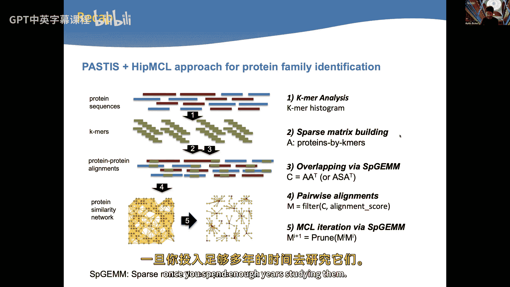

So let's actually concede the fact that I'm never going to be able to talk about suffix arrays today。

 but I have enough time to talk a little bit about payY sequence alignment so what is this。

This is two sequences I given and I'm trying to find the best way to align one sequence to the other。

There is many different variants of this algorithm and even the objective functions are slightly different。

 let's start with the global alignment here what I'm saying is I want to morph one sequence to the others。

Minimizing a certain penalty。ThePal factors are given by the user based on the application for this application。

 it's like every mismatch。I is a penalty of one， every match is a gain of one， and if there is a gap。

 meaning I had to insert a gap into one sequence， then I'm also penalized as much as a mismatch。

This is one pretty uniform way of scoring and based on your exact problem and your input data。

 you can change these parameters。And the optimal algorithm for this is order mn M is the length of sequence1 and n is the length of sequence1。

 sequence two， assuming these are of the same length， it's a quadratic algorithm。On one input。

And the scheme is based on dynamic programming because you can write this recursion fairly easily。

 you can say that the score between sequence1 and between sequence one up to its height index to sequence two up to its Jde index。

 can be given by this recursion， which is I'll choose the highest score。Among the three options。

 which is。Score of the best alignment between。Sequence 2 up to its Jde index and sequence1s up to I minus1 index。

What is going on and same with the roles of IN the roles of sequence 1 and2 I changed plus a gap in these cases i'm inserting a gap and finally I am going back by one nucleotide in both sequences and adding the score of trying to match the height nucleotide of the first sequence and the J nucleotide of the second sequence so okay that's a mouthful what does it really mean？

So I'm here and I want to this self represents the best way。Of best score of aligning。

The two letter traffics。Of sequence1 to the three letter pres。Of sequence two。Now what can it be。

 it can be the best way of aligning two letter prefis of one with the two letter prefis of two plus a gap insertion。

 I'm basically saying I'm inserting a gap to the second one to this one， sorry。

 and it can do the symmetric case up the best alignment with the single letter version of the sequence one。

 the three letter version of the other one and a gap。

Or it can be the best alignment between the single nucleotide version prefix of the first two nucleotide prefix of the second plus whatever the cost of morphing the last letters in this case actually the morphing the last letters gives me a gain in the score because they're about a so the maximum of these three is going to give me the best score and this algorithm will obviously fill this dynamic programming table。

And if it's filled intelligently。You can get the scores obviously in quadratic time without doing extra work for each cell。

 I'm only comparing three entries。But the main point is not to get the score。

 the actual main point is to get the alignment path。

Luckily I can just do that by keeping back pointers every time I'm feeling distinct。

 I can simply keep track of what decision I made when I'm making this decision that the best way to come to the cell was through the diagonal I'm putting a back pointer so that when I'm going back。

I can construct the best alignment in linear time。So that was global alignment when I was forced to align one sequence。

To its completeness， to another sequence， to its completeness。

There is a variant of this thing called the local alignment and it's worth knowing about this。

 this basically says how can I。Apologies for this animation that keeps going。How can I morph？

One sequence to a subset of another sequence。So I can say that this sequence a perfectly matches。

ASubsence of sequence P。And this is called a local alignment and it makes a lot of sense。

 let's say you're trying to map a single nucleottype to sorry a single read to a much bigger genome you can use this thing。

 nobody would do but it's totally possible， the only difference between the previous algorithm and this one is you're never in depth。

Meaning in the previous algorithm there are some locations where you like in minus two is your score and you have to pay the death of to get out of that area。

 but if you change your recursion to be the maximum of the three things that you already know and zero。

 you never in depth， so this allows you to find the local alignments because you don't go into a place where you have to recover from and that's basically the whole idea。

It doesn't change the algorithm， so that's why I'm kind of not spending too much time trying to explain why local alignment is sometimes more useful than the global。

There is even more variance of this semi global and so on。But let's see how you can fill this thing。

 you can actually fill this thing in three different ways or many more different ways。

 because whenever I need to update a cell，I only need to get information from the where is my mouse from the up neighbors left neighbors and the diagonal on my left up side right so the obvious ways of filling this thing is I can feel by diagonal。

By diagonal， right I can fill each diagonal at one time steps， I can fill column by column。

Because if I'm filling column by column， also when I come to a cell， I have everything I need。

If I'm filling each column from top to right in this sequence。

And I can do a very different competition of flow the important part is as long as the dependencies are satisfied。

 there's very different ways of filling this dynamic programming table。

 this gives you a lot of parallelism right the simplest one to think about diagonal bi diagonal is fairly obvious how you can assign a process to each entry in the diagonal。

And get get parallels and there's a lot of different attempts as described in this computing surveys。

 but the issue with all of this is。There isn't actually enough parallelism in one diagonal only sometimes you need to break this thing up into more pieces because what if the sequences of them is some you know aligning are only a thousand by thousands and I have more processes than that it doesn't seem to be a very practical question but in that case you can see that your parallelism is limited to order n for an n square problem and that's not perfectly ideal because the parallelismm you have usually you want the span of the computation。

 meaning the fastest runtime you can get to be logic on the input size whereas in this kind of approaches it's linear on one of the inputs。

But there are other ways to actually get around that problem。

 which unfortunately I won't have time because I am done with my time what the rest of these slides that you're not responsible for。

Talk about is how to do this alignment。In linear space。

 because so far we're actually taking quadratic speech。

 right the one sequence time the other sequence， I have to fill this whole table can I。

Find the optimal alignment without incurring quadratic space and it turns out I can。

 there is a very nice idea and that actually that idea becomes the basis of other parallelizations of this thing that in this slide we'll describe and it's simply basically is to find the cutoff point in the alignment without trying all possibilities and using that recursively and I'm constructing the other pieces and so on。

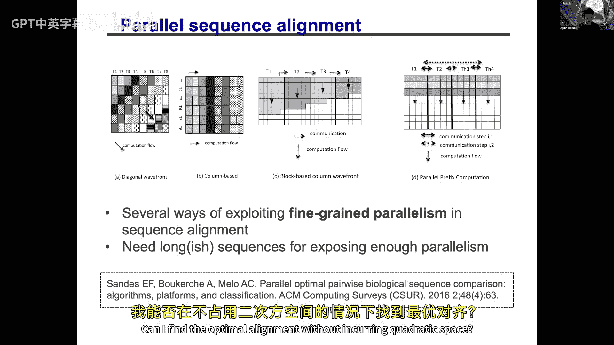

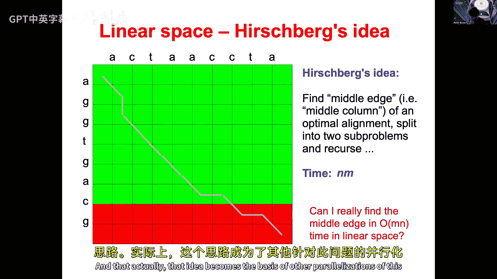

But that's about it on that。And suffix areas， therere in the slides， but you're not responsible for。

So this kind of concludes all of the lectures of CS267 for this semester， and it's been a pleasure。

To at least do the lecturing part and we still have much more work to do in the project part。

 looking forward to your project pitch and poster presentations next week。

And and then a couple weeks after that， also looking forward to reading your final reports。

 one thing I want to highlight is there is no extensions for the project reports because we have a due date for the register and we don't actually have a lot of time to。

Gade all your project reports so please be cognizant of the space limits that we try to put in your project reports we have a lot of them to grade and please realize that we can't give extensions on that because of the requirements of campus asking us grades by a particular deadline。

So see you all next week。

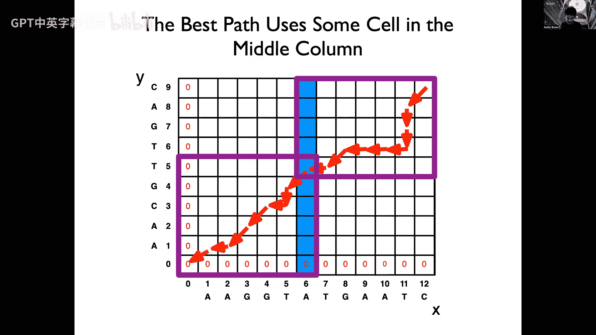

Hi， professorfessor， could I ask a question about the final project？

