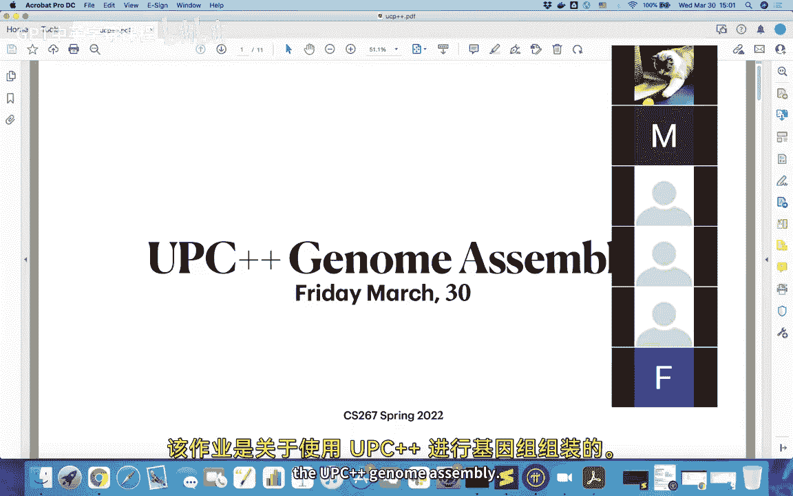
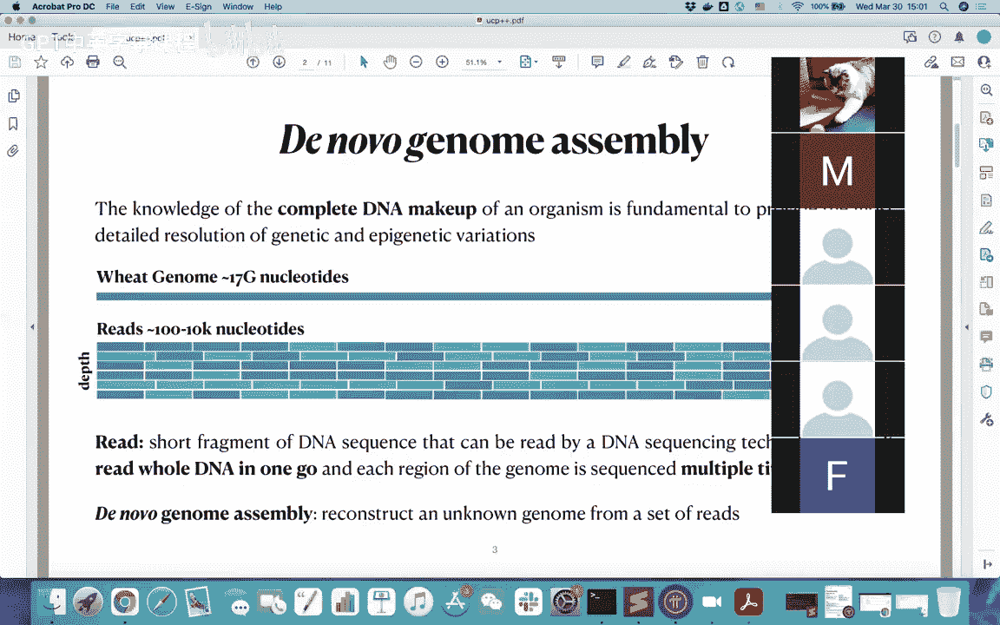
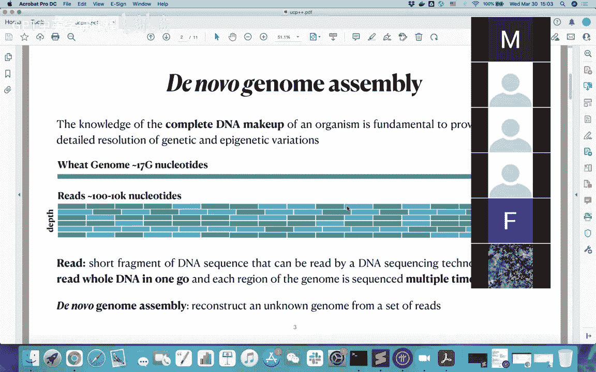
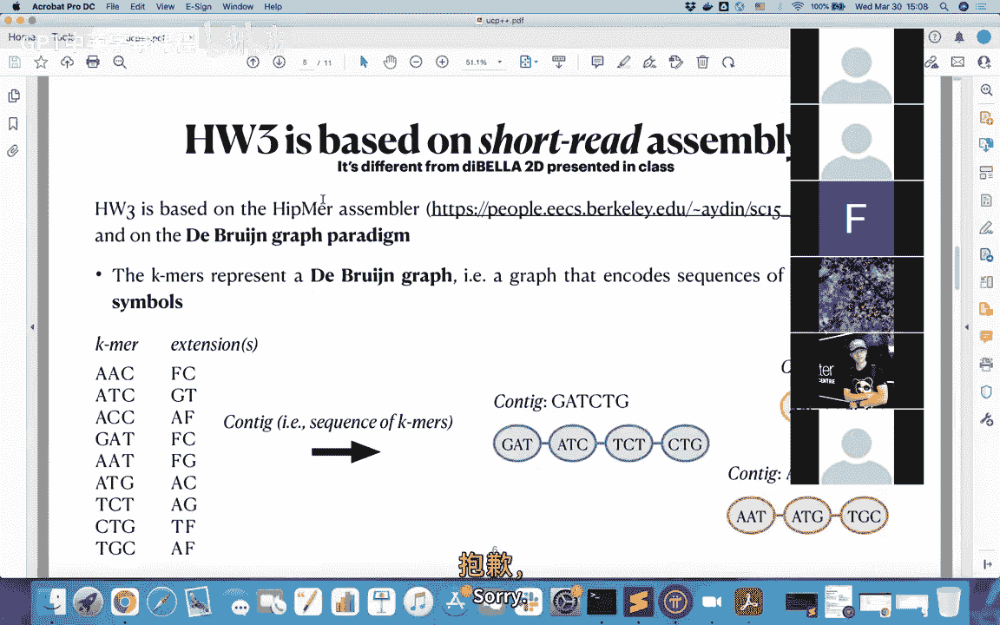
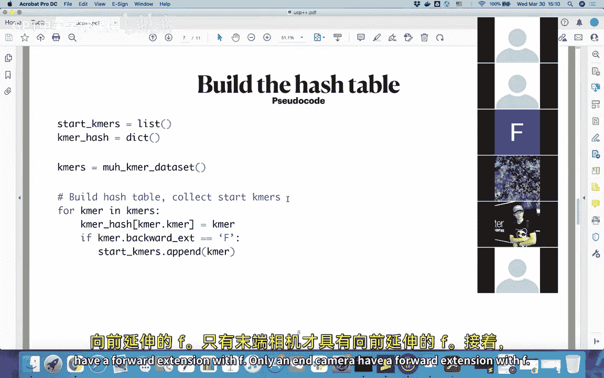
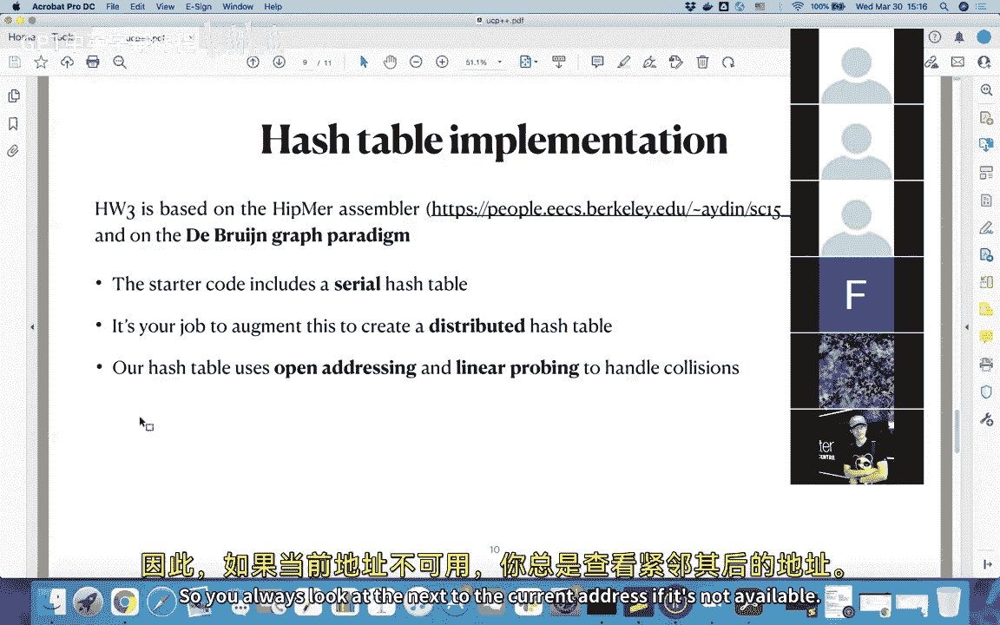

# 【并行计算 CS267 2022】伯克利—中英字幕 p23 CS267 HW3 Recitation -BV1PS421978D_p23-

Yes。是。Yeah， seems good。 Let's start。 So today I will go through some basic backgrounds about our homework 3。

 which which is the UPCC plus UPC plus plus genome assembly。

This recitation is more about the background of our project rather than some technical details such as how you write a code。

So I'll first talk about the de novo genome assembly。 So we know that。

The the knowledge of the complete DNA makeup of an organism is the fundamental to provide the most detailed resolution of genetic and and epi genetic variations。

 So generally we will have we will have a genome that is super long。

 such as the weight genome showcase on the on the top figure and in。In a lot of previous works。

 researchers have developed a system of like a system to process this genome。

By first generate the raise， each raise contains a like a smaller number of。N nucleotides。

 and it's generally 100 to 10 k。 And based on the rates will。OhSure。

 I will enable the live transcription。And so previous work have shown that based on the risk。

 we can have a more efficient way of processing the genome。

That will introduce us to the cameras。Womework 3 is based on a short read。Asly。

 so I say it's a very simple version of of this。Geneome assembly processing。So。

On the on the webpage we have shown that homework3 is based on the Fiqua asler this is a work done by previous Berkeley PhD in Iidings group and it published in supercomput 15 the PDFf link is on is online so I think I'll just。

Yeah， the title is just Hmer， it's very easy to find。In homework 3， we。

 we are given a series of cameras。 cameras is a short version of DNA sequences of length K。

 In our homework， we have a human genome， which which the camera is of a length 51 and others like the small dot text or the test version。

 we have the length of。Camers to be 19， and。And all of these cameras can be used to build a deep brain graph。

So each camera has a backward extension and a forward extension。

 This is just the normal characteristic of cameras。So， for example。On on the left。

 we can see that a camera。Is A G， and it has extensions， extensions。

 F G F means like we know that we only have a A G C T in genomes。 So F means special。A special note。

 for example， if we have FG as the extension， then we know it that our camera。

 AG don't have a previous camera。 So it is a start camera。

 and the following camera can be calculated by using the last two。last two character of camera A G。

 which is C G， And we have the extension G so that we have the following camera to be CGC。

And if we have a F character or F letter in the extension in the second in the second letter。

 second character of the extension， then it's an end camera。I see， those are quite straightforward。

 And based on those cameras， we can generate the cons by by doing a。Traverse。

 like by traversing the the brain graph。Which we can just。

Locate the sequence of overlapping symbols and then concatenate them together so that we can have different cons cons。

This can be showcased by algorithm。Whi will be shown later。In our homework。

 we want to efficiently traversing the the。Brand graph to discover the connected components in our job。

 And to do this， we'll use a hash table written in U PCC plus plus。

This hush table or this distributed h table is very important because generally we have a huge amount of cameras and without parallel computing。

 the serial version would take a huge long period of time to process。So here we show the速 code。

Let me see the chat。诶CG。Plus G。🎼Should be CGC。 Let me quickly。 have a look。不意思太。Sorry。

And good catch， by the way。 So let's see the code。 First， we want to build the hash table。

 we need to have a list of start cameras because we we only like we are not only having one con。

 We have multiple cons。 So that is to say we have different start cameras， And we also need a。

Dictionary called camera hash in this pseudocode。 The dic is writing in Python or anything。

 It's just a representation。 But in our homework 3。

 this d should be implemented by distributed hash table in UPC plus。

So here cameras is just a data set， so we have the API implemented in our homework3 Rpo。

 so we don't need to worry about that。So in the requirements， we have showcased that。

Only the like only the camera hash map should be modified。

 and we we should keep other files to be intact。So to build the hash table。

 we first need to collect the start cameras。 So in in this pseudo code。

 we just go over all the cameras and and and if we find any camera with a backward extension F。

 then we know it it is a start camera and we append it to the start camera list。

One thing to notice is that。A starter camera has a backward extension F like it don't have a。

 it don't it don't have a forward extension with F only a only a end camera have a。

Forward discussion with F。

Then we traverse the h table。So in the pseudo code， we see that we have a list of conts。

 That's our like final answer。 So that's our expected results。

 we traverse the conts each starting with a start camera。

 That is to say we just go over all the start camera inside the start camera list。

 we just constructed。 and then for each con。 we。呃 we。

Looking to the hash table to try to find the next camera of our current camera so that we can build a build a deep brain graph to form the con。

 So specifically we always look at if this is if this one have a。

 if the current camera has a forward extension of F。 if， if has a forward extension of F。

 then it is an end camera。 So we， we that means we just finished the can。

 But if this is not satisfied。 then we always want to look at the next camera by looking at the。Yeah。

 by input the camera as a key and use the next camera function of our camera data structure and。

After after getting the next camera， we。We just append the next camera into our config。

 so finally we can have our config。About the implementation。

 I think most of you have look at our rip， the repository show showing the hash table like the building blocks of our hash table and and the other camera data structures so Home3 is based on the Hmer asler。

 which I mentioned and the starter code is a serial version so if you see the details。

 you can find that in our serial code we we just。We just use use a dictionary and。诶。

And we never do any parallel parallel stuff。 So if you， so one thing to notice that on the website。

 we have a test version。 So it says if you run the test command and follow the instruction。

 if youll show nothing。 then you are correct on your implementation。

 that is for the parallel version。 So if you directly use the serial has table and run the test command。

 it will give you some error saying maybe there's no multiple processes or maybe there's no。

No distributed implemented。YouNo distribution implemented。So。

It is your job to create a distributed hash table。あ。And finally。

 our has table uses open addressing and linear probing to handle collisions it is also the details are also shown on the website。

 but I'm glad to briefly introduce some ideas here So for hash table or any dictionary data structure。

 we are always。We are always want to。Find a find any values by looking at the key。

 So in order to have a  one，2，1 reference or one to one relation between key and value。 We all。

 we always need a hash function。Dis function map all the keys to a specific and special location。

That you need use to that which you use to store the value。One thing we may meet here is coalitions。

 for example， you have two keys， but your but your hash function gave you the same。

The same final location to start a value。 that is。Absolutely嗯。

ThatThat is not what that is not we want。 And we need to address that。 That is called。

To a collision address。To like that is called to address the collision in in the hash table or the hash function。

 A lot of methods have been developed on this hashing hashing function。

linearar probing is the I would say， is the simplest one。The basic idea is that you just。呃。

So you first call your hash function on the key and it will generate an address for you and you just check if this address is already taken。

 if it， if it is not taken， then then we'll use it to store your value and if it is already taken。

 you just。You just look at the next available address by adding one to your address。

 So that is called linear probing。 So you always look at the next。The to the current。

 to the current address， if it's not available。

So here we'll briefly discuss some parallelization strategies and then I believe for this homework we can briefly talk about some takeaways or some something to。

To， to， to notice when you do the homework。So first， we'll talk about general strategies。呃。

As we know that。The distributed like， we can distribute the hash table among your UPC plus plus processes。

 This is taught in our CS 2，67 course。 and in our lecture， we know that。If you want to have a。

Have have a shared memory or its or logically shared memory， although it's actually physically。

Like like unrelated to each other。 but logically， if you want to have a shared memory to assess or to implement your cache table。

 you want to allocate and passing around some global pointers。

 So this is written in UPC plus plus as UPC X X and then global pointer。 So。

By using this global pointer， we can have a。We can have a shared memory。嗯。And each。

 each distributed process can can access to this to this shared memory by a global point。

So the other thing is that we need to take care of inserting。That is to say， when we are inserting。

Values。Into the hash table， we want to have some sort of coordination。

 like auto auto autonomic atomic or some， some coordination to avoid。

Or we can use logs to avoid the collision。诶。So。In our implementation， I think the。The atomic。

Doin of UPC plus plus is very useful， and the details can be checked in the in the UPC plus plus gate。

InInOr in this spec。For further optimization， you can aggregate multiple inserts into one communication operation。

This， this approach is used in paper and。Like the the link to the paper is just this one show shown in this in the page。

 which is the super computing 15。Published paper， So I want to mention here is that。We won't。诶。

So this is not this is an optional choice， so。Maybe as long as your implementation works well for the intra node and intra node scaling。

 it is fine。So for homework 3， the auto gridr will only test the internal node version。

And it won't look into。Implementation details。 so。Yes， so our greeting here is twofold。

 The first one is we will run the auto encoder to to testify your implementation。

 to see if it is correct。 and then we will。Use the auto encoder。 No， you will use the auto gridr to。

 to check the。The speed， the parallel performance of your inter node implementation。

And the other part of the grading is we will look at your homework report。

And see what different kinds of optimization you used in your implementation。

 or maybe we are interested in if you have made any problems or issues when running this UPC plus plus implementation and how you how you manage to handle it or address it。

 So so overall， if you have。If you have some special considerations， when you are writing the。

UPC plus plus implementation。 you you are welcome to talk about that in your homework project in your homework。

Like you know， homework report and。And。Since we don't test the intra intra node version。

 So you are required to report the intra node。Performance in the homework report and maybe add some discussion on what what is on what you reserve what you observed and some analysis on what is going on。

That's generally our suggestion for the parallelization， and。Yeah。

 and let me make some final clarifications on the implementation and then we have the Q&A。呃。Oh， yes。

 the first clarification is that。Our homework is indeed a very simplified version of the hipmer asler or we have another paper let me quickly have the name We have another paper called parallel Dbri graph Con and Traveral for de Novo Geno assembly you are welcome this is the information is on Piazza I think adding put a post about this paper so you are welcome to。

Check this paper， but it's not required。 as I said， all the。

 all the biological knowledge here is not required by by homework 3。 even， even myself。

 I always like make mistakes。 when I I pronounce those names like the debri graph or hip cameras。

 So for implementing the。Distributed has table。 you only need to focus on UPC plus plus and and the hing function。

 You don't you don't need to look at the。biiological meaning。

 and if you guys find it confusing about all the camera stuff like why do you need these cameras and why don't you directly doing stuff on the on different reads rather than on cameras or why should we have such an overlap among different cameras like all all of the reasons can be found on those。

Previous papers。And the other clarification is that we have。Oh， we have move on。

 like we have an upgrade on Cory， so。Previously， this homework can be compiled by query compiler。

 but currently you need to use G N U on the Github ripple is's not good on our homework ripple。

 we have。We have modified that， but if you are maybe for example， if you are using GCC。

If you are using Intel， Hawell or something else on your previous homework。

 you need to switch switch to GNU and KNL notess。呃。Yes。

 and the final clarification is about the different attributes for our command。

 So in our homework page。And we showed， we said that。

You need to look at the core job starter and also there are a lot of different attributes attributes。

 for example， we have slash C。Or we have the small， small N and the capital N。

 and we also have the N per N tasks per node。That you can use。

 So my suggestion is that you are not supposed to use all of them in one command。For example。

 the capital N is the number of nodes and N tasks per N tasks per node is just what it means it defines the the number of tasks per node。

 Those two can be used together。 and for for the。For the N and C function C is the number of logical course to run the different processes you。

 you are using。 So these two are the other pair of attributes that can be used together。嗯。Yeah。

 I think that's all for the， for the。Reciitation part， because I think。

So what I'm required to provide as background information is quite straightforward here。

Maybe I'll leave the other the left time for some discussion on implementation and some questions。

 specific questions。So feel free to speak up if you have any questions。嗯。Yeah。

 and thanks for being here。In the chat， we have question。 When will the slides be released。

 So I will release the current slide right away after the recitation and the previous slide is already there on P。

And I would say those are quite similar to each other。Go another。Question。

 if you don't have special optimizations beyond the scope of the recitation or don't cover any techniques。

In the report。We will lead to a great job， so。嗯。So you need please clarify any techniques in the report。

 are you referring to your homework report？I see， so。呃。

Yeah I think what's shown here in the recit should be enough for a good grade。呃Spial。

Techniques such as adding what adding mentioned。 the like， let me quickly check。嗯。嗯。Yes。

 so I didn mention in Piazza that we don't need to implement the aggregating stores optimization and also other optimizations is' optional but。

呃But。The final grade will depends on comparisons to， to your。To your peers。

 So maybe if all the other groups are using very advanced optimizations。

And have very super strong scaling performance。 then that may lead to a great job if you don't have it。

 but I I seriously doubt that because in from our previous experience。Like。

Some of the advanced techniques actually cannot provide you a very strong boost on the performance。

 and some and， and the other。Advanced techniques are very hard or time consuming to， to explore， so。

诶。So generally speaking， no。Okay。Yeah， and I also want to mention in our last GSI meeting。

 our instructors E and James also mentioned or encourage you guys to focus more on the cross project rather than spend all your time on homeworks。

They， they said that the projects。Have a larger proportion on the final grade。 And yeah。

 and for homeworks， as long as your version runs smoothly and the the scalingkating performance is decent then。

There won't be a huge problem， I would say。嗯。Yeah。Cool， awesome so。

Thanks for your time and if there are other questions。You can post them on Piazza， or send us emails。

And for and for the。Final project， I think we just sent out the comments about the project proposal last night and。

Please呃。Please adjust your go or。Final project， accordingly， and。诶。

And we are we look forward to seeing your great work。

