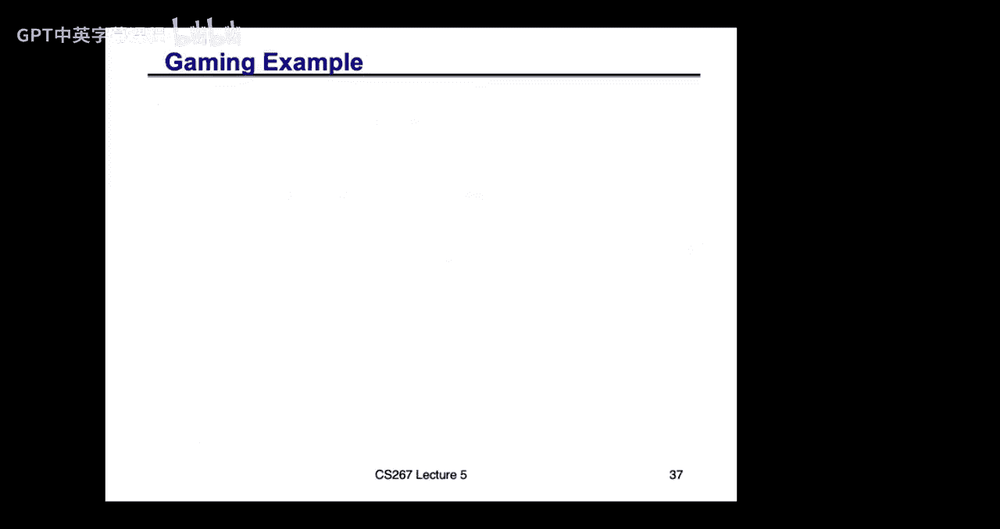
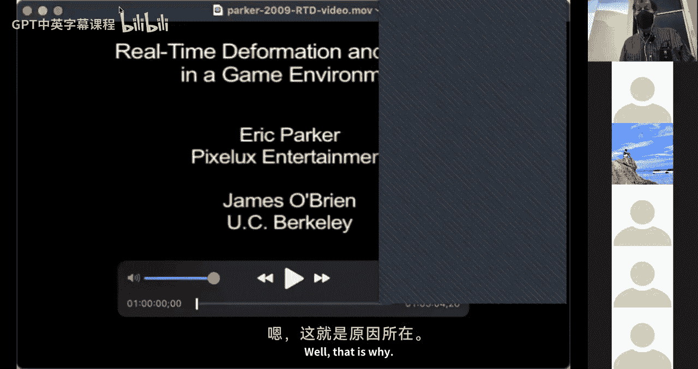
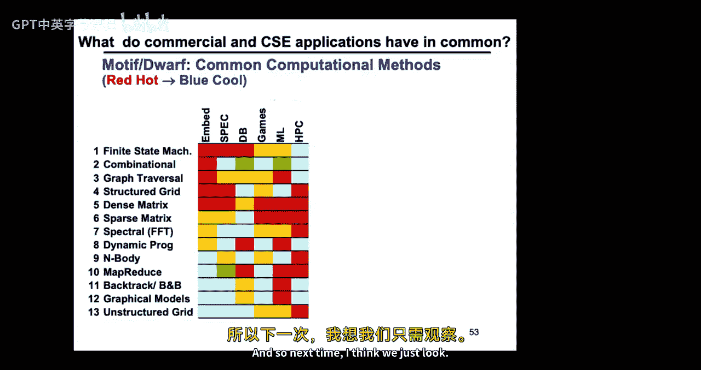
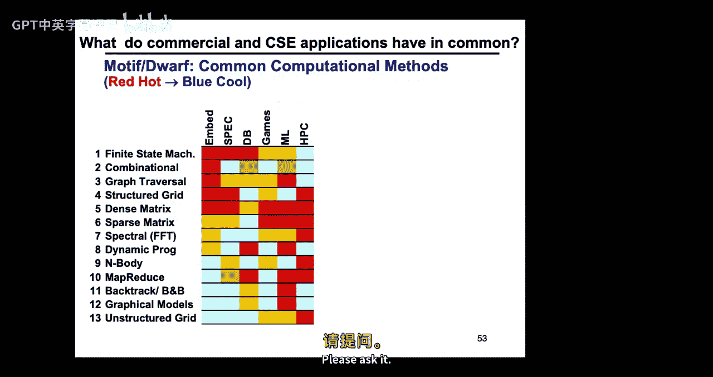

# 【并行计算 CS267 2022】伯克利—中英字幕 p24 CS267 Lecture 5： Sources of Parallelism and Locality in Simulation -BV1PS421978D_p24-

嗯。Just Zoom is working。Re。电到了。GuI'm not sure we have too much to do about that。等以说在个。Okay。

 I restarted recording。个。やとに？So Vivek， do we have any announcements we want to make？そた。

Nothing on my end， it's not already on Piazza。Okay。

Well welcome everybody it's great to be back in a hybrid classroom so half view are here and some large number are on zoom I don't know how many so today and tomorrow and the next time。

😊，Hello。Our plan is to talk about sources of parallelism and locality and so our goal here is to introduce you to certain patterns that come up over and over again in parallel computing that are important for two reasons one they tell you what you can parallelize。

 but they also tell you how you can keep data together on one processor or in one part of the memory in order to minimize communication。

 so we're going to emphasize scientific computing examples to illustrate these patterns。

 but they're very， very common they come up all over the place。So。

So let me just remind you of our basic architecture so that which is our simplified version so we can use that in order to talk about what's parallel and what communication means so we have a whole bunch of processors。

 there's an interconnect network and they're connected to a bunch of memories so the questions we need to ask ourselves when we at this simple level is where is the memory is it sort of located with the processor or far away really on the other side of the interconnect network and how is the interconnect network worked is it a bus where everybody can talk at the same time or is it a tous it something else complicated。

And so here are the three models of hardware that we've talked about so far to which we're going to map these patterns and the first one is a shared memory machine in that case the processors all talk over some network to a common shared memory so when one processor says you know load location 37 it's the same location 37 for every processor so you have all the issues so it's easy to share data but you have all the issues of race conditions and so forth that we talked about before。

And in the distributed memory case each memory is co-located with a particular processor so when processor this processor accesses location 37 it's just local there。

 it's not this processors data and so when they want to communicate they have to know send messages to one another that's the typical model you know send and receives it's sort of like the mailbox we'll talk about that in a future model and the last one is you know captures SD instructions like the ones you're using for your first homework assignment or GPUs where there's a single boss processor who's telling you know all the worker processors please do an ad at the same time on your data or a multiply or whatever and then they can all share some some sort of。

Data so so these communicate by reading and writing memory， sending messages， and again。

 going through memory。And so the ideal cost that we're going to use for much of this lecture in order to understand the patterns is that the cost of a read to write is constant。

 it doesn't matter you know who is where you're going into the memory to get it it's going to and so here when you send a message。

 the time is going to depend on how big your message is you sending more bytes cost more because it's the bandwidth cost。

 but it doesn't matter whether you're going from this processor to what looks like a neighbor or far away the network we're going to ignore its connectivity and here when we issue a parallel instruction saying add this vector to that vector。

 we're going to for the moment you know assume there's an unbounded number of arithmetic units of course know if it's a very long vector that'll have to be repeated。

 but that's going to be our simple model。So， oh and I should say this these models also capture。

 for example， if you're competing over the internet using Spark， that would be， for example。

 also fit under this very high level model。So as we said before and we're going to you know see this over and over again。

 parallelism is important to get high performance but also data locality so that we're not moving very much data because moving data is the most expensive operation and the good news is that many real world problems have a lot of parallelism and locality in them automatically。

So it's obvious in the real world many objects operate independently of others。

 so here I am speaking each of your brains is operating independently。

 you know either reading email or listening to me but it's all independent work and then objects also depend much more on nearby objects and distant objects and you're going to see that in homework too when you simulate billiard balls rolling around so obviously two billiard balls if they get close enough。

 they will bounce off one another and otherwise they don't so that's very nearby neighbors but that's know depending on the physics of the problem or the sociology of the problem you know that that will be what nearby means to change。

And then dependence on distant objects can also be simplified often so here's an example from gravity so let's suppose you want to compute the gravitational force on the earth due to all the other particles out there so you go out at night you look up at the sky and you see a billion little white dots and you say oh okay I have a sum of a billion numbers or so and order to figure out the force in the Earth and then you realize that one of those little white dots is the Andromeda galaxy and it has another billion little white dots in it and you say oh oh it's a lot harder problem than I thought but actually your intuition was right in the first case it's perfectly fine to replace the Andromeda galaxy by a little white dot at its center of mass with the total mass you'll get all the decimal places you need in the course of gravity and in fact if you apply that idea recursively the Milky Way looks like a little white dot。

 the Andromeda galaxy know inside the solar system etc you can get the cost of computing all the forces down from order n squared to order n where everybody interacts with one another and this is a。

This algorithm that we'll allude to today， but have a whole lecture on later。

So and then scientific models may introduce even more parallelism。

So if I have a continuous problem where particle know billiard balls are moving continuously in time。

 I'm not going to you know try to compute their position at every time I'm just going to do it at discrete time intervals you know at time one。

2，3，4 or something like that and so that discrete process also adds more perilism because and it helps communication because I may only need to talk to my nearest neighbors you know in the course of one time step because the information doesn't。

😡，Travel much farther than that。And of course， many problems can exhibit parallelils and at multiple levels。

So here are the four basic kinds of simulation that we're going to be talking about and the different patterns that arise the first one is called discrete event simulation and the simplest one you know was appeared in a scientific American article back in 1970。

 the game of life and where you have a grid each grid cell is either dead or alive and there's a rule to go from time T to T plus1 that each grid cell we either become alive or dead depending on how many of its neighbors are alive or dead and this is a famous game people have been playing for a long time and we're going to use that as an example for simulation。

So manufacturing systems assembly lines， that's another discrete event system things go on and off finance is pretty natural too。

 you know you have transactions that occur at particular times。Circuits。

 the natural way to model a digital circuit is to say at every time step I get some inputs from my neighbors and I compute an and an or or something like that and finally we're going to use games as an example and this is a very ancient game and PACM where everybody all these little particles are moving around in a cell under your control and you're trying to get them to go somewhere。

So the next level of simulation is called particle systems。

And so now this is a little bit more continuous than before because I still have a discrete set of objects。

 let's say billiard balls， but they're now moving around continuously in time。

And they can only you know and they can only interact in certain ways。

 so bouncing billiard balls is one obvious example。

 galaxies moving around astronomers do those kind of simulations。

 molecular dynamics where I have atoms moving under certain forces and I want to know where they go circuits I can also do at this level of simulation that's sort of asking you know if I simulate the electrons and how they move around and then games again。

 so pinball being rather more slightly more modern version of a game that's worthy of simulation。

The third level gets a little bit more continuous and it's called lumped variables。

 depending on continuous parameters， and you can think of these as being ordinary differential equations。

 but it's actually more general than that。And so here I have a whole bunch I have a discrete set of variables。

 let's say the position of all the beams in this building and I want to simulate them or come up with some simulation over time and so the simplest example would be earthquake simulation and there's been a little whole h of work here at Berkeley on paralyzing earthquake simulation so I exert a force know on each beam and they all move and I want to simulate that going forward。

 chemical kinetics is another example where I want concentrations and chemicals at time circuits again。

 and in fact the most popular algorithm you know used in Silicon Valley to simulate circuits of many。

 many companies is called Spice which was invented here at Berkeley by Don Peterson many years ago and then there's one more game。

Which we'll see a video of later calledSt Wars， the Force Unleashed。And finally。

 when everything goes continuous， we have continuous variables depending on continuous parameters。

And excuse me。And that is also called partial differential equations。

 although it doesn't have to be a partial differential equation。

 so things like heat you know where you want to know the temperature as a function of position in time。

 elasticity where you want to know motion and strain as a function of position in time electrostatics now finance seems like a funny one to have a PDE but there was actually a Nobel Prize for that it's called the Black Shos equations which is used on Wall Street for doing simulation of prices。

 circuits again if you want to have you can model limit that level of detail shorts equation or something medical image analysis。

And finally， Terminator three， the rise of the machines。Now I have these two different。Games in here。

 and I just want to mention what they have in common and how they're different。So。

This one was is solving ODEs， this one is solving PDEs。

This one was invented at Berkeley and this one was invented at Stanford。

What they have in common is that they've both been used in various Harry Potter movies。

And they've both won Academy Awards。There's an Academy award for technical achievements。

 and this one， I believe was the name of the award was for destruction modeling and we'll see why it was that way before。

So anyway， you can see there's a lot of use of this stuff and all sorts of things beyond science。

 although you know getting these simulations correct for games and videos is also。

 simulating physical events。So and it's also true that a particular event and so I've mentioned circuits and finance here at all these different levels can be you know you can combine different levels of simulation and do that and so here if you can't wait to see the video of the Star Wars unleash there's the link to it but I'll be showing it shortly。

So here are is an example just for circuit since a lot of folks in the audience here from Es and saying that these can be simulated every different level of those four that I'm showing。

 so you can think of individual instructions being executed。

 where you take something some inputs and doing an and or an ore and put them in some output you can do it at a cycle level where you have。

 for example an ALU which is doing a bigger operation but is still doing it once per cycle。

 a lot of colleagues like to write RTL register transfer language， to simulate how a circuit works。

 you could do it at the level of gates， you can go up to spice which I mentioned before。

 solving ODEs so you can model what all the transistors resistors and capacitorors doing。

 and then you could simulate which some of the physical electronics colleagues do what's going on at the electron and silicon level and so this goes all the way from discrete events to the to the continuous to the lump systems to the continuous。

ち。So to summarize here what we're going to do for the next lecture and a half。

 this doesn't all fit in one lecture， we'll do discrete event systems where time and space are discrete。

 like the game of life， particle systems where the locations can be continuous and that's a special case of ODEs or a little more general than ODEs where the locations and entities are discrete but time is continuous。

And then there's continuous systems where time and space are all continuous。

 and so what I'd like to do is identify common problems。So at this point。

 you may you know we have students from 20 different disciplines in this room。

 so I can't assume everybody has knowledge of a certain physics problem or something in order to illustrate how it works and motivate this so what we've done over time is we've built a standard set of simulations using some made up rules to illustrate all these different problems and it's called sharks and fish。

And this there's a link to all of these codes on our web page and the basic idea is we have a bunch of sharks and fish living in an ocean and we have some rules for how they move around and there's both continuous rules swimming around and discrete rules where they live on a two-disional grid and can move to their nearest neighbors and of course fish and sharks like to create new fish and sharks or eat other ones or pass away and so there are all these different rules for doing that then of course there's ocean currents so that's something that is also part of the simulation and then it turns out that fish attract fish and they form schools so there's some gravity in there。

And sharks are attracted to fish， but fish are not attracted to sharks。

 so there's all these different rules for doing the simulations and these are available in various parallel programming languages。

 not the most recent ones。 and so some of the homework will be based on this。

So here is just in a little bit more detail what the six levels of sharks and fish are， you know。

 going from， you know， just。Independently moving around， embarrassingly parallel。

 up to very complicated rules。Okay， so now if there are no questions and I haven't heard of any on chat。

 which I can't see， hopefully our colleagues and instructors are taking care of that。

 I'm going to move on to discrete event systems。Okay， in the so discrete event systems。

Are represented as a finite set of variables。Each variable。

 if you take the sets of the values of all the variables at any given time， that's called the state。

😡，And then there's something called a transition function where each variable is updated from one time step to the next by evaluating this transition。

And there are two kinds of discrete event systems that are going to be paralyzing in different ways。

 synchronous and asynchronous synchronous are the easiest things to imagine there's a discrete time step like your computer and at every you know Delta T。

 everybody moves at the same time and updates themselves depending on some neighbors values that they may be connected to the asynchronous case。

Is more complicated and that's called also called event driven simulation where you may be swimming around in an ocean and it's you know in a discrete ocean and it's not until one of your neighbors actually has another fish in it that you need to do something and you don't want it every time step to say。

 is there a fish right next to me is there a fish right next to me you only want to do that when you know that event actually occurs when there's a collision of some kind and so the question how to paralyze that is different。

And as I mentioned， there is the game of life， which is also sharks and fish number three。

 where I've divided space into cells and I have some rules to say whether each cell is either alive or dead。

 occupied or not， depending on whether their how many nearest neighbors are alive or dead。

So let's talk about perism in the game of life。And this is going to be synchronous。

 this is the simplest thing to paralyze。好 about get this out of the way。

So what we're going to do is we're going to have two grids。

 the old state and the new state and we're going to ping pong between them in order to paralyze it without worrying about race conditions so initially all the states are stored in one particular copy of the grid then each processor is going to get a subset of the grid to work on it will grab all of its neighboring data compute the new value and store that in the new grid so everybody can do that independently without any race conditions。

Then when everybody's done， there's a barrier， and then everybody reads the new grid and writes the old grid。

 and so it bounces ping pongs back and forth and we can avoid all those race conditions。

And the way it works in this set of rules is that each new grid cell only depends on nine values。

 its north， south， eastt and west， know in northeast neighbors and so forth in its own value。

So what we're going to do in order to parallelze this is something called domain decomposition and this is going to come up over and over again in all the other patterns too。

 so suppose I have a square grid and I have nine processors。

 the natural thing to do is to divide it up into squares and assign each processor to be responsible for everything in that square。

So how am I going to do this with this old and new grid？I'm going to at the beginning of this loop。

 I'm going to repeat until I've done all the time steps。I'm going to compute locally each processor。

 just all the。Updates that I have all the information for locally that require no communication with a neighbor。

 So that means if I only need my immediate neighbors， I'll just do everything that's sort of。

One away from the boundary。And everybody's going to do that independently， embarrassingly parallel。

 and then I do a barrier， I'm going to wait until everybody's done。And then when everybody's done。

 I can exchange data between between let's say， left and right processors because P2 needs the data right next to it in P3。

 and so they exchange it all and I know it's the right data at that point。

Then I finished the updates just on the borders。And then when I'm done with that。

 I can go on to the next step and that avoids all races and everything else。

So how do I get local so why is this good for parallelism and locality。

 well locality is obviously achieved by using large you know chunks of the ocean where most of my neighbors are also local。

And so the only boundary values from neighboring patches are needed Now。

 in this particular example where I have a square， it's pretty， you know。

 your intuition is that all I need to do is pick sub squares。 And that's in some sense。

 optimal in terms of。Load balance and also minimizing how much data has to move。

 but not every picture is quite as simple as this where I can divide it up into into nice intuitive things like squares so let me try to say what our metric is for choosing this domain decomposition in a more general case。

So but I'll start with this case and I'm going to make up two hypothetical partitions and say which one is better than the other。

 and it'll be obvious in this case， but it won't be obvious for more general connectivity problems。

So I'll start with this 18 by 18 mesh， each little square represents some data。

Excuse me each mesh point represents some data and i'm connected to my neighbors and I have I want to divide it up into nine different processes so sort of the intuitively easiest thing to do is to give two consecutive rows to each processor so the first。

The red processor gets the first two rows， the blue processor gets the second two。

 this kind of obviously is load balanced， but communication is another question。

And here's what we had on the previous slide where I divided up this way where everybody gets a square。

So what is the measure that we're going to use to compare these two partitions to one another I'm going to count the communication which is the number of edge crossings because every edge that goes from you know red to blue represents some data that has to move and it's pretty easy to see that if this is an n by n mesh with P processors I'm going to have n times p minus1 edge crossings that's a simple counting argument。

And over here， it's a factor of the square root of P smaller。Which is much better。

And so what we're trying to do here is in some sense， minimize the surface to volume ratio。

So I'd like to you have as big an area know as much work to do as possible。

 but I'd like to minimize the surface and in the case of you this 2D mesh mesh you know it's easy to see that it squares。

 but if I have a more regular irregular problem， a graph where I'm only connected to certain neighbors。

 how do I make this decision？So yeah， so what I want to do is minimize the surface to volume ratio of the partition。

So let's go on to something a little bit more irregular and my goal here is to define a problem that we're going to see over and over again during the semester called graph partitioning and we're going to have a whole lecture on it later today is just kind of to motivate it。

So you can think of a circuit that you want to simulate is a graph and it's made up of sub circuitcuits connected by wires。

So a component is you know。Interact if they share a wire。

So you have a capacitor connected to a resistor or something like that。

And so my data structure is a graph， an irregular graph saying who is connected to whom the wires are edges and the devices are nodes in the graph。

And so what I'm going to do here is do time stepping。

 do it synchronously at every time step I'm going to get my neighbors and try to evaluate it。

So the question is how do I assign work to processor so here's a very simple looking graph and you know where I'm just where the you know so these are the nodes。

 these represent work， I want to load balance them by assigning them to four processors and each color box represents a different processor and the edges represent communication wires in this case。

So my first goal is that every processor should get an equal amount of work to do an equal number of nodes。

 so here everybody has two and here everybody has two and I also want to minimize the number of edge cross because that represents communication that edge means that this processor needs to share data with that processor it goes between。

you know， from this box to that box and so that represents communication and so how do I do that for meshes it was squares it was quite easy。

 it turns out in general it's NP hard。That means the best algorithm anybody's ever thought of is exponential in time and it's probably harder than your original problem you wanted to solve and so there's a lot of approximations。

 a lot of great software tools to do that solve this problem for you already and we'll have a lecture on that in the future but just to compare these two here the number of edge crossings is two plus two plus two or six and here every edge crossing this is a pessimal way to do it and so the edge crossings is10 and so that one's better and we'll do graph partitioning later to solve this problem approximately。

So here is another variation where I have sharks and fish and loosely connected ponds。

And so here each colored block represents of either a fishery shark。

It's pretty clear that you these can move around quite freely。

 but there's only a very narrow way to get from this pond to that pond so the question is how am I going to paralyze this？

😡，And so for load balancing， you could imagine each processor gets a set of ponds with roughly equal area or an equal number of sharks and fish in it。

And and how am I going to you know communicate so it would be if this is on a different processor than that one。

 it would be pretty silly for this processor to say at every time step have I gotten a message from you。

 have I gotten a message from you that's a lot of you know wasted communication we would like for this processor to be able to move ahead quickly and only occasionally need to update itself from there。

And so this brings us to asynchronous simulation。And so we don't want to do that previous example synchronously。

And so we're only going to update when an event arrives， so there's no global time steps anymore。

 And that means each event needs to have a timestamp。 When did it occur。

So that we can make sure we have all the data that we need for correctness。

So the example you was on the previous slide a game of life in loosely connected ponds so we don't want to simulate empty ponds or you know ask if data is moving over those narrow streams very often。

 it's also circuit simulation with delays so if the events there are gates changing most gates are inactive at every time step it's only a few that are active and so you want to put all your computational power just into the active parts。

And also traffic simulation and there you assume the car is going down a lane and stays in that lane most of the time and occasionally it moves and then there's something important to simulate and so that's another event driven one。

So asynchronous has the possibility of being much more efficient。

 but it can also be much harder to paralyze。And and so there's more than one way to do it and so on distributed memory。

 events are naturally implemented as in this message passing interface that we'll talk about later。

 you're sending messages from one processor to another。

 but it's expensive just to look at your mailbox and see if the messages arrive。

 so we want to minimize how often you need to do that。

And there's two approaches that people use in practice。

 one of them is called conservative and the other one is called speculative。

So in the conservative case， we only simulate up to and including the minimum time of all your neighbors right so you wait until you know so。

If if the state of your neighbors is good up to time step three。

 you can simulate yourself up to time step three and you're guaranteed to get the right answer。

 so that's conservative， you never go past where you're sure you'll get the right answers。

But unfortunately， that means you can have deadlock。You know。

 if everybody is stuck at the same time step， and I'll show you an example on the next slide and how you fix deadlock。

And this is used in practice in the speculative case is that you just assume that nobody's going to update you and you keep on simulating ahead。

Now what if somebody something shows up in your mailbox and you know you made you have the wrong answer。

 well， you have to back up and so that means you have to save some information and timestamps so that you can return to an earlier state and simulate forward in the correct way。

So there's obviously trade offs here， know。So in particular， if you want。

 if you have load balance and locality， those are going to be difficult to simultaneously optimize if you have a circuit that's tightly coupled you know like a CPU then。

Then it will be communicating with other parts of the CPU quite frequently。

 so that means that there's a lot of communication that means that you want to have it all on one processor。

 but then you don't have any parallelism if you have one processor simulating the CPU where' is the parallelism so we have tradeoffs here and there's no one obvious best way to do it。

So here's an example of deadlock， a very， very simple example。And and what how to fix it。

 So suppose I just have three processors。Simulating three ponds and they're connected in this simple loop so information can only move from left to right and around so suppose all the ponds have done their simulations and they're correct up to time t zero。

 but no fish move， so there's no message sent。So everybody is stuck。

 you can't go past time T0 because nobody's making any progress。So how do you fix that。

 suppose you're this processor and you've been waiting for a while。

 you don't get any information and you send out a message along these arrows to your neighbor saying are you stuck too？

And if you ever get a message saying， are you stuck to you pass along to your neighbor？

And if you ever get that mail returned to you， your own message saying， are you stuck too。

 you know there's a cycle。And then you could just move ahead and you pass that information along and everybody can do an update。

Now that would be a terrible way to paralyze this， that would be a serial bottleneck for this particular one。

 you know you're not making any progress， but that's not a problem for general circuits。

 I mean most systems don't look like this， so this is also used in practice in simulation。😊，Okay。

 so to summarize this very high level description of discrete event simulation。

 so we're going to you know we're going to have you know time and we're going to run each component is going to have a particular state depending on certain neighbors at each time。

 and we can either do it synchronously or asynchronously synchronously means everybody updates at every time step so every information is correct。

Asynchronously， you're sort of communicating on demand depending on when an event occurs and you can either be conservative and don't go past the time where you have the correct information。

 but then you might have deadlock and need to fix it。

 or you can be speculative and just keep moving ahead， but then you need to roll back。

So all of these are used in practice， are there any questions？About discrete event simulation。是的。

So let's move on to particle systems。So a particle system has a finite number of particles。

And they're moving in space， according to some laws， I'm going to use Newton's laws。

 S equals MA here， but it could be lots of other things too。

And both the time is continuous and the positions of these discrete set of particles is continuous。

And so you know， star is moving around under the force of gravity and electron beam and semiconductor device manufacturing。

 people have used it there， molecular dynamics， you know atoms in a molecule moving around according to all the electrostatic forces of their neighbors。

Neutron is an efficientff reactor。another example， cars on a freeway。

 in that case you have Newton's laws plus another much more complicated model of how drivers and engines work that you can use as a discrete event part as this too。

And then balls in a pinball game and as I said， you can combine both discrete event and particle system simulations。

 so for example， when a neutron hits a nucleus， there could be an event and you get more neutrons and so that's a discrete event that then contributes more particles and the simulation goes on。

So what is the interesting part and challenge of paralyzing this。

 it's computing the forces on all the particles and depending on the nature of the force。

 there's three different ways to parallellyze the computation the forces so you could have external force。

Nearby for it that only depends on your position。Nearby force。

 it only depends on your nearest neighbors。And like billiard balls and then far field fors like gravity where everybody depends on everybody。

And so external forest is the simplest case in sharks and fish， that would be the ocean current。

 if you know where you are in the ocean， you can just look up the current at that point and apply it to yourself。

 but in a physical situation， if you're trying to steer an electron beam with an imposed electric field that just depends on the position time in space and you can just look that up and use that for steering。

neearby forces that sharks attracted to eat nearby fish， balls on a billiard table。

 and there's even another physical force called Vananderw's For and our colleague Bob Full has used this in the past to figure out how gecko feed work。

So geckos are these interesting animals that can walk upside down on the ceiling and they can make their feet sticky or not sticky so they can know that's how they can do it and it turns out that they do that by turning on and off the vanderwall for in their feet。

And Vander Walls is an attractive force that falls off like one over the distance to the sixth power。

And so that falls off so quickly that you know once R is not too large。

 you can completely ignore it and so in simulations， unlike gravity， which is one over r squared。

 you can't ignore anything， one over R to the sixth， once it's far enough away you can ignore it。

Was there a question？Okay。And then there's far field force is which only falls off like one over r squared or something like that。

 and that's gravity electrostatics and so forth， and in that case we're going to use the fact later in a later lecture that the forces are governed by a very。

 very special elliptic partial differential equation called Poisan's equation and use that to help paralyze the computation those forces even better。

Okay， so we're going to talk about the pros and locality in all three of these now。And some of them。

 like the last one is mostly going to be， motivation for a future lecture。

So let's do external forces and this I can write in MATLAb pseudocode on one slide。

 and it's easy to see how it's parallel。So I'm going to have an array of all the fish positions and where they start fish pea。

 and those are going to be stored as complex numbers because the complex number is point in a plane。

And then I will also have a vector of allder velocities。

 that's another vector you know where each entry is a complex number。

 which is a direction of vector in 2D， then I have an array of masses。

 and I also have the target time I want to simulate up to。

And my algorithm is going to be very simple， it's going to use this centuries old algorithm called Euler' method with varying time steps。

 so all I'm going to do is take my velocity， move in that direction for a little while。

 figure out my new position。And then compute and then update everything。

So I'm going to loop over all the time steps。And my initial time step is going to be just 。01。

 but I'm going to update it。I'm going to keep iterating until I get to the final time。

 I update the time step and here's the simple update。

 I take my current position and then I move in the direction of my velocity just for a little while。

 so just move in a straight line。Then I compute the new acceleration at that point because I know the current based on my location because that's how ocean currents work。

 and so I test take f equals MA and divide by M to get a。

And then I do the same tiny little update to my velocity， I add Dt times the acceleration。

 so that's a nice simple linear approximation。And so so I haven't done any communication yet。

 this has been embarrassingly parallel。 Everybody's moving independently。

 but now there's a one step of communication， and that means I need to update the time step。

And because I want to make that deelta T small enough to be accurate。

 but not too small because then it'll run too long。

 So what I'm going to do is take the maximum fish velocity。 This is called a reduction operation。

 All the processors are going to know collaborate to compute the maximum velocity over all the fish divide by the maximum of all the accelerations。

 and and say and so when I multiply that by 0。1。That tells me that no velocity is going to be updated by more than 10% at every step。

 so that'll make sure that you know my velocities don't change dramatically at every step and I also want to you know don't want the time step to get too large。

 so I'll do them in with one。So this is kind of a toy example。

 but it's a mixture of embarrassing parallelism and occasional reduction operations。

So there's some other terminology that's used for this in the literature it's called embarrassingly parallel historically。

It's sometimes also called mapRuce， that's terminology that Google invented a long time ago。

 map is everybody computes a local function that's identical and reduces that compute the max of everything。

And it's easy to do load balancing， any distribution works， locality is not an issue。And yeah。

 so this is the easiest case。So let's move on to nearby forces now it's going to get more interesting。

 so now there's there's interaction with nearest neighbors and so there's going to be communication。

And collisions are the easiest case to talk about， and the simplest and slowest algorithm is you take all pairs of particles and ask do they collide。

 that's an n squared algorithm and that's ridiculously slow。😊。

So again we're going to use domain decomposition to make this work and so in this case。

 here is my domain in which the particles live， I'm going to divide it up into 25 squares and each of these squares represents both a region of space and a processor that's assigned to that region of space。

And if my particles are roughly evenly distributed。

 each processor will have a roughly equal amount of work to do， it's not perfect here。

 but it may be good enough for practice， so what I need to do is now figure out how what does each processor need to do to update its local particles and worry about situations like this where there could be a collision with a neighbor。

And so what I need to do is communicate the locations and velocities of particles near the boundary to the neighboring process because that's where collisions could occur where I don't have the information and so here I've colored in blue all the regions in which particles need to be communicated to the neighbor and in the literature these are sometimes called gosons or halos because you need to have this information from your neighbor so you actually need not just your own halo。

 but the halos of your neighbors all the information in there。And so again。

 we want to minimize how much communication there is。

 we want to minimize the of the sizes of these haloads。

 and again it's a surface to volume ratio problem， and which is why squares are a perfectly good example in this case。

 but may not be you know in general。So this I have an assumption here which was particles were fairly evenly distributed。

 of course if I were doing a simulation and they stayed evenly distributed it would be really boring and so I'm expecting you know clusters and things like that。

 so how do I deal with the fact that the product particles are not going to be evenly distributed？

And I'm going to use a different kind of scheme where I recursively divide the domain into smaller pieces。

 depending on how many particles are in there。So I will start by dividing up into four squares and then I will ask how many particles are in each subsqua and I'll keep on and if you if there's only three or less in this example I'll say I'm done I'm only going have one processor assigned there so one processor is responsible for these two and these two but there's more than three in these two subquas so I just apply the same idea recursively divided again。

 I don't have to assign any processor to that one because it's empty。One processor for there。

 one processor for there， and then I keep on repeating until I get down to some threshold where I've chosen three here in practice。

 it would be of course， much larger。And so now youre still only need to talk to your nearest neighbors。

 you're still squares which kind of minimizes the surface to volume ratio。

 and I've drawn the picture here in two dimensions where it's called a quad tree for obvious reasons。

 the same thing works in three dimensions in which case it's called an O tree。

 I take a cube and divided into eight subcues。And so of course， as the particles move around。

 I may need to rebalance this in the short run， I can just you know let each particle you know。

 go across the border and keep them assigned to the same local processor for a while。

But then occasionally， I may need to rebalance， hopefully not too often。

So now let's move on to the most challenging example， which is far field forces。

 where everybody depends on everybody。And so gravity protein folding。

 it all comes up there and the simplest algorithm which will improve。

 which we can improve in various ways is， you know， just you take all pairs of particles。

 you compute their common force， it's an order n squared algorithm。

And that appears in sharks and fish various examples。

So just decomposing space does not help since every particle still needs to visit every other particle。

 so let's suppose that I have five processors and each processor is assigned n over five particles。

 what I'm going to do you know is initially every processor just takes its own local set of and over five particles and computes all the pairwise interactions。

That's a constant step then every processor sends a copy of its n over five to its neighbor on the right and then it's a tous so it sort of loops around then each processor has its own process its own particles。

 its neighbors particles it compete all n over five squared interactions。Then the next step。

 you send your neighbors to the next neighbor and it keeps on going and there's P steps required。

And since there's P steps required， and at each step you're sending an P particles。

 the total communication is still order in。So no matter how many processes you have。So in the future。

Well， I'm going to give you a hint now there's more clever algorithms where we can actually communicate less than order n。

And we can reduce it significantly by actually replicating the particles and having extra copies of them。

 And this simple algorithm can actually be beaten significantly。

And therere also clever algorithms to beat the n squared cost。So this communication you know， is。

 you， when I reduce communication， I'm still doing order n squared work。

 but we can also beat the order n squared。So let me give you some hints about how to beat order n squared。

So this first example is called particle mesh。And it's all of these are going to do approximations in different ways so they may be appropriate for your problem or not。

 so what we're going to do is superimpose a regular mesh。So now in this same domain here。

 this represents a mathematical mesh that I'm putting on top of all the particles。

And what I'm going to do is move the particles to the nearest grid points。

 these little arrows say that this particle is being moved to there and there and so forth。

So I have a new set of locations， I've changed the answer， but I'm going to use that answer。

As an approximation for the forces and why am I doing that。

 it turns out that if all your particles are located on a mesh， which they are after I've moved it。

 you can solve an equation called Poissson's equation using either the fast Fourier transform。

 which is really really fast or multigrid， which we'll describe in the future lecture to get the answer in either n log n or order n time instead of n squared。

So that's a really good idea and we're going to talk about how to parallelze these algorithms in the future。

 but whether this approximation is okay you know is hard to tell so to repeat what we're going to do is move the particles from nearest mesh points。

 solve the problem on the mesh。And then to get the force here。

 I'm going to average the four nearest neighbors to sort of get what the force would be there。

So whether that's a good approximation or not depends on how clustered your particles are。

So here's the。The other example， which gets you down to order N。

 and you can get as many digits of correctness as you want。

And the idea was is the same idea I had about the Andromeda galaxy。

 if you go out at night and you see the Andromeda galaxy。

 it's perfectly fine to approximate it by a little white dot。

And conversely the Milky Way is a white dot for the Andromeda galaxy and inside our solar system。

 then you can do the same sorts of approximations you know at a smaller scale。

 and so we're going to use the same kind of quad tree data structure divide up the particles and will have a rule that says these particles are far enough away like the Andromeda galaxy that can replace them by just a center of mass。

And let's say I want to compute the force of these three particles on these two particles are these three far enough away from these two that I can approximate them。

 and so I will have a rule that says is this box small enough and far enough away that I can replace it by its center of mass？

That algorithm was invented quite a while ago， it's called the Barnes h algorithm。

 Then some folks realized that just replacing it by the mass and center of mass is really just taking the first term of a tailor expansion。

And if you take some more terms the Taylor expansion， you get as many correct digits as you want。

And that's called the fast Multipo method by Green Garden Rockland。

 which is extremely widely used and won lots of prizes。

 and so we'll be discussing that in a later lecture。So to summarize particle methods。

 we have discrete entities namely particles and time is continuous and their locations are continuous。

 and so all the interesting computer science and mathematics with some computing the forces。

 whether it's external， embarrassingly parallel nearby， in which case we use domain decomposition。

 or far field in which case there's lots more clever stuff to talk about later。

 and if we are good enough to do approximations we can either use particle mesh or these tree-based algorithms。

😊，So are there any questions about particle methods？

Before I go into lump systems or ODEs more generally。O。

So many systems are approximated by this in the world。

 so there's one continuous parameter which is usually time in an ordinary differential equation。

 so a circuit again as a common example， I have wires that are edges the nodes or connections between two or more wires like resistors and capacitors and I want to know over time know what's the voltage and in current at every point in this system and I have some rules you know for writing down the equations like Oms law。

 Kerrkoff's laws and so forth and and we'll have examples later you know for structural mechanics in which case it's F equals MA and hook's law for how springs work and things like that。

So you get a system of ordinary differential equations。

 but it's actually more general than that because you can also have algebraic constraints on the solution of your differential equation。

 you could have equations without derivatives in them and those are called DEs differential algebraic equations and those come up in simulations too and it's all the same kind of simulation。

So to illustrate that。And to make the connection with sparse matrices。

 which is going to be the important data structure that we're going to use in this。

 let me just say in a little bit more detail what the system of equations is and why it's a big sparse matrix for circuits。

So I'm going to have。A circuit， which is going to have node voltages。

 a node is where a bunch of wires come together and join。Then along each wire。

 there's a current and so I'm going to have a current along each branch。

 branches an edge in the graph。And then a branch voltage is the difference of the voltage is in one n minus the other。

 so it's how much the voltage changes from one end。

And now I'm going to write down five equations and put it all into one matrix。

That I need to solve and these are all the different rules and this matrix A has all the information of who's connected to whom it's a big sparse matrix。

 and it only has plus ones， minus ones and zeros in it。

So there's one column in this matrix for each edge in the graph and there's one row for each node for each vertex。

 and each column is going to say that this node is connected to that other node。

 which it's just going to store the connectivity of the graph and it'll have plus one and minus one in each column in the rows indicating the endpoints。

And so what does the first equation say， it says that big sparse matrix times all the currents equals zero。

 this is just saying that all the currents going in are equal to all the currents going out。

 just the obvious conservation law， and that's Krkov's current law。

The second row is a similar and there are no derivatives in that one that's just。

 you know recording that you know conservation lot。

 The second one uses a transpose that prime is a transpose and it says if I transpose the voltage transpose times all the voltages。

That's going to tell me， what's the difference in voltages you know going in and out of。

That's the sum of all the voltages going into a node and that's going to depend on where the batteries are。

 so S is sort of a bunch of discrete points where I may have sources S for sources like batteries and things along each edge。

Then I have Om's law resistance times current equals voltage。And finally I get derivatives。

 C is a big sparse matrix where there's you know a value in it wherever there's a capacitor and it relates the current to the derivative of the voltage and then there's something for inductances so this is a very large sparse matrix and I need to do time steppingping with this thing。

And here's another example which so as I said， this is represented in the system called Spice。

 which is a Berkeley product。 Here's another Berkeley product， which is open seas。

 which was motivated by the collapse of。The Lu Frida earthquake， this section of 880 collapsed。

 and this is an ongoing project to do earthquake simulation。Structural mechanics。

 so now the variables are displacements of points in the building。

And they're all connected again sparsely， depending on Newton's law and H's law， which says。

 you know how much a spring pulls back when you stretch it and theres those obviously only apply if there's you know a particular beam between two points and what are the simulations that people like to do know once you've written down a big sparse matrix like that the simplest one is static modeling that's just solving a linear system you exert some force and you want to know the displacement so there's no time there then there's dynamic modeling。

 you want to apply some external force like an earthquake and want to know how the building vibrates so you know whether it's safe or not。

And that actually brings up an eigenvalue problem， So how do you decide if a building is likely to be safe when you're designing it。

 it depends on the building's eigenvalues， So the idea is that earthquakes vibrate at certain frequencies and if the frequency at which earthquakes like to vibrate。

 which we have historical data for match the resonant nodes the building。

 its eigenvalues that it likes to resonate at you get a problem。

So because it's going to start you matching the earthquake。

 so all of these are used in civil engineering practice。So now let me do a gaming example。

Yeah。嗯。O。Oops。Yeah。嗯。ok。Let's do it over here。Hopefully we'll hear it。嗯是。😊，Yes， okay， good。

 we can hear it too。So in this simulation。It's doing real time finite element simulation。

 including generating the sound and generating the damage in real time on an old Sony Xbox 8 processor machine。

And so whenever Darth Vader smashes something， it's doing a finite element model of what happens。So。

Let me。I don't want to play the whole thing。Let me just scan ahead here。2 minutes。Hold on。

 I have minute 122。Okay， Sir。So there's different models in it for different materials。

 so here is stone。And I'll show you what the finite element models are later。

 that's also part of the video。So glass is a little bit different。Obviously， the sound is different。

Metal is a little bit harder， literally and figuratively。Yeah。Yeah。

 so the interior model is different。嗯。So not every material is hard。So。The next。Yes。Hold on， 228。

 let me go up to the next interesting material。Which is plants。Yes。

Wwhichch are much more flexible and made out of multiple layers。

 so here when you can see what happens when plants are stimulated。You sort of wave around。

And the bark comes off， that's also part of the real time modeling。All right。

 now let me move ahead so we can see what's actually going on in the inside。Okay。

 so here's some wood。So， here's a。Simulation。And in a moment， yeah。

 and there's the final element model underneath the cupboards that's being used for this。 Now。

 it turns out， yes， you can also simulate bricks， but all these models can be changed in real time。

 So there's a pull down menu where you can change。😊，The poisson ratio， the stiffness constant。

 all of that of all of those bricks。Yeah， young's modulus， all that kind of stuff。

 and the bricks suddenly behave a little differently。And you can simulate that if you want。

So as I said， you know， if you've seen the Harry Potter movies and various other things。

 you've enjoyed this already。Okay， so let me。Yes。他。Oh dear， okay， well， that is why let me go back。

To stop sharing that and share this。The video is easily available。Yes， yes， just a moment here。因系屌。

All right？Okay。Hopefully I'm back to sharing this thank you for the debugging is this visible now Okay。

 so there's the URL to play this。So how do we go about solving these things and these examples and in most others。

 the matrices are very sparse， that means all the array。

 most the entries are zero and so we clearly don't want to either store or do any computation on those。

And it's also- and why is it sparse， it's because of the physics。

 it's because the value of each particle or piece of wood or whatever it is only depends on the nearest neighbors because of the equations。

And so that there are two kinds of questions that we want to answer is given the values。

 we want to compute the values of all the variables。

 the time team we want to solve the ODE going forward and there's two different。

Solution methods are called explicit and implicit， which have trade offs in terms of parallelism and accuracy。

 and then there's also computing the modes of vibration， which are eigenvalue problems。

So let me just draw a picture of the very simple sort of cartoon algorithm that we're going to use for explicit methods and explain why all it is is a sparse matrix vector multiply which is something we're going to spend some time on paralyzing so I'm going to assume the ODE is very simple x dot equals a times x so where a is a sparse matrix。

 and I know I only want the solution a discrete time step。

 so Dt two times dt3 times DT so I'm going to store all those in a vector。In an array。

 and the ordinary differential equation is going to give me the slope at each point。

 and so I'm going to use the simplest kind of idea that in order to get the solution approximate solution at time step t plus delta t。

 I'll just start here， figure out the slope and move in a straight line along the slope。

And this is called Forward Euler， it's been around for a few centuries， so in this case。

X dot is a times x and so I'm going to you to do what I just said， I'm going to say here I am。

 my slope here is going to be approximated by you know that value minus that value divided by Dt and that's equal to the slope there and I solve for the x at the new time step I plus1 and it's just you a matrix tractor multiply I take my sparse matrix a multipied by my current value and move ahead。

So this is a simple algorithm it comes down to sparse matrix vector multiply for which there's lots of work on paralyzing it lots of great algorithms。

 we'll talk about it in the future， but it has numerical issues and that is that it could be unstable and so in particular I may have to take very tiny time steps so DT may have to be very small if my solution is very steep you can see why you would have trouble if the true solution。

 the red curve were very very steep and that's called a stiff system。And so how do I fix that。

 I want to take larger time steps， even if my solution could be quite steep。

And all I need to do is instead of taking the derivative at the time step T。

 I take it at the end of the interval at t plus delta t， so again。

 I'm going to use the same approximation here for writing down the derivative。

But I'm going instead of taking a times x of I， instead of taking the slope here。

 I'm going to take the slope at the other endpoint， so I change I to I plus one。

So now I need to solve this system of equations for the new value x sub i plus one。

 and now it's not just a matrix vector multiply anymore。

 I have to solve a sparse system of equations where it's identity minus the time step times my sparse matrix。

So we need to solve a large sparse linear system。 So what are the tradeoffs here。

 I can take much larger time steps， especially for stiff systems。

 but it's a more difficult algorithm because I need to solve a sparse linear system at every step。

 And depending on your problem， that could be worth it or not worth it。

So finally I want to just mention eigensolvers where I want to compute the modes vibration and in that case what I'm looking for is I'm going to write down f equals MA divide by M to get a。

 and so here's the acceleration， the second derivative of the position。

 and that's going to be some function of my current position。

And so what does it mean to find an eigen resonancesonant frequency。

 I'm going to assume I have a solution which is a vibration with a constant vector that's the resonance。

 oops sorry。And I'm just going to plug that in and I get and then the s cancel and I get minus omega squared times this vector x equals a times x n。

 so the frequency squared is an eigenvalue and the shape of the vibration is an eigvector and so I need to solve an eigenvalue problem and it turns out that there's big libraries for doing this this is a well- studieddied problem and the solution reduces either to sparse matrix sector multiply again or to solving sparse linear system so it all comes down into the same two problems。

So to summarize all these ODE methods。If I'm doing an explicit method。

 it comes down to sparse matrix vector multiplication， if it's implicit。

 I need to solve linear systems of those big sparse matrices。

And there's going to be two ways of doing that that we're going to have a high level electron later in the semester。

 the direct methods are variations in Gaussian elimination。

 also called LUD composition where we factor our matrix into a lower triangular times an upper triangular。

And we're going to talk about this in both the denses and the sparse case and the sparse case there's lots of interesting data structures to worry about and it turns out you can use graph partitioning again in order to make it run faster。

 but again there's lots of great libraries for that and the iterative solvers for which we'll discuss several of these it's all sparse matrix sector multiply again so it comes down to paralyzing that。

And eigen problems are also as farrs as made check to multiply。Okay。

 so with that motivation that sparse matrices are important。

 I want to talk a little bit in more detail about the， you know。

 how do we represent sparse matrices and how do we paralyze sparse matrix sector multiply？

So are there any questions before I sort of dive into sparse matricies？Okay。

 so I want to compute y equals y plus a times x that's SPMV for short。

 and our goal is to only store and do arithmetic on the non-zero entries of a and there's a lot of different data structures that people have invented over the years with trade offs here's the simplest one that's most commonly used it's called CSR compressed sparse row。

So here here the idea is that every white box in this matrix is a zero， I'm not going to store it。

 I only want to store the non- zeros which are the colored boxes。

 so here the first four entries I'm going to store contiguously， then I'll take store the second row。

 the green entries， then the third row and so forth。😊。

So that certainly doesn't waste any space duringor zeros。

 but I still have to remember where in which column did these entries occur？So this was in column 1。

 two， five， and nine， so I'll have another array， the index array where I'll store one， two。

 five and nine so that I need because I need that to interpret this。

And of course I also need to know how long each row is they may not be the same。

 so I'm going to have another array which is pointers or indices。

 so this is going to point to the beginning of the first row， the beginning of the second row。

 the beginning of the third row and so forth so that tells me you know and then you know a pointer off to the end of the last row。

So that is going to be my data structure and so how am I going to use that to do sparse matrix sector multiply it's pretty easy to see that the inner loop is going to need to multiply a sub Ij times xj and add it to Yi so here's what the simple two nested loops are going to look like i'm going to loop over all the rows。

And then I'll loop over all the non zeros in each row， I'll just look at the pointer。

 and from the beginning of the row to the end of the row， I'll grab the value， the a sub I J。

 and then I need to get the entry of x to multiply it by。

And the tricky part is that I have to do indirect addressing。

 this is where all the expensive communication is going to be。

 I need to get this subscript and then I need to go get the value of x that corresponds to that subscript which could be sitting on any processor right initially you know because I don't know ahead of time where that's going to be and that's going to be the expensive part。

So let us think about how to organize this computation with that in mind that accessing x sub some。

Random number is going to be expensive。So the simplest way to imagine paralyzing this is to deal is to。

Imagine I have four processors each processor is going to get one quarter of the work to work on and so each processor is going to own a complete set of rows so processor in this picture processor one owns the first n over four rows and so forth。

I may decide to divide it up differently for load balancing。

 but and then each processor also owns the corresponding entries of y。

 so the first quarter the entries of y and the first quarter the entries of x。

That's the initial data structure。So x is also distributed across everybody。

And so what I need to do is figure out these partitions， you know who to assign to processor one。

 processor two， processor P。And then each processor is going to do the dot product of each row it owns with the whole vector x and store it in the entry of y that it owns。

So the communication is that。😊，Prossor 1 it may need these entries of x as well。

 not just the ones that it owns。So the question is， how do I？你系。

Measure the cost of that and how do I improve the cost you know given that that may be very expensive because I'm typically doing many sparse matrix sector multiplies I'm not just doing it once if I'm solving an ODE I'm doing it many。

 many times， and so it's worth taking some time to reorganize the data structure to make it faster。对。

So what would be？So one degree of freedom that I have is that I can。Let me go back here。

So one degree of freedom that I have is that I don't have to assign the first n over four。

 the next n over four you know rows， I can choose these to be any subset of the rows that I like and the question is how do I divide this up so that it's both load balanced？

And to minimize communication， so that would be amount to if you like permuting the roads and imagine。

 you know this is some subset， this is a different subset it's equivalent to permuting the rows of the matrix。

And so what would an ideal matrix look like if I managed to permute the rows in a perfect way？

This would be a matrix where there's no communication required at all。crossor 0。

 this block up here would be dense。 It already owns those entries of x。 it owns those entries of y。

 And so we would do a local matrix vector multiply。

In order to do that processor2 processor one that's processor  zero processor one would also do a local matrix vector multiply。

 it owns all the entries of X a and y that it needs。

 and there'd be no communication because all of the entries are zero now this is an ideal matrix and obviously real sparse matrices are much more complicated than this they don't look like it but if since I have the freedom to reorder the rows and columns of my matrix how close can I make it look like this is there some permutation that will take that will make all of the entries of the matrix as close to the diagonal as possible So there is as few non-zeros out here as possible because every non-zero out here。

Requires communication。So that is going to be my goal。So so so just to repeat the goals。

 I want to be load balanced so I want each processor to have an equal amount of work to do and what is the work' it's a multiply in an addd and so I'm just going to count non zero so I want to assign an equal number of non zeros to each processor so each row because some rows may have more nonzes than others。

I also want to ideally balance the storage， the amount of memory。

 and that's proportional the number of non zeros， so these two are the same problem。

So then I want to minimize communication。And that's minimizing the number of non zeros outside these diagonal blocks because everything that's out here means I have to grab some data I don't own in order to do an update。

And then there's a lot of lower levels optimizations that are just like homework one that we won't go into more detail。

 it turns out in real matrices， especially like finite element models you have lots of little dense blocks and you'd like to use micro kernelnels on those and do all the right stuff so all of those optimizations from homework one apply here as well。

So what we'd like to do is this reordering， and I should say that the algorithms we're going to show you now from graph partitioning。

Are also used to reorder rows and columns to make algorithms like Gaussian elimination run faster。

 so there's all sorts of reasons to do this kind of reordering。

 but I'm just going to talk about it for sparse matrix vector multipier。

So let me tell you about the relationship between graphs and。

Sparrse matrices and graphs they're just really two different names for the same thing。

 they're mathematically identical。 So here I have a sparse matrix and with six rows and columns and I'm keeping it symmetric for simplicity so one4 is non0 and41 is non0 and here is the graph that it corresponds to so I have six nodes corresponding to six rows and columns and whenever I have a nonzero you know connecting let's say row1 in columns or I get an edge from one to4 so this is the same mathematical structure。

😊，And so what I'd like to do is understand what is the cost of matrix sparse matrix vector multiply when I assign certain rows to different processor。

So here is a relationship， you know。APartitioning of the graph and how it corresponds to a partitioning of the matrix so I'm going to take rows one and 2 and put them together that corresponds to that partition of the graph rows3 and4 and rows5 and 6 and so when I want to do when processor3 and4 want to do a matrix vector multiply so when this processor wants to do its work what data does it need well it needs。

You know。3 and4。And six and two and one， it needs all of these different things。

 and so those correspond to these edges， each of these edges corresponds to non zero。

 and it's you talking to pretty much everybody。So so you can see that four and three is sort of you know maximizing communication what about six and five。

 they need five and six， but they also need one and two， so they have some edges from one and two。

 but they don't need any connectivity to three and four yeah and six needs three。Yes。

So this partition tells us what the communication is required there。

 so what I ideally like to do is do this partitioning so that everybody has an equal amount of work to do and the number of edge crossings is as small as possible and that's the graph partitioning problem that we'll have a whole lecture on later。

So the common problems are load balancing， and in the static case that's graph partitioning。

And in the case of discrete event simulation， we saw it there。

 and I also brought it up in the case of sparse matrix sector multiplied。

And that's the static case because graph partitioning is kind of expensive。

 but I might also need to do it dynamically if the balance changes over the course of the job because the particles are moving you know and that's a different problem we talked about linear algebra。

And the solving sparse linear systems came up in all these different in many of these examples and eigenvalue problems too。

And we also talked about fast particle methods where we went from order n squared down to order n or n log n in order to do all pairs of particle interactions。

So let me just say that remind you of a picture we've seen before when we talked about the seven dwarfs of the seven motifs and these are the patterns that we said that would come up over and over again and in today's lecture we've seen dense matrices。

 sparse matrices， FFTs， em body and embarrassingly parallel。

Next time we're going to look at structured grids and unstructured grids。

 those are going to come up in the next。A pattern we want to paralyze， which is PDEs。

So these seven models came up you know in a paper that was written by Phil Kella a number of years ago when he looked at high performance computing applications。

 in particular all the applications at the Department of Energy and recognize that you know if they could successfully paralyze these seven different patterns。

 they would basically solve all the problems of the Department of Energy more or less。

 and then a bunch of folks at Berkeley on campus thought about that and they said。

 well what about the rest of Silicon Valley， you know machine learning and games and databases。

And so there was a study done to ask which patterns show up there？

And there were a total of 13 patterns that showed up the original six all showed up。

 but there was also some new ones， finite state machines， combinational logics， graph traveral。

 dynamic programming， backtrack branch and bound search and graphical models。

 which has since grown to be lots of other machine learning algorithms。

And so here is the heat plot that showed up by that study， and where you see red。

 that means that this particular pattern， for example。

 dense matrices showed up a lot in machine learning and games and pretty much everywhere else。

 and then there were more or less uses for all of these。

And so this is you know not this process goes on， and so there was a recent National Academy of Sciences working group that asked the same questions about machine learning。

And they published a study， and the title of the study was the Seven Giants of machineine learning。

And because they deliberate pun on the Seven dwarf， and there was a lot of overlaps， sparse matrices。

 dense matrices， and so forth， graph algorithms， but there were a couple of new ones。

 you know sorting and competing basic statistics。And so next time。

I think let me just。Look， yes， I think this is。No。

Yes， so next time when we come back， we'll talk about paralyzing PDs。So are there any questions？

We ended a few minutes early。对包括想。下需要的。Please ask it， I can't see the chat， let me stop sharing。

And so。And look at the chat。Is there a rule of thumb for how sparse the matrix should be for sparse matrix multiply to be worth it？

So。我不行。全问个。Yes， so。So， I would say。That。En is an expert in this。

 but I would say a few percent or less it's absolutely worth it once the matrix is like 10% or more。

 it may be worth doing dense matrix multiply。Would you say 10% is a decent threshold？你告诉的单你发。Yes。

 depends on the size of the matrix， so this is a tuning parameter。

 which is why auto tuning is an important topic we'll talk about later。这个不会。不什。

I'm just going to end this hold on。Okay。No。