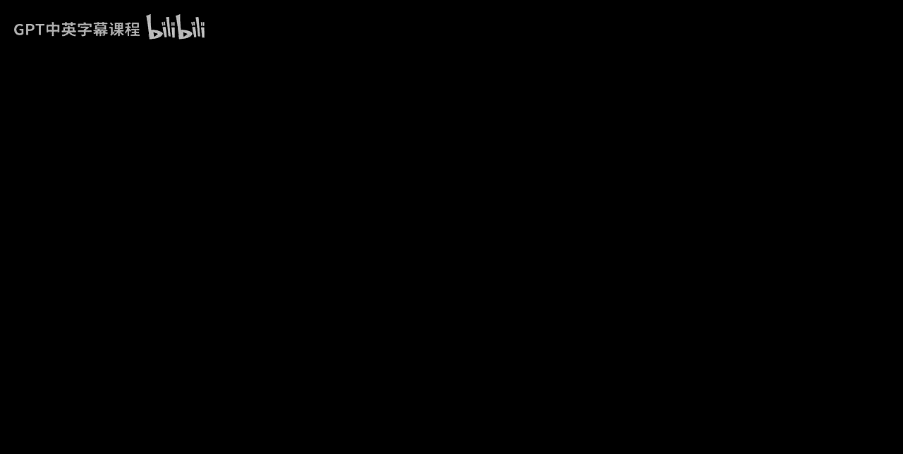
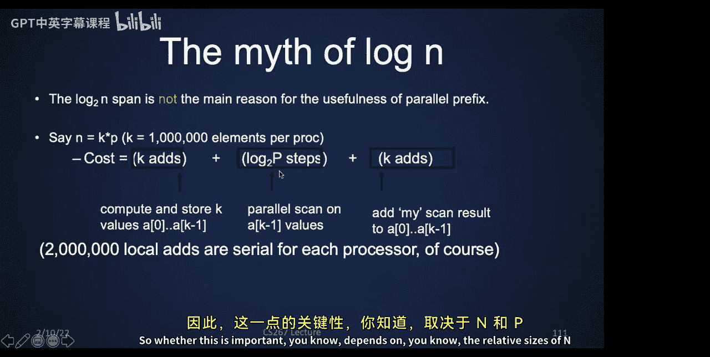

# 【并行计算 CS267 2022】伯克利—中英字幕 p25 CS267 Lecture 8： Data Parallel Algorithms -BV1PS421978D_p25-

对。没有。Yeah okay， so we started recording again and so now I want to share a screen again and which one desktop two I think。

我把然后。这个会接。大我的。So Viveette， can you see this all good， this is great， Okay， and we're recording。

So only two minutes late。So thank you everyone for showing up again we're going to get started and yes so please ask any questions you may have so last time we talked about GPUs and which do lots and lots of common operations in parallel and large amounts of data and that's a good programming models for all sorts of purposes so today we're going to talk about data parallel algorithms and these are interesting algorithms not just for GPUs but in general。

好吧。Okay so here are the different kinds of architectures that we're going to talk about during the semester and you can use this data parallel programming in all of them so last time we had a lecture on shared memory programming that's this model next time we'll have a lecture on distributed memory programming which are the largest computers in the world where everybody has their own local memory and they communicate by sending messages over a network and last time this box in red was this is the abstract model of what we did with GPUs where there's a single processor which sends out a common command to lots of little processors arithmetic logic units and each of these will do the same operation on a subset of the data。

And so this is， but you know this same programming model applies not just to these kinds of machines。

 but to lots of different machines， and there are lots of sort of surprising algorithms that make use of this。

And so the name of this kind of programming model is data parallelism where you do the same operation on multiple values and we're going to interpret that a little bit more broadly it's not just you know like adding one vector to another。

 it includes things like reductions where you compute the sum of a whole array or broadcast where you take one number and fill out a whole array and a whole bunch of others too and you can build these all out of you know and there's lots of clever algorithms you can build out of those in particular scan or parallel prefix。

Looks like a sequential algorithm but you can actually do it in parallel and you can build lots of clever things out of this and so is one of the more advanced and let's say just theoretical algorithms。

 it turns out you can invert a matrix and end by end matrix in log squared end time which is sort of surprising that you can do that and it's not a practical algorithm but just as one example of many other very practical algorithms I'll show that to you。

And so as I said， lots of different programming models support this， you know CMD units。

 AVX instructions， GPUs when you're program in QUDa。

 if you do cloud computing map Red has been around for a long time as a primitive to do this kind of stuff and when we learn about MPI programming distributed memory machines。

 the the the，System called MPI message passing interface for communicating among lots of processors has built in operations to do a lot of these things because they're so popular。

And so let me just remind you of the most simple operations and then we'll work our way up to the more complicated ones。

 so the simplest thing you can do is you have two arrays A and B and you simply want to compute B from a by applying the same operation same unary operation that means one argument to it so this in this case squaring replaces each entry of a each entry each entry of B is a squared right so three squared is9 one squared is one and so forth so that's the simplest operation。

Easy to do。And of course， the next one up is binary operations where I would take one array and add it to a second array so and the code is very simple you just declare a and B to B arrays and then you just do a subtraction and in that case you know three plus0 is three one plus。

Excuse me，3 minus zero is three， one minus1 is zero and so forth， we're doing a subtraction here。

So the next more complicated one， still not very complicated is the broadcast。

 in that case I would take this scalar three and fill up a whole array with it。

And then once I do that， I can multiply this constant times all the entries of another vector and add it to a third vector。

 so this would do a， which is all threes times x plus y。

 and so this is a very straightforward algorithm that's used quite often it's one of the standard basic linear algebra subrines or bs1 operations and it's often called axby in general。

 So this sort of you know so this is what broadcast is good for。

And so let's get a little bit more complicated where we can have irregular access so that we can do more general stuff and so this array assignment where I said a equal be that works if the arrays have the same shape。

 and so in this case， you know this is an array of five entries。

 another array of five entries and I'm assigning one to the other。

But it could also have a stride so for example， if a I could say a is the entries of this is B sub zero。

 b sub two b sub4 and if a is of length three that would work right I could do that or excuse me in this case I'm only assigning the so A and B have the same size。

 they're both index from zero to4， but I'm only touching entries zero2 and4 and copying them from B to A。

And in this case， C is a matrix， so it's a five by five matrix。

 and I'm just taking one column of C and copying it day since they're the same size， it all works。是的。

So。Ohoops， let me move this。So the next thing is called a gather。

And this is where we have a regulargular indexing， and so now I can have a set of indices and I can refer to B sub x in all in one parallel operation。

 I'm going to get B sub three and assign that to the first entry of a， B sub zero。

 assign that to the second entry of a and so forth。And so you can see。

That you know a is now filled up with you know because B is0，1，2，3。

4 basically then a turns into 30421 which is matches that so that's what that does so that's called a gather where the indirect is on the right hand side of equal sign。

And there's also something called a scatter where the indirection is on the left hand side of equal sign。

And so now what I'm going to do is take B sub0 and assign it to a sub x sub0， which is a sub3。

 so that's why the zero appears over there。And so that's also kind of a built in operation that we can use to you know reorder stuff。

 so obviously that will let us do know much more interesting algorithms。So gather and scatter。

And so you could say okay I have a bug here， could have a bug what if I do a scatter and all the entries of x or 000 so that's going to assign the first entry of b to a0。

 the second entry of B to a0 and so forth so this is a natural race condition or an error and basically your system should not you know no promises are made if you do this this is a programming error so you have to make sure that you don't have any common destinations like that。

So another operation is called masking， and that means you can have an array M of zeros and ones。

 and they will only let you do the operation where they're ones and they won't do the operation where there're zeros。

So in this case， I want to add two arrays A and B， but I'm only going to do it where there's a1。

 so I'll add3 and0 and get a three， but here since there's a zero。

 I'm not going to change a and the one gets copied。

So that also lets us do a lot of operations that with branches and so forth so I can have conditionals。

And so the next operation。doesn't produce an array as an output。

 it produces a single scalar and it's called a reduction。

 and so what it does is it takes the sum of all of these。

Or you could take the max of all of these And so know what is this useful for So one of the most obvious things is obviously a dot product I would take x times y that's so I do a component wise product of all the entries of x and y so one times1 and one times two and then I compute the sum and I get 19 And so the question is this is not done in one step in one time step obviously there's more work and it's going to take log n steps in order to sum of n numbers and we'll talk about that later。

 but this is still a basic data parallel operation Now in order for this to be to work correctly you have to make an assumption that you're in order to get the right answer your operator in this case edition has to be associated that means you're allowed to do the operations in any order you like as long as you maintain the original order you can put the parentheses wherever you like and get the same answer and so for example。

is another example where that works。And so you really need to read the documentation。

 this is sort of the standard assumption， associivity。

 but there are some systems and we had a bug in our group once because we hadn't read this carefully because they also assume commutivity。

 so that means you could do the you know you could order the operations in a different way completely and then put in the parenthees any way you like。

And so some systems assume that， and so the question is when could that go wrong。

 it's when your operator is associative but not commutative。

And so can you think of an operator like that？Matrix multiply that's a pretty important operator and so in fact our algorithm at that time were trying we had a new faster algorithm to do least squares and we were trying to implement it in Sp which is a very popular programming model and it assumed both sociativity and commivity so it took us a while to figure out there was a bug so but for the rest of this talk we're just going to assume sosociivity but read the documentation。

ok。Yes。So the。好吧。So the next operation looks sequential， but it's really parallel。

And it's going to let us do this surprising stuff like invert matrices and log squared end time and other you know and much more practical things too。

 so what it does is it takes one array and computes the sum of the leading entries。So B1 is just a1。

 so there you get three， then three plus one is four，3 plus1 plus one is5。

3 plus one plus one plus two is seven and so forth。So this is again。

 something you can do with any associative operation， so here's the same thing with a max。

So here there's the max of three， there's the max of  three and one， the max of three。

1 and one when I finally hit a four， the max is four。

And so it sort of seems like this is an inherently。Sca excuse me， serial operation。

 I got to do it from left to right， but no， you can do it in log n time there's a very clever algorithm to do this and we'll talk about that。

So there's actually two kinds of scans， depending on whether you include a sub I to compute B sub I or only the ones before a sub I up to a sub I minus1。

And these are called inclusive and exclusive。So inclusive， which is the one I've described so far。

 that means that B0 is a0， then you know then you get a0 plus a1 for B1 and so forth。

 so that includes the entry of B。Exclusive means you leave it out so that means that B0 is just the identity。

 whatever that means for your operations so zero if you're doing something。😡，And then B1 is a0。

 B2 is a0 plus A1 and so forth。 Both of these are useful in practice。

And then of course you can always get one from the other very easily if you have the inclusive scan。

 you can just you know add the original array to it and that you bumps it up to an inclusive scan so either one works in practice。

So those are some of the basic operations and now we're going to do lots of clever algorithms that work surprisingly fast and parallel just building on top of those are there any questions about those underlying you know operations first。

嗯。Okay。So now let me tell you what our idealized hardware performance model is for these。

 so when we write down an algorithm we we can sort of simply say yes it's going about as fast as possible。

 so this is an idealized model。And so we're going to assume we have a CD machine where we have one control processor who sends the same command out to know an unboundly large number of little processors that can each to an ad at the same time or a max or whatever it is。

And so this in each processes just going to you know do the same instruction at the same time。

 So here is our ideal model。 We're going to assume we have an unbounded number of processor。

 So if I want to add one array to another， that takes。Time one， no matter how long that arrays。

 that's my simple model to analyze these algorithms。

And I can do that you know one per time steps so I'm not going to count the time it takes to you know for the control processor to send the commands out or any of that and I'm also going to assume communication is free now most of the time you're just adding local data you'll see that there's some communication between these processors when I need to do the scan but we're not going to worry about that either that you know that we're not missing anything too important。

And so the cost complexity is how many of these parallel operations with unbounded number of processor do I need to execute。

 that's called the span in order to compute solve my problem。

And so here just to apply it to the simplest thing， adding one vector to another， the cost is one。

 no matter how long that array is， because I'm assuming I have an unbounded number of processor。

 and I'm also assuming that even if A and B are not perfectly aligned。

 you know they maybe shouldn you， I may add a you know a shifted subset of B to a shifted subset of A。

 then I can still do that in one time step because I'm not worried about that communication。

On the other hand， reductions in broadcasts cost more because I'm going to use a tree in order to do it。

 a binary tree。And so let me just show you， I mean， that's sort of natural。 and interestingly。

 there's a very simple proof that that's a lower bound， no matter how you do。

Broadcast or reductions as long as you know you only have binary operations。

 it's going to take at least log in time。So how do I do a broadcast out to end processors well I can broadcast the two each of those can broadcast the two more then to two more and obviously if I take you know n times K time steps I can get to two to the K processor so with you know if I want to get to end processors it's log based two of n steps。

And an ad reduction is the same thing， if I am only allowed to add two numbers in one time step。

 I can add the pairs， then I can add the next pairs and after log n steps， I finally get the answer。

And this is why I need associivity because I'm implicitly know not summing these numbers from left to right。

 I'm putting parentheses in a nested fashion around them and I to get the same answer。

 you know this is fine for addition and multiplications。

 long here not for matrix multiplications for scalar multiplication。

 in min and Max and a bunch of other useful operations。So why is log n a lower bound。

 it's a very simple argument。So if I can only do binary operations。And in one time step。

 I can only depend on two inputs。So in one time step， this value here can only depend on two inputs。

So how many inputs can I depend on after two time steps？For and so forth， right so。No。

 so after two time steps， I can depend ultimately on these four at the basis of my binary tree and so forth。

 and after k， I can depend on two to the K inputs。And if 2 to the k equals n k is log n。

 then that's how many steps it takes， so in the binary tree is implicitly what all this hardware is doing。

Okay， so let's take these building blocks and start doing some higher level algorithms。

Here's sort of the simplest obvious one， I can multiply n by N matrices in log n time。

And why is that so what am I going to do I need to compute the sums of you know AIK times Bkj you know for all different values of I andj and over all the Ks and so in one time step I can do all N cube of these multiplies so I have all of my sums available all at once using N cube processor because I'm assuming they're unbounded。

And then I need to do n squared reductions， you know I need to compute c11 and c12 and each of those is a sum and that you know so that's a tree of depth log n and so I just need n squared trees of depth log n and so it's all together it's like NQ processes。

And so this is sort of， you know， you can't imagine multiplying。

 you know matrices faster than log n time just because of that dependency。And so we will。

 so this is sort of a trivial algorithm in some sense。

 but we'll use it as a building block later for some more surprising stuff。So the next operation。

 which sounds serial， but is really parallel is a scan also known as parallel prefix。

 and that's where I want to compute I'm given an array of numbers。And an associative operator。

 let's say plus and I want to compute a0， a0 plus A1， the sum of the first three。

 the sum of the first four， and so forth all over it。And I want to do that in。Log in time。

And so since I'm only assuming sosociivity here， I could use it for matrix multiply。

And I will do that later， I could do it for Boolean operations in that case ans and oars。

 I will use that too when I show you how computers add binary numbers。

 that's an important operation there。And then of course。

 I could imagine real numbers or integers and do plus in multiplication and so forth。

So the question is， how do I do this in log in time because if I write down。The obvious one。

 it seems like I have to know that sum of the first I minus1 before I get the sum of the ice。

So it's you know this is going to take n minus one operations to do in sequentially and so how do I paralyze it well let me give you a naive version which is way too expensive and then the version that's used in practice which is surprisingly cheap。

So。The obvious cheap thing to do would be to have for each output have a reduction tree that adds you know the leading five entries。

 the leading six entries， so I would have， you know so I would be computing lots of sums over and over again redundantly right I'd compute the first two the first three completely independently so it would take only log n you know steps to do it。

 but I'd be doing n squared editions which is a real waste so I want to do it in log n steps but do only do order n editions In fact I'll do two n editions。

对。So here's sort of just a hint as to what we're going to do。

 so suppose that I independently know decided I was going to sum the trailing for numbers。

What would they be useful for？Well let's suppose I'd also sum the first four numbers independently。

 well then I could use those and combine them， but I could also use the sum of one， two， three。

 four in order to get all these other sums there so I can reuse this particular sum。

And the same idea applies to what if I have a tree and I compute the sum of one plus two and3 plus four。

 then I can sum those and get the sum of the first all four。

 but I can also compute one plus two plus three so what I want to do is compute the sums of subsets and reuse them。

And so here is a high level recursive description of the algorithm and then I'll give go into the details of how we actually do it so here's a whole bunch of numbers。

And I want to compute their parallel prefix to some of the leading n numbers。

And so the first step is just sum up all the pairs like that。

 that's obviously one time step and over two processors， and I get all these partial sums。

So once I have all these partial sums。I want to do parallel prefix on those， I want to compute three。

3 plus seven， 3 plus7 plus 11， because I can use those to compute all the other things that I need。

Oops。是。So what I'm going to do is recursively compute on this array of half the size。

 the leading sums of that。The parallel prefixt of that。So once I get that， what numbers do I have。

 I have three，3 plus7， 3 plus 7 plus 11 is 21， so I get all those numbers on a problem of half the size。

And so now what do I do with those？I'm going to get the output just by copying。

These values here and adding them to the predecessor。So I'll take one。

 and that'll give me that value。 I'll take three plus three。

 that'll give me the sum of the first three。 that'll take 10 plus5。

 that'll give me the sum of the first， excuse me， that's the sum of the first。

That'll give into to some of the first five， and then all the others are already there。

So so what I've done， so here's the answer and I've done it by using all of these intermediate sums as partial results。

 and so this three is that three， that seven you know that 10 gives me that 10 and so forth。

 but all these other partial sums give me you know the odd values。Okay。

 so that's sort of a high level description of how you I change the problem from one size of n to size of n over two n over four takes log n steps。

 but what's surprising so let's count do the complexity and so if I were to run this sequentially with one processor how much work am I doing I'm doing some extra work and here's the recurrence I'm doing n over two additions at the top。

 I'm doing n over two additions at the bottom and then I'm calling it recursively on a problem of half the size and so that means I'm doing two n roughly additions so I'm doing twice as much work but I'm not doing n squared work。

And if I have an unbounded number of processors， the number of layers is to log n。

 so this is a log n algorithm Now the issue with this。

Is that it sort of seems like I need a lot of extra memory in order to keep track of all these intermediate results。

 It turns out you can run this algorithm in place。 You can just sort of overwrite the array in log n steps。

 it's replaced by its parallel prefix。 So you don't need any extra memory to run this。Okay， so here。

It's the in place algorithm and it's kind of clever due to guide Gic and so there's here's the original data and there's sort of two sweeps to the algorithm as he described it。

 there's going to be an up sweepep which I'll show you and it's going to overwrite the data with partial sums。

And then there's going to be a down sweep where I again replace all the data with partial sums and they're called up and down because I'm in a sense。

 going up a tree and down a tree。So here is the first step。

I'm going to take all consecutive pairs and overwrite x1 by x0 plus 1。

 overwrite x3 by x2 plus x3 and so forth。 so just overwrite it， that's one step。Then。There。

I do the next part of the tree and I do things that are four apart and again I'm going to overwrite this by its neighbor sorry that are two apart。

 so these were nearest neighbors they're one apart now they're two apart。

And now they're four apart okay so that is log n steps and I get all of these partialc sums in there。

 which aren't you know the final answer， but except for this very last one。

 that is you know the sum of x0 through x7， but I'm actually going to throw it away and recompute it。

Okay， so that's going up to suite。And so now I'm going to take that value and go down。

And so I'm going to start with the value that I just had， so this is just a copy of that。Then sorry。

 I'm going to zero out that last result because I'm not going to use it。

 and so now I'm going to have a pattern that looks very much the same you know where I have these arrows with nearest neighbors。

 next nearest neighbors and so forth。Sorry， this animation didn't work out so well。

So I just zero that out now I take these。For number。

 these these pairs of numbers that are four apart and this dotted line means I just copy no work。

 So I just move the zero over there。 And then I sum these two numbers。 And since that's a zero。

 it amounts to a copy， but it's still just， you know， it's a sum。对。错。

So then I do them with two apart， and again， I just copy along the dotted arrow and I sum this and that value to get that。

And then finally。Sorry about this。I do it with just nearest neighbors and again。

 I just copy sideways and then I do a sum with my nearest neighbor and that's the final answer。

And so there's a inductive proof that this gives you the right answer。

 which I'm not going to go into the details， but the point is it took only two log n steps。

And I only did2N editions。And so it's sort of efficient and it's entirely in place， right。

 I didn't need any extra memory in order to do this。And so this is a。啊。Yeah， so it's work efficient。

 I'm only doing two n ads and it's space efficient it all updates in place。Okay。

So now given those building blocks， I want to especially scan。

 I want to do a bunch of higher level algorithms that solve surprisingly solve interesting problems。

 including linked lists and all sorts of other things in log n time。So here's a list。

 a longer list I can't cover all these in the lecture。

 but here's sort of a superet of what I'm going to talk about。

So adding two Mbit integers in log n time， every computer in the world has been manufactured actually since around the 1800s。

 uses this algorithm and it can be expressed as parallel prefix where what is the associative operation。

 its two by two Boolean matrix multiply。So multiplication turns into and and addition turns into or。

 and it's all associative， but that's， in fact， what Kerie Lookhead does if you've had a class in hardware。

 it's really running this algorithm。I mentioned inverting n by M triangular matrices in log squared end time。

 and we're going to use that to invert dense n by M matrices in log squared end time。

So this is not a practical algorithm， but it's sort of you know。Quite simple。

 it's four lines using all these building blocks， so we'll show you how that works。In fact。

 you can evaluate arbitrary expressions in log n time what do I mean by an arbitrary expression。

 you can have plus minus times divide， you can have the prehees wherever you like。

 it has n arguments that you like at the base of the tree you can still do it in log n time again not necessarily practical but possible and you can evaluate arbitrary recurrences so linear recurrences where x sub n is some function of x of n minus1 and if that function has certain nice properties certainly it can be a linear recurrence then it works fine and I'll give you an example of that So it's used for image segmentation where we're doing the parallel prefix not just in one direction but in both the x and y directions on an image and and thats can be used to speed up image segmentation you can use it for sparse matrix vector multiply it's been used for page layout in a browser to figure out where to put the images on。

On your screen， we can traverse linked lists and log in time。

 which seems strange because it seems like you can only get to the next one in one time step。

 but we'll show you how that works and a bunch of other points too。So let's start with some examples。

And so， the first one。Is compressing a stream of data。

So what I'd like to do is I'm given a bunch of values in an array， you know3，2，4， one。

 and so and forth， and I have some flags saying which ones I want to keep so I want to keep this one。

 that one and that one but I want to throw away all the orange ones so keep the blue ones。

 throw away the orange ones。And so what I'd like to do is compress that into just three， four， one。

 three，1。And I'd like to do that as quickly as possible using all these operations that we've been defining。

So here is the algorithm， I'm going to compute an a scan of these flags。

 so in other words take this array of yeses of zeros and ones and just compute this I'm going to use these to index you know into where I'm going to put the data。

Then I'm going to scatter the values， scatters what I defined before。

 so that means the result at this index is going to be the values。You know。

 just where the flags are equal to one。So that means three is going to go into location zero，2。

 I'm going to skip。Four is going to go into location two。

 one is going to go into location three and so forth。And so by a mixture of， you know， using。

Masking and you this indirect indexing， I can pick any subset I want and get that to happen in sort of in principle in one operation。

So here's just a simple example of where you want to do it。

 suppose I have an array of numbers and I'm given I only want to keep the numbers that are divisible by x。

So I want to throw away the ones that are not divisible by x。

So I create this array of zeros and ones， which simply says who's divisible by x and who isn't。

 I can do that in one time step， and then I use the previous solution to throw away the orange result。

 so I only keep the ones that are in this case divisible by three。

So here is a rather more complicated algorithm for sorting。And it's something called Radic sort。

 which you may have heard of before。And the way Radic sort works is you imagine I have a binary bunch of binary numbers。

 and what I'm going to do is sort them one bit at a time。

So I'll take all these numbers and just look at their bottommost bit or the even rod。

 and I'll put all the zeros on the left。And all the ones on the right。

So if I only add one bit I'd be done， of course I have more bits。

 but if I have two numbers that agree entirely except in their trailing bit。

 you know the zero will come before the one， so this is know as long as my later sorting keeps that order as long as it's stable。

 then I've made progress。So then I'll look at the next bit over， sort by that， the next bit over。

 sort by that。And so the number of steps， if I can do each one of those sorting steps in a constant amount of time。

IThe number of steps is just the number of bits and all the numbers and so the question is how can I do one of these sorting steps in a constant amount of time using all these operations that you've heard of？

So here is。Let me do an illustration of the algorithm and see how it works。

And so I'm going to start with the leaf significant bit， you know， are you even or odd。

 and I want to put the even ones first。So in this case I want four， two， six。

 and zero to come before seven， three， five， and one。And so after one step， I've done that。

So this is high level， I'm not explaining how to implement it with these operations yet。

So then I'm going to look at the next bit， the middle bit。

 and again I want to put the ones that have that bit zero before the ones that have that bit one。

So now two and six and seven and three have a one in the middle。

 and four and zero and five and one have a zero there。So， after this step。

You know those are on the left and these are on the right， and then finally I get to the leading bit。

 which is in some sense the most important one。And so I just want to say is the leading bid zero。

 so are you less than four is the leading bid one， are you at least four？

And there's the ones that are at least four， and I do one more step of sorting and they're all in the desired order okay。

So this is what I want to emulate and take each one of these steps。

 this was just three bits should take a constant amount of time。

So using all of these parallel prefix and other data parallel operations。

And so here is the 10 lines of code that we need to sort on one bit。

So it's a little bit complicated and is so I need to do this as many times as I have bits in my numbers。

And so there's my input again。And so the first thing I'm going to do is create an array called odds。

 which is just the last bit of each entry to say， are you even a odd。

 and that's obviously one data parallel thing to do。And that identifies those。

 so these are the odd ones， the orange ones， and then the evens are just the complement of the odds。

So now I'm going to do an exclusive sum scan of the evens。

I'm going to add up all of these numbers to indicate where they should go in the final array this。

So what I'm going to do。Look at this right。So I'll get and this is an exclusive sand so I start with zero。

 and then I have a one and then this is one plus0 is one and then one plus0 plus one is two and so forth。

 so these numbers are going to go one， two， three， four and I'm going to use those to put the evens in their eventual destination。

in consecutive locations。So then I need the total number of evens， so that's a reduction step。

 so the evens are going to occupy the last four entries。

 so that's going to tell me how far to shift them over。Then I just need this array too。

 which is just zero through seven， just a constant。Now I get the odd position。

 so here's the sort of clever part， how do I get the position for each odd entry。

 I'll take the total number of evens。Because they come first， so I have to be at least that big。

I'll add this index， which is this array here to put things in consecutive locations and I will subtract。

The even positions。And so that's going to， you know， because that tells them where the odds go。

And so finally， this is positions。 So if it's even then I take this value that I compute。

 the even positions。 and if it's not even， I take the odd positions。

 So this is kind of emerged with masking。 And this is the final set of indices of where everybody is supposed to go。

😊，And then I do a scatter。So I take this original array and I put four into location zero。

 I put seven into location four。You get this right。Yeah， yeah。

 so I just scatter these around according to this input and I use these as subscripts。

And then I'm just going to go， okay， here it is， yeah， so four goes there， seven goes over there。

 and so forth。Yeah， so this was a copy of the input and after I scatter it， you。

 this is the final destination and indeed， you know all the even numbers come before all the odd numbers。

And so this is kind of complicated， but it is a constant number of steps。

 no matter how long these arrays work。Okay， and then I repeat with an next bit and so forth。

So any questions about that sort of。Complicated algorithm。嗯。So the next one is traversing a list。

 a linked list。Which seems like an inherently sequential thing to do。

But the idea is that if I have all of this data you know sitting out in memory。

 I'm imagining I have one processor available for each of those memory locations or perhaps a subset。

 and so all of these processors can at the same time look at the pointers that they have local to their data in traverse it。

And then I can sort of glue those together。And so here is an example of a linked list know with the distance to the next location。

 so it's one to get to the next location， one to get to the next location。

 and what I want to do is replace all these ones with how far it is to get to the end。

So that is going to be the distance to the end of the list and I want to compute that and if I were to do it sequentially you know I'd have to traverse the list from the beginning you know from my pointer up here。

 left to right and it'll take a while。And so here is the parallel version of that。

So everybody is going to simultaneously look to their neighbor。

And replace their pointer to their neighbor with the neighbor's pointer to the next farther neighbor over。

So this will no longer point to the nearest neighbor it'll be you know tool away and that will be tool away and that will be two away and then I increment the distance counter which says I'm now pointing to something that was originally tool away。

 originally tool away so I can all do that in one step because I in principle I have one processor for each of these locations in memory。

Then I do it again， so everybody looks to their neighbor who's now two away and。

And traverse and follows the pointer one more time to get to be four away and replaces their pointer with something that points to four away and increments their local counter and most of these are two plus two is four。

But over here。Since one pointed to zero， it didn't get updated。It's one away from the end。

 and so it didn't have any more incrementing to do one plus0 is0 one plus zero is one。

 which stayed the same。And so when two， after the first step points to zero。

 it will no longer change either。So I after one step know at the beginning。

 this is correct the distance the end is one， after one step。

 the distance the end is two is no longer going to change after the third step。

 the distance to this one is three because it points to one。

And then then I'm done there's an old pointer there， so it's not going to go any farther either。

And so I'm sort of building up the correct distances at the end and I'm having twice as many correct distances at every step。

And so now all these trailing fours turn into8s， but the in the middle I have765 four。

 so all of these are the corrected。And then finally， at the end， I have one more step。

 you know in eight， this eight。Points to22 plus8 I'm sorry。

2 plus8 is 10 and I have a correct distance there and here I have eight plus one is9 and then I get an null pointer and I'm done。

是吧。So this is another clever algorithm。So now we'll do something a little bit more。Matthey。

 and I want to illustrate that we can do arbitrary linear recurrences in log end time。

And the simplest example is computing Fibonacci numbers。So what's a Fibonacci number。

 I take the last two in my sequence and I add them to get the next one。So how do I change that to be？

An associative operator of sometimes what I do is since I it depends on the two previous values。

 I make them a little two by one vector。And to get the next sequence of two， so I go from fn。

 fn minus1 to F n plus1 FN。The top one is just the sum pre of these two。

 so it's one times FN plus fn minus1， and FN is just copied。So I just have to copy this one。

 and so it's really a two by two matrix multipplly to get from the n step to the n plus first step。

And so how do I get to， you know， how do I do two steps。

 I need to multiply this matrix times itself2 to get to the next step and to do all of them I need this matrix squared cube。

Fourth power and so forth， I need to compute a parallel prefix on this sequence of matrices because I need all the powers of this matrix。

And then what I do is I just grab the initial values of F0 and F1。

 whatever they are and multiply them by that matrix。

 and in one more step I have the values of the recurrence。And suppose I had not Fibonacci， you know。

 but I had something more complicated， you know I could obviously have you know three times fn plus five times fn minus1 plus you know six times fn minus2 in that case I'd have a three by three matrix and with some different numbers in it but it'd be the same idea so I could do arbitrary recurrences this way。

不。So now let's get to Car look ahead edition， how all computers add integers。

 and it really is just parallel prefix。Even though it wasn't called out at the time when it was invented in the 1800s。

So I have two n bit numbers and they're the bits， you know a0 is the least significant bit up to A and minus1 and I want to add it to B。

And I'm going to call the sums S0 through SN， I may get a carry out at the end， maybe one bit longer。

And there's also a carry array， which indicates， you know。

 is there a carry from the I bit to the I plus first bit， and I'm going to use C for that。

 So given that those definitions。Let me write down sort of the obvious sequential algorithm for computing everything if I were to compute from the least significant bit to the most significant bit。

So the carry in at the very bottom is zero， there's no you know carry at the beginning。

 so I'll go from0 to n minus1 how do I get the I sum Well。

 it'll be one if I have an odd number of ones that I'm adding so I look at AI。

 B and C minus1 the carry and I say is it one or three that's all gotten by doing x ors and in that case my sum bin is1。

How do I decide if there's a carry， Well， I need to the sum has to be at least two。

Right then they get a carry。 and so that would happen if。🤧Exactly one of the AI and BI is one。

But I get a carry， so that would be there two or AI and BI are both one。

 then the carry doesn't matter and the carry in doesn't matter。 I'm guaranteed to get a carry out。

So these are two very simple formulas。And so I want to do is change this to a two by two matrix multipier。

Which will then be associative and I'll just do the usual stuff。So okay。

 so here's an example of how to sum numbers this way。

 so the initial carry in is zero at the very beginning。

So I'm going to have0 plus1 plus0 plus0 plus one and I'll get a one。

And then the next carry is a zero， there's nothing， everything fit here， so C sub1 is zero。

And then the next sum will be0 plus1 plus zero is one and so forth。自己。🤧。Anyway。

 so this is just binary edition propagating the carries over。Okay， and so this is a。

Apparently log an order in algorithm since I'm doing it over n bits from left to right。

 and I want to do it and log in using parallel prefix。

So what I need to do is compute all of these carries in log n steps and once I have the carries and I can immediately compute the sums that eat the S bits。

Yeah。So what I'm going to do is precompute all in one step。The X ors of the AI and B。

 and I'll call that P for propagate。I'm going to use that to decide if a carry goes over。

And I'll also compute AI and B， that's called a generate bit because and if that's one。

 I'm guaranteed that a carry bit will be generated。So here is how I'm going to get my recurrence。

 I'm going to have a little vector。Of which has a CI the I carry it on top of a one or a true right because iss Boolean stuff。

And what I want to do is you know express that as a matrix multiply using c sub I minus1。

 so here's the formula， the carry bit is the propagate bit and C minus1 or the generate bit。

That's one， if and only a C sub I is one。Okay， so that I can express as PI GI here's a little two by two matrix multiplied by that vector。

Now these are Booles， what do I mean by multiplication？Mulplication of a two booleions means anthem。

And addition of two booles means or them。And so P times C minus1 is P and C minus1。

 and then Gi times1 is G。And then the sum is or。And then one just propagates， you know，01。

 the one just propagates。And so I get this little two by two matrix， which I'll call M sub I。

And it turns out you can check that if I take two of these matrices and multiply them。

All the usual rules apply and it's associated。Just change multiplication to and in addition to war。

So。To get the I bit， I need the product of all of these leading two by two boolean matrices times 01。

 and that's exactly what parallel prefix will do in log n steps。

And every piece of hardware that has ever been built to do addition on the CPU uses this trick and it's called carry Lookhead Ed。

And its first implementation was in the 1800s in this rather large old few bit machine that was invented by Charles Babbage。

So it's been around for a long time。Okay。So are there any questions？Yes。

So the next example is parsing， and this is rather more complicated。So what does it mean。

 so what do compilers do so a compiler takes you know a string of characters。You know。

 the lines of code and it needs to break them up into tokens。

 it needs to break them up into you know are you you know a variable， are you a variable name。

 you know are you a a command of some kind are you a comparative operator you know are you a string and break them up into those pieces which then goes into the next level of compilation so what I want to do is scan this string of characters from left to right and figure out you know when there's a border。

 you know when you know I change from this token to the next token and from that token to the next token。

And so how is this done？In practice， it's done with something called a finite state machine。

And so what I'm going to do is and here's a picture of the finance state machine and each of these states and circles represents what I've seen so far。

 are you an identifier you know the name of a variable and that's called the Z state。

Are you some string in quotes likeHello world， that's the S state。

Are you an operator you know times plus minus and so forth and those have all their own names and then overall there's an expression okay which I'm trying to build and so what I do is I read this string from left to right and I look at the eye and I look at the F and I follow the edges here depending on。

You know this table， so each arrow is labeled with。

 you know where do I go if I see a particular character and then you know when I change states that tells me I'm it's at the end of the token right it's time for the next token to begin。

And so this looks like very much a left to right sequential kind of thing and the question is can you do it faster so let me just be concrete here so we're going to start and state N。

 which means I've seen nothing yet and then depending on what I see next you depending whether the next characters letter or the alphabet or one of these you know operators or another space I will you know move to this other state which could be an identifier or an expression or whatever and so this table is sort of just writing down all the arrows here where do you go and how they're labeled。

And so for example， if I'm in the state Z and I read y double quote plus。Then Z followed by Y。

Leavs me in state Z， so I replace Z Y with Z。Z followed by double quote。Tells me I'm right there。

 so that tells me I'm in the state Q whoops。And when I get a plus， and if I'm state Q。

 and I see a plus sign， then I move to S。So what I want to do is figure out how to do this in log n time where n is the length of the string。

And so what I need to do is define a little associative operator。

 this is going to be a more complicated one right because it's going to have this entire table kind of encoded in it。

That well let me do this all in log end time。Okay， so here is。You know how I build these operators？

So what I'm going to do is。Build a table。Where there's one column for each character in the input stream。

The first so that's yeah， and so the first row is the string， you know。

 if x less than or equal to blah， blah， so one column is going to correspond to reading in each character。

And then there's going to be one row for every possible state I'm in before I read the next character。

So this is going to have。 so this is pretty large。 The number of rows is the number of possible states。

 the number of columns is the length of your string。And I and so what is this entry。

 this entry says if I'm in state A and I see an I， I move to state Z。

 And so this is kind of encoding。Very verbosely， everything in this table。Over and over again。Okay。

 so now how do I do this sort of pairwise combination of stuff to do everything in log end time？

So so I can just fill in all this table in a constant amount of time， it's just looking it up。

 so now I have this table。And so now what I want to do is say， I have an I followed by an F。

I want to combine those。So what I want to do is replace these two columns by one column。

 which says if I start with an n and I read IF， what state of I N？If I started in A and I read an IF。

 what state am I in？So I will replace these two columns as one column representing the pair of transitions。

And that will you know。And so if you can imagine a reduction operation。

 I could just do a tree of those。And it would tell me what state I'm in at the end。

But if the same trick works for parallel prefix because I want all the intermediate states。

 so I know where the tokens begin and end。So that。You know， has been used you know for small。

Grammars。This would obviously be rather large， you know challenging for a large grammar because you can。

 in principle， combine two columns in a constant amount of time。

 but you you need a lot of the amount of parallelism you need is proportional the number of rows。

But that can be done。And in addition to this old paper from 86。

 you it's also been used more recently you know here at Berkeley and other things for parsing HTML。

Okay， so let's talk about something more mathematical here。

 and so this is going to be a building block， this is the easy case。

 so I'm going to invert triangular matrices and then I'll invert general dense matrices。

So what I want to do is find a divide and conquer algorithm。

Which inverts triangular matrices in log squared in time。

And I'm going to use this basic fact from linear you algebra that if I have a two by two matrix。

 so imagine these are just numbers， then you can just confirm that's the inverse。

 you know a times a inverse is 1 C times a inverse plus B times that that's zero and so forth。

 And if this is an n by n matrix and A and B are n over2 by n over two matrices。

 it's still the same formula。So here I've changed the problem of inverting an n by N， sorry。

 I thought this was turned off。So I've changed the problem inverting one n by n matrix into inverting two n over 2 by n over two matrices and then doing some matrix multiplies。

 which I know how to do。Okay， so let's write down the algorithm。

So this is a triangular inverse and I'm assuming for simplicity it's on n by n matrices where n is a power of two and if it's one by one。

 that's the base case， I just return one over t。Otherwise。

 I write the matrix in this block form and I recursively call myself。

 and this is I can do in parallel， I compute A inverse and B inverse。

 and that implicitly creates a tree。When I get back the inverse of a and the inverse and B。

 I need to do this multiplication， evaluate that formula。

 be inverse C inverse and that's two matrix multiplies and I know I can do each of those in log n time so the question is how deep is the tree how many login operations do I do in the depth of the tree also log n？

And so when I'm done， in log squared n time， I have inverted triangular matrices。

So that's a simple divide and conquer。Here is the yes， and so yeah。

 so here's the way to figure it out the time is the time it takes to execute these two in parallel。

 which is the time to invert n over two by N over two matrices plus that line of code is log n and then you can solve that and it's log squared n。

So here uses a little bit more linear algebra in order to invert general matrices。

You may remember the Kayleley Hamilton theorem from linearar algebra that says that every matrix satisfies a polynomial。

And the coefficients to polynomial are the characteristic polynomial。

 these roots would be the eigenvalues， so that means I can express the inverse of a matrix as a polynomial in the matrix。

Just by multiplying that through by a inverse， but in order to evaluate that polynomial。

 I need to know the coefficients So the question is how do I get the coefficients to that polynomial。

And that comes from something even older called Newton's identityities。

And it turns out that there's a triangular system of equations to solve whose solution is the characteristic polynomial。

So all I have to do is solve a triangular system， which I know how to do。

And the answer will be those coefficients that I need。So where does this triangular system come from？

I have to compute them。 So where those entries of that triangular system come from。

It turns out what you need to do is compute the sums of the diagonal entries of the powers of the matrix。

Those are called traces， so I need the sums the diagonal of a of a squared of a cubed and so forth。

And then once I have those， I just evaluate this polynomial for the inverse。

And this idea goes back to 1976。So how do I compute？A squared a cube。

 that's just parallel prefix where the operation is matrix multiply。

And so that's going to take log n matrix multiplies， how much does it take to multiply a matrix。

 it's another log n， so that's log squared。Then I get all of those powers and I compute the sums of their diagonals。

 that's another log n if I have enough processors。Then I have to solve a triangular system of equations using that triangular inverse I just showed you how to do this another log squared in。

And then I evaluate the polynomial， and that's just another sum of log n numbers。

So this is a very interesting algorithm， it's the fastest known algorithm in theory， but it is。

Completely numerically unstable。So if were you do this in floating point， you know。

 it's easy to concoct four by four matrices where you just get complete rubbish because of round off errors but it is an interesting identity。

That you can actually do this。So let me go back to something maybe more practical。

And this is another version of scans。Where you get to start over。

So here I have an array of numbers and what I want to do is compute。The sums of the leading ones。

 but then I want to start over whenever I see a one and start computing the sum again。

And so what I would like here is this one says， please start over when you see that one。

 so I want the sum of these two， I want the sum of these three， then there's another one。

 the sum of those two in that one。And the result is going to be one， one plus two。

 then I start over I get three， three plus four is seven，  three，4，5 is 12， start over， get a six。

 six plus seven and 13 and so forth。And so this is a natural building block for doing sparse matrix vector multiplicationation。

 because what are each of these subsets。It's the nonzero entries in a row of the matrix and there could be different numbers of nonzes in each row you know times the x vector。

 so I want to multiply entries， you know take the dot product of a row of the sparse matrix times my column vector x to do a times x and so this says there's two non zeros in the first row。

 three non zeros in the second row and so forth so I want to compute all those sums。

And so this is useful there， but it's useful for other things as well。した。Okay。

 so that's the end of the algorithms part。 And I just want to say a little bit more about how this has been mapped hardware over time and you know GPUs are kind of natural。

 but this idea goes back quite a ways。And there's something called the connection machine。

 which was a startup in the '80s by an MIT grad student， Danny Hillis。

And this had this was sort of motivated by doing machine learning。

 no surprise people have been trying to do this for a long time。

 and it was trying to model your brain and so it had one bit arithmetic in it because that's what they thought that was good enough for neurons and it had 65。

0001 bit processors with 4 kilobytes each and they hired Richard Feynman as a consultant and he thought that the right interconnect network was a 12diional Boolean queue。

So and finally they decided， oh， there might be some scientific applications so they added a floating point processor to it and they programmed it in parallel languages based on listsp and C at the time and you could think of it as being you know risk plus vectors very simple operations and so this was you know very much you know an early example of where people were trying to do this data parallel stuff。

Eventually Moore's law overtook them that didn't succeed， you know。

 because Moore's law was still going gangbusters at the time。

 but it's obviously data parallelism has come back。

So I think I've already mentioned this UA have CD and vector processors and where we add two vector registers to one another。

 one entry at a time。And so the nice thing about vector instructions。

 which have been around for a while is that you can say， please add this vector to another。

 here's the length。And it will automatically map it to your hardware So you in other words。

 your length doesn't have to match your hardware you know so if you want to multiply you know add a vector of length300 to another vector of length 300 and your parallel unit is of length 16 it'll break it up in the size of chunks of 16 and the last one will be a little bit shorter to 16 doesn't divide by 300 and there is you know a lot of。

Special hardware that people have built over time to make that work。 Gu is sort of historical。嗯。

Then we already had we just had a lecture on GPUs so I don't have to go into this in more detail。

 and then you have know multi treading and Tread box and so forth and that's precisely what GPUs are designed to do。

嗯。So to sort of summarize a little bit from the last lecture， branches are still expensive。

 and so that's why mask operations are a really good idea so that you can you know have all the threads being active at one time to keep all the processors busy。

 padding with zeros or null pointers or whatever is often a good idea。You can write branches。

 but hopefully they will turn into masks so they can all run in parallel。

You can access non contiguous memory， but it is more expensive， you。

 so if you want to access you a sub0，2，4， six and so forth。

 you you still have the problem of doing that。And then you have to find enough parallelism to keep all the processors busy to hide all that memory latency right so real we've been ignoring memory costs so far。

 but they're real and you so when you do the GPU homework， you'll have to worry about it。

So now when you get to a different kind of processor like a massively parallel processor with distributed memory。

 which is the next lecture， and you still want to use these algorithms and then you sort of have to think about how do I assign different work to different algorithms so if I have P processors and I have an array of link n then each processor will the natural thing to do is each processor gets n over P of the work。

 and then you'll do a single edition and so you'll get a factor of P speed up for this sort of most obvious basic operations。

If you're not load balanced， in other words， if all your data starts on a small fraction of your processors。

 you have to ask yourself， is it worth spreading out all the data。

 doing the additions because there's going to be some communication costs associated with distributing all the data and that's going to depend on how many of these parallel steps you need to take。

And for reductions and broadcasts， if I have the data spread out over P processors。

 then I will do a local sum sequentially say that'll be n over P and then I will do my reduction tree of size log P and so if n is enormous compared to P the speed up is going to be P this part is going to be negligible and so the fact that there's a tree may not matter so much。

So。So what does parallel prefix cost if you think about that recursive algorithm that I talked about where I would compute the sums of pairs and then do parallel prefix on those partial sums and then go backwards then what I would do on a distributed memory machine is I'd run the local parallel prefix sequentially。

 so if I have four processor I'd compute the sum of the first n over four locally。

 the next n over four locally and so forth。And then I would only need to run parallel prefix on those n over P numbers instead of the original n numbers。

 and so it could be that this part here is small in cost compared to doing the local N over P parallel prefix。

you might do sequentially。And so in particular， let's suppose I had you know N over P were a million right in that case I'm doing a million local editions and then log P steps。

And then you know another million local editions to you know in the final step。

 and so if a million completely outweighs the log P， then you don't need to worry about it so much。

 so whether this is important you know depends on the relative sizes of N&P and your architecture and all of that。

So last slide， we're done a little bit early。So it's one thing about data parallelism is that you can think sequentially。

 I'm going to do this operation on all the operas all at once and then so it's much easier to convince yourself your code is correct and to debug it if necessary。

 there are no races or anything like that。The cost model when you design your algorithm is independent of the number of processors until you get into the details that I was just telling you about。

 but the high level algorithm is just imagine doing everything in parallel。And yeah， yes。

 and so if n is much， much bigger than P then it may get a little trickier you know so you have to think about memory use and there's lots of great papers on this。

 people have been exploring this for a long time， and so there is a classic paper which overviews all these algorithms。

So， and that's a good place to stop。Are there any questions？Vvek， anything on the chat？Yeah。

I don't hear you， so perhaps not。Yeah。Okay。Good luck on the next homework。嗯。嗯。嗯。对。

