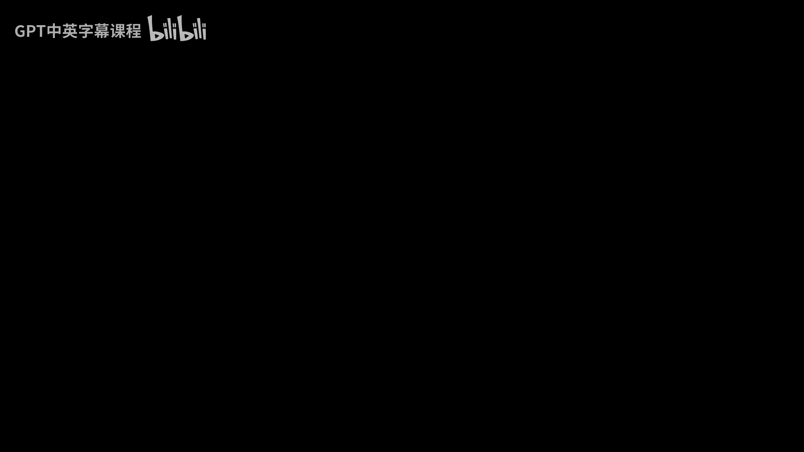
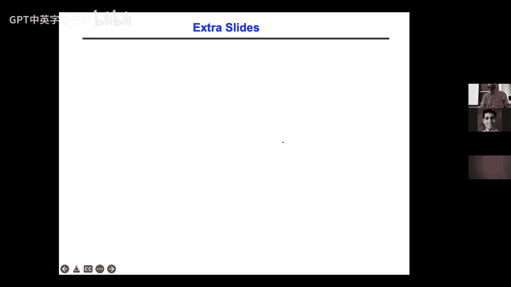
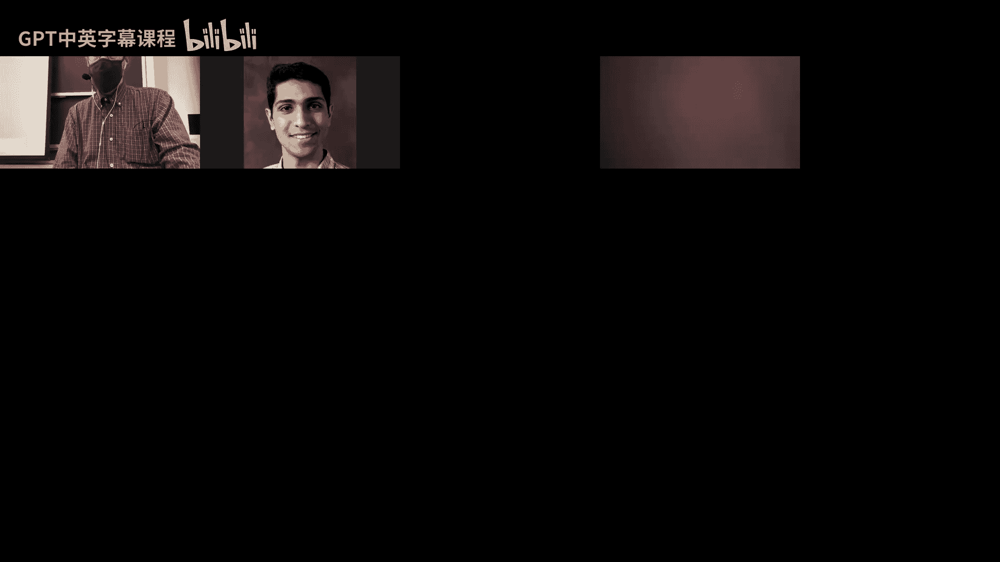

# 【并行计算 CS267 2022】伯克利—中英字幕 p26 CS267 Lecture 18： Structured Grids -BV1PS421978D_p26-

To CS 267 structured grids。 and just to remind you of where this lives in our。

Agenda， so here's the list of the 13 motifs the patterns that come up in parallel computing all the time and structured grid is outlined here in blue and it comes up in all sorts of different places。

 I'm going to concentrate on one theme that I introduced in sources of lecture2 which is solving Poisonic equation to illustrate the different ways to parallellyze and optimize structured grids。

 but perhaps even more popular reason for structured grids is image processing because an image is of course just a 2D you。

Mattrix of pixels and a lot of the algorithms that people run on them correspond to operating on a structured grid。

So I'm going to review Poisson equation just so I can motivate the different algorithms that I'm going to talk about and how to parallelze them and the techniques for parallellyzing them apply you beyond Poisson's equation that's going to be my motivating example and then from the list of algorithms that I introduced in the sources sources of parallelism too I'm just going to pick three of them which are based on structured grids。

 one of them is Jacobbe's method which is simple averaging with your nearest neighbors at every step over and over again red black SoR is another one of those methods is just averaging with your nearest neighbors but it's a little bit different because we're going to average over different subsets and so that's going to have a different parallelization screen then there's conjugate gradient which is a much more general method and involves some operations like dot products and so forth that show up elsewhere and it's much more general than just Poisson's equation and finally I'll talk about multi-grid which is Z optimal algorithm for Poisson it runs in order end time linear。

And there， as we'll see， the grids can't just be nearest neighbors all the time。

 they have to be much more widely separated in order to get fast convergence。

And you may recall that I mentioned that the FFT is also a very fast and popular algorithm and nearly optimal for Poisson's equation。

 but that'll be the topic of a later lecture。So just to remind you of what this system of linear equations it is and why it's a structured grid is I want to solve T equals F for U and t is this very simple matrix which is basically a structured grid why do we call it that because you can think of it operating on just a bunch of mesh points which are the red dots here and multiplying by t just involves taking two times every value and subtracting your nearest neighbors and doing that for every mesh point so that's what one-dimensional structured grid looks like so that's multiplying by t which is going to be what we're going to talk about paralyzing and use it to solve the system of equations。

And then here's the two dimensional version， which is much more interesting。

 and so now I have a two dimensional mesh。And in this case， the values on the boundary are all given。

 those are my boundary conditions， so I only have the unknowns inside nine in this case。

 and what what this operator does is it's at every interior mesh point it takes four times the value there and subtracts all its four nearest neighbors and so this stencil is repeated at every internal mesh point and if it happens to be sitting here its neighbors on the boundary and that's a fixed boundary condition。

So and 3D would be analogous， but I won't try to draw it in that case you would have one point and six nearest neighbors in all three different directions。

And so just to remind you of all the algorithms of which I'm going to talk about just very few today that are used to solve these systems of linear equations。

 these are the algorithms I mentioned in sources sourcesurs2 lecture and they're sorted in two orders from the most general and slowest algorithm to the most specific to the Poisson equation and the fastest algorithm。

So all of these are used in practice you know depending on the structure of your problem。

 if you have a dense linear system to solve then the answer is you know Gaussian elimination that's an N cubed algorithm but you know we're going to be eventually today talking about multigrid which solves this system in order n steps and so these are the four algorithms that I'm going to talk about today that are based on structured grid properties so Jacobbe which runs in order n squared time where this is in for the 2D case so in this case I have a little n by little n mesh so the total number of unknowns is little n squared and that's what I'm calling capital n。

And that runs an n squared time， then both SOR and conjugate gradients are asymptotically faster。

 they run an end of the three/ halves， and then finally I get down to multigrid。

 which is much much faster and is optimal。你 see。So let me write down Jacobcoby's method。

 and to do that， I'm going to rewrite the Pisson equation。嗯。

On a 2D mesh in a slightly different way to make it to derive it。

So let me move get myself off the top of my math， so this is just the equation。

 the IJS equation for Puson， it says that if there's a four in the denominator。

 so if I multiply3 by four I get four times my value equals a sum of all my neighbors left right above me and below me plus the given right hand side。

 that's the equation I want to solve。And so I'm going to have a sequence of approximations to it and I'm going to call the m approximation because I'm going to take many steps。

 I'll put an m there to indicate which approximation it is so how do I go from approximation m to m plus one it's very simple I'm going to take each one of the scalar equations and solve it exactly so that means I'm just going to take all the values of themp approximation on the righthand side plug them into the equation and get the m plus first approximation so this means this single equation is now solved exactly。

But since this value is used in lots of other neighboring equations。

 that means that other neighbors are now not solved exactly。

So I saw one equation at a time and hope that it all converges so how many steps does this take and the theory which I won't go into says it's proportional to problem size so I have to update all of the entries of the mesh capital n times and therefore the serial complexity is the cost of updating them all at once。

 which is the number of mesh points which is capital n times the number of updates which is capital n for n squared。

So let me try to give you some intuition for why this is going to converge slowly。😡。

Sorry about that stuff at the top， so let me try to give you some intuition of why this converges slowly and eventually why we're going to have a much faster algorithm。

And if all we're doing is averaging with our nearest neighbors， that means that every step。

 information can only move to one adjacent grid point。

RightBecause if all I'm doing is averaging with my neighbors then that's how fast information can move。

 but the solution depends on the data everywhere， so let's just consider this particular model problem so my right hand side that I'm trying to solve for has a one in the middle of the grid and a zero everywhere else。

So since Bason is approximating gravity。This is not surprisingly the shape of this is one over the distance to the one in the center of the mesh so it's a perfectly spherical kind of thing and so this is what the exact solution looks like。

 let's ask ourselves how fast we can possibly converge to this if all we can do is average with third nearest neighbors。

So here is what the right hand side look like looks like it's one in the middle and it's zero everywhere else。

 here's the true solution again。So what happens when I start averaging with my nearest neighbors well if I'm out here the right hand side is zero so I'm averaging with you know my neighbors are all zero so I stay zero。

 so after five steps the only place I can possibly have a nonze solution is within distance five of the center。

And this is what the solution happens to look like after five steps it's you exactly zero outside the distance five。

 so what's the best thing I could imagine if all I were allowed to do was to average with my neighbors。

 I would have the perfect solution so this would match truth。Within distance 5。

 and it would have to be exactly zero everywhere outside。

And so the air has to be at least as big as the size of this cliff that I fall off after five steps。

Because I'm getting zero when it should be the value of that cliff and so that tells me how long it's going to take to converge and pretty clearly if I'm only averaging with my neighbors and this is an end little end by little end mesh。

 it's going to take little end steps for information from the middle to get to the side。

And so I have to iterate at least that many times。Okay。

So now let's talk about how to parallellyze it because even though it seems slow。

 this is going to be the building block for everything else we do， so we still have to get it right。

And so if this is my vector of all of the iterations at approximations at time M。

 how do I get to time m plus1， I'm averaging with my neighbors and basically that's a sparse matrix vector multiply where it's basically I take that matrix to Poisson equation divide by four。

 subtract the identity and then you know add the right hand side divided by four so this equation here。

Is just the same as this equation， where I've written this linear combination of entries as this matrix T。

 it has the same structure as before。So now the question is how do I assign this to different processors and what are the opportunities for optimizing it Well we talked about it so here's my 2D mesh and what I'd like to do is minimize communication and make sure it's all loadbal so we talked about this before and the intuitive thing to do is to divide if I have four processors is to take this mesh and divided up into squares and each processor will get a sub square of size you know n over two by n over two or more generally n divided by the squared of p by n divided by the squared root of P and so when it needs to do its work most of the work will be on data it owns but'm on the boundary it's going to have to communicate。

So everybody on the boundary is going to turn into a communication with the nearest neighbor and so the question is what's the right shape to minimize the communication and not surprisingly squares are just fine we talked about that before the amount of data communicated on this little n by little n mesh is n divided by squared of P to each neighbor so the question is can we do any better than this kind of obvious algorithm。

So what I'm going to do is give you a way to take case steps of this algorithm K iterations。

For the communication costs， in some sense of one iteration。

So this is going to be a lot of communication that we can avoid in principle。

 and the idea is that instead of updating all the mesh points at every step and then all the mesh points at every step。

 we're going to interleave them。So we're going to， you know we're going to get to part of the M plus first and part of the m plus second and part of m plus third iteration and interleave all those and that will give us this big savings in communication。

So I'm going to show you how to do this for a 1D mesh because it's much easier to draw the pictures。

And so what I want to do。Is compute so this is I'm going to make it really small so I can draw everything so I have 32 mesh points and those are those 32 dots in the bottom and I want to do one step of Jacobbi two steps。

 three steps of Jacobbi and I'm writing this as a matrix vector multiply you know by this。

Simple matrix which is just averaging with your nearest neighbor so a is a tri diagonal matrix and so the question is。

What dependencies do I have to take into account to get the right answer？

So since the matrix is tri diagonal， it's pretty clear that to evaluate any point。

 I need the value at there in the two nearest neighbors。

So this triangle repeats itself everywhere in here， so for example， if I want to compute that entry。

 it'll depend on the three ones right below it， it'll depend on then you know the five ones below that and then the seven ones below that so I'm going to get to bigger triangles so this triangle will just grow out the bottom you know for later ones。

😡，So now let's suppose that the vector x is let me do the sequential case first and let me suppose the vector x is too big to fit in cache and so if I just did the obvious thing and read in X。

And computed a times x。And then computed a squared all of a squared times x。

 and then all of a cubed times x， I would have to do n the number of entries of x times k moves between fast and slow memory。

Because I can't even keep one vector in fast memory。

So the question is can I do it better and so let me show you how to do it。

 supposing that I can only keep about a quarter of the vector x in memory。

 so I'm going to have a quarter of of the vector x in cache and I'm going to compute。

Everything that I need。So here's what I'm going to do in the first step。

 I'm going to read in the first quarter of the entries of x。😊，And then because of their dependencies。

 I can compute all those entries of a times x because if you look at every point the triangle underneath it is there。

 it's in memory and it keeps getting a little bit smaller because you know I can't compute that one because it depends on something I don't have but everything inside that blue trapezoid is computable so and then。

I can do that with one data move， I can read in those n over four entries of x， do all this work。

 and write out those roughly n over four entries of a cube times x。

 you know so there's sort of it doesn't matter how many steps I've taken。

 it sort of still order n over four。So that's the first step。Here's all the other steps。

What am I going to do I'm going to read in the next quarter of the entries of X I will keep that boundary。

 you know that slany part and that slany part and now I have everything to compute that I need to compute the red parallelogram so all of these entries are in there and this one for example it depends on those two which I've kept plus that one so this can also be done just by reading that in and writing that out so it doesn't depend on how many steps I take then I'll do the green parallelogram and then i'll do the yellow trapezoid。

And so the communication has gone down from n times k， the number。

 know the length of the vector times the number of steps to just order n。

So that's the sequential optimization。So what about the parallel case。

 so now what I'm interested in is minimizing communication between processors。

And it's going to be a similar kind of picture。So here's what processor one is going to compute。

So I want processor one to be responsible for everything in that。You know， K by n over4。

Block rectangle now what it's going to do in order for it to compute all those entries it's going to need some information from its neighbor from processor two who owns that so if I just did it the traditional way。

 in order to compute that entry I have those two numbers。

 but I'd have to you know have a message from my neighbor to get that number。

And then to compute that number I'd have to have one more message to get that one and to compute that I'm going have one more message to get that one so we would take three messages in this case or k messages in general I want to do it with one message so I'm going to get the latency cost down by a factor of k and here's the simple trick I'm going to take all these three numbers from processoror two and pack them in one message and send them to Proor one。

So it's the same amount of communication three， but now it's going to be one message and then Proor one has everything it needs to compute everything inside the blue trapezoid so that's Proor one。

 Proor two will do it similarly， there'll be one message from its neighbors， Pro one and Pro three。

 then it can compute everything inside the red trapezoid， there's Proor three and there's Proor4。😡。

So if I look at this， what I'm paying a price， a little price for this， I'm doing redundant work。

So everything in this where these you know。Tpioids overlap these triangles at the boundary。

 all of these are computed twice they're computed redundantly。

 but flops are cheap right you know i'm giving i'm doing a little bit more flops in order to save you know。

Three messages， which is well worth doing。And so this is the picture for the one dimensional case。

Are there any questions about that， I chose this because it's simple geometry。

Here's the picture for the 2D case， which is why I didn't try to draw it。

So suppose one processor is responsible for that square， what's it going to need。

 it's going to need eventually everything that's colored red at the bottom。

 so all its neighbors are going to package up these red values and send them in one message to the processor in the middle who will then know compute this pyramid。

😡，And so and you can imagine it's more complicated in 3D， but it's the same kind of picture。

And in fact， this idea works for arbitrary sparse matrices as long as they're very sparse right it doesn't have to be nice and regular like this and later when we talk about sparse linear algebra。

 I'll come back to this and point out that this is another optimization we can use in the general sparse case。

Okay， so sorry that the title can't be seen here， so some I can make this go away。对。好。哦。Oop。耶。Okay。

ChrisOkay， thank you very much。I should have learned that by now。

 but anyway so there's a lot of work that's been done on optimizing stenils I'm going to just give you a little history here。

 one of the biggest most recent efforts is called Hali。

 which is work that Jonathan Rob and Kelly did in his PhD thesis at MIT and it's now part of Google's image processing pipeline it's very widely used it lets you automatically explore different ways of doing these kinds of tilings in Mapee or special architectures。

We've been done a lot of work on this over the years too at Berkeley。

 so here's a list of papers that are all on our web pages。

 so we did automating auto tuning stencil codes in the case of cache based multico platforms how do you do that trick about doing AX a squared times X and so forth for more general sparse matrices。

 know and then so lots of and then s review paper？Armando Fox had a project a number of years ago where the idea was to write it in Python and then automatically do all these optimizations and convert it。

And there was also work at MIT in Charles Lyicens's group and they produced what they called a domain specific language in a stencil compiler。

 that was also meant to map these things。So one more slide just to show you how long this history goes back so Mary Hall at Utah has been doing this for a long time for HPC applications Michelle Strtroud has also at Arizona been doing this for various applications so back in 2001 the motivation here in a supercomputing paper was that your grid was spread out。

Yeah， so on the grid， what is the grids it's computers connected over the internet。

So the idea here is that your problem is so large and you're sharing computing resources you know with colleagues at different universities and different cities and they were all connected over the internet。

 how do you parallellyze that in an optimal way and that was a supercomputing 2001 paper。

And back in 1993， our colleagues， Satiif Rao and some colleagues。

 actually came up with communication lower bounds for these operations。

 which these algorithms attain。And then people have been thinking about this for a very long time。

 the oldest paper I know of is from 1963。where they were trying to optimize this in the case where your fast memory was something called cores。

 so little magnetic circles， and your slow memory was disk。

 but it was sort of a similar set of ideas so it goes back a long ways just to say that structured grids and stencils are important。

So let's go on to the next optimization to the next algorithm and how that's going to change the way we optimize。

And so there are two ways that are pretty natural to try to improve on Jacobbe。

 but we're still going to do the same thing that each update。

 so the M plus first approximation at the IJF mesh point is still going to be a linear combination of the neighbors。

 but we're going to change the coefficients and we're going to change the update order。

So here are the two improvements， so at any point in time you may have some neighbors that have been updated recently。

 you should just use the most recent update values of your neighbors because they're hopefully more accurate。

And the other one is that if I'm moving， you know， if I'm adding an update to go from step M to step M plus one。

 why don't I just go a little farther in the same direction？And you know so in other words。

 take the correction from Jacobbi and multiply it by something bigger than one and go farther in the same direction。

And it turns out if we do both of these， then we're going to get an asymptotic speed up。

So so here is the idea the first idea so here's what Jacobbe does I get the m plus first iteration from taking all the values of the amp iteration and averaging them in some way and I'm going to change that to i'm just going to use the latest data available which could be either theM or the m plus first。

So let's see what the obstacles are to doing this if we do it in the kind of most obvious way。

So this is called Gaus Sael， it's invari old algorithm。

 and so suppose I'm just updating all my entries from left to right， top to bottom。

So at this point if I'm updating that one I'm going to get my four neighbors and my most recently updated neighbors are above me and to my left so there's going to be m plus one but the one to my right and the one below me haven't been updated yet so the question is how could I paralyze this and the answer is obviously not if I insist that these two be m plus one and those two be m I have no choice but to do it sequentially from left to right and talked about them？

So I can't parallellyze this， so it has to do something differently。And here's the trick。

I'm just going to do it in a different order。I'm going to give each mesh point a color。

 I'm going to break them into two categories， red and black。

 this is called red black ordering and the idea here is that this mesh point this red one only has black neighbors。

And each black point only has red neighbors。And so if I want to update all the black points。

 then I know ahead of time that all their neighbors are stepM。

 I just grab them and I can do all the black points in parallel by grabbing the values。

 the old values of the red points， then when I do the red points I can do all those in parallel。

 they don't depend on one another。But all of their neighbors are black and they've just been updated。

 so I have an M plus one over there。So this is called red black。SOR or red， black outsideel。

So I'm going to do so everything can be updated in two parallel steps。😡。

So what do I have what if I have a general graph， so I know what a test board looks like if I only have my four nearest neighbors。

 but stencils can be bigger。And so it's called so we need a different technique。

 which not surprisingly is called graph coloring So what I want to do is give every node in this graph and what's the graph I have a。

A node for every point that I want to update and I have edges for all the neighbors I depend on so it's just in this case you know east west north south。

I could have a more complicated graph and so what I want to do is give each node a color so all its neighbors have different colors you know so I don't have any red nodes depending on red nodes。

Then I can just loop through all the colors and update all the red ones simultaneously。

 all the black ones， all the blue ones， all the green ones。

 so I want to do this graph so this is a graph coloring problem。

And it's known to be you know combinatorily difficult。

 but there's something called a maximal independent set algorithm which runs very fast and what you can do is run that and it gives you a you know few you it doesn't guarantee the minimum number of colors but it gives you few colors。

And there's actually a famous theorem in mathematics that tells you how many colors you need。

In a certain special case， and this was originally proposed in the 1800s。

 it's called the Four color Theorem。It says that if your graph。

 if you can draw it on a piece of paper without any edges crossing one another。

 so it's like the map know of a country or with the states in it right none of those edges overlap if you connect to your nearest neighbors。

 then you only need four colors。In order to give everybody a color that's different from their neighbors and even though that was conjectured in the 1800s by somebody named Merbius。

 it wasn't proven until 1976 and somebody needed to write a computer program to generate all 1900 special cases the computer could then check so that was actually the first proof of a famous theorem done by a computer。

So anyway， our graphs are much simpler and for most of the time， and so for example。

 I could have a stencil that where I was connected to all eight of my nearest neighbors。

 and then I might need more colors。Okay， so if I made any you know if I gotten any speedups yet just by that one operation。

 you're doing reds and then blacks and the answer is well not really because even though that red black Gaus Sael converges twice as fast as Jacobbi you can prove it takes half as many steps。

 it does take twice as many parallel steps right it have to do all the red ones and then all the black ones。

 I can't update them all at once the way Jacobbi did。

And so there's one more improvement to get an asymptotic speed up so here's you can think of Jacobbi as adding a correction to every mesh point and I'm just going to take a bigger step in the same direction I'm going to multiply that update by some magical number W that's bigger than one and go farther and it turns out that for Poisson equation people know exactly what that magical constant is and there's a formula for it this is not know this is a topic for a different math class it's just a little bit less than two so you just go about twice as far in that direction and that makes the number of steps you need to converge the square root as big as it was before so instead of taking little n squared steps you only need little n steps to converge。

And that drops the complexity， the serial complexity down to the number of unknowns to the three halves。

 instead of the number of unknowns squared。And so that is sort of the next big improvement。

 and this is also a building block for the ultimate linear time algorithm。Okay。

 so we've just done Jacobbe and we've done SOR。And I want to say a little bit about contigate gradients just on one slide because it's very similar in spirit。

And so let me just write down the algorithm for conjugate gradients without trying to prove that it works it's basically doing gradient descent on the residual so it's trying to minimize the norm of the residual by going downhill in a certain complicated norms but I won't try to derive it so what does it do in the inner loop it's going to compute a dot product with the residual vector it's going to do a b one operation multiply you know this descent direction by a scalar and add the residual to it then most of the work is right here there's the sparse matrix vector multiply and then it does another dot product and some more sbyes。

And this converges in the same number of steps as SOR。

 so asymptically it's just it's the same expense， but it's much more general so that you can apply this to any matrix a that is symmetric and is positive definite。

 which means all its eigenvalues are positive。And and it's also possible to use all those tricks that I showed you about how to do many in multiplications by a and one with less communication。

 you know so computing A and a squared and a cubed。

 but you have to change all the algebra about the rest of it because you're doing different matrix vector multiplies and that turned into several PhD theses at Berkeley earlier to figure out all the algebra to make that work。

 but there are also significant speedups from doing that。Okay。

 so finally we're going to get to multigrid， which is the fastest algorithm and since it's going to converge in linear time。

 it will be an iterative method that means that information has to go faster than just your nearest neighbor。

 we can't just do matrix vector multiply anymore。Okay， so so just to repeat what I said。Jacobe， SOR。

 all these methods that just do sparse matrix vector multiply or averaging with your nearest neighbors。

 it's going to take at least n steps to move the information across an end by end grid because information moves one step at a time。

If you're averaging with your nearest neighbors and so that means I can't just do sparse matrix vector multiply if I want to you know move data very quickly and so in fact。

 if I want to converge in a constant number of steps。

 I somehow have to go all the way across the grid in one step。The question is。

 how am I going to do that？So here's the idea and it's going to come up in several lectures in this class and the idea is that if something is far away in the grid。

 then it's going to be simpler， we're going to approximate that problem in a certain way and the example that I used。

 I think in the sources to lecture and it applies to gravity so put on is that if you go out at night and you look up at the sky and you look at all the little white dots that you want to compute their force of gravity on the Earth。

And then you realize that one of those little white dots is the Andromeda galaxy and it has another billion little white dots in it。

 but you know your impression that the Andromeda galaxy is a white dot is just fine。

 you can approximate it by its center of mass。And that gives you all the decimal digits you'll need to get the effect on the Earth。

And so we're going to use a similar kind of approximation。

 so we're going to use a course approximation， we're going to approximate stuff that's far away by less information and then move it。

And so we're going to do that in this lecture from multigrid。

 and that will solve this Poisson's equation in linear time。

We're going to use the same idea in a different lecture for graph partitioning and that's a completely irregular problem you know arbitrary you know sparse graphs。

 we want to break them up into smaller subgraphs and the idea is again we're going to replace the original graph by a cos of one and all of this will be done recursively so we take this coars of graph and approximated it again。

And then we will come back to solving Poisson's equation and ones that are like it。

 and these are famous algorithms like the fastS multiple method。

That also get the complexity down to nearly linear time to solve this。

And the way you parallellyze them is quite interesting。

So the point is that big any idea that's used three times， at least is a standard technique。

 so that's why it's worth're talking about。Okay so here is why we can get away with course approximations and use those so let's suppose this is the solution that you're looking for and here's a fine mesh and in general you can see that it's you know moving rather smoothly and so here is the same solution on a mesh with half as many points in each direction。

And I think your intuition should be that this is a perfectly fine approximation for them。

And so and but this has now a quarter of as many mesh points。

 so if I can somehow solve this more quickly and use this as a starting guess for the fine problem。

 then I can make a lot of progress。And I can do that recursively。But I could have。

 you know not every problem looks nice like this， you know suppose that the what i'm really trying to do is this。

 so I could have lots of joggy behavior from one fine mesh point to the next there's no reason that my solution has to look this nice and smooth。

But underneath it， there's still the same basic pattern of how things move across distances from between this one and this one。

 and so what I'm going to do is just do local corrections to get the jaggy stuff to work。

So and we're going to see we can interpret that as this is high frequency noise and this is low frequency so we're going to you know so the interpretation is to think of the fine mesh captures the high frequency。

Part of the error and the course me captures the low frequency part of the error。

 so I'll be more specific about that。Okay。So here's the algorithm。

 we're going to replace the problem on a fine grid by an approximation of a coser one。

We'll solve the course grid approximately and use that as a starting guess for the fine grid。

And we're going to do that recursively， so this coar grid will be replaced by even coarser one with again。

 half as many points in each direction。And if we do that all the way， you know。

 down to a one by one mesh， you can prove that the whole complexity is going to be linear。Okay。

 so let me just define some notation。So I can say what it means to do this recursively and so I'm going to start with just a 1D problem to keep it simple so here is my 1D mesh and I'm going to do it where I'm going to assume I have2 to the m plus one mesh points。

Because that'll make it easy to take every other mesh point to get the course problem and so I'm going to let p sub I be the problem of solving it on this grid with two to the I plus one points and so in this case when I equals three I'm going to have nine points those nine dots there but the boundary conditions are given to me so I know the value there I know the value there so it's only the points in the middle that are unknown that I need to solve for so there's two to the I minus one unknowns plus the two boundary points。

And so I'm going to write that system of linear equations that whose dimension is now 2 to the I minus1 by2 to the I minus1 as T times X equals B。

So what do I need to do in this one dimensional case P3 I have nine points， black dots。

 seven unknowns there and what does it mean to co knit I'm going to take every other mesh point and that's going to correspond to the problem P2 and I've colored the points with red twos that are going to be the coursearse approximation so I have five points left they're over here this is problem P2。

And I'm going to approximate that again by taking every other mesh point。

 so I now have you know the boundary conditions and only one point left in the middle so I've labeled those one and P1。

 there are three points in one unknown， so that's the base case which I can obviously solve。

And so the question is， how do I combine all of these different equations together？Okay。

 so now I'll just draw the picture for 2D having drawn it for 1D so now I'm going to have a two dimensional mesh and it's going to be 2 dM plus one in each direction。

 so this is going to be a nine by9 mesh。And again， it's only the ones inside that are the unknowns。

 I'm given as boundary conditions， all the values on the boundary。

 So I' the unknowns are just this 7 by 7 mesh in the middle。 That's problem P3。

Then I take every other mesh point to get my next coarser problem。

 P2 and I've labeled them all by twos here， and that gives me this five by five grid of unknowns。

 but it's only this three by three ones in the middle that are unknown。And then again。

 I take every other mesh point that gives me problem P1。

 and now I have one unknown and all those boundary points。

So that's what it means to create this sequence of problems courses from finest to courses。

So let me now at a high level describe what I need to do to。Take my problem。

 map it from the fine to the course， improve it there a little bit and then map it back from course to fine each so I need some operators to do that and it turns out they're all structured grids they're all stencils。

😡，SoBut they're just going to be on different subsets of the original one。

So all of these operators are just going to average neighbors on the grid and so you know from nearest neighbors。

 but once I'm coarse， let me just go back to this picture， once I'm coarse。

 if I'm just talking to my nearest neighbor here， I'm moving twice as far as I did on this fine grid。

And so moving to your nearest neighbors on course bridges is where the fast communication happens。

Okay， so the first thing I need to do is I need to take a problem on the fine grid and map it to the course grid。

 the next courseurser grid。And so I'm going to give that I'm going to call that restriction。

 I'm going to restrict it from find a course， and I'll tell you what the numbers are。

 but I'm just going to use this symbol here R sub I so I'm going to take this。

Vectctor of size2 to the M and map it to something of size to the2 to the I map it to something of size 2 to the I minus1。

 so half is big。And so this is a rectangular matrix， but again， it's just averaging with neighbors。

So that goes from fine to co。I also have to go from course to fine。

 and I'm going to call that interpolation。So that takes an approximate solution on my problem piece P minus one。

 that's the course one。And it maps that approximate solution to a fine one。

And so it's going to do that just by interpolation to fill in the missing points and I'll tell you what you know what it looks like in a picture in a moment but so I'm just just going to use this notation to write down the algorithm on one slide so so far I've just gone from find to course and course to find I haven't done actually any useful work yet to improve the solution so I still have to do something that's Jacobbe like。

And I'm going to call that a solution operator， and that is on any one mesh。

 I'm going to do something that looks very much like what I just showed you。

 Jacobbe that's going to operate on a single level of the grid and improve the solution。

But it's going to be slightly different from Jacobbi， slightly different numbers。

 but it's basically the same idea。So let me just use these operators to describe the algorithm at a high level。

 and then I'll tell you about you know the details and enough to parallellyze it。

So this is called a multigrid V cycle and I'll show you a picture of why it's called a V cycle on the next slide it's just a picture of the call graph。

So what I'm given is an approximate solution， an initial guess could be all zeros and the right hand side。

 and my goal is to solve this system of linear equations given this initial guess。

So what's the base case， it's when I have a one by one system， so I just solve it exactly。Otherwise。

 what am I going to do， I'm going to do a few steps of this weighted Jacobbe to try to make the solution better。

Then I'll compute the residual， so if my solution were perfect， the residual would be zero。

 but it's not。So here is the interesting part， I'm going to take that residual。

 I'm going to restrict it to be on the coarser grid。

And then I'm going to call this algorithm recursively， so MGV is calling MGV。

 and I'm going to solve the coarser problem with the residual with an initial guess of zero。

And once Ive solved that I interpolate it back to the fine mesh so this is D is going to be my correction to my solution on the fine mesh and then I subtract it from my solution and if this had line of code have been an exact solution you know if R subbi exactly equal this then x sub I would be the true solution but it's not this is you know but I've made some progress and then I do a few more Jacobbi steps to keep it know to improve the answer and return that so that is what the recursive algorithm looks like。

So let me now just explain a little bit more about what these structured grid operators are。

 these stencils that S and R and interpolate。Oh and here's why it's called a V cycle so it's just a picture of the call graph。

 so I originally call it on the on the finest mesh which is I equals five it calls itself recursively with I equals four recursively three to one that's the base case and then one returns and then I update。

Two， update three， update four， update five， so this， the vertical axis is which mesh。

 the horizontal axis is time， and that's why it's called a recycl。So。I claim that this runs。

 I haven't proved that it converges yet， but it runs in linear time that running this V cyclee。

 the cost is dis proportionportal to number of unknowns。

And it's really easy to see why and that's because at each level I have this many unknowns。

 it's a two to the I minus1 by two to the I minus1 mesh。

 that's how many mesh points there are I do a constant amount of work at every mesh point its so the total work is still big O of  four to the I。

And so all I need to do is sum for to the I at every level of the mesh is the simple geometric sum。

 and it's dominated by all the work on the finest mesh for to the M， which is the number of unknowns。

And so this is why it's a linear time algorithms to do one of those v cyclees to do one of these and you know I haven't proved。

 and so if it converges in a constant number of steps， I'm done and I will show you， you know。

 I will just argue without doing mathematical details， this converges in a constant number of steps。

And so on an ideal parallel machine， each of these。

Levels recursive calls or I'm just averaging with my neighbors。

 that would take a constant amount of time on this perfect machine where I had one processor for grid point in free communication。

 so the total time is just the number of layers， which is order M。

And so that's the log of the number of unknowns， so that's how much it would take in on a perfect parallel machine。

Okay so here is the theorem that I won't prove， but I'll illustrate it to you in some graph。

 it turns out that after one call to that multigrid v cycle the error goes down by a factor of 0。

5 and it doesn't matter how many unknowns you know the grid can be as big as you like so that means you get at least one more bit of accuracy every time you do that v cycle and usually more。

And so if that means we can make the error less than any fixed tolerance。

 you decide how small you want the error to be in a fixed number of steps。

 independent on how many grid points。And this is what makes multigrid so attractive because all the other algorithms have to take more。

 their number of iterations grows with the problem size， grows as M increases。But multigri does not。

Okay， so let me tell you what these operators do。And and this will help explain why it converges so fast。

 so I'm going to tweak Jacobbe a little bit。So what would Jacobbe do in the 1D case。

 it would take the neighbor to the left， the neighbor to the right， the right hand side， add them up。

 multiply by a half， you know divide by the diagonal so that's what pure Jacobbe does。

It's just going to change a little bit， I'm going to average all three values。

 all three of these values， and put a one third there。So if I have the true solution。

 you can convince yourself these two equations are the same。

 but this is going to actually do a better job of converging for reasons I'll illustrate。

And in 2 to D， it's a similar average of nearest neighbors。

 so it's very similar to what Jacobbi would do。So here is why we are going to do weight to Jacobbi。

 it turns out that you can think of multigrid as getting rid of high frequency errors at every step。

So if I choose the right to Kobe so let me just show you three steps。

 excuse me two steps of multi grid and see what it does。To illustrate it。

 I've chosen the exact solution to be this sign curve， a dotted line。

 and my initial guess is this jagged line that's sort of approximately the signine curve。

So here is the error so it's the difference between the jagged line the signine curve and you can see that it you know it's just quite random numbers and what I want to do is understand to understand how multigrid converges I want to look at the FFT of this signal so this is the error。

 but now it's the FFT of the error， so this is the low frequency parts and these are the high frequency parts of the error。

And so you can see it's also， you know， pretty much。

 there's as much low as high frequency air because this is just noise。

So now I'm going to take one step of Jacobbi of this smooth Jacobbi。And here's the error。

 and there's its FFT。And what you should notice is that there's still some big points where the air。

 but the air is a lot smoother。And if I look at the FFT。

 I can tell that it's smooth because all the top half of the frequencies have gotten a lot smaller。

In fact， you can prove that this is decreased by at least a factor of three。

 that's what the math says， that you've knocked down the upper half of the frequencies of the error by a factor of three。

If I take one more step of Jacobbi， the error gets a lot smoother and now I've knocked down the high frequencycate error by a factor of nine and it's not worth doing any more steps。

Because I'm not improving the low frequency error， I'm only improving the high frequency air。

So this is what this weighted Jacobbe does。So now the question is do I how do I fix the low frequency error right I got to make all the errors small and that's what working on a coar grid will do for us because the coarse grid will make the low frequencies look higher。

So you can think of multigrid as divide and conquer in the frequency domain so here is sort of a cartoon of the picture I was just showing you here's the FFT of the error you know and it's big everywhere here's the upper half of the frequencies and as I said these get knocked down by a factor of three every time you do a step of way to Jacobbi so now let me take that and map it to the coursear grid how does that change the frequency。

So the only way I can see the high frequency error is by looking at neighboring mesh points。

Because things change rapidly， if I only take every other mesh point。

 I can only see the lower half of the frequencies。And so this is the part the FFT of the error that I can see on my coarse mesh。

 so now if I do Jacobbi weighted Jacobbi I'm going to kill the upper half of the remaining frequencies so the coarse Jacobbi will kill this part of the frequency。

Then I'll co it again and I can only see the bottom half of what remains and Jacob will kill the upper half of what remains。

 and so I just keep getting rid of half of whatever remains of the frequencies。

And so that's why after one v cycle， I've knocked down all the frequencies by a factor of three or nine or however many steps I take。

And that's why convergence is so fast。😊，So let me tell you what restriction means this is easy so this remember the restriction takes a problem on the fine mesh and gives me a coar approximation so here's a picture that's sort of the simplest thing you could imagine on a 1D problem so the fine mesh has 17 points on it and there's the dotted line and the easiest thing I could imagine is just take every other mesh point to get the course grip right and that's the solid black line。

But it actually converges a little bit faster if you do a little bit of averaging。

 so to get this course point， I'm going to take one half times the value where I you know there plus one quarter of that neighbor and one quarter of that neighbor。

 so it's going to smooth it out a little bit。And so it's still just a structured grid。

 but that's going to let me get this great convergence result。Ohoops。And so if I'm in 2D。

 I'm going to average not just with my left and right neighbors， but with all eight neighbors。

 you know， north， south eastst and west and the other corners， northeast and so forth。

That's restriction。So now I have to do interpolation。

 this is easier so now I only have the solution on a course mesh which is shown here and I want the solution to all the fine mesh points so I'll just interpolate you draw straight lines and you know so the fine mesh point there will just be the average of its two neighbors and if I'm doing it in two dimensions it's a little more complicated you know I'll average with the four neighbors there to get the one in the middle。

So that's what the interpolation operator does。So let me show you some convergence plots and then i'll get to paralyzing it finally if so now this is the one dimensional problem here's the true solution which is nice and jaggy and here's the right hand side so it's only non zero in four places there's a 0。

5 a minus。5 a plus1 and a minus1。And so now I'm just going to run multigrid several steps and see how fast the converges and here is one way to measure it。

 it's the residual at step m plus one divided by the residual at step M and this says that the residual is getting smaller by a factor of 0。

2。Hit every step。And I can also do that by just drawing it on a log scale。

 so the slope of this is the log of 0。2。But here's another way to see how this smoothing occurs so so now i'm showing you all the residuals actually you know so this is a mesh of 128 dimensions。

 the vertical axis is a log scale and so here all the residuals after every step。😊。

And one thing to notice is that they're all sort of a constant distance apart that because you know that's my constant convergence rate of about 0。

2， but it's originally the residual is very rough and then the next time it gets a little bit smoother and then smoother and it's very smooth at the bottom so this is the smoothing property that multigrid has。

And here's just a two dimensional problem to see the same thing。

 so here's the true solution on a square there's the right hand side that i'm trying to solve it。

 and you can see that the residual is improving by a factor of 0。4 at every step the theory says 0。

5 but you know sometimes you do better。And so I can also plot it by just taking you know the plotting the log of the residual and so this is a on a log scale。

 and so this has slope， you， the log of 0。4。Okay， so now it's time to paralyze this finally and talk about you know what we need to do。

And so let me just illustrate this on this mesh， which is 32 33 by 33。

 and I have a four by four mesh of processors so I have 16 processors。

And I'm going to do the natural thing， I'm going to break it up into squares and assign each subsqua to a different processor。

And I've drawn as I did before， I've labeled each mesh point by which problem it lives on so the problems labeled five。

 that's problem p5， that's the finest mesh， the grid points labeled four， that's problem P4。

 that's the next cos of one， P3。P2， so now when I get to P2， there's only one unknown per processor。

And if I get even coarser you can see there's some processor that are idle。

 you know it depends on the values of n and P and so forth。

 but as the mesh gets coarser and coarser we will have idle processors and so that means the speed up is not going to be perfect but it's going to be close to perfect you know because we will have idle processor。

And so the question is what is this processor here going to do so this processor here the pink one it owns all the data that I've colored pink and so what does it need to do at every step when it's working on the finest mesh it needs to average with its nearest neighbors so those four values and if it's on the boundary it needs to go to its neighbors to get the mesh points so all the points that I've labeled five that's the fine mesh on the neighbors are communication so that's the fine mesh stuff then I go to the coar mesh and I'm only going to do every point that would be labeled for here so if I'm trying to update that point I need to get that neighbor and that neighbor and they're also on different processors so again I have all these points that are labeled the red fours those are needed to do the P4 problem on that mesh and those all require communication then these threes also require communication to do the problem P3 and finally P2。

So and so you can imagine， you know， you can write down the formulas for how much communication there is to do all this。

 but that's what's done and then of course there'll be some idle processors if it's even coarser。

And here's all the count， I don't want to go into the details there。

 but if you want to read the count， so let me just say what the final answer is。

 what's the complexity of solving this problem。So I'm going to show you the complexity for multigrid。

 for FFT and for SOR， the successive over relaxation， the red black stuff。So N is going to be this。

number of unknowns P is a number of processors and multigrid the number of flops is going to be an over P that's perfect speedup。

 but there's a little log term to make it larger and that's because we have some idle processors in the course grid so that's just you know the payment for that。

The number of messages is log of n squared and the number of words sent is just proportional to the perimeter of the square。

 which is n over P square root。So all of those should not be a surprise if I compare that to the FFT。

 which people also use for Poisson， so it's in log n。

 that's the cost of an FFT and that speeds up perfectly divided by P。

 but now the number of messages is quite different it's P to the one2。And so。

 depending on your problem size， either one of these could be larger。But the number of words sent。

 the bandwidth cost is significantly larger， this is basically the square of the multigrid cost。

 so that's significantly worse。And finally， SOR is not competitive。

 it's worse in all of these metrics so it's doing end of the three have flops。

 they do speed up perfectly， but you know that's a lot bigger。

End the one half is bigger than all of these and number of words send it matches the FFT。So anyway。

 so this is a very coarse analysis， but it sort of tells you what what's worth trying out。

So let me just give you some data practicalities， people have been optimizing this for a very long time。

 so some of this data is old。So for one thing we don't go all the way to one by one problems。

 you know that would be a waste of time， so you stop at you know a much larger problem and then you solve that which still may live on one processor and then you solve it by conjugate gradients or something like that so the base case is not one by one。

So the other thing is that on the impression you should have gotten is that the coursese grids are really cheap right all the time is spent on the fine grid。

 but on a parallel machine， the coursese grid can actually be quite expensive。

Because of the communication， so let me just give you an example。

 so suppose we have1 thousand points per process that's the my course problem。

And so the number of flops is going to be proportional to 1000 the number of mesh points so let me compare the communication cost to that so in 2D that means i'm going to have a square root of 1000 by square root of 1000 mesh and so how much am I going to communicate well four times a square root of1000 that's 128 words so that's about 13% of100 Okay so that's small but it's not really small but in。

3D its you know you'll see， so now I have a thousand mesh points， it's 3D so that's 10 by 10 by 10。

How many points are on the border of a 10 by 10 by 10 cube well there's  a thousand00 points。

 there's 8 cubed strictly in the interior and that leaves about 500 on the boundary。

 so they're almost 50% of the points are on the boundary of a 10 by 10 by 10 Q。

So that means you're doing a lot of communication， even though， it seems like a lot of points。

So that's something that you have to take into account when you're paralyzing it。

So here's some old data and there'll be some more modern data shortly， so this was。

Taking this algorithm and running out in 1024 processor NQ when they tried it on a 64 64 by 64 grid of unknowns。

 the efficiency of one v cycle was 2% right so it was not this is compared to running it on one processor so the communication was completely dominant。

But by the time they got up to 1024 by 1024 grid， it got up to pretty good efficiency。

 so 70% efficient so the communication did not matter at that point and FMG is just another variation of multigri。

 you're doing lots of these cycles。And let me just say that。

People have been paralyzing this at LBL for a number of years。

 they have their own special implementations of multigrid。

 these are the names of the project and so they're trying to exercise you know trying to figure out how to deal with this communication cost on course meshes as well when you switch to a different algorithm like conjugate gradients。

 how many processor you use and so forth。So let me just say how this generalizes a little bit to unstructured meshes。

 I brought this up in the sources of parallelism two lecture。

 but I just want to remind you that people need to solve problems you know that。

mayy consist of not just a simple structured mesh like a square or a cube but it may be more complicated and it may consist of multiple squares or cubes that you can stitch together and so what I've told you is a building block for more complicated kinds of multi-grid but I want to just show you how multigrid works more generally so we're not going to have just you know a square mash or a cubic mesh it's going to be a more general graph that we're going to have to partition and we're going to have a lecture on graph partitioning later in the semester。

We still have to figure out how to course how to you know restrict and interpolate and you know and so that's going to be different if it's not simply you know nearest neighbors on a 2D mesh where I showed you how to do it。

 just take every other mesh point， it's going to be more complicated if I have a general finite element mesh or something like that。

And so what we can do is still use this idea of maximal independent sets now I'll show you some pictures of how that works and as I said。

 how do you restrict， how do you interpolate， how do you generalize Jacob Kobe and and when you have these course meshes。

 maybe I should restrict it to fewer processor and and map it down to a subset so that I have less perism but I also have less communication and so that's another optimization people do。

So just to give you a few pictures this was some work that was done here and a joint project a while ago so this is a fairly regular looking mesh。

 it's a tube and so it it's a regular mesh that goes around in a circle and the question is how do we coen that and maintain the geometry of a tube know because you that's important to get the physics right and so one level of coarsing gives us this and it still looks like a tube pretty much？

Then here is another level of couring and it's a little less tube b and finally it doesn't look like a tube at all anymore。

So the idea is we needed to come up with some rules for how do you decide who your nearest neighbors are to make sure that you don't know leap across this hole in order to grab a neighbor who may not be close so there's all sorts of different rules that people have invented depending on the geometry of the problem。

And the last example， which again I had last time in the sources lecture。

 this was a joint work with some folks in mechanical engineering and they were interested in coming up with a tool to analyze osteoporosis of elderly patients。

 and this is a picture of a bone that they wanted to do a finite element model on in order to say if I put a certain amount of stress on it。

 is it going to fracture。And that turns into a very large problem。

 which they solved using multigrid and so what they did was they did a micro CTt scan to look at this bone from from a cadaver and got a 3D image a 22 micron resolution。

And did a finite element， a meshing of it and came up with a 537 million by 537 million matrix。

 and you can see it's hardly a cube， there's lots of holes in it as you'd expect。

 but there's still enough regularity that multigrid is the right thing to do。

And so they implemented multigridness and they got 70% parallel efficiency and they ran it on 4000 processes and this one the prize for the best paper in parallel computing that year at supercomputing there's a special prize called the Gordon Bell Prize for someone who solves an important physical simulation as fast as possible so this was very interesting work now in practice of course you can't take a bone out of a living patient to do this kind of analysis you have to do something coarser but this shows that the what they showed was that this analysis was accurate enough to reproduce laboratory experiments where they actually did shatter the bone by putting a certain amount of force on it so it was clinically accurate the question is how do you do this on real patients without doing this kind of extraction so that's a medical problem that's not a topic of this class。

So that is the end of today's lecture。Are there any questions， yeah， I ended early。

Have a great spring break。I look forward to reading all your class project proposals and giving you feedback。

Yes。

Yeah。Yeah。

。对。