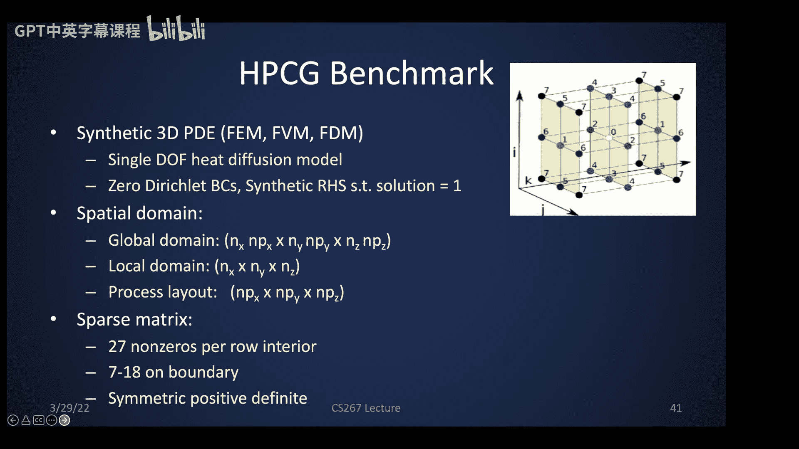
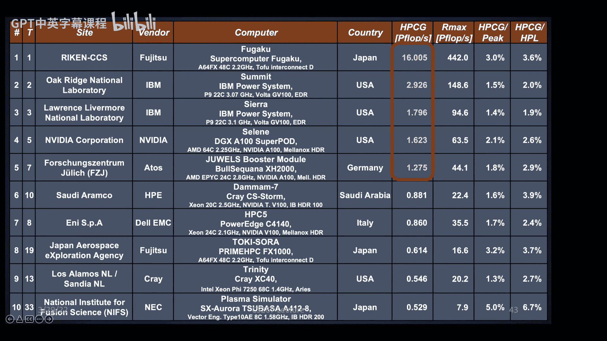
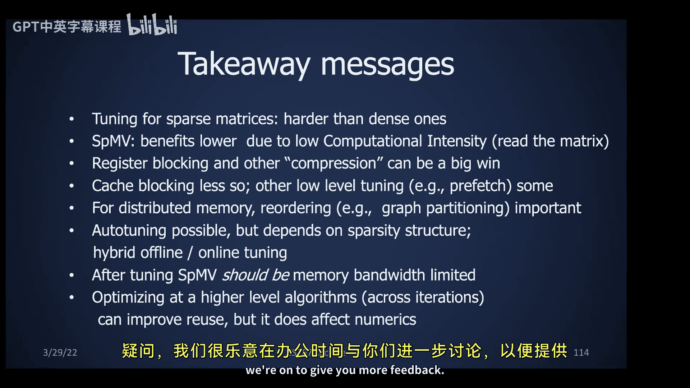

# 【并行计算 CS267 2022】伯克利—中英字幕 p27 CS267 Lecture 19： SpMV and Iterative Solvers -BV1PS421978D_p27-

to solvers for which the sparse matrix vector multiplies an inner loopop。

 But let me start with a Nobel Prize。

It's related to this， so Harry Markowitz invented the term Sprse or he made it popular first he also invented something called Markowitz's ordering which was you know a long time ago when sparse matrices were becoming popular in economics and of course his nobel not for sparse matrices per se it was for his contributions to economics but you know the motivation is in many fields to deal with these quickly。

So what is a sparse matrix it's a matrix it's mostly full of zeros and when if you were to actually represent them you know as a dense matrix it would waste a lot of memory and time。

 it arises in many， many different fields， climate simulation analyzing images， photos， MRIs。

 web page ranking I'll tell you a funny story about that in a moment and graphs including sort including graphph neural networks and that picture there is what's called a spy plot and MATLAb and so if you want to look at your sparse matrix that way you can just type spy of the matrix and you'll see what it looks like。

So here are some examples of diagonal matrices of sparse matrices that come up in different situations so diagonal is the easiest one tridiaagonal comes up a lot and eigenvalue problems you can also have the diagonals anywhere you want it turns out that a lot of matrices are sparse with in an irregular pattern and so we're going to have to store where all the non-zes are but some of them are blocked and so we only have to store an index indicate where each block is that's very common and finite element problems。

If it's symmetric， you can obviously take advantage of that and then the general case which we'll start with is where it's completely irregular and the non-zes can be wherever you like and so you can see that we're going to have to store not just the values of the matrix entries but we're going to have to store their locations and there's a lot of interesting data structures and optimizations that are possible for that。

So how do you look at a sparse matrix I mentioned that you can do a spy plot before so here's internet connectivity and so you can see that there's certain clusters you know of people that link to one another so here I comma J is nonze means there's a link from web page I to web page J and you can also visualize it by putting dots you know in lines connecting them as a graph that's a little bit harder to see so here's structural design to find it element matrix。

Easier to visualize and linear programming， you know。

 these matrices can obviously be rectangular as well， not just square。Yeah。

So recommendation systems are obviously very popular these days。

 and so here is an example where there's one row for every customer and one column for every product and the matrix entries indicate how much you know how many times that person has bought that product and so you want to do is predict the missing entries the question mark there in order to figure out what you want to advertise next。

So here is an example that comes from image segmentation and so what we'd like to do and there are lots of algorithms for image segmentation of course so what we want to do is represent this image by a sparse matrix and so there's going to be one row and column for every pixel and so what does IJ mean it means how likely I andJ are to be in the same subset of the image so if INJ have to be very close together obviously for that to be likely but also they might have to be the same color you know if you have a red next to a white that's probably not in the same one and you encode that in a sparse matrix it's mostly zero because most pixels are very far apart from one another and so you don't say they're part of the same image。

And then it turns out that the problem of finding the border is the segments in this can be written as an eigenvalue problem for this particular sparse matrix and if we look at one of the eigvectors you can see it kind of sort of reflects the boundaries in this image and of course you need many eigenvectors not just one and so how do you find eigenvectors it's mostly sparse matrix vectorctor multiply it's doing you taking this matrix and doing lots and lots of matrix vectorctor multiplies so that is going to be you know the core operation we're going to spend most of today on。

是。So here's some more applications and so here is the funny story I want to tell you about Google Page ranknk。

 a colleague at Stanford who teaches linear algebra was having office hours one day and a student he didn't know walked in and asked him I have this huge sparse matrix I need to find the dominant the largest eigenvalue and its eigenvector how do I do that and the professor said。

 oh this is the standard problem it's very easy you just need to do repeated matrix vector multiplies from some starting vector and it'll convert to exactly what you want。

So text analysis is another example， so there that's called latent semantic indexing。

 you have one row for every document and one column for every word。

 and there's a matrix entry that says you does that word appear in that document and so forth and it turns out if you do a low rank approximation。

 something like the SVD of that rectangular matrix。

 then that can tell you how to classify documents are they similar similar and so forth。

And of course， in science and engineering， they come up all the time when you're doing a scientific model and we'll have examples of those know finite element problems or just solving ODEs and PDEs。

 they all lead to sparse matrices。For which we have to do solves or eigenvalue problems and there's many。

 many examples of this。So let me tell you about some sparse matrix formats because and the most basic ones。

 and we'll be know showing you a lot more because there's a lot of optimization opportunities here。

So what I want to do is remind you that a sparse matrix and a graph are just two different words for the same thing they're sort of mathematically equivalent。

 so I'll start by sort of graph data structures and then move on to the sparse matrix data structures and so CSR。

Compressed sparse row is going to be the first data structure we talk about。

 but let me start with a graph， and so here is a graph with four nodes and a few edges which are directed and there are weights on the nodes and there weights on the edges。

And so what's an actual data structure for that you're going to use a bunch of linked lists you'll have an array with one entry for each node and then it'll point to a linked list of all the edges so zero goes to zero it has a self- edgege because there's a weight there of size 12 and it also has a link from zero to2 so there's a pointer there so linked lists as you can imagine are very flexible you can delete and an add one but if you have a static they're going to be much more expensive to traverse because there's all these memory axises every time you want to find another entry in the matrix so we want something that's good for repeated accesses that's more static。

ok。And so what we're going to do is represent this in the following data structure and we're going to have an array of all of the weights of this graph。

 so so we're going to have the numbers 12， 26， 1914 and 7 we're also going to have and those are the numbers that appear here and so we're just going to have this represent you know all packed together this linked list so 1226。

 1914 and 7 that's that array there。What we also have is the adjacencies you know who is 12 associated with who is 26 associated with and then we have a pointer to where where is the beginning of each linked list so zero points there that's the beginning two points there because that's where the second one begins two and one points of the same place。

 one is empty there's no links there and so that is the the data structure that's for this sparse matrix。

And here is the sparse matrix actually， so maybe it's a little easier to understand this data structure。

 so there's going to be one entry here。For each row of the matrix here are all of the non zeros in rows 122619 122619 and then there is the column in which that appears so 12 and 26 appears in columns0 and 2 so that's0 and 2 19 appears in column1 so there's a1 so these are all the columns and what this array points to is where does row  zero begin where does row1 begin where does row 2 begin begins at the same place because row1 is empty where does row 3 begin and so forth so this is this is compressed sparse row format and it lets us access each row of the matrix just by you consecutive matrix entry so it's the most efficient thing to do。

Okay。And so this was a directed graph。And so you thees， which means the matrix is not symmetric。

 so I can't throw away any information it's all there， but I could have an undirected graph。

And what does that correspond to that corresponds to a symmetric matrix so the edge from three to one is the same as the edge from one to three so that 14 appears in two places in that matrix。

 and we can use the same data structure， but we only need to store half the data right we only need to store the upper triangle and we just know that the other entry appears to so that's a more compressed version of that data structure。

嗯。So here is you know just another illustration of the same thing I have a sparse matrix they're all the non-zero values I'm going to take them and pack them all together so those four you know real numbers or floating point numbers all get packed together there the next three get packed there for each one of them I store its index it's column so this is column014 etc so these are014 and I guess nine and then I have pointers to where row1 begins row0 begins row1 begins row two begins and so forth and I have one more pointer to the end so I know were the end of the data structure roots。

And then finally， I need to have two more integers which I'm not showing here。

 which is how many rows there are and how many non zeroros there are。

 so I know exactly how long this pointer is and what the size of the data structures are。

So there are a lot of other formats and let me just mention them we'll go into more details later。

 the one I just showed you compressed Sprse row is the most common。

 but there's I could also do compressed sparse column so it's the same data structure I'm just storing a transpose if you like but I just store all the entries in each column packed together。

There's another format which is called coordinate format and in that case I just store triples of a sub IJ I and J so I store both the row in the column and that way I can store them in any order that I like。

Talk about that in too much more detail。Okay。So there's also diagonal format and I showed you pictures of that。

 sometimes your matrix is sparse， but its diagonals are pretty much filled in so you can store those as as and say which diagonal it is。

And as I mentioned， if the matrix is symmetric， you don't have to store all of those。

 you can just store half of it。And then we're going to spend a fair amount more time on blocked。

Algorithms where you know because if you're doing a finite element model you know that you typically have four by four little dense blocks or eight by8 dense blocks it depends on what your finite element model looks like and you don't have to store you know the column index of every one of those numbers in that eight by8 block you just have to store the upper corner and then you know where all the others are automatically and that can reduce your memory requirement but significantly obviously one index instead of 64 indices and those are quite common and that's all called register blocking and there's also cache blocking it for another level the memory here。

And yes， many more specialized ones。So let's talk about how I do sparse matrix vector multiply。

 assuming I have this compressed sparse row， and I'll write the serial code and then I'll talk about how to parallellyze it。

So there's my sparse matrix again， there's the x vector I want to multiply it by。

 and I want to compute y equals a times x。And there's my sparse matrix。Yess。

So there is the inner loop that I want to loop over。

 I want to compute a subi j times x sub J added to Yi for all the non zero a subi js。

 so how do I organize all the loops？So I'm going to loop over each row so and I have a pointer to where each row begins and then I will loop over all the non-zes in each of those in each row so I'll loop from you know pointer sub0 up to pointer sub you know one minus one so loop over all the red ones and then I'll get the non-zero entry so this is a sub ij and then I need an irregular memory axis I need indirect addressing to say where do I go get x because x could be anywhere and that's where a lot of the expenses the fact that I have to you know that this subscript for j comes from accessing this index and going off to somewhere unknown in memory to go get the entry of x that corresponds to it so here I will need x for the first row I'll need x0 x1。

X4 and x9。嗯。Okay， so the。An important observation here is that this is a baz2 operation and so how much data reuse is there well I'm doing exactly one multiply in one ad for every non-zero matrix entry so there's no data reuse here so this is going to be expensive I'm not going to be ever able to go faster than dense matrix vector multiply which is a Baz2 operation know unless I do some optimizations of a higher level in the algorithm and we'll talk about that at the end but we'd like to our goals to the beginning is how close can we get this to run just to the classical dense B2 that's our speed limit。

So let's now go paralyze it。And so I'll just show you some simple code and a whole bunch of different programming models that we've all learned about so the first one is openmp and the simplest thing you can imagine doing is putting in a pragma which says please paralyze the outer loop you know the loop over all the rows and you can choose a schedule and I'm going to just choose a static schedule so what would this do if you have eight processors it might assign the first n over eight processors n over eight rows to the first processor。

 the next n over eight rows to the second processor and so forth。Now。

 and that's sort of embarrassingly parallel and all that， but is it load balanced？

I mean it could be that some rows have a lot more non-zes and other rows and so if it could be that processor one has much more work to do than all the other processors who you're not paralyzing very well and so what is the trick in openmp to fix that load balancing problem we're going to have a whole lecture on load balancing later but know in this case I'm going to change that word static to dynamic and what that will tell openmp to do is keep track of which processors are busy and assign them you know more work to the not busy processors that's how going to have some overhead attached with it and as I said we'll have a whole lecture on how you implement that efficiently but it's going to try to keep all the processors load balanced。

So here's another code I'm not going to ask you to read this so this is how if you had an8 wide SD unit which a lot of processors have how would you write that code so what you would need to do is go fetch eight consecutive entries of the matrix a of the row so you know so this is only useful if you have at least eight nonzes each row of the matrix then you have to go off and index and gather you the eight corresponding entries of x so that's going to be you know so we're going to send off eight fetches to memory and then I can do all the multiplies in one vector operation。

😊，And you know and so speed up the floating point that way。

 even though it's not going to speed up the memory accesses necessarily。

 and then finally I have to sum all of them you know and keep track of that。

So this is sort of you know what you might so this is a code written in AVX2 at a low level just to see what that might look like and the nice thing here is that there's I should say I should have said this before there's no race conditions right because I'm accumulating all the data。

🤧Into I'm assigning one processor responsible for each entry of why。

 so you know there're not never going to be two processors trying to access the same entry of y at a time。

 so race conditions are not an issue here。Yes， okay， so that's what I just said。

And then there's some code at the end， know in case the number of non zeros in a row is not a multiple of eight。

 you have to clean that up at the end。So here's some kUa code and it is also quite straightforward all i'm going to do is assign different blocks of rows to different process you know to different threads and so here's some standard kutuda lingo to loop over all of the rows know in these blocks and so each thread will be assigned a certain number of block dim times gridd threads in order to accumulate that so this is quite straightforward to doing in kuta as well。

So it turns out there's another trick that you can use on a GPU and that is to use a segmented suffix scan in order to do the sums so remember when we did prefix sum it computed all the sums of a leading sums of an array you computed Ai plus a2 plus dot do AI for all different values of I and that could all be done in parallel and and we did something we called something segmented if you could say please break off the sum at some part so you could do a1 plus a2 plus a3 but then start over with a4 plus a5 plus a6 and you can choose where those breakpoint are and that's exactly what we need to do here if we have all of the products a sub I j times xj we might want to sum the first three to get y1 the next five to get y2 and so that's going to be done with a segmented scan so here is sort of at a high level。

What that would look like， so here's my data structure， where does each row begin。

 what's in the column， what are the non zeros in the matrix。

And what I need to do is say where does I'm going to use this flag to say where I'm going to restart my segmented scans so this is where row zero begins I'll put a one there。

 this is where row one begins I'll put a one there where row two begins and so this is going to be my input to my segmented scan and and I can do that build this array with one line of code by saying it's full of zeros and I'll put ones exactly where each row begins that's what the pointer array is so that's one line of code to get this flag array。

Then I will go get all the x's and put them there， so I will go off to this array and access it according to this index。

 and so these are all the x's I need for all the multiplies by all the entries of y。

And then I will compute the product。Of all the entries of a。

 that's the valeert times all the corresponding entries of x。

🎼And i'll get all the products so what I want to do now to get my answer is some the first two entries of all the products that'll give me y1 y zero。

 then the next three will give me y one the next two will give me。

Y2 and so forth and that's exactly what the segmented scan does。

 please take this array of products and compute the prefix sums starting over every time you start a new row and that's the answer and that is the output of the sums。

And so in fact， it has lots more intermediate values in it。

 and so that's why I'm going to know describe grab the ones I need， that one， you know。

 the leading sums。Okay， so here， I just want to mention one more specialization。

 how it looks different。We're going to paraze it differently if I have a different data structure than CSR。

 So suppose my matrix。Is stored along diagonal so in this case。

know this is what my matrix looks like and the natural data format here is to have three arrays。

 an array of the red entries， array of the blue entries and array of the yellow entries。

 and so this is the data structure I would have the dimension would be n in this direction and and the number of rows would be the number of non-zero diagonals。

And so now what I'm going to do is parallellyze differently。

Because what I want to do is do all of these multiplies， you know。

 I want to multiply the red times x2 plus red times x3 plus red times x4 and then sum them all up。

And so that's going to make the accessing much simpler， I can access these in consecutive order。

 I can access X in consecutive order because you know I need x2 x3 x4 and so that makes the inner loop much cheaper than it would have been otherwise there's no indirected addressing I'm doing consecutive memory accesses to get the entries that I need and I'm just going to store them in different entries of Y。

So that's a different one， so I'll have one proor do the reds。

 one proor do the blues and one proor do the yellows， for example。

So people also have used this in GPUs and this jagged diagonal just points out that these diagonals don't all have to be the same length。

 they could end early and that's a pretty common data structure and that's called jagged diagonal format。

Oh。哦。Okay。Okay， so now what I'd like to do is remind you about。Something we already covered。

 which is the distributed memory version， and I just want to quickly review how I do parallel dance matrix vector multiply。

 you know we covered this in an earlier lecture and then I'll sparsify it。

And so so this is a warm up in the dense case so if I have four processors each processor is going to own one fourth of the data and there are several ways to do that so let me just remind you the simplest thing you can imagine is each processor owns a quarter of the rows so processor0 owns this you know n over4 by n block of a and so forth and then each processor owns a quarter of x and a quarter of y and so this is all reasonably embarrassingly parallel but some communication is required because if processor one owns that chunk of x it will need to broadcast it so that processor02 and 3 I'll get a copy and so the first step is a broadcast and then I just do local dot products or local matrix vector multiplies of that orange chunk times the whole green chunk and then each Y is stored locally and so no communication is required there so that was one simple implementation we did before I could also store the matrix。

In column blocks， and so now I don't need to do any communication to multiply a times x because this subset of a that processoror0 owns all the entries of X that it needs in order to compute that but the communication is to compute Y because now I need to do a reduction because every processor is going to have a contribution to every entry of Y。

 And so there's going to be a summerd you know sideways across all the processors to get their contributions to Y。

And finally， we mentioned this 2D block block layout， so now I have 16 processors。

 each processor is going to own a sub matrix。And so now there is going to be communication two phases of communication。

 because processoror zero， who owns that is going to have to tell broadcast it to processors 4。

8 and 12。Prosor 5 who owns that chunk of x will have to broadcast it to Pros 1，9 and 13。

 and similarly there'll be a sideways reduction。So is this a good idea or a bad idea， well。

 there's now there are two phases of communication but they're both much smaller。

 maybe only square root of P processors participating and so whether that's a good idea you know depends on the sizes your matrices and the number of processor and so forth。

So now let us go see if this is a good idea and any of these are a good idea in the sparse case。

So here is my sparse matrix which I've kind of drawn there where all the non-zes are kind of uniformly spread out that's not you know you can't assume that but we'll just draw that for this picture and so it's going to be the same kind of algorithm if we just apply it straightly each processor is going to get one quarter of the rows of the matrix and I will still need to broadcast all of the entries of x and I will you know but then all of the entries and then I will do a local sparse matrix vector multiply using the algorithm I just showed you and update y independently but you know is this a good idea this load balanced well obviously in this picture I've drawn a as though it's load balanced but from the pictures we've seen before we can't assume that all of these non-zes are uniformly spread out so we're going to have to worry about that。

And the same story happens here， so now if I have a column wise layout。

 what could be unbalanced is the reduction so it could be that some processors have nothing to contribute to why in the summer de and so does that mean I want to have a sparse summerduce that's much more complicated to implement or I could just do the expensive thing and assume that everybody contributes fully to why。

And that's going to be equally and load balance is going to be even a bigger issue if I use a 2D layout because if you remembered some of my pictures。

 a lot of the non-zes were clustered on the diagonal and so that meant the processors you know two。

3 and7 could be completely empty they could have no non-zes at all and so this would be a rather bad way to to do the load balancing and so we're going to have a whole lecture later on how to reorder the matrix in order to deal with with load balance but right now I'm just going to assume that so in other words if I were to permute the rows and columns of this matrix I could move the non-zes around and make a better load balance worse load balance all that sort of thing the question is how do I pick the right order of the rows in the columns that problem is called graph partitioning and we're going to have a whole lecture on that later because it's important for all sorts of things but right now I'm just going to assume that I'm given the data structure I'm not allowed to change where the nonzes are I can assign them to different processors。

But I can't change the structure of the matrix。So what would the ideal structure look like if I could reorder the rows and columns。

 it would be if the matrix could be reordered so that it would look like this block diagonal。

 then clearly then each processor run in completely embarrassingly parallel way。

 processor zero would multiply its non-zero block times its block of x and added to its block of y there's no communication at all。

 it would be perfectly load balance， this would be the ideal sparse structure and so what graph partitioning will do for us later is say if you're given an arbitrary sparse matrix how do I make it look like this as much as possible by reordering the rows and columns。

But that's a whole another lecture， as I said。So let me go on to what performance we can expect from running these kinds of algorithms and you already heard in lecture one about the top 500 where everybody。

 all the top supercomputers in the world race to see how fast they can do dense。

 Gaussian elimination， well there's another benchmark called HPCG， high performance。

 conjugate gradient， where all the top computers in the world race to see how fast they can do sparse linear algebra。

And so I just want to tell you how that benchmark looks and then we'll look at the results and see how much slower they go than for dense linear algebra and so what people decided to do they put together this benchmark where the bottleneck is where the goal is to solve a big sparse system of linear equations and's still linear equation solving and it's going to use a method called contigate gradient which is and the bottleneck is going to be matrix vector multiply and then there's a bunch of dot products and Spees too。

And so you have to choose the sparse matrix and they chose deliberately a so-called easy one with a very regular structure it's a three dimensional PDE so there's a three dimensional mesh and there's going to be one row and one column for every point in the mesh and so where are the non zeros the idea is that everybody is connected to its。

😊，26 nearest neighbors。So in other words， if this is node zero。

 there's if this is a node right there， there's going to be a non zero for its neighbors this direction。

 that direction， all the ones that are that are here so this is something that might come from。

Many different kinds of science problems this happens to be a very simple you computing the distribution of temperature inside a cube of uniform material and so it's a very simple sort of poisson like equation and so what are the so there's going to be a domain which is there's going to be a processor layout so you get to choose know you're going to have a three dimensional grid of processors it's not going to be two dimensional because three dimensionsals make sense here so you have to choose the processor layout so this is a total number of processors and then each processor is going to get some know parallel some brick shaped thing of vertices that it owns locally so of size nx times byny by Nz and so and then you build a sparse matrix and then all the entries are pre-assigned there's basically a big number on the diagonal and then minus ones off the diagonal so it's sort of like poisson and then。

Lots of sparse matrix vector multiplies。So。Here is the list of the top 10 machines and how well they do so what I want to do is sort of explain these a little bit so the first column here with the number sign that's the rankings this is the top 10 the number next to it is their ranking on the top 500 how fast they do linear algebra so you can see that the top three are winners on both。

Then it starts changing and in fact， the one who's top 10 for sparse linear algebra is way down the list for dense linear algebra。

 number 33。So this is a very different kind of machine for that。So。Here is how fast they're going。

 so this is petaflops per second。For the top machine so these are sorted because it's in that order and the fastest machine this data is about a year and a half old so need to update it it's only going at 16 petaflops and that's to be compared with how fast it does the dense case which is 442 megaflps so you can see this is a whole lot slower and let me pull this down。

And all of these are running at small fractions of you know you know just a little over one petafloop and then finally it falls off below one petaflo by the time you hit the sixth one here's how fast they do the dense linear algebra and here's the ratio this is how fast。

This you know the matrix sector multiply this benchmark is going compared to HPL， the top 5001。

 and you see it's going you know at less than you know usually less than a few percent until you get to this one here who's doing 6。

7% that's why they went from 33 on the list at number 10 on the list。

And if you also look at how does it compare to the peak speed of the machine。

 it's also getting a tiny fraction of the peak speed of the hardware。So this is， you know。

 going this is just a limit on how fast we can do sparse linear algebra。

 you know we can we're using all the processor on these very large machines。

 but these are all very memory about。And so this is， you know。

 so what we should have here is a column of how fast this is going compared to the memory bandwidth limit。

 you， which we could compute to， but that's not in this particular benchmark。

Okay， so now I want to start talking about how we can tune sparse matrix vector multiply to go a lot faster。

And this is， you know， these are optimizations that work well， not just， you know。

 on these big parallel machines， but they're important on any processes。

And it's all about communication， no surprise。So let me look at a few specific examples and so this and this is some old data but we have you know details for it。

 so here's a spy plot of a matrix that comes from a NASA structural analysis problem and so let's sort of zoom in on the top corner and see what it actually looks like in detail。

And so there's the top corner。And you can see that that narrow little band is actually a bunch of it block tri diagonal。

 so tridiaagonal because there's three diagonals here， but each diagonal is an eight by eight block。

And so it's pretty clear that I don't want to store 64 indices to indicate which column each of these non- zeros are in。

 I just want to say wheres the top corner starts and then store this as a dense matrix and then I can reduce potentially the communication by this huge factor right instead of having 64 indices I need one index to indicate where that lives。

And so the question is， how much faster can I go if I use that natural data structure？

And so I'm going to show you a lot of data。😊，And so。So as I said， what I'm going to do， in this case。

 I'm going to store my matrix not as each individual entry， I'm going to store it as little blocks。

 and I'm going to use R and C number of rows by number of columns for the size of the block。

And for that matrix， it was kind of obvious that8 by8 seemed like a natural block size。

 but that's the tuning parameter we'll see that8 by8 is not the best theres so R and C are going to be tuning parameters we need to pick。

And so if I keep making R and C bigger and bigger， my storage can drop up to a factor of two。

 why is that I have to store all the non-zero entries， all the floating point numbers。

 but the number of indices can get smaller and smaller and if I made them know if I reduce that by a size of 64。

 then that could and it's all 32 bit numbers that would reduce the total memory axis is by a factor of two。

 so it seems natural to try to make R and C as big as possible。

And so let me show you some performance data to see what happens when we just do the experiment on an old machine。

 so we're going to try doing that blocking trick not just for eight by eight。

 but for all the factors of eight， so two by four， four by eight， all combinations。

And let me show you results in a heat plot。So here is all the possible results。Of doing one， two，4。

8 for the columnblock size， one， two， four，8 for the roadblock size。And it's color coded by speed up。

 and so one by one is the base case， it's speed of one and two by four winds。

Yes I should say four by two wins it's a factor of four faster the8 by8 case is faster too but it's only 1。

55 times faster， so that is not obvious and that is why this is an auto tuning problem right well we really need to do in practice and we and people have built and we have built tools to do this is they automatically collect this data to try to figure out what is the best block size because it's not something you want to spend your own time doing for every matrix that you get you want to have this be automated。

So can you think of why the intuitively obvious eight by eight is not always the best thing to do？

Well， if you don't have like 64 registers in order to store all those numbers at once for some reason on this old machine you don't have big enough registers set then you know you're not going to get all the speedups you know so so that is and it also may be you know and if you're doing prefetching you need multiple you know sets of 64 registers and you may run out but you may be able to keep all the floating point units busy and all the memory busy if you use a smaller size so there's all sorts of complicated。

And hardware reason is not to use the largest possible size。So。Yeah， so there's the best。

So here's a bunch of other machines just to show you that there is no one best answer and so they won in the lower right here that's one we just saw and there was the winner but you can see the winner could be anywhere depending on what platform you have and these you can see from their names which you may not recognize these are very old platforms but it's the same story on today's processes and this was got the biggest speedups but you can see there speedups elsewhere。

And。Just one more， you know， you， for eye candy， you know all every machine looks different。

So this is really an architecture dependent tuning problem。

So now for that particular problem we could just look at it and say oh eight by8 that's kind of obvious and so we can try all of these you know factors of eight but most matrices aren't so obvious and so that makes it another tuning problem and so let me just sort of dive into one particular matrix that comes from a finite element problem for fluid dynamics and sort of zoom in on the upper corner and try to guess what the right block size is so let's zoom in the upper upper left corner。

And this is what the sparseity structure is。And so now， yes。

 there's a lot of little dense blocks there， but it's maybe not so obvious what the right box size is。

But you know if you do a bunch of accounting， you can see that three by three kind of makes sense。

 there's a lot of three by three subbs here。But if I superimpose this grid。

 so each little black square is now a three by three sub matrixtri。

 you can see that there are indeed a lot of dense three by three sub matrices。

 but there are a lot of three by three matrices that aren't full。

So what would happen if we were to actually insist that we use this three by three data format and stored you know this thing as a dense three by three block。

 then I'm going to have to fill in all the non- zeros and so this is what it would look like all of those red dots would be stored as explicit zeros in my data structure and I would do explicit multiplies and ads with those zeros。

Does that seem like a good idea， well， on this problem， we added 50% more nonze。

 so we increased the amount of work by a factor of 1。5， but it was 1。

5 times faster despite that on this machine。And how could that be， well， for one thing。

 we still decreased the memory bandwidth because。Even though we had so what was the size。

 the original data structure， it was NNZ。No zeros and N and Z indices N N Z is the number of non zeros and after this it was 1。

5 N and Z non zeros， but it was 1。5 divided by 9。N NZ indices。

 and so it's still smaller than two times N andz。And altogether。

 and and then we were able to take advantage of the vectorization on this platform， and it was a 1。

5 x faster。So this is clearly also something that you don't want to have to explore by hand。

Because it's a complicated thing that depends on the matrix。

And so the question is how do you do this and we we are not the only ones to have done this we built an auto tuner called OSCI。

 which is a deliberate pun， it stands for optimized sparse kernel interface and there's also a parallel version for it and it automatically searches over all the different data structures for your particular machine and it tries to divide up the work into what you can do once when you like install the software on your platform and so you do all this hardware kind of benchmarking and then when you get the matrix。

 it just does something very cheap， it sort of randomly samples your matrix to figure out what the most you what the best data structure is。

And so let me tell you a little bit more detail about that and yeah， so there's there's OSI。

And so here is what we do。So there's an offline part and a runtime part and so offline what we do is we take a dense matrix and we break it up into little R by C blocks and we benchmark it how fast do you go when you pretend you treat this dense matrix as sparse with R by C blocks so it'll tell you whether8 by8 faster or two by4 is faster for all possible R andC up to 12 by 12 there weren't any matrices that need anything bigger so that takes a while but you do that once。

Then at runtime what we do is we do some random sampling to say well if I took my input matrix and broke it up into R by C blocks。

 how many new non-zes would I have to create and that's called fill so this is a number that's bigger than one and it tells you how many extra floating point operations you'd have to do if you stored your matrix in R by C blocks and then how do we pick the optimal R andC we say this is how many extra flops。

 this is how much faster I go take the ratio and I maximize and I want to minimize this so this will if the flops get bigger for this particular RncC。

 even though if I do a few more know even if I fill in the matrix a little bit you know this may be the smallest and so that will and I'll show you that that does a very good job of picking the optimal values of RncC。

So how do I estimate this without doing something very expensive right I mean I don't want to like pass through my matrix。

You know，12 squared times and build a new data structure and ask how big it is that's ridiculously expensive。

 Oh well， so here are some of the pictures so that I wanted to show you So this is the the megaflps as a function of R andC。

 So here's what it looks like。 And so there this is the processor I showed you before。

 So there's the 4。07 for the 2 by4 matrix。 But here it is for all the other different values up to 12 by 12。

 So this is what we collect offline。And here's just a bunch of other pictures so that you can see that it's different for every processor and you know this is just you know data that you collect and you want the machine to do all this kind of stuff。

 so this particular one was pretty uniform but you know still there's some variability in it。Okay。

 so how do I know， estimate the fill in？Without doing something very expensive building 144 data structures。

 what I'm going to do is pick a sampling factor between0 and1 I'm going to subsample a fraction of the matrix of size s times n and Z and then I'll take that submatrix and block it and ask how much it fills in and by doing some variance monitoring some basic data science I can increase the sampling until my estimates settle down and I can use that to be my estimate of how much it would fill in and so overall the cost of converting the matrix from the input to this new data format is order big O of 10 spMvs so it's an expensive thing to do but we're only interested in doing this if we're running for example。

 an iterative algorithm where I'm doing many matrix vector multiplies。If you're only doing one。

 don't bother with this， but if you know that you're going to do lots of them in most science applications or whatever。

 you're going to do a lot of sparse matrix sector multi play， so it's worth investing this。

And the other thing is that in many science applications or machine learning。

 the data structure doesn't change， but the entries and the matrix change。

 so you can reuse the same data structure， even with different entries and so you that makes it much cheaper too over many runs。

好。So this is sort of one example of machine learning to do performance tuning， and there's many。

 many papers that have been written over time。To do this。

 I just wanted to give you a list here you know and this is work know we did some work in this stuff back in the early 2000s and we have a project going on right now that's funded by DOE called GPtune which uses Bayesian modeling you know Gaussian process modeling to try to build performance models on codes to try to choose all these parameters because this problem of tuning code has appeared so many times that people say why can't we just build automatic tools for it so if you're interested in using any of these in your final project to choose lots of parameters then here's some pointers and we can talk about it more offline as well。

So let me show you the results of OSCI how well it does and I'm going to do that by showing you the raw time if I don't do any blocking you know just naive sparse matrix spectrum multiply for a bunch of different sparse matrices and I'll compare that to the result from doing exhaustive search all possible RNCs you try all 144 possibilities how close can we get to optimal and so the vertical axises performance so up is good and the horizontal axis are 44 different test matrices that are kind of sorted in order from easy to hard and so this is a dense matrix and so because that's where we expect to do the best then the next eight matrices are finite element problems where they all have a common little dense block size you eight by8 or something like that。

The next matrices are also finite element problems。

 but they have multiple block sizes they don't all just have one know set of blocks。

 there's a bunch of them。Then there's you know random other matrices that were hard to classify and then the hardest case turned out to be linear programming problems。

 so these are know very short wide matrices that represent the constraints in the linear program and these were know the hardest so you can see we didn't get any speed ups there at all。

So。And there's lots more details in our former graduate student thesis Rich Mudox here if you want that。

 so that is the best， this is a reference。And here is how that heuristic that I told you about and so you can see that and that's the little green box。

 so you can see in most cases the little green box hit the optimal。

 you know it managed to pick the optimal box sizes。In some cases， it was a little bit lower。

 but not too much。And so that tells you this heuristic work pretty well。

And so remember I also said that the peak speed that we can ever hope to get to is dense matrix vector multiply。

 so let me show you that's dense matrix vector multiply so this is the bs to you know optimize like crazy and we can get you knows by treating our input dense matrix that way you know we get pretty close to that peak and this is know how close all the others get。

So all of this was about register block finding little blocks。

 but there's different levels of memory hierarchy so I just wanted to mention the next level the memory hierarchy which is cache blocking and the question since so the question is why would I do this there's no data reuse for the matrix entries the only possibility for data reuse is the vector y and the vector x now the vector y we've already done perfectly right we grant you know each entry of y is written to memory once know that's fine so the only possibility for improvement is reusing the entries of x because we're going we have to access that in many different ways and so。

Approach of cache blocking would be to say， let me take my matrix and break it up into blocks so that I'm only into columns。

 blocks of columns so that all the entries of X that I might need for that column block fit in cache。

So that means I can read a bunch of entries in X and do that entire block column。

 and then I'll do the next block column and I'll reuse the next bunch of entries of x。

And so that's what cache blocking refers to， and that's particularly useful when I have a very long vector x that doesn't fit in cache right so I need to have a very short and wide matrix for this to make sense。

😊，And so here's some just some data， some examples of when this pays off。

 this is for a latent semantic indexing matrix which is very short and wide and so here are the cache block sizes。

 the log based two of the number of rows， the log based two of the number of columns and you can see there was a speed up of around four you know if we chose it right for this particular short and wide matrix and there's a paper on this but heres and here's some other results of speed ups on random matrices that look like this as opposed to a particular latent semantic indexing matrix。

And again， the log base two of the number of columns and rows in our cash block size。

And this is what the speedups were， sometimes it pays off， sometimes it doesn't。And so in fact。

 the paper you can see from its title says sometimes it works and sometimes it doesn't so。

 but it is useful when it does work。😊，Okay， so let me so I've spent a whole bunch of time now just on talking about blocking。

 but there's a lot of other optimizations to make sparse matrix vector multiply go faster that I won't have time to talk about so I'm just going to give you some highlights of what they are and how much speed up you can get so far I've talked about register blocking and we showed up to4x speed up so over're just using a compressed sparse row so what happens if my matrix doesn't you know have one size block in it well the obvious thing to do if you know you have a finite element problem with8 by8 and 3 by three blocks is to break it up into two matrices。

And one is stored with eight by eight blocks， the other one is stored with three by three。

 and that's called variable block splitting， and that can get to another factor of 1。

8 by just choosing one common block size。So diagonals。

 you know I mentioned that already that can give you a factor of 2x doing that trick with graph partitioning to reorder the matrix so that I can push entries together that were previously sorry that's not graph partitioning but I'm doing is I'm reordering the matrix so that if I have a whole bunch of nonzes in the matrix that are far apart I can push them close together and so I can create dense blocks where they weren't there before and that's more of a local optimization problem and that gives me another factor of 2x over compressed sparse row if the matrix is symmetric I only have to store half the entries but you know use each one twice and that can give me a factor of up to 2。

8 cache blocking I mentioned。So multiple vectors so that's not just a times1 x it's a times many x。

 so it's really sparse matrix times a tall skinny dense matrix multiplies so now there's all sorts of opportunities for data reuse or know homework one again and they're no surprise you get and get up to a 7 x speed up there and they are a lot of examples where people want to do many matrix vector multiplies and all of these can be combined。

Which is why you want to automate the process and for triangular solve that's you know if the matrixes sparse again all of these optimizations apply you can get a 1。

8 to x speed up and then you know sort of giving us a hint of something to come which is what if I have a higher level algorithm and you know the only way I can go faster is not to think about optimizing a single matrix vector multiply but asking where does that know what does the algorithm actually do with that and just to give you a hint of one possibility there are a lot of cases where I want to multiply not just a times x but a times a transpose times x and that's in the inner loop of a bunch of things and it turns out you can do both of these operations and only touch a once。

So the easiest way to think about that is that if I take the first row of a and I do a dot product of it with x。

 then I get a scalar， and then I multiply that scalar times。The first column of a。

 which is of a transpose， which is the first row of a， which I already have in memory。

 So I only have to read a once， and I can do both of these matrix vector multiplies。

 And so by taking advantage of that reuse， I can get you know significant speed ups。

 And then this funny looking thing here。😊，Can give us even larger speed ups and this is going to be the kernel of our which we're calling it the AKX kernel because that's you can see a to the K appears there。

 so what I can do is do all of these matrix vector multiplies and in theory only touch the matrix a once。

And this particular set of matrix vector multiplies can then be used to inside your conjugate gradient method or your eigens solvever or whatever it is。

 and make that go much faster。So by looking up you。

 higher up in your algorithm and asking what optimizations are possible。

 you can do much better than just thinking about sparse matrix sector multiply。

So let me just give you a few more examples of speedups and then I'll move on to those new algorithms so this was some roof line modeling for how fast spMV can go as I said we're going to be memory bound but there but the question is because there's very little data reuse but the question is how much can you still you optimize for your hardware and so here is a roof line and just to remind you these horizontal lines tell you so the horizontal axis is your flop to bitete ratio in your algorithm which is very low for sparse matrix vector multiply and the vertical axis is how fast you can go these horizontal lines are the peak speed of the machine know depending on whether you use all the SIMD units and these diagonal lines are the bandwidth limits that tell you how fast you can go you know depending on whether you know you're accessing which level of the memory hierarchy。

And so these are four different processors and this is an old accelerator which is very hard to program and so you can see that these red dots are where sparse matrix sector multiply lived and' and so they're all limited by sort of the slowest bandwidth of the machine and so this is like with no optimizations。

 just sort of the naive CSR matrix sector multiply。

So then what can you do to optimize that and this is for these are all multi core machines。

And so if you do NuMma， if you use the fact that on a multi corere machine。

 some memories are closer to some of the processors than others。

 and you make sure that each core accesses its closest memory that's and you do it with software prefetching。

 then that moves up the performance closer to the peak bandwidth of the machine。

 so I can now hit the green dots。And if I do all of those tricks for matrix compression。

 you know do the blocking you know you use smaller indices， all those kinds of things。

 then the dot actually moves sideways because I now have a better floop to bite ratio so and i'm still so i'm still bandwidth limited but i'm still you know i'm much closer you know to the。

Yeah， so but I'm higher on this slope， so I'm going faster。So here's one of the other optimizations。

 if I'm doing cash blocking and I'm making my block small enough。

 I may not need 32 bit integers to store the locations of the non zeros。

 I may only need 16 bit integers and that's going to drop your memory by a significant amount。Okay。

 one more story here about to show you how all these how important all these optimizations are。

 so here on the horizontal axis through a bunch of different matrices。

 dense and then lots of different sparse ones and then the median。And the vertical axis is a speed。

And these are four different platforms。And so again。

 these are three different multico platforms and this was an old accelerator。

 which was the hardest to get speed up on know by using these straightforward tricks and so the purple bar is the naive code just CSR。

And then the vertical， the top of the light blue bar is naive P threads。

 so just you know parallellyze you know， using the simplest code that I showed you before。

 you know where each process gets， you know one， you one piece of the each core gets one piece of the rows to do the dot products on。

And so you can see that each of these has， let me make sure I remember， I think eight processors。

LetMake sure I get this number right。Oh。Right， so each of these are eight core machines。

This is 128 core。And this is 16， so we would hope that these blue bars would be eight times higher。

 but they're way far away from being eight times higher。So the question is。

 what can we do to make that better？And so let me show you the results of doing a whole bunch of different optimizations and so each of these stacks of colors tells you how much more of a speedup we got from doing compression that means the blocking trick from doing prefetching from doing the nu metric trick where we reach core accesses its local memory and then that's on top of doing the parallellyization than naive code and so now you can see that we're getting much better speedups and so and none of this was this is all using heuristics know none of this is doing any you know exhaustive search to find the parameters so that's a good result that shows that and so now I've changed the vertical axis to be go up to 16 that's why all these is shrunk and I've added one more optimization which is cache blocking and you can see that that doesn't help very much except for the linear programming matrix and that's because it's a very short and wide matrix。

That I mentioned before and now finally， if you write the language for this accelerator。

 it's the winner and so that tells us that you know we can't do it all you know by taking C code and doing all these automatic transformation sometimes and of course accelerators are hot these days。

 you know we're going to have to write low levelve code to get the kind of speedups that are promised。

😊，And here are finally the numbers for the median speed ups over the original。Unoptimized code。

 so it's well worth using these accelerators if you can， 35 x。Okay。

 and the last topic is how do you change the algorithms so that we're not limited by SPMV？

And so if you just do。SPMV then you can see so this is a bunch of different platforms and you can see this is where all the time goes to do an SPMV it's accessing either the DRAM or the L3 or the L2 or the L1 and the floating point work doesn't even show up in this plot it's trivial so all of you know so we're completely memory limited by by SPMV on all of these different processes so what we have to do is change the algorithms at a higher level。

And so how are we going to do that and what I'm going to do is not just do one SPMV at a time。

 I'm going to do multiple SPMVs at a time where I access the matrix A still just once。

And I already showed you a trick for doing this when we did the structured grid code where I said you could do multiple applications of your structured grid in one step and I'll remind you of those pictures。

 but now we can do it for arbitrary sparse matrices so to what class of algorithms to apply。

 it applies to a whole bunch of iterative algorithms for solving Ax equal B or solving eigenvalue problems。

 they have names like conjugate gradients GMmrez Lach there's a huge long list of these。

What do they all have in common， they all do a sequence of sparse matrix vector multiplies to get some vectors k at a time。

 and then they take some linear combination of those vectors to get the best solution and they all have different rules for finding which linear combination in different definitions of optimal to find the best solution for ax equal B or ax equals lambmbda x。

 but what we want is to get all of these vectors and touch the matrix A once。

And so in the parallel case。What we'd like we'd like to do is to make the cost independent of how many steps we take。

 we want to you know decrease the communication cost from k sparse matrix vector multiplies to the equivalent of one sparse matrix vector multiply so in the parallel case that means I want to do not just K reductions each reduction costing log P I want to do one reduction。

And get it down to a single reduction cost to do take K steps of the algorithm。

 and in the sequential case， I want to access the matrix once not k times in order to get all of these。

And so this doesn't work for every matrix， your sparse matrix has to have some structure。

 and so I want to remind you of what that structure was for the structured grids and then show you how it generalizes and so this is the trick that we did when my matrix was tridiagonal and I wanted to compute x a times x a squared times x and a cubed times x。

Where each entry just depends on its two nearest neighbors。

 I'm going to compute the same average of you know。

 take this number times two and subtract the two nearest neighbors。

And the picture I used to illustrate that was that every entry of a times x depends on three entries of x because there's three non zeros in each row。

 so I'll take some number times my own value and then some number times my neighbors。

And to see what a squared times x depends on， I just repeat that dependency graph and so now that entry of a squared times x depends on all the five entries of x。

And if I wanted to compute all those entries of A cube。

 they eventually depended on everything at the bottom of that trapezoid and so how did we。

You know implement so what I'd like to do is compute all of these vectors aX a squared x a cubed x and minimize the amount of communication。

 so in parallel I would like to you know communicate as little as possible between different processors and then sequentially I'd like to only touch the these vectors once。

Instead of reading the first one， reading the second one， reading the third one。

And so here was the trick in the sequential case， suppose you can only fit a quarter of your。

Vectctors X into fast memoryory at one time， you'd read that in and then you have all the information you need to compute everything in that orange trapezoid then you can do the blue trapezoid then the green and then the yellow and you can reduce the total amount of x and so all of this is going to be resident in cache instead of having to read each vector in once so each of these touches the vectors once and so altogether together you touch the vector once。

And this was the parallel model， so each processor is going to be responsible for a parallelogram and to do that they're going to redundantly compute the stuff in the triangles where they're where excuse me where their trapezoids overlap so processor two computes everything there。

 Pro one computes everything there so they'll compute the green stuff twice but they only have to share this data at the bottom and one message so one reduction。

So the question is how does this generalize to arbitrary sparse matrices， so here's the picture。

So here is a graph picture of a sparse matrix， so each vertex is a row or a column and each edge represents a non0。

 so if that's row1 and that's know row and column1 row and column two that says a sub 12 is non zero。

And so the question is how do I assign this to processors to do the same trick that I had in the previous slide。

 so I'm going to partition my matrix， so each processor is going to get some subset of the rows and here's the yellow processor it owns that and so what does it need to have in order to do a times x。

It needs- since there's a non zero there， this processor is going to need to know that value of x that's associated with that。

And so just to do a times x。It's going to need to get all the nearest neighbors these are all the communications that are going to be required it's going to get you know that value of these two values of x from that neighbor。

 these two values of x from that neighbor and so forth。So what if I want to do a squared times x？Yes。

I'm going to need to get all the neighbors of the neighbors。

So that's the same picture that I had before， I'm just making the that。

The base of the trapezoid a little bit bigger， but now it's going to be this irregular thing。

 but if my matrix is suitably sparse， that isn't very much more and then finally。😊。

If I take three steps， I'll need all the blue ones。And so by using this trick。

 we can make matrix- I can do a times x， a squared times x and a cubed times x。

 just by communicating all of these red， green， and blue data once。

And that's the parallel case and the sequential case， then I would compute all of these first。

 then all of those， then all of those and all of those and it's the same idea。

And it uses some mathematics， some algorithms called hypergraph partitioning。

 which we'll talk about in a future lecture。So here are the speedups that you can get by using this trick for a whole bunch of different sparse matrices and you can see that this was the case of you know just where you're only depending on your nearest neighbors。

 in fact this is a five point sscil instead of three point stencil you get a sixx speed up but you get speed ups for all of these。

And so there's lots of other performance results， which you can read about。

But the question is what are these new vectors good for because they' are different vectors than the classical algorithms require the classical algorithm。

 you know I'm not doing a squared times x it's a times some linear combination of previous data so I'm computing something different mathematically and this is just repeating what I said before that I'm reducing a number of messages by a factor of k and in the parallel case and the amount of data movement by factor of k in the sequential case。

So let me show you how the algorithm has to change just for the simplest case。

 which is GMRs so what I'm going to do what GMRs does is it takes this basis of vectors and it picks the linear combination of them that minimizes the residual right ideally Ax equals B this would be zero it wants to minimize the residual so what's the algorithm do it computes a times a vector。

 it makes that vector orthogonal to all the previous vectors by running something called modified gram Schchmidt and then it creates a little k by K subproblem that it solves to minimize the vector。

The residual so what's the new algorithm going to do it's going to take this different basis it's going to run an algorithm I told you about in an earlier lecture called tall skinny QR that's going to give you the same orthogonal vectors that this modified graham Schmidt would do and then we can rebuild the same H matrix and solve the same little K by K problem and in an exact arithmetic we get the same answer and we get you know and we decrease all the cost by a factor of K in the sequential case and the parallel case。

So the question is， what could go wrong and this is all in mathematically。

 you know all these are exact mathematical transformations， but in floating point， it doesn't work。

Unless you fix it， so here is the conversionvergence plot of the original algorithm。

 horizontal axis is a number of iterations， the vertical axis is a residual and you can see it's converging。

😊，Here is the algorithm that I showed you that can go potentially much faster。In exact arithmetic。

 all of those green triangles would lie on top of the blue curve， but because of Rooff error。

 it's complete garbage。So we have to change the algorithm。

And by computing not a squared times x and a cubed times x， we just chose different polynomials。

 so a different quadratic polynomial， a different cubic polynomial， and doing the numerical analysis。

 then you can get it to converge and the costs are about the same。

So this is just meant to illustrate that it's not just， so to speak a computer science problem。

 it's also a numerical analysis problem in order to modify your algorithms to get these speedups。

And when you do that， these are the kind of speedups that we get。

 you know again that are so the vertical axis is the runtime and you can see and so down is good and so this is how much faster we go for all of these different problems for that GMRs algorithm。

So I'm almost out of time here and so this is the last slide so here's the takeaway from the lecture so tuning for sparse matrices is even harder than for dense ones there's a much bigger design space of data structures you know and algorithms and so forth it depends very much in the hardware and the structure of your matrix SPMV is going be slower we have no you know hope of you you know if all you care about is one SPMV it's going to be memory bound there's still a lot of you know。

Optimizations we can perform make to compress it to make it faster。

 know there's register blocking there's cache blocking how you distribute it and on distributed memory matters and we're going to talk about graph partitioning to try to make a matrix vector multiply go faster there's lots of auto tuning that depends on the sparsity structure and tools that do that but that's expensive you know so typically you want to do many matrix vector multiplies for that to be worthwhile。

And then you know the best thing you can hope for is to optimize your higher level algorithm so it's not just a single SPMV。

 it's multiple SPMVs where you can take advantage of data reuse。So it's 1230 and that's。

A good place to stop。Are there any questions？Were there any on Zoom？Okay。

So you should have all gotten your class project feedback。

 I hope you got that in email and we're obviously happy to talk about that more in office hours you know we on。

Yeah， to give you more feedback。

Okay。