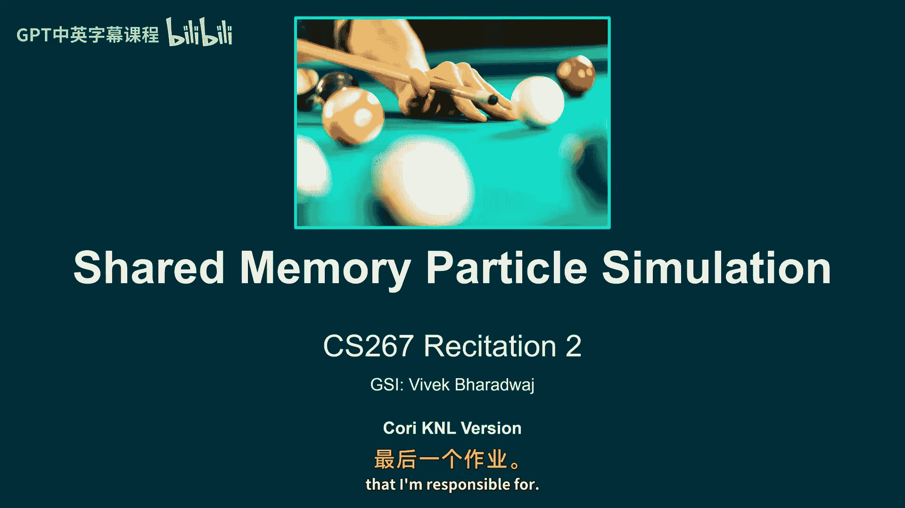

# 【并行计算 CS267 2022】伯克利—中英字幕 p28 CS267 Recitation 2： Shared Memory Particle Simulation -BV1PS421978D_p28-

Forward。Yeah。Okay， so just a disclaimer。These are being recorded。

 we may post this on Moodle so some of the exceed students we don't have a Moodle。

 but this class is sort of being offered to students at other universities。And。

To offer it to them we you know upload it to YouTube and closed caption it so if you don't want your camera sort of appearing in that in those videos。

 you know you can go ahead and。And just。Turn off your camera or if you're fine with it， you know。

That's fine， but like be aware that it might be。It might be broadcast Okay。

 enable live transcription Sure， as far as I know it doesn't show up in the recording。Okay。

So let's get started by the way， I my screen is set up in such a way that I really can't see the。

That I really can't see the chat and I also can't see what anybody else is seeing because my iPad is not working。

 so can everyone see the the slides just。Someone has to shout out okay， good。

Good and I will clear the chat at intervals but if I don't you know someone should just feel free to interrupt me this recitation is by the way congrats everyone onm making it through homework one I think that's frankly the hardest one this recitation is going to be somewhat shorter I also kind of phoned it in a lot of the bullet points aren't animated and stuff like that so let's just get started。

So。Homework 2。1， this is shared memory particle simulation。

 also the last homework that I' am responsible for。

Um。The problem is a pretty simple one let's just go through some class notes if you haven't sent me your exceed note exceed usernames I need that you should submitted the group sign up form even if you didn't want a random team。

 if you haven't done that please email me ASAP with your exceed username because we need to get you access to the second system you're going to use for the GPU assignment which is PSC bridges。

呃。Next thing is you know。I think you did the hardest assignment in the class frankly the MP assignment is also pretty annoying but you know if you got through this you're in great shape so nice job hopefully you appreciate high performance matrix application a little better you guys are using the N hours that's great。

If you hit your individual cap， this shouldn't happen because we think that everyone has enough hours。

 but if you hit the cap， if your job just stop executing for some reason。

 tell us we'll raise the cap， obviously don't waste some time， run only the benchmarks that you need。

 but like if you need to run benchmarks， please run as as many as you'd like， and if need be。

 we can request more hours。And again， the reminder again， please don't run code on the login nodes。

 I think we've been even told in the past that when a large number of students come come into the course。

 sometimes login nodes slow down because people are all running on the login nodes instead of the bath jobs or the interactive notess。

Okay， let's guy actually get to the assignment。And we'll probably finish the presentationt early and I'll just stick around to answer any questions。

So your assignment is to write the fastest serial particle simulation that's a single core that you can and then you're going to paraze this particle simulation on a single actually I think we actually make you go to two nodes at this point so this is actually incorrect this should I think say two nodes using actually it is a single node for this assignment by apologies so you're going to paraze your serial particle simulation a single node using openM so this is shared memory parallelism。

And you're actually going to use 68 threads， not 64 threads。

So the key of this particle simulation is that at close ranges。

 the particles exhibit repulsive forces beyond a certain cutoff radius。

 there's no force between the particles， and you can use this to your advantage。

Let's take a quick look at the starter code here， I have this divided among two slides and one second I'm just going to go ahead and。

Mute all participants， there we go。So the starter code is pretty simple。

 we have simulation initialization you can do this。

 you can use this to do any kind of setup you need if you have any kind of data structures you want to initialize and you don't want to do this in every simulation step which is no smart you should put all kind of data structure initialization the simulation function don't do any actual particle simulation in this first。

First part， but any data structure setup up that should go here， simulate one step。

So this is pretty simple this just sort of loops over all pairs of particles and computes the force interactions between them。

 so here we have two nested loops I and J each one going through all the particles in simulation that's order n squared that's pretty terrible that's the thing you have to first speed up in your serial simulation before you paralyze and once we compute all force interactions then it's just a matter of moving the particles based on the force compute that's just using f equals MA。

And performing basically a time stepping computation to evolve the state of each particle。

Okay and let's actually dive into my next function come on come on okay there we go so let's actually dive into what the applied force function does so the apply force function that takes in both a particle and its neighbor it's just going to compute the distance between these two particles that's this little section here if the distance is larger than the cutoff it's just going to say you know what there's no force between them and otherwise it's actually going to compute the force。

It's computing the force， but it's really accumulating into these buffers AX and AOY。

 these are the X and Y accelerations。😡，And the thing here to note is first of all。

 we have this F max r2 min R min R so this basically says if two particles are extremely close to each other we don't want some massive force between them that just kind of blows up the simulation that'll make something go beyond the boundaries of the simulation box。

 so we're going to say you know what the radius is going to be。

It's going to be at least this minimum R， so the force' magnitude doesn't get too massive。

And then we accumulate into these accelerations and there we go and the move function is also pretty simple。

😊，This uses this。Sort of modification of the oiluler method they're calling this fertlet integration no idea what that is。

 but this is basically Oer's method。And。The idea here is you add to the velocity that each particle is maintaining and then you add to the position each particle is tracking both its position and its velocity。

 and there's some code here that basically handles the simulation boundaries bouncing off the walls。

Okay， any questions about the starter code， this is pretty straightforward。

Okay no questions about start code let me just talk about some miscellaneous notes some groups every year find creative ways to compute this force function that we provide you and this is really fantastic there's some really creative methods that come up every year these include kind of changing the arithmetic order using some fancy machine instructions especially for the division over the square of the radius all sorts of other techniques some people try Cd I think I tried C last year this is all great but these often produce slight differences with our reference code just due to floating point roundoff errors and these add up over time and eventually these cause the correctness check that we provide you there's a separate repo homework assignment that actually tests the correctness of your particle simulation and this correctness check ends up failing due to rapidly accumulating floating point errors this is like simulations that is very sensitive to the initial conditions and the thing is we can't anticipate every way of computing this force function so the rule is you could do whatever you want。

But if it doesn't reliably pass the correctness check for like one and a half million particles。

 then it's not allowed regardless of whether you can sort of prove that your method recomputation is more accurate than ours。

 which some people have， that's not the point of the assignment。

 so the correctness check is the ground truth。Okay。

Let me just clear the chat for a second do we have access to the Craigness check repo yes yes you do that was cleared up on Piazza it's all linked on the assignment page。

And the definition of the cutoff is the that is the maximum distance to have a repulsive force between two particles so the idea is if I go back to。

This slide。呃对对的。Can afford to be a little more leisurely this time and answer the questions so there's this little shaded region outside this particle outside the shaded region there's no force between this particle and sort of any other particles。

 but this particle that's sort of on the boundaries of the shaded region and is in the shaded region is there is a force so this cutoff radius that's the radius of the shaded region here so it's not the minimum distance that's the maximum distance there is also a minimum distance in the applied force function but that's just that's sort of a technical hack so you know our force doesn't kind of blow up if two particles somehow manage to get really really close to each other。

Would you recommend that we apply for and move unmodified。

 I wouldn't say that I recommend that I think you were going to have to end up disassembling those functions anyway。

😡，But just be aware that。Significant modifications to the order like there's this one particular formula in the starter code like let's see。

This like one minus cut off over R over R squared divided by mass thing if you significantly change this particular formula you know I can't guarantee that you will pass the correctness check so I think it's fine I don't I wouldn't say I recommend that you leave these alone feel free to you know take parts of it out integrate it into the rest of your code structure all that stuff but be aware that as you mess with this formula you risk passing the are you good as long as you pass the correctness check yeah as long as you pass and not just for a small number of particles you have to try it with the full one and a half million particles or something that we recommend obviously don't do this with the starter code or unoptimized serial code like optimize first and then run run the thing。

But yes， as long as you pass the correctness check， you're good。

How to run the assignment you should be testing so no should you shouldn't be testing on a。

A login node you should be we provide you the batch scripts to test this on a on a K andL node you can either allocate an interactive node and then run within that or you can。

Yeah you can allocate an interactive note or you can submit the batch job script that we provide you。

 but don't test on a login note does that answer the question。😡。

Yeah i'm yeah the cursor unfortunate okay good yeah please again don't run code on the login notes even though we're all guilty of that at some point yeah my cursor is not available because i'm in presenter view so。

I don't think I think the casualty here is that we're not going to be able to see the cursor。

 but if you are wondering what I'm going to try not to point to everything I'll sort of describe what I'm pointing at。

 but if you need more clarification， just shout out or put it in the chat。Okay， so let's keep going。

呃 the。So reminder on canal architecture you have and I mistakenly put 64 threads。

 you should really run with 68 threads。Canal architecture has 68 cores on 34 active tiles。

 so each core has its own L1 cache shared its L2 cache with neighboring course on its tile and all these cores are going to communicate through shared memory。

So in this case， you don't have to worry about explicit message passing。

 the idea is all of these threads sort of have shared access to variables that you declare。

Unless you explicitly use open MP constructs that mark certain things private。

So communication is not an issue here， youll have to worry about things like false sharing like Iden described。

 but you don't have to worry about sort of explicitly declaring this core is going to talk to this core。

 just have everything modify shared variables。😡，Okay。

 and the other thing is cash efficiency is also important for this assignment。

The order in which you access particles you and sort of we'll talk about binning in a second。

 but the idea is you should keep in mind the lessons from homework one and sort of optimize your code so that things are。

😡，Cash efficient because that can actually speed up your serial code if you want suggestions for that office are sort a good place for it。

So here are the grading criterion。There's two things you need to do here you need to optimize the starter code serial simulation to be as good as possible and then you need to parallellyze it using openmp you're graded on the time required for serial simulation on various part problem sizes I think I have a little graph on one of these slides and also it's on piazza showing what kind of performance you should expect should benchmark the serial slowdown of the simulation as the problem size increases I have you a definition of what serial slowdown is we'll talk about this。

😡，Then you should benchmark the parallel efficiency of the Openmp version and your reports should include both strong and weak scaling of the Openmp version on all of the criteria that we give you。

And we should also discuss any synchronization primitives use use openmp barriers， locks。

 you should describe openmp implicit barriers after each openmp parallel for region there's like a little implicit barrier。

 talk about you know performance impacts of that。And you should talk about you know any optimizations you implemented designs。

 diagrams， et cetera， et cetera， keep the report under 10 pages。

 no code needs to be included in the report。嗯。Theres little。

Performance target from two years ago this is also run on K&L nodes you have the grade distribution serial slow down so good optimized serial code that should run in 10 to 15 minutes if it's taking you know beyond 30 minutes yeah that's definitely a sign you need to optimize the serial code something that's critical here you should not submit like a bad serial code。

That has like good parallel efficiency if you say submit like an order n squared serial simulation and say oh we'll look at that it's you know100% parallel efficient you know that's that's not valid and we will penalize you because that's just wasteful but it's the serial time for a plus yeah it's about 700 seconds about you can sort of interpolate on this graph here's the y axis I don't have more detailed statistics than this because this was two years ago。

But yeah， it's about 700 seconds。And it's not necessary to go this extreme， but like you know。

 beyond 30 minutes you should definitely think about optimizing your serialro code more。Okay。

And I just talked about this， don't you know， make sure your serial code runs fast before you parallelze it because bad serial code that achieves good parallel speed up is not what we're looking for and we'll penalize you for it。

In terms of efficiency， this should actually say strong scaling so I'm sorry about that I'll correct the slides trying to get at least 50% strong scaling efficiency。

 you may have trouble hitting this target if you write really good serial code you may see like say 45% or 40% efficiency that's fine will account for it。

 but otherwise aim for 50% strong scaling efficiency。

And is it okay that the serial imp perel program yeah that's fine serial and peril program structure are different i'm not saying you know start with the serial version and you know parallelze that but like the serial version has to run well that'ss that's an imperative。

😊，Okay。So topics we're going to cover， we're going to cover particle binning。

 parallelization with openmp， and then we're going to look at ondal's law and the scaling benchmarks you're going to use to actually benchmark your simulation。

So particle bidding is the technique you need to speed up your serial simulation。😡。

So let's say that you're you are the particle at the center of this highlighted bubble that's the interaction radius。

 the key here is there's no force by this particle on any of the particles outside its interaction radius and vice versa so you don't need to check any of the particles outside this little bubble。

So how do you use this to your advantage well one good strategy is to divide the entire simulation space that's just basically an entire large square into tiles or bits。

 whatever you want to call them。And for all particles， you need to compute which bin they lie in。

 so for each particle compute the spatial location in space and then map that to one of the bins。😡。

And then for each particle， you only need to consider particles that are in the bin that neighbors your current bin for force interactions。

😡，Simple as that so basically you consider everything that is marked in black and you don't consider anything that's marked in gray on this and how do you consider average so and I have a slide on that i'll get to it。

😊，So this basically speeds up the runtime of your serial simulation。

So what are the assumptions we're going to make we're going to assume that you know our simulation is going to be run for several different counts of particles。

 but we're going to assume that the particle density is always going to be constant。

 so the idea is as we increase the number of particles in the simulation space you are going to also increase the size of the simulation space so the size of this cube the square increases proportionally to the number of particles。

 the density stays constant。So if you compute an expectation。

 how many particles lie in this shaded region， that is in expectation a constant because the interaction radius is a constant and the size of the simulation space scales as in proportion to the number of particles。

😡，So given that there's a constant number of particles that we expect to be in this gray bubble。

 the simulation complexity is going to decrease from order n squared to order n。

Question here by assuming that the particle density is constant do we not explicitly need to load balance while rebinning so I don't think you'll have any load balance issues here mostly because you shouldn't have any load balance issues here assuming you do the openmp code right and by the way this is the openmp code the reason is。

Yeah， there's a couple of reasons first， we assume that。😡。

The particles are sort of uniformly spread out throughout the simulation space and this uniform distribution doesn't change as the simulation evolves that's a good assumption because these particles are just bouncing off of each other be even if。

simulationimulation density changes slightly， which it shouldn't like as the simulation evolves。

 remember that all threads have access to all particles。

 so lower bounds shouldn't really be an issue as it is with distributed memory because everyone has access to everything you can divide up the chunks of work as you see fit without you know incurring high overheads。

So so yes， that's in effect， this assumption， which is a good assumption。

 prevents you from having to worry about load balance at all。Good question。Okay。

 now some warnings here， the particles move obviously as the simulation as the simulation advances so you have to recompute the bins。

 so one particle may be in this bin at some point in time it might move to another bin at another point in time and so when you recompute these bins at each simulation step。

😊，You don't want to quote unote lose particles you want to make sure that every particle is assigned to a bin at every point in time and the design choice you have here is how big should you make your particle bins if it's too big you're going to consider too many particles outside the interaction radius and that's wasteful if it's too small you make miscomputing certain interactions that should exist and I think there's like a mathematically correct formulas to the side length of each of these tiles that you can work out based on the interaction radius so that you explicitly account for all the forces but that's on you to work out it's not too complicated。

Okay so there was a question about serial slowdown what does that mean here's what that means so binning should decrease the serial complexity from order n square to order n does that actually happen well I mean it should happen but in practice you might observe some order n to the one plus epsilon scaling where epsilon is some small constant sorry there's a there's a question what in the。

In the chat window。What's the math formula to compute the bin size that's on you you got to compute you should work out what the formula to compute the bin size is based on the interaction radius the cutoff radius that we provide you and it's not that complicated right it's going to be some probably some multiple of this cutoff radius so that's that's on you to try。

呃。Okay， so back to serial slowdown in practice， you're going to observe some n to the one plus epsilon scaling where epsilon is some very small constant。

Now the serial slowdown is the value of one plus epsilon that you observe。

 so if you plot the performance versus the number of particles on a log log plot and you compute the slope this basically gives you one plus epsilon if you just work it out take the logs both sides you will get this value of this exponentage。

And this basically quantifies how what the deviation from ideal behavior that your simulation is is exhibiting and we expect some deviation it's not perfectly order in that's fine do we need to write a benchmark that no no no。

 we provide you the benchmark file like or I think it's called main do sequence++ in this one。

But yeah， we provide you the test hearts， don't need to worry about that。

And we provide you the test harness， there's a separate repo in this case for the correctness check and。

I think you can even visualize there's like a visualization repo for this as well。Okay。

 ver out just contains n equals 1000 results do we need to take care of the N。

How can we get correct out files for higher ends？Does it not run for larger than I think this is something that I'm going to have to punt and get back to you。

I need to actually check the correctness script and see if maybe it only runs for 1，000 particles。

Oh yeah， so the correctness check， I believe should only should not be run on a million particles that should only be the performance benchmark。

Let me double check， but I think you're actually good if the correctness check passes with 1 thousand00 particles。

 I might retract my earlier statement that needs to pass with like every count of particles because running this correctness check is expensive。

 you have to like print out everything。But a good point， let me get back to you on that。

But in general， if you pass the correctness check， you're good。

How do we plot order end to the one Im I'm a little confused by this question in practice we cannot achieve order end to the one。

U。Okay， main not see plus look。Let me get to this question in a second。Sohuan。

 can you clarify what you mean here in practice you can't achieve order N1， that's true。

 that's this lower plot here， extra the one ideal extra to two the worst。

 but what you should the green plot is something like what you would observe on a log log plot。Yeah。

 yeah。 So I mean， if we can only observe the the。Like the the blue line。

 then how do we like how do we know the ideal line is Oh yeah， yeah。 So start with a single。

Start with， let's say， 10，000 particles in your simulation， take like two data points。

 take like 1000 and maybe 2000 and straight line fit through them。

 like literally two data points yeah。That should that should do it and of course that's not great right I mean it'll definitely deviate so that's's like okay we expect that and timingming your question doesn't contain serial serial slowdown is something you have to we don't provide that benchmark you have to like compute that based on the numbers we provide you and the correctness check is in a separate repo like you don' you don't have to write the correctness check because there's like a separate repo called homework one homework 2。

1 correctness that you can use for that but yes you do have to compute the serial sodown by as I said to Sichuan you have to like interpolate and look at the deviation from ideal behavior。

O。So let's move on okay so now let's talk about so that's actually this is actually the main strategy you need to use to get good speedup for the serial simulation there is one other technique you can look at you know if you look at the starter code it's really looping through all pairs of particles that's looping through everything like a particle and its neighbor and then a neighbor and its particle both orders you should sort of look at the fact that this force function is symmetric and you don't need to do that that sort of reduces the number of op you need to do by like some factor of two basically saying that I don't need to once I compute the force between a particle and its neighbor I can accumulate into my neighbor's acceleration as well and that sort of somewhat decreases the total number of arithmetic operations you need to do but this particle binning this is like the major thing you need to do。

O。So let's actually move on to the fun part of this assignment finally writing explicit parallel code you're going to parallelze this using openmp this should be fairly straightforward once you finish writing a serial implementation in that you're going to have a bunch of four loops in your serial implementation oftentimes parallelization is as simple as annotating your serial code with something like pragma Omp for。

And basically adding locks and synchronization constructs to a bunch of code you've already written now there some there was some confusion it's confusing kind of every year why the code is structured in this particular way you'll notice that the main C++ file is going to initialize a thread team for you we have this iff openmp then it's going to there's this open open block for the thread team open a pra MP parallel default shared that's basically initialized thread team for you and inside that we have this four loop which is the number of simulation steps you might be looking at this going what's going on here。

Are we paralyzing this for loop we're not actually paralyzing the for loop we're having every single thread execute the simulation from zero steps to end steps so all the threads are going to simultaneously execute。

You know，S is the bad word， all the threads are all going to execute。

 simulate one step for all steps， zero through end steps。😡，嗯。😊。

I'll answer this particle data structure question in a minute。

 but you might be looking at this going why on earth would we want to do this why is every single thread doing the same thing The reason is we don't we want to avoid recreating the thread team at every single time step and so once you're within to simulate one step function then you can use constructs like pragma OMP4 without the parallel clause split work efficiently among threads。

Here's a little picture of what should do。Our main do C++ file it basically initializes the thread team with a pragma OMP parallel if you have something like code one just within this parallel region all threads are going to execute code one there's going to be no work splitting or roing they're basically all going to execute the same thing however。

 within this parallel region effectively within the simulate one step function if you have something like pragma OP4。

That's a work sharing construct， so here code two。Different threads execute different indices of this of this four loop so code two this first thread executes one through n n plus one through two n is。

Second thread executes it and so on， and then back to code three。

 everyone executes code three together。So this is how you divide up work within the simulating step function。

Okay and list of things you need to paralyze you need to paralyze particle binning force interactions and moving the particles now design choices you need to make what is the data structure going to be for the bins you know are you going to use some C+ false vectors or something like that are you going to reb all the particles at every time step or are you going to use some kind of delta method where are you going to sort of update existing bins with the differences in particles that come and go from each bin that's a design choice that's up for you。

Then you need to decide how to design your parallel simulation and basically you know you can just annotate each for loop with like prama OMP for that's fine。

 but you know how many blocks of this are you going to have you need to be careful about implicit barriers because each prama OM4 block this basically has like。

A barrier sort of at the end of each block that can be somewhat expensive。

And I think I didn talk about this more in the lecture so now there's a question can you make modification to the particle data structure I wish but no for this assignment we didn't have time to modify the starter code in time and I think even if we had you wouldn't have been able to modify the particle data structure because we really need that for our correctness check so no you can't modify the particle data structure sorry that's just the rules of the assignment。

Okay another question should we distribute the point by putting the closed one or together or distribute them evenly on different threads Okay。

 so this seems to be a question about locality。Simulation locality so we。

This is sort of up to you how you want to do the work sharing。

 do you want to do bins together or do you just want to iterate through the particle array together to get good cache locality for each thread that's a design choice should we be concerned about false sharing yes。

 absolutely should absolutely be concerned about false sharing especially because。😡。

All of these threads need access to all of these bins so if all of them are kind of stepping on each other's toes updating the same bins at the same time。

 there's totally going to be false sharing even if technically it's all thread safe behavior and in addition the particle array is one giant linear array。

That also will suffer from false sharing， even if two threads don't access exactly the same particle。

 if you code it sort of in a suboptimal way， you can get false sharing。So yeah。

 good question you should worry about false sharing and for those of you who are sort of don't recall from the lecture。

 false sharing is this phenomenon where even if two threads don't access exactly the same cell and memory。

 if those two memory cells are in the same cache line。

 the processor basically has to execute a synchronization primitive at the hardware level with its bus to make sure the two core have the same kind of correct value in their caches and that's expensive。

So yeah， you should take false sharing into account。And discuss it in your report。

 but that's it's really based on how you structure your code。

 it's difficult for me to say yes it will always be an issue or no it won't always be an issue。Okay。

 and I think we got through that Dan I'm not sure I answered your question fully。

 but basically yours is basically locality versus iterating through the particles in order that basically you have to decide whether you want to iterate what order you want to iterate through the particles do you want to iterate them through bins that are all local or just in the order that're provided so you get good cash performance that's up to you。

Okay， let's talk about benchmarks， I think this is frankly the lot you know we're getting close to the end here。

 so let's talk about strong scaling and weak scaling。

There's two ways you can benchmark the efficiency of your parallel implementation。

One is strong scaling and these are kind of important concepts if you're taking say the perel computing prelim exam。

 sort of thing comes up。So。Strong scaling means keeping the problem size fixed， whatever that means。

 and you benchmark the performance as a process account increases。😡。

So the definition of parallel speedup， recall this definition。

 let T of NPp be the time for P processors to solve the problem with quote unquote size n in our case size is the number of particles。

 so the speedup with P processors， that's just the time that it takes for problem size n on a single processor over the time for P processors to execute that same problem。

So the strong scaling efficiency， that is the speed up you would expect on pe processors over pe。

Okay what does that actually mean here's a little graph of what that means if you plot on a log log plot the number of processors and the time that it takes you should observe basically a straight line slope down。

And I know this end variable， this is sort of taken from the。From the earlier presentation。

 don't worry about it。What the side is saying is if you plot P and T on a log log scale。

 you should see the straight line in practice is that what you observe note you always see some deviation and if the deviation is too large you have poor strong scaling。

Here's the intuition you should really think about for strong scaling I have the formula on the previous slide the intuition is。

The following， you should say to yourself， okay， my program maybe took its unrealistic here like one second on 1000 particles。

 if I throw 100 processors at the problem， I expect my program to get 100 times faster。

 but in reality my program only got 60 times faster for whatever reason and so my strong scaling efficiency is 60%。

Okay， so this is the intuition you should keep in your head and now you'll realize what the problem with strong scaling is。

 we discussed AmMdel's law briefly in class Ill remind you what that is OMDels law basically ensures that strong scaling efficiency tends to zero for a fixed problem size as you increase the number of processor。

So to see this， let me remind you what Amdo's law says。

 it says that the speed up on P processors is1 over C plus1 minus C over p。

 where C is the fraction of the program that is nonparlyzable。

So let's just do a little sanity check here， if 0% of the program is nonparlyzable。

 like everything is perfectly parallellyzable， then this is zero， this is one。

 and you should see it an ideal speed up of P。Throw P processors at the problem and the problem gets p times faster。

On the other hand， if C is like。😡，One， if the entire program is non paralyzable。

 the speed up is like one， no matter how many processor you throw at it。

 and that's terrible strong scaling。😡，And you if you just look at what happens here。

 if you just asymptotically take a limit as P goes to infinity of the strong scaling efficiency based on our Ondos law formula for the speedup。

 you get zero P here is the number of processors that we throw at the problem and in the simulation that you're going to do for your homework that's just the number of threads in our case 68 at max。

 but you should test for not just 68 threads， you should test for thread counts ranging from like1 through 68。

Yeah， that's right。Okay， so theres a problem so clearly there's a problem with strong scaling like at some point it just becomes unrealistic in a metric。

😡，So this is why we take into account weak scaling so weak scaling benchmarks the performance as the processor account increases proportionally to the problem size so weak scaling efficiency is defined as the time for。

One processor to solve a problem of size n。😡，Over the time for P processors to solve a problem that is p times as large NPP over here。

The intuition here is we would never throw all of Corri like all 10。

000 kL nodes or whatever at your well I think 10，000 or 2000 kNL nodes at your homework problem that is like designed to be solved on a single node so strong scaling with 1000 nodes that's going to be like0% efficient well yeah that's kind of expected but we might throw off core at some multibillion particle simulation some molecular dynamic simulation or something like that and so we scale and captures what happens when processor count matches the problem size。

And so here's what you would expect in this case， for a log log plot。

 you should expect that the time actually stays constant as you both double the processor count and the problem size and any deviation from this we will see some deviation。

 but that's basically poor performance。Okay。And finally let's talk about the intuition here。

 I think it's the last slide I have the intuition here is my program took one second with one processor on 1000 particles so I expected it to take one second with two processors on 2000 particles right because I'm doubling the problem size but I also have more processors to work on it。

But you know， due to whatever inefficiencies or something。

 my program really took four seconds with two processors on 2000 particles。

 so my weak scale efficiency is 25%。And that should be pretty clear。

Okay and these are the benchmarks you need other than that I don't really have anything for you because you know this is sort of a shorter assignment than the others good luck we finished pretty early i'm going to go ahead and。

Stop the recording。Second。How do I stop recording。